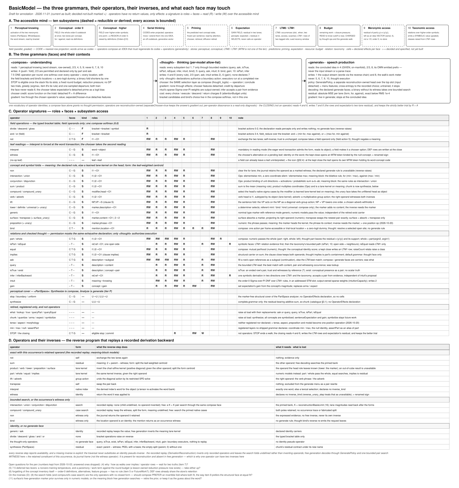

# Accessible-mind effects

The three grammars share numerical operators and a conceptual dictionary.
`<thought>` effects use the existing controller, chronological thought history,
conceptual activation carrier and LTM stores. There is no added language
model, interpreter, policy or semantic store. Expectation's image of the
completed sentence is formed at the closing;
[ExpectationRetention](ExpectationRetention.md) gives its gradient and credit
contracts.

Operators have no return values. An operator of any of the three grammars acts
only by reading and writing the accessible mind, the ten subsystems below, so
its signature is three things: its grammatical roles (`I1 ... In -> O1`), the
faces it has, and its read and write sets over those subsystems. There is no
other channel: no side table, hidden return object, model or reasoner handle;
`ThoughtResult` implements an effect and is not the interface. Every access is
bounded: a declared and charged number of frames, items or steps, never all of
a store.

## Fields, codes and ideas

Three forms are kept apart. A field $a \in \mathbb{R}^N$ is an activation per
concept over the whole codebook at once: graded, parallel and symbolic, the
activation level of every symbol, for and against. A code is the field's
nearest-row projection $\pi(a) = \arg\max_i a_i$, one discrete index produced
one at a time; $\pi$ is idempotent, and words arrive as codes. An idea is what
composition makes of codes: one vector in no codebook, tied to the codebook not
by nearest-row lookup but by generation, since it must unfold through the tied
inverse and the generate operators into a sequence of operations and codes,
each step ending in a projection. A code does not go stale as the codebook
learns; an idea stays meaningful only while the current operators can still
unfold it, which is why generativity is measured, not assumed.

## Permissions and effects

The sheet is generated by `python doc/diagrams/gen_diagrams.py grammar_operators.svg`
from the `GO_*` data block in that script; edit the data, not the SVG.

`Subsystem` enumerates the ten subsystems:

1. *Perceptual knowing*: the activation of PartSpace and WholeSpace and the
   word stream they present, read by bracket and located by `.where` and
   `.when`.
2. *Order-zero knowing*: a field over the whole order-zero codebook at once,
   two lanes (for and against) per concept, read through the definitions.
3. *Higher-order knowing*: a field over the higher-order symbols, each one
   point at its own order and a possibly discontinuous region of order zero,
   raised by definitions.
4. *Serial thinking*: the codes that enter already projected and the one
   off-codebook idea that operators make of them, held in STM's chunks.
5. *Priming*: the predicted next concept state, frozen per sentence and read
   by attention, the chooser and retrieval.
6. *Expectation*: a gain field with its residual in two lanes; at the percept
   level the forward path carries the expected value plus the residual. It
   selects and never calls an operator.
7. *LTM*: LTM0's occurrences and LTM1's relations of two tagged references,
   reached by cue in a bounded window.
8. *Budget*: the remaining work and the closure pressure, read to know that
   cutoff is near and charged by thought operations and the generate walk;
   never a semantic feature.
9. *Meronymic access*: the residual of
   $\mathrm{part}(x, y) = x \odot (y / \lVert y \rVert)$, left as a graded idea
   vector in serial thinking rather than a 1/0, computed at order zero with no
   store.
10. *Taxonomic access*: relations over higher-order symbols that emit a graded
    symbolic value, with classes raised from LTM1 rows.

Perceptual knowing, conceptual knowing (one indexed table at two orders) and
LTM are stores; priming and expectation are predictions; budget is a resource
and the taxonomy a relation; serial thinking and meronymic access are views of
and computations over the stores. MTM is not one of the ten.

`AccessibleMind.PERMISSIONS` enforces which owner may read and write what:

| Owner | Reads | Writes |
|---|---|---|
| compose | perceptual, order-zero and higher-order knowing, serial thinking, priming, meronymic access | order-zero and higher-order knowing, serial thinking |
| thought | every subsystem except perceptual knowing | order-zero and higher-order knowing, serial thinking, expectation, budget, LTM |
| generate | order-zero and higher-order knowing, serial thinking, budget | perceptual knowing (the output stream), budget |
| chooser | order-zero and higher-order knowing, serial thinking, expectation, LTM, budget | nothing |
| closing | serial thinking, expectation | LTM, expectation |

Compose has no access to expectation, and nothing writes perceptual or
order-zero knowing on expectation's behalf. An operator declares one
`OperatorEffects` shared by all its faces; a face can only remove capabilities,
never grant them. Within one operation round each subsystem may be written once
(`EffectRound`). `OperatorFootprint` names the coordinate families an operator
reads and writes (form, meaning, poles), and each must be carried by a declared
subsystem. A descriptor's read/write sets must fit its grammar's permissions,
and its write target must be in its write set. Structural contexts carry a
geometry-only conceptual capability. An injected LTM, taxonomy, expectation or
controller capability is rejected. Compose's current stream and priming
snapshot remain live owned copies; generate sees its own emitted prefix and no
priming. Thought operands, reads and writes detach.
[Permissions](../bin/AccessibleMind.py), [checked dispatch](../bin/Queries.py).

| Operator | Effect |
|---|---|
| `part`, `equal`, `implies`, `exist` | Conceptual content and an independent evidence pair over codes. |
| `isPart`, `isEqual`, `isTrue` | Symbolic evidence and witnessing rows read by reference from LTM or the taxonomy. |
| `infer` | Derives a held rule's consequent from a held premise (identity, membership, equality or instantiation), the pair the minimum along the path and the maximum across alternatives, or opens the antecedent as a subgoal at `(0, 0)`; operands and results are STM chunks addressed by their `.when` stamp (2026-10-29). `inferBackward` is its converse spelling (permutation `(I2, I1)`), the face that opens the antecedent as a subgoal. |
| `bind` | Fills a selected reference site with its pair, evidence kind `reference`; the only binder, once per site, in compose at a mention and in thought at an open site. |
| `intuit` | At thought time, fires recalled rules over the order-zero knowing with output-owned Pi and Sigma weights, holds the result and its rule plans in the episode's focus chunk, offers each fired rule to `infer` and deposits knowing (`write_knowing`); its pair stays provisional until `infer` selects a firing. |
| `query` | The best matching cued row, retained as a serial result with its pair and occurrence. |
| `ask` | Attempt to fill an open reference; a nested attempt shares the same history and meter. |
| `not` | Exchanges a pair's poles, retaining its meaning; the closing records a large omission in its expectation image as `not X` (`ThoughtClosing.absence`). |
| `gain` | Sets expectation gain for the next sentence; the predictor remains global. |

The retired `what`, `lookup`, `chunk`, `quantize`, `arma`, `expect` and `true`
names raise with their replacements. The thought writer publishes `inference`
rows, `unverified` rows for a `(0, 0)` pair and `question` rows for open slots,
with occurrence addresses and witness references; unresolved questions belong
to closing. There is no generic writable-store capability on an executor.

Open referent columns are addressed by the source row and role and participate
in the same bounded bind menu as filled columns. `bind` enumerates individuals
only from the bounded situation (the stream's recent addresses) and the frames
already held in the episode, and never scans LTM to choose a referent; its
choice is its own learned score over each candidate's content, form, roles,
recency and MTM continuity, against a zero-logit option that leaves the
reference open. Copula substitution fills that variable at its existing
occurrence. A mint records its bind/mint/open choice and chooser probability as
provenance. Episode-local gain, priming and predictor effects are restored when
the episode ends. Its lasting effects are the filled or still-open reference,
new LTM rows with provenance, and the credit trail.

`ThoughtResult` remains the immutable internal effect record and checkpoint
representation. Its serialization kinds describe payload shape; the descriptor's
subsystem write target determines ownership. The answer adapter reads those
owned records without another query. Serial effects live on `ThoughtRecord`
and in the episode's STM chunks (`ThoughtChunks.stage`): retrieved frames and
bound references are held as chunks, `intuit` deposits into order-zero knowing
(`write_knowing`), and `gain` sets expectation's gain (`apply_thought_effect`).
Each frame or reference committed to STM is metered (`effect_node`).

## What can enter the chooser

The chooser attends live STM slots, its ordinary thought history, the row's
bounded discourse chain and frames retained by `query`. It reads no slice of
the most recently written LTM rows: merely writing a fact does not expose it to
the chooser. Each retrieved frame owns detached values, so later store mutation
or compaction cannot alter the held content. Its occurrence address remains
provenance. Frame evidence survives thought-result checkpoints and holds its
referenced LTM occurrences alive while the owning history is retained.

Priming reaches thought through `intuit`, whose rules are taken from the
predicted field, and through `bind`'s score; the cued read itself does not use
it, and priming magnitudes never become chooser features. Open references gate
conclusion. One `attentionBudget` covers every nested attempt; the grammar
scorer receives the expectation image as context. A departure is judged by its
whole path's reconstruction and supplied-answer cost; the walk's metered work
bounds it but is not a cost. The activation predictor's inputs (the observed
symbolic field, STM and age) are always detached, and it learns only from its
own error against the detached next state.

## Cued LTM reads

LTM0 keeps one idea vector per row (`slots[capacity, width]`) beside its two
evidence lanes, and LTM1 keeps relations of two tagged references. A cued read
(`EntryRead.cued_rows`) scores one bounded window of at most `ltmWindow`
candidates: the explicitly referenced and already retrieved occurrences first,
then the LTM0 rows that LTM1 relations tie to the cue's concepts, then the
remaining rows newest first and the relations by their stamps. Episode anchors
never enter the window. Estimates, covers and questions without evidence are
unavailable, and a row must occupy every role the cue occupies. One batched
product per role ranks the window by masked role similarity, with the `.when`
band excluded and address order breaking ties; scope and bindings filter
candidates, and only the returned records are charged. The read uses no
lexical membership index, and nothing is unfolded at read time.

`query` retains at most the best row. `isTrue` retains the ended pair and trust
separately; `exist` is the conceptual presence face and reads no row. A recall
by time alone (`EntryRead.recall_time`) reads the nearest sentence stamps in a
bounded clock window, every read metered. Row-to-concept identity remains the
allocator's index, independent of semantic vectors. Store compaction preserves
occurrence IDs, and reset clears the rows. [Reader](../bin/EntryRead.py),
[store](../bin/Memory.py).

## Measured limits

Generativity is measured through the shared bounded forward-kernel inverse.
Words are terminals; learned A/B columns and higher-order properties are
structural candidates on either side. Recomposition and the generate policy
decide orientation. Sentence trials also use a bounded, detached snapshot of
live composed values; stored reads cannot use that snapshot. Order and
filled-reference context can license a determiner while the ordinary grammar
ranks marker words. Those declared identity modes are to be retired
(2026-10-10): `bind` is the only binder, and determiners are its cue inputs,
not declared modes.

Numerical inversion alone cannot distinguish a projection's output from its
head. Reconstruction therefore audits missing/excess support after decoding,
marks the read incomplete and charges the actual keep cost. Support counts do
not select decoder actions. Unspelled wholes remain candidates, while STOP
requires a word; self-reproducing pairs are removed before candidate ranking.
The measured recovery rates are recorded in
[DevelopmentHistory](DevelopmentHistory.md).
