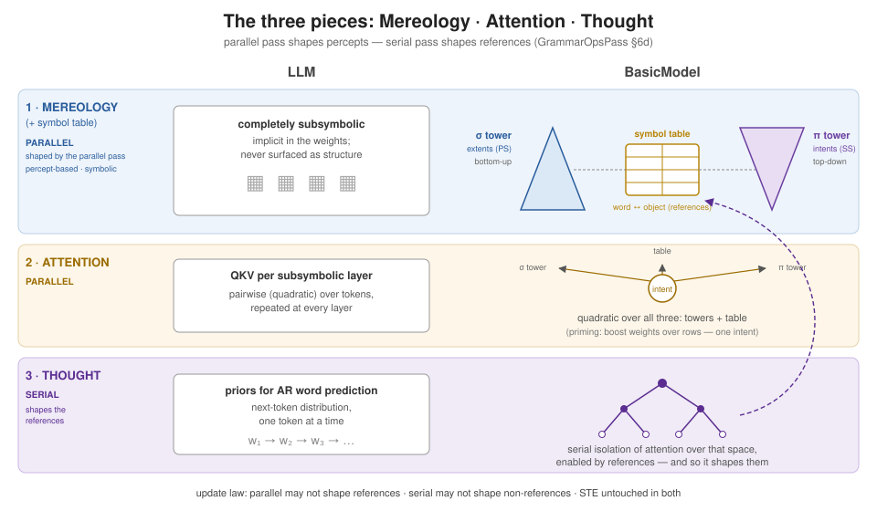
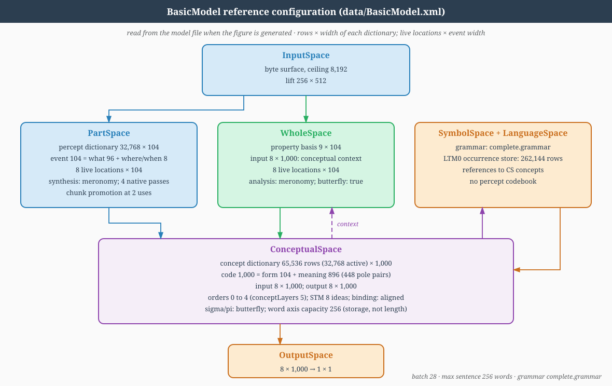

# Architecture

> **Amendment of 2026-10-20 (read first).** Decisions of 2026-10-19/20 supersede statements below where they conflict; the text is kept as the record. Record: [two truths §1, "The row, field by field"](specs/2026-09-16-two-truths-ideas-and-relations.md#1-definitions-decided); [bind plan §6–§6.3](plans/2026-10-19-bind-thought-operation.md); [occurrence spec §13–§14](specs/2026-09-30-occurrence-tense-aspect.md); [expectation spec rev 5](specs/2026-10-08-expectation-at-every-level.md).
> - Naming (2026-10-21, Alec): LTM0 is the occurrence store (old LTM1); LTM1 is its relation stratum (old LTM2); LTM2 denotes relations over relations. The old LTM3 name is retired. Earlier names below belong to the retained record.
> - Rows: an LTM1 row is **one** concept slot; an LTM3 row is **three symbol references** (argument, kind, argument) of kind definition, attribution or conditional. The three-slot relation row with a REL code in the middle, null outer vectors, `refs`, `rel_type`, `role_mask`, `order`, `polarity`, `grammatical_mode`, `row_ids`, the address columns and the semantic sidecar are superseded: a row holds its slots, `.when` (model time, a column composition never reads), `truth_plus`/`truth_minus` (the lanes, renamed from `c_plus`/`c_minus`), the access count (renamed from `witness_count`) and `surprise`, and nothing else. **Amended (decided 2026-10-23, [step 2 §71](plans/2026-10-21-step2-one-ltm.md); recorded 2026-10-30):** an LTM1 row is two tagged references with its kind read from the referents, not three. As built at `3718d9d0dc`, `LTM0` still carries `c_plus`/`c_minus`, `source_trust`, `order`, `row_ids`, `origin`, `record_kind`, `polarity` and `witness_count` columns; only `refs`, `grammatical_mode` and the index columns are retired (audit 2026-10-30; decided 2026-11-01, Alec: the unused columns are removed and the row brought to this layout, [thinking spec §32.2](plans/2026-10-27-item2-5-thinking.md) item 17).
> - Parthood, subsumption and kind statements ("cats are animals") are **folds** in the meronomy and the taxonomy over symbols, not rows; equality is membership in a singleton; no `REL_PARTOF` row exists.
> - Identity lives only in the major structures: a **minted** concept row at the shared index (its content the fold of its occurrences, rebuildable) or a **short-term** concept (the NP's fold point with its `.where`/`.when` band, for the situation). The nouns dictionary, the resolver's count tables and the ICA event chart are off the identity path; minting is by recurrence in LTM1; **`bind`** is the only binder (a thought operation, once per site), determiners are cue inputs, and its content term is the meet, not distance.
> - `.where` is inside the concept's reserved band (no column); **symbols have `.where` and `.when`**, concepts keep the extent and never the clock; `.when` is model time, sinusoidally encoded, never read by composition but read by recall (Alec, 2026-10-23: a query with only its `.when` filled returns the entries at that time; item 3, [layout spec](plans/2026-10-23-layout-and-removal.md)); the document and the stream are **context wholes** in WholeSpace, so "sentence *k* of document *d*", source address hashes, timestamps and situation wholes are superseded.
> - STM is the open sentence's three concept-width working slots plus an **index** of the most recent rows (about eight addresses) and the symbol activation field; the intersection `bind` needs is computed on read, never stored. **MTM** (`ConceptualSpace.mtm`, default capacity 64) retains token membership as introduction/use addresses, kind, access count and last model time, independently of LTM. *Amended 2026-10-22 (Alec): MTM stores working content: each identity's current value, the state after its latest verb, with names mapped to identities ([step-2 spec §35](plans/2026-10-21-step2-one-ltm.md#35-decided-alec-2026-10-22-mtm-stores-working-content)).* In focus means the STM frames; familiar means the pool; known means a minted concept. Kept closes alone add bindings; revision computes working groups on read. Each noun site adds an object to the pool without a price. Before the sentence closes, its trial-local own-object record keeps the site’s content for later mentions; only the kept close writes it to MTM. A reference site is a participant in the kept derivation at stamped order one: the reading supplies a leaf’s order and a determiner supplies its result order. Site, marker and reference-mode decisions read grammatical positions and occupations, never lexical definitions. Noun candidates follow those participant positions and declared heads; surface markers and predicate heads, including their lexical copies, are excluded. Bind chooses an accessible antecedent only if it beats a zero-logit dummy; an unlinked named site keeps an anonymous token, and an arrival may refine it while its occurrence still owns that token. Joined sites are left intact; observed incompatibility excludes an antecedent for a new mention, and no incompatibility is recognized at initialization. A merge adopts the joined kind only when the antecedent has none. Bind choices receive the sentence or thought episode's R + A credit through the ordinary departure rule. Closing reconstruction adds `reconstruction.reference`: the bound mention’s uncovered description share, with independent weight 0.1, read from the preview’s selected record; first mentions, own objects, mints, gaps, arrivals and thought episodes add zero. Eviction loses the link and leaves the rows intact. Candidates still come from the frames; content access beyond that window and recurrence promotion are later steps ([bind plan §10.3](plans/2026-10-19-bind-thought-operation.md#103-decided-alec-2026-10-21-mtm-a-medium-term-identity-pool-on-conceptualspace)).
> - **Identity threading (2026-10-23, reviewed source `65ab7fbe9`):** `bind.forward` is a compose-grammar operation, with one action per frame-accessible or trial-local location plus the zero-logit dummy in the ordinary chooser. Determiners keep their folds without reference variants. MTM retains each identity’s current value, mention readings and verb/role event histories; VP results replace the value and description mentions join it. Each trial owns a numerical overlay, so a later clause reads an earlier VP’s result through identity before the sentence closes. Only the kept close publishes detached values. Pathwise derivatives reach the live value and VP; the discrete choice keeps ordinary R + A credit. Role evidence lasts with the token. Reference reconstruction uses the record captured at the bind. A word cannot be another word’s definition object. This amends the earlier thought-only bind and membership-only pool descriptions above. The LTM0 idea/LTM1 binary-chain layout and eight shared STM chunks are specified for a later round, not implemented here. [Identity specification and source receipt](plans/2026-10-23-identity-threading.md).
> - **2c consolidation (2026-10-23, frozen `fcaff2d19`, awaiting review):** a reading recurring across three source documents becomes a concept; a token recurring across three source sentences gains a concept containing the union fold of its mention occurrences, preserving its current state and introducing address. MTM expires after sixteen intervening kept closes without reference in its stream; it persists across documents within an epoch and is cleared at the epoch boundary (`end_document` ends only the cover; corrected 2026-10-30). Today's embedded addresses keep their format; consolidation checkpoints the originating source sentence beside its reading cache. Definitions remain derived from retained Part edges. These changes precede item 3's layout and STM work. [2c receipt](benchmarks/2026-10-23-item3-5-step2c/README.md).
> - **Modal implementation (2026-10-24, awaiting combined review):** a token owns an actual timeline and alternative timelines, each with events and current value. A chosen `adverb` withholds NP+VP lowering; its idea stays above order 0 and extends the latest alternative while leaving the actual state intact. Only actual order-0 occurrences enter promotion. A bound composition reads the identity's current value and its written idea retains the identity reference. Equal-time actual/alternative events supply `modal_teacher`; bounded reads distinguish actual events from abstractions and fold some/every timelines. The numerical overlay only mirrors Token while a sentence is open. Prepending MTM symbols for compositions at every order remains item 3's STM integration. [Iteration specification](plans/2026-10-23-verb-and-modal.md).
> - Expectation is a **gain field** `c = m⊙a⊙o` with the residual in two lanes, never a subtraction or a sign-reversed image; per level with a local error (no inversion across levels — the invertible path is item 3's); one activation predictor over the symbol bank (the slot-structured `SentenceExpectation`, `BracketExpectation`, the byte level and the ARMA heads are retired); keep and credit both read `R + A`; defaults gains 0, prime on, `φ = .5`.
> - Amended 2026-10-29/30 (Alec; [thinking spec §§16, 22](plans/2026-10-27-item2-5-thinking.md), [2.7 record §42](plans/2026-10-27-item2-7-corpus.md)): at the percept level the residual is signed and the forward path carries `expected + residual`, so "never a subtraction" is superseded there (built in item 2.7's final round); at the concept level the expectation is `ActivationPredictor`'s predicted next state, which at item 2.5 round B is also the spread that primes attention, the chooser and retrieval; `intuit` is a separate top-down layer with its own weights, trained only by output; one backward with each band stopped at its output is the decided direction. The round B and one-backward parts are not built.
> - Item 4 is closed as a mechanism (learning gates at item 0); item 3.5 carries the mechanism residue of items 6 and 5.5, including `bind`, LTM1/LTM3 and the row audit; item 3 carries the invertible-path program.
> - **Operations on meaning, centroids on form** (Alec, 2026-10-23; item 3, [layout spec](plans/2026-10-23-layout-and-removal.md)): every grammar and logical operation acts on the meaning block in conceptual space, logical ones by exact rules and grammatical ones by learned kernels; a reduce's percept part is the centroid of its constituents' forms; zeroth-order concepts start random and are placed by the priming surface. Today's kernels on the form block and the headed operations' meaning passthrough are the state this replaces. *Moved to item 3.5's first remaining iteration the same day (Alec: "The whole swap now"; [spec](plans/2026-10-23-verb-and-modal.md) §2).* *Verified 2026-10-24: centroids are for concepts and are stored on the concept's symbol row in the shared index; percepts keep the towers' interval mereology (lower bound over parts, upper bound over wholes); concepts are arranged by context, today the occurrence-context mean, in item 3 the priming surface ([context-wholes spec §2b](plans/2026-10-24-context-wholes.md)).*
> - **Orders are learned, not written into the grammar** (Alec, 2026-10-21; [Orders §10](Orders.md#10-orders-are-learned-definitions-raise-three-compositions-lower-alec-2026-10-21-decided-built-in-item-3); built in item 3). Parts of speech stay order-free. Definitions raise: several "is" rows sharing a side with distinct other sides make an equivalence class one order up, which creates individuals from events ("this is Felix, that is Felix") and kinds from individuals. The determiner, NP + VP and VP + MP each lower one order, returning to S0. Definitions are kept as LTM1 rows and as folds; the rows train the fold in the symbolic order loop, and their match or mismatch is judged in the two truth lanes. Until item 3, a determiner outputs order 1 and unit tests force a name's order. *Amended 2026-10-23 (Alec): only NP + VP lowers; the modal withholds the lowering ([iteration spec §4](plans/2026-10-23-verb-and-modal.md)).*
> - **Pointing words: witness() and the null-concept (Alec, 2026-10-31; decided; built in item 2.5's completion round, [thinking spec §32](plans/2026-10-27-item2-5-thinking.md) and §32.1).** Pronouns and indexicals are one class, not noun; nothing marks a word deictic and nothing is forced. A pointing word handled by `interpret` is minted at its first kept definition, raised at `raiseCount` distinct relata, and its identity across time empties as the things it was share nothing ([Orders §11](Orders.md)). `witness` is `interpret`'s sibling at the leaf, a unary rule declared beside it in the grammar and chosen by the compose chooser with ordinary credit; the three readings of a percept are interpret, witness and neither, and in reading mode `interpret` stays mandatory at the word transaction. `witness` opens the mention's own MTM token, the perceptual identity: a point on a worldline with its `.where`, `.when` and address and the witnessed percept's content, zero until the model has a field, with the null-concept as its kind, one reserved concept with form and both lanes zero and its certainty frozen, exempt from the definition index, the fold, the cover, membership and the raise, the taxonomy, the order projection, priming and forgetting, which no thought operation reads. The token can be bound again, carry events, and be named or kinded by a definition, which never defines the pointing word; the row is written at the occurrence, one order below the other side; the token expires as any token does, a finger pointing at the moon. With a field the token's value is the witnessed percept ([FutureWork](FutureWork.md), "Indexicals under multimodal input"); the reading in Buddhist terms is [Philosophy](Philosophy.md), "Witnessing Suchness".
> - **The three readings: interpretation optional and initially forced, its reading a sign or a symbol; `witness` renamed `sign` (Alec, 2026-11-01; [thinking spec §32.3 and §32.4](plans/2026-10-27-item2-5-thinking.md), item 22).** Alec: "let's force a three way decision of an object (no op, sign(), or interpret() are the icon, sign, and symbol), so that the confusing term witness is replaced with pierces SIGN"; refined the same day: "the better way to implement this is for interpret() to be optional, and if it happens, then the interpretation may be a sign or a symbol. Again, interpretation can be initially forced since words are so often meaningful beyond themselves." Two decisions at every leaf, one above the other, both the compose chooser's with ordinary credit and anchored to no word. The first is whether to interpret: a leaf left uninterpreted is the **no-op**, Peirce's icon, the percept standing for itself with the word-concept code it arrives as for its value. The second, taken only when the first interprets, is the interpretation's kind: **`sign`**, Peirce's index, the operation declared as `witness` in the bullet above under its new name, whose token is the pointed-at occurrence with zero content in a text; or the **symbol**, the word's conventional object, the interpreted leaf left standing as that object, with no operation of its own. The first decision is initially forced: the reading-mode forcing of the bullet above stands as built, `interpret` mandatory at the word transaction, so every word is interpreted and the chooser decides `sign` or the symbol, exactly one at every leaf, with `sign` available at every interpreted leaf; the eager word transaction is the admission of the form and the lookup of an existing object, mints nothing, and is not the decision. The no-op is built behind the forcing: when the forcing is lifted, with a field or inside a certificate, a no-op leaf opens its own occurrence's token at the kept close with that code as content and the null-concept as kind, which a later mention binds and a definition names or kinds, and it reverses to the form, so a mention generates as itself. The null-concept, the token mechanics and certificates (i) to (iv) stand under the new name; certificate (v) is "The dog went woof. That was a bark." with the forcing lifted ([Orders §11](Orders.md), "The three readings forced"; [Language](Language.md), the amendment under `interpret`; [Philosophy](Philosophy.md), "Witnessing Suchness", closing paragraph).
> - **Audit resolutions and the freeze rule (Alec, 2026-11-01; [thinking spec §32.2](plans/2026-10-27-item2-5-thinking.md)).** D-iii is withdrawn: the one-backward path and round B's work are accepted as implemented, the three lesson-13 arms are measurements, the configured defaults stay `separateChooser=true` and `reconstructionJitter=0` until Alec changes them, and a test that fails on an unresolved deviation is a strict xfail naming it, so the stage 2 freeze locks down what works. Expectation calls no grammar operator: it selects active percepts on both paths and active concepts on the parallel pass only; `expectation.reference_mentions` goes, bind's credit returns to the ordinary departure rule and the supplied answer's loss to output. `LTM0` is reduced to the amended row of the "Rows" bullet above. Deducibility is deleted from retention ([Reasoning](Reasoning.md), "Retention utility"); "the water" is corrected ([Orders §7](Orders.md)); `whereRungRatio` and `ltmConsolidation` stay live. Proposed by Claude and standing unless Alec overrules: `reconstruction.free_percept` stays trained, and `<architecture><relevance>` is retired with the priority read recorded as built, parallel path only.


For the current loss paths, stop-gradient boundaries, parameter ownership and
joint learning rule across representation, prediction, thinking and output, see
[Gradient flow across the architecture](GradientFlow.md).

> This document describes the cognitive and mathematical architecture. For the
> live software ownership map—including configuration, training, STM, losses,
> checkpoints, reconstruction, and proposed consolidation boundaries—see
> [Runtime Architecture and Componentization](Componentization.md).

## The three pieces: Mereology, Attention, Thought (2026-06-11)



> **Terminology (2026-06-21 convention).** One noun per-space: a **percept** is
> a perceptual thing (PartSpace/WholeSpace, dimensionally-embedded, extensional;
> *part* and *whole* are its two subtypes); a **concept** is a ConceptualSpace
> relation tying one part-percept to one whole-percept (the Concept codebook);
> a **symbol** is a SymbolSpace 0-D reference to a concept. The CS "symbol
> table" is therefore the **Concept codebook** below.

The architecture has three pieces, expressed through one attention mechanism
(see [One attention](#one-attention-68-1) for the current execution contract):

1. **The mereological towers (and the Concept codebook).** In an LLM the
   mereology is completely subsymbolic — implicit in the weights,
   never surfaced. In BasicModel it is percept-based and symbolic: two
   towers — the $\sigma$ tower ascending bottom-up (part-percept extents, the PS
   codebook) and the $\pi$ tower descending top-down (whole-percept intents, the
   WS property codebook) — bound by location into the ConceptualSpace
   dictionary, whose rows are concepts (part$\leftrightarrow$whole relations).
   SymbolSpace references those concept ids downstream.
2. **Attention.** In an LLM, attention is QKV per subsymbolic layer.
   In BasicModel: **bases of relevance guide attention; attention
   determines the contents of awareness.** Relevance is carried as
   weights on the percepts; ATTENTION is the single selection process
   (at CS) that reads the integrated priority out; AWARENESS is what the
   selection admits. (The priority-map synthesis — Fecteau & Munoz 2006;
   Bisley & Goldberg 2010 — with attention as the readout, never the
   sources; attention distinct from awareness per Koch & Tsuchiya 2007.)
   Relevance factors as **ORIGIN $\times$ AXIS**, realized as **ONE
   QUADRATIC PRIMING SURFACE per space with two write channels** (the
   simplified law): **bottom-up things are primed in virtue of BEING
   SEEN** (perception itself writes the surface: fired rows bump, the
   surface decays toward neutral) and **top-down things are primed in
   virtue of being DESIRED or HATED** (signed intent: desire boosts,
   hate suppresses with floor 0 — suppression, never a veto). "Top-down"
   is therefore a DIRECTION of writes on the one surface, not a second
   mechanism — matching biased competition (Desimone & Duncan: the
   template IS conceptual content) while keeping the two channels'
   automatic/strategic dissociation distinct (§C). The bracket chooser reads the same priming surface; its selected
   word bracket supplies the reading scope. Two AXES, orthogonal to origin ("Parse
   time" §C): HORIZONTAL (which parts within the level) and VERTICAL
   (which properties — fixing Rosch's Basic Level and, through it, which
   objects exist at all).
3. **Thought.** In an LLM, thought is the computation of priors for
   autoregressive word prediction. In BasicModel, thought is a
   **subsequent isolation of attention over that space, enabled by
   references** — the serial pass: referential lookup, shift/reduce
   composition, story selection. Because thought is the only process
   that invokes the referential taxonomy *qua references*, it is the
   only process licensed to **shape the references**.

This yields the codebook update law (GrammarOpsPass §6d,
implemented): **percepts are shaped by the parallel pass; references
are shaped by the serial pass.** STE is untouched in both modes; the
partition governs row updates — parallel mode may not shape
references, serial mode may not shape non-references
(`Spaces.reference_update_mask`; the `update_mask_fn` chokepoint on
`VectorQuantize`). Rational by construction — though possibly an
overly optimistic arrangement with respect to human thinking.

See [SymbolFirewall.md](SymbolFirewall.md) for the governing principle this
update law (and the codebook/meronomy ownership model generally) instances: all
computation is composed over typed, symbol-attached units — read/write masks,
no anonymous global residual stream.

## Words are a formula for narrowing attention (2026-09-28)

The second and third pieces meet in language (Alec, 2026-09-28): **words
are a formula for narrowing attention.** Attention selects what enters
awareness; a sentence is a sequence of instructions for making that
selection. What the words narrow is the **domain of discourse** — Boole's
universe of discourse, a register that the situation seeds and that is all
of conceptual space when there is no context — and each word is a
**projection operator** onto a lower-dimensional or smaller subspace of it.

- **One kind of operator.** Nouns, adjectives, verbs and adverbs all
  restrict the domain; they differ in which dimensions they constrain, not
  in kind. A noun is an operator read against the whole domain. Part of
  speech is a role in a derivation, not a property of a codebook row.
- **Three indices.** Language individuates along which thing (determiner),
  which stretch of time (tense and aspect) and which alternative (modal).
  These are indices of the symbolic projection and of the LTM row; a concept
  stays one code; the §13.4 serial reading below derives its perceptual and context components.
- **Regions are derived, never stored.** Membership is invariance under the
  operator and subsumption is absorption, so `part`, `whole` and `equal` are
  tests on the same algebra.
- **Two attentions, one chooser.** *Perceptual attention* is the bracket of
  item 6.8. Its objects are the percepts of the input and, since symbols are
  percepts, the symbols of thought; it excludes, and what it excludes is not
  taken up. Perception and higher-order thought share its one budget
  (`attentionBudget`), which is spent before grammatical analysis, so the
  words do not draw on it. *Conceptual narrowing* is what the words do, and
  it is different in kind: it keeps the domain it elects from as the Ground
  against which its Figure has meaning. There is a budget for percepts and
  none for conceptual space, though thoughts do shape it. Bracket candidates, restrictors and
  the identity binding of item 6.5 are candidates in the one softmax of
  item 7.5. Neither is obliged to narrow: the open read excludes nothing of
  the input, and the symbol `everything` excludes nothing of the domain.

The statement, its consequences, what the code does today and the
literature are in
[the accessible-mind specification §2.0.1](specs/2026-09-20-accessible-mind-subsystems.md#201-words-are-a-formula-for-narrowing-attention);
the language mechanics are in
[Language](Language.md#words-narrow-the-domain-of-discourse-2026-09-28), and
the reading of it in
[Philosophy](Philosophy.md#words-as-a-formula-for-narrowing-attention-2026-09-28).
Decided in direction; nothing in this section is implemented as such or
measured.

## Relation to LLMs, Formal Concept Analysis, and DisCoCat

> The sense in which compose, predict, invert, emit is *equivalent* to a
> token-level language model, with a proof and the four conditions under
> which it stops holding, is stated once in
> [LLMEquivalence](LLMEquivalence.md).

BasicModel is best read as an explicit decomposition of functions that a
transformer LLM usually folds into attention heads, feed-forward blocks, and an
unrestricted residual stream. The LLM comparison in this document is therefore
architectural, not merely benchmark-oriented:

- **LLMs:** a conventional LLM learns fluent priors over token sequences with
  latent attention and hidden residual state. BasicModel keeps the language-model
  goal of prediction and generation, but separates perception, concept
  formation, attention, grammar, truth, and reconstruction into named stores and
  typed operations. The wager is that some behavior now implicit in LLM weights
  should become inspectable state.
- **Formal Concept Analysis:** the PartSpace/WholeSpace towers and Concept
  codebook form a neural, fuzzy analogue of a formal context. Part-percepts play
  the role of objects or extents, whole-percepts play the role of attributes or
  intents, and concepts are the order-bearing links between them. The resulting
  meronymic structure is not a classical binary FCA lattice, because support and
  trust are graded and trainable, but it uses the same extent/intension
  discipline as its organizing constraint.
- **DisCoCat:** the grammar path is a DisCoCat-like composition engine: typed
  grammatical reductions decide how word/object meanings compose into sentence
  meanings in vector space. BasicModel differs from standard categorical
  compositional distributional semantics by making the reductions bidirectional,
  tying them to part/whole codebooks, and feeding their results into truth,
  reconstruction, and memory.

In short: LLMs are the operational baseline, Formal Concept Analysis supplies
the lattice and extension/intension reading of concepts, and DisCoCat supplies the
grammar-to-vector-composition reading of sentence meaning.

### Addressable attention — the typed `.where`

The answer-owned `PrimedSymbolReader` (`bin/Attention.py`)
ranges over a **typed addressable space**: one choice competes across every
store at once and emits a typed `.where` = `(space-id, bracket)` plus a soft-read
$\sum_k \alpha_k \cdot \mathrm{key}_k$. Six stores (the `SPACE_*` ids):

| id | store |
|---|---|
| `INPUT` | the staged input window (per-span percept content) |
| `STM` | the live short-term-memory rows |
| `LTM` | the shared clause store (rows, references and paired evidence) |
| `PART` | the PartSpace codebook (part-percepts) |
| `WHOLE` | the WholeSpace property codebook (whole-percepts only) |
| `SYMBOL` | the downstream SymbolSpace reference namespace (1:1 with concepts) |

`PART`/`WHOLE` appear whenever their tower has a codebook; `SYMBOL` only under
`<symbolTower>`. Pointing `.where` at a codebook/LTM store is recall; at the input
window it is reading — one mechanism, the type tag distinguishes them. The
selected read enters the answer through a gate initialized at zero, so output
loss trains retrieval. The former global-attention flags and modules are retired.

The symbol namespace is a **reference**, not a learned copy: it tracks concept
ids so the two cannot diverge or dissociate. A symbol's IDENTITY is that integer
concept reference and allocates no independent learned or EMA row; its VALUE,
the signed 0-D activation from the symbolic phase, is grad-bearing. (Two-phase
update, 2026-07-02: the activations' gradient path is
the conceptual SBOW over the settled slab parked at the post-pump cutover --
the once-built SS leg itself is a state-contract sync whose product no loss
consumes; pre-P3 the in-loop leg carried the gradient.)

These six stores are the substrate for the four foundations of mindfulness; the
mapping (and the trust-sign-as-vedana / luminosity-as-joy reading of `LTM`) is in
[Philosophy.md](Philosophy.md#the-four-foundations-of-mindfulness).

*A superseded passage beginning "**Status (2026-05-29 update):** further architectural pivo" moved to [DevelopmentHistory](DevelopmentHistory.md) (2026-10-30).*

*A superseded passage beginning "**Historical status (2026-05-27; ownership superseded 2026" moved to [DevelopmentHistory](DevelopmentHistory.md) (2026-10-30).*

## Symbolic weights, reconstruction, parse-time, attention (2026-06-30)

A design pass clarifying four coupled pieces (PS = PartSpace, WS = WholeSpace,
CS = ConceptualSpace, SS = SymbolSpace).

### A. Symbolic weights (the two-phase forward; reworked 2026-07-02, forward composition superseded 2026-07-10)

**Implemented 2026-07-02**, superseding the forward-transform parts of the
prior sparse-layer conceptual-embedding design, as a dedicated
**`SparseLayer`** (`bin/Layers.py`), NOT a SigmaLayer option: SigmaLayer's
atanh-entry contract expects logit-domain codes in $[-1, 1]$, while these
maps consume *presences/activations* -- a different input domain deserves its
own class. The substrate contract is the transpose autoencoder pair:
forward $= \tanh(W x)$, reverse $= \tanh(W^T y)$; export-safe scatter-add
kernel by default, `torch.sparse.mm` opt-in. Edges append host-side at mint
(`add_edge`, idempotent, tail-preserving value growth) and are removed by
pruning rounds (`remove_edges`; `ConceptualSpace.prune_concept_links` keeps
the closest links using within-tower relations only). The iterated-loop
rework (v3, landed 2026-07-03) kept this substrate and collapsed the
per-order families into ONE square untyped **`ConceptualAttentionLayer`**
subclass; its *forward composition* was in turn superseded by the
2026-07-10 dual-towers rev-2 feedforward sigma-pyramid (the 2026-07-10 note, now in DevelopmentHistory.md) -- the
`SparseLayer` substrate itself (edges, COO forward/reverse, `add_edge` /
`remove_edges`) is unchanged by either rework.

**The forward has one terminal cutover.** Input attention first reads the open
bracket and narrows it under `attentionBudget`. PartSpace combines located parts;
WholeSpace divides the field by primitive properties. Perception has no learned
sigma/pi fold layers. `bindingDepth` constructs the binding layers through which
the carrier passes; it does not repeat an independent attention loop. The
concept inventory and the per-word grammar retain their structural bounds.

**Pass-back scales, never gates (Alec, September 24).** Attribution of the
current conceptual demand yields a strength `a ∈ [0,1]` for each PartSpace
slot. Its content is scaled by `0.5 + 0.5*a`: attributed parts approach full
strength, while unattributed parts retain half their input strength on every
pass. The where/when band is unchanged. New content within the extent stays
visible and can form a concept even when existing concepts do not define it.

Phase B symbolizes the terminal field and runs the bounded higher-order
pyramid. It performs sigma over the preceding order's symbols; no pi edge
exists in this loop. Codes support similarity and tied reconstruction,
while the feature definitions supply evidence. The paired field reaches the
symbol leg and conceptual losses without replacing the native carriers.

**The `ConceptualAttentionLayer` is SYMBOLIC-ONLY and owns BOTH readings of concept
structure (dual-towers rev 2 -- landed 2026-07-12).** The
weighted reading uses disjunctive and conjunctive COO matrices, each
$[S \times 2(S+1)]$, over one bounded concept inventory (`ConceptualAttentionLayer`, bin/Layers.py) -- named for
what it IS, bottom-up attention over the concept inventory (see "Parse
time" sec C); `SparseLayer` is how it works (it subclasses the substrate
above). The per-order role-split families and their dyadic capacities are
RETIRED. Edges carry nonnegative exponents and address a positive or negative
symbol pole. Population from existing concept records
writes one edge per SYMBOLIC constituent (row = the relation, col = the
constituent); order-0 native references write the feature definition. A
trailing-bias-column edge (col $S$) supplies the bound for relations under
the EVERYTHING pole
(bias-bounded chain links, un-refined asserted concepts; a concrete whole
retires it). Self-edges raise (the Quine atom $x = \{x\}$); longer cycles
are deliberate -- a documented fact of un-ramsified taxonomies and of human
minds, which nothing in the current codebase observes or damps at runtime
(the diagnostic that used to watch them, `cs_groundedness_probe`, is
retired -- see DevelopmentHistory.md).

The feedforward concept pyramid (`cs_forward_content`) retains
`[concept, batch, extent, 2]`. The order-0 membership read composes field
requirements before encoding; subsequent rungs only union symbol evidence.
The taper ranks the stronger pole and admits the pair together. Extents
remain separate. The [current equations](#decided-in-direction-a-concept-is-sigma-over-pi-alec-2026-09-21)
define independent pole reductions and attribution descent.

`_order_caps()` sizes the per-rung taper. While the sparse concept
transform is active (`_sparse_active`), it is a tile-based taper
`[base, base>>1, .., 1]` (`conceptLayers` bounds the inventory's orders,
`base = min(outputShape[0], nVectors)`, shrunk until the taper fits the
inventory) -- inventory rows past `sum(caps)` stay inert (as built, audit 2026-10-30: the taper is a
placement preference; definitions and raised classes seat in the tail and
every reachable row is gathered into the attended field). Off that path,
the caps fall back to the pre-rev-2 `(n_snap, n_pool)` 50/50 split
(`n_snap = max(1, N // 2)`), a fossil of the superseded design below.

*A superseded passage beginning "**Historical note (forward composition superseded 2026-07-" moved to [DevelopmentHistory](DevelopmentHistory.md) (2026-10-30).*

Alongside this weighted reading, the store holds the DISCRETE relation
table: ordered role-tagged constituent records (`embed_pair` stores the
sec-4c ordered pair
$[\text{whole}, \text{part}]$, whole first: whole $\Rightarrow$ part / if
$\to$ then; `discretize_row` is exact on the binary-ordered subset). A thin
shared `ConceptAllocator` owns global concept ids, order derivation
(bookkeeping only under v3 -- nothing migrates by order), the
raise/retire/singleton sets, and the idempotency caches; ConceptualSpace
keeps orchestration only. Each bounded evidence activation IS a 0-D
symbol: the once-built SS leg retains the two poles at the row-aligned identity
(order-0 codes follow their feature definitions; the leg syncs the SS state contract, while the
activations' GRADIENT path is the conceptual SBOW over the settled slab
parked at the cutover). The native read places the attended percepts
in the order-0 field; the selected bracket supplies the region or mereological
scope. `attentionBudget` bounds perceptual operations. Perception has no learned
$\sigma$/$\pi$ fold layers. Distributed codes serve similarity, retrieval and the
tied reconstruction; they do not determine conceptual presence.

#### Relation-table entry contract

*A superseded passage beginning "The [two-truths clause closing](specs/2026-09-16-two-truths-" moved to [DevelopmentHistory](DevelopmentHistory.md) (2026-10-30).*


At the sparse-entry level, one entry binds one concept row index to one symbol
column index, plus its signed membership weight. A concept definition is
therefore not limited to one symbol: the same concept index may occur in
multiple entries, each paired with a different symbol index. Those repeated
entries collectively form the concept's sparse, set-like definition; different
concept indices define different concepts.

The same representation is sufficient for a vine, with an important
qualification: one entry alone does not encode a total order. Each vine link is
the ordered pair $[\text{whole}=\text{current},\text{part}=\text{rest}]$, where
`rest` references the next relation concept. The discrete role-tagged records
preserve the whole/part distinction exactly, while recursive nesting and wave
iteration make the sequence order operational. In short: repeated entries for
one concept define a set; recursively nested relation concepts define a vine.

*A superseded passage beginning "**Groundedness and cycles -- REMOVED (2026-07-10).** `cs_gro" moved to [DevelopmentHistory](DevelopmentHistory.md) (2026-10-30).*

The lattice poles are VECTORS of the presence domain: **NOTHING**
$= [0,0,\ldots]$ (bottom; a part contributing $W \cdot 0 = 0$ -- no edge)
and **EVERYTHING** $= [1,1,\ldots]$ (top; a whole realized as the trailing
bias column). Order-0 concepts reserve their distributed row and read
their signed feature definitions over native PS percepts and WS properties.
A fresh object's standing bounds supply no perceptual membership; its
definition awaits testimony. Feature addresses preserve the source rows
by reference, without duplicating their codes. Word/object associations now
use the DEF rows above. Completed sentences store their actual end state;
they keep no word chain or derivation. The older word/object META ordered
pair and sentence-type JOINT chain are retired by item 7. A
1:1 tie between SYM refs is the SINGLETON principle (Alec 2026-07-02): the
unit-set $\{x\}$ -- a whole containing exactly one symbolic part
(`singleton_concept`, min-support exempt) -- is the constructive primitive
behind if$\to$then ($\{x\} \Rightarrow x$) and the recursion vine, and it is
stored structure that `resolve_identities` never collapses (only ties
between concrete raw codes resolve away). Sequencing depth under strict
ramsification TRUNCATED the chain's weighted reading (same-order link
references were dropped at the order cap) -- the defect that motivated the
successor design (the iterated-symbolic-loop, landed 2026-07-03),
which FIXES it: iteration over the one untyped square `ConceptualAttentionLayer`
replaces stratification, so a link of any order simply arrives one rung
later (originally a wave hop, now a feedforward pyramid rung -- the
2026-07-10 historical note, now in DevelopmentHistory.md); see "Parse time" sec C.

### B. Reconstruction (parts $\to$ `.what`, wholes $\to$ `.where`)

InputSpace maps two views of the *same* data, segmented differently: a
**universal view** to WS (which it analyses) and an **atomic view** to PS (which
it synthesises). WS yields **low-fidelity** information covering the **whole**
space; PS yields **high-fidelity** information over a **smaller** area
(`_paint_reconstruction`: the universal view paints the background, the atomic
view is averaged in where it has support). For verbal reconstruction of text the
**parts (PS) should reconstruct the `.what`** and the **wholes (WS) should
reconstruct the `.where`** — approximately the inverse of what happens at parse
time. The separate `what_scale` / `where_scale` / `when_scale` reconstruction
channels already exist to carry this. Per-word reconstruction scores content
and position only: every word in an input carries the same field timestamp,
so repeating that timestamp as a target adds no word-specific information.
The temporal band still passes through grammar operations and their inverses;
a future field-time objective would score it once per field.

For text, it would be foolish to insist on an *absolute* `.where` from WS: the
parts already know each word's size, so under a perfect tiling the placement is
just the running sum of part sizes (serial mode computes this as an AR1 increment
over the previous `.where`; the for-loop is time). WS may still supply **type**
information for the tiling — *word*, *space*, *word*, *punct*, … — even where it
does not supply coordinates.

### Tiling, subspace sizes, and consciousness

Whether the parts/wholes **perfectly tile** the input (a partition — so order
alone reconstructs, with no gaps between parts) is **NOT** entailed by
parallel-vs-serial mode. It is entailed by the **relative sizes of the InputSpace
subspace and the PS/WS subspaces**:

- In **serial mode** they are *forced* to match — the for-loop traverses **all**
  of input space — so the tiling is always perfect.
- In **parallel mode**, if they do not match because InputSpace is *larger* than
  PS/WS, that bounded mismatch is exactly where the two attentions **select what
  is most relevant to consciousness**: PS/WS cannot hold all of InputSpace, so
  attention picks the salient subset to surface. (When InputSpace $\le$ PS/WS — as
  in the current test fixtures — the tiling is again a partition and order
  suffices.)

### C. Parse time (relevance = origin $\times$ axis)

At parse time CS receives the overcomplete input representations from the PS
and WS mereological towers. **Bases of relevance — carried as weights on the
percepts — integrate into a priority signal; attention is the selection at
CS that reads it out; awareness is what the selection admits.** Relevance
factors as ORIGIN $\times$ AXIS: two origins (perceptual salience/novelty;
symbolic history) crossed with two axes (horizontal: which parts; vertical:
which properties/level).

- **Salience/novelty, HORIZONTAL (significant particles, PS)** — within
  the level the vertical axis fixed, WHICH items? The level may fix the
  word boundary of *wheelhouse*, but what makes *wheel* + *house* its
  building blocks rather than the equally-segmentable *wheelhou* + *se*?
  **Greedy longest-match** is the current easy approximation
  (`RadixLayer.longest_match`); particle salience should guide both
  parsing and reconstruction here. Under the simplified law the signal
  is SEEN-priming: rows that fire are primed by being perceived (bump +
  exponential decay toward neutral) — presence primes; no separate
  novelty computation.
- **Salience/novelty, VERTICAL (significant properties, WS)** — a
  property can be stimulus-significant too (a novel type-run, an
  unexpected region); property salience weights the wholes and thereby
  participates in fixing the **Basic Level** of analysis (E. Rosch): the
  size of parts and wholes. The scope handoff is the vertical axis's
  EFFECT ON PERCEPTION: the word-level isolates the regions that are type
  *word*, *punctuation*, and *space*, forming a **complete tiling** (the
  WS$\to$PS `_passback_scope_where` handoff) — the level of analysis
  governs which particular objects are chosen at all.
- **The single quadratic surface (SS and every space)** — ONE priming
  vector over each space's rows, with TWO WRITE CHANNELS: **SEEN**
  (bottom-up — fired rows bump, the surface decays exponentially toward
  neutral; `prime_seen`) and **DESIRED/HATED** (top-down — signed
  intent; desire boosts, hate suppresses with floor 0, never a veto;
  `prime_desire`). The two channels ARE the automatic/strategic
  dissociation (Posner & Snyder 1975; Neely 1977, the prime-target
  expectancy experiments): **AUTOMATIC** — fast, capacity-free,
  inhibitionless priming through use — versus **STRATEGIC** — slow,
  capacity-limited, goal-set (the SINGLE intent of GrammarOpsPass §5 —
  capacity limited by construction), able to suppress. They also
  dissociate from each other behaviorally (selection/reward history
  captures attention even AGAINST current goals: Awh, Belopolsky &
  Theeuwes 2012) — both channels WRITE, neither vetoes.
  (Since 2026-09-10 the wholes the symbols map onto are the units of the
  meronomy fold ladder, doc/plans/2026-09-10-meronomy-fold-ladder.md.)
  The bracket candidates read this surface through their detached
  codebook-retrieval prior. The chosen bracket supplies the scope handed
  to mereology; there is no separate `ReadingAttention` module.

**Amended 2026-10-20 (Alec):** the diffusion is the layer's spreading
activation and stays on by default at a **small** value — `primingSpread` (now `geometricSpread`)
default lowered from 0.25 to **0.05** — over the sparse mereological
context, never an N×N matrix: today the concept store's untyped part and
kind edges plus the word-to-sentence membership graph; under LTM2 these
are one thing, the `Part(x, y)` edges of the one store (a word is part of
its sentence). **And a conceptual channel — stratified by order (Alec, same day;
[Orders §9](Orders.md#9-per-order-conceptual-spaces-ramsified-over-one-symbol-tree-the-stratified-priming-surface-alec-2026-10-20-decided)):**
the surface is one vector but is read per order; restricted to the
symbols of order *n−1* it is a point in order *n*'s conceptual space.
Within an order above 0, conceptual overlap is shared membership, reached
by the existing two-hop through the shared member, so no code-derived
channel exists there. Within order 0 only, the geometric overlap in the
dense similarity space where word meanings are placed by context — the
one code-derived channel, computed once per sentence by `Priming.propagate` and stored in
`_priming_boosts` (item 2.9, 2026-10-27; read-only until then), and the one
that placement must not read. Both feed the one degree-normalized, energy-conserving budget. No
matrix, and never the percept cube (forms and meanings do not share a
metric, [SymbolFirewall](SymbolFirewall.md)).
**Amended 2026-10-22 (Alec; [Orders §10](Orders.md#10-orders-are-learned-definitions-raise-three-compositions-lower-alec-2026-10-21-decided-built-in-item-3)): one conceptual
space.** The per-order reading above is reversed: the surface is read
whole, not per order, and every concept of every order is placed by
context in the one similarity space, concrete and abstract intermingled.
The edge channel still crosses orders along the Part and membership
edges (as built, `Priming.propagate` reads only the placement field; the Part
edges feed centroid evidence and conduct no energy, as the as-built paragraph
below says; audit 2026-10-30). The conceptual channel, the overlap of placed codes, then applies
at every order rather than at order 0 only (confirmed and built in item 2.9).
The loop guard keeps its form: placement reads the seen ledger, the chooser
and attention the propagated surface (item 2.9). Strata remain the structure of LTM.
**Guard against the feedback loop (Alec's question, 2026-10-20):** codes
are written from content only — the fold of parts and wholes, the fold
over occurrences, the pretraining's observed context — and *(amended the same day, Alec: "can the priming surface be used to
do the SBOW after registering the context on that surface?")* placement
**may read the registered surface as its context** — the seen bumps and
the symbolic diffusion along recorded Part and membership edges, which
are observed structure (skip-gram factorizes shifted co-occurrence PMI,
Levy & Goldberg 2014; random-walk embeddings factorize the *diffused*
co-occurrence, Qiu et al. 2018 — the surface after registration is that
object) — **but never the conceptual channel**, the overlap-weighted
diffusion derived from the codes themselves. Two ledgers, one read point each
(item 2.9, 2026-10-27): placement reads `_priming_seen`, written by the
decay and the seen bump only; the chooser and attention read
`_priming_boosts` after `Priming.propagate`. That is the exact form of the loop
guard: codes never read what was computed from codes. The
loop that remains is indirect and bounded: priming biases attention and
the chooser, which biases what is observed and composed, which the folds
are taken over — the small spread, the decay to neutral, energy
conservation and the capped read keep it a bias on sampling. In `bind`
priming enters only the expectation term, never the content term (the
meet over content), and recurrence, not priming, mints.
Decay (`primingDecay` 0.9), the seen bump, the
signed desire channel and the bounded read are unchanged.

**Priming diffusion (`geometricSpread`, default 0.05).** There is one
batched step per sentence in `Models._prime_sentence_symbols`, ordered
decay, bump, propagate. The fired-row call `_prime_seen_step` and signed
`prime_desire` bumps do not propagate or change the diffusion ledger.
`_last_priming_diffusion` records `before` and `after` totals summed in double
on CPU, `budget_fraction`, the `receivers` count before the cap, and the
`radius` used for the step. Afterward the radius adapts from the active
streams' mean count. `geometricSpread=0` leaves decay and bumps; the
controller still observes neighbourhood counts. Decay (`primingDecay` 0.9),
the signed desire channel and the bounded consumer read retain their roles.

**One conceptual space, stored location diffusion (item 2.9, 2026-10-27).**
Every order shares one placement. After the sentence's decay and seen bump,
`Priming.propagate` applies the placement field without a pairwise matrix:
`z = (r * ok) @ placement`, then `scores = z @ placement.T`. Unit directions
supply the cosine neighbourhood. The adaptive radius and fixed neighbour cap
bound receivers; the spread budget transfers excess conservatively. Part
membership edges supply the evidence weights for a class's centroid; they
conduct no energy. A noncontiguous class is invalid and excluded from the
field and receiver mask. Definitions remain separate from membership.

**Guard, as built (item 2.9, 2026-10-27).** Placement reads only `_priming_seen`,
the preallocated ledger written by seen decay and bumps. Desire and
location propagation never write that ledger. `placement_context`, the
collapse audit and consolidation read its nonnegative excess over neutral.
Thus codes never read energy computed from codes. The chooser and attention
read the propagated `_priming_boosts` through the bounded, pure
`relevance_weights` read. The indirect loop remains bounded: priming biases
what is observed and composed; decay, the small conservative spread and the
capped read keep it a bias on sampling. In `bind`, priming enters only the
expectation term, never the content term, and recurrence mints.

**Decided for item 2.5 round B (Alec, 2026-10-28/30; [thinking spec §22.3](plans/2026-10-27-item2-5-thinking.md)); not built.** The spread becomes an expectation: `ActivationPredictor`'s predicted next concept state replaces `_priming_boosts` and the stored location diffusion step as what attention, the chooser, retrieval and `intuit`'s rule selection read, each consumer detached; the predictor trains only on its own error against the detached next observed state. Placement keeps `_priming_seen` as its context, so the guard holds as built: codes never read a value computed from codes. Desire stays its own channel; location's other readers (`bind`'s content term, the class centroids, MTM's candidate matching, the reconstruction bank's selection, the tower projection) stay. The diffusion step, its radius controller and the `geometric*` knobs retire after round B's measurement of the two spreads on one hash. `intuit` is the separate top-down component, a Sigma over Pi with its own weights trained only by output, at thought time only ([Reasoning](Reasoning.md), "Intuition, understanding and thought").

**Frozen concepts (`freeze_concept` / `_frozen_concepts`, Alec 2026-07-11).**
A concept's relational structure can be FROZEN: no FORMING of new edges, no
FORGETTING of existing ones, no WEIGHT drift on them
(`_refresh_frozen_values_hook` zeros backprop gradient on the frozen rows'
edge values) — the codebook row/content stays live and keeps tracking
perception; only its DEFINITION is fixed.

**The readout site is the concept pyramid's per-order top-K**
(`cs_forward_content`; the FF pyramid is COMPOSITION, not attention — the
selection over it is where attention acts). The CS surface projects
directly onto the inventory rows as the ranking score
(`_relevance_priority` $=$ boost $-$ 1; rank $= |cand| \cdot (1 +
\mathrm{score})$, spreading upward through edge magnitudes, admitted rows
only) — selection changes, activations never distort. The pyramid's
Admitted rows write back through `prime_seen`. The priority score is read
on the parallel path. The serial path does not use this inventory ranking.
`primingDecay` sets the seen decay.

**Attention and expectation share a gain mechanism (Item 4, 2026-10-19).**
Attention contains the admitted region; expectation attenuates predicted
activation within it. Neither changes the native identity or adds predicted
content to the observation. Expected activations separately prime selection,
while excess and omission train the predictor and supply retention surprise.
The existing desire channel remains distinct. Open objects and withheld
properties are spared. This supersedes the September 20 signed-image account;
see [ExpectationRetention](ExpectationRetention.md) and the
[rev 5 specification](specs/2026-10-08-expectation-at-every-level.md).

**The bases interact (cross-basis priming).** The psychological literature
is unambiguous that symbolic activation primes the subsymbolic layers:
automatic spreading activation vs. strategic expectancy in semantic priming
(Neely 1977 — the heat vs. intent split, exactly); word-level activation
feeding back to letter perception (McClelland & Rumelhart's interactive
activation); conceptual templates biasing early sensory competition
(Desimone & Duncan's biased competition); learned context guiding spatial
attention without awareness (Chun & Jiang's contextual cueing); labels
sharpening perception (Lupyan's label feedback). The architectural
consequence: **conceptual activation supplies the reading prior** — the
reading template is built from the currently
selected concepts (the pyramid's winners, `_concept_activations`) rather
than a free-standing query — making WS's vertical basis the conceptual
tower's own downward projection, as biased competition prescribes.

### D. Attention indexing (`.where` / `.when` / codebooks)

The **global location registry** assigns disjoint address ranges to input
positions, part rows, whole rows and symbol poles. A word's percept and symbol
occurrences use its input byte start in the input range. Repeated words thus
have different occurrence locations even when they refer to the same stored
row. A stored percept's location is its row address; a symbol produced by
thought uses its symbol-row address, with one address per pole. There are no
extra address slots per occurrence. Each address travels in the event's
`.where` band: two sine/cosine pairs with different periods.
The long period covers the entire registry; the short period resolves one
location. Both periods are derived at construction, and every space shares
the same encoding. Captured programs retain the bands, from which an integer
address can be decoded when needed.

Codebook identity remains the row index within its owning codebook. The
registry adds a distinct location range for each owner; it does not replace
that identity. An LTM sentence is addressed by a 64-bit hash of its source
document key, sentence index and content key. `.when` carries the relative
unit bracket `[i, i+1]`; `.where` retains the input/percept location. The
model's absolute `when_time` is written only to the row's `timestamp`, which
recency reads. Re-reading the same address updates its committed vectors,
timestamp and per-pole maximum evidence in place. A full store raises.
The [4a-0 receipt](benchmarks/2026-10-07-operators-round4a0/) inventories every
reader and records storage use against capacity.

The spatial band records a start, not an extent. A part's byte length gives
its end from that start. A whole's end cannot be recovered from the start
alone; this remains a limitation even though perception retains span metadata.

## Cognitive grounding: dense-perceptual vs sparse-symbolic (2026-07-02)

The design splits representation into a **dense, invertible, subsymbolic**
integrator (the corpus-callosum mixing matrix, which mixes part/whole *content*
in high dimension) and a **sparse, symbolic** composer (the `ConceptualAttentionLayer`,
which composes *scalar activations* of named concepts; it subclasses the
`SparseLayer` substrate). This is not an
arbitrary engineering choice; the split, and specifically *why sparsity belongs
only on the symbolic side*, tracks several convergent findings on human
cognition.

- **Complementary Learning Systems** (McClelland, McNaughton & O'Reilly 1995).
  Neocortex uses slow, dense, *overlapping* distributed codes that extract
  statistical structure across experiences; hippocampus uses fast, *sparse,
  pattern-separated* codes to bind individuated episodes. The reason
  hippocampal codes are sparse is **interference avoidance among individuated
  bindings**, not compression: dense overlapping codes suffer catastrophic
  interference when made to hold many discrete conjunctions. This is the
  cognitive answer to "why sparse, and why only symbolically" — the perceptual
  manifold wants the dense mixing; the binding of individuated things into
  reusable conjunctions (the joint/sentence concept over word-symbols) wants
  sparsity. A **symbol is a scalar handle on a grounded direction** (the atom),
  which is precisely a hippocampal index into cortex; the transpose decode
  ($\tanh(W^\top y)$) is pattern **reinstatement**. Caveat: this maps the
  *sparse-symbolic vs dense-perceptual* axis onto hippocampus-vs-cortex — NOT
  the ramsified *orders* (abstraction is a separate, graded
  anterior-temporal / prefrontal axis).

- **Dual-process cognition** (Sloman 1996; Kahneman). A fast, parallel,
  similarity-driven associative system and a slow, serial, rule-based symbolic
  one. The subsymbolic (parallel content-mixing) and symbolic (sparse
  relational) loops instance this split. The sparsity and the serial
  capacity-limit are the *same fact*: a sparse composer has low fan-in per
  concept, the computational shadow of working-memory span (Miller's $7 \pm 2$;
  the STM depth $\approx 8$ the model already carries).

- **The neuro-symbolic interface / systematicity** (Fodor & Pylyshyn 1988). The
  architecture is a concrete stance on the oldest fight in cognitive science:
  **content stays connectionist** (dense, continuous, invertible mixing),
  **structure becomes symbolic** (discrete, reusable, composable edges), and the
  **interface is the activation readout** — the point where mixed content is
  read through feature memberships into the two symbols of a named thing. The discrete edges buy the
  compositionality/systematicity that pure distributed codes are accused of
  lacking, while the dense mixing keeps perception continuous and
  gradient-trainable.

- **Grounded cognition** (Barsalou 1999; contra amodal symbol systems). Because
  the distributed code follows the concept's definition and its two
  activations carry the observed evidence, the symbols are not amodal Fodorian tokens — they are
  grounded pointers-with-magnitude, closer to perceptual-symbol "simulators."
  Retaining graded memberships is cognitively load-bearing: graded activation *is* typicality / salience
  (Rosch's graded membership), which a cosine would discard.

- **Basic-level categories are perceptual, not content-free** (Rosch et al.
  1976). "Subsymbolic" $\ne$ "category-free": the mixing output at order 0 is
  already carved toward basic-level regions, because that is what perceptual
  integration *for a categorizing organism* produces. This suggests the
  feature-defined conceptual regions are the **pre-linguistic Gärdenfors regions**
  (prototype centers, basic-level, perceptual) and the sparse symbol graph is
  the *post-linguistic* labelling-and-composition that points at them — three
  cognitively distinct stages (integrated field $\to$ unnamed category region
  $\to$ named composable symbol), not two layers with a bookkeeping detail
  between.

**Where the mechanism is deliberately cleaner than cognition.** (1) The order-0
boundary is a *default flow*, not a wall: perception is concept-penetrated
(top-down / predictive coding), and it is the TOP-DOWN attention channel —
goal/emotion-weighted properties fixing the level of analysis, delivered to
perception through the scope handoff — that carries that penetration back down;
the priming/heat loop is the BOTTOM-UP horizontal channel and touches
perception only through what it makes retrievable. The division must never
become impermeable.
(2) *Invertibility* is instrumental (reconstruction, gradient), not a biological
claim; brains approximate and predict, they do not compute exact inverses. The
extensional/intensional semantics this grounding implies for a **single**
conceptual space is developed in
[BasicModel.md](BasicModel.md) "Conceptual Space." The memory, two-truths,
expectation, testimony and feeling side of the grounding, with its discrepancy
list, is in [Philosophy.md](Philosophy.md#psychological-grounding-2026-09-16).

**References.** McClelland, McNaughton & O'Reilly (1995), *Why there are
complementary learning systems in the hippocampus and neocortex*, Psychological
Review 102(3). Sloman (1996), *The empirical case for two systems of reasoning*,
Psychological Bulletin 119(1); Kahneman (2011), *Thinking, Fast and Slow*.
Miller (1956), *The magical number seven, plus or minus two*, Psychological
Review 63(2). Fodor & Pylyshyn (1988), *Connectionism and cognitive
architecture*, Cognition 28. Barsalou (1999), *Perceptual symbol systems*,
Behavioral and Brain Sciences 22(4). Rosch, Mervis, Gray, Johnson &
Boyes-Braem (1976), *Basic objects in natural categories*, Cognitive Psychology
8(3). Gärdenfors (2000), *Conceptual Spaces: The Geometry of Thought*, MIT
Press. Olshausen & Field (1996), *Emergence of simple-cell receptive field
properties by learning a sparse code*, Nature 381 (sparse *activation* over a
dense dictionary — the dictionary/atom side here — as distinct from the sparse
*relational graph* of the `ConceptualAttentionLayer`).

## Overview

BasicModel is a bidirectional neural architecture organized as a pipeline of five
**spaces** plus a symbol host (`SymbolSpace`), each implementing a distinct
representational transformation:

```
Forward:  InputSpace -> {PartSpace, WholeSpace} -> ConceptualSpace -> SymbolSpace -> OutputSpace
Reverse:  OutputSpace -> SymbolSpace -> ConceptualSpace -> {PartSpace, WholeSpace} -> InputSpace
```

The pre-2026-05-27 "two feedback loops" (S $\to$ C symbolic loopback per stage,
C $\to$ P subsymbolic loopback cross-forward) collapse under the substrate
refactor:

- **Perception shares one attention.** PS reads native parts at the selected
  bracket. The open read and later narrowing share `attentionBudget`; the
  constructed binding layers carry their result forward.
- **Symbolic loop generalizes** to pairwise grammar ops over STM, dispatched
  by the signal router (`LanguageLayer`). `Lift` and `Lower` join the same
  GrammarLayer dispatch surface as `Intersection`, `Union`, etc.

The forward pass transforms raw input into predictions; the reverse pass
reconstructs the original input from the symbolic representation. Both
directions are trained simultaneously with a single optimizer minimizing a
combined loss (superseded, audit 2026-10-30: training is per-sentence exploit/explore
trials with reconstruction at `reconstructionScale`, expectation and output
terms over owned parameters, plus percept expectation's own local Adam; no
`reconRatio` exists; see [GradientFlow](GradientFlow.md)):

```
totalLoss = (1 - reconRatio) * outputLoss + reconRatio * reconstructionLoss
```

*A superseded passage beginning "The legacy `SubwholeSpace` and `SyntacticSpace` classes have" moved to [DevelopmentHistory](DevelopmentHistory.md) (2026-10-30).*
`PartSpace` and `WholeSpace` (renamed 2026-06-12 from `PerceptualSpace`
/ the original `SymbolSpace`) both subclass `Space` directly — both views
are perceptual, but there is no shared intermediate base class. A thin
`PerceptualSpace(Space)` base briefly existed (holding no params/submodules;
only `NULL_PERCEPT_KEY` and isinstance sites) but was **removed 2026-07-10**
as part of the dual-towers rev-2 pyramid rework
(decision 3): PS/WS became symmetric duals with the same `forward(in_sub,
CS_out)` signature instead. At the corpus callosum, objects are analysed
and synthesized by sending them back through the towers — wholes get
split, parts get chunked. In symbolic "mode" the objects sent back are
symbols. Terminologically there are
objects and references; a reference is a *sign* (a quantized version of
the referent) or a *symbol* (an unrelated version of the referent, of
much lower dimensionality). The freed name `SymbolSpace` was
**reintroduced 2026-06-19** with new semantics — it is now the
grammar/word space-role (formerly `WordSpace` / `WordSubSpace`, abbrev `ss`;
the WholeSpace stream is now `ws`).

Gated `<mereologyRaise>` (default false), the cross-tower binding is
`ConceptualSpace._autobind_cross_tower`. PartSpace and WholeSpace use
independent `.what` codes and a shared input location. Concept definitions
refer to memberships in both views, without equating their code values.
`RunStructureLayer` reads retained native witness spans in the current
ConceptualSpace field. Their contiguity and refinement history govern
automatic promotion above order 1; a constituent count supplies no such
permission. Word/object identities remain in the conceptual inventory, and
object-kind relations require item 7's testimony. The live support geometry
is released with the attended field; only scalar refinement history persists.

### Spaces

| Space | Role | Owns | Notes |
|-------|------|------|-------|
| **InputSpace** | Lifts raw data into working dimensionality; surface tokenization | LiftingLayer; lexer wiring (text mode) | Reaches PS's lexicon via back-ref; no own lexicon |
| **PartSpace** | Bottom-up ordered part synthesis | Radix parts, native codes and `<synthesis>` policy | Recurrence forms parts; codes are max over constituents. Canonical ids and ordered containment determine presence. |
| **ConceptualSpace** | STM container + main grammatical CPU + (when sparse-active) the POST-PUMP symbolic phase | STM (`ShortTermMemory`, depth ~8); the single untyped square `ConceptualAttentionLayer` (a `SparseLayer` subclass; registered via the `_sparse_fam` shim) + concept dictionary (`similarity_codebook`) + the relation store (`ConceptAllocator` + ordered records) when sparse-active | `forward(subspace, word_subspace=None)`: STM bookkeeping only — the pump is purely subsymbolic (P3 two-phase); the symbolic transform fires ONCE post-pump (`cs_symbolic_phase`: membership read + FF concept pyramid, $K$ = `conceptLayers - 1`, driven by `_forward_body`'s cutover). Dispatches read-only grammar ops via the signal router. |
| **WholeSpace** | Top-down division by primitive properties | Property codebook (`self.subspace.what`) and `<analysis>` policy | Max over allowed primitives per position, min pervasion over a run. Readings share the attended field with PS; there is no perceptual pi layer. |
| **OutputSpace** | Final prediction | LinearLayer | nActive, nDim, nVectors |

The native perception and conceptual carrier contract is:

```
PS.forward(x):  return native_part_read(x)
CS.forward(subspace, word_subspace):
    STM[1..7] = STM[0..6];  STM[0] = folded          # newest at slot 0, shift toward higher indices, oldest (slot 7) drops off; mode-dispatched, the pump stays subsymbolic
# POST-PUMP cutover (sparse-active, once per forward, in _forward_body):
#   content, acts = cs.cs_symbolic_phase(last_cs.materialize(), extents=extents, percepts=native)
#   # membership read -> concept pyramid (K = conceptLayers - 1)
#   last_cs._concept_activations = acts;  SS leg built ONCE;  SBOW parks the settled slab
SS:  no atomic forward operator; hosts write-required grammar ops
     (the CS->SS symbol bind leg is SymbolSpace.forward_concept_to_symbol, .forward()-mediated)
```

The legacy composition `C = sigma_percept(pi_input(IS) + pi_concept(C_prev))`
is **retired**. Per-stage feedback is absent at the substrate; grammar
dispatch over STM provides the recurrent character via the signal router.

**The familiar tier (item 2.7, 2026-10-28)** (gated
`attentionPromotion`, default off): candidates and identities share
`MediumTermMemory`'s entries, transient ids, access clock, capacity,
eviction and checkpoint. Each candidate retains a bounded sparse support
and its evidence-weighted centroid in conceptual width. At the open end
of the sentence, every present word bracket is read once, before grammar
narrows attention. Positive field rows join lexical rows for the one
`prime_seen(..., propagate=True)` step; that same field opens or updates
candidates, including located conjunctions under `conceptualPi`, without
minting. `PrependedSymbols.stage` carries these familiar entries beside
pending identities. At the kept end, activated references advance MTM's
clock; after placement, `promote_candidates` applies one recurrence rule:
`conceptMintCount` observations within the horizon, outside the both corner.
Both readings retain candidate refinement and wait. A defining equality
or IS clause can promote its pending subject at that kept close. Neither
route supplies a grammatical order. Explicit raises and promoted
candidates share `cover_members`: sigma edges merge by maximum, placement
uses the members' centroid, and form uses their evidence-weighted fold.
Transient occurrence members wait for a durable symbol. The inventory
pool and its close-time observer are retired; §§9 and 13 of the item 2.7
spec remain for the following round.

See [Spaces.md Section "Sigma / Pi ownership"](Spaces.md#sigma-pi-ownership)
for the cognitive rationale and the migration trail.
See [Logic.md Section 8](Logic.md) for the algebraic constraints on sigma/pi.

Dimensions (`nDim`) are read from `TheObjectEncoding`. Codebook sizes
(`nVectors`) are likewise on `TheObjectEncoding`; the factory validates
`nVectors >= nActive`.



Layer selection by `invertible` (the `<reconstruct>` element / `reconstructEnum`
were **RETIRED** in A1, 2026-06-09; reconstruction is now seeded from concepts
**unconditionally**, gated only by `reconstructionScale`):

1. **Non-invertible, forward-only layers** (`PiLayer`, `SigmaLayer`):
   forward-only, no reverse pipeline.
2. **`invertible`**: Single invertible layer
   (`PiLayer(invertible=True)`, etc.) serves both directions, sharing weights.
3. **Not `invertible`** (but reconstructed): Two layers with separate
   weights --- `forward()` on one, `reverse()` on the other. Avoids the
   expressivity limitation where a non-invertible layer can't represent the
   inverse of another. Reverse uses matrix `pinv` (may be numerically
   unstable from SVD convergence). `<invertible>true</invertible>` avoids
   this via shared-weight inversion.

### Single Optimizer with Overlapping Weight Spaces

Representation learning and response learning use one optimizer step over
explicitly owned parameters. Reconstruction, expectation and generation have
separate state paths. Output treats the concluded idea and its contextual
operands as given; expectation can train live preceding ideas while its target
stays detached. Shared operators receive ordinary summed gradients from their
uses in each computation. Independent heads specialize in their own paths.

The global reconstruction-priority projection is retired. The run harness
logs reconstruction versus output/expectation cosine per shared operator at
`branchDiagnosticsEvery` intervals. Persistent opposition names a specific
operator for investigation; the diagnostic never changes its gradient. See
[GradientFlow](GradientFlow.md) and the
[superseding contract](plans/2026-09-15-next-sentence-as-the-production-objective.md#84-gradient-boundaries-and-learning-evidence).

An invertible transform uses its same learned mapping in the forward and
inverse directions ([`InvertibleLinearLayer`](../bin/Layers.py#L1066)); its gradient
follows the configured joint-learning policy.

Reference: A.M. Rogers, T.T. Shannon, and G.G. Lendaris, "A comparison of DHP
based antecedent parameter tuning strategies for fuzzy control,"
*Proceedings Joint 9th IFSA World Congress and 20th NAFIPS International
Conference*, 2001, doi:
[10.1109/NAFIPS.2001.944317](https://ieeexplore.ieee.org/document/944317).

### Training Loop

Single Adam optimizer with persistent state (momentum/variance accumulate
across epochs; as built one main optimizer with per-objective restricted
backward, and `PerceptExpectation` owns a second local Adam, audit 2026-10-30):

1. Forward pass: input $\to$ prediction + `end_state`
2. Compute `outputLoss` from prediction vs. target
3. Reverse pass: `end_state` $\to$ reconstructed input
4. Compute `reconstructionLoss` from reconstruction vs. original input
5. Backpropagate combined `totalLoss`
6. If ergodic: run `paramUpdate()` (gradient energy sensor updates `bias`/`var`)
7. Optimizer step (embedding params excluded when `trainEmbedding` is `NONE`,
   `CBOW`, or `SBOW`)
8. If `trainEmbedding` is `CBOW`, `SBOW`, or `BOTH`: run embedding update step

Ergodic exploration is not epoch-annealed. `ErgodicLayer` starts in
pure-exploit mode (`bias=1`, `var=0`) and updates those buffers from observed
gradient variance after backward. See [Ergodic.md](Ergodic.md).

See [Params.md](Params.md) for all XML parameters. See
[Training.md](Training.md) for embedding modes.

### One attention (6.8-1)

Attention reads a typed bracket, then narrows it with the common operation
chooser. The first bracket covers the input. That open read takes no optimizer
step and writes no codebook: it supplies context before native admission and
grammatical composition. The table carries padded intervals `[B, K, 2]`,
validity, space, level, completion and spent work; `K = attentionBudget`.

Within a bracket, the field offers the order-independent operations `and`,
`or` and `not` on paired observed presences. Across brackets, grammar operates
on identified symbols. This follows from the operand types: a pooled field
has no order on which lift, lower, verb or adverb could act. The parser checks
these declarations. The former mode-exclusion rule is therefore a consequence
of representation, with no `serial` or `parallel` mode switch.

The narrowing candidates are `divide`, `descend` and `gloss`, declared in the
compose grammar and scored by the 7.5 chooser. A pure singular word can gloss;
a heterogeneous bracket can divide at a pole disagreement; an unknown word
can descend to its retained byte parts before `interpret` admits one object.
6.8-1 pins the stop at words. A wider bracket cannot gloss and a known word
cannot descend below that stop. Repeated unknown surfaces share one witness.
The fixed WholeSpace `word` whole and the reader use the same maximal ASCII
letter run; punctuation, whitespace and digits separate words. Digit runs
remain native percepts for numeric proofs such as XOR_exact.

Before native admission, input narrowing compares two complete percept walks
under the same parameters. Its reconstruction owner uses the decoder's existing
byte/end-of-word likelihood against an immutable percept bank; an omitted word
remains in the target. This comparison is separate from the later sentence
compose comparison. Both use the same chooser and the same strict improvement
rule. Native paired evidence, including counterevidence, determines eligibility;
a Boolean field operation changes the next mask, while a child reads its own
native parts.

`attentionBudget` meters perceptual bracket work and attention to symbols in
thought and recall. It does not meter the words' grammatical restriction of
the domain of discourse. The static grammar round count and word capacity
remain bounds on compiled tensor shapes. `bindingDepth` counts constructed
binding layers and `conceptLayers` sizes the concept inventory; neither is a
second attentional or symbolic-loop allowance. The old order budgets and
`subsymbolicLoop` are rejected. There is one conceptual field read, with the
existing refine-before-raise rule and its unchanged patience guard.

The scope handed back to mereology comes from the selected bracket table.
One address registry names input, STM, LTM, part, whole and symbol spaces.
Recall uses typed intervals in those spaces, the common categorical selection
law and the same work meter. Detached content keys protect codebook ownership.
The answer owns the learned primed-symbol reader and its initially zero
consume gate. Priming also enters bracket logits through the codebook prior
`max_v cos(key, row_v) * boost_v`.

One `SymbolExpectation` owner serves word, symbol, closing and next-row reads.
It predicts independent for/against activations over native bank identities and
trains with local activation MSE. Every source and target is detached; observed
input advances context in both training and inference. The word's positive
lane is normalized only for rank/NLL reporting. Content gain, expected prime
and residual lanes have separate consumers. Byte, ARMA and slot-structured
heads are retired. The chronological observation and stable-occurrence
lifecycle remain owned by the same component.

Compose, thought and generation compare a greedy walk with one legal departure,
replaying the greedy prefix and following a greedy suffix. Both are costed
before training under the same parameters. Only strictly lower owner cost
keeps exploration: reconstruction for the decoder, realized answer error for
output, and controller return for thought. Output's selection does not grant
its loss ownership of decoder parameters. Walk records expose costs, kept
paths, explore-win fractions and per-sentence stability; code geometry remains
a diagnostic. Prior-only anticipatory thought holds both forecasts until the
next observation supplies its return. Forecast previews publish nothing, and
only the committed observation supplies policy credit and the winning record.
The larger prior spend is reserved against input attention, so either delayed
winner fits the same allowance without reading the target early or restoring
an old interaction history over a new observation.
See the [6.8 plan](plans/2026-09-27-item-6-8-one-attention.md)
and the [implementation receipt](benchmarks/2026-10-03-operators-attention/README.md)
for validation status.

**Generation completion and credit (item 2.7 §34, 2026-10-28).**
For the decoder and output comparisons, a drained stack now beats a pending
stack; pairs with the same completion status retain the strictly lower cost
rule. Each stack slot permits at most the number of unary generate rules in
consecutive unary rewrites. Binary rewrites and pushes reset both affected
slots, and STOP resets the vacated slot. A top with no legal move stays pending.
The step budget, stack capacity and inverse-menu cache are unchanged.
Detached policy inputs accompany the action trace. A winning exploration
teaches its departure through `reconstruction.walk_credit`, beside the recorded
tree's `reconstruction.walk_policy`; the reconstruction owner remains the sole
writer of the generate policy, including credit from output comparisons.

**Presentation and epoch boundaries (item 2.7, Alec, 2026-10-28).**
`BaseModel.begin_presentation` retains the live-sentence guard and starts the
per-document cover rewrite. Occurrence memory and MTM persist across documents
within an epoch. `model_boundary(epoch_boundary=True)` owns experience deletion,
recurrence clearing and MTM restoration. The 2026-10-28 statement that
epoch-written definitions survive is historical and was superseded on 2026-11-02. The lesson and math drivers invoke this boundary once
before an epoch's first document. The corpus cursor clears at a completed epoch
and never clears when resuming an incomplete checkpoint. Sentence reading takes
each identified word's DEF object or its named pending MTM identity; kept mention
recurrence or a defining clause promotes and defines it. The thought grammar's
`interpret.forward` operation and chooser alternatives remain available.

**The epoch re-presents one history (Alec, 2026-11-02).** An epoch gives the
weights another opportunity to learn from the same history. Before the next
training epoch, LTM0's rows, LTM1's relations and evidence, and MTM return to
their starting state. Given knowledge remains. The learned weights, optimizer
state and minted concepts survive, including the concepts' names, orders and
connections to other concepts. The history's occurrences, definitions and
other grounding relations are withdrawn. Reading the history again recognizes
the retained concepts and grounds them in the new epoch's memory. The reset
runs between training epochs. A partially consumed epoch resumes its memory
and cursor. After the last epoch the model and its checkpoint retain the
experience that grounds its concepts. Santoro et al. found interference from
retaining external memory across episodes in their classification experiment.
McClelland, McNaughton and O'Reilly describe how repeated reinstatement of an
experience trains slower cortical weights. [Santoro et al. (2016), §4.2.1](https://proceedings.mlr.press/v48/santoro16.pdf#page=6) · [McClelland, McNaughton and O'Reilly (1995)](https://web.stanford.edu/~jlmcc/papers/McCMcNaughtonOReilly95.pdf)

**Epoch start and supplied relations (item 2.5 §41, 2026-11-03).** The starting history includes intentional setup present before the first native evaluation or training presentation. Validation may write its own history until training begins. A supplied assertion retains its relation and the dependencies that make its endpoints meaningful. Restored LTM0 occurrences obtain new recurrence assignments against the current seats. A live role, physical seat or relation-index key reserves its symbol even when a former relation has lost that handle. A historical checkpoint with missing epoch baselines fails at load. A checkpoint of a fresh model can explicitly record that its first presentation has yet to begin. [Epoch certificates](../test/test_epoch_start.py)

### Evidence belongs to its source (Alec, 2026-11-04)

Evidence belongs to the source that produced it, and lasts as long as that source is held.

- **Within an epoch** the history is held. Forgetting removes whole memories whose retention (trust, surprise, use and age) is low. It never zeroes a belief, so a belief outlives the loss of its episode. [Forgetting](../bin/Forgetting.py)
- **Testimony** carries its teller's authority on the outer relation only. Content embedded in a supply enters unverified, with both evidence lanes at zero, and belief in it comes from inference over the claim. [Assertion provenance](../test/test_assertion_provenance.py)
- **At an epoch boundary** the history is released, so everything it produced goes, in LTM0 and LTM1 alike.
  - A row the history wrote is withdrawn.
  - A row kept only because given knowledge refers to it keeps what it is: its endpoints or slots, tags, and place and time bands. Both its evidence lanes are zero, and its access count and surprise return to their values at the epoch's start.
  - A relation carries a supply's authority only if the supply wrote it.
  - Given knowledge keeps the evidence its supply gave it, and after the boundary it is the only source of belief in what it mentions.
  - The epoch's start, intentional setup included, is not part of the history it re-presents. The learned weights, the optimizer's state and the minted concepts are not memory of the history, and they stay.
- **After the last epoch** nothing resets, so a trained model follows only the first two rules.

The epoch boundary is not a psychological event but the re-presentation of one history to the weights. Its psychological counterpart is amnesia with semantic memory intact (McClelland, McNaughton and O'Reilly 1995): what one was told survives, and what one concluded from the lost episode does not. The alternative, belief persistence at the boundary, is in [Future work](FutureWork.md#belief-across-the-epoch-boundary-perseverance-and-testimony-alec-2026-11-04-revisit-if-necessary), to revisit if necessary. It is implemented in item 2.5's completion round ([thinking spec §44](plans/2026-10-27-item2-5-thinking.md)).

**Supply withdrawal and epoch restoration (item 2.5 §47, 2026-11-04).** A supply's checkpointed provenance identifies its outer occurrence or relation, its explicit pair, and the structural rows its closing wrote. Only the outer row receives that source's authority; companions, identity-bearing nodes and reference requests enter the retained copy at zero unless independently asserted. Releasing a source removes its contribution from both memories' retained copies, including a relation-only supply. The epoch boundary resolves dependencies across LTM0 and LTM1 before restoring either memory. A supplied raw `('sym', h)` reference retains the named relation at zero evidence; seats and relation-index keys retain only the existing reservation. Sharing a source document does not make a historical row an assertion. Access and surprise roll back only at the epoch boundary; ordinary withdrawal and stateless load preserve their live values. The post-load pruning flag is set on its actual SymbolSubSpace owner, so structural provenance is restored before pruning. Older checkpoint envelopes import explicitly saved supplied pairs and stamp missing creation observations once from their loaded values; later accesses cannot change that compatibility baseline, and no live evidence pair is inferred. The constructed banks and their tensor shapes are unchanged. [Source lifetime certificates](../test/test_epoch_start.py)

**Identity order at creation (item 2.7 §34, 2026-10-28).** MTM promotion
records the individual's witnessed order in `alloc.reference_orders` while its
occurrence is present. Later forgetting and epoch resets can remove occurrence
rows without removing that order. A missing witness fails at creation with the
occurrence record; the epoch-boundary guard remains in force.

### Pipeline as a unit, two-space-role reset

`runBatch` is a pure compute brick: forward $\to$ loss $\to$ backward $\to$
optimizer.step. It does **not** decide when to reset per-row state, does
**not** consume `_end_of_stream` for control flow, and (after Section 6
vectorization) does **not** issue any GPU$\to$host sync inside the brick.

Reset lives in `runEpoch`. The same loop drives both byte cursor (AR text
byte) and trial cursor (non-AR); `next_tick` is universal dispatch:

```
while not ds.all_done():
    inp, out, hard_eos = ds.next_tick()              # 3-tuple, host-side
    runBatch(inp, out)                                # compute brick
    flush_word_buffers()                              # materialize subspace.word
    dispatch_per_row_reset(hard_eos)                  # hard resets
    dispatch_soft_reset()                             # grammar <start> reductions
    post_tick_compact()                               # truth_layer.compact
```

For AR text byte, `inp` is a byte slab and `hard_eos[b]` flips True when
row b's cursor exhausts a doc. For non-AR / numeric data, each tick yields
one batch of trials with `hard_eos = [True] * B`.

**Hard reset.** `TheData` walks each document one slab of $\le$1024 bytes at a
time. `hard_eos` flips True on cursor exhaustion. Full row-state cascade
fires for that row only; other rows continue mid-document with state
preserved.

**Soft reset.** The active parser signals when a row's parse reduces to
`<start>`. `wordSpace._sentence_completed` is drained per-tick, clearing `_last_svo[b*K..]` and parse-stack rows for `b`,
but **preserves discourse history** (discourse accumulates across sentences
within a document and clears only on hard reset).

**No truncation.** Documents longer than `slab_bytes` span multiple ticks;
concatenating per-tick slabs for any row reproduces the original document
byte-exact. `valid_mask: [B, K]` handles partial-fill tails via NULL-padding.

**Compute-brick contract.** No `.item()`, no `.tolist()`, no Python
conditional on a tensor value, no GPU$\to$host copy inside the compiled
per-word bricks (as built, audit 2026-10-30: `runBatch` itself runs priming,
closings, trials and commit eagerly between the bricks, with host reads). The
chart's residual `.tolist()` calls retired with the `Chart` class itself in
the substrate refactor.

### Two-File Architecture

| File | Contents | Managed by |
|------|----------|-----------|
| **XML config** (e.g. `BasicModel.xml`) | Architecture, hyperparameters | Hand-edited |
| **Weights checkpoint** (e.g. `BasicModel.ckpt`) | Full integrated bundle: model parameters, register-buffer state, embedding vectors, vocabulary mappings, BPE codebook | Training (`save_weights`) |

The 2026-05-12 *integrated-weights* refactor retired the separate
`.kv` embedding artifact: embeddings, vocabulary mappings, and the
BPE codebook now ride inside the single `.ckpt` bundle alongside the
model's other parameters. The bundle layout is:

* `state_dict`: every `nn.Parameter` and `register_buffer` in the
  module tree (model weights, `wv._vectors`, `TruthLayer.truths`,
  etc.) --- serialised by the normal PyTorch path.
* `vocab_extras`: the WordVectors Python-side mappings that don't
  live in `state_dict` (`index_to_key`, `counts`, `total_count`).
* `bpe_extras`: the ChunkLayer's pure-Python state (merges list,
  vocab dict, `id_to_bytes`, growth cursors). Required because
  `ChunkLayer` stores its merge table as Python dicts/lists, not
  tensors.

`bin/embed.py` still produces standalone `.kv` artifacts for
CBOW/SBOW *pre-training* studies, but those artifacts are no longer
part of the runtime artifact set. Cold-start training initialises
the vocabulary and BPE codebook from scratch and learns them
end-to-end alongside the model weights.

---

## Language System

The grammar dispatch runs through the **signal router** (`LanguageLayer`,
`bin/Language.py`) — the single canonical parser. `SymbolSubSpace` owns it
directly as `self.languageLayer`. The pre-substrate CKY `Chart` and STM
shift-reduce parsers retired in Stage 3 of the substrate refactor.

The signal router represents STM as a slab `[B, N, D]`; per-layer scorers
emit per-position copy/reduce scores *(superseded, audit 2026-10-30: one
`OperationSelectionLayer` softmax selects one binary or unary operation or
STOP per round; no tiling DP or Viterbi pass exists, and `rule_probability`
survives only as a dormant gate)*; `binary_tiling_soft_dp` produced
marginals at training (soft superposition), `binary_tiling_viterbi`
produces the best tiling at eval. `Grammar.rule_probability(body)` is
generalized to the per-position, per-op score head — dormant defaults
(fold ops fire, negation ops don't) carry over as initial biases. Single-
application enforcement via `_fired_bodies` / `reset_derivation` carries
over unchanged.

Grammar ops are GrammarLayer subclasses dispatched by the router as
unary (copy-side) or binary (reduce-side):

- **Unary symbolic operators**: `not(S)`, `non(S)`, `swap`, `copy`,
  `true`, `false` *(as built, audit 2026-10-30: `swap`, `copy`, `true` and `false`
  are dormant `Legacy` operators; the live inventory is [Language](Language.md)'s
  compose, thought and generate sections)*.
- **Binary symbolic operators**: `intersection(S, S)`, `union(S, S)`,
  `conjunction`, `disjunction`.
- **Mereological operators**: canonical `part(S, S)`, converse `whole(S, S)`,
  and `equal(S, S)`. Their structural faces are pure-geometric; their checked
  thought faces run only at a completed boundary. The `MereologicalTree` sidecar that formerly stored
  explicit parent / equality links retired in favor of clipped-cosine
  parthood on codebook activations. See [Mereology.md](Mereology.md).
- **`lift` and `lower`**: now binary `GrammarLayer` subclasses (Stage 4 of
  the substrate refactor). Each owns an internal `SigmaLayer` (`LiftLayer`)
  or `PiLayer` (`LowerLayer`) for the pairwise math. No longer
  "substrate-borrowing" — fully self-contained binary grammar ops with
  `arity=2`, `space_role='CS'`. Result order comes from each operation's
  `order_delta` and a determiner's fixed output; order-typed categories such
  as `S4 = lift(NP3, VP1)` are legacy and unused at runtime, and orders are
  learned instead ([Orders §10](Orders.md#10-orders-are-learned-definitions-raise-three-compositions-lower-alec-2026-10-21-decided-built-in-item-3)).
  See [Language.md](Language.md).
- **Butterfly mode on `GrammarLayer`** (Stage 5): all GrammarLayer
  subclasses accept `butterfly=True, N=N` for efficient cross-STM
  pairwise composition via a packed `nn.Parameter[n_levels, N//2, 2D, 2D]`
  cascade with bit-reversal permutations. These are grammatical operators;
  native perception has no fold layers. The 11c XOR gate learns located
  field cases and unions their symbols at order 1.

Parthood (`part`) is the **fundamental** mereological operation, realized
as clipped cosine projection on symbolic activations. The full suite
(`whole`, `equal`, `overlap`, `underlap`, `boundary`) composes through
`part` on `Basis`. `equal(S, S)` is propositional identity on S; it delegates
to `Basis.equal` when selected as a thought operator. The historical
`isEqual`/`query` layers remain compatibility-only.

### Short-Term Memory on ConceptualSpace

`ConceptualSpace.stm` (an instance of `ShortTermMemory`) is a per-batch
stack of unquantized CS "ideas" — the working set the signal router
dispatches grammar ops over. Capacity defaults to 8 (within Miller's 7±2 band);
`<ConceptualSpace><stmCapacity>N</stmCapacity></ConceptualSpace>` overrides.

Post-substrate-refactor, `CS.forward(subspace, word_subspace=None)` is **STM
bookkeeping** — shift existing slots toward higher indices, push the new idea
onto slot 0 (newest-at-slot-0; `_stm_shift_and_push`). The legacy
atomic forward fold (`sigma_percept`) is retired. (The symbolic
transform no longer runs inside `forward` — P3 two-phase rework: the pump
stays purely subsymbolic and `cs_symbolic_phase` fires ONCE at the post-pump
cutover in `_forward_body`; its outputs feed the SS leg and the losses, never
the STM content. See Architecture.md sec A.) The mode dispatch:

- **SERIAL / GRAMMATICAL**: one idea pushed per word; STM shifts (newest to
  slot 0, oldest dropped from the high end). Grammar ops dispatched per word
  or at sentence boundary.
- **Whole-slab binding**: T = `<bindingDepth>` binding outputs written to STM
  slots simultaneously; no shift.

STM is cleared on hard `Reset` (sentence boundary) and survives soft
reset. The signal router consumes `stm.snapshot()` for its slab input.
See [Spaces.md](Spaces.md#shorttermmemory).

The STM data model, the predict-then-perceive cadence (serial and
parallel), the in-STM and inter-sentence predictors, masked-word
reconstruction, relative-vs-absolute end-states, and the LTM chain are
documented in full in the dedicated [STM.md](STM.md) chapter. Note in
particular that **serial mode runs WITH attention by design** (the old
serial-vs-attention guard was lifted; `MentalModel.xml` is serial +
`hasAttention`) — see [STM.md Section 4](STM.md#4-attentional-filtering).

### Per-word operational flow (SERIAL mode)

In SERIAL / GRAMMATICAL mode, each word traverses a per-word path:

```
byte stream  ->  PS.forward(IS_t)    # radix part ids (RadixLayer); no MPHF
                                     # synthesized by max over constituent codes
             ->  CS.forward(idea)    # STM shift toward higher indices; push idea onto slot 0
             ->  signal router dispatches grammar ops over STM
                                     # (read-only via CS; write-required via SS)
```

PS's `self.vocabulary` (Embedding) holds the per-word vectors keyed by
MPHF, including the authoritative `key_to_index` forward map. Lookup
chain: surface $\to$ MPHF $\to$ PS lexicon row. The 2026-05-27 tied-storage
plan (`insert_paired_word`: an orth row copied from PS's per-word vector,
paired with a random semantic row via `Codebook.set_part_parent`, both
living on WS's codebook) was **retired 2026-06-10** — the lexicon keeps
PS-local, untied storage permanently. Decode (row $\to$ word) resolves
through the INVERSE of `key_to_index`, not positional `index_to_key`
(the two coincide for an untied lexicon).

**Category information rides the symbol machinery.** The live category
codebook learns role participation for MetaSymbols, and the router uses that
context when ranking grammar routes. So per-word symbol handling does not
depend on a separate POS tagger. The parser still uses category information
for typing reduce candidates ($NP + VP \to S$, etc.); that information is
learned through parsing alongside the codebook.

See [Logic.md](Logic.md), [Mereology.md](Mereology.md), and
[Language.md](Language.md).

**Shamatha Speech target.** Planned narrow grammar for one-pointed object
speech: complete DNF over active percepts, permitting each `conjunction` /
`disjunction` only when operands' `where()` supports are connected and
`when()` supports are continuous. See
[Philosophy.md](Philosophy.md#shamatha-speech-and-single-pointedness).

---

### Two spaces, one index: symbol and concept (6.8 §14 addendum)

A concept lives in conceptual space; its symbol, its form, lives in perceptual
space. The shared index pairs them. The implementation remains one vector,
`[form | meaning]`, but its two faces name positions in two spaces. Letters
that are only parts of a symbol require no conceptual row. Removing their
reserve restores XOR_grammar's concept capacity to 6 and MM_grammar's to 8.
The perceptual inventory is unchanged.

There is no free order-zero word row. The paired dictionary cache is
overwritten from the derivation each forward. Perception reconstruction alone
trains native PS/WS prototypes and 11b evidence; the sentence reading detaches
both. Its root remains live to train the sentence choosers.

A word's native lower bound is the join `L` of its parts. Its form is now
`c = L + α(U−L)`, where `U = L ∨ ⋀ L(neighbour)` over its adjacent-word
wholes. Each pair's form is the join of its constituents. `W_P` counts native
part atoms; `W_U` counts distinct addressed pair occurrences, and
`α = W_U/(W_P+W_U)`. The containment projection caps contained words by their
containers in decreasing part count, never below `L`. Equal part sets share
the cap. The index key is `[c == 1]`; binding projects `c` with the fixed
round-3a matrix. This replaces the room pass and the older alphabet-whole
ceiling (operators plan §§32–38).

The round-2 closing image acts only after the complete perceptual block:
its form content and reserved coordinates are untouched. Interpretation and
retained leaves multiply both blocks by activation magnitude and exchange
meaning poles for a negative activation (round 4a). The two grammar gates now
have a 128-coordinate bipolar complement. The image remains zero without a
prior forecast; thought reads the conceived complement while storage keeps the observation.

Generally characterized codes have zero location/time coordinates. Sentence
occurrences carry source-relative brackets and addressed provenance. The same
postings provide a word's meaning: the detached, recency-weighted mean of fixed
sentence content identities, on the for pole with a zero against pole.

Membership priming adds word ↔ addressed sentence edges to the existing concept
graph. Each word's concept and membership edges share one degree-normalized
outflow budget; a sentence distributes received energy among its member words.
This detached forward diffusion reaches the attention walk through the existing
codebook-retrieval prior. Attention's mask and visits are unchanged.

At every order, identity comes from below through the fold of forms and meaning
comes from above through contexts. At orders ≥ 1, composition of meanings also
joins from below. Order-zero meaning is context only. Same-context concepts
coinciding in conceptual space is correct and is not counted or repaired.
Their symbols can have different forms. Max/min folds of forms can coincide,
and product composition preserves partner differences only on the other
operand's support; form support and root geometry are measured at both endpoints.

The final operators update composes each block independently. The form retains round 3a's
binding kernel and normalization. The meaning complement is bipolar evidence:
conjunction/intersection `(min⁺, max⁻)`, disjunction/union `(max⁺, min⁻)`,
sum the mean of each pole, and `not` the pole exchange. Operators without a
meaning write pass it through. Form normalization never rescales meaning.

XOR_grammar and MM_grammar retain 104-dimensional native form events and add
128 meaning coordinates (64 pole pairs, three identity bits per sentence).
BasicModel's existing 896-coordinate complement holds 448 pairs with six
identity bits. The static membership certificate, including negation, is the
semantic test; the XOR class gate may finish with mixed connectives.

`canonical_shape("ConceptualSpace")` remains `(0,0)`. Lexical identity is read
by scale-free perceptual cosine and retains either activation pole's spelling.
The class reader's fixed unit-root transform is a readout convention, not a
unit-sphere constraint on codes. The field path retains its existing ownership.

All concepts are read within one attentive field; none is individually
located. The field has exactly one bracket and one interval; occurrence
brackets belong to the percept events, not to the field or to any concept
(item 9b below). Level finding and selection of a region of interest are
the narrowing of that one bracket.

### One where, one when, many whats: the field, attention and the two modes (item 9b, September 25)

**Decided in direction (Alec, 2026-09-25);
[plan](plans/2026-09-25-item-9b-mode-sharing-and-interpret.md).** This
section describes the reviewed item 9b implementation. Native percept
events own occurrence brackets. The conceptual seam pools their poles before
reading definitions and includes every supported identity, replacing the
8/8 candidate truncation and per-position conceptual tensors of 11b/11c.

**Three kinds of thing, and only one chooses its coordinates.**

| Thing | `.where` | `.when` | `.what` |
|---|---|---|---|
| a percept event, a symbol occurrence | its own bracket | its sentence's document-relative bracket | one code |
| a **field** — a reading; an LTM row is a ended field | **one** convex bracket | **one** interval | **many** codes: the parts and wholes inside the bracket |
| a **concept row** in the store | none | none | its definition over percept poles |

A concept *in a field* therefore has a where and a when — the field's —
and a multiplicity of `.what` perceptual codes that are parts or wholes of
that (where, when) location. A concept *row* has neither coordinate. The
captured field and answer program retain that pair now. Item 7 owns its
durable LTM row columns: the closing will write the pair once per row, never
per concept.

**The conceptual field is a percept activation vector.** For every
percept row, its presence and its observed complement, each **pooled over
the occurrences inside the bracket** — the union at readout that 11b
performs per symbol, moved down to the seam. In serial mode sixteen pairs
are nonzero (eight parts, eight wholes: the attended field); in parallel
mode every active percept is. Above it sit the sparse definition matrix
(one COO row per order-0 concept over percept poles, read by the 11c
folds) and the symbol matrix. Nothing else is conceptual. The `[B, E, P]`
occurrence tensors of `cs_read_memberships`, the retained position pairs
travelling through the field, symbol readout and checkpoints, and the
`n0` truncation of `_bind_attended_concepts` all go; the where they
carried stays with the percept events.

**Parallel mode is not a mode (Alec, 2026-10-28; [2.7 record §22](plans/2026-10-27-item2-7-corpus.md)).** A grammar with no serial options forces `intuit` to reach S by the one-pass calculus; the flag retires once `intuit` does so, with that certificate (item 2.5 round B, [thinking spec §23](plans/2026-10-27-item2-5-thinking.md)).

**Attention is one convex bracket.** Open attention (parallel mode) sets
the bracket to the whole input; focused attention (serial mode) narrows it
to the current word's extent and neighbourhood; the region-of-interest
move is narrowing the bracket, which is attention as non-affirming
exclusion ([Philosophy](Philosophy.md#expectation-as-a-negative-image-attention-as-exclusion-2026-09-20)).
No per-concept `.where` channel exists: it would give concepts individual
locations, which the opacity note above forbids. What one convex bracket
cannot express — attending to two disjoint regions at once — is exactly
what a higher-order concept is for.

**Both is the field's report.** If a property holds on one occurrence
inside the bracket and fails on another, its percept pair pools to
`(1, 1)` before any concept reads it, and the concept reads *both*. That
is not an error: it is the field reporting that the bracket pools
heterogeneous occurrences, the *both* corner of the tetralemma the
architecture was built to handle. The two remedies are the two prompts
already decided: **narrow the bracket** (attend, divide), or **raise
order** when the heterogeneity is the thing to name (sigma over symbols).
Convexity is what keeps the two remedies distinct: a contiguous support
refines within order 0; a support discontiguous *within* the bracket
raises order. The same holds in time: a concept present at one moment and
absent at another inside the field's interval reads *both*, and the
remedies are narrowing to one row or naming the change — a process, an
event, a habit.

**Exact co-location is perception's.** Pi over pooled activations
computes co-presence within the bracket, which equals co-location only
when the bracket is one occurrence — the same `∃x A ∧ ∃x B ≠ ∃x (A ∧ B)`
that rules out pi over symbols, now at the seam. So the conjunctions that
must be exact are perceptual: PartSpace's fused part (*A at 1 and B at
2*, one recurring unit), WholeSpace's pervading run, property
intersections on a run. A conceptual intersection is bracket-scoped and
may read *both*. XOR becomes simpler: `10` and `01` are two fused parts,
two distinct percepts, so the cases are pi over those presences and sigma
unions them, while the *both* corner of "is a one" over the word bracket
is the reading that prompts the division. Attribution still reaches
`.where`: reverse pi attributes a reading to percept rows by wire, and
their events carry the brackets, so the refine-before-raise run count
moves to perception's side.

**When (final operators update).** Each event carries the index of its sentence within
its source document as the endpoint-sum bracket `[i, i+1]`. Both rungs use
the spatial encoding's scale; the long period exceeds the document bound
and the fine rung resolves adjacent positions. Re-reading yields the same
band. Absolute model time is separate and appears only in the LTM timestamp
column. The situation code in content, and learned before/after operators,
remain item 5.5 work.

**Updated (Alec, 2026-10-22, step-2 spec §16):** LTM rows retain `.when`;
input location stays with the percepts. The LTM0 `where` column, its row
export and `SituationFrame.where` are removed. Loading an older checkpoint
discards that retired column while preserving `.when`.

*A superseded passage beginning "**Historical (Alec, 2026-09-25; row `.where` superseded abov" moved to [DevelopmentHistory](DevelopmentHistory.md) (2026-10-30).*

**Open and focused readings share one structure.** The order-0 rows,
definitions, symbol pairs and memberships belong to one inventory. The open
bracket reads it before narrowing; grammar composes the resulting word symbols.
The former mode exclusion follows from operand types: field operations act
within brackets, grammar operations act across symbols. There is no schedule
flag and no second context forward. The open read takes no gradient step;
native admission follows the selected narrowing walk.
The psychological motivation is recorded in
[Philosophy](Philosophy.md#attention-as-one-bracket-both-as-the-fields-report-and-the-sharing-of-the-two-modes-2026-09-25).
The original erosion experiment is archived in
[FutureWork](FutureWork.md#shared-mode-erosion-measurement-item-9b). Its historical
interleave results remain unchanged. Categorical discrimination remains a
descriptive metric for item 4's logger.

**`interpret`: word-concept to object-concept (item 7 amendment, September 29).**
Every read word is interpreted under every binding. Its parts are fused
first; the word keeps both its parts and its wholes, but its symbol is
evidenced only where its part was read. A repeated canonical part sequence
is a lookup even when the learned property reading has changed.

The unary replaces a new word by its object in the same inventory row.
It costs two native identities, one inventory row and one DEF row; it adds
no META and no order-raising fold. An existing object keeps its order, and
the grammar selects among ambiguous associations. Where the field discovers
its own cases, interpretation reserves the word and its definition until
the field admits the object's row. A word concept never blocks that discovery.
Capacity is reserved before admission; refusal leaves nothing behind.

The eager word boundary owns this transaction before graph execution. The
sentence boundary retains category learning and recognized-word work.
Generation uses the same DEF index in reverse. See
[Language](Language.md#interpret-word-concept-to-object-concept-item-9b-2026-09-25)
and [the definition contract](specs/2026-09-16-two-truths-ideas-and-relations.md#17-definitions-word-def-object-decided-alec-2026-09-29).

### Loop and parameter ownership (tied reconstruction, 2026-09-16)

`forward()` composes and endings the input, publishing the existing 21-value
sentence state. BasicModel selects `reconstructionPlacement=compiled`, a
separate fullgraph reconstruction call. With the MPS `eager` capture backend,
that call uses `aot_eager` to capture backward as well. Its compiler retains
saved buffers for repeated gradient reads by the joint balance rule; the caller's
global donation setting is preserved ([Models.py:11257](../bin/Models.py#L11257)). Configurations without
the placement setting retain the historical in-graph default; the
`BASICMODEL_RECON_PLACEMENT` diagnostic can override either for comparison.
Completion owns the result once during understanding, including
valid zero-valued results ([Models.py:7278](../bin/Models.py#L7278),
[Models.py:8025](../bin/Models.py#L8025),
[Models.py:11226](../bin/Models.py#L11226)).

The reconstruction traversal has three bounded passes: an integer-only replay
identifies operand occurrences; closing reversal recovers each completed sentence's
stack; then a reverse word walk undoes unary/post folds, pops and scores the
word, and undoes its pre-fold. Repeated concept rows retain their own signed
occurrence activations. Packed sentences have separate boundaries and costs.
Every dictionary candidate retains its occurrence's sentence id. Both the
bounded inverse search and byte-assignment softmax exclude other sentences'
entries, including duplicates of an identity present in the current sentence.
First-sight concept admission and active-codebook growth precede staging this
bank. Requested tied reconstruction requires a complete bank and at least one
usable WORD surface candidate per active sentence; missing staging or failed
admission cannot silently become a uniform-only byte loss. The boundary checks
tensor metadata in Python and asserts ownership and sentence coverage on device,
without reading tensor scalars back to the host; accelerator assertion failures
are reported asynchronously.
The live closing bank is completed with each row's final slots and depth before
saved answer programs are captured; ragged rows can end at different slots.
These changes preserve packed/single parity at equal frozen model state
([item 9 diagnosis](benchmarks/2026-09-25-item9-parity/README.md)).
The two floating passes use gradient-bearing carries; the metadata pass needs
no backward tape ([Models.py:11300](../bin/Models.py#L11300)).

Reconstruction owns no learned decoder. Selected compose transforms supply
affine inverses, known-operand residuals or explicitly bounded approximate
reconstruction. A missing inverse reports incompleteness. Dictionary snapshots
and witnesses are detached and retained for backward; targets only score the
result ([Language.py:14346](../bin/Language.py#L14346),
[Models.py:11642](../bin/Models.py#L11642)). Recovered word ideas pass through
the shared numerical input reverse chain using a fresh carrier; they never
enter the free generate chart ([Models.py:8063](../bin/Models.py#L8063)).

Output keeps its generate policy, answer-side state and termination budget.
It receives no input reconstruction witnesses or basis. Selected numerical
kernels remain shared pending the separate comprehension/generation catalog
migration in [integrated §10.6](plans/2026-09-15-next-sentence-as-the-production-objective.md#10-consolidated-implementation-and-verification-order).
**Amended 2026-10-28 (item 2.7, inverse work):** each unary menu entry evaluates
its own operator once. Within one eager CPU output walk, exact repeated parent
values and active masks reuse detached inverse menus, bounded by the existing
stack capacity. Under thinking §34.1 the selected inverse builds a fresh
pullback at every step. An operator used only by a rejected proposal gets
no gradient from this walk. SGD leaves its parameters and existing momentum
untouched if it has no gradient from another objective. This cache expires
with the walk. The eager
walk also reuses the detached dictionary-only whole-presence read. At total
membership `t`, the centroid reads presence `p = min(1, t)` and moves the
parts toward the mean by `p/2`; the direct carrier is the weighted code sum
divided by `max(1, t)` (Alec, 2026-11-04). Reads
depending on proposed operands remain live. The selected unary pullback
evaluates only operators selected by live streams.
Its final modality readout uses the output-relevant rectangular LDU factors,
with all generated percept coordinates available to the learned projection.
This preserves the former forward function and gradients while avoiding an
input-width square allocation. Existing checkpoint adapters retain their full
factor layout; new checkpoints carry a compact-layout marker
([Layers.py:1637](../bin/Layers.py#L1637),
[Spaces.py:30277](../bin/Spaces.py#L30277),
[Models.py:9007](../bin/Models.py#L9007)). This head is independent of the
input reconstruction inverse and belongs to the answer optimizer parameters
([Models.py:9129](../bin/Models.py#L9129)).
`resolveAnswer(understanding, questions)` prepares an owned `AnswerDerivation`
before `reverseOutput(understanding, derivation)` realizes it. Output requires
that value and never invokes the resolver; repeated realization retains the
same derivation and target-free presentation metadata. Its conceptual clone
retains the current step's gradient. The remaining levelled-controller
migration must finish all internal thoughts before the final surface call;
the explicit API boundary alone does not complete that work
([Models.py:8171](../bin/Models.py#L8171),
[Models.py:9182](../bin/Models.py#L9182),
[Output.py:48](../bin/Output.py#L48)).


### Full-description existence evidence

Boundary `Exist` evaluation checks accepted LTM facts against all occupied
NP1/VP/NP2 roles, bindings, scope and constituent references. It retains
positive and negative support plus occurrence provenance independently;
missing evidence is unknown. Observations, questions, estimates and unverified
legacy records cannot certify their own referents. `ConceptualMeaning` is an
owned value; `LTM0` remains the durable evidence owner.
[Lookup](../bin/reasoning.py#L156),
[value](../bin/Meaning.py#L67),
[store](../bin/Layers.py#L8674).

The existing checkpoint sidecar now retains semantic context and source text,
bound to stable source-address keys and tensor fingerprints. Required metadata
missing on restore makes the corresponding evidence unavailable. This
foundation does not complete grammatical VP dispatch or levelled thought
history. Conceptual-taxonomy evidence is implemented separately below. See [Existence evidence](ExistenceEvidence.md)
for the exact migration and gradient boundaries.
[Restore checks](../bin/Layers.py#L8823).

### Conceptual-taxonomy thought evidence

The canonical `part` thought operator reads bounded conceptual reference
records, preserving native proof sources. Perceptual edges, vector overlap and
world-relation rows cannot certify this domain. The grammar-spelled `whole`
form carries the converse permutation; unsupported domains fail explicitly.
The derived read view adds no memory or learned parameters. The normal
controller and linguistic integration consume the shared-VP contract below.
The historical `PartOf` reader is compatibility-only. See [Taxonomy
queries](TaxonomyQueries.md).
[Reader](../bin/Taxonomy.py#L117),
[query dispatch](../bin/reasoning.py#L586),
[model entry](../bin/Models.py#L22259).

### Thought-operator contracts and shared grammatical VPs

Grammar loading derives structural contracts from role-labelled compose/generate
faces, then selects its immutable thought catalogue from the model's explicit
`<thought>` section. The legacy `<Queries>` spelling and rule attributes are
rejected. Every selected executable face has grammar-owned roles and
executor-owned domain, evidence semantics, and capability scope; a structural
face omitted from `<thought>` is not a controller action. At setup, the
grammatical thought registry binds one native named ConceptualSpace concept per
`(domain, semantic_id)`. Pure candidate formation preserves canonical roles,
grammatical mode, polarity, and scope. Selected execution derives its operation
from the middle VP and role occupancy, retaining the evaluated proposition with
its detached evidence.

Structural faces receive only stream, conceptual-space, and priming
capabilities. Boundary thought faces receive those same frozen values plus
descriptor-scoped LTM/taxonomy views and one meter; neither receives the model
or reasoner. No new learned parameters or parallel semantic memory are added.
See [Thought-operator contracts](QueryContracts.md) for current behavior and
remaining gates.

## Sigma and Pi Layers

For weight matrix $W \in \mathbb{R}^{m \times n}$ and input $x \in
\mathbb{R}^n$:

Sigma layer:

$$y_j = W x + b = b_j + \sum_{i=1}^{n} W_{ji} x_i$$

Pi layer (log-space linear):

$$s_i = \log\!\frac{1 + x_i}{1 - x_i} = 2\,\mathrm{atanh}(x_i)$$
$$z_j = \sum_i W_{ji}\, s_i + b_j$$
$$y_j = \frac{e^{z_j} - 1}{e^{z_j} + 1} = \tanh(z_j / 2)$$

Forward maps $[-1,1] \to (0,\infty)$ via `_to_mult`, log, linear, exp,
`_from_mult`. Domain and range both $[-1,1]$. Reverse inverts each step:
`_to_mult(y)`, log, $W^{-1}(z - b)$, exp, `_from_mult`.

**Motivation.** The classical product form $y_j = b_j \prod_i (1 + W_{ji}
x_i)$ becomes, after taking logs, a sum. The code moves into a
log-multiplicative domain via atanh, performs a linear op there, returns
via tanh. The atanh transform stretches values near $\pm 1$ toward infinity,
making the layer sensitive to strong activations.

**Monotonicity of the lift / lower chain.** Under `monotonic=True`,
Pi/Sigma select non-negative linear layers, giving $W \geq 0$. Positive
matrices are monotone on the positive cone, so lift / lower preserve
parthood for activations represented in that cone. Truth-set bivectors
remain live for user-supplied truths; they are explicit truth/operator
surfaces rather than a space-wide output mode.
See [Spaces.md](Spaces.md#monotonicity-of-the-lift--lower-chain).

*Moved to [DevelopmentHistory](DevelopmentHistory.md#proposal-bounded-pi-and-sigma-folds-as-normalized-means-alec-2026-09-21) (2026-10-30): "Proposal: bounded pi and sigma folds as normalized means (Alec, 2026-09-21)".*

#### Decided in direction: a concept is sigma over pi (Alec, 2026-09-21)

> The best psychological support is for sigma-over-pi (DNF), not just
> successive sigma. […] Since we have symbols mapping 1:1 to concepts, then
> concepts from symbols (and perhaps even from percepts) should be sigma-pi
> DNF.

Todo item 11. The best-supported models of categorisation have this shape:
similarity to each stored exemplar is a *product* over feature matches, and
the evidence for a category is the *sum* over its exemplars (Medin & Schaffer
1978; Nosofsky 1986); the difficulty people have with a Boolean concept
tracks the length of its shortest formula (Feldman 2000), and the rational
rules model represents concepts as disjunctive normal form (Goodman,
Tenenbaum, Feldman & Griffiths 2008); ventral-stream models alternate
template matching with MAX pooling, and chose MAX over averaging because an
average dilutes one active input (Riesenhuber & Poggio 1999), which is
finding 10. It is graded DNF — sets with similarity, not logic formulas:
people find explicit disjunctive rules hard (Bruner, Goodnow & Austin 1956)
and natural categories are graded (Rosch & Mervis 1975).

**Concepts are assemblages of wholes and parts** (Alec, 2026-09-22). Every
row of the concept store is a concept; there are no kinds of row. A
concept's *parts* are the concepts it is computed from and its *wholes* are
the concepts it enters. With the pi stage on, a concept's parts are of two
kinds: **conjunctive** parts, all of which it needs, and **disjunctive**
parts, any of which suffices. A concept whose parts are all conjunctive is a
conjunction; one whose parts are all disjunctive is a union; most are both.

**Two structures, and the taxonomy is the higher-order concepts** (Alec,
2026-09-22: "let's leave the taxonomy the same as the higher order concepts.
That means that by default, we are doing sigma, not sigma+pi for increasing
order").

- *The meronomy of percepts*: parts and wholes at order 0, in the perceptual
  towers and their `.where`; below it, WholeSpace's property rows type the
  percept field. This is the hierarchy that is learned directly over letters
  and words.
- *The hierarchy of concepts*: the pyramid's higher-order concepts **are**
  the knowledge hierarchy — a meronomy of types, and so the taxonomy. A
  higher-order concept is a type: any of its members suffices, which is the
  union, and that is why **sigma alone is the default** for increasing
  order, as today. Taxonomic access keeps walking this structure
  ([taxonomic access](specs/2026-09-20-accessible-mind-subsystems.md)); the
  concept-level index of [two truths §3.4](specs/2026-09-16-two-truths-ideas-and-relations.md#34-meta-and-the-taxonomy-decided)
  is this structure, and the closing is one of its writers. The pi stage is an
  optional discriminative extension in the order-0 field, `<conceptualPi>`,
  off by default: conjunctions with negation, for XOR-type concepts.
- *Two ways in, and a maxim.* **What co-occurs is a necessary part of the
  whole it forms; what substitutes is a sufficient part of the kind it
  forms** (Alec, 2026-09-22). Necessary parts are pi, and make a meronomy of
  concepts; sufficient parts are sigma, and make the taxonomy. The pyramid
  is a **taxonomy of kinds, not a meronomy** (Alec): by default it discovers
  kinds, and wholes of co-present concepts are the grammar's — an idea is
  exactly that, with roles. A kind over things the mind **witnesses** — words
  and other percepts — is **discovered** by substitution: concepts that fill
  the same context on different occasions, the same where at different
  times, which is the evidence the promotion observer's context weights
  already collect. A kind over **objects** cannot be witnessed until the
  mind has a video feed; its membership rests on **testimony**: the
  two-truths closing writes the asserted part row ("cats are animals") into
  this same structure, between the object concepts the words resolve to —
  the identity the expectation layer carries
  ([two truths §3.5](specs/2026-09-16-two-truths-ideas-and-relations.md#35-object-permanence-a-word-may-translate-to-an-earlier-occurrence-decided-2026-09-21))
  — with the source's trust kept on the LTM row, never on the edge. With
  `<conceptualPi>` on, the pyramid also discovers **wholes** from presence
  in the same space and time, and every co-present concept is a necessary
  part of the whole it forms; the XOR gate needs this, for conjunctions with
  negation. Substitution in a context ("the cat / the dog sat on the mat")
  is evidence of a word's part of speech or sense, according to the grain
  of the context; it is never evidence of an object's kind.

**The computation (11c, Alec, September 24).** A concept carries
`(c⁺, c⁻) ∈ [0,1]²`. A negated literal swaps its poles. On each pole
independently, required evidence uses **min over nonzero contributions**,
or zero if none; alternatives use **max**. A = `(1,0)` and B = `(0,1)`
therefore give `(1,1)` for A and B, and `(1,0)` for A and not B.
`(0,0)` is complete uncertainty and contributes nothing. Negation changes
the selected pole, never the reducer. A literal's nonnegative exponent
qualifies its membership as `q**w` for a requirement and
`1-(1-q)**w` for an alternative. Zero is an unwritten weight.

`W_π` connects order-0 concepts in the field, and only there.
`W_σ` unions alternatives at order 0, or the preceding order's symbols
above it. **Symbolization raises order; sigma and pi do not.**
`conceptualPi` defaults off and enables field conjunctions; it never
permits a pi edge in the symbolic loop. Sparse gathers and scatter
min/max evaluate the two poles with the same exponent. The taper ranks
the stronger pole and keeps the pair together. Repetition cannot inflate
a union: max(.8, .8) is .8, at any number of positions or alternatives.

**Why symbols combine but cannot be cut.** A symbol names a region after
its occurrence readings have been pooled within an extent. Its identity
has no internal coordinates, although its occurrence is a located percept.
Union commutes with this pooling: `max_x A(x) ∨ max_x B(x)` equals
`max_x (A(x) ∨ B(x))`. Intersection does not: A on the left and B on the
right activate both names without an overlapping region. Pi must return
to their retained field occurrences. Higher orders therefore contain sigma
and symbolization, never pi over pooled symbols. A both corner diagnoses
heterogeneity; it is not itself an intersection or a learned XOR row.

**Negation exists only for concepts, not percepts (or symbols).** Present
percepts supply one-sided memberships. A signed conceptual definition
sorts them into support and counterevidence. Absence supplies neither;
`c⁻` is never `1-c⁺`, and there is no De Morgan dual reducer.
Distributed codes serve similarity, retrieval and tied reconstruction;
the membership definition supplies the read. The historical measurements
remain in the [item 11](benchmarks/2026-09-23-item11/README.md) and
[item 11a](benchmarks/2026-09-23-item11a/README.md) receipts.

**The open points, settled (Alec, 2026-09-22).**

1. **The store is a sparse matrix, and now two.** The concept store already
   is a sparse `(I, J, weight)` matrix: `SparseLayer` holds host COO rows
   and columns with one learnable value per edge, and
   `_populate_concept_weights` writes one edge per constituent of a minted
   concept. The allocator's `(whole, part)` records are the host-side list
   of the same matrix. With the pi stage on there are two such matrices,
   `W_π` for conjunctive parts and `W_σ` for disjunctive parts; a concept's
   parts are the columns of its rows, and it gains a part by `add_edge`.

   **1a. Sequences leave the concept store.** The `(whole, part)` table was
   also designed for sequence learning: `conceptualize_chain` builds a
   tail-recursive `[whole, part]` list (Gallistel unitisation) and the
   JOINT / sentence concept is built on it. Now that LTM rows carry `refs`
   and leaf-code columns, **LTM references are the source of sequences**
   (Alec): a sequence is an episode, a conjunction of particular things in
   order, and it is the chain of rows the two-truths closing writes
   ([accessible mind §2.7.1](specs/2026-09-20-accessible-mind-subsystems.md));
   the predictor learns its regularities. `conceptualize_chain`, `chain_idx`
   and the JOINT concept are deleted when item 7 lands.

   **1b. One-hot and distributed — keep both, as now (confirmed, Alec
   2026-09-22).** The *identity* of a concept is its persistent concept id, and a symbol is
   that concept's activation times its aligned identity, so the one-hot
   symbol comes free with the row. Item 11b's membership read
   (`cs_read_memberships`) supplies the paired presence at the entrance to
   the conceptual layer, and the symbolic readout retains both poles at
   that shared row identity
   ([spec §2.0](specs/2026-09-20-accessible-mind-subsystems.md)). The
   *content* of a concept is its code, a distributed vector on the unit
   sphere, used by similarity, retrieval by cue, composition into
   off-codebook ideas and the tied reconstruction, and placed by
   distribution ([plan §8.4](plans/2026-09-15-next-sentence-as-the-production-objective.md)).
   The DNF operates on the per-row activations, its edges run between rows,
   and it never touches the codes.

2. **Unknown weights start at zero; witnessing writes each pole.** A
   present percept co-active with a concept's positive symbol writes a
   positive weight; co-active with its negative symbol it writes a negative
   weight. Nothing is written from absent percepts. Signed weights are
   stored as a nonnegative exponent and a source pole. Learning refines the
   magnitude; the closing can assert either pole. Witnessing runs at the sentence
   boundary over retained position pairs, before the next field is bound.

3. **Field conjunctions and symbolic unions.** Both matrices use sparse
   gathers and reductions. Dependencies within order 0 are evaluated in
   topological order. Located requirements match their designated brackets
   inside the subject before the readout union. Above order 0, each row
   reads only the preceding order's symbols through sigma. `conceptLayers`
   sizes that inventory; it is independent of the perceptual attention budget.

4. **Idempotent union.** Max replaces probabilistic union. Weak repeated
   evidence stays weak and exact zero stays zero at every scope. No floor,
   accumulation limit, or extra regularizer is required. The existing
   definition-sparsity penalty applies to feature and concept weights.

5. **Descent is attribution.** With an observed field, intersect a demand
   with its cases' evidence to select the supported cases. Without a field,
   choose a case by the existing weighted chooser. Descend through sigma,
   then attribute order-0 requirements through their native memberships.
   There is no sigma inverse or balanced probabilistic split. Attention and
   expectation use this concept-to-percept route.

6. *A superseded passage beginning "**A pool of unminted concepts, learning all the time, wit" moved to [DevelopmentHistory](DevelopmentHistory.md) (2026-10-30).*

*A superseded passage beginning "**Implementation and evidence (September 22–23).** The origi" moved to [DevelopmentHistory](DevelopmentHistory.md) (2026-10-30).*

#### Item 11a: primitive properties and grounded extents (September 23)

WholeSpace analyzes properties of the input; PartSpace composes its parts.
Both start from the same observed byte positions, but own independent
distributed codes. Byte identity and the observed-position mask are the
primitive observations. A code in one tower never identifies a code in the
other. The bridge is a shared input extent, with the positions or roles
inside that extent retained.

**The property basis.** A WholeSpace property is a learned membership over
the complete set of 256 byte primitives. Its coefficients are bounded in
`[0, 1]`. For primitive presences `x_b` and memberships `w_rb`, its read is
the union `q_r = max_b (w_rb x_b)`. On a single observed byte this
reduces to reading that primitive's learned coefficient. The implementation
may gather that coefficient without constructing a dense one-hot tensor;
there is no fixed byte-tag lookup supplying the answer beside the learned
definition. The complement of a property is available only on observed
positions: `observed · (1 − q_r)`. A missing observation supplies neither
presence nor complement.

The familiar letter, digit, whitespace and punctuation properties, and
their capital/control/high-byte/pad refinements, are a priori teaching
examples over byte primitives. Their names and initial teaching data are
the prior; their runtime definitions are learned coefficients, owned and
checkpointed once with the property inventory. Later training reads and
updates those same coefficients. An arbitrary byte subset can be learned;
the vocabulary of predefined property names does not bound the algebra.
The old property-tag and signature lookup must not remain an alternate
forward path. Old checkpoint tags are intake evidence for migration only.

**Folds and reverse.** WholeSpace unions alternatives and intersects
properties to narrow a region. Runs with a constant property signature
retain the existing segmentation contract; boundary and singleton policies
continue to be learned separately. PartSpace conjoins the required parts
of a whole, each at its own position. These are bounded max/min
operations. Item 10's measurement rejected normalized means; that mode
is deleted. The reverse of a property read distributes support through
the same primitive memberships; it is an attribution, not an inverse of
a many-to-one classification. Native surface reconstruction uses the
forward's located conceptual evidence and radix activity. It keeps no
ordered byte witness or percept-event stack and is best effort.

#### Item 11b: membership read and extent truth corners (September 23)

**Alec's formulation, with the 11c evidence correction.** A concept's
own signed weights read the towers' feature memberships at occurrences in
one attentive field. Required evidence uses min independently on each pole,
ignoring zero contributions; alternatives and readout use max. Precision
exists only for location (`.where`), never at the conceptual level. In
location, parts ⊆ concept ⊆ wholes; in presence the entailment runs back
to the required parts. See [Where Is Context](Philosophy.md#where-is-context-particulars-universals-and-the-two-axes-2026-09-22).

**The membership read.** PartSpace and WholeSpace have independent native
addresses. A present feature contributes its membership raised to the
weight's magnitude, on the positive pole for a positive weight and the
negative pole for a negative weight. Each pole reduces its nonzero required
contributions by min, and returns zero if empty. No numeric complement of an
absent feature supplies evidence. Alternative definitions use max on each
pole; there is no dual fold at the seam.

**Pervasion is necessary for a whole, not a part.** PartSpace containment
is a lookup over the ordered canonical part ids inside the subject extent,
shared by its positions. WholeSpace first reads its allowed primitive set
at each observed position, then takes ordinary min across all positions in
the run. An observed zero rules out pervasion; missing support asserts
nothing. The pervasion calculation and the conceptual evidence reducer
have different domains. Negation exists only for concepts, not percepts
(or symbols).

For a word such as "love", the PS literal is the ordered group of existing
part ids, with repetition and adjacency retained. A first witness creates
no PartSpace row. The same containment reader reads either that group or
a single percept id inside the subject extent. Positions carry the radix's
canonical longest-match tiling; the read neither expands bytes nor searches
other tilings. Recurrence may promote the group into one percept. The radix
records its id ancestry, and the definition then addresses that row without
changing its membership read or learned exponent. A part formed in a turn
does not aggregate further in that turn: formation stops aggregation.
The WholeSpace literal is the word-like property pervading the span. A word
usually has one such part and whole; a concept can have several necessary
percepts in each of several sufficient alternatives. Witnessing writes
those weights on the concept pole co-active with each present percept. Graded support from incomplete
letter composition belongs to item 10's membership-fold evaluation.
The meronomic refinement and pruning pass treats each alternative's own
conjunction separately; accumulated references across different witnesses
are not one over-collected conjunction and cannot retire the union.

**The attended field.** Alec: eight parts from PartSpace and eight wholes
from WholeSpace are the attended space of perception, a span in `.what`
restricting both mereological level and location. Conceptual space arises
from that field. (Item 9b makes this the *serial* form — focused
attention — and opens the field to every active percept in parallel mode;
the `n0` truncation below is what it removes.) Order-0 rows are therefore bound per turn. A read gathers
definitions referencing the attended memberships, admits them up to the
caps by membership support, and composes the existing taper over that field.
Sparse definitions and their weights persist in the inventory keyed by
concept id; an attended row has no permanent owner. Sparse views gather
those weights without copying their learning state. Sentences in a batch
bind independently within the same caps. Retained evidence carries its own
concept ids and code snapshot after the view is released.
Context weights use persistent inventory addresses resolved from concept
ids, stored sparsely; a reused field slot cannot transfer another concept's
context. Checkpoints, the priming bridge, symbols and thought effects resolve
concept ids instead of treating packed field offsets as identities.

**Occurrences and extents.** Constant-signature runs remain positions;
word units remain subject extents. PartSpace part spans and WholeSpace
runs retain their input brackets. The two towers' features meet on those
brackets; identical spans count once. With raw analysis, uniform carrier
regions are clipped to each input's last observed byte and wholly padded
regions are empty. Each subject retains its own position evidence: the
extent's part containment meets each position's property pervasion, then
the definition reads sigma over its percept conjunctions. The separate
union at readout ranges over occurrences wholly inside
the subject's extent, separately for each symbol. Both can arise across these occurrences or from conflicting required
evidence within one occurrence. Retained pairs and brackets belong to the
shared field; no concept owns a `.where`. They travel beside the field,
symbol readout and checkpoints. Above order 0, sigma reads the preceding
order's symbols, within each subject extent.

**Codes and learning.** `PerceptRead`, its two learned coordinate maps, the
projection onto atoms, `conceptEvidenceFloor`, its calibration harness and
the projection residual are removed. Distributed codes remain for similarity,
retrieval and tied reconstruction. Their order-0 rows follow the signed
feature definition at the sentence boundary; changing a code cannot change
a membership read. The existing definition-sparsity penalty also reads
feature weights. There is no additional regularizer.
The boundary replaces order-0 distributed rows with their definitions'
codes, so the SBOW gradient on those rows is inert as a lasting update.
It does not teach the membership definition through the stored code.

An observed positive definition can offer zero-magnitude candidates from
its lower-order context, including the opposite source pole. Gradients can
make a candidate nonzero. A present feature witnessed with the negative
symbol can write a negative weight directly. Candidate preparation occurs at the sentence
boundary beside `promotion_observe`. `getParameters` only reads parameters.
Sparse growth preserves optimizer ownership and frozen-row gradient barriers.
Participation remains an EWMA of use, never a gradient parameter.

**The primitive-input XOR gate.** P = "is a one" reads `(1,0)` on
`11`, `(0,1)` on `00`, and `(1,1)` on `01`/`10`. Those are diagnostic
corners. The learned XOR row's **positive pole** is the asserted output.
The retained position pairs let order-0 conjunctions match the two pure
mixed cases: P⁺ on the left with P⁻ on the right, and the converse.
All requested located witnesses must occur inside the subject; a missing
witness is no match, and invents no counterevidence. Ordinary per-pole min
then reduces their support. Symbolizing those field cases lets an order-1
sigma row learn their union. Every pi edge remains at order 0.

The gate trains from primitive byte input, with four and eight provisional
conjunctions and three unseeded runs each. All four located cases are offered
without selecting for XOR. The output alternatives start at zero; the row
must improve from its initial error and learn the two mixed cases. Tests
inspect the located pi definitions, prohibit pi in the symbolic loop, and
require unrelated content to read exactly zero at position, extent and
symbol scope. `(A ∨ B) ∧ ¬(A ∧ B)` is a composition check in the field,
not the training target. No selected seed, floor or accumulation ceiling is
allowed; null results are reported as null.

**Normalization lifetime, accepted.** Post-optimizer maximum normalization
applies only to assigned provisional disjunctive rows. Discovered and
closing-written definitions retain their learned exponent scale. This closes
the 11a normalization residue. The 11a prior memberships and segmentation
remain unchanged. The [11c receipt](benchmarks/2026-09-24-item11c/README.md)
records the current learned-row gate, controls, serial reconstruction against
`d4dc385` without a tolerance gate, and source-matched validation. The
[11b receipt](benchmarks/2026-09-23-item11b/README.md) preserves the preceding
membership-read measurements. The [September 24 review correction](benchmarks/2026-09-24-item11b-review/README.md)
records located parts and alternative percept definitions. Its first-witness
fusion and permanent order-0 field assignment are superseded by the correction
above. Item 11c amends the negative-pole formula, witnessing and XOR gate
as specified here. The [attended-field correction receipt](benchmarks/2026-09-24-item11b-corrections/README.md)
records recurrent parts, canonical-id containment and per-turn binding.
The [extent correction receipt](benchmarks/2026-09-24-item11b-extent/README.md)
records containment at the subject extent, raw spans clipped to observed
input, and the restored raw smoke's positive-only read of each present word.

**Shared symbol index.** Concept id `c` has logical symbol addresses `2*c`
and `2*c+1`. A parallel carrier packs two poles per attended concept and
retains the ids beside those packed offsets; rebinding an offset cannot
rename a symbol. The codebook keeps one code per inventory concept. Serial
word references already carry their inventory addresses and are not halved.
Readers use their declared index domain.


---

## Dimensionality Constraints

- Input layer output dim = perceptual layer output dim (conceptual operates
  on both).
- Symbolic layer input dim = perceptual layer input dim (both operate on
  conceptual output).
- Output layer input dim = sum of symbolic layers' output dims.

---

## Invertible Linear Layer (LDU)

Factors $W = L \cdot D_{\text{embed}} \cdot U$:

- $L$: unit lower-triangular ($nIn \times nIn$, diagonal = 1).
- **D**: diagonal vector of length `rank = min(nIn, nOut)`, embedded into
  $[nIn, nOut]$ by zero-padding.
- $U$: unit upper-triangular ($nOut \times nOut$).

**Exact inverse via triangular solves:** $W^{-1} = U^{-1} \cdot D^{-1} \cdot
L^{-1}$. Each factor inverted by `torch.linalg.solve_triangular`. No SVD;
inverse exact when all D entries are nonzero. Parameter count: $nIn^2 +
\mathrm{rank} + nOut^2$. Initialized at $L = I, d = 1, U = I$ (identity).

`naive=False` (default) applies L/D/U sequentially without materialising
`W_eff` as a full matrix. `naive=True` materialises `W_eff` and its inverse.

Ergodic noise injection at the factor level, plus the `stable=True` clamp
and the noise lifecycle, are documented in [Ergodic.md](Ergodic.md).

---

## Ergodic Exploration

See [Ergodic.md](Ergodic.md).

---

## Local expectation and retained document context

`SymbolExpectation` owns the shared activation head. Its bounded chronological
context contains only actual external observations, with independent evidence
lanes. Predictions are made before their targets and never feed their own
future context. The same head is read at symbol arrival, row closing and next
row prediction. The original identity and activation gain stay separate.
At item 2.5 round B the head's predicted field is also the conceptual spread
that primes attention, the chooser and retrieval, read detached (decided
2026-10-30, [thinking spec §22.3](plans/2026-10-27-item2-5-thinking.md); not built).

Document addresses from the corpus cursor reset only the affected row's
transient prediction context. Soft boundaries retain it; hard resets and
checkpoint restoration start it cold. Provisioning and internal thought run
with external observations suspended. Stable source occurrence links, full
bank estimates and original observations live in the existing LTM owner.
[Expectation retention](ExpectationRetention.md) specifies the pair and its
checkpoint sidecar. The structured sentence and byte/chain ARMA heads are
retired, including their contrastive objective and recursive forecast feedback.

The configuration exposes `perceptExpectationGain`, `symbolExpectationGain`,
`rowExpectationGain` and `documentExpectationGain` in `[0,1]`,
`perceptExpectationRate`, positive `expectationEpsilon`, and clipped or smooth
`expectationSaturation`. `explorationUniformFraction` is in `(0,1]` and
`explorationTemperature` is positive. The canonical gains are 0 (Alec, 2026-10-19: zero until the §9 zero-gain gate; 0.5 is a measured setting), with the prime on and `φ = .5`; this default
is a configuration choice, not a learning result. `hetTolerance` stays at 1.

### Checked thought execution phases

`resolveAnswer()` temporarily permits checked thought execution only for the
completed program rows owned by its `Understanding`. Input execution,
reconstruction and output realization mask that permission; the checked
registry validates the guard before operand reads. The permission is transient
host state, so it adds no architectural tensor, parameter, memory owner or
forward-result slot. See [Query phases](QueryPhases.md).

### Shared selected-thought work

One QueryWorkBudget on ThoughtGrammarContext carries one transient allowance
across selected VP/operand preparation, executor invocation, occurrence and
fact reads, taxonomy capture/traversal, codebook candidates, and predictor
context. Local read limits only tighten that meter; a nested selected call must
reuse it. The meter is host bookkeeping, not a semantic feature, memory owner,
checkpoint field, parameter, loss, or additional compiled-result slot.
Standalone audited readers may use their existing local bounds without one.
The normal selected-meaning controller now instantiates the meter from
`attentionBudget`, shares it with perceptual narrowing, and charges its own
query/finish/descent/return choices,
and records each exact delta once in the row-local ordinary history. `what(Q)`
reuses that object rather than starting a child allowance. The meter remains
host accounting: it creates no semantic feature, learned parameter, residual
reward or learned-utility claim. See [shared query work](QueryWork.md).

### Retained grammatical occurrences

Item 2.5 round A uses the fixed STM working set for serial thought.
`chunk_truth [B, C, 2]` holds the independent evidence lanes beside each
chunk's content and references. `STMChunks.locate` resolves exact four-float
`.where` addresses; the episode pins its `focus_where` until finish.
`ThoughtRecord.address` names the written chunk, while the record's ordinal
identifies its chronological occurrence. History checkpoints use version 6.
Recalled rules remain premises beside the focus. `infer` reads a premise and
a rule by address, derives the consequent or opens the antecedent as a
subgoal, and records its supports and ordered witnesses. Path support uses
minimum, alternatives use maximum, and negation exchanges lanes. The answer
reader requires inference, recall, or pervasion provenance; provisional
intuition cannot supply an answer. A kept derived idea goes to LTM0 with its
pair and witnesses and follows ordinary forgetting. The supplied referent's
trial cost adds content coverage error to the text cost.

The durable LTM owner retains the transitive closure of records addressed by
surviving rows and ordinary-thought roots. A bounded derived view preserves
ordered role edges, repeated references, scope and each occurrence's own
evidence; it does not add a parallel semantic store. Withdrawing a request
origin removes its fact authority without turning retained content into a
truth. See [nested retention](NestedRetention.md).

## Two spaces, one index: the symbol in perceptual space, the concept in conceptual space (decided, Alec, 2026-10-04)

Decided during the 6.8 §13–§15 rounds
([plan §13.4](plans/2026-09-27-item-6-8-one-attention.md#134-perceptual-space-is-the-basis-of-zero-order-conceptual-space-alec-2026-10-04),
[§14](plans/2026-09-27-item-6-8-one-attention.md#14-review-of-the-13-measurement-claude-2026-10-04),
[§15](plans/2026-09-27-item-6-8-one-attention.md#15-review-of-the-14-measurement-claude-2026-10-04)).

**The sign.** A concept lives in conceptual space; its symbol, its form,
lives in perceptual space; the shared index pairs them (Saussure's signifier
and signified). The stored representation is one vector `[form | meaning]`
with per-block operations, the same object as two aligned vectors in two
spaces. SymbolSpace is the index that joins a form to a concept and has no
geometry of its own.

**The form (order 0).** A word's position in perceptual space is the join
of its parts at full presence: `L = ∨_{p : d_p > 0} c_p`, the coordinate-wise
max over the part codes whose net evidence `d = relu(e⁺ − e⁻)` is positive.
The round-3a candidate makes these parts boundary-marked adjacent letter
pairs and cumulative length atoms. Pair codes have three deterministic bits
in a 64-coordinate block; length atoms occupy a separate 32-coordinate
thermometer, exact through length 32. A collision adds each word's own
positional triple, extending its deterministic bit stream until the forms
separate, with later positions and then quadruples as the fallback. The
sparse form is the index key. Binding and pair search use a fixed 96-by-64
dense projection; the index, containment audit and exact byte read retain
the sparse form. Byte rows still serve character classes and descent.
Evidence selects a part; it does not scale it. Certainty is the leaf's
activation (the projection coefficient `(leaf·c)/(c·c)`), not the code's
magnitude: full-presence codes replace the earlier unit-length constraint,
and the 6.9 catalogue's "magnitude = certainty" row returns in this form. The
adjacent-word wholes set the ceiling `U = L ∨ ⋀ L(neighbour)`. Their distinct
address witnesses set the centroid weight. The containment cap preserves the
native order and never lowers a coordinate below `L`; the room pass is retired.
A higher-order form continues to use its declared binding kernel. The address bands
(`.where`, `.when`) are zero in a code: the particular lives in its
occurrence row, the type in the codebook, and the mereological structure of a
genus is its structure (typed parts, arranged), not a location.

**One forward snapshot.** Meaning means and centroid forms are frozen before
lexical staging. Both trials, the inverse and readback use that snapshot until
the committed writes finish. Pair search shortlists words, then offers each
word's two symbols: unchanged form with either meaning-pole orientation.
Readback merges the two aliases into the same word identity.

**Codes are perception's.** In the conceptual derivation the percept
prototypes and the 11b evidence are detached: no gradient from the sentence
path (pair search, byte audit, answer head) reaches them. Identity atoms and
their dense projection are fixed; only a recorded collision extends a minted
atom's bit stream. Other percept prototypes retain perception's reconstruction
owner. Identified words read their exact bytes from the indexed row; their
rung-zero reconstruction term is an audit, with zero expected error.

**The concept.** Order-zero meaning is the detached recency-weighted mean
of fixed sparse identity codes of containing REL_NONE sentence rows, using
the existing leaf postings and references and excluding definitions. The mean
fills the for pole; the against pole is zero. Absence is unknown. Each identity
is generated from the sentence content key by a private generator; it is an
index with no optimizer owner. Text content keys hash ordered, length-framed
identified word bytes. Direct opaque rows use their initial form. Occurrence
addresses remain separate provenance. The snapshot precedes both trial walks,
and composed meanings are still stored as `o`.

At higher orders, meaning also composes from below by the bilattice.
Conjunction/intersection meet the for poles and join the against poles;
disjunction/union join for and meet against. Sum averages both, and negation
exchanges them. `(0,0)` is unknown and `(1,1)` is conflicting evidence.
Thus `not a` has a's extent against and none for, and `a ∧ not b` has b's
extent against and none for. The form keeps the existing binding kernels;
the two blocks are never normalized together in composition.

**Readers and the two blocks (final operators update).** Identity reads stay on form,
similarity reads on meaning, and the class reader and pair-search residual
read the paired vector. Both grammar gates have 64 pole pairs; BasicModel has
448. A static certificate exhausts every word pair and stored corpus row.
At corpus scale the sparse representation admits false memberships, reported
as a diagnostic; exact membership is answered by postings. The predictor
trains on the committed trial's row only. The centroid and membership
priming are included, controlled by `symbolCentroid` and `membershipPriming`.
`meaningWidth=0` disables the context bootstrap without resizing storage.

**Footprints.** Each operator declares what it reads and writes over form
(perceptual space), meaning (conceptual space) and the poles (the symbol's
activation): catalogue §1 rule 10.

## The scheme confirmed 2026-10-06: expectation and surprise through the architecture

Decided in the operators update plan, [§6–§13](plans/2026-10-05-operators-update.md);
scheduled by its [§9.5](plans/2026-10-05-operators-update.md#95-proposed-round-sequence-replaces-2)
and [§12.3](plans/2026-10-05-operators-update.md#123-round-2-as-it-now-stands).
This section states the target; the sections above and
[GradientFlow](GradientFlow.md) state what is implemented at each round.

**One bank, two relations.** A shared bank of codes `{X, …}` with two
relations over it: *contains X* from the segmentation (a word's parts; a
sentence's words) and *is X* from the predicates (a thing's own row, its
classes, the has-a concepts one order up, later "occurs in S"). The bank
grows only when two things would otherwise coincide: a new row for a new
identity, a distinguishing feature (an unshared pair, a count, the length)
when a new thing collides with an old one, and otherwise nothing.
Containment is exact in the index (references and leaf postings); the code
is the evidence-weighted centroid between the join of what the thing
contains and the meet of what contains it, each whole weighing in
proportion to how much it narrows (round 3).

**Parts: pairs and length.** The parts of a word are its boundary-marked
adjacent letter pairs (`#c ci ir rc cu us s#`) plus its letter count; the
fold is unchanged (the join of the parts). Anagrams separate without
position, repetition separates by length, "ends in s" is a part, and the
derivation is one parallel join over the slab rather than a serial walk;
the same rule serves the sentence rung with adjacent word pairs. The
content block must hold the inventory as a sparse superposition (round 3).

**Attention is a mask over `.where`** (Alec, 2026-10-07). It starts as the
sentence's global scope and narrows to a mask on each word in turn, so the
serial grammar and the other non-parallel operations process one word at a
time. It does not decide which words matter; every word is visited. Its
loss is what its mask leaves out of the target; the region inside the mask
pays the percept/concept chain's cost. Over a wide scope the field is
heterogeneous and the pair accumulates *both*; the walk's answer to both is
to divide (`narrowing_mask`: both permits divide, pure permits gloss,
neither permits descend) until each bracket is homogeneous, where the
concept is unipolar and pervades the object — union and pervasion coincide
on a pure extent (Alec, 2026-10-07). *Both* therefore never enters a leaf
from an identified word; it re-arises by composition, as two-truths §1.1
says it must. This is the narrowing walk of 6.8
(the open bracket, divide/descend/gloss to each word, the scope handed to
conceptual space). Under identity by construction a word left out of the
mask is a word missing from the reconstruction, which the owner-step trial
cost charges and credits to the walk's choices (round 2). The walk's poles
are handed off with the scope (round 2), and priming through shared wholes
supplies its prior.

**Two lanes, two positive symbols** (two-truths §1.1; restated by Alec,
2026-10-07). Evidence for and evidence against a concept are separate
quantities in separate lanes, and each lane is the magnitude of its own
positively-valued symbol — the concept's one code, signless, in perceptual
space. A leaf is `[form × presence | code × c⁺ | code × c⁻]`; the attention
walk's poles are that pair; operators act lane by lane; the stored row keeps
the pair as `(c⁺, c⁻)`. Nothing on the path forms the pair's difference or
sign: a single signed activation cannot tell *both* `(1,1)` from *neither*
`(0,0)`. The order alternation is then intact without a second symbol after
a zeroth-order concept's location: percepts (perceptual) → the concept, an
aggregation of parts and wholes (conceptual) → its symbols, the location
at two magnitudes (perceptual) → the first-order concept, composition over
symbols (conceptual) → the sentence's location (perceptual) → …

**Two hard derivations as expectation and surprise.** The forward is always
a tree. The greedy derivation is what the model expects of itself; one
departure, drawn first uniformly among eligible walks (narrowing and compose),
then uniformly among the selected walk's eligible rounds, is the question
(operators round 2d); both are completed and costed at
the owner step on `R + A`: reconstruction and, where supplied, the answer.
The strict keep commits the lower-total trial, with ties keeping greedy;
the same total supplies the chooser's advantage. Local expectation losses
train the predictor independently. The committed trial is
written to its row and presented; the chooser is credited by the score-function
term at the departure, corrected by the inverse alternative probability
times the eligible walk and round counts. The
choice stays discrete; no mixed forward, no straight-through.

**Surprise at every layer (Item 4, October 19).** Percepts use field-wide
running mean and variance, supplying per-coordinate salience to attention and
one pooled scalar gain per admitted region. Symbols of every order use one
shared predictor of independent for/against activations over the native bank,
conditioned on detached observed bank activations and STM. The same weights
are read at composition, closing and document continuation. Identity is read
before gain and retained beside it. Content is `m * a * o`; excess and omission
are separate residual lanes. Only the local residual trains the predictor;
its entire gain calculation is detached. An expected activation is a selection
prime, never a fabricated observation. Awareness retains raw observation and
prior even when content gain is zero. The former slot/ARMA predictor and
expectation by inversion are retired; the latter program belongs to Item 3.
See the [implementation record](plans/2026-10-19-item4-start.md) for validation
status and the still separate Item 0 and 5.5 gates.

The paired departure is sampled from a positive uniform floor mixed with the
policy evaluated without expectation gain or prime. One departure is followed
by a greedy suffix. Both the keep rule and chooser credit compare `R + A` at
the sentence boundary; `E` remains independent predictor training. Sampling
credit uses the actual alternative probability, including its uniform floor.

**The invertible path.** The projections (SVD-factored), the butterflies,
the LDU readout and the operators' tied inverses are invertible now; the
form from bytes (round 3) and binding through the bank at sufficient width
(rounds 3–4) are made exact. Reconstruction then retires to a structural
audit that must read zero, the decomposition chooser becomes a lookup, the
collapse channel closes (an invertible path cannot discard information),
and the trainable surfaces — the chooser, the maps, the predictors, the
readers — train by expectation and output along one path. Where a
transformation is only approximately invertible, reconstruction stays a
loss for that part.

### Operators round 2e: two answer-owned readers

The [round-2e candidate](benchmarks/2026-10-06-operators-round2e/README.md)
separates the answer read used for presentation from the read used to compare
sentence trials. The presented reader trains once per sentence on the
reconstruction-kept root alone. Its rejected-root weight is exactly zero.
The comparison reader has the same form and independent parameters; it
trains once on the mean of the detached trial roots' losses for a compose
departure, or on the kept root for a narrowing departure. Only its answer
cost enters the chooser's `R + E + A` comparison. It supplies no presented
answer, written output or gate prediction.

Both readers belong to the answer owner. The comparison parameters begin
as copies of the presented parameters without another random draw. The
existing output objective sums their independently reduced losses, giving
each reader one update. The strict reconstruction keep, walk-first proposal,
score-function correction, and detached understanding boundary are unchanged.
The candidate is held for Claude's review before any commit.


### Address checkpoint migration (final operators update)

The store has no occurrence counter or random owner namespace. Its short keys
use all 64 hash bits, including the sign bit of the int64 storage column;
`-1` remains the absent-reference sentinel. Typed references use the shared
`address-v1` format tag. A store resolves a key only if it retains that address.
Full document/content digests and the position detect a short-key collision
before any row can be merged. The derived `_index_occurrences` maps address
keys to current physical rows and is rebuilt after load and compaction.

Legacy checkpoints cannot recover source documents from an absolute clock.
Their rows are migrated into an explicitly marked legacy document, retaining
the original occurrence ordinal. Native refs, typed semantic references,
expectation pairs and references in thought history are rekeyed together.
The old metadata fingerprint is checked before edges are rewritten. Existing
timestamps and evidence survive; loaded rows acquire relative bands. New
reads use their real source addresses. No migration claims to recover
identified words from an old composed vector.

### Determiners and relation declarations (final operators update)

`lower` projects a description; its marker contributes no content. A rule's
`determiner_mode` chooses mint, bind, or kind. Mint creates an unasserted
addressed member only when the selected reading closes; it does not mint a
dictionary concept. Bind chooses an earlier occurrence by address. Kind and
`generic` retain the high-order description. A sentence `lift` inherits its
subject's order; dimensional lift remains with 5.5. Reverse lower uses the
existing bounded candidate lookup or a supplied marker witness.

A relation closes as a row and publishes its name in STM; its two operands
remain references. Equality states both directed PART rows, while lexical
interpretation remains a separate DEF edge. Predicate identity is a grammar
rule property, including the thought equality predicate. Runtime behavior
reads declared properties, independent of a rule's spelling. The obsolete
GrammaticalQueryRegistry remains retired.

The [combined receipt](benchmarks/2026-10-07-operators-final/) contains the
single sweep and thirty standing trainings, plus separately labelled
bisections. Plan §39 rejects that candidate; the accepted repair follows.

### Combined operators repair (October 7; accepted landing)

The [repair receipt](benchmarks/2026-10-07-operators-final-b/) follows plan
§40. Consumer priming is bounded by `ConceptualSpace.primingMaxBoost`
(default 2.0), with neutral 1.0; diffusion retains its energy ledger.
`readerBlockNormalization` defaults on. The numeric reader uses one form
scale and one meaning scale from its shared snapshot, plus separate scales
for the echoic bank. Common scales preserve affine reading of composed
roots, including the sum control. No reader scaling is written into the
composition or LTM. The relative `.when` path through
`PartSpace._embed_radix` is intentional and MM_xor is a live gate.

The first repair sweep completed 5,354 cases with three failures, retained
in the receipt. The user authorized a further sweep with the §42 tetralemma
repair. The inverse now identifies words by form alone and recovers each
lane independently. Closing retains required evidence per pole, without
inferring Boolean assertion polarity from their relative magnitudes. The
final measured source completed a green 5,500-case sweep (5,214 passed,
285 skipped, one non-strict XPASS), then all thirty trainings: sum 10/10 at
¼, XOR class and reconstruction each 10/10, MM_xor 10/10. R is identically
zero, priming stays in [1,2], and every grammar training uses four sentence
rows plus four DEF rows out of 1,024. The source and per-trial costs remain
in the receipt. Alec accepted the repair under plan §45 on October 7 and
authorized commit, push and the WikiOracle bump. Item 6.5 is next, with §44's
magnitude as definedness first.


**Item 2.7 final-round implementation (2026-10-29; §§38–42).** A training
phase admits its input and supplied-answer forms through `Corpus.admit_training_forms`
before reading, without meanings, occurrences or priming. `Generative.walk_bank`
retrieves a bounded lexical shortlist once from each walk's root; steps reuse it.
For a resolved answer, the derivation owns the generation read and this shortlist
at the resolution boundary. A later sentence can admit new words without changing
the candidates of that answer. The sentence comparison still builds its live
read from the trial's concluded idea.
`InverseMenu` separates native admissibility from exactness and carries form and
two-lane recomposition residuals. In-cube native proposals may be approximate;
an unavailable inverse remains unavailable. The numeric, nonsymbolic path keeps
its own domain. The 144-step lesson budget, stack and unary bound are unchanged.
Only a drained walk with every chosen step exact is certified; paired selection
prefers certification, then total cost. The unresolved frontier and each chosen
step contribute to `reconstruction.walk_residual`. Detached menu features teach
the sole reconstruction-owned generate policy alongside its existing teacher
and winning-departure credit.

`DefinitionFold` reads actual witnessed members and both LTM1 evidence poles,
with DEF names as provenance. It teaches sigma's independent lanes toward the
maximum of its detached current reading and the member's bounded evidence.
Missing lanes teach nothing; repeated witnesses join by maximum. Sparse additions
preserve optimizer moments. The kept-close mask applies, and configurations that
already assign sigma to output keep this term in output. The lesson reports
both-corner saturation instead of netting away conflict.

`PerceptExpectation` forecasts native percept forms from prior detached context.
At the eager per-word boundary, before the next arrival, its own Adam consumes
`expectation.percept` once; the main optimizer excludes these parameters. Its
pre-arrival value is frozen for both trials. Moments observe each external arrival
once, including a valid expected absence. Every model checkpoint saves the
local optimizer; `CorpusCheckpoint` additionally preserves mid-epoch context, including both
priming ledgers and MTM.
Completed-epoch saves retain its moments even with no continuation cursor.
Percept content recombines to the exact attended input,
with its identity Jacobian; the arithmetic `expected + (observed - expected)` is
also reported so floating-point cancellation is visible. Candidate attention may
read the signed residual as a feature; the old `_percept_word_gain` content
multiplication has no reader.

The committed inverse starts at completed `SentenceUnderstanding.end_slots` and
its forest, with live occurrence witnesses for the certified paired surface,
counted sum and surface-unary maps. Transpose reverses the two retained slots.
Only certified coordinates that numerically recover their source are detached
from the field reconstruction gradient; their errors remain audits. Unsupported
or approximate coordinates retain their losses. Free walks keep their independent
choices and residual costs. At both leaf-error boundaries (§42), the inverse's
native form is translated into a signed correction conditioned on the detached
arrival expectation; the detached teacher is `observed - expected`. Adding the
same expectation back gives the full-signal reconstruction error. This coordinate
translation certifies loss/gradient separation, not an empirical reduction in
inverse capacity. No conceptual residual teacher or new learned inverse head is
introduced; the conceptual half remains item 2.5 round B.

**Paired generation draws (item 2.7 final round, 2026-10-29).** The two
readings of a sentence share a fresh uniform quantile for each corresponding
free decoder and output comparison. Each legal menu maps the quantile to its
own departure. Thus an unchanged understanding does not acquire a different
reconstruction score just because the nested exploration drew differently.
The draw belongs to the sentence, is discarded after its comparison, and is
neither a seed nor a checkpointed random schedule.

**Native percept-event ledger (item 2.7 final round, 2026-10-29).**
`PerceptField` stores actual occurrence columns with their native spans.
Trailing columns with zero extent in every stream are omitted before crossing
events with features and attention brackets. Interior gaps remain, preserving
canonical tile adjacency. The reading axis,
B28/W256 carriers and constructed inventories keep their configured sizes.

**Item 2.5 round B (2026-10-30; thinking spec §§22–24).** The bottom-up
spread is `ActivationPredictor`'s next concept-state prediction. Its inputs and
next observed target are detached. The forecast is frozen when the sentence opens;
only its local next-state error trains the predictor. Attention, compose choice,
retrieval, rule selection and the sparse tower projection consume the prediction
detached. Placement continues to read the observed `_priming_seen` ledger. Desire
has its own buffer. The earlier `_priming_boosts` energy surface, location diffusion,
radius controller and `geometric*`/`primingMaxBoost` controls are retired. Location
remains available to binding, class centroids, MTM matching and reconstruction
selection. Class contiguity retains the former construction threshold of 15 degrees.

`intuit` runs only in thought. It holds one order-zero Sigma-over-Pi result and
reference plans for fired rules in an addressed STM slot. Negation exchanges the
literal lanes before the meet; unit weights reproduce the max-min DNF. The
preallocated sparse Pi and Sigma banks have `intuitionCapacity` addresses each
(default 4096). A capacity overrun fails before reserving a partial term. Answer
loss reads the fired weights live through the plan, while the slot's cached value
is detached. These weights belong to output; reconstruction and expectation do
not train them. The chooser reads each infer candidate's firing metadata. `infer`
computes an accepted pair from evidence independently of the learned proposal
weights. Pervasion narrows by Part edges and partOf, takes each lane's minimum over
parts, and joins implicit and explicit evidence at the close.

The amended design discards the earlier `ConceptExpectation` open-pass DNF and
intuition's proposed answer-gradient path into definition edges. The conceptual residual split (D7) remains
future work. The comparison measurement retains both spread routes on one source
hash before retirement; the final source and regression receipts are linked from
[thinking spec §24](plans/2026-10-27-item2-5-thinking.md#24-round-b-implementation-and-frozen-verification-2026-10-30).

**Item 2.5 one-backward round (2026-10-30; thinking spec §§16–16.2,
22.4 and 25).** The architecture variables `<separateChooser>` (default
`true`) and `<reconstructionJitter>` (default `0`) select the training boundary.
The default retains per-owner differentiation and detached compose features.
With `separateChooser=false`, both compose trials and the kept closing's terms
form one surrogate, followed by one backward and one shared optimizer step per
sentence. Output reaches the understanding. The compose chooser reads live
semantic features; thought and generate chooser features stay detached. Its
existing sampled-proposal credit enters at scale 1.0.

One strength is drawn per sentence from `U[1-j, 1]`, with
`j=reconstructionJitter`; it scales reconstruction alone and is shared by that
sentence's two trials. Zero jitter consumes no random draw. Expectation and
attention stop at their outputs where consumed, and their local inputs and
targets are detached. ActivationPredictor belongs to expectation; intuition's
sparse weights belong to output. A late differentiable objective after a single
sentence update fails rather than acquiring another backward.

Percept expectation now adapts between arrivals through fixed context and moment
state. Each arrival uses its pre-arrival forecast, advances those loop carries,
and contributes its local error once to the sentence objective. Its parameters
join the shared optimizer. The private per-arrival optimizer is retired for both
chooser settings. The arrival brick is checked against the eager loop using the
Inductor backend; continuation versions are checked before restoration writes.

The lesson receipt reports per-operator gradient cosines and chooser-gradient
variance per parameter group. These are read-only measurements. Timing separates
diagnostic collection from training and also reports wall time. The three
configurations and their answers, objects, XOR and packing results are linked
from [thinking spec §25](plans/2026-10-27-item2-5-thinking.md#25-one-backward-implementation-and-frozen-verification-2026-10-30).

**Item 2.5 stage 2 repair (2026-10-30; thinking §26.3).** Generation uses
`absolute_residual(parent, recovered, form_width, numeric=...)`: a separate
mean squared error for form, for and against. Cube walks compare their plain
coordinates; numeric walks compare `asinh` coordinates. All four generation
consumers use that chart. The exactness threshold is the single absolute MSE
constant `1e-8` (RMS `1e-4`). A nonfinite residual on an admissible proposal
raises at the producer. It never filters the proposal out of the menu.

A walk returns `[batch, 3]`: each lane sums its chosen-step errors and its
unresolved stack's mean-square energy, with no step-count divisor. Sentence
close registers three reconstruction terms with unit detached baselines; the
kept-trial comparison uses those same terms. There is no parent-energy
normalization, scale floor or detached scale in the generation residual.

`<architecture><ltmWindow>` defaults to 1024. Cued LTM retrieval takes explicit
references first, newest occupied LTM0 rows next, then newest relation rows,
up to that candidate window. LTM0 compaction preserves physical row order;
relation handles can be reused and therefore use their `.when` stamps for
recency. The candidate window is scored by one batched product of normalized
role vectors, with time coordinates zeroed. Kind, role, scope and binding
filters precede returning the best `max_records`, with ascending address ties.
The shared meter charges returned records. `records_scanned` counts the
window; `ltm_window` and `work_budget` distinguish the two limits. Three
nonpersistent scratch buffers have fixed construction-time shapes. This change
does not alter `recall_time`, `premise_evidence` or `relation_evidence`.

The repair's unseeded core run also exposed a recall-address producer bug:
chunk READ ticks are per stream, so recalled thought addresses now use that
stream's maximum tick, not the batch maximum. An unchanged larger tick in a
neighboring stream cannot cause an occupied address to be reused. Exhaustion
of the 48-bit recall serial raises. The occupied-address guard, fixed STM
shapes and `STMChunks.locate` are unchanged.


The repair measurement also exposed a structural-reader mismatch for a
reflexive Part proposition. `ConceptIndex.index_part_row` already treats
`Part(x,x)` as the existing identity without creating a constituent;
`ConceptAllocator.records` now applies that same case when projecting LTM1
rows into an implicit definition. The Part fact and both evidence lanes stay
in LTM1. Intuition's cycle guard is unchanged and still rejects a genuine
multi-concept cycle. The native before/after and unchanged-storage certificate
is retained with the item 2.5 repair receipt.

The same measurement found a kept determined mention whose semantic term had
already been written as a relation through an earlier projection. A cached
relation is not an occurrence identity. `PartClosing` now materializes the
forced mention's occurrence in that case; a cached occurrence still reuses
its identity. Clause admission's preflight follows the same entry-kind
transitions and reserves the occurrence before any write. The relation
remains stored, and `ReferenceClose` still rejects an event whose determined
introduction is missing. No MTM membership or persistence format changes.

The final repair measurement stops on an unresolved structural-membership
case: a positive Part/equality close between two promoted order-1 individuals
is stored, then its structural projection derives order 2 for the right
individual. The epoch boundary correctly rejects disagreement with its
witnessed order. The repair does not choose a new rule for classifying those
rows or weaken the order guard. Thinking §27 records the early return to
Alec; the stage 2 measurement and freeze remain incomplete.


### Class membership and the counted raise (2026-10-31)

An order-0 concept denotes situated content over percepts. Its location can
distinguish one occurrence from another. An affirmed LTM1 row between symbols with recorded orders
supplies a structural member only when it is exactly one order below its
whole. This rule includes order zero. A self-reference stays in LTM1 and contributes
no recursive constituent. Within a class, a recorded symbol contributes to
the extension, the definition fold and the placement cover when it is one
order below the whole. An equal-order row between abstract concepts retains
both evidence lanes for retrieval and reasoning. Occurrence and relation
members and sides without a recorded order retain their existing readings.

Either endpoint of a qualifying equality can be the shared side. A class is
created when `raiseCount` pairwise distinct witnesses of the same order
have retained positive evidence above `raiseEvidence`. Token witnesses
require different tokens and different published values. Event witnesses
require different locations or times. Until then each witness occupies a
seat in the constructed snapshot slab. A kept definition can mint its
subject while the shared side awaits its count. The resulting class is one
order above its members, and a word for that side denotes the class. The
individual members remain available in LTM1. The epoch observation records
the two kept operands in sentence order, including an unresolved operand
when a side acquired no symbol.

### Sign and the null-concept (2026-10-31; renamed 2026-11-01)

`InterpretLayer.mandatory` initially forces interpretation at the reading word transaction. The compose chooser then selects `sign` or leaves the conventional object standing as the symbol. `Language.choose_operation` offers `sign` at every interpreted leaf, including a known word. Setting `mandatory=False` on that layer instance exposes the first decision, so the leaf arrives as its word-concept form and the chooser can interpret it or retain that form. `ClauseScope` carries the interpreted-leaf flag in its existing fixed-width scope. `ClauseJournal` validates each leaf’s two decisions and retains a no-op or sign occurrence through surrounding grammar. At the kept close, `ReferenceClose` opens a fresh occurrence-addressed MTM token with the null-concept as its kind and the mention’s time and place. The no-op’s content is its published form. A textual sign has zero content, while a field sign retains its percept. `PartClosing` and `FamiliarTier.define_pending` use the occurrence reference to name it, join a known identity or assign a kind. The source word acquires no definition from that occurrence. `promote_candidates` excludes null-kind tokens, whose events, binding and expiry use the ordinary MTM lifecycle. The reserved null form, lanes and certainty remain byte-zero outside the trainable inventory and have no conceptual order, definition, class membership or inference role. Reverse retains the original word form. Both decisions receive the ordinary compose chooser’s reconstruction and output credit. The certificate lifts forcing on the layer instance, and Params.md gains no parameter.

During a kept reference close, MTM records the stream's pending access clock
as it opens a mention or selects an existing bind. The operands of a pending
null-kind definition keep their seats until that definition is read. Ordinary
mentions use the existing eviction order, including when a single close has
more mentions than seats. The clock advances once when the close finishes.

### Expectation selects; it calls no grammar operator (2026-11-01)

Percept expectation selects active percepts on both paths. Concept expectation selects active concepts on the parallel pass. The compose and thought choosers receive their ordinary reconstruction and output credit through departure. Supplied answers train the output readers. Percept and concept expectation train against their own detached observations.


### LTM0 occurrence rows (2026-11-01)

Each occurrence holds its slot, model-time band, two truth lanes, access count and surprise. The occurrence index owns stable addresses, stream membership, document and content keys, and checkpoint integrity data. Recurrence summaries address those same occurrences. A retained occurrence takes its order from its referent. An idea with no referent is concrete. The working clause keeps the order produced by its grammar. Open roles identify questions, estimate links identify estimates, and cover references identify a cover. The input document owns supplied-fact authority. Signed evidence comes from the two independent lanes. The layout version is 14. Loading an older row fails with its obsolete column name.

### Recognition across presentations (2026-11-02)

The mixing word reader retains the admitted word, the physical row of its conceptual operand and the pending token's address in their respective fixed fields. Only located mentions of the introducing word count toward its recurrence. A new document retains presentation experience. At an epoch boundary, the model clears experience and the witnesses of recurrence while retaining the prototype of an already learned consolidation symbol. The same-order angular read can then reuse that symbol. A sparse change direction matching an existing source under the existing novelty threshold uses that source.

An MTM occurrence keeps its first available word reading when `MediumTermMemory.bind` changes its token or `open` reopens it. The original lexical site can therefore witness its word's recurrence at a later close, even after a different reference uses the occurrence.

### Reference dependencies and closing deadlines (2026-11-03)

A temporary reference introduction can be selected by an independent constituent. Its retained operands and their earlier bindings determine whether it depends on the requesting site. Reusing the same already-published leaf in another role is permitted. At the final sentence-closing round, the chooser excludes a reduction from a valid three-slot relative field to two slots, which would require another round to become a one-slot field. A budget that starts insufficient still leaves its live forest available for reconstruction. Its negative publication status excludes it from reading admission and memory. [Reference eligibility](../bin/ReferenceClose.py) · [Closing selector](../bin/Language.py) · [Incomplete admission](../test/test_sentence_journal.py)

### Free generation capacity (2026-11-03)

`architecture.generateBudget` sets the maximum trips of each free output and sentence-decoder generation walk, with a default of 32. It is a positive integer fixed at model construction. Each walk allocates its output, action, residual and feature arrays to that capacity before taking a step; it never grows them. An exhausted walk reports its unresolved stack and adds that stack's energy to the chosen steps' per-lane residuals. The input's recorded derivation keeps its independent structural capacity of four actions per word plus the closing rounds, so reducing the generation budget neither truncates the reading journal nor removes replay targets. [Generation capacity certificates](../test/test_generation_budget.py)

### Unexpected recompilation (2026-11-03)

Each compiled model entry admits its initial graph separately for training or evaluation, enabled or disabled autograd, and inference mode. Reconstruction and output decoding also declare their greedy, departure, replay and trace modes; output declares the availability of its semantic banks and structural context. The ownerless percept-arrival brick declares its explicit training flag. These are execution phases; changing a tensor's shape, stride or an arbitrary owner attribute does not admit another phase. The sentence's primed bank uses the constructed seen-ledger capacity, with occupancy represented by its mask. After a phase's first successful call, a Dynamo guard failure raises `RuntimeError` with the callable and failed guard before recompilation or eager fallback. A recompile-limit hit also names the callable and phase. The policy is scoped to that invocation and restores the surrounding compiler settings after an error. Independent models and the separately defined word-capacity entry points each own their initial admission. The shared cache ceiling of 64 permits those initial graphs, not growth within a phase. Eager execution performs no compilation. Output-walk construction errors propagate; the primitive cascade reports util.compile's backend fallback. [Compiler guard](../bin/CompileGuard.py) · [Certificates](../test/test_compile_guard.py)

### Proof ownership across nested returns (2026-11-04)

Before a suspended `ask` returns, `Models.return_child` checks whether the child's checked result proves the proposition the child actually concluded. If an inner read leaves its caller unchanged, the return preserves that caller's evidence pair and retains the inner checked result as nested provenance; it does not copy the inner proof onto the caller's different proposition. Each return record links its child record. A proof of the same proposition still propagates unchanged and strict replay rejects a corrupted evidence pair. The check precedes materialization and applies at every nesting level, as the existing finish check does at the root. [Native nested-return certificates](../test/test_thought_intuition.py)

### Whole read at its presence (Alec, 2026-11-04)

A whole's total membership `t` supplies presence `p = min(1, t)`. A form centroid moves its parts toward the whole mean by `p/2`, using a lerp to retain exact cube rails. The differentiable contribution is the weighted code sum divided by `max(1, t)`, so no consumer divides by a small mass. The inverse removes that same contribution and divides by `1-p/2` before splitting the part counts. Unary and pair candidate search use these equations too. At zero mass the whole contributes nothing and receives no consumer gradient. The retained derivation stores the mean, total and presence carrier in fixed-size fields. `_WholeMean` retains its exact-rail forward for independent mean reads; the centroid's bounded pullback follows the presence carrier. No floor or new constant is introduced. [Gradient equations](GradientFlow.md) · [Presence certificates](../test/test_whole_presence.py)

### Fixed inverse pair choice (Alec, 2026-11-04)

`DecompositionChooser` selects the fixed joint residual argmin over form and both meaning lanes. Its device-following constant is `[1, 0, 0, 0, 0]`, outside every optimizer group. The bottom-up operand-identity teacher and `reconstruction.decomposition` registration are retired; old learned chooser checkpoint values are dropped and reported. Shortlisting, eligibility, exact-pair precedence and tolerances stay as specified. No replacement learning rule is introduced. The walk-policy teacher remains until item 2.0.

### Constructed word surfaces (2026-11-04)

`architecture.wordSurfaceCapacity`, default 64, bounds a word's raw bytes independently of the sentence input capacity and serial word count. The bound is fixed at construction: targets use 64 byte positions and candidate tables reserve a separate EOS position; a longer surface raises rather than being clipped. Stored bytes are `uint8` with Boolean masks. The primed sentence bank retains that compact surface for the named-part lesson, while native inverse walks retain only terminal presence and primitive membership, avoiding another raw-byte copy. Primitive support is computed once when staging the surface, and only an explicit compatibility bank promotes byte values to scatter indices. These fixed shapes admit different word lengths in the same compiled reconstruction phase. [Capacity certificates](../test/test_word_surface_capacity.py)

Before its first event, an MTM identity's actual meaning is computed from its held references (Alec, 2026-11-05, thinking §50). A reading typed as a word contributes the current concept that `InterpretLayer.referent` resolves: the first live denotation, otherwise the single remembered object not superseded by a recorded raise, otherwise the word; ambiguity raises. A derived-kind reading, a wordless mention and a kept thought contribute their own occurrence rows. The explicit native individual or promoted symbol is also a held concept reference. `MediumTermMemory.value_of` joins these detached meanings by elementwise maximum after `percept_event_width`, preserving the stored carrier's form and location; a chart with no meaning pairs keeps its stored value. The first event freezes only the actual timeline's computed state. Alternative timelines keep their producer's starting states, and an identity with an event thereafter reads its selected timeline's stored state. An eventless identity rejects direct state updates: a kept thought adds its written occurrence instead. Native and ingestion pools retain their conceptual owner, and an ownerless semantic reference raises; numerical pools with synthetic handles keep their explicit value API. Held readings are protected from conceptual reclamation, and `ReferenceClose.accessible` indexes names and reads each token once per call. Consolidation candidates retain their separate weighted live-support read before events. Neither the MTM state layout nor its constructed capacity changes; item 2.0 replaces event states with references as well.

A mention associates by content only when one of `IdentityRows.meet_ratios`' two coverage ratios over meaning coordinates is exactly one: either the request contains the candidate or the candidate contains the request (Alec, thinking §50). This eligibility is shared by the closing/arrival/thought scorer, the compiled STM binding menu and read-time re-identification; witnessed incompatibilities remain exclusions. Empty meaning supplies no identity evidence. Named-token reads, stored-identity re-entry and committing a selected re-identification are joins by identity and retain their existing reference paths. No tolerance, distance threshold or word-class rule replaces exact containment.

The whole-sentence forward with a positive concept order limit remains eager: its sparse store, conceptual inventory and percept parse grow while reading. `enable_compiled_step` declares this host work instead of admitting changing graph shapes. Tensor STM writes leave the host depth mirror untouched during compilation; `_forward_per_stage` refreshes that mirror from live depths at the eager whole-sentence boundary. Native `stage_cs_sub` and `stage_cs_sym` word bricks declare two initial phases through `CompileGuard.carried_state_phase`: fresh state with no autograd history, and carried state with at least one differentiable tensor. The phase admits the first graph for each state; further guard changes within either phase still raise. Target word bytes retain the fixed `wordSurfaceCapacity` axis and are never marked as dynamic residual parts. (Item 104, 2026-11-05.)

Candidate-whole membership reads keep their constructed candidate and property dimensions. `CandidateWholes._weights` computes each independent property minimum in blocks of 256 properties and concatenates the results, preserving the dense read bit for bit while bounding its temporary. `SpanWholes` retains its existing read. Lexical `PrimedSymbols` tables must share their candidate rows' leading shape; construction raises on disagreement. Structural whole banks remain separate and are rebuilt after the lexical join. (Items 105–106, 2026-11-05.)

Creation-observation checkpoint envelopes use explicit structural version 3. A current live occurrence or relation absent from both the epoch snapshot and its creation observations raises. Versions 1–2 use the recorded compatibility import; saved supplied rows provide their saved observations. Before a supply refresh drops a still-live dependency from either snapshot, it records the dependency's start observation. Withdrawing or compacting a supply therefore cannot cause a later supply to import history's live counters as its start. (Item 102, 2026-11-05.)

**Descriptions and the remaining association limits (item 2.5 §52, Alec, 2026-11-05).** A mention's identity reads its whole noun phrase. `ReferenceClose.commit` retains a head word as a reading only for a one-leaf mention (a name, pronoun or bare noun); a longer description reads its own occurrence. `FamiliarTier.promote_identity` uses an introducing reading as a name only when the allocator records that reading as a word. [Native closing and promotion certificates](../test/test_reference_description.py) cover a red ball, a blue-ball request that is not contained in it, a contained mention, and the surviving one-leaf reading.

In a chart with `meaning_pairs == 0`, meaning-only coverage is always zero, so MTM associates by identity only: a name's own token, `reading_identity`, kept definitions and promotion. The reviewed `MM_math_chain` chart has 352 form coordinates, eight location coordinates and no meaning band. The phase certificate `test_live_pending_premise_closes_in_both_orders` cannot pass on that chart; its learning evidence and the choice of a meaning band remain with item 0. This round adds no test tier or meaning coordinates.

The witnessed-incompatibility test is subsumed for a mention's own content once either meaning contains the other. It remains effective for an independently asserted constraint and for the grouping pass's incompatible retained uses. The same [certificates](../test/test_reference_description.py) show a contained candidate accepted without, and excluded with, the asserted constraint; they also show one group splitting into two after the exclusions are witnessed. No exclusion reader is retired.

The aligned serial reader's eager word admission (`BasicModel._stage_serial_concept_rows`) still admits whitespace and punctuation as lexical words. This contradicts the word-boundary rule above and the default-false `whitespaceUnits` contract in [Params.md](Params.md). It is a known defect carried to item 2.3, where operator trust and the learned-word contract are considered; it is not repaired in item 2.5.

**A description's closing address (item 2.5 §52, 2026-11-05).** A sentence that closes as an unresolved relation retains that relation and its evidence. If its reference mention has no occurrence of its own, closing reserves and writes a separate, untimed occurrence with zero evidence for the mention's complete idea. The mention address is distinct from the sentence result, including across the final time-stamp replacement. A multi-leaf description never substitutes its first word's occurrence or inherits a lexical reading through its fallback kind; a non-word kind remains a reference to the description's own occurrence. Existing occurrence results are reused. This uses the ordinary occurrence writer and provenance rules, changes no capacity or tensor layout, and preserves the current-row references to held individuals and promoted concepts.

### Named forward references and closing exclusions (2026-11-05)

A named open referent is not filled by reading its own word or that word's named object through the mention's MTM token. `ClauseRow.read_reference_bindings` and `ReferenceClose.finish_thought_bind` share the check: a resolved token kind takes precedence over its native/promoted symbol, so a genuinely selected native antecedent remains readable even when the token retains an older naming symbol. Promotion, a definition, or an event/state update alone does not discharge the forward reference. A thought chooser may record an unresolved option, including the own-name placeholder, but that option returns `pending_antecedent` and does not call the filling operation. The closing's explicit `exclude` addresses are removed from the supporting uses; if that removes the last supporting use, the referent stays open, while other retained uses of the selected identity still resolve it. This exclusion does not follow identity or relation edges transitively. Anonymous recursive working references remain legal, and bounded readers continue to own their traversal; selected binding and kept thought remain the owners of reference resolution.

### Journal origins at the closing boundary (2026-11-06)

`ChunkJournal.capture` reads an operation transaction only for a fold or rewrite (action kind 1 or 2) with a valid journal column. SHIFT and transpose actions carry no operation transaction: they contribute no identities through that selection and emit zero event and timeline rows. The same validity rule governs identity enumeration, introducing-action search and column-to-action mapping. A local identity that is neither an existing MTM token, a durable concept nor a shifted lexical introduction must name a real introducing operation in its journal; absence raises at capture. The former fallback to action zero is retired, while an actual introducing operation at index zero remains legal. The captured origin lets `ClauseJournal` retain the addressed introduction and `ReferenceClose.sites` place it before its uses in both scoring and admission. `ReferenceClose.preview` still raises for a bind whose introduction is unwritten, and the named-forward-reference rule above is unchanged. This changes no capacity, parameter or tensor layout. (Thinking spec §56.2, item 118.)

### Concept and relation trust (item 2.3 round 1, 2026-11-06)

The provisional decisions in [the trust specification](plans/2026-11-05-item2-3-trust.md#5-decisions-alec-2026-11-06-provisional-until-the-review-before-the-push), amended by §11 D6/D7 and §13 D8, replace the earlier count-only meaning magnitude. A concept's trust is its **for-lane** length, $\ell=(\mathrm{agreement}/\mathrm{views})(1-e^{-\mathrm{views}/\mathrm{trustViews}})$, or zero with no view. Fixed-capacity, checkpointed `views` counts kept content observations and `agreement` sums request coverage against the unscaled content. A view of empty stored content has agreement one; the first nonempty view becomes its stability reference, and subsequent views use coverage. This rule grants no identity association by empty containment. Observing a view allocates no LTM0 or LTM1 row; structural relations and forgetting do not change the counters. The content column retains its unscaled magnitude and its for direction follows training, so trust does not feed back into its evidence. The form band is untouched. Placement writes direction times radius to the for lane; the against lane retains its written evidence, zero for an ordinary placement. `lengths[:,1]` stays as captured or zero. Optimizer projection rescales only the for lane and leaves against coordinates alone. Thus a placed stored concept with no against evidence reads support `(radius, 0)`, and negation exchanges the two poles. An unplaced row has zero for coordinates while operand trust reads its stored radius. Frozen concepts and the null-concept retain their built trust lengths. Operand trust comes from a seated, tracked concept row; otherwise an operand contributes one. Meaning charts track their concept rows, and explicit class views on whole conceptual charts can also allocate tracked radii. A chart without a meaning band carries no concept trust: observation and projection are inert, its operands contribute one, and `Queries.extent` continues to read the whole-value norm. A seated tracked concept with no views contributes zero; a seatless word contributes one even to its own named row. `MM_math_chain` gets its meaning band in item 0.

At the grammatical close, a relation's stored poles (`truth_plus`, `truth_minus`) receive the evidence scaled by source trust, with independent per-lane maximum across closes. Source trust remains truth-set row trust times architecture trust. Within `clause_assertions` (truth-set or user authority), the authority supplies the pair from its signed trust and an explicit input evidence pair is ignored, as landed. Outside an authority context, an explicit pair is scaled by the source trust; without an explicit pair the signed trust supplies its polarity. The pair is never sealed. Two fixed-capacity, checkpointed columns, `effective_plus` and `effective_minus`, hold the stored pair times the minimum of the endpoints' and operator's trust. A seated concept on a tracked chart contributes its stored positive-lane radius; a seatless identity, an operand on an untracked chart, a non-concept occurrence or an open region contributes one; a relation endpoint contributes the larger of its effective poles. A lexical operator follows that same operand rule through the checkpointed `operator` column (`-1` for no lexical operator); fixed relations and grammar operations contribute one in this round.

`relation_order` is a preallocated, checkpointed order of live row handles, with every relation endpoint before the row that uses it. Writes preserve that order; retention packs the surviving order without renumbering handles, and epoch snapshots rebuild it. Cycles and dangling row endpoints raise. At the close boundary, and before an authority read if a radius has since changed, LTM1 recomputes the effective columns in this order. `ConceptTrust.revision` and stored-pair changes invalidate this derived evidence. `LTM1.evidence` is the common authority read. A row's effective poles cannot exceed a row endpoint's larger effective pole; a radius falling can lower all rows above it while their stored evidence stays unchanged.

Recorded membership also constructs concept order, seats, class initializers and placement. Those construction readers use stored observations: a new concept needs its seat and direction before it can supply a radius. `ConceptAllocator.records`, `PartClosing.observe_members`, `FamiliarTier.class_members`, the supervised `DefinitionFold` teacher and mereological placement's `Priming.part_edges(authority=False)` serve that construction. Query priming uses the default effective authority. Forgetting, epoch restoration and the supply ledger retain stored evidence; restoring or removing history is distinct from merging another close.

`Interpret.define` remains the sole naming writer and writes every valid named pair. `DefinitionIndex` admits that pair as a denotation only while its effective positive pole is at least `definitionTrust`, both on add and on rebuild; effective-evidence changes invalidate the index. The threshold gates the binding, never the word's identity: a named word resolves by its form below the threshold. A sign with no denotation but exactly one remembered object of its order adds one view of its kept content to that object and stays pending with the null kind, without minting or adding a membership row; when the index admits the named pair, retained signs join that object, while signs that expired leave no identity or membership row. The first sign with no remembered object still mints, and an already denoted name absorbs its sign as before. A generic structural chain never becomes a name. The shared `WordSurfaces.is_lexical_form` predicate excludes empty, whitespace-only and Unicode-category-P-only text from lexical identity at admission and tiling under either `whitespaceUnits` setting. `Corpus.admit_training_forms` still admits those bytes as percept spans through `identity.admit`, then skips lexical lookup; the grammar-word and eager readers use the same predicate. The knob controls null units in the tiling. Operation trust, developmental gates, and `RUN_TRAINED` belong to round 2.


### Operation trust and learned-test prerequisites (item 2.3 round 2a, 2026-11-07)

`PartsOfSpeech.operation` owns the rule in §31.3: input definiteness is separability times view evidence, and operation trust is the minimum input definiteness. Class fit is candidate coverage of direction times radius; radius still records ConceptTrust agreement. Empty measurable classes have zero definiteness. Charts unable to take conceptual views have neutral operation trust one and undefined clause readiness. Kept application uses remain checkpointed telemetry. Identity mechanics (`interpret`, `sign`, `bind`) and the fixed relations (`part`, `whole`, `equal`, `generic`, `implies`, `assertPart`) retain authority one. These exceptions do not remove their declared argument concepts.

`PartClosing._write` records the composition's formal operation in the preallocated `LTM1.grammar_operation` column, with -1 for no recorded composition operation (including a named row after D11). Its indices refer to the saved `PartsOfSpeech.operations` catalogue. The first composition to write a pair owns this tag (D10): subsequent writes merge the poles by per-lane maximum and retain that origin, even when the later composition uses another operation. The naming writer `Interpret.define` calls `LTM1.clear_operation` to set the tag to -1 and invalidate effective evidence (D11); named authority is the stored pair times the minimum of word and object trust and any closed interpret-gate cap, and later composition writes leave the tag cleared. `LTM1.configure_operations(None)` preserves the bank's catalogue and occupation owner; an attachment without an occupation owner inherits the bank's owner through `attach_clause_index`. An empty incoming catalogue is likewise inert; only a different nonempty catalogue is a conflict. LTM1 layout 5 and argument-concept schema 4 carry the catalogue, gate states, native argument identities and scalar use counts through checkpoints without resizing. Native concept vectors, view counters and members use their ordinary checkpoint owners. Count-table checkpoints cannot reconstruct learned geometry and are rejected with their producer named for replay. `LTM1.refresh_effective` takes the minimum of endpoint trust, lexical-operator trust and operation trust before scaling the stored pair; the stored pair remains source evidence. Changed argument views, radii or uses invalidate the effective cache. Native named and membership rows have no learned-operation factor and are made current before dependent authority and gate reads; a cyclic dependency on learned relation authority fails explicitly. No development gate or chooser-radius change is introduced in 2a.

`ConceptualSpace.trust_measurements()` reports the fraction of admitted words with a measured for radius at least `definitionTrust`, the fraction of named words with a denotation, and each operation's uses, input definiteness and trust. Empty denominators return zero. A word without a seated tracked radius does not count as measured ready; the neutral operand contribution of one is not a radius measurement. `corpus_lessons.measure` records these values per presentation and beside its lexical forms. The two authority gates below read the stable-word fraction and lift definiteness in round 2b; fine ordering of concepts and parts of speech remains a curriculum responsibility.

`RUN_TRAINED=1` enables tests marked `trained(phase)` only after the single phase-artifact registry verifies their prerequisite and its hash. Without the flag these tests skip before fixtures, with phase counts in terminal, JSON and HTML reports. An enabled test fails on an unknown phase, null or missing artifact, wrong hash or missing producing receipt. The existing `phase` marker keeps its prior behavior. Mechanism tests supply their learned operation through fixture observations; sentence-acquisition claims use the trained tier. The ten lesson phases are registered with null artifacts and their §5b producer rows; no lesson is run by a missing-prerequisite test.

Bind eligibility checks the order of its result in `ReferenceContext.prepare_operands`: a dummy must retain a known mention order, and an actual field binding must select a chunk with a known order. A known referent can supply that order even when the mention has none. An unknown-order result remains an error at the clause boundary.

### Authority gates (item 2.3 round 2b, 2026-11-08)

`ConceptualSpace.gates` declares two gates in model data. Word admission is always open. While closed, `interpret` caps the named pairs recorded in `named_identities`; it opens when `ConceptTrust.measurements` reports a stable-word fraction at least its `fraction`, counting admitted words whose measured for radius reaches `definitionTrust`. The `clause` gate caps rows with a recorded composition operation outside its `except` list; it opens when the mean of `PartsOfSpeech.operation('lift')['definiteness']` reaches its `threshold`. Fixed relations retain operation trust one but now retain their catalogue index and are covered unless named in `except`. A row with no recorded operation (-1) is outside the clause gate; D11 still clears a named row's operation tag, and the interpret gate finds it through its naming record.

Every applicable closed gate contributes `closedTrust` to the same minimum as the endpoints, lexical operator and operation trust. Open gates contribute one. No gate changes a stored evidence pole or prevents a write. `LTM1.refresh_effective` first publishes primitive evidence with the current caps, then reads the gate measurements and operation factors. When a gate opens, it invalidates the effective cache and republishes primitive authority before the next measurement, so subsequent binding reads see the newly admitted denotations. The existing cyclic-authority guard remains. A bank without live rows keeps its declared start; an unavailable concept or occupation owner has no measurement and cannot open the corresponding gate. Unobserved lift argument concepts have zero radius, so empty classes report zero readiness and leave the clause gate closed. Empty or whitespace-only `except` elements exempt no operations.

`TrustGates` holds each bank's open booleans. Once measured open, a gate stays open even if its measurement later falls. LTM1 layout 5 saves these booleans beside the operation catalogue in `_extra_state`; missing gate state or an older layout is rejected, never backfilled. Epoch row restoration retains the live gate booleans. Explicit checkpoint loading restores the saved state. Column storage, codebooks and capacities do not resize.

`data/model.xml` starts both gates open. The dedicated `data/MM_corpus_lessons.xml`, selected by default by `corpus_lessons`, starts both closed; an explicit `--config` remains supported. The existing `MM_corpus_orders.xml` and test configurations retain the open defaults. `ConceptualSpace.gate_measurements()` reports each state and current measurement; `corpus_lessons.readiness_report` records them as `gates` beside `trust_measurements` in presentation, epoch and lexical reports. These reports advance no curriculum. The chooser keeps its menu and additive scoring rule. Under the learned-argument representation, its existing argument-score carrier now reads candidate coverage of the radius-bearing class by the word direction, without normalization. No gate directly changes eligibility. Further chooser changes belong to the lessons item.

### Hierarchical conceptual context (Alec, 2026-11-08)

Hierarchical influence belongs to the concept architecture. `ConceptHierarchy.refresh` and `MereologicalCodes.derive_class_placements` derive class directions from evidence-weighted member centroids in the shared conceptual space, at every order. `ConceptHierarchy.condition` then passes higher-order context down native membership edges, highest order first, using the existing placement objective, rate and negative-sample controls. Same-order updates share a snapshot; fellow members are excluded from negative samples. It runs at the kept sentence boundary, after member observations. A class can condition another class, which can condition its own members. Centroids are rederived after the downward pass. Neither forms nor trust radii are moved by this directional conditioning.

`ConceptHierarchy.observe_member` is the general participation writer: the class is one native order above its member, its persistent `('sym', identity)` constituent is deduplicated, and each kept participation contributes a view of the member's unscaled meaning direction through `ConceptTrust.observe`. Native relational memberships and these constituent memberships share `Priming.part_edges`; geometry reads stored weights, while context authority reads effective evidence (constituent edges use the endpoints' minimum). This extends the earlier seen-ledger-only placement guard: observed lexical context still uses the seen ledger, and hierarchical context uses explicit native memberships. Desire and propagated activation still do not supply a learning target.

Parts of speech have no separate centroid, attraction, trust-learning or feedback implementation. Their only special treatment is a priori construction and grammar use. `prebuild_formal_arguments` declares one mutable, seated concept for every formal input and output. Native word concepts are order 0, their argument classes order 1, and classes over argument concepts order 2. Empty declarations start with zero direction, radius and views. Kept grammar applications supply word members to the ordinary hierarchy; shared members bring the argument centroids together without dividing the word's membership between roles or assigning one exclusive category. The chooser reads geometric argument scores. Category names beyond the declared arguments are not built in.

Model construction adds the loaded grammar's fixed argument-seat reservation to the configured ordinary inventory before constructing tensors and optimizer ownership. Hand-built fixtures supply enough physical capacity themselves. All seats and trust columns remain fixed thereafter. An untracked whole conceptual chart retains neutral ordinary operand trust; explicit class views can allocate radii using that chart's conceptual value. A paired chart with no meaning band records membership but supplies no conceptual view or direction: its form coordinates cannot teach class geometry. Downward conditioning requires a meaning band. These chart rules are shared by ordinary and formal classes. Copied owners rebind their grammar catalogue only when the copied native argument identities agree; unrelated owners fail loudly.

### Argument fit, separability and boundary conditioning (§31.3, 2026-11-08)

The class read is candidate coverage `IdentityRows.meet_ratios(word_direction, class_direction * radius)[0]` in conceptual coordinates. A zero class reads zero; smaller nonzero radii are less restrictive. Scores are not normalized across arguments. ConceptTrust agreement remains request coverage: radius measures tightness, not separability.

`PartsOfSpeech.operation` computes each argument's separability as the fit-weighted fraction of its members that fit it strictly better than every populated argument outside `CLASS_CONTIGUITY_COSINE` (15 degrees). Contiguous classes do not compete. Definiteness is separability times `1 - exp(-views/trustViews)`; an empty measurable class has zero definiteness. Operation trust is the minimum input definiteness, with the existing fixed exemptions. The clause gate reads the mean of lift's two values. A chart unable to take conceptual views contributes neutral operation trust one and has undefined clause readiness (`None`). Gate and curriculum reports include separability, views and definiteness per argument.

At the kept sentence boundary, observed members are collected across active streams, centroids refresh once, and only those members and their ancestors receive downward context. An absent member does not move. A constituent's centroid weight is its coverage fit under the class direction before that refresh; initially unplaced classes weight their first members equally. Relation-backed members retain their evidence weights and are enumerated once. Word conditioning never implicitly conditions its denoted object or changes its definition binding. Native membership proofs retain their path and name any formal-argument classes they traverse; those classes remain available to thought.
