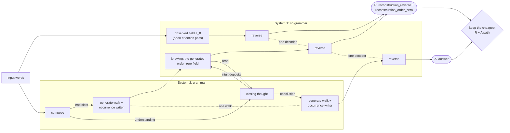

# Architecture

The subject is the system's design as a whole: the pipeline and its spaces
([Overview](#overview)), attention ([One attention](#one-attention)),
the two spaces joined by one index, the sentence loop
([Whole paths](#whole-paths-and-concept-episodes-2026-11-11)), memory's role
and the two systems
([Dual process](#dual-process-system-1-knowing-and-system-2-2026-11-09)). Loss
paths, stop-gradient boundaries, parameter ownership and the joint learning
rule across representation, prediction, thinking and output are in
[Gradient flow across the architecture](GradientFlow.md).

> This document describes the cognitive and mathematical architecture. For the
> live software ownership map—including configuration, training, STM, losses,
> checkpoints, reconstruction, and proposed consolidation boundaries—see
> [Runtime Architecture and Componentization](Componentization.md).

## The three pieces: Mereology, Attention, Thought (2026-06-11)


> **Terminology (2026-06-21 convention).** One noun per-space: a **percept** is
> a perceptual thing (PartSpace/WholeSpace, dimensionally-embedded, extensional;
> *part* and *whole* are its two subtypes); a **concept** is a ConceptualSpace
> relation tying one part-percept to one whole-percept (the Concept codebook);
> a **symbol** is a SymbolSpace 0-D reference to a concept. The CS "symbol
> table" is therefore the **Concept codebook** below.

The architecture has three pieces, expressed through one attention mechanism
(see [One attention](#one-attention) for the current execution contract):

1. **The mereological towers (and the Concept codebook).** In an LLM the
   mereology is completely subsymbolic — implicit in the weights,
   never surfaced. In BasicModel it is percept-based and symbolic: two
   towers — the $\sigma$ tower ascending bottom-up (part-percept extents, the PS
   codebook) and the $\pi$ tower descending top-down (whole-percept intents, the
   WS property codebook) — bound by location into the ConceptualSpace
   dictionary, whose rows are concepts (part$\leftrightarrow$whole relations).
   SymbolSpace references those concept ids downstream.
2. **Attention.** In an LLM, attention is QKV per subsymbolic layer.
   In BasicModel: **bases of relevance guide attention; attention
   determines the contents of awareness.** Relevance is carried as
   weights on the percepts; ATTENTION is the single selection process
   (at CS) that reads the integrated priority out; AWARENESS is what the
   selection admits. (The priority-map synthesis — Fecteau & Munoz 2006;
   Bisley & Goldberg 2010 — with attention as the readout, never the
   sources; attention distinct from awareness per Koch & Tsuchiya 2007.)
   Relevance factors as **ORIGIN $\times$ AXIS**, realized as **ONE
   QUADRATIC PRIMING SURFACE per space with two write channels** (the
   simplified law): **bottom-up things are primed in virtue of BEING
   SEEN** (perception itself writes the surface: fired rows bump, the
   surface decays toward neutral) and **top-down things are primed in
   virtue of being DESIRED or HATED** (signed intent: desire boosts,
   hate suppresses with floor 0 — suppression, never a veto). "Top-down"
   is therefore a DIRECTION of writes on the one surface, not a second
   mechanism — matching biased competition (Desimone & Duncan: the
   template IS conceptual content) while keeping the two channels'
   automatic/strategic dissociation distinct (§C). The bottom-up
   channel that attention and the chooser read is the expectation of the next
   concept state, predicted from what was seen; the seen record itself is read
   only by placement (§C). The bracket chooser reads the same priming surface; its selected
   word bracket supplies the reading scope. Two AXES, orthogonal to origin ("Parse
   time" §C): HORIZONTAL (which parts within the level) and VERTICAL
   (which properties — fixing Rosch's Basic Level and, through it, which
   objects exist at all).
3. **Thought.** In an LLM, thought is the computation of priors for
   autoregressive word prediction. In BasicModel, thought is a
   **subsequent isolation of attention over that space, enabled by
   references** — the serial pass: referential lookup, shift/reduce
   composition, story selection. Because thought is the only process
   that invokes the referential taxonomy *qua references*, it is the
   only process licensed to **shape the references**.

This yields the codebook update law: **percepts are shaped by the parallel pass; references
are shaped by the serial pass.** STE is untouched in both modes; the
partition governs row updates — parallel mode may not shape
references, serial mode may not shape non-references
(`Spaces.reference_update_mask`; the `update_mask_fn` chokepoint on
`VectorQuantize`). Rational by construction — though possibly an
overly optimistic arrangement with respect to human thinking.

See [SymbolFirewall.md](SymbolFirewall.md) for the governing principle this
update law (and the codebook/meronomy ownership model generally) instances: all
computation is composed over typed, symbol-attached units — read/write masks,
no anonymous global residual stream.

## Words are a formula for narrowing attention (2026-09-28)

The second and third pieces meet in language (Alec, 2026-09-28): **words
are a formula for narrowing attention.** Attention selects what enters
awareness; a sentence is a sequence of instructions for making that
selection. What the words narrow is the **domain of discourse** — Boole's
universe of discourse, a register that the situation seeds, that is all
of conceptual space when there is no context, and whose running value within
a sentence is the idea under construction — and each word is a
**projection operator** onto a lower-dimensional or smaller subspace of it.

- **One kind of operator.** Nouns, adjectives, verbs and adverbs all
  restrict the domain; they differ in which dimensions they constrain, not
  in kind. A noun is an operator read against the whole domain. Part of
  speech is a role in a derivation, not a property of a codebook row.
- **Three indices.** Language individuates along which thing (determiner),
  which stretch of time (tense and aspect) and which alternative (modal).
  These are indices of the symbolic projection and of the LTM row; a concept
  stays one code; the reading in "Two spaces, one index" below derives its perceptual and context components.
- **Regions are derived, never stored.** Membership is invariance under the
  operator and subsumption is absorption, so `part`, `whole` and `equal` are
  tests on the same algebra.
- **Two attentions, one chooser.** *Perceptual attention* is the bracket
  ([One attention](#one-attention)). Its objects are the percepts of the input and, since symbols are
  percepts, the symbols of thought; it excludes, and what it excludes is not
  taken up. Perception and higher-order thought share its one budget
  (`attentionBudget`), which is spent before grammatical analysis, so the
  words do not draw on it; attention to internal representations and to the
  senses draws on one limited resource (Chun, Golomb and Turk-Browne 2011;
  Kiyonaga and Egner 2013). *Conceptual narrowing* is what the words do, and
  it is different in kind: it keeps the domain it elects from as the Ground
  against which its Figure has meaning, the profile against its base
  (Langacker 1987) and Figure against Ground in language (Talmy 2000). There is a budget for percepts and
  none for conceptual space, though thoughts do shape it. Bracket candidates, restrictors and
  the identity binding are candidates in the one operation softmax.
  Neither is obliged to narrow: the open read excludes nothing of
  the input, and the symbol `everything` excludes nothing of the domain.

The language mechanics are in
[Language](Language.md#words-narrow-the-domain-of-discourse-2026-09-28), and
the reading of it in
[Philosophy](Philosophy.md#words-as-a-formula-for-narrowing-attention-2026-09-28).

## Relation to LLMs, Formal Concept Analysis, and DisCoCat

> The sense in which compose, predict, invert, emit is *equivalent* to a
> token-level language model, with a proof and the four conditions under
> which it stops holding, is stated once in
> [LLMEquivalence](LLMEquivalence.md).

BasicModel is best read as an explicit decomposition of functions that a
transformer LLM usually folds into attention heads, feed-forward blocks, and an
unrestricted residual stream. The LLM comparison in this document is therefore
architectural, not merely benchmark-oriented:

- **LLMs:** a conventional LLM learns fluent priors over token sequences with
  latent attention and hidden residual state. BasicModel keeps the language-model
  goal of prediction and generation, but separates perception, concept
  formation, attention, grammar, truth, and reconstruction into named stores and
  typed operations. The wager is that some behavior now implicit in LLM weights
  should become inspectable state.
- **Formal Concept Analysis:** the PartSpace/WholeSpace towers and Concept
  codebook form a neural, fuzzy analogue of a formal context. Part-percepts play
  the role of objects or extents, whole-percepts play the role of attributes or
  intents, and concepts are the order-bearing links between them. The resulting
  meronymic structure is not a classical binary FCA lattice, because support and
  trust are graded and trainable, but it uses the same extent/intension
  discipline as its organizing constraint.
- **DisCoCat:** the grammar path is a DisCoCat-like composition engine: typed
  grammatical reductions decide how word/object meanings compose into sentence
  meanings in vector space. BasicModel differs from standard categorical
  compositional distributional semantics by making the reductions bidirectional,
  tying them to part/whole codebooks, and feeding their results into truth,
  reconstruction, and memory.

In short: LLMs are the operational baseline, Formal Concept Analysis supplies
the lattice and extension/intension reading of concepts, and DisCoCat supplies the
grammar-to-vector-composition reading of sentence meaning.

### Addressable attention — the typed `.where`

The answer-owned `PrimedSymbolReader` (`bin/Attention.py`)
ranges over a **typed addressable space**: one choice competes across every
store at once and emits a typed `.where` = `(space-id, bracket)` plus a soft-read
$\sum_k \alpha_k \cdot \mathrm{key}_k$. Six stores (the `SPACE_*` ids):

| id | store |
|---|---|
| `INPUT` | the staged input window (per-span percept content) |
| `STM` | the live short-term-memory rows |
| `LTM` | the shared clause store (rows, references and paired evidence) |
| `PART` | the PartSpace codebook (part-percepts) |
| `WHOLE` | the WholeSpace property codebook (whole-percepts only) |
| `SYMBOL` | the downstream SymbolSpace reference namespace (1:1 with concepts) |

`PART`/`WHOLE` appear whenever their tower has a codebook; `SYMBOL` only under
`<symbolTower>`. Pointing `.where` at a codebook/LTM store is recall; at the input
window it is reading — one mechanism, the type tag distinguishes them. The
selected read enters the answer through a gate initialized at zero, so output
loss trains retrieval.

The symbol namespace is a **reference**, not a learned copy: it tracks concept
ids so the two cannot diverge or dissociate. A symbol's IDENTITY is that integer
concept reference and allocates no independent learned or EMA row; its VALUE,
the signed 0-D activation from the symbolic phase, is grad-bearing. The
activations' gradient path is the conceptual SBOW over the settled slab parked
at the post-pump cutover; the once-built SS leg itself is a state-contract sync
whose product no loss consumes.

These six stores are the substrate for the four foundations of mindfulness; the
mapping (and the trust-sign-as-vedana / luminosity-as-joy reading of `LTM`) is in
[Philosophy.md](Philosophy.md#the-four-foundations-of-mindfulness).

## Symbolic weights, reconstruction, parse-time, attention (2026-06-30)

A design pass clarifying four coupled pieces (PS = PartSpace, WS = WholeSpace,
CS = ConceptualSpace, SS = SymbolSpace).

### A. Symbolic weights (the two-phase forward)

The concept store's weights live in a dedicated **`SparseLayer`**
(`bin/Layers.py`), not a SigmaLayer option: SigmaLayer's atanh-entry contract
expects logit-domain codes in $[-1, 1]$, while these maps consume
*presences/activations*, a different input domain. The substrate contract is
the transpose autoencoder pair: forward $= \tanh(W x)$, reverse
$= \tanh(W^T y)$; export-safe scatter-add kernel by default,
`torch.sparse.mm` opt-in. Edges append host-side at mint (`add_edge`,
idempotent, tail-preserving value growth) and are removed by pruning rounds
(`remove_edges`; `ConceptualSpace.prune_concept_links` keeps the closest links
using within-tower relations only). One square untyped
**`ConceptualAttentionLayer`** subclasses this substrate; its forward
composition is a feedforward sigma pyramid.

**The forward has one terminal cutover.** Input attention first reads the open
bracket and narrows it under `attentionBudget`. PartSpace combines located parts;
WholeSpace divides the field by primitive properties. Perception has no learned
sigma/pi fold layers. `bindingDepth` constructs the binding layers through which
the carrier passes; it does not repeat an independent attention loop. The
concept inventory and the per-word grammar retain their structural bounds.

**Pass-back scales, never gates (Alec, September 24).** Attribution of the
current conceptual demand yields a strength `a ∈ [0,1]` for each PartSpace
slot. Its content is scaled by `0.5 + 0.5*a`: attributed parts approach full
strength, while unattributed parts retain half their input strength on every
pass. The where/when band is unchanged. New content within the extent stays
visible and can form a concept even when existing concepts do not define it.

Phase B symbolizes the terminal field and runs the bounded higher-order
pyramid. It performs sigma over the preceding order's symbols; no pi edge
exists in this loop. Codes support similarity and tied reconstruction,
while the feature definitions supply evidence. The paired field reaches the
symbol leg and conceptual losses without replacing the native carriers.

**The `ConceptualAttentionLayer` is SYMBOLIC-ONLY and owns BOTH readings of concept
structure.** The
weighted reading uses disjunctive and conjunctive COO matrices, each
$[S \times 2(S+1)]$, over one bounded concept inventory (`ConceptualAttentionLayer`, bin/Layers.py) -- named for
what it IS, bottom-up attention over the concept inventory (see "Parse
time" sec C); `SparseLayer` is how it works (it subclasses the substrate
above). Edges carry nonnegative exponents and address a positive or negative
symbol pole. Population from existing concept records
writes one edge per SYMBOLIC constituent (row = the relation, col = the
constituent); order-0 native references write the feature definition. A
trailing-bias-column edge (col $S$) supplies the bound for relations under
the EVERYTHING pole
(bias-bounded chain links, un-refined asserted concepts; a concrete whole
retires it). Self-edges raise (the Quine atom $x = \{x\}$); longer cycles
are deliberate -- a documented fact of un-ramsified taxonomies and of human
minds, which nothing observes or damps at runtime.

The feedforward concept pyramid (`cs_forward_content`) retains
`[concept, batch, extent, 2]`. The order-0 membership read composes field
requirements before encoding; subsequent rungs only union symbol evidence.
The taper ranks the stronger pole and admits the pair together. Extents
remain separate. The [current equations](#decided-in-direction-a-concept-is-sigma-over-pi-alec-2026-09-21)
define independent pole reductions and attribution descent.

`_order_caps()` sizes the per-rung taper. While the sparse concept
transform is active (`_sparse_active`), it is a tile-based taper
`[base, base>>1, .., 1]` (`conceptLayers` bounds the inventory's orders,
`base = min(outputShape[0], nVectors)`, shrunk until the taper fits the
inventory). The taper is a placement preference: definitions and raised
classes seat in the tail, and every reachable row is gathered into the
attended field. Off that path, the caps fall back to a 50/50
`(n_snap, n_pool)` split (`n_snap = max(1, N // 2)`).

Alongside this weighted reading, the store holds the DISCRETE relation
table: ordered role-tagged constituent records (`embed_pair` stores the
sec-4c ordered pair
$[\text{whole}, \text{part}]$, whole first: whole $\Rightarrow$ part / if
$\to$ then; `discretize_row` is exact on the binary-ordered subset). A thin
shared `ConceptAllocator` owns global concept ids, order derivation
(bookkeeping only under v3 -- nothing migrates by order), the
raise/retire/singleton sets, and the idempotency caches; ConceptualSpace
keeps orchestration only. Each bounded evidence activation IS a 0-D
symbol: the once-built SS leg retains the two poles at the row-aligned identity
(order-0 codes follow their feature definitions; the leg syncs the SS state contract, while the
activations' GRADIENT path is the conceptual SBOW over the settled slab
parked at the cutover). The native read places the attended percepts
in the order-0 field; the selected bracket supplies the region or mereological
scope. `attentionBudget` bounds perceptual operations. Perception has no learned
$\sigma$/$\pi$ fold layers. Distributed codes serve similarity, retrieval and the
tied reconstruction; they do not determine conceptual presence.

#### Relation-table entry contract

At the sparse-entry level, one entry binds one concept row index to one symbol
column index, plus its signed membership weight. A concept definition is
therefore not limited to one symbol: the same concept index may occur in
multiple entries, each paired with a different symbol index. Those repeated
entries collectively form the concept's sparse, set-like definition; different
concept indices define different concepts.

The same representation is sufficient for a vine, with an important
qualification: one entry alone does not encode a total order. Each vine link is
the ordered pair $[\text{whole}=\text{current},\text{part}=\text{rest}]$, where
`rest` references the next relation concept. The discrete role-tagged records
preserve the whole/part distinction exactly, while recursive nesting and wave
iteration make the sequence order operational. In short: repeated entries for
one concept define a set; recursively nested relation concepts define a vine.

The lattice poles are VECTORS of the presence domain: **NOTHING**
$= [0,0,\ldots]$ (bottom; a part contributing $W \cdot 0 = 0$ -- no edge)
and **EVERYTHING** $= [1,1,\ldots]$ (top; a whole realized as the trailing
bias column). Order-0 concepts reserve their distributed row and read
their signed feature definitions over native PS percepts and WS properties.
A fresh object's standing bounds supply no perceptual membership; its
definition awaits testimony. Feature addresses preserve the source rows
by reference, without duplicating their codes. Word/object associations are
definitions, `LTM1` rows of a word and its object. Completed sentences store
their actual end state; they keep no word chain or derivation. A
1:1 tie between SYM refs is the SINGLETON principle (Alec 2026-07-02): the
unit-set $\{x\}$ -- a whole containing exactly one symbolic part
(`singleton_concept`, min-support exempt) -- is the constructive primitive
behind if$\to$then ($\{x\} \Rightarrow x$) and the recursion vine, and it is
stored structure that `resolve_identities` never collapses (only ties
between concrete raw codes resolve away). The one untyped square
`ConceptualAttentionLayer` replaces stratification by order, so a link of any
order arrives one pyramid rung later; see "Parse time" (§C).

### B. Reconstruction (parts $\to$ `.what`, wholes $\to$ `.where`)

InputSpace maps two views of the *same* data, segmented differently: a
**universal view** to WS (which it analyses) and an **atomic view** to PS (which
it synthesises). WS yields **low-fidelity** information covering the **whole**
space; PS yields **high-fidelity** information over a **smaller** area
(`_paint_reconstruction`: the universal view paints the background, the atomic
view is averaged in where it has support). For verbal reconstruction of text the
**parts (PS) should reconstruct the `.what`** and the **wholes (WS) should
reconstruct the `.where`** — approximately the inverse of what happens at parse
time. The separate `what_scale` / `where_scale` / `when_scale` reconstruction
channels already exist to carry this. Per-word reconstruction scores content
and position only: every word in an input carries the same field timestamp,
so repeating that timestamp as a target adds no word-specific information.
The temporal band still passes through grammar operations and their inverses;
a future field-time objective would score it once per field.

For text, it would be foolish to insist on an *absolute* `.where` from WS: the
parts already know each word's size, so under a perfect tiling the placement is
just the running sum of part sizes (serial mode computes this as an AR1 increment
over the previous `.where`; the for-loop is time). WS may still supply **type**
information for the tiling — *word*, *space*, *word*, *punct*, … — even where it
does not supply coordinates.

### Tiling, subspace sizes, and consciousness

Whether the parts/wholes **perfectly tile** the input (a partition — so order
alone reconstructs, with no gaps between parts) is **NOT** entailed by
parallel-vs-serial mode. It is entailed by the **relative sizes of the InputSpace
subspace and the PS/WS subspaces**:

- In **serial mode** they are *forced* to match — the for-loop traverses **all**
  of input space — so the tiling is always perfect.
- In **parallel mode**, if they do not match because InputSpace is *larger* than
  PS/WS, that bounded mismatch is exactly where the two attentions **select what
  is most relevant to consciousness**: PS/WS cannot hold all of InputSpace, so
  attention picks the salient subset to surface. (When InputSpace $\le$ PS/WS — as
  in the current test fixtures — the tiling is again a partition and order
  suffices.)

### C. Parse time (relevance = origin $\times$ axis)

At parse time CS receives the overcomplete input representations from the PS
and WS mereological towers. **Bases of relevance — carried as weights on the
percepts — integrate into a priority signal; attention is the selection at
CS that reads it out; awareness is what the selection admits.** Relevance
factors as ORIGIN $\times$ AXIS: two origins (perceptual salience/novelty;
symbolic history) crossed with two axes (horizontal: which parts; vertical:
which properties/level).

- **Salience/novelty, HORIZONTAL (significant particles, PS)** — within
  the level the vertical axis fixed, WHICH items? The level may fix the
  word boundary of *wheelhouse*, but what makes *wheel* + *house* its
  building blocks rather than the equally-segmentable *wheelhou* + *se*?
  **Greedy longest-match** is the current easy approximation
  (`RadixLayer.longest_match`); particle salience should guide both
  parsing and reconstruction here. The signal attention reads
  is the expectation formed from what was seen (below); there is no separate
  novelty computation.
- **Salience/novelty, VERTICAL (significant properties, WS)** — a
  property can be stimulus-significant too (a novel type-run, an
  unexpected region); property salience weights the wholes and thereby
  participates in fixing the **Basic Level** of analysis (E. Rosch): the
  size of parts and wholes. The scope handoff is the vertical axis's
  EFFECT ON PERCEPTION: the word-level isolates the regions that are type
  *word*, *punctuation*, and *space*, forming a **complete tiling** (the
  WS$\to$PS `_passback_scope_where` handoff) — the level of analysis
  governs which particular objects are chosen at all.
- **Two write channels (SS and every space).** The SEEN record is written
  bottom-up: fired rows bump and the ledger decays exponentially toward
  neutral (`prime_seen`). DESIRED/HATED is written top-down as signed intent,
  in a buffer of its own (`prime_desire`): desire boosts and hate suppresses
  with floor 0, never a veto. The two channels are the automatic/strategic
  dissociation (Posner & Snyder 1975; Neely 1977): automatic priming through
  use is fast, capacity-free and inhibitionless, while strategic priming is
  slow, capacity-limited, goal-set and able to suppress; selection and reward
  history capture attention even against current goals (Awh, Belopolsky &
  Theeuwes 2012). The bracket candidates read the relevance below through
  their detached codebook-retrieval prior, and the chosen bracket supplies the
  scope handed to mereology.

**Concept spread is an expectation (Alec, 2026-10-28).** When a sentence
opens, the conceptual space's own `ActivationPredictor`
(`ConceptSpread.open_prediction`) reads the order-zero concepts' keys and the
observed knowing, and freezes its prediction of the next concept state for
every path of the sentence. The relevance read (`relevance_weights`) is
$1 + \max(\text{expected knowing}) + \text{desire}$ for each stream and row,
clamped at zero ($1 + \text{desire}$ on the serial concept path). Attention,
the compose chooser, retrieval, `intuit`'s rule order and the sparse
projection onto the tower rows read it detached. The predictor trains only on
its own error against the detached next observed state
(`expectation.concepts`). The spread biases where attention goes and carries
no truth: nearness in meaning asserts nothing, and truth moves only along
rules, through `intuit` and `infer`. Location keeps its other readers:
`bind`'s content term, the class centroids, MTM's candidate matching and the
reconstruction bank's selection.

**One conceptual space (Alec, 2026-10-22).** Every concept of every order is
placed in one similarity space, concrete and abstract intermingled; a raised
class takes its members' evidence-weighted centroid. Forms and meanings never
share a metric: placement never reads the percept cube
([SymbolFirewall](SymbolFirewall.md)).

**The guard against a feedback loop (Alec, 2026-10-20).** Codes never read a
value computed from codes. Placement reads only the seen ledger
`_priming_seen`, written by the decay (`primingDecay`, default 0.9) and the
seen bumps; desire and the prediction never write it, and
`placement_context`, the collapse audit and consolidation read its nonnegative
excess over neutral. The loop that remains is indirect and bounded: the
prediction biases attention and the chooser, which bias what is observed and
composed, from which the codes are placed. In `bind` priming enters only the
expectation term (the prime), never the content term (the meet over content),
and recurrence, not priming, mints.

**Placement.** Meaning is placed by context, while forms take
centroids. At each kept close, and only
there, `MereologicalCodes.observe_close` places the rows the sentence
registered on the seen ledger. Each codebook seat holds a unit for-lane
direction `placement[r]`, a witness count and a 32-byte content key; the for
lane of the cached meaning is that direction scaled by the row's trust radius,
so an unplaced row reads zero. A first placement starts from `identity_code`
of the content key (a word's bytes, or a key pinned when a concept is minted),
a private SHA-256 draw that uses no global random state. One subgradient step
of

$$J(q)=\sum_{i\in C} a_i\,\frac{\mathrm{meet}(q,c_i)}{\mathrm{mass}(c_i)}-\lambda\sum_{n\in N}\frac{\mathrm{meet}(q,n)}{\mathrm{mass}(n)}$$

then moves it, on the for lane only: $C$ are the placed rows with seen excess
$a_i>0$, $N$ up to `placementNegatives` (5) placed rows with zero excess, drawn
by a generator seeded from the sentence's content key, meet is the
coordinatewise minimum summed, mass is the coordinate sum, and $\lambda$ is
`placementNegativeWeight` (1.0). The subgradient of a meet is 1 where
$q_j<c_j$, and the update is
$q\leftarrow\mathrm{normalize}(\max(0,\,q+\eta\,\partial J/\partial q))$ with
$\eta$ = `placementRate` (0.1). All rows of one close step from one snapshot,
so seat order cannot matter; a raised class is not stepped but takes its
members' centroid (`derive_class_placements`). This is skip-gram's objective
(Levy and Goldberg 2014; Qiu et al. 2018) read from the model's own registered
co-occurrence, in conceptual space's metric.

Activation and location are one quantity at two time scales: activation is a
short-term position in conceptual space, and location is that position made
long-term, as the hippocampal predictive map is learned from transient
activation (Stachenfeld, Botvinick and Gershman 2017). Training location
therefore needs both halves, co-activated concepts drawn together and never
co-activated ones pushed apart: attraction alone collapses the codes, so the
negatives are the brake. `collapse_audit` measures it: the mean meet ratio
against the registered context should rise while the ratio against fixed
audit negatives does not.

**Frozen concepts (`freeze_concept` / `_frozen_concepts`, Alec 2026-07-11).**
A concept's relational structure can be FROZEN: no FORMING of new edges, no
FORGETTING of existing ones, no WEIGHT drift on them
(`_refresh_frozen_values_hook` zeros backprop gradient on the frozen rows'
edge values) — the codebook row/content stays live and keeps tracking
perception; only its DEFINITION is fixed.

**The readout site is the concept pyramid's per-order top-K**
(`cs_forward_content`; the FF pyramid is COMPOSITION, not attention — the
selection over it is where attention acts). The CS surface projects
directly onto the inventory rows as the ranking score
(`_relevance_priority` $=$ boost $-$ 1; rank $= |cand| \cdot (1 +
\mathrm{score})$, spreading upward through edge magnitudes, admitted rows
only) — selection changes, activations never distort. The pyramid's
Admitted rows write back through `prime_seen`. The priority score is read
on the parallel path. The serial path does not use this inventory ranking.
`primingDecay` sets the seen decay.

**Attention and expectation share a gain mechanism (2026-10-19).**
Attention contains the admitted region; expectation attenuates predicted
activation within it. Both are gains in $[0, 1]$ that compose by
multiplication, $c = m \odot a \odot o$ ("Surprise at every layer" below):
attention's gain $m$ is exactly zero outside the region, where a deep
expectation is absent rather than attenuated, so the unattended field passes
nothing and reports no omission. Neither changes the native identity or adds predicted
content to the observation. Expected activations separately prime selection,
while excess and omission train the predictor and supply retention surprise.
The existing desire channel remains distinct: desire writes only to
selection, never into content, so expectation never learns to predict and
cancel it. An open object keeps its prime and is spared attenuation; a
dimension withheld by `non` has no prior, so it is neither primed, attenuated
nor counted as omitted. See [ExpectationRetention](ExpectationRetention.md).

**The bases interact (cross-basis priming).** The psychological literature
is unambiguous that symbolic activation primes the subsymbolic layers:
automatic spreading activation vs. strategic expectancy in semantic priming
(Neely 1977 — the heat vs. intent split, exactly); word-level activation
feeding back to letter perception (McClelland & Rumelhart's interactive
activation); conceptual templates biasing early sensory competition
(Desimone & Duncan's biased competition); learned context guiding spatial
attention without awareness (Chun & Jiang's contextual cueing); labels
sharpening perception (Lupyan's label feedback). The architectural
consequence: **conceptual activation supplies the reading prior** — the
reading template is built from the currently
selected concepts (the pyramid's winners, `_concept_activations`) rather
than a free-standing query — making WS's vertical basis the conceptual
tower's own downward projection, as biased competition prescribes.

### D. Attention indexing (`.where` / `.when` / codebooks)

The **global location registry** assigns disjoint address ranges to input
positions, part rows, whole rows and symbol poles. A word's percept and symbol
occurrences use its input byte start in the input range. Repeated words thus
have different occurrence locations even when they refer to the same stored
row. A stored percept's location is its row address; a symbol produced by
thought uses its symbol-row address, with one address per pole. There are no
extra address slots per occurrence. Each address travels in the event's
`.where` band: two sine/cosine pairs with different periods.
The long period covers the entire registry; the short period resolves one
location. Both periods are derived at construction, and every space shares
the same encoding. Captured programs retain the bands, from which an integer
address can be decoded when needed.

Codebook identity remains the row index within its owning codebook. The
registry adds a distinct location range for each owner; it does not replace
that identity. An LTM sentence is addressed by a 64-bit hash of its source
document key, sentence index and content key. `.when` carries the model-time
unit bracket `[t, t+1]`; `.where` retains the input/percept location. Time
recall reads the stored band, and learned readers use its age or a difference.
Re-reading the same address keeps its first stamp and episodic entry, while
updating the existing evidence according to the row's write contract. A full
store raises.

The spatial band records a start, not an extent. A part's byte length gives
its end from that start. A whole's end cannot be recovered from the start
alone; this remains a limitation even though perception retains span metadata.

## Cognitive grounding: dense-perceptual vs sparse-symbolic (2026-07-02)

The design splits representation into a **dense, invertible, subsymbolic**
integrator (the corpus-callosum mixing matrix, which mixes part/whole *content*
in high dimension) and a **sparse, symbolic** composer (the `ConceptualAttentionLayer`,
which composes *scalar activations* of named concepts; it subclasses the
`SparseLayer` substrate). This is not an
arbitrary engineering choice; the split, and specifically *why sparsity belongs
only on the symbolic side*, tracks several convergent findings on human
cognition.

- **Complementary Learning Systems** (McClelland, McNaughton & O'Reilly 1995).
  Neocortex uses slow, dense, *overlapping* distributed codes that extract
  statistical structure across experiences; hippocampus uses fast, *sparse,
  pattern-separated* codes to bind individuated episodes. The reason
  hippocampal codes are sparse is **interference avoidance among individuated
  bindings**, not compression: dense overlapping codes suffer catastrophic
  interference when made to hold many discrete conjunctions. This is the
  cognitive answer to "why sparse, and why only symbolically" — the perceptual
  manifold wants the dense mixing; the binding of individuated things into
  reusable conjunctions (the joint/sentence concept over word-symbols) wants
  sparsity. A **symbol is a scalar handle on a grounded direction** (the atom),
  which is precisely a hippocampal index into cortex; the transpose decode
  ($\tanh(W^\top y)$) is pattern **reinstatement**. Caveat: this maps the
  *sparse-symbolic vs dense-perceptual* axis onto hippocampus-vs-cortex — NOT
  the ramsified *orders* (abstraction is a separate, graded
  anterior-temporal / prefrontal axis).
  The individuated episodes of this account have
  their own place in the store: a sentence's row keeps a few order-zero
  concepts of its open attention pass, and a recall by time reinstates them as
  the stream's knowing
  ([Episodic and semantic memory in the two systems](#episodic-and-semantic-memory-in-the-two-systems-2026-11-11)).

- **Dual-process cognition** (Sloman 1996; Kahneman). A fast, parallel,
  similarity-driven associative system and a slow, serial, rule-based symbolic
  one. The model's two systems are divided at grammar, not at symbols: order-0
  symbols, `intuit`, expectation and memory's linking belong to System 1, and
  System 2 is the three grammars
  ([Dual process](#dual-process-system-1-knowing-and-system-2-2026-11-09)). The
  sparsity and the serial capacity-limit are the *same fact*: a sparse
  composer has low fan-in per concept, the computational shadow of
  working-memory span (Miller's $7 \pm 2$; the STM depth $\approx 8$ the model
  already carries).

- **The neuro-symbolic interface / systematicity** (Fodor & Pylyshyn 1988). The
  architecture is a concrete stance on the oldest fight in cognitive science:
  **content stays connectionist** (dense, continuous, invertible mixing),
  **structure becomes symbolic** (discrete, reusable, composable edges), and the
  **interface is the activation readout** — the point where mixed content is
  read through feature memberships into the two symbols of a named thing. The discrete edges buy the
  compositionality/systematicity that pure distributed codes are accused of
  lacking, while the dense mixing keeps perception continuous and
  gradient-trainable.

- **Grounded cognition** (Barsalou 1999; contra amodal symbol systems). Because
  the distributed code follows the concept's definition and its two
  activations carry the observed evidence, the symbols are not amodal Fodorian tokens — they are
  grounded pointers-with-magnitude, closer to perceptual-symbol "simulators."
  Retaining graded memberships is cognitively load-bearing: graded activation *is* typicality / salience
  (Rosch's graded membership), which a cosine would discard.

- **Basic-level categories are perceptual, not content-free** (Rosch et al.
  1976). "Subsymbolic" $\ne$ "category-free": the mixing output at order 0 is
  already carved toward basic-level regions, because that is what perceptual
  integration *for a categorizing organism* produces. This suggests the
  feature-defined conceptual regions are the **pre-linguistic Gärdenfors regions**
  (prototype centers, basic-level, perceptual) and the sparse symbol graph is
  the *post-linguistic* labelling-and-composition that points at them — three
  cognitively distinct stages (integrated field $\to$ unnamed category region
  $\to$ named composable symbol), not two layers with a bookkeeping detail
  between.

**Where the mechanism is deliberately cleaner than cognition.** (1) The order-0
boundary is a *default flow*, not a wall: perception is concept-penetrated
(top-down / predictive coding), and it is the TOP-DOWN attention channel —
goal/emotion-weighted properties fixing the level of analysis, delivered to
perception through the scope handoff — that carries that penetration back down;
the priming/heat loop is the BOTTOM-UP horizontal channel and touches
perception only through what it makes retrievable. The division must never
become impermeable.
(2) *Invertibility* is instrumental (reconstruction, gradient), not a biological
claim; brains approximate and predict, they do not compute exact inverses. The
extensional/intensional semantics this grounding implies for a **single**
conceptual space is developed in
[BasicModel.md](BasicModel.md) "Conceptual Space." The memory, two-truths,
expectation, testimony and feeling side of the grounding, with its discrepancy
list, is in [Philosophy.md](Philosophy.md#psychological-grounding-2026-09-16).

**References.** McClelland, McNaughton & O'Reilly (1995), *Why there are
complementary learning systems in the hippocampus and neocortex*, Psychological
Review 102(3). Sloman (1996), *The empirical case for two systems of reasoning*,
Psychological Bulletin 119(1); Kahneman (2011), *Thinking, Fast and Slow*.
Miller (1956), *The magical number seven, plus or minus two*, Psychological
Review 63(2). Fodor & Pylyshyn (1988), *Connectionism and cognitive
architecture*, Cognition 28. Barsalou (1999), *Perceptual symbol systems*,
Behavioral and Brain Sciences 22(4). Rosch, Mervis, Gray, Johnson &
Boyes-Braem (1976), *Basic objects in natural categories*, Cognitive Psychology
8(3). Gärdenfors (2000), *Conceptual Spaces: The Geometry of Thought*, MIT
Press. Olshausen & Field (1996), *Emergence of simple-cell receptive field
properties by learning a sparse code*, Nature 381 (sparse *activation* over a
dense dictionary — the dictionary/atom side here — as distinct from the sparse
*relational graph* of the `ConceptualAttentionLayer`).

## Overview

BasicModel is a bidirectional neural architecture organized as a pipeline of five
**spaces** plus a symbol host (`SymbolSpace`), each implementing a distinct
representational transformation:

```
Forward:  InputSpace -> {PartSpace, WholeSpace} -> ConceptualSpace -> SymbolSpace -> OutputSpace
Reverse:  OutputSpace -> SymbolSpace -> ConceptualSpace -> {PartSpace, WholeSpace} -> InputSpace
```

There is no per-stage feedback loop between the spaces:

- **Perception shares one attention.** PS reads native parts at the selected
  bracket. The open read and later narrowing share `attentionBudget`; the
  constructed binding layers carry their result forward.
- **The symbolic loop is grammar over STM**: pairwise grammar operations
  dispatched by the signal router (`LanguageLayer`). `Lift` and `Lower` share
  the GrammarLayer dispatch surface with `Intersection`, `Union`, etc.

The forward pass transforms raw input into predictions; the reverse pass
reconstructs the original input from the symbolic representation. Both
directions are trained together: each sentence's complete paths are compared
on R + A (reconstruction plus answer cost), and one optimizer takes one step
per sentence over the reconstruction (scaled by `reconstructionScale`),
expectation and output terms
([Whole paths](#whole-paths-and-concept-episodes-2026-11-11);
[GradientFlow](GradientFlow.md)).

`PartSpace` and `WholeSpace` both subclass `Space` directly: both views are
perceptual, symmetric duals with the same `forward(in_sub, CS_out)` signature
and no shared intermediate base class. At the corpus callosum, objects are
analysed and synthesized by sending them back through the towers: wholes get
split, parts get chunked. In symbolic "mode" the objects sent back are
symbols. Terminologically there are objects and references; a reference is a
*sign* (a quantized version of the referent) or a *symbol* (an unrelated
version of the referent, of much lower dimensionality). `SymbolSpace` is the
grammar/word space-role (abbrev `ss`; the WholeSpace stream is `ws`).

Under `<mereologyRaise>` (default false), perception's autobind hook builds a
meronymic lattice and raises abstraction order as attention requires. PartSpace and WholeSpace use
independent `.what` codes and a shared input location. Concept definitions
refer to memberships in both views, without equating their code values.
`RunStructureLayer` reads retained native witness spans in the current
ConceptualSpace field. Their contiguity and refinement history govern
automatic promotion above order 1; a constituent count supplies no such
permission. Word/object identities remain in the conceptual inventory, and
object-kind relations require testimony. The live support geometry
is released with the attended field; only scalar refinement history persists.

### Spaces

| Space | Role | Owns | Notes |
|-------|------|------|-------|
| **InputSpace** | Lifts raw data into working dimensionality; surface tokenization | LiftingLayer; lexer wiring (text mode) | Reaches PS's lexicon via back-ref; no own lexicon |
| **PartSpace** | Bottom-up ordered part synthesis | Radix parts, native codes and `<synthesis>` policy | Recurrence forms parts; codes are max over constituents. Canonical ids and ordered containment determine presence. |
| **ConceptualSpace** | STM container + main grammatical CPU + (when sparse-active) the POST-PUMP symbolic phase | STM (`ShortTermMemory`, depth ~8); the single untyped square `ConceptualAttentionLayer` (a `SparseLayer` subclass; registered via the `_sparse_fam` shim) + concept dictionary (`similarity_codebook`) + the relation store (`ConceptAllocator` + ordered records) when sparse-active | `forward(subspace, word_subspace=None)`: STM bookkeeping only — the pump is purely subsymbolic (P3 two-phase); the symbolic transform fires ONCE post-pump (`cs_symbolic_phase`: membership read + FF concept pyramid, $K$ = `conceptLayers - 1`, driven by `_forward_body`'s cutover). Dispatches read-only grammar ops via the signal router. |
| **WholeSpace** | Top-down division by primitive properties | Property codebook (`self.subspace.what`) and `<analysis>` policy | Max over allowed primitives per position, min pervasion over a run. Readings share the attended field with PS; there is no perceptual pi layer. |
| **OutputSpace** | Final prediction | LinearLayer | nActive, nDim, nVectors |

The native perception and conceptual carrier contract is:

```
PS.forward(x):  return native_part_read(x)
CS.forward(subspace, word_subspace):
    STM[1..7] = STM[0..6];  STM[0] = folded          # newest at slot 0, shift toward higher indices, oldest (slot 7) drops off; mode-dispatched, the pump stays subsymbolic
# POST-PUMP cutover (sparse-active, once per forward, in _forward_body):
#   content, acts = cs.cs_symbolic_phase(last_cs.materialize(), extents=extents, percepts=native)
#   # membership read -> concept pyramid (K = conceptLayers - 1)
#   last_cs._concept_activations = acts;  SS leg built ONCE;  SBOW parks the settled slab
SS:  no atomic forward operator; hosts write-required grammar ops
     (the CS->SS symbol bind leg is SymbolSpace.forward_concept_to_symbol, .forward()-mediated)
```

Per-stage feedback is absent at the substrate; grammar dispatch over STM
provides the recurrent character via the signal router.

**The familiar tier** (gated
`attentionPromotion`, default off): candidates and identities share
`MediumTermMemory`'s entries, transient ids, access clock, capacity,
eviction and checkpoint. Each candidate retains a bounded sparse support
and its evidence-weighted centroid in conceptual width. At the open end
of the sentence, every present word bracket is read once, before grammar
narrows attention. Positive field rows join lexical rows for the one
`prime_seen` step; that same field opens or updates
candidates, including located conjunctions under `conceptualPi`, without
minting. A candidate never re-mints what exists: when its support is one
witnessed row, or it matches a witnessed row of its order by the same literal
or the same support, the observation is a use of that row (an access, with
`cover_members` merging any added members by maximum) and opens nothing. The
literal route (`observe_native_cases`) opens candidates only for located
conjunctions that are not lexical forms, so a word's object comes from its
defining clause or the recurrence of its mentions, never from the word's own
letters. `PrependedSymbols.stage` carries these familiar entries beside
pending identities. At the kept end, activated references advance MTM's
clock; after placement, `promote_candidates` applies one recurrence rule:
`conceptMintCount` observations within the horizon, outside the both corner.
Both readings retain candidate refinement and wait. A defining equality
or IS clause can promote its pending subject at that kept close. Neither
route supplies a grammatical order. Explicit raises and promoted
candidates share `cover_members`: sigma edges merge by maximum, placement
uses the members' centroid, and form uses their evidence-weighted fold.
Transient occurrence members wait for a durable symbol.

See [Spaces.md Section "Sigma / Pi ownership"](Spaces.md#sigma-pi-ownership)
for the cognitive rationale and the migration trail.
See [Logic.md Section 8](Logic.md) for the algebraic constraints on sigma/pi.

Dimensions (`nDim`) are read from `TheObjectEncoding`. Codebook sizes
(`nVectors`) are likewise on `TheObjectEncoding`; the factory validates
`nVectors >= nActive`.

**Fixed capacities.** Every store, bank and working buffer is allocated once,
at model construction, to a capacity derived from declared bounds (sentence
words, `stmCapacity`, the stream count, the configured inventories), with the
derivation written beside the allocation. Storage never grows or shrinks at
run time: a write past capacity raises rather than resizing, clipping or
dropping content. Fixed shapes keep compiled graphs valid across inputs and
checkpoints comparable. The one exception is the transient content of a native
thought store, which may be rebuilt to the exact size a meaning needs under a
construction-time ceiling ("Whole paths and concept episodes" below).


Layer selection by `invertible` (reconstruction is seeded from concepts
unconditionally, gated only by `reconstructionScale`):

1. **Non-invertible, forward-only layers** (`PiLayer`, `SigmaLayer`):
   forward-only, no reverse pipeline.
2. **`invertible`**: Single invertible layer
   (`PiLayer(invertible=True)`, etc.) serves both directions, sharing weights.
3. **Not `invertible`** (but reconstructed): Two layers with separate
   weights --- `forward()` on one, `reverse()` on the other. Avoids the
   expressivity limitation where a non-invertible layer can't represent the
   inverse of another. Reverse uses matrix `pinv` (may be numerically
   unstable from SVD convergence). `<invertible>true</invertible>` avoids
   this via shared-weight inversion.

### Single Optimizer with Overlapping Weight Spaces

Representation learning and response learning use one optimizer step over
explicitly owned parameters. Reconstruction, expectation and generation have
separate state paths. Expectation's predictors train only on their own local
objectives, with sources, targets and consumed forecasts detached. Shared
operators are the intended coupling: they receive gradient from their uses in
each computation, so every objective shapes the one central representation
through named, interpretable parameters. Independent heads specialize in
their own paths.

By default (`separateChooser=false`) each sentence's single backward projects
the answer gradient A against the reconstruction gradient R on every shared
optimizer unit, removing only A's component that opposes R
(`GradientProjection`), and output reads the concluded idea live. Under
`separateChooser=true` each objective owner differentiates only its own
parameters, and output treats the concluded idea and its contextual operands
as given. The owners, sides and units are in [GradientFlow](GradientFlow.md).

An invertible transform uses its same learned mapping in the forward and
inverse directions ([`InvertibleLinearLayer`](../bin/Layers.py#L1066)); its gradient
follows the configured joint-learning policy.

Reference: A.M. Rogers, T.T. Shannon, and G.G. Lendaris, "A comparison of DHP
based antecedent parameter tuning strategies for fuzzy control,"
*Proceedings Joint 9th IFSA World Congress and 20th NAFIPS International
Conference*, 2001, doi:
[10.1109/NAFIPS.2001.944317](https://ieeexplore.ieee.org/document/944317).

### Training Loop

One optimizer with persistent state (momentum and variance accumulate
across epochs) is stepped once per sentence (`Models.getOptimizer`; the
per-owner update rules are in [GradientFlow](GradientFlow.md)):

1. Forward pass: read and compose the input into its `end_state`
2. Reverse pass: `end_state` $\to$ reconstructed input; the reconstruction
   cost R compares it with the original input
3. Thought and output: the prediction, and the answer cost A against the
   target where output is supervised
4. Run steps 1-3 for the greedy path and each `explorePaths` alternative, and
   keep, per stream, the strictly cheapest path on R + A
   ([Whole paths](#whole-paths-and-concept-episodes-2026-11-11))
5. Backpropagate the sentence's objective once (A projected against R by
   default)
6. If ergodic: run `paramUpdate()` (gradient energy sensor updates `bias`/`var`)
7. Optimizer step (embedding params excluded when `trainEmbedding` is `NONE`,
   `CBOW`, or `SBOW`)
8. If `trainEmbedding` is `CBOW`, `SBOW`, or `BOTH`: run embedding update step

Ergodic exploration is not epoch-annealed. `ErgodicLayer` starts in
pure-exploit mode (`bias=1`, `var=0`) and updates those buffers from observed
gradient variance after backward. See [Ergodic.md](Ergodic.md).

See [Params.md](Params.md) for all XML parameters. See
[Training.md](Training.md) for embedding modes.

### One attention

Attention reads a typed bracket, then narrows it with the common operation
chooser. The first bracket covers the input. That open read takes no optimizer
step and writes no codebook: it supplies context before native admission and
grammatical composition. The table carries padded intervals `[B, K, 2]`,
validity, space, level, completion and spent work; `K = attentionBudget`.

Within a bracket, the field offers the order-independent operations `and`,
`or` and `not` on paired observed presences. Across brackets, grammar operates
on identified symbols. This follows from the operand types: a pooled field
has no order on which lift, lower, verb or adverb could act. The parser checks
these declarations. The former mode-exclusion rule is therefore a consequence
of representation, with no `serial` or `parallel` mode switch.

The narrowing candidates are `divide`, `descend` and `gloss`, declared in the
compose grammar and scored by the compose chooser. A bracket yields a symbol only
when it is pure (exactly one pole of its pooled pair is nonzero) and singular
(exactly one identity has support in it), so its projection to a code is
unambiguous; `gloss` performs that projection (`Attention.narrowing_mask`). An
impure (*both*) or plural bracket offers only field and bracket operations. A
pure singular word can gloss;
a heterogeneous bracket can divide at a pole disagreement; an unknown word
can descend to its retained byte parts before `interpret` admits one object.
The stop is pinned at words. A wider bracket cannot gloss and a known word
cannot descend below that stop. Repeated unknown surfaces share one witness.
The fixed WholeSpace `word` whole and the reader use the same maximal ASCII
letter run; punctuation, whitespace and digits separate words. Digit runs
remain native percepts for numeric proofs such as XOR_exact.

Before native admission, input narrowing walks the brackets with the same
chooser; a departure in that walk is the attention walk of the sentence's
whole-path comparison ("Whole paths and concept episodes" below), judged on the
same R + A. Native paired evidence, including counterevidence, determines eligibility;
a Boolean field operation changes the next mask, while a child reads its own
native parts.

`attentionBudget` meters perceptual bracket work and attention to symbols in
thought and recall. It does not meter the words' grammatical restriction of
the domain of discourse. The static grammar round count and word capacity
remain bounds on compiled tensor shapes. `bindingDepth` counts constructed
binding layers and `conceptLayers` sizes the concept inventory; neither is a
second attentional or symbolic-loop allowance. There is one conceptual field
read, with the refine-before-raise rule and its patience guard.

The scope handed back to mereology comes from the selected bracket table.
One address registry names input, STM, LTM, part, whole and symbol spaces.
Recall uses typed intervals in those spaces, the common categorical selection
law and the same work meter. Detached content keys protect codebook ownership.
The answer owns the learned primed-symbol reader and its initially zero
consume gate. Priming also enters bracket logits through the codebook prior
`max_v cos(key, row_v) * boost_v`.

One `SymbolExpectation` owner serves word, symbol, closing and next-row reads.
It predicts independent for/against activations over native bank identities and
trains with local activation MSE. Every source and target is detached; observed
input advances context in both training and inference. The word's positive
lane is normalized only for rank/NLL reporting. Content gain, expected prime
and residual lanes have separate consumers. The chronological observation and
stable-occurrence lifecycle are owned by the same component.

Attention, compose, thought and both generate walks share one comparison per
sentence ([Whole paths and concept episodes](#whole-paths-and-concept-episodes-2026-11-11)).
Output's selection does not
grant its loss ownership of decoder parameters. Walk records expose costs, kept
paths, explore-win fractions and per-sentence stability; code geometry remains
a diagnostic. Prior-only anticipatory thought holds both forecasts until the
next observation supplies its return. Forecast previews publish nothing, and
only the committed observation supplies policy credit and the winning record.
The larger prior spend is reserved against input attention, so either delayed
winner fits the same allowance without reading the target early or restoring
an old interaction history over a new observation.

**Generation completion and credit.**
A walk that ends with a pending stack adds that stack's energy to its
residual ("Free generation capacity" below), so it costs more than a drained
walk in the path comparison. Each stack slot permits at most the number of unary generate rules in
consecutive unary rewrites. Binary rewrites and pushes reset both affected
slots, and STOP resets the vacated slot. A top with no legal move stays pending.
Detached policy inputs accompany the action trace. A winning exploration
teaches its departure through `output.walk_credit`, owner output, side A.
Reconstruction uses the common order-zero reverse directly for System 1, and
after a generate walk and the occurrence writer for System 2 (Alec, 2026-11-10).

**Presentation and epoch boundaries (Alec, 2026-10-28).**
`BaseModel.begin_presentation` retains the live-sentence guard and starts the
per-document cover rewrite. Occurrence memory and MTM persist across documents
within an epoch. `model_boundary(epoch_boundary=True)` owns experience deletion,
recurrence clearing and MTM restoration. The lesson and math drivers invoke this boundary once
before an epoch's first document. The corpus cursor clears at a completed epoch
and never clears when resuming an incomplete checkpoint. Sentence reading takes
each identified word's DEF object or its named pending MTM identity; kept mention
recurrence or a defining clause promotes and defines it. The thought grammar's
`interpret.forward` operation and chooser alternatives remain available.

**Streams, documents and covers (2026-10-24).** Streams and documents are
bookkeeping, not wholes. A stream is the batch row that wrote a row: LTM0
records that ownership, and per-stream structures (STM per row, MTM's
per-stream clocks) read it. A document is marked by a cover: at a document's
first sentence in a stream, `DocumentCover.begin_sentence` writes an `LTM0`
row of kind `cover` before any sentence row, with evidence $(1, 0)$ and one
slot holding the document's concept. A book has one cover concept for the
life of the model, so a later presentation reuses the concept and writes its
cover row again at the same address. A row belongs to the document of the
latest cover before it in its stream; no membership column exists. Recurrence
counts distinct documents by their covers, so repeated presentations of one
book are one document. A query naming the cover concept reads that segment
under the record meter. Forgetting keeps a cover while any row of its segment
survives. Proposition readers (cued rows, premise evidence, timeline reads,
consolidation) skip rows of kind `cover`, `episode`, `estimate` and
`question`.

**The epoch re-presents one history (Alec, 2026-11-02).** An epoch gives the
weights another opportunity to learn from the same history. Before the next
training epoch, LTM0's rows, LTM1's relations and evidence, and MTM return to
their starting state. Given knowledge remains. The learned weights, optimizer
state and minted concepts survive, including the concepts' names, orders and
connections to other concepts. The history's occurrences, definitions and
other grounding relations are withdrawn. Reading the history again recognizes
the retained concepts and grounds them in the new epoch's memory. The reset
runs between training epochs. A partially consumed epoch resumes its memory
and cursor. After the last epoch the model and its checkpoint retain the
experience that grounds its concepts. Santoro et al. found interference from
retaining external memory across episodes in their classification experiment.
McClelland, McNaughton and O'Reilly describe how repeated reinstatement of an
experience trains slower cortical weights. [Santoro et al. (2016), §4.2.1](https://proceedings.mlr.press/v48/santoro16.pdf#page=6) · [McClelland, McNaughton and O'Reilly (1995)](https://web.stanford.edu/~jlmcc/papers/McCMcNaughtonOReilly95.pdf)

**Epoch start and supplied relations (2026-11-03).** The starting history includes intentional setup present before the first native evaluation or training presentation. Validation may write its own history until training begins. A supplied assertion retains its relation and the dependencies that make its endpoints meaningful. Restored LTM0 occurrences obtain new recurrence assignments against the current seats. A live role, physical seat or relation-index key reserves its symbol even when a former relation has lost that handle. A historical checkpoint with missing epoch baselines fails at load. A checkpoint of a fresh model can explicitly record that its first presentation has yet to begin. [Epoch certificates](../test/test_epoch_start.py)

### Evidence belongs to its source (Alec, 2026-11-04)

Evidence belongs to the source that produced it, and lasts as long as that source is held.

- **Within an epoch** the history is held. Forgetting removes whole memories whose retention (trust, surprise, use and age) is low. It never zeroes a belief, so a belief outlives the loss of its episode. [Forgetting](../bin/Forgetting.py)
- **Testimony** carries its teller's authority on the outer relation only. Content embedded in a supply enters unverified, with both evidence lanes at zero, and belief in it comes from inference over the claim. [Assertion provenance](../test/test_assertion_provenance.py)
- **At an epoch boundary** the history is released, so everything it produced goes, in LTM0 and LTM1 alike.
  - A row the history wrote is withdrawn.
  - A row kept only because given knowledge refers to it keeps what it is: its endpoints or slots, tags, and place and time bands. Both its evidence lanes are zero, and its access count and surprise return to their values at the epoch's start.
  - A relation carries a supply's authority only if the supply wrote it.
  - Given knowledge keeps the evidence its supply gave it, and after the boundary it is the only source of belief in what it mentions.
  - The epoch's start, intentional setup included, is not part of the history it re-presents. The learned weights, the optimizer's state and the minted concepts are not memory of the history, and they stay.
- **After the last epoch** nothing resets, so a trained model follows only the first two rules.

The epoch boundary is not a psychological event but the re-presentation of one history to the weights. Its psychological counterpart is amnesia with semantic memory intact (McClelland, McNaughton and O'Reilly 1995): what one was told survives, and what one concluded from the lost episode does not. The alternative, belief persistence at the boundary, is in [Future work](FutureWork.md#belief-across-the-epoch-boundary-perseverance-and-testimony-alec-2026-11-04-revisit-if-necessary), to revisit if necessary. The boundary also puts both clocks back, so a re-presented history receives the same stamps, and an episodic entry or anchor stays or goes with its row; the lost episode is lost with its entry.

**Supply withdrawal and epoch restoration (2026-11-04).** A supply's checkpointed provenance identifies its outer occurrence or relation, its explicit pair, and the structural rows its closing wrote. Only the outer row receives that source's authority; companions, identity-bearing nodes and reference requests enter the retained copy at zero unless independently asserted. Releasing a source removes its contribution from both memories' retained copies, including a relation-only supply. The epoch boundary resolves dependencies across LTM0 and LTM1 before restoring either memory. A supplied raw `('sym', h)` reference retains the named relation at zero evidence; seats and relation-index keys retain only the existing reservation. Sharing a source document does not make a historical row an assertion. Access and surprise roll back only at the epoch boundary; ordinary withdrawal and stateless load preserve their live values. [Source lifetime certificates](../test/test_epoch_start.py)

**Identity order at creation (2026-10-28).** MTM promotion
records the individual's witnessed order in `alloc.reference_orders` while its
occurrence is present. Later forgetting and epoch resets can remove occurrence
rows without removing that order. A missing witness fails at creation with the
occurrence record; the epoch-boundary guard remains in force.

### Pipeline as a unit, two-space-role reset

`runBatch` is the compute step: forward $\to$ loss $\to$ backward $\to$
optimizer.step. It does **not** decide when to reset per-row state and does
**not** consume `_end_of_stream` for control flow.

Reset lives in `runEpoch`. The same loop drives both byte cursor (AR text
byte) and trial cursor (non-AR); `next_tick` is universal dispatch:

```
while not ds.all_done():
    inp, out, hard_eos = ds.next_tick()              # 3-tuple, host-side
    runBatch(inp, out)                                # compute brick
    flush_word_buffers()                              # materialize subspace.word
    dispatch_per_row_reset(hard_eos)                  # hard resets
    dispatch_soft_reset()                             # grammar <start> reductions
    post_tick_compact()                               # truth_layer.compact
```

For AR text byte, `inp` is a byte slab and `hard_eos[b]` flips True when
row b's cursor exhausts a doc. For non-AR / numeric data, each tick yields
one batch of trials with `hard_eos = [True] * B`.

**Hard reset.** `TheData` walks each document one slab of $\le$1024 bytes at a
time. `hard_eos` flips True on cursor exhaustion. Full row-state cascade
fires for that row only; other rows continue mid-document with state
preserved.

**Soft reset.** The active parser signals when a row's parse reduces to
`<start>`. `wordSpace._sentence_completed` is drained per-tick, clearing `_last_svo[b*K..]` and parse-stack rows for `b`,
but **preserves discourse history** (discourse accumulates across sentences
within a document and clears only on hard reset).

**Per-stream state.** A batch row is one document stream for the life of a
batch group. State held per row (the priming surfaces, word references, open
questions, held credit) is sized to the current batch; a per-row surface whose
batch dimension differs from its reader's raises, so one stream's state is
never broadcast to every stream.

**No truncation.** Documents longer than `slab_bytes` span multiple ticks;
concatenating per-tick slabs for any row reproduces the original document
byte-exact. `valid_mask: [B, K]` handles partial-fill tails via NULL-padding.

**Compute-brick contract.** No `.item()`, no `.tolist()`, no Python
conditional on a tensor value, no GPU$\to$host copy inside the compiled
per-word bricks. `runBatch` itself runs priming, closings, trials and commit
eagerly between the bricks, with host reads.

### Two-File Architecture

| File | Contents | Managed by |
|------|----------|-----------|
| **XML config** (e.g. `BasicModel.xml`) | Architecture, hyperparameters | Hand-edited |
| **Weights checkpoint** (e.g. `BasicModel.ckpt`) | Full integrated bundle: model parameters, register-buffer state, embedding vectors, vocabulary mappings, BPE codebook | Training (`save_weights`) |

Embeddings, vocabulary mappings and the BPE codebook ride inside the single
`.ckpt` bundle alongside the model's other parameters. The bundle layout is:

* `state_dict`: every `nn.Parameter` and `register_buffer` in the
  module tree (model weights, `wv._vectors`, `TruthLayer.truths`,
  etc.) --- serialised by the normal PyTorch path.
* `vocab_extras`: the WordVectors Python-side mappings that don't
  live in `state_dict` (`index_to_key`, `counts`, `total_count`).
* `bpe_extras`: the ChunkLayer's pure-Python state (merges list,
  vocab dict, `id_to_bytes`, growth cursors). Required because
  `ChunkLayer` stores its merge table as Python dicts/lists, not
  tensors.

`bin/embed.py` still produces standalone `.kv` artifacts for
CBOW/SBOW *pre-training* studies, but those artifacts are no longer
part of the runtime artifact set. Cold-start training initialises
the vocabulary and BPE codebook from scratch and learns them
end-to-end alongside the model weights.

**Checkpoint layouts.** A checkpoint loads only into the layout and
capacities it was saved with, or through a declared migration that reports
what it changed or dropped (for example LTM0 schemas 14 and 15, which load
with empty episodic entries and name the dropped percept columns). Each store
records a layout or schema version; a missing or unsupported version, a
retired or absent column, or a different constructed capacity raises with an
error naming the difference. Nothing is classified by guessing, no column is
inferred, and no store is resized on restore. A state that cannot be
reconstructed, such as learned geometry from an old count table, is rejected
with its producer named so that it can be rebuilt.

---

## Language System

The grammar dispatch runs through the **signal router** (`LanguageLayer`,
`bin/Language.py`), the single canonical parser. `SymbolSubSpace` owns it
directly as `self.languageLayer`.

The signal router represents STM as a slab `[B, N, D]`. One
`OperationSelectionLayer` softmax selects one binary or unary operation, or
STOP, per round ([Language](Language.md#one-operation-per-round));
there is no tiling pass. Single-application enforcement runs through
`_fired_bodies` / `reset_derivation`.

Grammar ops are GrammarLayer subclasses dispatched by the router as
unary (copy-side) or binary (reduce-side):

- **Unary symbolic operators**: `not(S)`, `non(S)`; the live inventory is
  [Language](Language.md)'s compose, thought and generate sections.
- **Binary symbolic operators**: `intersection(S, S)`, `union(S, S)`,
  `conjunction`, `disjunction`.
- **Mereological operators**: canonical `part(S, S)`, converse `whole(S, S)`,
  and `equal(S, S)`. Their structural faces are pure-geometric; their checked
  thought faces run only at a completed boundary. Parthood is clipped cosine
  on codebook activations, with no sidecar of explicit parent or equality
  links. See [Mereology.md](Mereology.md).
- **`lift` and `lower`**: binary `GrammarLayer` subclasses. Each owns an
  internal `SigmaLayer` (`LiftLayer`) or `PiLayer` (`LowerLayer`) for the
  pairwise math, with `arity=2`, `space_role='CS'`. Result order comes from
  each operation's `order_delta` and a determiner's fixed output; orders are
  learned ([Orders §10](Orders.md#10-orders-are-learned-definitions-raise-three-compositions-lower-alec-2026-10-21)).
  See [Language.md](Language.md).
- **Butterfly mode on `GrammarLayer`**: all GrammarLayer
  subclasses accept `butterfly=True, N=N` for efficient cross-STM
  pairwise composition via a packed `nn.Parameter[n_levels, N//2, 2D, 2D]`
  cascade with bit-reversal permutations. These are grammatical operators;
  native perception has no fold layers. The 11c XOR gate learns located
  field cases and unions their symbols at order 1.

Parthood (`part`) is the **fundamental** mereological operation, realized
as clipped cosine projection on symbolic activations. The full suite
(`whole`, `equal`, `overlap`, `underlap`, `boundary`) composes through
`part` on `Basis`. `equal(S, S)` is propositional identity on S; it delegates
to `Basis.equal` when selected as a thought operator. The historical
`isEqual`/`query` layers remain compatibility-only.

### Short-Term Memory on ConceptualSpace

`ConceptualSpace.stm` (an instance of `ShortTermMemory`) is a per-batch
stack of unquantized CS "ideas" — the working set the signal router
dispatches grammar ops over. Capacity defaults to 8 (within Miller's 7±2 band);
`<ConceptualSpace><stmCapacity>N</stmCapacity></ConceptualSpace>` overrides.

`CS.forward(subspace, word_subspace=None)` is **STM bookkeeping**: shift
existing slots toward higher indices and push the new idea onto slot 0
(newest-at-slot-0; `_stm_shift_and_push`). The symbolic transform does not run
inside `forward`: the pump stays purely subsymbolic and `cs_symbolic_phase`
fires once at the post-pump cutover in `_forward_body`; its outputs feed the
SS leg and the losses, never the STM content (§A above). The mode dispatch:

- **SERIAL / GRAMMATICAL**: one idea pushed per word; STM shifts (newest to
  slot 0, oldest dropped from the high end). Grammar ops dispatched per word
  or at sentence boundary.
- **Whole-slab binding**: T = `<bindingDepth>` binding outputs written to STM
  slots simultaneously; no shift.

STM is cleared on hard `Reset` (sentence boundary) and survives soft
reset. The signal router consumes `stm.snapshot()` for its slab input.
See [Spaces.md](Spaces.md#shorttermmemory).

The STM data model, the predict-then-perceive cadence (serial and
parallel), the in-STM and inter-sentence predictors, masked-word
reconstruction, relative-vs-absolute end-states, and the LTM chain are
documented in full in the dedicated [STM.md](STM.md) chapter. Note in
particular that **serial mode runs WITH attention by design**; see
[STM.md Section 4](STM.md#4-attentional-filtering).

### Per-word operational flow (SERIAL mode)

In SERIAL / GRAMMATICAL mode, each word traverses a per-word path:

```
byte stream  ->  PS.forward(IS_t)    # radix part ids (RadixLayer); no MPHF
                                     # synthesized by max over constituent codes
             ->  CS.forward(idea)    # STM shift toward higher indices; push idea onto slot 0
             ->  signal router dispatches grammar ops over STM
                                     # (read-only via CS; write-required via SS)
```

Within a sentence a word's percept depends on neither the grammar state, STM
nor the expectation: the arrival chart's forward value and Jacobian are
exactly the observed percept (`Expectation._PerceptIdentity`), the expectation
enters only the separately measured residual, and the sentence's word bricks
run with empty grammar feedback. Only the arrival state and the forecast
depend on earlier words. The percept pass is therefore parallel over a
sentence's words in principle; the serial part of reading is the grammar.

PS's `self.vocabulary` (Embedding) holds the per-word vectors keyed by
MPHF, including the authoritative `key_to_index` forward map. Lookup
chain: surface $\to$ MPHF $\to$ PS lexicon row. The lexicon keeps PS-local,
untied storage. Decode (row $\to$ word) resolves through the inverse of
`key_to_index`.

**Category information rides the symbol machinery.** The live category
codebook learns role participation for MetaSymbols, and the router uses that
context when ranking grammar routes. So per-word symbol handling does not
depend on a separate POS tagger. The parser still uses category information
for typing reduce candidates ($NP + VP \to S$, etc.); that information is
learned through parsing alongside the codebook.

See [Logic.md](Logic.md), [Mereology.md](Mereology.md), and
[Language.md](Language.md).

---

### Two spaces, one index: symbol and concept

A concept lives in conceptual space; its symbol, its form, lives in perceptual
space. The shared index pairs them. The implementation remains one vector,
`[form | meaning]`, but its two faces name positions in two spaces. Letters
that are only parts of a symbol require no conceptual row.

There is no free order-zero word row. The paired dictionary cache is
overwritten from the derivation each forward. Perception reconstruction alone
trains native PS/WS prototypes and 11b evidence; the sentence reading detaches
both. Its root remains live to train the sentence choosers.

A word's native lower bound is the join `L` of its parts. Its form is
`c = L + α(U−L)`, where `U = L ∨ ⋀ L(neighbour)` over its adjacent-word
wholes. Each pair's form is the join of its constituents. `W_P` counts native
part atoms; `W_U` counts distinct addressed pair occurrences, and
`α = W_U/(W_P+W_U)`. The containment projection caps contained words by their
containers in decreasing part count, never below `L`. Equal part sets share
the cap. The index key is `[c == 1]`; binding projects `c` with a fixed
matrix.

The closing image acts only after the complete perceptual block:
its form content and reserved coordinates are untouched. Interpretation and
retained leaves multiply both blocks by activation magnitude and exchange
meaning poles for a negative activation. The image remains zero without a
prior forecast; thought reads the conceived complement while storage keeps the observation.

Generally characterized codes have zero location/time coordinates. Sentence
occurrences carry source-relative brackets and addressed provenance. A word's
meaning is placed by context at kept closes ("Placement" under C. Parse time),
on the for pole; the against pole holds only written evidence.

At every order, identity comes from below through the fold of forms and meaning
comes from above through contexts. At orders ≥ 1, composition of meanings also
joins from below. Order-zero meaning is context only. Same-context concepts
coinciding in conceptual space is correct and is not counted or repaired.
Their symbols can have different forms. Max/min folds of forms can coincide,
and product composition preserves partner differences only on the other
operand's support; form support and root geometry are measured at both endpoints.

Composition acts on each block independently: the form block of a composition
is the leaf-weighted centroid of its operands' forms, and the meaning block is
composed by the operation's exact rule, learned action or kernel ("Operations
on meaning, centroids on form" below). Form normalization never rescales
meaning.

`canonical_shape("ConceptualSpace")` remains `(0,0)`. Lexical identity is read
by scale-free perceptual cosine and retains either activation pole's spelling.
The class reader's fixed unit-root transform is a readout convention, not a
unit-sphere constraint on codes. The field path retains its existing ownership.

All concepts are read within one attentive field; none is individually
located. The field has exactly one bracket and one interval; occurrence
brackets belong to the percept events, not to the field or to any concept
(below). Level finding and selection of a region of interest are
the narrowing of that one bracket.

### One where, one when, many whats: the field, attention and the two modes

Native percept events own occurrence brackets. The conceptual seam pools their
poles before reading definitions and includes every supported identity.

**Three kinds of thing, and only one chooses its coordinates.**

| Thing | `.where` | `.when` | `.what` |
|---|---|---|---|
| a percept event, a symbol occurrence | its own bracket | its sentence's model-time bracket $[t, t+1]$ | one code |
| a **field** — a reading; an LTM row is a closed field | **one** convex bracket | **one** interval | **many** codes: the parts and wholes inside the bracket |
| a **concept row** in the store | none | none | its definition over percept poles |

A concept *in a field* therefore has a where and a when — the field's —
and a multiplicity of `.what` perceptual codes that are parts or wholes of
that (where, when) location. A concept *row* has neither coordinate. The
captured field and answer program retain that pair. A stored row keeps its
`.when` once per row, never per concept, and input location stays with the
percepts: no row `where` column exists.

**The conceptual field is a percept activation vector.** For every
percept row, its presence and its observed complement, each **pooled over
the occurrences inside the bracket** — the union at readout that 11b
performs per symbol, moved down to the seam. In serial mode sixteen pairs
are nonzero (eight parts, eight wholes: the attended field); in parallel
mode every active percept is. Above it sit the sparse definition matrix
(one COO row per order-0 concept over percept poles, read by the 11c
folds) and the symbol matrix. Nothing else is conceptual; the where stays
with the percept events.

**Parallel mode is not a mode (Alec, 2026-10-28).** A sentence's attention starts fully open for one pass and then, where the grammar has serial options, narrows word by word; the field read, the knowing and `intuit` are that one-pass calculus. A grammar with no serial options therefore forces `intuit` to reach S: with `intuit` the grammar's only rule, `intuit` alone completes the field and the thought finishes. No conceptual-mode flag exists, and `<serial>` is rejected at configuration.

**Attention is one convex bracket.** Open attention (parallel mode) sets
the bracket to the whole input; focused attention (serial mode) narrows it
to the current word's extent and neighbourhood; the region-of-interest
move is narrowing the bracket, which is attention as non-affirming
exclusion ([Philosophy](Philosophy.md#expectation-as-a-gain-attention-as-exclusion)).
No per-concept `.where` channel exists: it would give concepts individual
locations, which the opacity note above forbids. What one convex bracket
cannot express — attending to two disjoint regions at once — is exactly
what a higher-order concept is for.

**Both is the field's report.** If a property holds on one occurrence
inside the bracket and fails on another, its percept pair pools to
`(1, 1)` before any concept reads it, and the concept reads *both*. That
is not an error: it is the field reporting that the bracket pools
heterogeneous occurrences, the *both* corner of the tetralemma the
architecture was built to handle. The two remedies are the two prompts
already decided: **narrow the bracket** (attend, divide), or **raise
order** when the heterogeneity is the thing to name (sigma over symbols).
Convexity is what keeps the two remedies distinct: a contiguous support
refines within order 0; a support discontiguous *within* the bracket
raises order. The same holds in time: a concept present at one moment and
absent at another inside the field's interval reads *both*, and the
remedies are narrowing to one row or naming the change — a process, an
event, a habit.

**Exact co-location is perception's.** Pi over pooled activations
computes co-presence within the bracket, which equals co-location only
when the bracket is one occurrence — the same `∃x A ∧ ∃x B ≠ ∃x (A ∧ B)`
that rules out pi over symbols, now at the seam. So the conjunctions that
must be exact are perceptual: PartSpace's fused part (*A at 1 and B at
2*, one recurring unit), WholeSpace's pervading run, property
intersections on a run. A conceptual intersection is bracket-scoped and
may read *both*. XOR becomes simpler: `10` and `01` are two fused parts,
two distinct percepts, so the cases are pi over those presences and sigma
unions them, while the *both* corner of "is a one" over the word bracket
is the reading that prompts the division. Attribution still reaches
`.where`: reverse pi attributes a reading to percept rows by wire, and
their events carry the brackets, so the refine-before-raise run count
moves to perception's side.

**When (Alec, 2026-11-10).** Every store uses `RowTime.encoder()` and its fixed horizon;
`BasicModel.when_time` is the saved clock. The model advances one tick
before perceiving each present sentence slot; all streams in that slot share
the tick. A new thought idea and a produced sentence each take another tick.
A configuration without sentence composition advances once per input batch.
Words retain their order as subdivisions of the sentence's `[t, t+1]` bracket.
Order-zero reconstruction carries the input sentence's tick, while output
carries its own. Document identities and sentence ordinals remain provenance
addresses, separate from time.

Learned chooser, attention and composition readers receive ages or differences,
never the phase of the absolute stamp, so no choice, composition or answer depends on when it is made: a reader of the absolute stamp lets the clock's phase pick the derivation, and a trained model's answers then move with the clock. Attention uses the reversed age bracket
and its existing history scale; an observation at age zero remains observed.
Presentation memory saves both `when_time` and `LTM0.model_clock` beside its
initial rows, restores them at each epoch, and checkpoints that baseline. A
repeated presentation order therefore receives the same sentence stamps.

Each input sentence can retain up to `episodicConcepts` order-zero concepts
from its open attention pass (default four), each with one signed value, its
evidence for less its evidence against, in reading order
(`EpisodicMemory.select`; columns `episodic_concepts` and `episodic_values`).
The largest magnitudes are kept when there are more, and a zero signed reading
leaves no entry. No place or pole pair is stored, and entries are detached from
training. The input close explicitly supplies the entry to its own LTM0 row; a thought
written during that close receives none. A relation-only closing with a nonempty
entry reserves one LTM0 anchor before writing anything (Alec, 2026-11-11).
Its kind is `episode`; its
only content is the sentence's `.when` band. Its distinct address cannot become
a later sentence's semantic root. Zero capacity or an empty entry allocates no
anchor. Re-witnessing preserves the first anchor, stamp and entry; the fixed row
columns follow compaction, forgetting, checkpoints and epoch restoration.

Time-only recall of an entry in the querying stream (`EpisodicMemory.reinstate`)
publishes the stored concepts as that stream's knowing: the two poles are
rebuilt from the sign, the readings are laid out by their concepts' surface
lengths one position apart, and each carries the original sentence's tick. The
stream's present percept readings are cleared and other streams are untouched;
`reverse` alone reconstructs this field, without compose or generate. A
concept that has expired since is skipped and counted, and a concept with no
surface keeps an empty extent and is counted. Anchors participate in this time read and review, and are excluded from
content retrieval, STM/MTM identity loading, prediction history and consolidation.
Rows without entries leave attention unchanged. `End` releases the present
percept field and its coordinates; `_episode_review_field` retains a review until
the next open attention pass. Document-cover continuity and both thought-writing
branches use document ordinals, independently of presentation time.

The conceptual mixer's temporal input is the elapsed-time ladder minus its
zero-age band. This is a read of a time difference; the absolute stored stamp is
unchanged and a current observation adds no constant temporal content to the
mixer.

**Two kinds of time.** Occurrence time is where and when the
utterance or percept occurred: a row's `.where` and `.when`, written by the
reading from outside the concept. Conceived time is what the sentence says
about time, its order relative to now and any stated amount ("yesterday",
"for three days"): it is content, carried by the verb phrase through tense,
aspect and prepositions, and is never demuxed into a band. A date, when one is
needed, is worked out at recall from the row's occurrence and what the concept
says. A reference supplies an event, never a time, and a phase is judged by
content without consulting occurrence time (`TimelineRead.case_coverage`).
`.where` is the subjective location of the experience, where in the field it
occurred, so two documents may share a location. Order is each stream's
history: rows of different streams have no meaningful order, and a re-witnessed
row keeps the stamp of its first occurrence.

**Bands are positions.** Signed location and time coordinates are positions,
not membership evidence, and cannot enter the $[0,1]$ membership chart.
Composition reads content on either side of the declared percept band
(`GrammarLayer.content_operand` zeroes it) and carries the band through
unchanged.

**Open and focused readings share one structure.** The order-0 rows,
definitions, symbol pairs and memberships belong to one inventory. The open
bracket reads it before narrowing; grammar composes the resulting word symbols.
The former mode exclusion follows from operand types: field operations act
within brackets, grammar operations act across symbols. There is no schedule
flag and no second context forward. The open read takes no gradient step;
native admission follows the selected narrowing walk.
The psychological motivation is recorded in
[Philosophy](Philosophy.md#attention-as-one-bracket-both-as-the-fields-report-and-the-sharing-of-the-two-modes-2026-09-25).

**`interpret`: word-concept to object-concept.** Every read word is
interpreted under every binding: the unary replaces a new word by its object
in the same inventory row, with no order-raising fold. A definition is the
`LTM1` row of a word and its object, named by their symbols and never by
content, so what training does to either code cannot make the definition
point elsewhere; `DefinitionIndex` is a cache rebuilt from those rows, and
generation uses it in reverse. The eager word boundary owns this transaction
before graph execution. See
[Language](Language.md#interpret-word-concept-to-object-concept-2026-09-25).

### Loop and parameter ownership (tied reconstruction, 2026-09-16)

`forward()` composes and closes the input, publishing the existing 21-value
sentence state. BasicModel selects `reconstructionPlacement=compiled`, a
separate fullgraph reconstruction call. With the MPS `eager` capture backend,
that call uses `aot_eager` to capture backward as well. Its compiler retains
saved buffers for repeated gradient reads by the joint balance rule; the caller's
global donation setting is preserved ([Models.py:11257](../bin/Models.py#L11257)). Configurations without
the placement setting retain the historical in-graph default; the
`BASICMODEL_RECON_PLACEMENT` diagnostic can override either for comparison.
Completion owns the result once during understanding, including
valid zero-valued results ([Models.py:7278](../bin/Models.py#L7278),
[Models.py:8025](../bin/Models.py#L8025),
[Models.py:11226](../bin/Models.py#L11226)).

The reconstruction traversal has three bounded passes: an integer-only replay
identifies operand occurrences; closing reversal recovers each completed sentence's
stack; then a reverse word walk undoes unary/post folds, pops and scores the
word, and undoes its pre-fold. Repeated concept rows retain their own signed
occurrence activations. Packed sentences have separate boundaries and costs.
Every dictionary candidate retains its occurrence's sentence id. Both the
bounded inverse search and byte-assignment softmax exclude other sentences'
entries, including duplicates of an identity present in the current sentence.
First-sight concept admission and active-codebook growth precede staging this
bank. Requested tied reconstruction requires a complete bank and at least one
usable WORD surface candidate per active sentence; missing staging or failed
admission cannot silently become a uniform-only byte loss. The boundary checks
tensor metadata in Python and asserts ownership and sentence coverage on device,
without reading tensor scalars back to the host; accelerator assertion failures
are reported asynchronously.
The live closing bank is completed with each row's final slots and depth before
saved answer programs are captured; ragged rows can end at different slots.
The two floating passes use gradient-bearing carries; the metadata pass needs
no backward tape ([Models.py:11300](../bin/Models.py#L11300)).

Reconstruction owns no learned decoder. Selected compose transforms supply
affine inverses, known-operand residuals or explicitly bounded approximate
reconstruction. A missing inverse reports incompleteness. Dictionary snapshots
and witnesses are detached and retained for backward; targets only score the
result ([Language.py:14346](../bin/Language.py#L14346),
[Models.py:11642](../bin/Models.py#L11642)). Recovered word ideas pass through
the shared numerical input reverse chain using a fresh carrier; they never
enter the free generate chart ([Models.py:8063](../bin/Models.py#L8063)).

Output keeps its generate policy, answer-side state and termination budget.
It receives no input reconstruction witnesses or basis. Selected numerical
kernels remain shared: the compose and generate grammars keep separate
declared catalogues and choosers, and the catalogues reference the same
numerical host, so generation has no second optimizer owner or checkpoint
copy of an operator. Each unary menu entry evaluates
its own operator once. Within one eager CPU output walk, exact repeated parent
values and active masks reuse detached inverse menus, bounded by the existing
stack capacity. The selected inverse builds a fresh
pullback at every step. An operator used only by a rejected proposal gets
no gradient from this walk. SGD leaves its parameters and existing momentum
untouched if it has no gradient from another objective. This cache expires
with the walk. The eager
walk also reuses the detached dictionary-only whole-presence read. At total
membership `t`, the centroid reads presence `p = min(1, t)` and moves the
parts toward the mean by `p/2`; the direct carrier is the weighted code sum
divided by `max(1, t)` (Alec, 2026-11-04). Reads
depending on proposed operands remain live. The selected unary pullback
evaluates only operators selected by live streams.
Its final modality readout uses the output-relevant rectangular LDU factors,
with all generated percept coordinates available to the learned projection.
This preserves the former forward function and gradients while avoiding an
input-width square allocation. Existing checkpoint adapters retain their full
factor layout; new checkpoints carry a compact-layout marker
([Layers.py:1637](../bin/Layers.py#L1637),
[Spaces.py:30277](../bin/Spaces.py#L30277),
[Models.py:9007](../bin/Models.py#L9007)). This head is independent of the
input reconstruction inverse and belongs to the answer optimizer parameters
([Models.py:9129](../bin/Models.py#L9129)).
`resolveAnswer(understanding, questions)` prepares an owned `AnswerDerivation`
before `reverseOutput(understanding, derivation)` realizes it. Output requires
that value and never invokes the resolver; repeated realization retains the
same derivation and target-free presentation metadata. Its conceptual clone
retains the current step's gradient
([Models.py:8171](../bin/Models.py#L8171),
[Models.py:9182](../bin/Models.py#L9182),
[Output.py:48](../bin/Output.py#L48)).

The output walk is a call of its own because the answer it realizes is
resolved after the forward, from the understanding and the question, so no
data for it exists inside the forward's graph. No compilation or wrapper may
reorder the phases: understanding and reconstruction, then reasoning, then
output realization.

### Full-description existence evidence

Boundary `Exist` evaluation checks accepted LTM facts against all occupied
NP1/VP/NP2 roles, bindings, scope and constituent references. It retains
positive and negative support plus occurrence provenance independently;
missing evidence is unknown. Observations, questions, estimates and unverified
legacy records cannot certify their own referents. `ConceptualMeaning` is an
owned value; `LTM0` remains the durable evidence owner.
[Lookup](../bin/reasoning.py#L156),
[value](../bin/Meaning.py#L67),
[store](../bin/Layers.py#L8674).

The checkpoint sidecar retains semantic context and source text,
bound to stable source-address keys and tensor fingerprints. Required metadata
missing on restore makes the corresponding evidence unavailable. See
[Existence evidence](ExistenceEvidence.md) for the migration and gradient
boundaries.
[Restore checks](../bin/Layers.py#L8823).

### Conceptual-taxonomy thought evidence

The canonical `part` thought operator reads bounded conceptual reference
records, preserving native proof sources. Perceptual edges, vector overlap and
world-relation rows cannot certify this domain. The grammar-spelled `whole`
form carries the converse permutation; unsupported domains fail explicitly.
The derived read view adds no memory or learned parameters. The normal
controller and linguistic integration consume the shared-VP contract below.
See [Taxonomy
queries](TaxonomyQueries.md).
[Reader](../bin/Taxonomy.py#L117),
[query dispatch](../bin/reasoning.py#L586),
[model entry](../bin/Models.py#L22259).

### Thought-operator contracts and shared grammatical VPs

Grammar loading derives structural contracts from role-labelled compose/generate
faces, then selects its immutable thought catalogue from the model's explicit
`<thought>` section. Every selected executable face has grammar-owned roles and
executor-owned domain, evidence semantics, and capability scope; a structural
face omitted from `<thought>` is not a controller action. At setup, the
grammatical thought registry binds one native named ConceptualSpace concept per
`(domain, semantic_id)`. Pure candidate formation preserves canonical roles,
grammatical mode, polarity, and scope. Selected execution derives its operation
from the middle VP and role occupancy, retaining the evaluated proposition with
its detached evidence.

Structural faces receive only stream, conceptual-space, and priming
capabilities. Boundary thought faces receive those same frozen values plus
descriptor-scoped LTM/taxonomy views and one meter; neither receives the model
or reasoner. No new learned parameters or parallel semantic memory are added.
See [Thought-operator contracts](QueryContracts.md).

## Sigma and Pi Layers

For weight matrix $W \in \mathbb{R}^{m \times n}$ and input $x \in
\mathbb{R}^n$:

Sigma layer:

$$y_j = W x + b = b_j + \sum_{i=1}^{n} W_{ji} x_i$$

Pi layer (log-space linear):

$$s_i = \log\!\frac{1 + x_i}{1 - x_i} = 2\,\mathrm{atanh}(x_i)$$
$$z_j = \sum_i W_{ji}\, s_i + b_j$$
$$y_j = \frac{e^{z_j} - 1}{e^{z_j} + 1} = \tanh(z_j / 2)$$

Forward maps $[-1,1] \to (0,\infty)$ via `_to_mult`, log, linear, exp,
`_from_mult`. Domain and range both $[-1,1]$. Reverse inverts each step:
`_to_mult(y)`, log, $W^{-1}(z - b)$, exp, `_from_mult`.

**Motivation.** The classical product form $y_j = b_j \prod_i (1 + W_{ji}
x_i)$ becomes, after taking logs, a sum. The code moves into a
log-multiplicative domain via atanh, performs a linear op there, returns
via tanh. The atanh transform stretches values near $\pm 1$ toward infinity,
making the layer sensitive to strong activations.

**Monotonicity of the lift / lower chain.** Under `monotonic=True`,
Pi/Sigma select non-negative linear layers, giving $W \geq 0$. Positive
matrices are monotone on the positive cone, so lift / lower preserve
parthood for activations represented in that cone. Truth-set bivectors
remain live for user-supplied truths; they are explicit truth/operator
surfaces rather than a space-wide output mode.
See [Spaces.md](Spaces.md#monotonicity-of-the-lift--lower-chain).

#### Decided in direction: a concept is sigma over pi (Alec, 2026-09-21)

> The best psychological support is for sigma-over-pi (DNF), not just
> successive sigma. […] Since we have symbols mapping 1:1 to concepts, then
> concepts from symbols (and perhaps even from percepts) should be sigma-pi
> DNF.

The best-supported models of categorisation have this shape:
similarity to each stored exemplar is a *product* over feature matches, and
the evidence for a category is the *sum* over its exemplars (Medin & Schaffer
1978; Nosofsky 1986); the difficulty people have with a Boolean concept
tracks the length of its shortest formula (Feldman 2000), and the rational
rules model represents concepts as disjunctive normal form (Goodman,
Tenenbaum, Feldman & Griffiths 2008); ventral-stream models alternate
template matching with MAX pooling, and chose MAX over averaging because an
average dilutes one active input (Riesenhuber & Poggio 1999).
It is graded DNF — sets with similarity, not logic formulas:
people find explicit disjunctive rules hard (Bruner, Goodnow & Austin 1956)
and natural categories are graded (Rosch & Mervis 1975).

**Concepts are assemblages of wholes and parts** (Alec, 2026-09-22). Every
row of the concept store is a concept; there are no kinds of row. A
concept's *parts* are the concepts it is computed from and its *wholes* are
the concepts it enters. With the pi stage on, a concept's parts are of two
kinds: **conjunctive** parts, all of which it needs, and **disjunctive**
parts, any of which suffices. A concept whose parts are all conjunctive is a
conjunction; one whose parts are all disjunctive is a union; most are both.

**Two structures, and the taxonomy is the higher-order concepts** (Alec,
2026-09-22: "let's leave the taxonomy the same as the higher order concepts.
That means that by default, we are doing sigma, not sigma+pi for increasing
order").

- *The meronomy of percepts*: parts and wholes at order 0, in the perceptual
  towers and their `.where`; below it, WholeSpace's property rows type the
  percept field. This is the hierarchy that is learned directly over letters
  and words.
- *The hierarchy of concepts*: the pyramid's higher-order concepts **are**
  the knowledge hierarchy — a meronomy of types, and so the taxonomy. A
  higher-order concept is a type: any of its members suffices, which is the
  union, and that is why **sigma alone is the default** for increasing
  order. Taxonomic access walks this structure: a relation between
  higher-order symbols (cats are animals) is not a fact about activation
  geometry, so it is settled by a bounded traversal of the taxonomy, charged
  to the shared work meter ([Taxonomy queries](TaxonomyQueries.md)).
  Translating a word to its object never walks it: that is the direct
  definition index. The pi stage is an optional discriminative extension in
  the order-0 field, `<conceptualPi>`, off by default: conjunctions with
  negation, for XOR-type concepts.
- *Two ways in, and a maxim.* **What co-occurs is a necessary part of the
  whole it forms; what substitutes is a sufficient part of the kind it
  forms** (Alec, 2026-09-22). Necessary parts are pi, and make a meronomy of
  concepts; sufficient parts are sigma, and make the taxonomy. The pyramid
  is a **taxonomy of kinds, not a meronomy** (Alec): by default it discovers
  kinds, and wholes of co-present concepts are the grammar's — an idea is
  exactly that, with roles. A kind over things the mind **witnesses** — words
  and other percepts — is **discovered** by substitution: concepts that fill
  the same context on different occasions, the same where at different
  times, which is the evidence the promotion observer's context weights
  already collect. A kind over **objects** cannot be witnessed until the
  mind has a video feed; its membership rests on **testimony**: the
  closing writes the asserted part row ("cats are animals") into
  this same structure, between the object concepts the words resolve to,
  with the source's trust kept on the LTM row, never on the edge. With
  `<conceptualPi>` on, the pyramid also discovers **wholes** from presence
  in the same space and time, and every co-present concept is a necessary
  part of the whole it forms; the XOR gate needs this, for conjunctions with
  negation. Substitution in a context ("the cat / the dog sat on the mat")
  is evidence of a word's part of speech or sense, according to the grain
  of the context; it is never evidence of an object's kind.

**The computation (11c, Alec, September 24).** A concept carries
`(c⁺, c⁻) ∈ [0,1]²`. A negated literal swaps its poles. On each pole
independently, required evidence uses **min over nonzero contributions**,
or zero if none; alternatives use **max**. A = `(1,0)` and B = `(0,1)`
therefore give `(1,1)` for A and B, and `(1,0)` for A and not B.
`(0,0)` is complete uncertainty and contributes nothing. Negation changes
the selected pole, never the reducer. A literal's nonnegative exponent
qualifies its membership as `q**w` for a requirement and
`1-(1-q)**w` for an alternative. Zero is an unwritten weight.

`W_π` connects order-0 concepts in the field, and only there.
`W_σ` unions alternatives at order 0, or the preceding order's symbols
above it. **Symbolization raises order; sigma and pi do not.**
`conceptualPi` defaults off and enables field conjunctions; it never
permits a pi edge in the symbolic loop. Sparse gathers and scatter
min/max evaluate the two poles with the same exponent. The taper ranks
the stronger pole and keeps the pair together. Repetition cannot inflate
a union: max(.8, .8) is .8, at any number of positions or alternatives.

**Why symbols combine but cannot be cut.** A symbol names a region after
its occurrence readings have been pooled within an extent. Its identity
has no internal coordinates, although its occurrence is a located percept.
Union commutes with this pooling: `max_x A(x) ∨ max_x B(x)` equals
`max_x (A(x) ∨ B(x))`. Intersection does not: A on the left and B on the
right activate both names without an overlapping region. Pi must return
to their retained field occurrences. Higher orders therefore contain sigma
and symbolization, never pi over pooled symbols. A both corner diagnoses
heterogeneity; it is not itself an intersection or a learned XOR row.

**Negation exists only for concepts, not percepts (or symbols).** Present
percepts supply one-sided memberships. A signed conceptual definition
sorts them into support and counterevidence. Absence supplies neither;
`c⁻` is never `1-c⁺`, and there is no De Morgan dual reducer.
Distributed codes serve similarity, retrieval and tied reconstruction;
the membership definition supplies the read.

**The open points, settled (Alec, 2026-09-22).**

1. **The store is a sparse matrix, and now two.** The concept store already
   is a sparse `(I, J, weight)` matrix: `SparseLayer` holds host COO rows
   and columns with one learnable value per edge, and
   `_populate_concept_weights` writes one edge per constituent of a minted
   concept. The allocator's `(whole, part)` records are the host-side list
   of the same matrix. With the pi stage on there are two such matrices,
   `W_π` for conjunctive parts and `W_σ` for disjunctive parts; a concept's
   parts are the columns of its rows, and it gains a part by `add_edge`.

   **1a. Sequences live in LTM, not the concept store** (Alec). A sequence
   is an episode, a conjunction of particular things in order, and it is the
   chain of rows the closing writes, `LTM0` occurrences joined by `LTM1` rows
   of two tagged references; the predictor learns its regularities. A chain
   approximates episodic memory with three limits: it serializes what was
   simultaneous, a long chain strains generativity, and it keeps only what
   was said. What was active but unsaid is kept beside it: each sentence
   keeps the `episodicConcepts` strongest order-zero concepts of its open
   attention pass beside its `LTM0` row
   ([Episodic and semantic memory in the two systems](#episodic-and-semantic-memory-in-the-two-systems-2026-11-11)).

   **1b. One-hot and distributed — keep both, as now (confirmed, Alec
   2026-09-22).** The *identity* of a concept is its persistent concept id, and a symbol is
   that concept's activation times its aligned identity, so the one-hot
   symbol comes free with the row. The membership read
   (`cs_read_memberships`) supplies the paired presence at the entrance to
   the conceptual layer, and the symbolic readout retains both poles at
   that shared row identity. The
   *content* of a concept is its code, a distributed vector on the unit
   sphere, used by similarity, retrieval by cue, composition into
   off-codebook ideas and the tied reconstruction, and placed by
   distribution. Three forms stay apart: a *field* is an activation per
   concept over the whole codebook at once, graded, parallel and in both
   lanes; a *code* is one row, the field's nearest-row projection, which is
   how a word arrives; an *idea* is what composition makes of codes, one
   vector in no codebook, tied to the codebook by generation, since it must
   unfold through the tied inverse into operations and codes.
   The DNF operates on the per-row activations, its edges run between rows,
   and it never touches the codes.

2. **Unknown weights start at zero; witnessing writes each pole.** A
   present percept co-active with a concept's positive symbol writes a
   positive weight; co-active with its negative symbol it writes a negative
   weight. Nothing is written from absent percepts. Signed weights are
   stored as a nonnegative exponent and a source pole. Learning refines the
   magnitude; the closing can assert either pole. Witnessing runs at the sentence
   boundary over retained position pairs, before the next field is bound.

3. **Field conjunctions and symbolic unions.** Both matrices use sparse
   gathers and reductions. Dependencies within order 0 are evaluated in
   topological order. Located requirements match their designated brackets
   inside the subject before the readout union. Above order 0, each row
   reads only the preceding order's symbols through sigma. `conceptLayers`
   sizes that inventory; it is independent of the perceptual attention budget.

4. **Idempotent union.** Max replaces probabilistic union. Weak repeated
   evidence stays weak and exact zero stays zero at every scope. No floor,
   accumulation limit, or extra regularizer is required. The existing
   definition-sparsity penalty applies to feature and concept weights.

5. **Descent is attribution.** With an observed field, intersect a demand
   with its cases' evidence to select the supported cases. Without a field,
   choose a case by the existing weighted chooser. Descend through sigma,
   then attribute order-0 requirements through their native memberships.
   There is no sigma inverse or balanced probabilistic split: a many-to-one
   union is not invertible, and a choice does not belong inside a layer.
   Attention and expectation use this concept-to-percept route.
   `ConceptualSpace.cs_reverse_presence` implements it: higher orders descend
   through sigma cases, intersections are expanded only at order 0, and the
   source pole and the common extent stay explicit. Imagination is reverse
   sigma to a chosen case followed by reverse pi to percepts.

#### Primitive properties and grounded extents

WholeSpace analyzes properties of the input; PartSpace composes its parts.
Both start from the same observed byte positions, but own independent
distributed codes. Byte identity and the observed-position mask are the
primitive observations. A code in one tower never identifies a code in the
other. The bridge is a shared input extent, with the positions or roles
inside that extent retained.

**The property basis.** A WholeSpace property is a learned membership over
the complete set of 256 byte primitives. Its coefficients are bounded in
`[0, 1]`. For primitive presences `x_b` and memberships `w_rb`, its read is
the union `q_r = max_b (w_rb x_b)`. On a single observed byte this
reduces to reading that primitive's learned coefficient. The implementation
may gather that coefficient without constructing a dense one-hot tensor;
there is no fixed byte-tag lookup supplying the answer beside the learned
definition. The complement of a property is available only on observed
positions: `observed · (1 − q_r)`. A missing observation supplies neither
presence nor complement.

The familiar letter, digit, whitespace and punctuation properties, and
their capital/control/high-byte/pad refinements, are a priori teaching
examples over byte primitives. Their names and initial teaching data are
the prior; their runtime definitions are learned coefficients, owned and
checkpointed once with the property inventory. Later training reads and
updates those same coefficients. An arbitrary byte subset can be learned;
the vocabulary of predefined property names does not bound the algebra.

**Folds and reverse.** WholeSpace unions alternatives and intersects
properties to narrow a region. Runs with a constant property signature
retain the existing segmentation contract; boundary and singleton policies
continue to be learned separately. PartSpace conjoins the required parts
of a whole, each at its own position. These are bounded max/min
operations. The reverse of a property read distributes support through
the same primitive memberships; it is an attribution, not an inverse of
a many-to-one classification. Native surface reconstruction uses the
forward's located conceptual evidence and radix activity. It keeps no
ordered byte witness or percept-event stack and is best effort.

#### Membership read and extent truth corners

**Alec's formulation, with the 11c evidence correction.** A concept's
own signed weights read the towers' feature memberships at occurrences in
one attentive field. Required evidence uses min independently on each pole,
ignoring zero contributions; alternatives and readout use max. Precision
exists only for location (`.where`), never at the conceptual level. In
location, parts ⊆ concept ⊆ wholes; in presence the entailment runs back
to the required parts. See [Where Is Context](Philosophy.md#where-is-context-particulars-universals-and-the-two-axes-2026-09-22).

**The membership read.** PartSpace and WholeSpace have independent native
addresses. A present feature contributes its membership raised to the
weight's magnitude, on the positive pole for a positive weight and the
negative pole for a negative weight. Each pole reduces its nonzero required
contributions by min, and returns zero if empty. No numeric complement of an
absent feature supplies evidence. Alternative definitions use max on each
pole; there is no dual fold at the seam.

**Pervasion is necessary for a whole, not a part.** PartSpace containment
is a lookup over the ordered canonical part ids inside the subject extent,
shared by its positions. WholeSpace first reads its allowed primitive set
at each observed position, then takes ordinary min across all positions in
the run. An observed zero rules out pervasion; missing support asserts
nothing. The pervasion calculation and the conceptual evidence reducer
have different domains. Negation exists only for concepts, not percepts
(or symbols).

For a word such as "love", the PS literal is the ordered group of existing
part ids, with repetition and adjacency retained. A first witness creates
no PartSpace row. The same containment reader reads either that group or
a single percept id inside the subject extent. Positions carry the radix's
canonical longest-match tiling; the read neither expands bytes nor searches
other tilings. Recurrence may promote the group into one percept. The radix
records its id ancestry, and the definition then addresses that row without
changing its membership read or learned exponent. A part formed in a turn
does not aggregate further in that turn: formation stops aggregation.
The WholeSpace literal is the word-like property pervading the span. A word
usually has one such part and whole; a concept can have several necessary
percepts in each of several sufficient alternatives. Witnessing
(`ConceptualSpace._witness_concept_poles`) writes only the basic percepts a
definition already holds, on each pole co-active with a present percept; it
adds no percept to a definition, so a partial observation never mints a new
sufficient alternative. Word concepts are not witnessed this way: a word's form
evidence belongs to perception's reconstruction, so a conceptual contradiction
cannot negate a word's observed bytes.
The meronomic refinement and pruning pass treats each alternative's own
conjunction separately; accumulated references across different witnesses
are not one over-collected conjunction and cannot retire the union.

**The attended field.** Alec: eight parts from PartSpace and eight wholes
from WholeSpace are the attended space of perception, a span in `.what`
restricting both mereological level and location. Conceptual space arises
from that field. (This is the focused form; open attention reads every
active percept.) Order-0 rows are therefore bound per turn. A read gathers
definitions referencing the attended memberships, admits them up to the
caps by membership support, and composes the existing taper over that field.
Sparse definitions and their weights persist in the inventory keyed by
concept id; an attended row has no permanent owner. Sparse views gather
those weights without copying their learning state. Sentences in a batch
bind independently within the same caps. Retained evidence carries its own
concept ids and code snapshot after the view is released.
Context weights use persistent inventory addresses resolved from concept
ids, stored sparsely; a reused field slot cannot transfer another concept's
context. Checkpoints, the priming bridge, symbols and thought effects resolve
concept ids instead of treating packed field offsets as identities.

**Occurrences and extents.** Constant-signature runs remain positions;
word units remain subject extents. PartSpace part spans and WholeSpace
runs retain their input brackets. The two towers' features meet on those
brackets; identical spans count once. With raw analysis, uniform carrier
regions are clipped to each input's last observed byte and wholly padded
regions are empty. Each subject retains its own position evidence: the
extent's part containment meets each position's property pervasion, then
the definition reads sigma over its percept conjunctions. The separate
union at readout ranges over occurrences wholly inside
the subject's extent, separately for each symbol. Both can arise across these occurrences or from conflicting required
evidence within one occurrence. Retained pairs and brackets belong to the
shared field; no concept owns a `.where`. They travel beside the field,
symbol readout and checkpoints. Above order 0, sigma reads the preceding
order's symbols, within each subject extent.

**Codes and learning.** Distributed codes serve similarity,
retrieval and tied reconstruction. Their order-0 rows follow the signed
feature definition at the sentence boundary; changing a code cannot change
a membership read. The existing definition-sparsity penalty also reads
feature weights. There is no additional regularizer.
The boundary replaces order-0 distributed rows with their definitions'
codes, so the SBOW gradient on those rows is inert as a lasting update.
It does not teach the membership definition through the stored code.

An observed positive definition can offer zero-magnitude candidates from
its lower-order context, including the opposite source pole. Gradients can
make a candidate nonzero. A present feature witnessed with the negative
symbol can write a negative weight directly. Candidate preparation occurs at the sentence
boundary beside `promotion_observe`. `getParameters` only reads parameters.
Sparse growth preserves optimizer ownership and frozen-row gradient barriers.
Participation remains an EWMA of use, never a gradient parameter.

**The primitive-input XOR gate.** P = "is a one" reads `(1,0)` on
`11`, `(0,1)` on `00`, and `(1,1)` on `01`/`10`. Those are diagnostic
corners. The learned XOR row's **positive pole** is the asserted output.
The retained position pairs let order-0 conjunctions match the two pure
mixed cases: P⁺ on the left with P⁻ on the right, and the converse.
All requested located witnesses must occur inside the subject; a missing
witness is no match, and invents no counterevidence. Ordinary per-pole min
then reduces their support. Symbolizing those field cases lets an order-1
sigma row learn their union. Every pi edge remains at order 0.

The gate trains from primitive byte input, with four and eight provisional
conjunctions and three unseeded runs each. All four located cases are offered
without selecting for XOR. The output alternatives start at zero; the row
must improve from its initial error and learn the two mixed cases. Tests
inspect the located pi definitions, prohibit pi in the symbolic loop, and
require unrelated content to read exactly zero at position, extent and
symbol scope. `(A ∨ B) ∧ ¬(A ∧ B)` is a composition check in the field,
not the training target. No selected seed, floor or accumulation ceiling is
allowed; null results are reported as null.

**Normalization lifetime.** Post-optimizer maximum normalization
applies only to assigned provisional disjunctive rows. Discovered and
closing-written definitions retain their learned exponent scale.

**Shared symbol index.** Concept id `c` has logical symbol addresses `2*c`
and `2*c+1`. A parallel carrier packs two poles per attended concept and
retains the ids beside those packed offsets; rebinding an offset cannot
rename a symbol. The codebook keeps one code per inventory concept. Serial
word references already carry their inventory addresses and are not halved.
Readers use their declared index domain.

---

## Dimensionality Constraints

- Input layer output dim = perceptual layer output dim (conceptual operates
  on both).
- Symbolic layer input dim = perceptual layer input dim (both operate on
  conceptual output).
- Output layer input dim = sum of symbolic layers' output dims.

---

## Invertible Linear Layer (LDU)

Factors $W = L \cdot D_{\text{embed}} \cdot U$:

- $L$: unit lower-triangular ($nIn \times nIn$, diagonal = 1).
- **D**: diagonal vector of length `rank = min(nIn, nOut)`, embedded into
  $[nIn, nOut]$ by zero-padding.
- $U$: unit upper-triangular ($nOut \times nOut$).

**Exact inverse via triangular solves:** $W^{-1} = U^{-1} \cdot D^{-1} \cdot
L^{-1}$. Each factor inverted by `torch.linalg.solve_triangular`. No SVD;
inverse exact when all D entries are nonzero. Parameter count: $nIn^2 +
\mathrm{rank} + nOut^2$. Initialized at $L = I, d = 1, U = I$ (identity).

`naive=False` (default) applies L/D/U sequentially without materialising
`W_eff` as a full matrix. `naive=True` materialises `W_eff` and its inverse.

Ergodic noise injection at the factor level, plus the `stable=True` clamp
and the noise lifecycle, are documented in [Ergodic.md](Ergodic.md).

---

## Ergodic Exploration

See [Ergodic.md](Ergodic.md).

---

## Local expectation and retained document context

`SymbolExpectation` owns the shared activation head. Its bounded chronological
context contains only actual external observations, with independent evidence
lanes. Predictions are made before their targets and never feed their own
future context. The same head is read at symbol arrival, row closing and next
row prediction. The original identity and activation gain stay separate.
The conceptual spread that primes attention, the chooser and retrieval is not
this head's: it is the conceptual space's own `ActivationPredictor` ("C. Parse
time" above).

Document addresses from the corpus cursor reset only the affected row's
transient prediction context. Soft boundaries retain it; hard resets and
checkpoint restoration start it cold. Provisioning and internal thought run
with external observations suspended. Stable source occurrence links, full
bank estimates and original observations live in the existing LTM owner.
[Expectation retention](ExpectationRetention.md) specifies the pair and its
checkpoint sidecar.

The configuration exposes `perceptExpectationGain`, `symbolExpectationGain`,
`rowExpectationGain` and `documentExpectationGain` in `[0,1]`,
`perceptExpectationRate`, positive `expectationEpsilon`, and clipped or smooth
`expectationSaturation`. `explorationUniformFraction` is in `(0,1]` and
`explorationTemperature` is positive. The canonical gains are 0 (Alec, 2026-10-19: zero until a measurement against the zero-gain baseline supports another value; 0.5 is a measured setting), with the prime on and `φ = .5`; this default
is a configuration choice, not a learning result. `hetTolerance` stays at 1.

### Checked thought execution phases

`resolveAnswer()` temporarily permits checked thought execution only for the
completed program rows owned by its `Understanding`. Input execution,
reconstruction and output realization mask that permission; the checked
registry validates the guard before operand reads. The permission is transient
host state, so it adds no architectural tensor, parameter, memory owner or
forward-result slot. See [Query phases](QueryPhases.md).

### Shared selected-thought work

One QueryWorkBudget on ThoughtGrammarContext carries one transient allowance
across selected VP/operand preparation, executor invocation, occurrence and
fact reads, taxonomy capture/traversal, codebook candidates, and predictor
context. Local read limits only tighten that meter; a nested selected call must
reuse it. The meter is host bookkeeping, not a semantic feature, memory owner,
checkpoint field, parameter, loss, or additional compiled-result slot.
Standalone audited readers may use their existing local bounds without one.
The normal selected-meaning controller instantiates the meter from
`attentionBudget`, shares it with perceptual narrowing, and charges its own
query/finish/descent/return choices,
and records each exact delta once in the row-local ordinary history. `what(Q)`
reuses that object rather than starting a child allowance. The meter remains
host accounting: it creates no semantic feature, learned parameter, residual
reward or learned-utility claim. See [shared query work](QueryWork.md).

### Retained grammatical occurrences

Serial thought uses the fixed STM working set.
`chunk_truth [B, C, 2]` holds the independent evidence lanes beside each
chunk's content and references. `STMChunks.locate` resolves a chunk by its
exact `.when` stamp; the episode pins its `focus_when` until finish.
`ThoughtRecord.address` names the written chunk by that stamp, while the
record's ordinal identifies its chronological occurrence.
Recalled rules remain premises beside the focus. `infer` reads a premise and
a rule by address, derives the consequent or opens the antecedent as a
subgoal, and records its supports and ordered witnesses. Path support uses
minimum, alternatives use maximum, and negation exchanges lanes. The answer
reader requires inference, recall, or pervasion provenance; provisional
intuition cannot supply an answer. A kept derived idea goes to LTM0 with its
pair and witnesses and follows ordinary forgetting. The supplied referent's
trial cost adds content coverage error to the text cost.

The durable LTM owner retains the transitive closure of records addressed by
surviving rows and ordinary-thought roots. A bounded derived view preserves
ordered role edges, repeated references, scope and each occurrence's own
evidence; it does not add a parallel semantic store. Withdrawing a request
origin removes its fact authority without turning retained content into a
truth. See [nested retention](NestedRetention.md).

## Two spaces, one index: the symbol in perceptual space, the concept in conceptual space (decided, Alec, 2026-10-04)

**The sign.** A concept lives in conceptual space; its symbol, its form,
lives in perceptual space; the shared index pairs them (Saussure's signifier
and signified). The stored representation is one vector `[form | meaning]`
with per-block operations, the same object as two aligned vectors in two
spaces. SymbolSpace is the index that joins a form to a concept and has no
geometry of its own.

**The form (order 0).** A word's position in perceptual space is the join
of its parts at full presence: `L = ∨_{p : d_p > 0} c_p`, the coordinate-wise
max over the part codes whose net evidence `d = relu(e⁺ − e⁻)` is positive.
These parts are boundary-marked adjacent letter
pairs and cumulative length atoms. Pair codes have three deterministic bits
in a 64-coordinate block; length atoms occupy a separate 32-coordinate
thermometer, exact through length 32. A collision adds each word's own
positional triple, extending its deterministic bit stream until the forms
separate, with later positions and then quadruples as the fallback. The
sparse form is the index key. Binding and pair search use a fixed 96-by-64
dense projection; the index, containment audit and exact byte read retain
the sparse form. Byte rows still serve character classes and descent.
Evidence selects a part; it does not scale it. Certainty is the leaf's
activation (the projection coefficient `(leaf·c)/(c·c)`), not the code's
magnitude: form codes are at full presence. The
adjacent-word wholes set the ceiling `U = L ∨ ⋀ L(neighbour)`. Their distinct
address witnesses set the centroid weight. The containment cap preserves the
native order and never lowers a coordinate below `L`.
A higher-order form is the leaf-weighted centroid of its operands' forms (below). The address bands
(`.where`, `.when`) are zero in a code: the particular lives in its
occurrence row, the type in the codebook, and the mereological structure of a
genus is its structure (typed parts, arranged), not a location.

**One forward snapshot.** Meaning means and centroid forms are frozen before
lexical staging. Both trials, the inverse and readback use that snapshot until
the committed writes finish. Pair search shortlists words, then offers each
word's two symbols: unchanged form with either meaning-pole orientation.
Readback merges the two aliases into the same word identity.

**Codes are perception's.** In the conceptual derivation the percept
prototypes and the 11b evidence are detached: no gradient from the sentence
path (pair search, byte audit, answer head) reaches them. Identity atoms and
their dense projection are fixed; only a recorded collision extends a minted
atom's bit stream. Other percept prototypes retain perception's reconstruction
owner. Identified words read their exact bytes from the indexed row; their
rung-zero reconstruction term is an audit, with zero expected error.

**The concept.** Order-zero meaning is placed by context at kept closes, from
a starting code drawn privately from the concept's content key ("Placement"
under C. Parse time). It fills the for pole; the against pole holds only
written evidence, and absence is unknown. Text content keys hash ordered,
length-framed identified word bytes. Occurrence addresses remain separate
provenance. The snapshot precedes every trial walk, and composed meanings are
still stored as `o`.

At higher orders, meaning also composes from below by the bilattice.
Conjunction/intersection meet the for poles and join the against poles;
disjunction/union join for and meet against. Sum averages both, and negation
exchanges them. `(0,0)` is unknown and `(1,1)` is conflicting evidence.
Thus `not a` has a's extent against and none for, and `a ∧ not b` has b's
extent against and none for. The two blocks are never normalized together in
composition.

**Operations on meaning, centroids on form** (Alec, 2026-10-23). Every
grammar and logical operation acts on the meaning block, in conceptual space
(`GrammarLayer.compose_blocks`). The logical operations and `sum` keep the
exact rules above. `lift`, the verb's action on its subject, and `adverb`, the
modifier, are learned actions (`MeaningAction`). Every other grammatical
operation, apart from `interpret`, `bind` (which returns the identity's value)
and the structural ones such as `transpose`, has a kernel that starts as the
identity and acts alike on the two evidence lanes without mixing them
(`MeaningKernels.LaneKernel`). The form block of a composition has no
parameters: it is the centroid of its operands' forms, each weighted by the
leaves it covers, moved toward the mean of the wholes active over its span by
half their presence
([Whole read at its presence](#whole-read-at-its-presence-alec-2026-11-04)).
The inverse (`reverse_blocks`) undoes the meaning kernel given the known
operand and splits the form centroid exactly given that operand and the leaf
counts. A configuration with no meaning block (a numeric one, or one whose
conceptual width equals its form width) keeps its kernels on the whole vector.
A concept promoted from recurring occurrences takes their evidence-weighted
form centroid (`MemoryConsolidation._fold`).

**Readers and the two blocks.** Identity reads stay on form,
similarity reads on meaning, and the class reader and pair-search residual
read the paired vector. Both grammar gates have 64 pole pairs; BasicModel has
448. A static certificate exhausts every word pair and stored corpus row.
At corpus scale the sparse representation admits false memberships, reported
as a diagnostic; exact membership is answered by postings. The predictor
trains on the committed trial's row only. `meaningWidth=0` leaves a chart
without a meaning band, so placement and conceptual views are inert, without
resizing storage.

**Footprints.** Every loaded rule declares which of three components it reads
and writes: form (the symbol in perceptual space), meaning (the concept in
conceptual space) and the poles (the two evidence lanes of the symbol's
activation). The declaration is checked when the grammar loads
(`AccessibleMind.OperatorFootprint`; [Accessible mind](AccessibleMind.md)),
so meaning cannot be written through a percept-only effect.

## The scheme confirmed 2026-10-06: expectation and surprise through the architecture

The loss paths are in [GradientFlow](GradientFlow.md).

**One bank, two relations.** A shared bank of codes `{X, …}` with two
relations over it: *contains X* from the segmentation (a word's parts; a
sentence's words) and *is X* from the predicates (a thing's own row, its
classes, the has-a concepts one order up, later "occurs in S"). The bank
grows only when two things would otherwise coincide: a new row for a new
identity, a distinguishing feature (an unshared pair, a count, the length)
when a new thing collides with an old one, and otherwise nothing.
Containment is exact in the index (references and leaf postings); the code
is the evidence-weighted centroid between the join of what the thing
contains and the meet of what contains it, each whole weighing in
proportion to how much it narrows.

**Parts: pairs and length.** The parts of a word are its boundary-marked
adjacent letter pairs (`#c ci ir rc cu us s#`) plus its letter count; the
fold is unchanged (the join of the parts). Anagrams separate without
position, repetition separates by length, "ends in s" is a part, and the
derivation is one parallel join over the slab rather than a serial walk;
the same rule serves the sentence rung with adjacent word pairs. This is the
open-bigram account of visual word recognition (Grainger and Whitney 2004) and
the subword bag of fastText (Bojanowski et al. 2017). Pair sets alone cannot
separate repetitions (`bana` and `banana` share their pairs); length can, and
as cumulative atoms ($\mathrm{len} \ge 1, \dots, \mathrm{len} \ge n$) it
keeps the containment order of parts exact. The rare words that share both
pair set and length are the collisions that a distinguishing atom is minted
for. The
content block must hold the inventory as a sparse superposition.

**Attention is a mask over `.where`** (Alec, 2026-10-07). It starts as the
sentence's global scope and narrows to a mask on each word in turn, so the
serial grammar and the other non-parallel operations process one word at a
time. It does not decide which words matter; every word is visited. Its
loss is what its mask leaves out of the target; the region inside the mask
pays the percept/concept chain's cost. Over a wide scope the field is
heterogeneous and the pair accumulates *both*; the walk's answer to both is
to divide (`narrowing_mask`: both permits divide, pure permits gloss,
neither permits descend) until each bracket is homogeneous, where the
concept is unipolar and pervades the object — union and pervasion coincide
on a pure extent (Alec, 2026-10-07). *Both* therefore never enters a leaf
from an identified word; it re-arises only by composition. This is the
narrowing walk of [One attention](#one-attention)
(the open bracket, divide/descend/gloss to each word, the scope handed to
conceptual space). Under identity by construction a word left out of the
mask is a word missing from the reconstruction, which the path comparison
charges and credits to the walk's choices. The walk's poles
are handed off with the scope, and priming through shared wholes
supplies its prior.

**Two lanes, two positive symbols** (Alec, 2026-09-16; restated
2026-10-07). Evidence for and evidence against a concept are separate
quantities in separate lanes, and each lane is the magnitude of its own
positively-valued symbol — the concept's one code, signless, in perceptual
space. A leaf is `[form × presence | code × c⁺ | code × c⁻]`; the attention
walk's poles are that pair; operators act lane by lane; the stored row keeps
the pair as `(c⁺, c⁻)`. Nothing on the path forms the pair's difference or
sign: a single signed activation cannot tell *both* `(1,1)` from *neither*
`(0,0)`. The order alternation is then intact without a second symbol after
a zeroth-order concept's location: percepts (perceptual) → the concept, an
aggregation of parts and wholes (conceptual) → its symbols, the location
at two magnitudes (perceptual) → the first-order concept, composition over
symbols (conceptual) → the sentence's location (perceptual) → …

**Two hard derivations as expectation and surprise.** The forward is always
a tree. The greedy derivation is what the model expects of itself; one
departure, drawn first uniformly among the eligible walks, then uniformly
among the selected walk's eligible rounds, is the question; both are completed
and costed at
the owner step on `R + A`: reconstruction and, where supplied, the answer.
Reconstruction alone cannot judge a choice: operators with exact inverses,
such as conjunction and disjunction over the same two words, recover the same
words and tie, so what a choice asserts shows only in the answer and in what
follows.
The strict keep commits the lower-total trial, with ties keeping greedy;
the same total supplies the chooser's advantage. Local expectation losses
train the predictor independently. The committed trial is
written to its row and presented; the chooser is credited by the score-function
term at the departure, corrected by the inverse alternative probability
times the eligible walk and round counts. The
choice stays discrete; no mixed forward, no straight-through.

**Surprise at every layer (2026-10-19).** Percepts are forecast from
prior context (`PerceptExpectation`) and keep their full signal: no gain
attenuates percept content, and the forecast's signed residual is attention's
salience input (below). Symbols of every order use one
shared predictor of independent for/against activations over the native bank,
conditioned on detached observed bank activations and STM. The same weights
are read at composition, closing and document continuation. Identity is read
before gain and retained beside it, since scaling can move a vector's nearest
key and at gain zero leaves none. Content is $c = m \odot a \odot o$; excess
and omission are separate residual lanes, scoped to the admitted region: an
expected symbol that fails to arrive inside it is an omission, and nothing
outside it is. Only the local residual trains the predictor, and its entire
gain calculation is detached, so the predictor cannot mispredict to brighten
the signal or over-predict to silence it. An expected activation is a
selection prime, never a fabricated observation, and reconstruction and the
answer judge each trial against the original observation, never the dimmed
content. Awareness retains raw observation and prior even when content gain
is zero. The gain's formula and the residual lanes are in
[Expectation](ExpectationRetention.md).

Expectation runs at two depths. Low-level located expectation of form, place
and time runs over the whole field, and its residual reaches the candidate
scorer as a salience input (`ModelCandidateAttention`, scaled by
`perceptExpectationGain`), as unattended low-level prediction errors do (Kok et
al. 2012; the mismatch negativity under an unrelated task). Cross-level
expectation, of an identity or of the next idea, leaves no error signature
outside attention (Richter and de Lange 2019); the symbol predictor's
expectation therefore enters only as a selection prime. Capture by surprise
follows the violation of a learned prior, not unfamiliarity (Vachon, Hughes
and Jones 2012): low priming alone is not a capture signal; a violated local
prior is.

The paired departure is sampled from a positive uniform floor mixed with the
policy evaluated without expectation gain or prime. One departure is followed
by a greedy suffix. Both the keep rule and chooser credit compare `R + A` at
the sentence boundary; `E` remains independent predictor training: judged by
its own surprise, a departure would teach the chooser to make the input
predictable rather than to explain or answer it. Sampling
credit uses the actual alternative probability, including its uniform floor.

**The invertible path.** The projections (SVD-factored), the butterflies,
the LDU readout and the operators' tied inverses are invertible. Where a
transformation is only approximately invertible, reconstruction stays a loss
for that part. Making the form from bytes and binding through the bank exact,
so that reconstruction retires to a structural audit that must read zero, is
an unbuilt direction ([FutureWork](FutureWork.md), "Expectation by inversion
and the reconstruction audit").

### Occurrence addresses

The store has no occurrence counter or random owner namespace. Its short keys
use all 64 hash bits, including the sign bit of the int64 storage column;
`-1` remains the absent-reference sentinel. Typed references use the shared
`address-v1` format tag. A store resolves a key only if it retains that address.
Full document/content digests and the position detect a short-key collision
before any row can be merged. The derived `_index_occurrences` maps address
keys to current physical rows and is rebuilt after load and compaction.

### Determiners and relation declarations

`lower` projects a description; its marker contributes no content. A rule's
`determiner_mode` chooses mint, bind, or kind. Mint creates an unasserted
addressed member only when the selected reading closes; it does not mint a
dictionary concept. Bind chooses an earlier occurrence by address. Kind and
`generic` retain the high-order description. A sentence `lift` inherits its
subject's order. Reverse lower uses the
existing bounded candidate lookup or a supplied marker witness.

A relation closes as a row and publishes its name in STM; its two operands
remain references. Equality states both directed PART rows, while lexical
interpretation remains a separate DEF edge. Predicate identity is a grammar
rule property, including the thought equality predicate. Runtime behavior
reads declared properties, independent of a rule's spelling.

### Readers, the inverse and generation

`readerBlockNormalization` defaults on. The numeric reader uses one form
scale and one meaning scale from its shared snapshot, plus separate scales
for the echoic bank. Common scales preserve affine reading of composed
roots, including the sum control. No reader scaling is written into the
composition or LTM.

The inverse identifies words by form alone and recovers each lane
independently. Closing retains required evidence per pole, without inferring
Boolean assertion polarity from their relative magnitudes.

**The generation walk.** A training
phase admits its input and supplied-answer forms through `Corpus.admit_training_forms`
before reading, without meanings, occurrences or priming. `Generative.walk_bank`
retrieves a bounded lexical shortlist once from each walk's root; steps reuse it.
For a resolved answer, the derivation owns the generation read and this shortlist
at the resolution boundary. A later sentence can admit new words without changing
the candidates of that answer. The sentence comparison still builds its live
read from the trial's concluded idea.
`InverseMenu` separates native admissibility from exactness and carries form and
two-lane recomposition residuals. In-cube native proposals may be approximate;
an unavailable inverse remains unavailable. The numeric, nonsymbolic path keeps
its own domain.
Only a drained walk with every chosen step exact is certified; paired selection
prefers certification, then total cost. The unresolved frontier and each chosen
step contribute to `output.walk_residual`, owner output, side A. Detached
menu features teach the output-owned generate policy through the departure
credit. Reconstruction restores the same walk's three residual lanes and
departure credit on reconstruction/R.

`DefinitionFold` reads actual witnessed members and both LTM1 evidence poles,
with DEF names as provenance. It teaches sigma's independent lanes toward the
maximum of its detached current reading and the member's bounded evidence.
Missing lanes teach nothing; repeated witnesses join by maximum. Sparse additions
preserve optimizer moments. The kept-close mask applies, and configurations that
already assign sigma to output keep this term in output. The lesson reports
both-corner saturation instead of netting away conflict.

`PerceptExpectation` forecasts native percept forms from prior detached context.
Its parameters join the sentence optimizer, which receives the accumulated
local arrival error (`expectation.percept`) once per sentence. Its pre-arrival
value is frozen for every trial. Moments observe each external arrival once,
including a valid expected absence. `CorpusCheckpoint` preserves mid-epoch
context, including the seen ledger, the expected and observed knowing, desire
and MTM.
Completed-epoch saves retain its moments even with no continuation cursor.
Percept content recombines to the exact attended input,
with its identity Jacobian; the arithmetic `expected + (observed - expected)` is
also reported so floating-point cancellation is visible. Candidate attention may
read the signed residual as a feature.

The committed inverse starts at completed `SentenceUnderstanding.end_slots` and
its forest, with live occurrence witnesses for the certified paired surface,
counted sum and surface-unary maps. Transpose reverses the two retained slots.
Only certified coordinates that numerically recover their source are detached
from the field reconstruction gradient; their errors remain audits. Unsupported
or approximate coordinates retain their losses. Free walks keep their independent
choices and residual costs. At both leaf-error boundaries, the inverse's
native form is translated into a signed correction conditioned on the detached
arrival expectation; the detached teacher is `observed - expected`. Adding the
same expectation back gives the full-signal reconstruction error. This coordinate
translation certifies loss/gradient separation, not an empirical reduction in
inverse capacity.

**Paired generation draws.** The two
readings of a sentence share a fresh uniform quantile for each corresponding
free decoder and output comparison. Each legal menu maps the quantile to its
own departure. Thus an unchanged understanding does not acquire a different
reconstruction score just because the nested exploration drew differently.
The draw belongs to the sentence, is discarded after its comparison, and is
neither a seed nor a checkpointed random schedule.

**Native percept-event ledger.**
`PerceptField` stores actual occurrence columns with their native spans.
Trailing columns with zero extent in every stream are omitted before crossing
events with features and attention brackets. Interior gaps remain, preserving
canonical tile adjacency.

`intuit` runs only in thought. It holds one order-zero Sigma-over-Pi result and
reference plans for fired rules in an addressed STM slot. Negation exchanges the
literal lanes before the meet; unit weights reproduce the max-min DNF. The
preallocated sparse Pi and Sigma banks have `intuitionCapacity` addresses each
(default 4096). A capacity overrun fails before reserving a partial term. Answer
loss reads the fired weights live through the plan, while the slot's cached value
is detached. These weights belong to output; reconstruction and expectation do
not train them. The chooser reads each infer candidate's firing metadata. `infer`
computes an accepted pair from evidence independently of the learned proposal
weights. Pervasion narrows by Part edges and partOf, takes each lane's minimum over
parts, and joins implicit and explicit evidence at the close. One call of
`intuit` is one layer of order-zero concept-to-concept prediction, intuition
by recall: the knowing cues remembered antecedents by content and unions
their consequents, and `Intuition.write_knowing` deposits the consequents'
poles into knowing at their existing brackets, by maximum. The calculus is in
[Reasoning](Reasoning.md#intuition-understanding-and-thought-alec-2026-10-30).

The generation residual's chart and exactness threshold are in
[GradientFlow](GradientFlow.md), "The generation residual". Cued LTM retrieval
scores one bounded window of `ltmWindow` candidates (default 1024): explicit
references first, then the newest occupied LTM0 rows, then the newest relation
rows ([Params](Params.md)).

### Class membership and the counted raise (2026-10-31)

An order-0 concept denotes situated content over percepts. Its location can
distinguish one occurrence from another. An affirmed LTM1 row between symbols with recorded orders
supplies a structural member only when it is exactly one order below its
whole. This rule includes order zero. A self-reference stays in LTM1 and contributes
no recursive constituent. Within a class, a recorded symbol contributes to
the extension, the definition fold and the placement cover when it is one
order below the whole. An equal-order row between abstract concepts retains
both evidence lanes for retrieval and reasoning. Occurrence and relation
members and sides without a recorded order retain their existing readings.

Either endpoint of a qualifying equality can be the shared side. A class is
created when `raiseCount` pairwise distinct witnesses of the same order
have retained positive evidence above `raiseEvidence`. Token witnesses
require different tokens and different published values. Event witnesses
require different locations or times. Until then each witness occupies a
seat in the constructed snapshot slab. A kept definition can mint its
subject while the shared side awaits its count. The resulting class is one
order above its members, and a word for that side denotes the class. The
individual members remain available in LTM1. The epoch observation records
the two kept operands in sentence order, including an unresolved operand
when a side acquired no symbol.

### Sign and the null-concept (2026-10-31)

A leaf has three readings, Peirce's icon, index and symbol: left
uninterpreted, the percept stands for itself; `sign` points at the occurrence;
and the symbol is the word's conventional object. Interpretation is optional
and initially forced (Alec, 2026-11-01: "interpretation can be initially
forced since words are so often meaningful beyond themselves"); the operators
are in [Language](Language.md) and the orders in [Orders §11](Orders.md).

`InterpretLayer.mandatory` initially forces interpretation at the reading word transaction. The compose chooser then selects `sign` or leaves the conventional object standing as the symbol. `Language.choose_operation` offers `sign` at every interpreted leaf, including a known word. Setting `mandatory=False` on that layer instance exposes the first decision, so the leaf arrives as its word-concept form and the chooser can interpret it or retain that form. `ClauseScope` carries the interpreted-leaf flag in its existing fixed-width scope. `ClauseJournal` validates each leaf’s two decisions and retains a no-op or sign occurrence through surrounding grammar. At the kept close, `ReferenceClose` opens a fresh occurrence-addressed MTM token with the null-concept as its kind and the mention’s time and place. The no-op’s content is its published form. A textual sign has zero content, while a field sign retains its percept. `PartClosing` and `FamiliarTier.define_pending` use the occurrence reference to name it, join a known identity or assign a kind. The source word acquires no definition from that occurrence. `promote_candidates` excludes null-kind tokens, whose events, binding and expiry use the ordinary MTM lifecycle. The reserved null form, lanes and certainty remain byte-zero outside the trainable inventory and have no conceptual order, definition, class membership or inference role. Reverse retains the original word form. Both decisions receive the ordinary compose chooser’s reconstruction and output credit.

During a kept reference close, MTM records the stream's pending access clock
as it opens a mention or selects an existing bind. The operands of a pending
null-kind definition keep their seats until that definition is read. Ordinary
mentions use the existing eviction order, including when a single close has
more mentions than seats. The clock advances once when the close finishes.

### Expectation selects; it calls no grammar operator (2026-11-01)

Percept expectation selects active percepts on both paths. Concept expectation selects active concepts on the parallel pass. The compose and thought choosers receive their ordinary reconstruction and output credit through departure. Supplied answers train the output readers. Percept and concept expectation train against their own detached observations.

### LTM0 occurrence rows (2026-11-01)

`LTM0` is the occurrence store and `LTM1` its relation stratum; `LTM2` denotes
relations over relations (naming, Alec, 2026-10-21). No sentence row exists: a
sentence is one `LTM0` idea when it compresses (the verb phrase applied to its
subject, one vector understood directly), else an `LTM1` chain whose top row
is the sentence; at the kept close `ClauseRows.write_clause` writes an `LTM1`
row only for a relation the sentence asserts or a composition that an
unresolved reference leaves open. The stores' layout is in [STM](STM.md).

Each occurrence holds its slot, model-time band, two truth lanes, access count and surprise. The occurrence index owns stable addresses, stream membership, document and content keys, and checkpoint integrity data. Recurrence summaries address those same occurrences. A retained occurrence takes its order from its referent. An idea with no referent is concrete. The working clause keeps the order produced by its grammar. Open roles identify questions, estimate links identify estimates, and cover references identify a cover. The input document owns supplied-fact authority. Signed evidence comes from the two independent lanes. A sentence's row also keeps its episodic entry (`episodic_concepts`, `episodic_values`). A row's identity is its address key, a digest of its document, its sentence index and its content key, so asserting the same content again re-witnesses the same row instead of appending a copy.

**LTM1 relation rows.** An `LTM1` row is one relation, $Part(x, y)$: two tagged references (`refs`, `ref_kinds`; each an occurrence, a symbol or another relation), the two truth lanes and their effective copies, the access count, surprise, a percept band holding the row's `.where` and `.when`, and the seats of its lexical operator and grammar operation (`operator_reference`, `operation_seat`). No kind is stored. Its readings follow from the types of its two arguments (`LTM1.readings`): two situations give a conditional, a situation and a speech individual an attribution, an object and a word a definition, two kinds a subsumption, a singleton on the right an equality, and two spatial arguments parthood; retrieval context chooses among the readings the arguments permit. A relation over a relation is permitted, and every endpoint is written before the row that uses it (`relation_order`). Part rows between symbols are the class-membership evidence of the taxonomy (`Priming.part_edges`).

### Recognition across presentations (2026-11-02)

The mixing word reader retains the admitted word, the physical row of its conceptual operand and the pending token's address in their respective fixed fields. Only located mentions of the introducing word count toward its recurrence. A new document retains presentation experience. At an epoch boundary, the model clears experience and the witnesses of recurrence while retaining the prototype of an already learned consolidation symbol. The same-order angular read can then reuse that symbol. Recurrence retains its evidence while any member lacks an order witness, and frequency never supplies the missing order; consolidation checks all members before allocating a concept (2026-11-10). A sparse change direction matching an existing source under the existing novelty threshold uses that source.

An MTM occurrence keeps its first available word reading when `MediumTermMemory.bind` changes its token or `open` reopens it. The original lexical site can therefore witness its word's recurrence at a later close, even after a different reference uses the occurrence.

`FamiliarTier.promote_identity` names a token by its introducing word and any explicit defining word. If those words already denote exactly one identity at the promoted order, active or remembered from an earlier epoch, the token joins that identity and nothing is minted; if they denote two or more, promotion raises before it changes the token or takes a seat. A new epoch's first reading of a retained name returns its unique remembered denotation through `InterpretLayer.referent` and writes no definition; the kept close grounds it again.

**Consolidation.** At each kept close `MemoryConsolidation.recurrence_groups` assigns every retained idea to a fixed reading seat. The idea's content with its time band zeroed joins the seat whose representative is closest by cosine and strictly within `recurrenceAngle` (15 degrees, cosine 0.966), else takes a free seat: an idea drifts a little over time, so recurrence is read by angle, never by an exact hash. A representative is the evidence-weighted mean of its retained ideas (weight $t^+ + t^-$), rebuilt at each close, so re-closing an idea never counts its evidence twice. A reading witnessed in three distinct documents (repeated presentations of one cover are one document) is promoted to a concept once all its members have an order. The promoted row's form is the evidence-weighted centroid of its occurrences' forms, with location, time and meaning zero, and its meaning is placed at the promoting close. A promoted seat keeps its symbol after its ideas are forgotten; an empty unpromoted seat is released.

### Reference dependencies and closing deadlines (2026-11-03)

A temporary reference introduction can be selected by an independent constituent. Its retained operands and their earlier bindings determine whether it depends on the requesting site. Reusing the same already-published leaf in another role is permitted. At the final sentence-closing round, the chooser excludes a reduction from a valid three-slot relative field to two slots, which would require another round to become a one-slot field. A budget that starts insufficient still leaves its live forest available for reconstruction. Its negative publication status excludes it from reading admission and memory. [Reference eligibility](../bin/ReferenceClose.py) · [Closing selector](../bin/Language.py) · [Incomplete admission](../test/test_sentence_journal.py)

### Free generation capacity (2026-11-03)

`architecture.generateBudget` sets the maximum trips of each free output and sentence-decoder generation walk, with a default of 32. It is a positive integer fixed at model construction. Each walk allocates its output, action, residual and feature arrays to that capacity before taking a step; it never grows them. An exhausted walk reports its unresolved stack and adds that stack's energy to the chosen steps' per-lane residuals. The input's recorded derivation keeps its independent structural capacity of four actions per word plus the closing rounds, so reducing the generation budget neither truncates the reading journal nor removes replay targets. [Generation capacity certificates](../test/test_generation_budget.py)

### Unexpected recompilation (2026-11-03)

Each compiled model entry admits its initial graph separately for training or evaluation, enabled or disabled autograd, and inference mode. Reconstruction and output decoding also declare their greedy, departure, replay and trace modes; output declares the availability of its semantic banks and structural context. The ownerless percept-arrival brick declares its explicit training flag. These are execution phases; changing a tensor's shape, stride or an arbitrary owner attribute does not admit another phase. The sentence's primed bank uses the constructed seen-ledger capacity, with occupancy represented by its mask. After a phase's first successful call, a Dynamo guard failure raises `RuntimeError` with the callable and failed guard before recompilation or eager fallback. A recompile-limit hit also names the callable and phase. The policy is scoped to that invocation and restores the surrounding compiler settings after an error. Independent models and the separately defined word-capacity entry points each own their initial admission. The shared cache ceiling of 64 permits those initial graphs, not growth within a phase. Eager execution performs no compilation. Output-walk construction errors propagate; the primitive cascade reports util.compile's backend fallback. [Compiler guard](../bin/CompileGuard.py) · [Certificates](../test/test_compile_guard.py)

### Proof ownership across nested returns (2026-11-04)

Before a suspended `ask` returns, `Models.return_child` checks whether the child's checked result proves the proposition the child actually concluded. If an inner read leaves its caller unchanged, the return preserves that caller's evidence pair and retains the inner checked result as nested provenance; it does not copy the inner proof onto the caller's different proposition. Each return record links its child record. A proof of the same proposition still propagates unchanged and strict replay rejects a corrupted evidence pair. The check precedes materialization and applies at every nesting level, as the existing finish check does at the root. A child that ends without a checked result, exhausted or concluded, returns its own evidence pair and its incomplete reason (such as `work_budget`), not $(0, 0)$ with an open reference. [Native nested-return certificates](../test/test_thought_intuition.py)

### Whole read at its presence (Alec, 2026-11-04)

A whole's total membership `t` supplies presence `p = min(1, t)`. A form centroid moves its parts toward the whole mean by `p/2`, using a lerp to retain exact cube rails. The differentiable contribution is the weighted code sum divided by `max(1, t)`, so no consumer divides by a small mass. The inverse removes that same contribution and divides by `1-p/2` before splitting the part counts. Unary and pair candidate search use these equations too. At zero mass the whole contributes nothing and receives no consumer gradient. The retained derivation stores the mean, total and presence carrier in fixed-size fields. `_WholeMean` retains its exact-rail forward for independent mean reads; the centroid's bounded pullback follows the presence carrier. No floor or new constant is introduced. [Gradient equations](GradientFlow.md) · [Presence certificates](../test/test_whole_presence.py)

### Fixed inverse pair choice (Alec, 2026-11-04)

`DecompositionChooser` selects the fixed joint residual argmin over form and both meaning lanes. Its device-following constant is `[1, 0, 0, 0, 0]`, outside every optimizer group. Selection is top-down: a pair is chosen by its joint residual, with meaning in the score, independently of the order in which the derivation composed its operands, because meaning matters most with a large lexicon. No operand-identity teacher trains the choice: conjunction and disjunction are commutative, so every target ties its transpose exactly and such a teacher's cross-entropy never reaches zero. Selection is not biased toward exact lexical reconstruction to pass a small fixture; a learned top-down pair policy, if one is ever wanted, is credited only by output.

Two exactness tests coexist. The pair search (`LanguageSpace._bounded_binary_reconstruction`) calls a decomposition pair exact when its joint residual is at most $(8\epsilon)^2$ for the parent's dtype (about $9.1 \times 10^{-13}$ in float32); any exact pair outranks every approximate one, and among exact pairs the joint residual still decides. The generate walk calls a proposal exact when its form and both meaning lanes are each at most `EXACT_RESIDUAL_TOLERANCE` ($10^{-8}$, an RMS code error of $10^{-4}$).

### Constructed word surfaces (2026-11-04)

`architecture.wordSurfaceCapacity`, default 64, bounds a word's raw bytes independently of the sentence input capacity and serial word count. The bound is fixed at construction: targets use 64 byte positions and candidate tables reserve a separate EOS position; a longer surface raises rather than being clipped. Stored bytes are `uint8` with Boolean masks. The primed sentence bank retains that compact surface for the named-part lesson, while native inverse walks retain only terminal presence and primitive membership, avoiding another raw-byte copy. Primitive support is computed once when staging the surface, and only an explicit compatibility bank promotes byte values to scatter indices. These fixed shapes admit different word lengths in the same compiled reconstruction phase. [Capacity certificates](../test/test_word_surface_capacity.py)

Before its first event, an MTM identity's actual meaning is computed from its held references (Alec, 2026-11-05). A reading typed as a word contributes the current concept that `InterpretLayer.referent` resolves: the first live denotation, otherwise the single remembered object not superseded by a recorded raise, otherwise the word; ambiguity raises. A derived-kind reading, a wordless mention and a kept thought contribute their own occurrence rows. The explicit native individual or promoted symbol is also a held concept reference. `MediumTermMemory.value_of` joins these detached meanings by elementwise maximum after `percept_event_width`, preserving the stored carrier's form and location; a chart with no meaning pairs keeps its stored value. The first event freezes only the actual timeline's computed state. Alternative timelines keep their producer's starting states, and an identity with an event thereafter reads its selected timeline's stored state. An eventless identity rejects direct state updates: a kept thought adds its written occurrence instead. Native and ingestion pools retain their conceptual owner, and an ownerless semantic reference raises; numerical pools with synthetic handles keep their explicit value API. Held readings are protected from conceptual reclamation, and `ReferenceClose.accessible` indexes names and reads each token once per call. Consolidation candidates retain their separate weighted live-support read before events.

A mention associates by content only when one of `IdentityRows.meet_ratios`' two coverage ratios over meaning coordinates is exactly one: either the request contains the candidate or the candidate contains the request (Alec, 2026-11-05). This eligibility is shared by the closing/arrival/thought scorer, the compiled STM binding menu and read-time re-identification; witnessed incompatibilities remain exclusions. Empty meaning supplies no identity evidence. Named-token reads, stored-identity re-entry and committing a selected re-identification are joins by identity and retain their existing reference paths. No tolerance, distance threshold or word-class rule replaces exact containment.

The whole-sentence forward with a positive concept order limit remains eager: its sparse store, conceptual inventory and percept parse grow while reading. `enable_compiled_step` declares this host work instead of admitting changing graph shapes. Tensor STM writes leave the host depth mirror untouched during compilation; `_forward_per_stage` refreshes that mirror from live depths at the eager whole-sentence boundary. Native `stage_cs_sub` and `stage_cs_sym` word bricks declare two initial phases through `CompileGuard.carried_state_phase`: fresh state with no autograd history, and carried state with at least one differentiable tensor. The phase admits the first graph for each state; further guard changes within either phase still raise. Target word bytes retain the fixed `wordSurfaceCapacity` axis and are never marked as dynamic residual parts. (2026-11-05.)

**Descriptions and the remaining association limits (Alec, 2026-11-05).** A mention's identity reads its whole noun phrase. `ReferenceClose.commit` retains a head word as a reading only for a one-leaf mention (a name, pronoun or bare noun); a longer description reads its own occurrence. `FamiliarTier.promote_identity` uses an introducing reading as a name only when the allocator records that reading as a word. [Native closing and promotion certificates](../test/test_reference_description.py) cover a red ball, a blue-ball request that is not contained in it, a contained mention, and the surviving one-leaf reading. The object being identified is the noun phrase, so an identity need not store that representation: it can be recovered by decoding the identity's references. Decoding is not trivial for an untrained model, so identity and object permanence are expected to bind weakly until the objects themselves stabilize.

In a chart with `meaning_pairs == 0`, meaning-only coverage is always zero, so MTM associates by identity only: a name's own token, `reading_identity`, kept definitions and promotion.

The witnessed-incompatibility test is subsumed for a mention's own content once either meaning contains the other. It remains effective for an independently asserted constraint and for the grouping pass's incompatible retained uses. The same [certificates](../test/test_reference_description.py) show a contained candidate accepted without, and excluded with, the asserted constraint; they also show one group splitting into two after the exclusions are witnessed.

The aligned serial reader's eager word admission (`BasicModel._stage_serial_concept_rows`) admits a word only when `WordSurfaces.is_lexical_form` accepts its surface, as every other reader does; whitespace and punctuation remain percept spans with no lexical identity.

**A description's closing address (2026-11-05).** A sentence that closes as an unresolved relation retains that relation and its evidence. If its reference mention has no occurrence of its own, closing reserves and writes a separate, untimed occurrence with zero evidence for the mention's complete idea. The mention address is distinct from the sentence result, including across the final time-stamp replacement. A multi-leaf description never substitutes its first word's occurrence or inherits a lexical reading through its fallback kind; a non-word kind remains a reference to the description's own occurrence. Existing occurrence results are reused. This uses the ordinary occurrence writer and provenance rules.

### Named forward references and closing exclusions (2026-11-05)

A named open referent is not filled by reading its own word or that word's named object through the mention's MTM token. `ClauseRow.read_reference_bindings` and `ReferenceClose.finish_thought_bind` share the check: a resolved token kind takes precedence over its native/promoted symbol, so a genuinely selected native antecedent remains readable even when the token retains an older naming symbol. Promotion, a definition, or an event/state update alone does not discharge the forward reference. A thought chooser may record an unresolved option, including the own-name placeholder, but that option returns `pending_antecedent` and does not call the filling operation. The closing's explicit `exclude` addresses are removed from the supporting uses; if that removes the last supporting use, the referent stays open, while other retained uses of the selected identity still resolve it. This exclusion does not follow identity or relation edges transitively. Anonymous recursive working references remain legal, and bounded readers continue to own their traversal; selected binding and kept thought remain the owners of reference resolution.

Every reference between sentences points back. A row is written when its sentence closes, so a sentence can refer only to what was read before it; where language refers forward across sentences ("Listen to this: the market crashed"), the later sentence writes the link, back to the earlier one.

### Journal origins at the closing boundary (2026-11-06)

`ChunkJournal.capture` reads an operation transaction only for a fold or rewrite (action kind 1 or 2) with a valid journal column. SHIFT and transpose actions carry no operation transaction: they contribute no identities through that selection and emit zero event and timeline rows. The same validity rule governs identity enumeration, introducing-action search and column-to-action mapping. A local identity that is neither an existing MTM token, a durable concept nor a shifted lexical introduction must name a real introducing operation in its journal; absence raises at capture. The former fallback to action zero is retired, while an actual introducing operation at index zero remains legal. The captured origin lets `ClauseJournal` retain the addressed introduction and `ReferenceClose.sites` place it before its uses in both scoring and admission. `ReferenceClose.preview` still raises for a bind whose introduction is unwritten, and the named-forward-reference rule above is unchanged.

### Concept and relation trust (2026-11-06)

Relations learned over words that are not yet stable come to encode false statements, and such a relation must not become a word's definition. Trust therefore keeps two kinds of value apart: each concept's trust, its radius $x_1, x_2, \ldots$, and each relation's own stored value $x_3$, what its closes wrote. A relation's authority is $\min(x_1, x_2, \ldots) \times x_3$, the least trusted of its operands and its operator scaling its stored pair: a relation requires its ideas to be defined, and an operator applied to words requires both the words and the operator to be learned. Authority follows learning with no second reading. With `trustViews` 3, Part(wug, bird) with wug seen once ($x_1 = 1 - e^{-1/3} \approx 0.28$) reads $0.28\,x_3$, and every row that depends on it reads no more; after three agreeing views of wug it reads $0.63\,x_3$; if wug's stability later falls, the row and every row above it fall with it, in order. A truth configured at 0.9 over words that are seated but not yet read is stored at $(0.9, 0)$, reads zero, and rises as its words are read. The composition is a minimum, not a product, so that a relation is not weakened for having more operands.

A concept's trust is its **for-lane** length (Alec, 2026-11-06), $\ell=(\mathrm{agreement}/\mathrm{views})(1-e^{-\mathrm{views}/\mathrm{trustViews}})$, or zero with no view. The length measures how well the concept is learned, both how often it has been seen and how stable it is, since each occurrence arrives with slightly different parts and wholes: the first factor is the mean agreement of its views, and the second rises with their number. Fixed-capacity, checkpointed `views` counts kept content observations and `agreement` sums request coverage against the unscaled content. A view of empty stored content has agreement one; the first nonempty view becomes its stability reference, and subsequent views use coverage. This rule grants no identity association by empty containment. Observing a view allocates no LTM0 or LTM1 row; structural relations and forgetting do not change the counters. The content column retains its unscaled magnitude and its for direction follows training, so trust does not feed back into its evidence. The form band is untouched. Placement writes direction times radius to the for lane; the against lane retains its written evidence, zero for an ordinary placement. `lengths[:,1]` stays as captured or zero. After every optimizer step the trust projection (`ConceptTrust.project`) rescales only the for lane, to its stored radius, and leaves against coordinates alone, so training moves a concept's direction and never its length. Thus a placed stored concept with no against evidence reads support `(radius, 0)`, and negation exchanges the two poles. An unplaced row has zero for coordinates while operand trust reads its stored radius. Frozen concepts and the null-concept retain their built trust lengths. Operand trust comes from a seated, tracked concept row; otherwise an operand contributes one. Meaning charts track their concept rows, and explicit class views on whole conceptual charts can also allocate tracked radii. A chart without a meaning band carries no concept trust: observation and projection are inert, its operands contribute one, and `Queries.extent` continues to read the whole-value norm. A seated tracked concept with no views contributes zero; a seatless word contributes one even to its own named row.

At the grammatical close, a relation's stored poles (`truth_plus`, `truth_minus`) receive the evidence scaled by source trust, with independent per-lane maximum across closes. Source trust remains truth-set row trust times architecture trust. Within `clause_assertions` (truth-set or user authority), the authority supplies the pair from its signed trust and an explicit input evidence pair is ignored. Outside an authority context, an explicit pair is scaled by the source trust; without an explicit pair the signed trust supplies its polarity. Later closes can still raise either stored lane. Two fixed-capacity, checkpointed columns, `effective_plus` and `effective_minus`, hold the stored pair times the minimum of the endpoints' and operator's trust. A seated concept on a tracked chart contributes its stored positive-lane radius; a seatless identity, an operand on an untracked chart, a non-concept occurrence or an open region contributes one; a relation endpoint contributes the larger of its effective poles. A lexical operator follows that same operand rule through the checkpointed `operator_reference` column (`-1` when there is no lexical operator or it is already an endpoint); fixed relations contribute one.

`relation_order` is a preallocated, checkpointed order of live row handles, with every relation endpoint before the row that uses it. Writes preserve that order; retention packs the surviving order without renumbering handles, and epoch snapshots rebuild it. Cycles and dangling row endpoints raise. At the close boundary, and before an authority read if a radius has since changed, LTM1 recomputes the effective columns in this order. `ConceptTrust.revision` and stored-pair changes invalidate this derived evidence. `LTM1.evidence` is the common authority read. A row's effective poles cannot exceed a row endpoint's larger effective pole; a radius falling can lower all rows above it while their stored evidence stays unchanged.

Recorded membership also constructs concept order, seats, class initializers and placement. Those construction readers use stored observations: a new concept needs its seat and direction before it can supply a radius. `ConceptAllocator.records`, `PartClosing.observe_members`, `FamiliarTier.class_members`, the supervised `DefinitionFold` teacher and mereological placement's `Priming.part_edges(authority=False)` serve that construction. Query priming uses the default effective authority. Forgetting, epoch restoration and the supply ledger retain stored evidence; restoring or removing history is distinct from merging another close.

`Interpret.define` remains the sole naming writer and writes every valid named pair. `DefinitionIndex` admits that pair as a denotation only while its effective positive pole is at least `definitionTrust`, both on add and on rebuild; effective-evidence changes invalidate the index. The threshold gates the binding, never the word's identity: a named word resolves by its form below the threshold. A sign with no denotation but exactly one remembered object of its order adds one view of its kept content to that object and stays pending with the null kind, without minting or adding a membership row; when the index admits the named pair, retained signs join that object, while signs that expired leave no identity or membership row. The first sign with no remembered object still mints, and an already denoted name absorbs its sign as before. A generic structural chain never becomes a name. The shared `WordSurfaces.is_lexical_form` predicate excludes empty, whitespace-only and Unicode-category-P-only text from lexical identity at admission and tiling under either `whitespaceUnits` setting. `Corpus.admit_training_forms` still admits those bytes as percept spans through `identity.admit`, then skips lexical lookup; the grammar-word and eager readers use the same predicate. The knob controls null units in the tiling.

### Operation trust (2026-11-07)

`PartsOfSpeech.operation` owns the rule: input definiteness is separability times view evidence, and operation trust is the minimum input definiteness. Class fit is candidate coverage of direction times radius; radius still records ConceptTrust agreement. Empty measurable classes have zero definiteness. Charts unable to take conceptual views have neutral operation trust one and undefined clause readiness. Kept application uses remain checkpointed telemetry. Identity mechanics (`interpret`, `sign`, `bind`) and the fixed relations (`part`, `whole`, `equal`, `generic`, `implies`, `assertPart`) retain authority one. These exceptions do not remove their declared argument concepts.

`PartClosing._write` records the composition's formal operation in the preallocated `LTM1.operation_seat` column, the concept seat of that operation ("References, shared strata and operator authority" below), with -1 for no recorded composition operation, including a named row. The first composition to write a pair owns this tag: subsequent writes merge the poles by per-lane maximum and retain that origin, even when the later composition uses another operation. The naming writer `Interpret.define` calls `LTM1.clear_operation` to set the tag to -1 and invalidate effective evidence; named authority is the stored pair times the minimum of word and object trust and any closed interpret-gate cap, and later composition writes leave the tag cleared. `LTM1.configure_operations(None)` preserves the bank's catalogue and occupation owner; an attachment without an occupation owner inherits the bank's owner through `attach_clause_index`. An empty incoming catalogue is likewise inert; only a different nonempty catalogue is a conflict. LTM1 layout 5 and argument-concept schema 4 carry the catalogue, gate states, native argument identities and scalar use counts through checkpoints without resizing. Native concept vectors, view counters and members use their ordinary checkpoint owners. Count-table checkpoints cannot reconstruct learned geometry and are rejected with their producer named for replay. `LTM1.refresh_effective` takes the minimum of endpoint trust, lexical-operator trust and operation trust before scaling the stored pair; the stored pair remains source evidence. Changed argument views, radii or uses invalidate the effective cache. Native named and membership rows have no learned-operation factor and are made current before dependent authority and gate reads; a cyclic dependency on learned relation authority fails explicitly.

`ConceptualSpace.trust_measurements()` reports the fraction of admitted words with a measured for radius at least `definitionTrust`, the fraction of named words with a denotation, and each operation's uses, input definiteness and trust. Empty denominators return zero. A word without a seated tracked radius does not count as measured ready; the neutral operand contribution of one is not a radius measurement. `corpus_lessons.measure` records these values per presentation and beside its lexical forms. The two authority gates below read the stable-word fraction and lift definiteness; fine ordering of concepts and parts of speech remains a curriculum responsibility.

Bind eligibility checks the order of its result in `ReferenceContext.prepare_operands`: a dummy must retain a known mention order, and an actual field binding must select a chunk with a known order. A known referent can supply that order even when the mention has none. An unknown-order result remains an error at the clause boundary.

### Authority gates (2026-11-08)

`ConceptualSpace.gates` declares two gates in model data. Word admission is always open. While closed, `interpret` caps the named pairs recorded in `named_identities`; it opens when `ConceptTrust.measurements` reports a stable-word fraction at least its `fraction`, counting admitted words whose measured for radius reaches `definitionTrust`. The `clause` gate caps rows with a recorded composition operation outside its `except` list; it opens when the mean of `PartsOfSpeech.operation('lift')['definiteness']` reaches its `threshold`. Fixed relations retain operation trust one but retain their operation seat and are covered unless named in `except`. A row with no recorded operation (-1) is outside the clause gate; naming clears a row's operation seat, and the interpret gate finds it through its naming record.

Every applicable closed gate contributes `closedTrust` to the same minimum as the endpoints, lexical operator and operation trust. Open gates contribute one. No gate changes a stored evidence pole or prevents a write, and no closed gate removes an operation from the chooser's menu: if it did, the operation's arguments would never be occupied, and the measurement that opens the gate could never be made. A closed gate caps authority instead: rows written through the operation are kept as structure without authority, the operation keeps being used and learned by reconstruction while it waits, and its rows gain authority at the next effective read after the gate opens. `LTM1.refresh_effective` first publishes primitive evidence with the current caps, then reads the gate measurements and operation factors. When a gate opens, it invalidates the effective cache and republishes primitive authority before the next measurement, so subsequent binding reads see the newly admitted denotations. The existing cyclic-authority guard remains. A bank without live rows keeps its declared start; an unavailable concept or occupation owner has no measurement and cannot open the corresponding gate. Unobserved lift argument concepts have zero radius, so empty classes report zero readiness and leave the clause gate closed. Empty or whitespace-only `except` elements exempt no operations.

`TrustGates` holds each bank's open booleans. Once measured open, a gate stays open even if its measurement later falls. LTM1 layout 5 saves these booleans beside the operation catalogue in `_extra_state`; missing gate state or an older layout is rejected, never backfilled. Epoch row restoration retains the live gate booleans. Explicit checkpoint loading restores the saved state. Column storage, codebooks and capacities do not resize.

`data/model.xml` starts both gates open. The dedicated `data/MM_corpus_lessons.xml`, selected by default by `corpus_lessons`, starts both closed; an explicit `--config` remains supported. `ConceptualSpace.gate_measurements()` reports each state and current measurement; `corpus_lessons.readiness_report` records them as `gates` beside `trust_measurements` in presentation, epoch and lexical reports. These reports advance no curriculum. The chooser keeps its menu and additive scoring rule. Under the learned-argument representation, its existing argument-score carrier now reads candidate coverage of the radius-bearing class by the word direction, without normalization. No gate directly changes eligibility.

### Hierarchical conceptual context (Alec, 2026-11-08)

Hierarchical influence belongs to the concept architecture. `ConceptHierarchy.refresh` and `MereologicalCodes.derive_class_placements` derive class directions from evidence-weighted member centroids in the shared conceptual space, at every order. `ConceptHierarchy.condition` then passes higher-order context down native membership edges, highest order first, using the existing placement objective, rate and negative-sample controls. Same-order updates share a snapshot; fellow members are excluded from negative samples. It runs at the kept sentence boundary, after member observations. A class can condition another class, which can condition its own members. Centroids are refreshed once per kept boundary, before the downward pass; the pass does not rederive them, and the next boundary's refresh sees the moved members. Neither forms nor trust radii are moved by this directional conditioning.

Conditioning context is learned from the input's composition: kept grammar applications supply the members (`PartsOfSpeech.observe_kept`), and the composed grammar supplies the top-down context. While grammar is unreliable its influence on syntactic categories stays limited, because the context weights are effective evidence, which operation trust and the authority gates cap. Sentences the model generates add no members and need no separate context-learning pass.

A word concept's position relative to a class centroid is its degree of membership in that part of speech: degree is position, and because only participating members are conditioned, position follows the word's own kept participations. The word concept lives apart from its object (the word moves toward the count-noun centroid; its object stays where its own memberships place it), and the word-to-object binding is identity through the definition index. Contraction of word concepts within a class is the part of speech being learned, and the collapse of many formal arguments (lift's subject, the verb's subject, the adjective's noun) onto a few parts of speech is intended. A member's weight in its class centroid is its current fit, so a word kept once in a class and never again weighs little there.

`ConceptHierarchy.observe_member` is the general participation writer: the class is one native order above its member, its persistent `('sym', identity)` constituent is deduplicated, and each kept participation contributes a view of the member's unscaled meaning direction through `ConceptTrust.observe`. Native relational memberships and these constituent memberships share `Priming.part_edges`; geometry reads stored weights, while context authority reads effective evidence (constituent edges use the endpoints' minimum). This extends the earlier seen-ledger-only placement guard: observed lexical context still uses the seen ledger, and hierarchical context uses explicit native memberships. Desire and propagated activation still do not supply a learning target.

Parts of speech have no separate centroid, attraction, trust-learning or feedback implementation. Their only special treatment is a priori construction and grammar use. `prebuild_formal_arguments` declares one mutable, seated concept for every formal input and output. Native word concepts are order 0, their argument classes order 1, and classes over argument concepts order 2. Empty declarations start with zero direction, radius and views. Kept grammar applications supply word members to the ordinary hierarchy; shared members bring the argument centroids together without dividing the word's membership between roles or assigning one exclusive category. The chooser reads geometric argument scores. Category names beyond the declared arguments are not built in.

Model construction adds the loaded grammar's fixed argument-seat reservation to the configured ordinary inventory before constructing tensors and optimizer ownership. Hand-built fixtures supply enough physical capacity themselves. All seats and trust columns remain fixed thereafter. An untracked whole conceptual chart retains neutral ordinary operand trust; explicit class views can allocate radii using that chart's conceptual value. A paired chart with no meaning band records membership but supplies no conceptual view or direction: its form coordinates cannot teach class geometry. Downward conditioning requires a meaning band. These chart rules are shared by ordinary and formal classes. Copied owners rebind their grammar catalogue only when the copied native argument identities agree; unrelated owners fail loudly.

### Argument fit, separability and boundary conditioning (2026-11-08)

The class read is candidate coverage `IdentityRows.meet_ratios(word_direction, class_direction * radius)[0]` in conceptual coordinates. A zero class reads zero; smaller nonzero radii are less restrictive. Magnitude is commitment, not a gain: coverage $\sum_i \min(w_i, v_i) / \sum_i v_i$ of the class vector $v = \ell c$ by the word's unit direction $w$ is lenient for a short, young class (any word sharing its support covers it) and strict for a long, mature one (the word must carry the class's mass coordinate by coordinate). A dominant class therefore cannot capture every word and a new lesson's operation can recruit members, while members conditioned toward a mature class cover it increasingly, so it still recognizes its own. Scores are not normalized across arguments. ConceptTrust agreement remains request coverage: radius measures tightness, not separability.

`PartsOfSpeech.operation` computes each argument's separability as the fit-weighted fraction of its members that fit it strictly better than every populated argument outside `CLASS_CONTIGUITY_COSINE` (15 degrees). Contiguous classes do not compete. Definiteness is separability times `1 - exp(-views/trustViews)`; it does not follow the radius's tightness, since a noun class is never tight. An empty measurable class has zero definiteness. Operation trust is the minimum input definiteness, with the existing fixed exemptions. The clause gate reads the mean of lift's two values. A chart unable to take conceptual views contributes neutral operation trust one and has undefined clause readiness (`None`). Gate and curriculum reports include separability, views and definiteness per argument.

At the kept sentence boundary, observed members are collected across active streams, centroids refresh once, and only those members and their ancestors receive downward context. An absent member does not move. A constituent's centroid weight is its coverage fit under the class direction before that refresh; initially unplaced classes weight their first members equally. Relation-backed members retain their evidence weights and are enumerated once. Word conditioning never implicitly conditions its denoted object or changes its definition binding. Native membership proofs retain their path and name any formal-argument classes they traverse; those classes remain available to thought.

## One memory file and thought time (2026-11-08)

[Memory.py](../bin/Memory.py) owns `STMChunks`' constants and functional operations,
`ShortTermMemory` and its live buffers and shift/reduce scorer,
`MediumTermMemory` with `Name`, `Token`, `Timeline` and `Event`, and `LTM0` and
`LTM1`. `OccurrenceRows`, `ClauseRows` and `EntryRead` are read/write mixins in
their own modules. The kept close is the boundary at which all three
stores change together; trial updates to STM are functional until retained.
The stores subclass the stateless `MemoryStore` to share tensor snapshot
ownership (clone, optional graph detach and CPU copy).

A deposited thought idea takes a tick of the one model clock (Alec,
2026-11-10: "One clock"), on `RowTime.encoder()`'s ladder, and has
`.where = (-1, -1, -1, -1)`. The stamp is a unique, exact address in its
stream: thought reads, enumeration, release, replay and query operands use
exact `.when` lookup, and duplicate occupied stamps and absent chunks fail
loudly. Reads and in-place updates preserve the stamp, and trial restore puts
the model clock back. `ThoughtRecord.address` keeps its checkpoint field name
and points to the thought `.when`. The stores' layout is in [STM](STM.md),
"Memory module and thought stamps".

Reading journals stay aligned to action positions. A SHIFT or transpose has
journal column -1 and empty sentinels (zero values, false relation/selection
flags and -1 references), and no table lookup is made for it. Only fold/rewrite
operations gather their original journal rows. Existing readers skip other
action kinds; ChunkJournal's kind mask stays. `ReferenceClose` accepts no
word occurrence in place of a symbol-addressed description: every
such description, including one leaf, raises that it has no own occurrence.

### Recorded action context in the inverse (2026-11-08)

The selected forward action records its object value, presence and verb group
beside the numerical journal frame. Derivation reconstruction and forward-discard
accounting pass that witness to the inverse; a missing non-adverb action record
raises. Free generation checks each candidate in its own proposed object's
basis and verb group. A proposed verb phrase supplies its object through the
bounded native decomposition over supplied concepts; a lexical verb has no
object. Kept and free paths share the declared verb-group lookup. Missing
objects and unknown groups follow MeaningAction's identity-basis rule. Pair
ranking, the selected inverse and recomposition use the same proposed context,
without reading an input journal, live STM or desired output. The proposals are
temporary tensors of the walk and allocate no memory row.

Every configuration owns one `wholeSpace`. Conceptual stages and ramsification
slots still follow `bindingDepth`; their property readers share this inventory.
Identity keys remain native identities.

### Gradients and choices (2026-11-09)

`separateChooser=false` is the default. Each sentence assembles reconstruction
R and answer A, takes their gradients over every optimizer parameter, and removes
only A's component opposing R before the single optimizer step. Units are
parameter tensors, concept rows and definition edges. Owner and side are
independent attributes of each cost: the owner names the parameters that
receive it under `separateChooser=true`, and the side (R or A) controls the
default projection. Both generate walks use compose's uniform/temperature
proposal mixture and `SentenceCredit.score_function`, correcting for the
sampled action and the uniformly sampled departure step; no recorded parse
supplies a forced walk lesson. The costs on each side and the projection's
metric are in
[GradientFlow](GradientFlow.md#default-projected-gradients).

Verb and modal observations still pair events, report residuals and mark them.
Only training updates the verb-group assigner, using the verb-phrase meaning
recorded at the forward lift, rather than the verb word's code. The MTM event
stores that operand alongside the symbol.
On a later read, the stored value v is presented as `v + (A(b) - A(b).detach())`.
The parentheses preserve v bit for bit. Operands are detached and only the current
action parameters receive this additional pullback; alternative timelines also
apply their recorded modifiers. Writes and close boundaries remain detached.

Generate menu features include parent argout and child argin occupation
scores, using the same candidate-coverage measure as compose. STOP and undeclared
faces contribute zero; scores never mask choices. The occupation weights
start at zero. After clamping
primitive memberships, reconstruction SGD clears only velocity pointing outward
at a bound, including compact row-local momentum. It preserves inward velocity.
Each walk trace has nine feature lanes: five inverse-quality measures, three
argument-occupation scores and the legal-action mask. Credit retains the ninth
lane to rebuild the sampled departure step's logit mask; the policy reads the
first eight. `Generative.WALK_FEATURE_WIDTH` owns this width, including dense
synthesis's empty trace.

Both default gradient traversals retain the batch perception graph until the
batch releases it. `SentenceBoundary.finish` cuts the completed sentence's
choice records, roots, decoder trace, attention state, diagnostic costs,
percept-field state, arrival loss and full STM buffers, including inactive
capacity rows. Threaded sub/sym state is rebuilt from detached written positions
and the original pre-loop perception values at unwritten positions. The batch
reference-vector and readout-coefficient slabs remain live. Publishing a chosen
sentence can replace the symbol-presence slab; that sentence's writes are cut
while original unwritten perception positions remain live. Thus a later sentence
can credit batch perception without traversing an earlier sentence's operations.

## Dual process: System 1, knowing and System 2 (2026-11-09)

### The three stages: input, thinking, output

The model has three stages and one loop. **Input** is perception: forms are read into order-0 concepts, through the basic percepts (parts and wholes tie at a basic percept; order-0 concepts collect basic percepts as higher concepts collect symbols). The state perception produces is **knowing**: the order-0 concepts and STM's ideas and relations, which can be dense (the subsymbolic activation of the conceptual field) or sparse (symbols). **Thinking** transforms knowing into knowing, order 0 into order $0'$, by the three grammars (compose, think, generate) and by memory (STM, MTM, LTM, the higher orders). **Output** reverses knowing into forms through the one order-0 decoder.

Reconstruction is "input (thinking)* output": the input's knowing is reversed after zero or more thinking steps. With no thinking step it is the **input reconstruction**, which involves no symbol and no grammar. After understanding it is the **order-zero reconstruction**: the grammar inverse unfolds the sentence's untransformed end slots, the occurrence writer locates the emitted terminals at new brackets, and the same decoder reverses that generated order-zero field; symbols take part, and are charged only when their alteration loses the input. Output differs from reconstruction only in that knowing was changed in between. The decoder is shared by construction, so every reconstruction step trains the decoder that output uses, and generation is the dual of comprehension without a second decoder. The loop closes without thinking, which is why thinking is optional.

In code names: the parallel conceptual field `a_0` that `FamiliarTier.open_sentence` computes by `cs_read_memberships`, once per sentence before either compose trial, packaged as `Understanding.ConceptualField(concept_ids, evidence, where, when)`, is the input's knowing. `BasicModel.reverse(x, field=...)` is the decoder, running through basic percepts to bytes and reading no perception spans. `BasicModel.generate` is the symbolic walk: its occurrence writer turns each emitted terminal into an order-$0'$ occurrence by the `readback_scores` argmax over the terminal bank, so thought's last step lands on the codebook, and thought-written higher rows descend to order 0 by `cs_reverse_presence`. Output is `generate`, the occurrence writer, then `reverse` on the order-$0'$ field in output order. The cost terms are `reconstruction_reverse.what/where/when` for the input reconstruction and `reconstruction_order_zero.what/where/when` for the order-zero reconstruction; the reconstruction walk's residual lanes and departure credit are booked on reconstruction/R, and output's on output/A.

Two acceptance checks define the loop: (1) the input's own order 0 fed through `reverse` as if it were thought's output equals the reconstruction byte for byte; (2) with STM and MTM emptied before the open, the input reconstruction is unchanged.

Output is a sequence of order-0 points, one decode per item; the word order comes from thinking, from the generate grammar, which output therefore still needs.

### Dual process theory as a design consideration

The architecture is a dual-process model, and the distinction is structural, not a label on speeds. It is the design's account of what separates animal from human cognition.

**System 1** is everything the loop needs to close without thinking: perception (parts, wholes, basic percepts), the order-0 concepts and their order-0 symbols (which are like percepts in that they still have a spatial interpretation), the order-0 decoder, `intuit()` within a step (the one-pass order-zero calculus, `ThoughtFaces.intuit` to `Intuition.execute`, writing into knowing by `write_knowing`), expectation across steps (`ConceptSpread.open_prediction` with `ActivationPredictor`, the prediction of the next input's order 0), and memory's linking of occurrences into collections: MTM's behavioral chains at order 0 and its identities at order 1, promoted by recurrence. Animals have that much: a mind with System 1 alone perceives, knows order-0 concepts, expects, tracks things and courses of events as extended nouns and extended events, and learns all of it without grammar. The loop with no thinking step is that mind.

**System 2** is grammar: the three grammars compose, think and generate with their choosers (`OperationSelectionLayer`, `GeneratePolicy`, the selected-thought chooser), symbols and the higher orders, definitions and LTM recall, the derivation and its inverse, and STM's sparse face, its ideas and relations as symbols. "Compose is thought in the sense that it is symbolic understanding ... compose, think, and generate grammars all operate as system 2, on top of system 1" (Alec, 2026-11-03). Human cognition is the same loop with thinking steps between input and output.

**The two inverses (Alec, 2026-11-10).** "For system 1 and animal cognition, the inverse happens from order-zero concepts. When symbolic processing is turned on (system 2, human cognition), we run the grammar inverse to determine the order-zero concept layer and then run the system 1 inverse." In code names: `BasicModel.reverse` is the System 1 inverse and reads no grammar (`reconstruction_reverse`); with symbols on, `SentenceField.sentence_generated` runs the generate walk on the sentence's own end slots, `OutputOccurrences.generated` places the emitted terminals, and the same `reverse` follows (`reconstruction_order_zero`).

**Where they meet.** System 2 reads knowing and writes back into it: thought's deposits go into knowing, as an order-0 concept's evidence at the input's brackets or as an STM idea with its `.when` (no column is appended to the field), and the deposit carries gradient. System 1 learns from System 2 mainly through System 2's activation of the conceptual space, which trains the expectation: expectation's target is the detached order-0 slice of the carrier after thought, so System 1 learns to predict what System 2 made of the last input, and `intuit()` and expectation stay two operations, one within a step and one across steps. Judgement follows the stages, and no judge reads the next sentence. Reconstruction judges the current input on every sentence: the order-zero reconstruction runs the generate walk on the composed understanding before the System 1 inverse, so System 2's compose and generate are trained by restoring the input even when no answer is supplied. Output's cost, including silence where nothing is asked, judges the thought, which is therefore trained only where output is supervised. Predicting the next input trains expectation, which belongs to System 1, and credits no System 2 departure.

**Gradient.** Under the loop the shared row is perception, the field's parameters (definition exponents, `PrimitiveProperties.members`, the percept codebook) and the decoder; System 2 is trained by output and, for the untransformed understanding, by the order-zero reconstruction through compose and the grammar inverse. Output's gradient is projected against reconstruction's on every shared unit and never alters reconstruction's, so to first order a step taken for the answer cannot increase reconstruction's loss. Each cost term carries an owner (which parameters receive it under `separateChooser` true) and a side (R or A under the default), which is how the two systems share a tree without one overwriting the other's learning ([GradientFlow](GradientFlow.md#default-projected-gradients)).

### Memory as the development stage of conceptual space

**Origin.** MTM is Kahneman, Treisman and Gibbs's object file: a file opened for an occurrence and kept while later occurrences prove to be the same thing, by continuity of place and time and by likeness, at every level it operates on, the perceptual level included: tracking a thing through occlusion and motion is the object file, and the same linking by continuity is what MTM does on basic-level percepts. A file holds references (Heim's file cards, Kamp's discourse referents) and a state of affairs (below). The grounding is in [Philosophy](Philosophy.md), the section on object files and file cards.

**One link, every level, one use.** MTM links occurrences into collections by one `link` function with no branch on order: basic-level percept occurrences (a percept with parts and wholes), order-0 states into chains, order-1 mentions into identities. A collection is a connected path: a time window and likeness enforced, place and continuity scored. Joining states makes an extended event, joining mentions an extended noun; identities at different orders are never joined. Its contents are not strictly conceptual, since basic percepts are perceptual, but its use is one thing at every level: a development stage for conceptual space. A collection that recurs (`concept_mint_count` times within `horizon`) promotes one order up by the one promotion rule: a recurring basic-level collection to a `BasicPercepts` row, which replaces admission as the writer of basic percepts; a recurring chain to a chained event concept; an identity to a noun concept, with the path written as membership and successor rows into LTM0 and LTM1. "It serves to develop candidates for next-order concepts always ... it has no use except as a development stage for conceptual space." A thing that persists through a chain of events is a noun candidate, which is how event identity helps create nouns.

**MTM and the stages.** The input reconstruction reads no MTM state: acceptance check 2 empties STM and MTM before the open, and promoted rows persist in their tables, so MTM's effect on perception is at promotion time, never at inference. Thinking and output read MTM: reading is interpretation, interpretation is grammar; words resolve to pending tokens, and prepended symbols present a token's value computed from its references to the next sentence (with the re-read, so that a later answer credits the verb that produced the value). MTM is thus involved in thought and action only: not that the percept level never has files, but that the reconstruction of the input does not depend on them. The hand-off is one way: thought passes order-zero concepts down to the decoder, and the percept side never addresses MTM (Alec, 2026-11-03).

**The state of affairs.** MTM holds, per identity, its static concepts at order 0 and the verbs that change them, with more than one state per identity: an actual timeline and alternative timelines. A verb is the difference between two states of one identity over time; a modal is the difference between two states that cannot both be actual, at equal time. Both states are readings of input, so training over MTM compares a verb with the world as read, not with the model's own choices: the verb action is trained to map an identity's earlier order-0 state to its later one, the modifier action to map the actual state to the alternative, and the group assigner's residuals on the recorded verb-phrase meaning assign a verb to its basis. The verb and modal teachers are therefore MTM: their training is memory's function. Every verb group starts as the identity basis, and no fit moves a basis toward an observed change: participation shapes the bases (the readers of the forward `lift`, the re-read and `memory.verb_state`), while the assigner runs on the host, moves no weight, runs only in training and only chooses among the bases (`VerbGroups.observe`). The re-read has limits: it credits only the latest event on each seat, takes the gradient at the current parameters for a value made with older ones, and teaches a verb nothing through a referent that is never read again; truth and existence answers about modality stay symbolic (`TimelineRead`).

**Modal timelines.** A modal clause continues its subject's most recent alternative timeline and opens one only when the identity has none (`MediumTermMemory.alternative`), so "Joe could have run. He would have been tired." is one branch. This default is adopted for simplicity, not as a claim about discourse; if two counterfactuals of one identity must be kept apart, the chooser can gain an action that opens a new timeline. An alternative starts from the actual event prefix, a later actual event does not advance it, and a branch is never a bind candidate or an identity. An actual (order-zero) request reads the actual timeline only, and an abstract request (order 1 or above) reads every timeline (`TimelineRead`).

**How `bind` scores a candidate.** `ReferenceClose.score` ranks a mention's candidates against a zero-logit own-object (dummy) alternative that a candidate must strictly beat. Requests and candidates are read in conceptual coordinates, never in the percept cube. A candidate is eligible only if it is admissible for the mention's order, its content is not contradicted by what the mention's own close asserts, and one description contains the other: one of the two meet ratios $|q \wedge c|/|c|$ and $|q \wedge c|/|q|$ (`IdentityRows.meet_ratios`, with $\wedge$ the coordinatewise minimum and no distance) equals 1, so an underspecified mention such as a pronoun ties on content and the other features decide. Its logit is one linear policy over twelve detached features (content coverage, the expectation's prediction and prime, form-region containment, recency, roles and four continuity features read from MTM), and the choice is credited by the score function on R + A (`expectation.bind_score_function`). The expectation prime is the only place priming enters `bind`.

### Episodic and semantic memory in the two systems (2026-11-11)

The mechanism is described under "When" in [One where, one when, many whats](#one-where-one-when-many-whats-the-field-attention-and-the-two-modes); this subsection places it in the two systems.

**Two sides of every store.** Every entry has two parts (Alec, 2026-10-23): the part located by its `.where` and `.when` is episodic in Tulving's sense, and the concept part is semantic; the concept index with `LTM1`'s edges is the semantic store proper, and promotion by recurrence is consolidation. Every memory structure (LTM, MTM, STM) therefore holds both, and the LTM entry holds the order-zero concepts of its moment rather than its percepts (Alec, 2026-11-11; below).

| store | concept side | episodic side |
|---|---|---|
| STM | the ideas and relations of `STMChunks` | the attended `PerceptField` (`ConceptualSpace._percept_field`) |
| MTM | identity collections and their timelines | collections of basic percepts (`member_kind` `'percept'`, order $-1$) |
| LTM | `LTM0` ideas, `LTM1` relations and the minted concepts | the entry beside a sentence's `LTM0` row, or on its `episode` anchor: up to `episodicConcepts` order-zero concepts of the open pass, each with one signed value (`episodic_concepts`, `episodic_values`), at the row's `.when` |

**Why concepts, not percepts.** An episode keeps concepts, and its percepts are reached through them. The evidence favours this: the hippocampal store is an index over high-level, object-level codes (Teyler and DiScenna 1986; Teyler and Rudy 2007; Murray and Bussey 1999); animals keep a few items bound to place and time (Clayton and Dickinson 1998; Luck and Vogel 1997; Cowan 2001); remembering reinstates sensory detail through the concept, and surface form fades before meaning (Wheeler, Petersen and Buckner 2000; Sachs 1967). An entry is the reading of its moment, not perceptual memory: a percept that had no concept when it was seen leaves no memory, a recall reverses the concepts' definitions as they stand at the recall, and the exact witness is not kept. One signed value (evidence for less evidence against) approximates the pair because a contradiction is not a valid mental object (Dharmakirti): a concept read as both, or as neither, leaves no reference, and the both corner belongs to working memory only. Fields and semantic truth rows keep both poles. Storing concepts also lets System 1 reconstruct a recalled moment with `reverse` alone, without compose or generate.

**Which system writes and which reads.**

- *System 1 takes the entry.* `EpisodicMemory.stage` selects it from the field of the open attention pass (`FamiliarTier.open_sentence`), which reads every present word's bracket at once and reads no grammar. That field is the input's knowing ("The three stages", above), so an entry is a few concepts of knowing, kept.
- *System 2's boundary keeps it.* `BasicModel._commit_sentence` hands the entry to `ClauseRows.write_clause` with the row its kept close writes; a thought written during that close gets none. A close that writes only an `LTM1` relation, with a nonempty entry, takes one `LTM0` row of kind `episode` to hold it (Alec, 2026-11-11). Reading a relation therefore leaves both kinds of memory: the relation, which is semantic, and the moment it was read, which no content read sees.
- *System 2 returns to it, and what returns is System 1's state.* A recall by time alone in the thought loop (`ThoughtLTMCapability.query` with only `when`) calls `EpisodicMemory.reinstate`: the kept concepts are published as the querying stream's knowing with their stored stamp, and that stream's present percept readings are cleared until the next open attention pass. Alec, 2026-11-10: "review of episodic memory should be represented as the attended field, otherwise we could not reason about as a previously lived experience."
- *Semantic memory is read by content and by reference* (the thought grammar's recall, `infer` over `LTM1`, the taxonomy, the minted concepts). A recall by time reaches it too, since ideas and relations carry model-time stamps (Alec, 2026-11-10); only an entry comes back as a field.
- *No learning rides on an entry.* It is stored detached, and a review books no loss of its own.

**Limits.**

1. An entry is taken only where the open attention pass runs and is written only at a sentence's close, so a configuration that composes no sentences keeps none, and review needs the thought loop: the loop with no thinking step has no episodic memory.
2. An episode is reached by its time only; a cue by content, a `.where` bracket on the recall and a duration between two episodes are open ([FutureWork §7](FutureWork.md#7-episodic-memory-a-few-active-indices-beside-each-row)).
3. Consolidation does not read the kept concepts: promotion by recurrence works over MTM's collections and the rows.

### References, shared strata and operator authority (2026-11-09)

`ConceptualSpace.link` is the kept-close boundary for reference sites, event members, basic-level percept occurrences and eligible order-0 states. MTM stores an idea address and the concept within it, never a second working value. A word reads its denotation; a description without a word reads its own idea. A collection has one kind and one member order, admits containment in either direction, and remains a candidate only within `mtmHorizon` kept closes. Pool entries and retained STM members share the menu. Its twelve policy features retain the eight reference features and add tail-place overlap, close gap, first difference and STM presence; the four continuity weights start at zero. Merge orders the members by close clock. Re-entry records the current close and joins an already open individual.

A sentence state links only when it is a kept close's order-0 idea with no open slot: a question, a modal or alternative-timeline clause and an unlowered idea are never states, and rows of kind estimate, question, cover or episode never link (`MemoryLink.state_eligible`); member kinds keep states out of reference binding. A member's order is the order of the concept its occurrence reads (`MemoryLink.member_order`): an explicit order comes first; a word reads its referent's order, and a pending name with no retained member yet reads its word's current referent; a basic percept is order $-1$.

The compose-time bind menu and kept-close reference menu apply the same collection-order constraint before selection. A prepended transient carries its collection's recorded member order; refreshing a resident chunk updates that order and its native-row reference with the working value. The written alias retains the selected reference, including a pending name without a permanent concept ID, while its value remains its own idea. A selected LTM address does not enter the occurrence's content key. Within one close, an alias retains its introduction's own mention address even when a later semantic projection rewrites the temporary result as a relation. The close transaction keeps both addresses without adding a permanent memory field. The common link boundary resolves a pending word's old path before a kept word or unnamed use re-enters its newly learned concept one order above. Promotion still presents the promoted concept at its own higher order.

Reference is resolved in two stages, as in human reading: an immediate bond to a salient candidate as the word arrives (Tanenhaus et al. 1995; Garrod and Sanford 1994), and resolution at the clause end, which can undo the bond (Kintsch 1988). The compose-time `bind` choice is the bond; the kept close's reference menu, including the arrival plan that fills a pending forward reference from the phrases arriving in the same sentence, is the resolution, so no separate binding pass exists, and a cataphoric reference stays open until a licensed phrase arrives (Kazanina et al. 2007). Surface identity never decides the option set: a same-form earlier occurrence is one candidate among the others, and the scored menu decides. An elided role, a reference site with no word, takes as its content what the role's retained witnesses describe (`ReferenceClose.expected_content`): once participants have filled that role of the predicate at least the verbs' recurrence count, the site reads the maximum of their latest descriptions, so `link` has a candidate for it; where no witness established the role, the site supplies no identifying content.

Recurrence promotes one order above the members through the common membership writer. Membership and successor rows carry the member's bands and are epoch witnesses: the boundary withdraws those rows while retaining the concept and its order. Idea members use `OCCURRENCE`; events already represented by native relations retain `RELATION`, with no duplicate idea row. Both are read back by the same visited-set path traversal. A recurring basic collection writes a durable `BasicPercepts` row. Consecutive state links give their stable participants ordinary mention witnesses, so nouns use the same threshold. A name for a member does not automatically name the higher-order collection formed from its repeated uses.

`STM0` subclasses `LTM0`, and `STM1` subclasses `LTM1`; their storage and reads are shared and their retention differs. A pinned sentence stores word and operator-concept occurrences in STM0 and ordered pairs in STM1: `pair(pair(operator,left),right)` or `pair(operator,argument)`. The recent buffer remains `stmCapacity` (eight by default). At the kept close the derivation tree collapses: the pinned applications expire, and LTM0 and LTM1 hold only the compacted idea and semantic relations. An operator is present in LTM only as its concept seat (`operation_seat`, `operator_reference`), never as an occurrence, an application row or a membership row tying an application to its operator; rows are added to the stores only with strong justification. `Reading` and `Composition` expose views, and thought chunks retain views of the same stores. Reconstruction, conditioning and memory therefore read the shared structure.

A generative realization from a retained idea requires no input derivation. A syntactic inverse need not be exact, nor recover the original wording, tree or witnesses: decoding is generative matching. From one retained LTM0 idea, the active concepts and each verb's available inverse, the walk proposes constituents and judges their recomposition against the idea, so a sentence can be unfolded after its input STM and derivation are gone. Replaying a known application reads its recorded action context, and a free candidate is checked in its own proposed object basis and verb group. An exact conditional inverse, when its witnesses happen to be present, is one proposal and never a requirement; unknown operands make a search problem rather than a decoding failure, while a broken calculation, such as a missing record on replay or a non-finite value, still raises.

An epoch boundary expires the recent, pinned and thought stores when it withdraws the historical occurrences and relations. Trial rollback within an epoch restores the already admitted shared context without importing it as a new durable checkpoint; durable imports still validate external references.

The pinned banks use the execution bound, `3*n + 2*stmCapacity` operator occurrences for a sentence of at most `n` words, since unary operations and transpositions exceed the $n-1$ binary applications. These capacities are constructed once, separately for the three coexisting trial views; no bank resizes ([STM](STM.md)).

Repeated unary work at the same operand pays an increasing cost (Alec, 2026-11-09): the first application pays zero, then subsequent applications pay 1, 4, 9, … logit units. The count follows the operand through shifts and swaps and resets when binary composition creates a new span; it adds no cap on unary count. The existing immediate-inverse mask and fixed execution budget remain. This is provisional learning guidance.

Each configured primitive has one concept seat, declared at construction with its identity and native execution interfaces. It has no surface spelling. Direction, confidence and formal-argument participations are learned. A relation's effective truth is its witnessed truth scaled by the minimum of the endpoint trusts, the operator-seat trust (`positive_length`) and the named/operation gate cap. An operator word already present as an endpoint has no duplicate reference; a nonendpoint operator retains `operator_reference`.

### Basic percepts and the two spaces (2026-11-09)

Parts and wholes meet in perception's `BasicPercepts`; a row's code is the identity join of its parts and the property meet of its wholes. The live basic-percept read takes the cross-tower minimum and carries gradient to `PrimitiveProperties.members`. Order-0 definitions contain only columns `2*bp + pole`; non-word concepts collect the basic percepts carrying their native property or part. Sigma/pi composition and `working[:n0]` retain their contract. Symbols have no direct two-tower mereological read.

Compose-time whole centroids and per-word typed slots use basic percepts with the existing presence-weighted derivative. The default table has 262144 preallocated rows; lesson files may use smaller fixed capacities. A reserved occurrence reads its own parts and wholes until recurrence promotes its durable row. Supplied training forms are declared at admission. Reverse runs through this basis for reconstruction and output: admitted forms and ordered native parts expand to their constituent byte events at their recorded offsets.

When native perception fuses an ordered run, the basic-percept read follows the new row's recorded part ancestry, preserving order, multiplicity and the parts' event extents. It does not reconstruct a second tiling from bytes or rewrite concept columns. Native field lessons declare their supplied forms before fitting feature weights, and retain the existing sparse optimizer migration when another word supplies a new feature. The field's recurrent literal cases collect basic percepts under the existing FamiliarTier mechanism; the collection-link path itself creates no order-0 concept.

The three memory errors have owner `reconstruction`, side `R`: `memory.link_coverage`, `memory.verb_state`, and `memory.modal_state`. Coverage is judged on every link. Its trial comparison is detached; the kept-close registry carries its live reader derivative. A kept close applies its lexical word-trust observations after its selected links have been written, so these observations preserve a word's radius between a link choice and that choice's containment check. Each observed word view is then learned once. The two state errors are training-only relative errors, with the no-change prediction as baseline and later reference values detached. They train the verb/modifier action parameters.

`memory.link_coverage` (`MemoryLink.coverage`) charges a link the share of the mention's content that the selected referent's value does not cover, $(|q| - \sum_i \min(q_i, c_i)) / |q|$, with the mention's mass $|q|$ as the uninformed baseline. Absence counts as uncovered: a definite description is presupposed of its referent, so a referent whose record lacks part of it pays that share. A mention with no content pays nothing, by content and not by word class. Read as a Bayesian account of reference, the resolver's features are the prior over referents and coverage is the likelihood that a referent produced the mention. A wholly covering referent and the mention's own object both cost zero, so the term separates referents but never forces a bind; it reaches the discrete choice only through the path comparison.

### One native decoder (2026-11-10)

`SentenceField.open_field` publishes the live `a_0` returned by the native
membership read. Both compose trials hold the same field object. Their
untransformed sentence end slots produce a second field through the shared
generate walk and occurrence writer. The writer determines word order and
brackets; it copies no input brackets. This generated field is also the
order-zero layer published after understanding.
The parallel path without serial sentence composition (`word_brackets=False`)
books only the observed-field reconstruction. The input reconstruction never reads STM or MTM. Each
stream keeps the input result of its selected trial before the sentence boundary
detaches it, together with the generated-walk traces and comparisons. The
batch's perception graph remains live for later sentences. The synthesis guard
keeps the immutable batch reference slabs themselves rather than introducing
sentence-local clones of their graph.

`BasicModel.generate` owns the symbolic walk and `OutputOccurrences` writes
its emitted terminals at new output brackets. Form similarity determines the
lexical row; contextual priming breaks exact identity ties and cannot rename
an already emitted terminal. A terminal is spelled through `Interpret.lexical_form`
(`word_surface_for_row`): a word still waiting for its object spells its own
form, and an object is spelled through its unique defining word; a terminal
with no such surface raises. The leaf supplies independent positive and negative
activation lanes. A logical inverse retains an already compatible candidate's
own pole in an empty intersection of disjoint codes; an empty parent alone
does not establish that both operands were absent. The two poles remain
independent. `BasicModel.reverse(*, field)` then follows basic percepts
to native parts, the vectorized radix decode and InputSpace. It produces detached
bytes and a continuous percept face for training. No saved input spans or
compose forest enter that decode, and aligned calls without a field raise.
On the way to the basic percepts, at order 0, `cs_percept_attribution` divides each
concept's demand over its written alternatives in proportion to their
definition weights, so the attributed parts sum to the demand instead of every
alternative being asserted at full strength, and a precise basic-level concept
keeps its own identity beside a broader property concept. A word's form is the
weighted centroid of the percepts of its positive written definitions, and the
code of its own admitted basic percept only when every definition weight is
zero (`MereologicalCodes.derive`). Both rules are Alec's (2026-11-10).
The activity representation and fixed spelling buffers avoid a dense
`[batch, 8192, native_inventory]` allocation.

Input reconstruction and order-zero reconstruction each have what, where and
when losses against the same detached native input. The event loss compares
the full extent of both sequences, with zero events beyond each sequence's
end, so missing or extra events cannot disappear by matching only a prefix.
Output's residual and
walk credit have owner output and side A; compose and reconstruction-category
thought rewards have owner chooser and side A, preserving the option's chooser
parameter set. The reconstruction walk's three residual lanes and departure
credit are on reconstruction/R.
`reconstruct_grammar_sentence` reports generate → occurrences → reverse;
`reconstruct_field_sentence` retains the observed-field report. Only the
grammar reading gates all four word multisets; the field count is an audit.
Byte identity and coverage are value-only audits.

Thought adds no field columns. STM thought ideas carry their model-clock `.when`
and an empty `.where`; knowing deposits retain a path to the selected intuition
weights. Expectation learns the detached post-thought order-zero field, including
on the serial path. Numeric heads keep the forward head with `answerSynthesis=false`.

### Whole paths and concept episodes (2026-11-11)

Each sentence has one comparison, over whole paths, with no local keep for compose, generation or thought. A path reads and composes the input, generates its reconstruction, publishes that order-zero field, thinks, and generates the thought's answer. No conclusion means no occupied output role and silence. Numeric output uses the same path's composed state through its single affine head. That head is a continuous output modality, a model option within this design rather than another architecture: it reads the concepts, higher orders included, with no grammar, so its path has no output walk and its A is the head's cost on that path's own sentence state. One greedy path runs first; each of `explorePaths` alternatives reuses its prefix and departs once in one of the seven walks. Each stream keeps its strictly cheapest R + A path, with ties keeping the greedy path. Input and recorded thought effects are committed only after the comparison; there is one optimizer step in either ownership mode. The seven walks are attention, compose, candidate, bind, reconstruction, thought and output (`SentenceCredit.WALKS`); a departure is drawn uniformly among the walks that have a legal alternative, then uniformly among that walk's rounds; the explore paths of one sentence take distinct departures. A compose departure must change the state: its alternatives are one representative of each distinct next state other than the greedy one, judged by exact equality of values and references, with identity unaries omitted and STOP excluded once every leaf already reads back exactly (`OperationSelectionLayer._distinct_departures`), since a departure that changes nothing can only tie.

**Why whole paths.** The stages are a chain, not parallel branches: the reconstruction walk's words become the order-zero field (`OutputOccurrences.generated`, `SentenceField.publish`), the thought reads that field and writes into it (`Intuition.write_knowing`), and the thought's conclusion is what the output unfolds. A keep at the end of each stage would choose at a local minimum. One comparison at the end of the whole path judges every choice by its effect on both costs: a composition is priced through the thought it leads to and the output that thought produces, so reconstruction R and answer A are two prices of one understanding. More credit is bought with more explore paths, not with local keeps.



*The sentence loop of one path. Solid arrows carry values; dotted links join calls of one set of parameters: one `reverse` decoder (`SentenceField.reconstruct`, `OutputOccurrences.realize`) and one generate walk (`BasicModel.generate`). Each stream keeps its cheapest R + A path.*

**Silence is supervised.** On data that supervises output, every row contributes an answer cost: the supplied answer where a question was asked, and silence otherwise (`WhatAnswer.silence`), so an answer to a statement is penalized and the model learns both to answer questions and not to speak unasked. Silence is an empty operand, not a walk taught to stop: reconstruction trains the same generate walk to unfold the state that a stopping penalty would teach it to leave folded. A numeric head's silence is a zero vector. On data with no supervised output, only the reconstruction-kept path thinks (`WholePaths.think_kept`), and nothing is scored against an answer.

**Why the numeric head reads the composed state.** The order-zero field of a two-word sentence holds its two words' concepts at amplitude one, so for first words $h$, $l$ and second words $w$, $t$ the four XOR sentences are $x_1 = h + w$, $x_2 = h + t$, $x_3 = l + w$, $x_4 = l + t$, and every affine read $f$ has $f(x_1) - f(x_2) - f(x_3) + f(x_4) = 0$, where the classes $0, 1, 1, 0$ need $-2$. Only the composed root carries the combination.

With one explore path a sentence makes at most four generate calls: reconstruction and output for each complete path, fewer when an alternative reuses an earlier stage. One reader sees both compositions: the answer trains on the kept path and, where an explore path departed in compose, shares that exposure equally with that path and the greedy path (`SentenceCredit.reader_weights`), because a reader trained only on what is kept reads the kept composition better for having been kept. The other costs every path books (reconstruction, expectation, the compose and generate lessons, attention and the regularizers) are scaled by $2/(1+K)$ for $K$ explore paths, so their total does not depend on `explorePaths`; A-side choice credits are booked once, at their departure ([Gradient flow](GradientFlow.md#whole-path-credit-and-concept-episodes-2026-11-11)).

Before the keep, thought reads the scored reference plan through a temporary composition view. This preview changes neither the pinned STM metadata nor the plan's commit records. A thought departure restores only its stream's fork, preserving other streams' readings and the latest shared clock. Each complete path retains its own compose departure mask and attention state for credit. A path without a departure reuses the computation with an independent registry container. Only the kept sentence attaches those reference decisions to its stored structure.

**Omission.** Training hides content and never corrupts it: a dropped word, or a dropped percept slot of a retained word, has zero content at a kept place and time, so the omission is signalled out of band, because a good model reproduces corruption when it sees corruption. All paths of a sentence share the omitted input. Only detached loss-side targets retain the original: System 2 reconstruction restores it, while System 1 reconstruction scores observed places. The two rates, for words and for percept slots, adapt to the kept path's reconstruction accuracy toward `omissionTarget`, and omission never runs in evaluation ([Training](Training.md)).

**Concept episodes.** A sentence's episodic entry keeps up to `episodicConcepts` order-zero concepts of the open pass, each with one signed value, instead of percepts (Alec, 2026-11-11). The entry and its recall are described under "When" in [One where, one when, many whats](#one-where-one-when-many-whats-the-field-attention-and-the-two-modes), and its place in the two systems in [Episodic and semantic memory in the two systems](#episodic-and-semantic-memory-in-the-two-systems-2026-11-11).

**Thought content.** `stmCapacity` fixes the number of simultaneous focus chunks, not the number of constituents inside one thought: a native thought store may rebuild its transient buffers to the exact size a meaning needs, under a construction-time ceiling of four rows per possible input meaning, and a larger meaning raises ([STM](STM.md), "Thought content growth within the sentence bound").


## Item 1.8 amendment (2026-11-12)

The grammar declares examination (`divide`, `descend`, `gloss`), field (`intersection`, `union`, `not`) and vector operations. Tier-local `pi` and `sigma` remain substrate declarations; the default keeps the parallel body. Field arithmetic is shared by definitions, attention and intuition. Recurrent lane sets mint conjunctive order-zero definitions. Known concept codes are stimulated by candidate coverage, then closed upward; a generated point uses its inverse walk's stimulated leaves. The numeric field adapter reads fixed axes without a learned input layer and writes through a fixed linear field reader. Examination without vector operations has its own field-only R+A close and episodic anchor.

One optional scalar joins text as a placeless reading. Counted word boxes use native MTM promotion and the definition writer. The native reference menu admits the current scalar event and its perceived individuals. See the item 1.8 return for the distinction between these mechanism certificates and the end-to-end question measurement.
