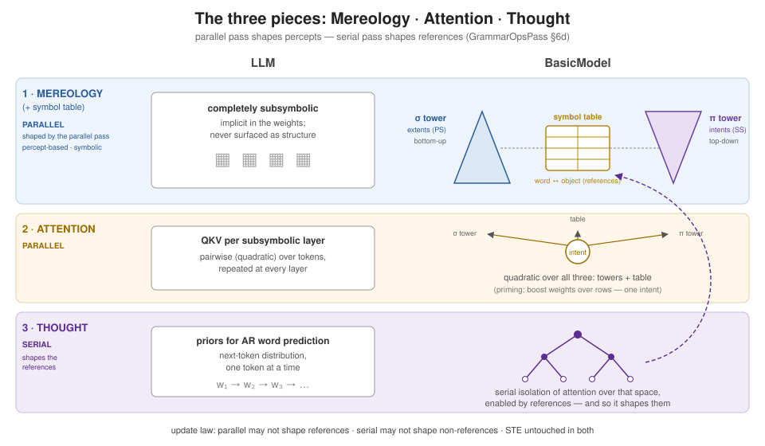
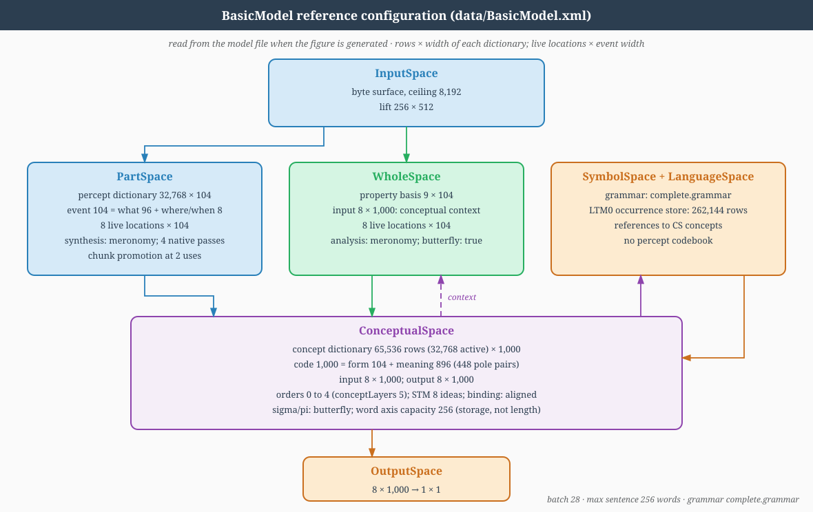
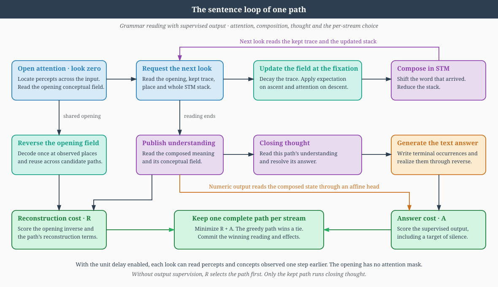

# Architecture

The subject is the system's design as a whole: the pipeline and its spaces
([Overview](#overview)), attention ([One attention](#one-attention)),
the two spaces and the layers that join them
([Sigma and Pi Layers](#sigma-and-pi-layers)), the sentence loop
([Whole paths](#whole-paths-and-concept-episodes)), memory's role
and the two systems
([Dual process](#dual-process-system-1-knowing-and-system-2)). Loss
paths, stop-gradient boundaries, parameter ownership and the joint learning
rule across representation, prediction, thinking and output are in
[Gradient flow across the architecture](GradientFlow.md).

> This document describes the cognitive and mathematical architecture. For the
> live software ownership map—including configuration, training, STM, losses,
> checkpoints, reconstruction, and proposed consolidation boundaries—see
> [Runtime Architecture and Componentization](Componentization.md).

## The three pieces: Mereology, Attention, Thought



> **Terminology.** One noun per space: a **percept** is a perceptual thing
> (PartSpace/WholeSpace, a code on two lanes within 0 to 1; *part* and *whole*
> are its two subtypes, and a basic percept is a row of the first Pi over its
> parts and wholes); a **concept** is one signed value a Sigma gives in
> ConceptualSpace; a **symbol** is a row of a Pi above order zero over
> concepts, split from its concept and with no dimensions
> ([Sigma and Pi Layers](#sigma-and-pi-layers)).

The architecture has three pieces, expressed through one attention mechanism
(see [One attention](#one-attention) for the current execution contract):

1. **The mereological towers (and the Concept codebook).** In an LLM the
   mereology is completely subsymbolic — implicit in the weights,
   never surfaced. In BasicModel it is percept-based and symbolic: two
   towers — the $\sigma$ tower ascending bottom-up (part-percept extents, the PS
   codebook) and the $\pi$ tower descending top-down (whole-percept intents, the
   WS property codebook) — bound by location into the ConceptualSpace
   dictionary, whose rows are concepts (part$\leftrightarrow$whole relations).
   SymbolSpace references those concept ids downstream.
2. **Attention.** In an LLM, attention is QKV per subsymbolic layer.
   In BasicModel: **bases of relevance guide attention; attention
   determines the contents of awareness.** Relevance is carried as
   weights on the percepts; ATTENTION is the single selection process
   (at CS) that reads the integrated priority out; AWARENESS is what the
   selection admits. (The priority-map synthesis — Fecteau & Munoz 2006;
   Bisley & Goldberg 2010 — with attention as the readout, never the
   sources; attention distinct from awareness per Koch & Tsuchiya 2007.)
   Relevance factors as **ORIGIN $\times$ AXIS**, realized as **ONE
   QUADRATIC PRIMING SURFACE per space with two write channels** (the
   simplified law): **bottom-up things are primed in virtue of BEING
   SEEN** (perception itself writes the surface: fired rows bump, the
   surface decays toward neutral) and **top-down things are primed in
   virtue of being DESIRED or HATED** (signed intent: desire boosts,
   hate suppresses with floor 0 — suppression, never a veto). "Top-down"
   is therefore a DIRECTION of writes on the one surface, not a second
   mechanism — matching biased competition (Desimone & Duncan: the
   template IS conceptual content) while keeping the two channels'
   automatic/strategic dissociation distinct (§C). The bottom-up
   channel that attention and the chooser read is the expectation of the next
   concept state, predicted from what was seen; the seen record itself is read
   only by placement (§C). The bracket chooser reads the same priming surface; its selected
   word bracket supplies the reading scope. Two AXES, orthogonal to origin ("Parse
   time" §C): HORIZONTAL (which parts within the level) and VERTICAL
   (which properties — fixing Rosch's Basic Level and, through it, which
   objects exist at all).
3. **Thought.** In an LLM, thought is the computation of priors for
   autoregressive word prediction. In BasicModel, thought is a
   **subsequent isolation of attention over that space, enabled by
   references** — the serial pass: referential lookup, shift/reduce
   composition, story selection. Because thought is the only process
   that invokes the referential taxonomy *qua references*, it is the
   only process licensed to **shape the references**.

This yields the codebook update law: **percepts are shaped by the parallel pass; references
are shaped by the serial pass.** STE is untouched in both modes; the
partition governs row updates — parallel mode may not shape
references, serial mode may not shape non-references
(`Spaces.reference_update_mask`; the `update_mask_fn` chokepoint on
`VectorQuantize`). Rational by construction — though possibly an
overly optimistic arrangement with respect to human thinking.

See [SymbolFirewall.md](SymbolFirewall.md) for the governing principle this
update law (and the codebook/meronomy ownership model generally) instances: all
computation is composed over typed, symbol-attached units — read/write masks,
no anonymous global residual stream.

## Words are a formula for narrowing attention

The second and third pieces meet in language: **words
are a formula for narrowing attention.** Attention selects what enters
awareness; a sentence is a sequence of instructions for making that
selection. What the words narrow is the **domain of discourse** — Boole's
universe of discourse, a register that the situation seeds, that is all
of conceptual space when there is no context, and whose running value within
a sentence is the idea under construction — and each word is a
**projection operator** onto a lower-dimensional or smaller subspace of it.

- **One kind of operator.** Nouns, adjectives, verbs and adverbs all
  restrict the domain; they differ in which dimensions they constrain, not
  in kind. A noun is an operator read against the whole domain. Part of
  speech is a role in a derivation, not a property of a codebook row.
- **Three indices.** Language individuates along which thing (determiner),
  which stretch of time (tense and aspect) and which alternative (modal).
  These are indices of the symbolic projection and of the LTM row; a concept
  stays one signed value, its form a percept ("Two spaces" below).
- **Regions are derived, never stored.** Membership is invariance under the
  operator and subsumption is absorption, so `part`, `whole` and `isEqual` are
  tests on the same algebra.
- **Two attentions, one chooser.** *Perceptual attention* is the bracket
  ([One attention](#one-attention)). Its objects are the percepts of the input and, since symbols are
  percepts, the symbols of thought; it excludes, and what it excludes is not
  taken up. Perception and higher-order thought share its one budget
  (`attentionBudget`), which is spent before grammatical analysis, so the
  words do not draw on it; attention to internal representations and to the
  senses draws on one limited resource (Chun, Golomb and Turk-Browne 2011;
  Kiyonaga and Egner 2013). *Conceptual narrowing* is what the words do, and
  it is different in kind: it keeps the domain it elects from as the Ground
  against which its Figure has meaning, the profile against its base
  (Langacker 1987) and Figure against Ground in language (Talmy 2000). There is a budget for percepts and
  none for conceptual space, though thoughts do shape it. Bracket candidates, restrictors and
  the identity binding are candidates in the one operation softmax.
  Neither is obliged to narrow: the open read excludes nothing of
  the input, and the symbol `everything` excludes nothing of the domain.

The language mechanics are in
[Language](Language.md#words-narrow-the-domain-of-discourse), and
the reading of it in
[Philosophy](Philosophy.md#words-as-a-formula-for-narrowing-attention-2026-09-28).

## Relation to LLMs, Formal Concept Analysis, and DisCoCat

> The sense in which compose, predict, invert, emit is *equivalent* to a
> token-level language model, with a proof and the four conditions under
> which it stops holding, is stated once in
> [LLMEquivalence](LLMEquivalence.md).

BasicModel is best read as an explicit decomposition of functions that a
transformer LLM usually folds into attention heads, feed-forward blocks, and an
unrestricted residual stream. The LLM comparison in this document is therefore
architectural, not merely benchmark-oriented:

- **LLMs:** a conventional LLM learns fluent priors over token sequences with
  latent attention and hidden residual state. BasicModel keeps the language-model
  goal of prediction and generation, but separates perception, concept
  formation, attention, grammar, truth, and reconstruction into named stores and
  typed operations. The wager is that some behavior now implicit in LLM weights
  should become inspectable state.
- **Formal Concept Analysis:** the PartSpace/WholeSpace towers and Concept
  codebook form a neural, fuzzy analogue of a formal context. Part-percepts play
  the role of objects or extents, whole-percepts play the role of attributes or
  intents, and concepts are the order-bearing links between them. The resulting
  meronymic structure is not a classical binary FCA lattice, because support and
  trust are graded and trainable, but it uses the same extent/intension
  discipline as its organizing constraint.
- **DisCoCat:** the grammar path is a DisCoCat-like composition engine: typed
  grammatical reductions decide how word/object meanings compose into sentence
  meanings in vector space. BasicModel differs from standard categorical
  compositional distributional semantics by making the reductions bidirectional,
  tying them to part/whole codebooks, and feeding their results into truth,
  reconstruction, and memory.

In short: LLMs are the operational baseline, Formal Concept Analysis supplies
the lattice and extension/intension reading of concepts, and DisCoCat supplies the
grammar-to-vector-composition reading of sentence meaning.

### Addressable attention — the typed `.where`

The answer-owned `PrimedSymbolReader` (`bin/Attention.py`)
ranges over a **typed addressable space**: one choice competes across every
store at once and emits a typed `.where` = `(space-id, bracket)` plus a soft-read
$\sum_k \alpha_k \cdot \mathrm{key}_k$. Six stores (the `SPACE_*` ids):

| id | store |
|---|---|
| `INPUT` | the staged input window (per-span percept content) |
| `STM` | the live short-term-memory rows |
| `LTM` | the shared clause store (rows, references and trust) |
| `PART` | the PartSpace codebook (part-percepts) |
| `WHOLE` | the WholeSpace property codebook (whole-percepts only) |
| `SYMBOL` | the symbols, rows of the Pi above order zero |

`PART`/`WHOLE` appear whenever their tower has a codebook. Pointing `.where` at a codebook/LTM store is recall; at the input
window it is reading — one mechanism, the type tag distinguishes them. The
selected read enters the answer through a gate initialized at zero, so output
loss trains retrieval.

A symbol is held apart from its concept: it has no vector, place, form or
trust read as a direction, and its value is the activation of its row.

These six stores are the substrate for the four foundations of mindfulness; the
mapping (and the trust-sign-as-vedana / luminosity-as-joy reading of `LTM`) is in
[Philosophy.md](Philosophy.md#the-four-foundations-of-mindfulness).

## Symbolic weights, reconstruction, parse-time, attention

A design pass clarifying four coupled pieces (PS = PartSpace, WS = WholeSpace,
CS = ConceptualSpace, SS = SymbolSpace).

### A. Symbolic weights (the two-phase forward)

The concept store's weights are the Pi and the Sigma of each order
([Sigma and Pi Layers](#sigma-and-pi-layers)): at order zero the first Pi over
the basic percepts' parts and wholes, the Not, and a sparse Sigma over the
signed values of the basic percepts' rows; above it a Pi of symbols over
concepts, the Not, and a Sigma of concepts over symbols. Every Sigma is
stored as compressed rows on the device with an index of columns, and every
matrix is grown into room allocated beforehand by the geometric taper
(`_order_caps`). A promotion writes an edge at one; the penalty thins the
values of the entries that exist.

**The forward has one terminal cutover.** Input attention first reads the
whole sentence in the open run, and later looks are activities over its
percept bank under `attentionBudget` ([One attention](#one-attention)).
`bindingDepth` constructs the binding layers through which the carrier
passes; it does not repeat an independent attention loop. The concept
inventory and the per-word grammar retain their structural bounds.

Alongside the weighted reading, the store holds the discrete relation table:
ordered role-tagged constituent records (`embed_pair` stores the ordered pair
$[\text{whole}, \text{part}]$, whole first: whole $\Rightarrow$ part / if
$\to$ then). A thin shared `ConceptAllocator` owns global concept ids, the
raise and singleton sets, and the idempotency caches; ConceptualSpace keeps
orchestration only. Distributed codes serve similarity, retrieval and the
reconstruction; they do not determine conceptual presence.

#### Relation-table entry contract

At the sparse-entry level, one entry binds one concept row index to one symbol
column index, plus its membership weight, at zero or above, whose sign is
read from the Not: a for entry or a Not entry. A concept definition is
therefore not limited to one symbol: the same concept index may occur in
multiple entries, each paired with a different symbol index. Those repeated
entries collectively form the concept's sparse, set-like definition; different
concept indices define different concepts.

The same representation is sufficient for a vine, with an important
qualification: one entry alone does not encode a total order. Each vine link is
the ordered pair $[\text{whole}=\text{current},\text{part}=\text{rest}]$, where
`rest` references the next relation concept. The discrete role-tagged records
preserve the whole/part distinction exactly, while recursive nesting and wave
iteration make the sequence order operational. In short: repeated entries for
one concept define a set; recursively nested relation concepts define a vine.

The lattice poles are vectors of the presence domain: **NOTHING**
$= [0,0,\ldots]$, the bottom from which the parts build, and **EVERYTHING**
$= [1,1,\ldots]$, the top from which the wholes cut. A fresh object's
standing bounds supply no perceptual membership; its definition awaits
testimony. Word/object associations are definitions, `LTM1` rows of a word
and its object. Completed sentences store their actual end state; they keep
no word chain or derivation. A 1:1 tie between references is the SINGLETON
principle: the unit-set $\{x\}$, a whole containing
exactly one symbolic part, is the constructive primitive behind
if$\to$then ($\{x\} \Rightarrow x$) and the recursion vine, and it is stored
structure that `resolve_identities` never collapses.

### B. Reconstruction (parts $\to$ `.what`, wholes $\to$ `.where`)

InputSpace maps two views of the *same* data, segmented differently: a
**universal view** to WS (which it analyses) and an **atomic view** to PS (which
it synthesises). WS yields **low-fidelity** information covering the **whole**
space; PS yields **high-fidelity** information over a **smaller** area
(`_paint_reconstruction`: the universal view paints the background, the atomic
view is averaged in where it has support). For verbal reconstruction of text the
**parts (PS) should reconstruct the `.what`** and the **wholes (WS) should
reconstruct the `.where`** — approximately the inverse of what happens at parse
time. The separate `what_scale` / `where_scale` / `when_scale` reconstruction
channels already exist to carry this. Per-word reconstruction scores content
and position only: every word in an input carries the same field timestamp,
so repeating that timestamp as a target adds no word-specific information.
The temporal band still passes through grammar operations and their inverses;
a future field-time objective would score it once per field.

For text, it would be foolish to insist on an *absolute* `.where` from WS: the
parts already know each word's size, so under a perfect tiling the placement is
just the running sum of part sizes (serial mode computes this as an AR1 increment
over the previous `.where`; the for-loop is time). WS may still supply **type**
information for the tiling — *word*, *space*, *word*, *punct*, … — even where it
does not supply coordinates.

### Tiling, subspace sizes, and consciousness

Whether the parts/wholes **perfectly tile** the input (a partition — so order
alone reconstructs, with no gaps between parts) is **NOT** entailed by
parallel-vs-serial mode. It is entailed by the **relative sizes of the InputSpace
subspace and the PS/WS subspaces**:

- In **serial mode** they are *forced* to match — the for-loop traverses **all**
  of input space — so the tiling is always perfect.
- In **parallel mode**, if they do not match because InputSpace is *larger* than
  PS/WS, that bounded mismatch is exactly where the two attentions **select what
  is most relevant to consciousness**: PS/WS cannot hold all of InputSpace, so
  attention picks the salient subset to surface. (When InputSpace $\le$ PS/WS — as
  in the current test fixtures — the tiling is again a partition and order
  suffices.)

### C. Parse time (relevance = origin $\times$ axis)

At parse time CS receives the overcomplete input representations from the PS
and WS mereological towers. **Bases of relevance — carried as weights on the
percepts — integrate into a priority signal; attention is the selection at
CS that reads it out; awareness is what the selection admits.** Relevance
factors as ORIGIN $\times$ AXIS: two origins (perceptual salience/novelty;
symbolic history) crossed with two axes (horizontal: which parts; vertical:
which properties/level).

- **Salience/novelty, HORIZONTAL (significant particles, PS)** — within
  the level the vertical axis fixed, WHICH items? The level may fix the
  word boundary of *wheelhouse*, but what makes *wheel* + *house* its
  building blocks rather than the equally-segmentable *wheelhou* + *se*?
  **Greedy longest-match** is the current easy approximation
  (`RadixLayer.longest_match`); particle salience should guide both
  parsing and reconstruction here. The signal attention reads
  is the expectation formed from what was seen (below); there is no separate
  novelty computation.
- **Salience/novelty, VERTICAL (significant properties, WS)** — a
  property can be stimulus-significant too (a novel type-run, an
  unexpected region); property salience weights the wholes and thereby
  participates in fixing the **Basic Level** of analysis (E. Rosch): the
  size of parts and wholes. The scope handoff is the vertical axis's
  EFFECT ON PERCEPTION: the word-level isolates the regions that are type
  *word*, *punctuation*, and *space*, forming a **complete tiling** (the
  WS$\to$PS `_passback_scope_where` handoff) — the level of analysis
  governs which particular objects are chosen at all.
- **Two write channels (SS and every space).** The SEEN record is written
  bottom-up: fired rows bump and the ledger decays exponentially toward
  neutral (`prime_seen`). DESIRED/HATED is written top-down as signed intent,
  in a buffer of its own (`prime_desire`): desire boosts and hate suppresses
  with floor 0, never a veto. The two channels are the automatic/strategic
  dissociation (Posner & Snyder 1975; Neely 1977): automatic priming through
  use is fast, capacity-free and inhibitionless, while strategic priming is
  slow, capacity-limited, goal-set and able to suppress; selection and reward
  history capture attention even against current goals (Awh, Belopolsky &
  Theeuwes 2012). The composing walk reads priming through its learned attention
  context. Each bracket also supplies the excess and omission between its
  conceptual field and the forecast made with its span left out. The chosen
  bracket supplies the scope handed to mereology.

**Concept spread is an expectation.** When a sentence
opens, expectation, the spread on the structure's own Pi, Not and Sigma
([Sigma and Pi Layers](#sigma-and-pi-layers)), reads the observed field on
both lanes and gives the expected field at every order, frozen for every
path of the sentence (`ConceptSpread.open_prediction`). The relevance read (`relevance_weights`) is
$1 + \max(\text{expected knowing}) + \text{desire}$ for each stream and row,
clamped at zero ($1 + \text{desire}$ on the serial concept path). Attention,
the compose chooser, retrieval, rule order (`ConceptSpread.rule_order`) and the sparse
projection onto the tower rows read it detached. Expectation is made at each
look and learned stage by stage: at each look the concepts' stage
(`expectation.concepts`) is the difference between what the earlier looks led
it to expect and what the look brings, and the basic percepts' stage
(`expectation.percepts`) likewise; each cost teaches its own stage alone. The spread biases where attention goes and carries
no truth: nearness in meaning asserts nothing, and truth moves only along
rules, through `infer`. Location keeps its other readers:
`bind`'s content term, MTM's candidate matching and the
reconstruction bank's selection.

**A conceptual space for each order.** Every concept is
placed by its context, concrete and abstract alike, and a raised class is
placed by its context like any other concept; but "the concepts at every
order live in spaces with different geometries", "since it is not clear that
the space of nouns, for example, should be constrained by the space of
events". Each order's concepts have a conceptual space of their own, and a
symbol's cone is tested against the concepts of one order alone. Forms and meanings never
share a metric: placement never reads the percept cube
([SymbolFirewall](SymbolFirewall.md)).

**The guard against a feedback loop.** Codes never read a
value computed from codes. The context of placement is activation read before
any weighting by likeness of places, so no place is moved by a value
computed from places. The seen ledger `_priming_seen` is written by the decay
(`primingDecay`, default 0.9) and the seen bumps; desire and the prediction
never write it, and the collapse audit reads its nonnegative
excess over neutral. The loop that remains is indirect and bounded: the
prediction biases attention and the chooser, which bias what is observed and
composed, from which the codes are placed. In `bind` priming enters only the
expectation term (the prime), never the content term (the meet over content),
and recurrence or a row's activity, not priming, mints.

**Placement.** Meaning is placed by context, while forms of order zero take
centroids and a row above order zero carries no perceptual form. At each kept close, and only
there, `MereologicalCodes.observe_close` places the rows active in the
sentence's field. Each codebook seat holds a unit for-lane
direction `placement[r]`, a witness count and a 32-byte content key; the for
lane of the cached meaning is that direction scaled by the row's trust radius,
so an unplaced row reads zero. A first placement starts from `identity_code`
of the content key (a word's bytes, or a key pinned when a concept is minted),
a private SHA-256 draw that uses no global random state. One subgradient step
of

$$J(q)=\sum_{i\in C} a_i\,\frac{\mathrm{meet}(q,c_i)}{\mathrm{mass}(c_i)}-\lambda\sum_{n\in N}\frac{\mathrm{meet}(q,n)}{\mathrm{mass}(n)}$$

then moves it, on the for lane only: $C$ are the placed rows of its own order
active in the sentence's field at every order, a token's types among them
(`FieldProjection.close`), at activation $a_i>0$, $N$ up to
`placementNegatives` (5) placed rows of its own order with zero activation, drawn
by a generator seeded from the sentence's content key, meet is the
coordinatewise minimum summed, mass is the coordinate sum, and $\lambda$ is
`placementNegativeWeight` (1.0). The subgradient of a meet is 1 where
$q_j<c_j$, and the update is
$q\leftarrow\mathrm{normalize}(\max(0,\,q+\eta\,\partial J/\partial q))$ with
$\eta$ = `placementRate` (0.1). All rows of one close step from one snapshot,
so seat order cannot matter; a raised class is stepped by its context like
any other concept. This is skip-gram's objective
(Levy and Goldberg 2014; Qiu et al. 2018) read from the model's own registered
co-occurrence, in conceptual space's metric.

Activation and location are one quantity at two time scales: activation is a
short-term position in conceptual space, and location is that position made
long-term, as the hippocampal predictive map is learned from transient
activation (Stachenfeld, Botvinick and Gershman 2017). Training location
therefore needs both halves, co-activated concepts drawn together and never
co-activated ones pushed apart: attraction alone collapses the codes, so the
negatives are the brake. `collapse_audit` measures it: the mean meet ratio
against the registered context should rise while the ratio against fixed
audit negatives does not.

**Frozen concepts (`freeze_concept` / `_frozen_concepts`).**
A concept's relational structure can be FROZEN: no FORMING of new edges, no
FORGETTING of existing ones, no WEIGHT drift on them
(`_refresh_frozen_values_hook` zeros backprop gradient on the frozen rows'
edge values) — the codebook row/content stays live and keeps tracking
perception; only its DEFINITION is fixed.

**Priming is read by attention's context.** The priority surface enters a look
only through the attention context (`AttentionContext.context`) that `attend`
maps to its request ([One attention](#one-attention)); it changes which
concepts are asked for, and never distorts an activation. Rows a reading
admits write back through `prime_seen`. `primingDecay` sets the seen decay.

**Attention and expectation share a gain mechanism.**
Attention contains the admitted region; expectation attenuates predicted
activation within it. Both are gains in $[0, 1]$ that compose by
multiplication, $c = m \odot a \odot o$ ("Surprise at every layer" below):
attention's gain $m$ is exactly zero outside the region, where a deep
expectation is absent rather than attenuated, so the unattended field passes
nothing and reports no omission. Neither changes the native identity or adds predicted
content to the observation. Expected activations separately prime selection,
while excess and omission train the predictor.
The existing desire channel remains distinct: desire writes only to
selection, never into content, so expectation never learns to predict and
cancel it. An open object keeps its prime and is spared attenuation; a
dimension withheld by `non` has no prior, so it is neither primed, attenuated
nor counted as omitted. See [ExpectationRetention](ExpectationRetention.md).

**The bases interact (cross-basis priming).** The psychological literature
is unambiguous that symbolic activation primes the subsymbolic layers:
automatic spreading activation vs. strategic expectancy in semantic priming
(Neely 1977 — the heat vs. intent split, exactly); word-level activation
feeding back to letter perception (McClelland & Rumelhart's interactive
activation); conceptual templates biasing early sensory competition
(Desimone & Duncan's biased competition); learned context guiding spatial
attention without awareness (Chun & Jiang's contextual cueing); labels
sharpening perception (Lupyan's label feedback). The architectural
consequence: **conceptual activation supplies the reading prior** — the
reading template is built from the currently
selected concepts (the pyramid's winners, `_concept_activations`) rather
than a free-standing query — making WS's vertical basis the conceptual
tower's own downward projection, as biased competition prescribes.

### D. Attention indexing (`.where` / `.when` / codebooks)

The **global location registry** assigns disjoint address ranges to input
positions, part rows, whole rows and symbol poles. Each input modality has a
range of its own (text, a numeric input, the scalar beside the words), so the
range of an address gives its modality, as the block a row lies in gives its
order. A place on two axes is one row-major address in its modality's range,
decoded by the declared shape (`WhereEncoding.decode_index`): in a 28 by 28
image, row 2 and column 3 is address 59. A word's percept and symbol
occurrences use its input byte start in the text range. Repeated words thus
have different occurrence locations even when they refer to the same stored
row. A stored percept's location is its row address; a symbol has no address
(it lives in no space), and what thought produces is placed where it stands.
There are no
extra address slots per occurrence. Each address travels in the event's
`.where` band: two sine/cosine pairs with different periods.
The long period covers the entire registry; the short period resolves one
location. Both periods are derived at construction, and every space shares
the same encoding. Captured programs retain the bands, from which an integer
address can be decoded when needed.

Codebook identity remains the row index within its owning codebook. The
registry adds a distinct location range for each owner; it does not replace
that identity. An `LTM0` row is named by its time ("Occurrence addresses"
below). `.when` carries the stamp of the model's one clock; `.where` retains
the input/percept location. No recall selects rows by their stored band; the
chooser and the operators compare a stamp with the present by the comparator
([Sigma and Pi Layers](#sigma-and-pi-layers)), and a stamp is never rewritten
as an age.
A sentence read again is a new row at a later time. A full
store raises.

The spatial band records a start, not an extent. A part's byte length gives
its end from that start. A whole's end cannot be recovered from the start
alone; this remains a limitation even though perception retains span metadata.

## Cognitive grounding: dense-perceptual vs sparse-symbolic

The design splits representation into a **dense, subsymbolic** code (the
percepts' codes in perceptual space, overlapping vectors of parts and
wholes, read by the first Pi alone) and a **sparse** composer (the Not and
the Sigma at every order, and the Pi above order zero, stored as compressed
rows, which compose the *scalar values* of concepts from rows and symbols).
This is not an
arbitrary engineering choice; the split, and specifically *why sparsity belongs
only on the symbolic side*, tracks several convergent findings on human
cognition.

- **Complementary Learning Systems** (McClelland, McNaughton & O'Reilly 1995).
  Neocortex uses slow, dense, *overlapping* distributed codes that extract
  statistical structure across experiences; hippocampus uses fast, *sparse,
  pattern-separated* codes to bind individuated episodes. The reason
  hippocampal codes are sparse is **interference avoidance among individuated
  bindings**, not compression: dense overlapping codes suffer catastrophic
  interference when made to hold many discrete conjunctions. This is the
  cognitive answer to "why sparse, and why only symbolically" — the perceptual
  manifold wants the dense mixing; the binding of individuated things into
  reusable conjunctions (the joint/sentence concept over word-symbols) wants
  sparsity. A **symbol is a handle with no dimensions on grounded concepts**,
  which is precisely a hippocampal index into cortex; the way back down
  through the Sigma and the Pi is pattern **reinstatement**. Caveat: this maps the
  *sparse-symbolic vs dense-perceptual* axis onto hippocampus-vs-cortex — NOT
  the ramsified *orders* (abstraction is a separate, graded
  anterior-temporal / prefrontal axis).
  The individuated episodes of this account have
  their own place in the store: a row keeps, beside its idea, a few slots,
  each one concept of its moment with its value, and a recall by content
  matches against them and brings the best row back onto the STM stack
  ([Episodic and semantic memory in the two systems](#episodic-and-semantic-memory-in-the-two-systems)).

- **Dual-process cognition** (Sloman 1996; Kahneman). A fast, parallel,
  similarity-driven associative system and a slow, serial, rule-based symbolic
  one. The model's two systems are divided at symbols, or equivalently at
  higher-order logic, which is what symbols allow: order
  zero, `intuit`, expectation and memory's linking at order zero belong to
  System 1, and System 2 is that logic, which the three grammars carry out
  ([Dual process](#dual-process-system-1-knowing-and-system-2)). The
  sparsity and the serial capacity-limit are the *same fact*: a sparse
  composer has low fan-in per concept, the computational shadow of
  working-memory span (Miller's $7 \pm 2$; the STM depth $\approx 8$ the model
  already carries).

- **The neuro-symbolic interface / systematicity** (Fodor & Pylyshyn 1988). The
  architecture is a concrete stance on the oldest fight in cognitive science:
  **content stays connectionist** (dense, continuous, invertible mixing),
  **structure becomes symbolic** (discrete, reusable, composable edges), and the
  **interface is the first block**: the basic percepts' Pi, the only reader
  of the codes, then the Not and the sparse Sigma that make concepts of order
  zero from the rows. The discrete edges buy the
  compositionality/systematicity that pure distributed codes are accused of
  lacking, while the dense codes keep perception continuous and
  gradient-trainable.

- **Grounded cognition** (Barsalou 1999; contra amodal symbol systems). Because
  a concept is a Sigma over perceived rows and its value carries the
  observed evidence, the symbols are not amodal Fodorian tokens — they are
  grounded pointers-with-magnitude, closer to perceptual-symbol "simulators."
  Retaining graded memberships is cognitively load-bearing: graded activation *is* typicality / salience
  (Rosch's graded membership), which a cosine would discard.

- **Basic-level categories are perceptual, not content-free** (Rosch et al.
  1976). "Subsymbolic" $\ne$ "category-free": the concepts of order 0 are
  already carved toward basic-level regions, because that is what perceptual
  integration *for a categorizing organism* produces. This suggests the
  feature-defined conceptual regions are the **pre-linguistic Gärdenfors regions**
  (prototype centers, basic-level, perceptual) and the sparse symbol graph is
  the *post-linguistic* labelling-and-composition that points at them — three
  cognitively distinct stages (integrated field $\to$ unnamed category region
  $\to$ named composable symbol), not two layers with a bookkeeping detail
  between.

**Where the mechanism is deliberately cleaner than cognition.** (1) The order-0
boundary is a *default flow*, not a wall: perception is concept-penetrated
(top-down / predictive coding), and it is the TOP-DOWN attention channel —
goal/emotion-weighted properties fixing the level of analysis, delivered to
perception through the scope handoff — that carries that penetration back down;
the priming/heat loop is the BOTTOM-UP horizontal channel and touches
perception only through what it makes retrievable. The division must never
become impermeable.
(2) *Invertibility* is instrumental (reconstruction, gradient), not a biological
claim; brains approximate and predict, they do not compute exact inverses. The
extensional/intensional semantics this grounding implies for a **single**
conceptual space is developed in
[BasicModel.md](BasicModel.md) "Conceptual Space." The memory, two-truths,
expectation, testimony and feeling side of the grounding, with its discrepancy
list, is in [Philosophy.md](Philosophy.md#psychological-grounding-2026-09-16).

**References.** McClelland, McNaughton & O'Reilly (1995), *Why there are
complementary learning systems in the hippocampus and neocortex*, Psychological
Review 102(3). Sloman (1996), *The empirical case for two systems of reasoning*,
Psychological Bulletin 119(1); Kahneman (2011), *Thinking, Fast and Slow*.
Miller (1956), *The magical number seven, plus or minus two*, Psychological
Review 63(2). Fodor & Pylyshyn (1988), *Connectionism and cognitive
architecture*, Cognition 28. Barsalou (1999), *Perceptual symbol systems*,
Behavioral and Brain Sciences 22(4). Rosch, Mervis, Gray, Johnson &
Boyes-Braem (1976), *Basic objects in natural categories*, Cognitive Psychology
8(3). Gärdenfors (2000), *Conceptual Spaces: The Geometry of Thought*, MIT
Press. Olshausen & Field (1996), *Emergence of simple-cell receptive field
properties by learning a sparse code*, Nature 381 (sparse *activation* over a
dense dictionary — the dictionary/atom side here — as distinct from the sparse
*relational graph* of the sparse matrices above order zero).

## Biological plausibility

**What is plausible.**

- *Two lanes and the Not entries.* Light and dark have a channel each from the
  first synapse of the retina: the ON pathway inverts the photoreceptor's
  signal at one synapse and the OFF pathway keeps it. So evidence against, at
  the level of percepts, is the evidence for of an opposite, carried on a lane
  of its own and driven positively, as the against lane is. Excitation and
  inhibition are carried by different cells (Dale's principle), so each sign
  is a thing in the circuit, as a Not entry is; a cue that signals the
  omission of an expected outcome becomes a conditioned inhibitor (Rescorla
  1969), and animals learn A or B but not both where a unit for the compound
  takes inhibitory strength (Pearce 1994): a Pi, a sign and a Sigma.
- *A local rule of excess and omission.* What was read beyond what was
  expected, and what was expected and did not come, are two signals at each
  row of the one gain field ([One attention](#one-attention)); the two signs of
  an error are carried by two populations (Keller and Mrsic-Flogel 2018), and
  dopamine neurons dip at an omitted reward (Schultz, Dayan and Montague
  1997).
- *Two pathways, what and where.* Object identity and location run on two
  pathways that are distinct and linked (the two-streams account, whose
  independence is contested), and features are held on maps tied to one map
  of locations, so that attending to a location gathers the features found
  there (feature integration). A percept's band of fixed where wires, with
  the salience map lighting it, and a look as the intersection of what and
  where, are that arrangement.
- *A mind without buffers*. STM is a tree that might be
  unfolded by the same process as conceptual recursion, kept by a trace of
  activation and not by a buffer that is read and written; with the extension
  (a field of active concepts) in place of the intension, the mind works by
  activating structures rather than by reading and writing contents.
- *One fold for every row.* A basic percept and a symbol are rows of a Pi
  with one form, the plain product over their constituents: "I think they
  need to be of the same form (for biological plausibility)".
- *Memory as activation.* What a walk has done is kept as the activation of
  concepts in the slots of episodic memory, "so that you are not just bolting
  on memory and structures to the algorithm".
- *Behaviour shaped, not prohibited.* No rule forbids a walk an act to make
  it pass a measure, which "seems very unbiological".
  Attention is taught as animals are, by successive approximation under
  conditioning: lessons that need a narrower focus each time, with the
  behaviour rewarded by its outcome.

**What is not.** Inverses and backpropagation. Brains approximate and
predict; they do not compute exact inverses, and the exact way back of the Pi
and the least-squares way back of the Sigma are instrumental, for
reconstruction and gradient. Nor is there evidence that a brain propagates an
error backward through its layers as the training does.

## Overview

BasicModel is a bidirectional neural architecture organized as a pipeline of five
**spaces** plus a symbol host (`SymbolSpace`), each implementing a distinct
representational transformation:

```
Forward:  InputSpace -> {PartSpace, WholeSpace} -> ConceptualSpace -> SymbolSpace -> OutputSpace
Reverse:  OutputSpace -> SymbolSpace -> ConceptualSpace -> {PartSpace, WholeSpace} -> InputSpace
```

There is no per-stage feedback loop between the spaces:

- **Perception shares one attention.** The open run reads the whole
  sentence, and each later look is an activity over its percept bank; the
  looks share `attentionBudget`, and theconstructed binding layers carry their result forward.
- **The symbolic loop is grammar over STM**: pairwise grammar operations
  dispatched by the signal router (`LanguageLayer`). `Lift` and `Lower` share
  the GrammarLayer dispatch surface with `Intersection`, `Union`, etc.

The forward pass transforms raw input into predictions; the reverse pass
reconstructs the original input from the symbolic representation. Both
directions are trained together: each sentence's complete paths are compared
on R + A (reconstruction plus answer cost), and one optimizer takes one step
per sentence over the reconstruction (scaled by `reconstructionScale`),
expectation and output terms
([Whole paths](#whole-paths-and-concept-episodes);
[GradientFlow](GradientFlow.md)).

`PartSpace` and `WholeSpace` both subclass `Space` directly: both views are
perceptual, symmetric duals with the same `forward(in_sub, CS_out)` signature
and no shared intermediate base class. At the corpus callosum, objects are
analysed and synthesized by sending them back through the towers: wholes get
split, parts get chunked. In symbolic "mode" the objects sent back are
symbols. Terminologically there are objects and references; a reference is a
*sign* (a quantized version of the referent) or a *symbol* (an unrelated
version of the referent, of much lower dimensionality). `SymbolSpace` is the
grammar/word space-role (abbrev `ss`; the WholeSpace stream is `ws`).

Under `<mereologyRaise>` (default false), perception's autobind hook builds a
meronymic lattice and raises abstraction order as attention requires. PartSpace and WholeSpace use
independent `.what` codes and a shared input location. Concept definitions
refer to memberships in both views, without equating their code values.
`RunStructureLayer` reads retained native witness spans in the current
ConceptualSpace field. Their contiguity and refinement history govern
automatic promotion above order 1; a constituent count supplies no such
permission. Word/object identities remain in the conceptual inventory, and
object-kind relations require testimony. The live support geometry
is released with the attended field; only scalar refinement history persists.

### Spaces

| Space | Role | Owns | Notes |
|-------|------|------|-------|
| **InputSpace** | Lifts raw data into working dimensionality; surface tokenization | LiftingLayer; lexer wiring (text mode) | Reaches PS's lexicon via back-ref; no own lexicon |
| **PartSpace** | Bottom-up ordered part synthesis | Radix parts, native codes and `<synthesis>` policy | A form's code is the set of its parts, the greatest of their codes in a parts half of 64 coordinates on two lanes. Recurrence forms parts; one lookup a sentence reads the percept bank. |
| **ConceptualSpace** | STM container + main grammatical CPU + the layers of every order | STM (`ShortTermMemory`, depth ~8); the first Pi of basic percepts (`PerceptPi`), the Not of order zero (`order_zero_not`) and its sparse Sigma (`order_zero`); above them the Pi of symbols, the Not and the Sigma of concepts, as compressed rows; the relation store (`ConceptAllocator` + ordered records) | `forward(subspace, word_subspace=None)`: STM bookkeeping only. The layers read each reading once; grammar ops are dispatched via the signal router. |
| **WholeSpace** | Top-down division by properties | The table of wholes (`PrimitiveProperties`) and `<analysis>` policy | A whole's code is the OR of the catalog parts that belong to it, or the AND of other wholes; a percept's wholes half is the least of its wholes' codes, from all ones. A whole is read where a run lies. |
| **OutputSpace** | Final prediction | LinearLayer | nActive, nDim, nVectors |

The native perception and conceptual carrier contract is:

```
PS.forward(x):  return native_part_read(x)
CS.forward(subspace, word_subspace):
    STM[1..7] = STM[0..6];  STM[0] = folded          # newest at slot 0, shift toward higher indices, oldest (slot 7) drops off; mode-dispatched, the pump stays subsymbolic
# POST-PUMP cutover (sparse-active, once per forward, in _forward_body):
#   the bank's basic percepts -> first Pi (for and against) -> Not (one signed value a row)
#   -> sparse Sigma of order zero -> at each order above: Pi of symbols, Not, Sigma of concepts
SS:  no atomic forward operator; hosts write-required grammar ops
     (the CS->SS symbol bind leg is SymbolSpace.forward_concept_to_symbol, .forward()-mediated)
```

Per-stage feedback is absent at the substrate; grammar dispatch over STM
provides the recurrent character via the signal router.

**The familiar tier** (gated
`attentionPromotion`, default off): candidates and identities share
`MediumTermMemory`'s entries, transient ids, access clock, capacity,
eviction and checkpoint. Each candidate retains a bounded sparse support
and its evidence-weighted centroid in conceptual width. At the open end
of the sentence, every present word bracket is read once, before grammar
narrows attention. Positive field rows join lexical rows for the one
`prime_seen` step; that same field opens or updates
candidates, including conjunctions of witnessed rows, without
minting. A candidate never re-mints what exists: when its support is one
witnessed row, or it matches a witnessed row of its order by the same literal
or the same support, the observation is a use of that row (an access, with
`cover_members` merging any added members by maximum) and opens nothing. The
literal route (`observe_native_cases`) opens candidates only for located
conjunctions that are not lexical forms, so a word's object comes from its
defining clause or the recurrence of its mentions, never from the word's own
letters. `PrependedSymbols.stage` carries these familiar entries beside
pending identities. At the kept end, activated references advance MTM's
clock; after placement, `promote_candidates` applies one recurrence rule:
`conceptMintCount` observations within the horizon, outside the both corner.
Both readings retain candidate refinement and wait. A defining equality
or IS clause can promote its pending subject at that kept close. Neither
route supplies a grammatical order. Explicit raises and promoted
candidates share `cover_members`: sigma edges merge by maximum; the class is
placed by its context like any concept and carries no perceptual form.
Transient occurrence members wait for a durable symbol.

See [Spaces.md Section "Sigma / Pi ownership"](Spaces.md#sigma-pi-ownership)
for the cognitive rationale and the migration trail.
See [Logic.md Section 8](Logic.md) for the algebraic constraints on sigma/pi.

Dimensions (`nDim`) are read from `TheObjectEncoding`. Codebook sizes
(`nVectors`) are likewise on `TheObjectEncoding`; the factory validates
`nVectors >= nActive`.

**Fixed capacities.** Every store, bank and working buffer is allocated once,
at model construction, to a capacity derived from declared bounds (sentence
words, `stmCapacity`, the stream count, the configured inventories), with the
derivation written beside the allocation. Storage never grows or shrinks at
run time: a write past capacity raises rather than resizing, clipping or
dropping content. Fixed shapes keep compiled graphs valid across inputs and
checkpoints comparable. The one exception is the transient content of a native
thought store, which may be rebuilt to the exact size a meaning needs under a
construction-time ceiling ("Whole paths and concept episodes" below).



Layer selection by `invertible` (reconstruction is seeded from concepts
unconditionally, gated only by `reconstructionScale`):

1. **Non-invertible, forward-only layers** (`PiLayer`, `SigmaLayer`):
   forward-only, no reverse pipeline.
2. **`invertible`**: Single invertible layer
   (`PiLayer(invertible=True)`, etc.) serves both directions, sharing weights.
3. **Not `invertible`** (but reconstructed): Two layers with separate
   weights --- `forward()` on one, `reverse()` on the other. Avoids the
   expressivity limitation where a non-invertible layer can't represent the
   inverse of another. Reverse uses matrix `pinv` (may be numerically
   unstable from SVD convergence). `<invertible>true</invertible>` avoids
   this via shared-weight inversion.

### Single Optimizer with Overlapping Weight Spaces

On a reading, reconstruction compares the wide-open field’s inverse with
the input before narrowed looks or thinking. At each narrowed look, the
attention request predicts basic percept activity and its location. The
spatial pyramid compares that forecast with the sensory field inside the
chosen fixation and teaches the network that issued the request. After
the model fixes its response, the supplied answer scores the produced
field. Silence is the target when the lesson supplies no answer.

These errors contribute to one optimizer step. The observed field is
detached, and the expectation predictors learn from their local errors.
Shared operators receive gradients from the computations that use them.

By default (`separateChooser=false`) each sentence's single backward projects
the answer gradient A against the reconstruction gradient R on every shared
optimizer unit, removing only A's component that opposes R
(`GradientProjection`), and output reads the concluded idea live. Under
`separateChooser=true` each objective owner differentiates only its own
parameters, and output treats the concluded idea and its contextual operands
as given. The owners, sides and units are in [GradientFlow](GradientFlow.md).

An invertible transform uses its same learned mapping in the forward and
inverse directions ([`InvertibleLinearLayer`](../bin/Layers.py#L1066)); its gradient
follows the configured joint-learning policy.

Reference: A.M. Rogers, T.T. Shannon, and G.G. Lendaris, "A comparison of DHP
based antecedent parameter tuning strategies for fuzzy control,"
*Proceedings Joint 9th IFSA World Congress and 20th NAFIPS International
Conference*, 2001, doi:
[10.1109/NAFIPS.2001.944317](https://ieeexplore.ieee.org/document/944317).

### Training Loop

One optimizer with persistent state (momentum and variance accumulate
across epochs) is stepped once per sentence (`Models.getOptimizer`; the
per-owner update rules are in [GradientFlow](GradientFlow.md)):

1. Forward pass: read and compose the input into its `end_state`
2. Reverse pass: `end_state` $\to$ reconstructed input; the reconstruction
   cost R compares it with the original input
3. Thought and output: the prediction, and the answer cost A against the
   target where output is supervised
4. Run steps 1-3 for the greedy path and each `explorePaths` alternative, and
   keep, per stream, the strictly cheapest path on R + A
   ([Whole paths](#whole-paths-and-concept-episodes))
5. Backpropagate the sentence's objective once (A projected against R by
   default)
6. If ergodic: run `paramUpdate()` (gradient energy sensor updates `bias`/`var`)
7. Optimizer step (embedding params excluded when `trainEmbedding` is `NONE`,
   `CBOW`, or `SBOW`)
8. If `trainEmbedding` is `CBOW`, `SBOW`, or `BOTH`: run embedding update step

Ergodic exploration is not epoch-annealed. `ErgodicLayer` starts in
pure-exploit mode (`bias=1`, `var=0`) and updates those buffers from observed
gradient variance after backward. See [Ergodic.md](Ergodic.md).

See [Params.md](Params.md) for all XML parameters. See
[Training.md](Training.md) for embedding modes.

### One attention

Attention is content based. A look asks for concepts, and what it returns is
found by what the sentence's percepts are and where they stand; nothing
selects by position or by time alone, no place is given to a look as a
number, and a look is not made of the intervals the input is split into
("If that is forced to words, then the lexer is doing the
models job"). What the grammar does with a look, the literal and silence are
in [Language](Language.md#the-looks); this section gives the mechanism.

**The percept bank.** At a sentence's start one lookup reads its percepts
into one bank, on the device. For each event the bank holds its row of the
first Pi, which is what the event is (a form's row where the store knows the
form, and the rows of the form's parts); its place, which is its start; its
band of where wires; the clock's stamp; the token it belongs to; and its activity on
two lanes. The events are the lookup's rows, not bytes. A known form that
spans several tokens (`ice cream`) is an event of its own at its start. The
first Pi is read only on the rows the lookup names, and nothing on a look's
path reads a span of the input again.

**A look is an activity over the bank.** An event's activity in a look is its
own activity, times its what match, times its where match: a percept is in
the look to the degree that both what it is and where it stands are salient. Before the where, an event's activity is its share of the
request capped at its own activity; the share already carries the activity,
so the two are not multiplied, and an event that two asked rows share is
counted once. What is not active is absent on both lanes and is never
evidence against. Attention dims; it does not cut: what lies away from where
the request looks is lowered by degree, by the radius and the magnitude of
what asks, with no floor.

**The request** is the output of `attend`: a mask over all concepts, on the
two lanes, and learned. It names a place in the tree of concepts, and the
more particular the concept asked for, the fewer words it selects. `attend`'s
map starts at the request "words", one declared concept that every word's
concept is a member of, with a Not entry on the space character, so that
asking for words lowers a part that holds a space. A concept "objects", one
that every object's concept is a member of (an object being what `interpret`
finds or makes for a word), is declared beside it.
`attend` reads the context it reads today (`AttentionContext.context`: the
understood prefix with its places and times, the heat of the spaces, the
surprise) and maps it to the request. It asks for the word level in general
and moves the location it asks for with the state of STM, so as to find the
next word not yet read. No order is built in: reading in order is taught
(the reading lesson, [Training](Training.md)), and a test of it gates the
grammar's tests. A look with the same request gives the same result whatever
was looked at before it.

**A walk has one act of attention, `attend`** ("you can
just use attend() , I don't see a need for explicit focus and unfocus
operators"). There is no focus and no unfocus, and no rule forbids a walk an
act: a rule that removes a walk's loop to pass a measure "seems very
unbiological". Moving on to the next word is a request,
and so is returning to the whole sentence. A focused state is context: once
focus is on a word, that state is what focus moves on from, to the right,
word by word, to the sentence's end. Attention is taught by successive
approximation: "we can't teach focus directly, but we can reward behaviors
that require a successively narrow focus". No rule says
where to look; the lessons are ordered so that each needs a narrower focus
than the one before, and the behaviour is rewarded by its outcome.

**The chooser's log** is conceptual activation in episodic memory, "so that
you are not just bolting on memory and structures to the algorithm". What a walk did at a step is the activation of concepts in the
slots of that step's chunk: the concept of the act, the concepts of its
place, and the concepts of what it returned, using the grammar's concepts
where they exist. The slots of the walk's last chunks are among what the
chooser reads, and what it does with them is learned; nothing forbids an act
because of them. A behaviour that lasts is a chain of acts, replayed from STM
or from LTM, and in the end held as concepts.

**The salience map** carries the request down to the percepts. It is the
analysis from above, conceptual attention, as the Pi's rows are the synthesis
from below ("We want top-down conceptual attention, I think
that can drive the what/where pathways over both particles and
properties"). It is the gradient of the asked concepts by the percepts of the
sentence, taken from the open run, the first look, in which the whole
sentence is read at once, and it is carried down by the transposes of the
matrices of the way up: through the Sigma's weights, which is before its
squash, so that a concept already lit still returns its percepts ("You said weights were better, lets do that"); through the Not,
which gives each of a row's two lanes its share, so that a requested concept
with a Not entry on a row gives its share to that row's against lane; and
through the first Pi's own entries, passed by the derivative of the product at
the values of the open run, onto every member of a row, its parts on the part
tower and its properties on the property tower, each on its lane, and onto
its where. It has no weights of its own, makes no lookup on the host, and no
second backward pass is made inside the forward. Salience is never below
zero; a request may make salient what tells for a wanted concept or what
tells against it. Where a token holds
several copies of one row, its membership is the greatest of them, and each
copy at the greatest takes the whole derivative. The map lands on two
domains: on each event's activity, the what, and on each event's band of
where wires. On the lesson's 304 requests it returned exactly the asked words
that are present, in 304 of 304.

**The where is a pathway of its own, on fixed wires**. The
`.where` stamped onto percepts flows from one parameter that holds the
constant sinusoid, the grid (`WhereRegistry.grid`): one row for each address
of the registry, the twelve wires of its place, four for each of three axes
(`WhereEncoding.encode_place`); it is the one where tensor of every space. A
percept's band is its row, taken by its place. Where a row's entries read a
place, they read it axis by axis and the three results are multiplied
(`BasicPercepts.place_factor_by_axis`), so an axis on which every place
agrees, as the second and third do for text, takes nothing from the others. The
parameter takes a gradient and is in no optimizer's groups: "The parameter
itself must stay fixed if the sinusoid coding is to remain meaningful across
all .where". What lights on a band says where to look. An event's where share
is the sum over its band of the salience times the wire's value; the where
match is that share referred to the sentence's most salient place and passed
through the Pi's exponential, so it is one at the most salient place, lower
away from it by the magnitude of what was asked, and one everywhere when
nothing of where was asked, so that a request with no where part selects the
level and leaves every place in. The match is read at a form's place, its
start, and applied once to the form's reading on both lanes, never inside the
product of a row's parts. There is one where: none for how a thing's parts
stand to one another. No location concept is made, and no concept has a
weight on a where wire: the where enters at the first Pi, as the look's where
match.

**The returned set.** The way up is run again on the bank with the look's
activity, and what it gives, each concept at its token, is the returned set.
The salience map selects the level and the where selects the word.
`interpret` takes the most active word concept of the set, exactly: a
selection with no degree. Of forms that begin at one place the largest, the
longer extent, is the word, so `the` is not taken at `there`. Where several
are still equally the most active, the request has identified no word, and
one is taken by a draw that the outcome of its path credits, as an explore
path's departure is credited (`explorePaths`, `SentenceCredit.WALKS`). Where
the set holds no word concept, nothing is interpreted. A form that was
interpreted is lowered in the bank's activity over its extent. Every look is
perceived and conceptualized, whether or not it returns a word.

A sentence has one loop of looks (`SentenceLooks.Looks.run`). The first look
is the open run; each later look is one call of `attend`, and what follows
from it (the look perceived, the grammar's option to interpret, the word
composed as it arrives) is done before the next, so words arrive in the order
they are interpreted. A departure in that loop is the attention walk of the
sentence's whole-path comparison ("Whole paths and concept episodes" below),
judged on the same R + A.

**What a look teaches.** The gradient of a look's selection lands on the
request, on which concepts are asked for and on what produces that asking,
and `attend` exposes to the error the weights that read the where. The
mereology's entries of the first Pi and the weights that read the what take
none of it, so that perception keeps its one teacher. The reconstruction
teaches location too: the bytes put back are built through a conjunction of
the what pathway and the where pathway, so its error reaches both
([Training](Training.md)).

**A look's forecast.** Before a look is perceived, expectation is taken on the
observed field formed from the readings outside the look and closed upward
through the definitions (`LookForecast.forecast`), so it says what should be
here given what was seen elsewhere. A look's activity is the `attention` of
`Expectation.gain_field`, and the look's forecast is its `expected`: there is
one gain field for attention and expectation. Its excess (what was read
beyond what was expected) and its omission (what was expected beyond what was
read) are the surprise `attend` reads, through the attention context's
zero-started projection (`AttentionContext.project`), so before any teaching
it scores as it would without them. The comparison is detached and books no
loss.

`attentionBudget` meters looks, and attention to symbols in thought and
recall; it does not meter the words' grammatical restriction of the domain
of discourse. The static grammar round count and word capacity remain bounds
on compiled tensor shapes. `bindingDepth` counts constructed binding layers;
neither it nor the room of the orders is a second attentional allowance.
One address registry names input, STM, LTM, part, whole and symbol spaces.
Recall is a match of content ([Recall and answers](#recall-and-answers)),
under the same work meter. Priming enters a request only through the
attention context (`AttentionContext.context`); there is no separate
codebook prior.

One `SymbolExpectation` owner serves the word read and the field read during
the read. It predicts independent for/against activations over native bank
identities and trains with local activation MSE; the field read's cost is
`expectation.symbols`, weighted by `symbolFieldLossWeight`. Every source and
target is detached; observed input advances context in both training and
inference. The word's positive lane is normalized only for rank/NLL
reporting. Content gain, expected prime and residual lanes have separate
consumers. No sentence is estimated and no close is a target: the same owner keeps each stream's recent situation, to which a
kept close admits each row it wrote (`include_occurrence`), and the word
read, the sentence's reference bank and thought read it
([STM](STM.md#11-the-recent-situation)).

Attention, compose, thought and both generate walks share one comparison per
sentence ([Whole paths and concept episodes](#whole-paths-and-concept-episodes)).
Output's selection does not
grant its loss ownership of decoder parameters. Walk records expose costs, kept
paths, explore-win fractions and per-sentence stability; code geometry remains
a diagnostic. Prior-only anticipatory thought holds both forecasts until the
next observation supplies its return. Forecast previews publish nothing, and
only the committed observation supplies policy credit and the winning record.
The larger prior spend is reserved against input attention, so either delayed
winner fits the same allowance without reading the target early or restoring
an old interaction history over a new observation.

**Generation completion and credit.**
A walk that ends with a pending stack adds that stack's energy to its
residual ("Free generation capacity" below), so it costs more than a drained
walk in the path comparison. Each stack slot permits at most the number of unary generate rules in
consecutive unary rewrites. Binary rewrites and pushes reset both affected
slots, and STOP resets the vacated slot. A top with no legal move stays pending.
Detached policy inputs accompany the action trace. A winning exploration
teaches its departure through `output.walk_credit`, owner output, side A.
Reconstruction uses the common order-zero reverse directly for System 1, and
after a generate walk and the occurrence writer for System 2.

**Presentation and epoch boundaries.**
`BasicModel.begin_presentation` only guards against a boundary inside a live
sentence; it rewinds nothing. Memory and MTM persist across documents and
epochs. `model_boundary` runs a forgetting pass ("Activity, forgetting and
promotion" below) at a document boundary and at an epoch's start, where the
symbol expectation's transient context is also reset. The lesson and math drivers invoke the epoch boundary once
before an epoch's first document. The corpus cursor clears at a completed epoch
and never clears when resuming an incomplete checkpoint. Sentence reading takes
each identified word's DEF object or its named pending MTM identity; kept mention
recurrence or a defining clause promotes and defines it. The thought grammar's
`interpret.forward` operation and chooser alternatives remain available.

**Streams and one history.** Streams and documents are
bookkeeping, not wholes. A stream is the batch row a sentence is read in, and
per-stream structures (STM per row, MTM's per-stream clocks) read it. Memory
keeps one history: the rows of a batch of several streams enter it in the
order of their streams, and no row records its stream, document, origin or
kind. No read is scoped to a document, and a sentence read again is a new row.

**One history across epochs.** An epoch gives the weights another opportunity
to learn from the same text; it rewinds no memory. LTM0's rows, LTM1's
relations and MTM are kept across the epoch boundary, the model clock
continues, and a sentence read again in the next epoch is written as a new
row at a later time. The learned weights, optimizer state and minted concepts
survive as before. What bounds the history is forgetting, which drops the
least active rows, not the epoch. A partially consumed epoch resumes its
memory and cursor.

**Identity order at creation.** MTM promotion
seats the individual in the block of its witnessed order while its
occurrence is present. Order is read from the block a row lies in
(`order_slice`), never stored beside the vector, so forgetting can remove
occurrence rows without removing that order; a full block is a capacity error
naming its order. A missing witness fails at creation with the
occurrence record.

### Trust of a row

Every `LTM0` row has one `trust`, a signed number from -1 to 1: above zero the
statement is held true to that degree, below zero it is held false, and at
zero it lights nothing. The idea is not scaled by it. Its source fixes it when
the row is written:

- An entry of the truth store (`Models.store_truths`, and `provision_ltm` for a configuration's own) is written at the trust it is given, at face value. Testimony carries its teller's trust on the outer statement only; content embedded in it enters at zero, and belief in it comes from inference over the claim. [Assertion provenance](../test/test_assertion_provenance.py)
- A sentence read in training is written at the model's `trust` times the certainty of its words.
- A sentence of a conversation is written at zero, so what was only said lights nothing.
- A kept thought is written at what its premises give, the least on each lane. A conclusion with evidence on both lanes is written as two rows, so that no row nets one lane against the other.

A relation a sentence writes takes the same number on the lane of its sign, in
`LTM1`'s two lanes. No writer changes a stored row's `trust`, and nothing
withdraws a row: a supplied truth is kept and dropped by its activity like any
row, a list sent again is written again, and a checkpoint restore withdraws
nothing. A valid source, an authority or a speaker's trusted definition, adds
trust by what it writes. The rows held as truths are those whose trust is not
zero: `TruthLayer.sync_from_ltm` holds the latest `truthMaxEntries` of them,
each as its content times its trust. A contradiction is a signal, not a
repair. "logical contradiction is merely an signal that something needs to be fixed, there is no automatic fixing routine for inconsistency (but there is a measure of that inconsistency for users of WikiOracle)."
`TruthLayer.consistency` measures it, and `suggest_clarifications` and
`assess` report it, naming a row by its time and its generated words.
Forgetting removes whole rows by their activity and never changes a trust
([Forgetting](../bin/Forgetting.py)).

### Pipeline as a unit, two-space-role reset

`runBatch` is the compute step: forward $\to$ loss $\to$ backward $\to$
optimizer.step. It does **not** decide when to reset per-row state and does
**not** consume `_end_of_stream` for control flow.

Reset lives in `runEpoch`. The same loop drives both byte cursor (AR text
byte) and trial cursor (non-AR); `next_tick` is universal dispatch:

```
while not ds.all_done():
    inp, out, hard_eos = ds.next_tick()              # 3-tuple, host-side
    runBatch(inp, out)                                # compute brick
    flush_word_buffers()                              # materialize subspace.word
    dispatch_per_row_reset(hard_eos)                  # hard resets
    dispatch_soft_reset()                             # grammar <start> reductions
    post_tick_compact()                               # truth_layer.compact
```

For AR text byte, `inp` is a byte slab and `hard_eos[b]` flips True when
row b's cursor exhausts a doc. For non-AR / numeric data, each tick yields
one batch of trials with `hard_eos = [True] * B`.

**Hard reset.** `TheData` walks each document one slab of $\le$1024 bytes at a
time. `hard_eos` flips True on cursor exhaustion. Full row-state cascade
fires for that row only; other rows continue mid-document with state
preserved.

**Soft reset.** The active parser signals when a row's parse reduces to
`<start>`. `wordSpace._sentence_completed` is drained per-tick, clearing `_last_svo[b*K..]` and parse-stack rows for `b`,
but **preserves discourse history** (discourse accumulates across sentences
within a document and clears only on hard reset).

**Per-stream state.** A batch row is one document stream for the life of a
batch group. State held per row (the priming surfaces, word references, open
questions, held credit) is sized to the current batch; a per-row surface whose
batch dimension differs from its reader's raises, so one stream's state is
never broadcast to every stream.

**No truncation.** Documents longer than `slab_bytes` span multiple ticks;
concatenating per-tick slabs for any row reproduces the original document
byte-exact. `valid_mask: [B, K]` handles partial-fill tails via NULL-padding.

**Compute-brick contract.** No `.item()`, no `.tolist()`, no Python
conditional on a tensor value, no GPU$\to$host copy inside the compiled
per-word bricks. `runBatch` itself runs priming, closings, trials and commit
eagerly between the bricks, with host reads.

### Two-File Architecture

| File | Contents | Managed by |
|------|----------|-----------|
| **XML config** (e.g. `BasicModel.xml`) | Architecture, hyperparameters | Hand-edited |
| **Weights checkpoint** (e.g. `BasicModel.ckpt`) | Full integrated bundle: model parameters, register-buffer state, embedding vectors, vocabulary mappings, BPE codebook | Training (`save_weights`) |

Embeddings, vocabulary mappings and the BPE codebook ride inside the single
`.ckpt` bundle alongside the model's other parameters. The bundle layout is:

* `state_dict`: every `nn.Parameter` and `register_buffer` in the
  module tree (model weights, `wv._vectors`, `TruthLayer.truths`,
  etc.) --- serialised by the normal PyTorch path.
* `vocab_extras`: the WordVectors Python-side mappings that don't
  live in `state_dict` (`index_to_key`, `counts`, `total_count`).
* `bpe_extras`: the ChunkLayer's pure-Python state (merges list,
  vocab dict, `id_to_bytes`, growth cursors). Required because
  `ChunkLayer` stores its merge table as Python dicts/lists, not
  tensors.

`bin/embed.py` produces standalone `.kv` artifacts for
CBOW/SBOW *pre-training* studies; they are not
part of the runtime artifact set. Cold-start training initialises
the vocabulary and BPE codebook from scratch and learns them
end-to-end alongside the model weights.

**Checkpoint layouts.** A checkpoint loads only into the layout and
capacities it was saved with, or through a declared migration that reports
what it changed or dropped (for example LTM0 schema 16, whose rows keep their
idea, time, signed trust and the strongest of their entry while every other
column is dropped with a warning naming it). Each store
records a layout or schema version; a missing or unsupported version, a
retired or absent column, or a different constructed capacity raises with an
error naming the difference. Nothing is classified by guessing, no column is
inferred, and no store is resized on restore. A state that cannot be
reconstructed, such as learned geometry from an old count table, is rejected
with its producer named so that it can be rebuilt.

---

## Language System

The grammar dispatch runs through the **signal router** (`LanguageLayer`,
`bin/Language.py`), the single canonical parser. `SymbolSubSpace` owns it
directly as `self.languageLayer`.

The signal router represents STM as a slab `[B, N, D]`. One
`OperationSelectionLayer` softmax selects one binary or unary operation, or
STOP, per round ([Language](Language.md#one-operation-per-round));
there is no tiling pass. Single-application enforcement runs through
`_fired_bodies` / `reset_derivation`.

Grammar ops are GrammarLayer subclasses dispatched by the router as
unary (copy-side) or binary (reduce-side):

- **Unary symbolic operators**: `not(S)`, `non(S)`; the live inventory is
  [Language](Language.md)'s compose, thought and generate sections.
- **Binary symbolic operators**: `intersection(S, S)` and `union(S, S)`;
  `conjunction` and `disjunction` are commented out of `data/complete.grammar`,
  the four connectives becoming these two.
- **Mereological operators**: canonical `part(S, S)` and converse `whole(S, S)`.
  An identity sentence composes as `part`, and `define` in thought writes
  `part` each way. Their structural faces are pure-geometric; their checked
  thought faces run only at a completed boundary. The scalar read of
  `part`, the support of its thought face and of a query, is the size the
  two operands share over the size of the first; it is not symmetric.
  There is no sidecar of explicit parent or equality links. See
  [Mereology.md](Mereology.md#parthood-as-shared-size).
- **`change`, `lift` and `lower`**: `change(NP, VP)`, the former two-operand
  `lift`, applies a verb phrase's action to its subject. `lift` and `lower`
  take one operand each: `lift` raises it one order, and `lower` takes an
  operand of order one or more down one order. Result order comes from
  each operation's `order_delta`; orders are
  learned ([Orders §10](Orders.md#10-orders-are-learned-definitions-raise-three-compositions-lower)).
  See [Language.md](Language.md).
- **Butterfly mode on `GrammarLayer`**: all GrammarLayer
  subclasses accept `butterfly=True, N=N` for efficient cross-STM
  pairwise composition via a packed `nn.Parameter[n_levels, N//2, 2D, 2D]`
  cascade with bit-reversal permutations. These are grammatical operators;
  native perception has no fold layers. The 11c XOR gate learns located
  field cases and unions their symbols at order 1.

Parthood (`part`) is the **fundamental** mereological operation, on
symbolic activations: as a vector, the projection of one operand on the
other's direction; as a scalar, the size the two share over the size of
the first. The full suite
(`whole`, `overlap`, `underlap`, `boundary`) composes through
`part` on `Basis`. `equal` is commented out of compose, generate and thought;
the thought test of identity is `isEqual`.

### Short-Term Memory on ConceptualSpace

`ConceptualSpace.stm` (an instance of `ShortTermMemory`) is a per-batch
stack of unquantized CS "ideas" — the working set the signal router
dispatches grammar ops over. Capacity defaults to 8 (within Miller's 7±2 band);
`<ConceptualSpace><stmCapacity>N</stmCapacity></ConceptualSpace>` overrides.

`CS.forward(subspace, word_subspace=None)` is **STM bookkeeping**: shift
existing slots toward higher indices and push the new idea onto slot 0
(newest-at-slot-0; `_stm_shift_and_push`). The symbolic transform does not run
inside `forward`: the pump stays purely subsymbolic and `cs_symbolic_phase`
fires once at the post-pump cutover in `_forward_body`; its outputs feed the
SS leg and the losses, never the STM content (§A above). The mode dispatch:

- **SERIAL / GRAMMATICAL**: one idea pushed per word; STM shifts (newest to
  slot 0, oldest dropped from the high end). Grammar ops dispatched per word
  or at sentence boundary.
- **Whole-slab binding**: T = `<bindingDepth>` binding outputs written to STM
  slots simultaneously; no shift.

STM is cleared on hard `Reset` (sentence boundary) and survives soft
reset. The signal router consumes `stm.snapshot()` for its slab input.
See [Spaces.md](Spaces.md#shorttermmemory).

The STM data model, the predict-then-perceive cadence (serial and
parallel), the in-STM predictor and the recent situation, masked-word
reconstruction, relative-vs-absolute end-states, and the LTM chain are
documented in full in the dedicated [STM.md](STM.md) chapter. Note in
particular that **serial mode runs WITH attention by design**; see
[STM.md Section 4](STM.md#4-attentional-filtering).

### Per-word operational flow (SERIAL mode)

In SERIAL / GRAMMATICAL mode, each word traverses a per-word path:

```
byte stream  ->  PS.forward(IS_t)    # radix part ids (RadixLayer); no MPHF
                                     # synthesized by max over constituent codes
             ->  CS.forward(idea)    # STM shift toward higher indices; push idea onto slot 0
             ->  signal router dispatches grammar ops over STM
                                     # (read-only via CS; write-required via SS)
```

Within a sentence a word's percept depends on neither the grammar state, STM
nor the expectation: the arrival chart's forward value and Jacobian are
exactly the observed percept (`Expectation._PerceptIdentity`), the expectation
enters only the separately measured residual, and the sentence's word bricks
run with empty grammar feedback. Only the arrival state and the forecast
depend on earlier words. The percept pass is therefore parallel over a
sentence's words in principle; the serial part of reading is the grammar.

PS's `self.vocabulary` (Embedding) holds the per-word vectors keyed by
MPHF, including the authoritative `key_to_index` forward map. Lookup
chain: surface $\to$ MPHF $\to$ PS lexicon row. The lexicon keeps PS-local,
untied storage. Decode (row $\to$ word) resolves through the inverse of
`key_to_index`.

**Category information rides the symbol machinery.** The live category
codebook learns role participation for MetaSymbols, and the router uses that
context when ranking grammar routes. So per-word symbol handling does not
depend on a separate POS tagger. The parser still uses category information
for typing reduce candidates ($NP + VP \to S$, etc.); that information is
learned through parsing alongside the codebook.

See [Logic.md](Logic.md), [Mereology.md](Mereology.md), and
[Language.md](Language.md).

---

### Two spaces: the form, the concept and the symbol

A word's form lives in perceptual space and its concept in conceptual space,
and nothing shares a row between them. The form is a percept: its code is the
set of its parts and the wholes it lies in, on two lanes, within 0 to 1
([Mereology](Mereology.md#percept-code)). Its basic percept is a row of the
first Pi, and the concept that row brings is one signed value, a Sigma over
the signed values the Not gives for the rows ([Sigma and Pi Layers](#sigma-and-pi-layers)).
It reads no code.
Above order zero a symbol is a row of a Pi over concepts, split from its
concept and with no dimensions: it has no vector, place, form or trust read
as a direction. Letters that are only parts of a form require no conceptual
row.

What joins a word to its object is a meta concept, which `interpret` makes
when it interprets the word and the meta concept does not yet exist, one
order above the higher of the word and its object and reaching both in one
step ([Orders](Orders.md)). A definition is the `LTM1` row of a word and its
object, named by their references and never by content, so what training
does to either cannot make the definition point elsewhere. The word and its
object are each learned from their own occurrences, and their meta concept
from their consistent association; nothing joins independent tokens
([Language](Language.md)).

At every order, identity comes from below, through the Pi rows of a
concept's members, and meaning from above, through the contexts that teach
its Sigma. A concept is opaque: it keeps its `.where` and its `.when`, the
stamp of the clock at its moment, and a row promoted to a concept keeps its
stamp. Same-context
concepts coinciding in conceptual space is correct and is not counted or
repaired.

### One where, one when, many whats: the field, attention and the two modes

A percept event has its own place; a reading has its own place; each is
stamped by the model's one clock.

**Three kinds of thing.**

| Thing | `.where` | `.when` | `.what` |
|---|---|---|---|
| a percept event | its band of where wires, from its place (its start) | the clock's stamp at its sentence | one code, on two lanes |
| a **reading**, a look's field; an LTM row is a closed one | its own place, from the fixed where parameter | the clock's stamp at its moment | **many** codes, each read by the first Pi into its row's two values |
| a **concept** | the `.where` it was given, kept | the stamp of its moment, kept | its entries in the Sigma, over the rows' signed values or over the symbols below |

A concept is opaque and keeps the `.where` and `.when` it was given. No
concept has a weight on a where wire: the where enters at the first Pi, as a
look's match of place, and the Sigma reads no code, no place and no time. A
stored row keeps its `.when` once per row, and input location stays with the
percepts: no row `where` column exists.

**The conceptual field is the concepts of a reading.** Each concept reads,
through its entries in the Sigma, the signed values that the Not gives for
the rows of the first Pi present in the reading, and above order zero the
symbols nominated over the order below. The where stays with the percept
events and the reading ([Sigma and Pi Layers](#sigma-and-pi-layers)).

**Parallel mode is not a mode.** A sentence's attention starts fully open for one pass and then, where the grammar has serial options, looks word by word; the field read, the knowing and `intuit` are that one-pass calculus. A grammar with no serial options therefore forces `intuit` to reach S: with `intuit` the grammar's only rule, `intuit` alone completes the field and the thought finishes. No conceptual-mode flag exists, and `<serial>` is rejected at configuration.

**Attention is an activity over the percepts.** Open attention, the open run,
reads the whole sentence at once; a later look is an activity over the
sentence's percept bank, the intersection of what each percept is and where
it stands as the request makes them salient ([One attention](#one-attention)).
What lies away from where the request looks is lowered by degree, which is
attention as non-affirming exclusion
([Philosophy](Philosophy.md#expectation-as-a-gain-attention-as-exclusion)): it
dims and does not cut, and what is not active is never evidence against. No
concept has a `.where` of its own.

**Both stands across percepts, and two concepts name it.** A single row of
the first Pi is for or against. If a property holds on one occurrence in a
reading and fails on another, one row carries it for and another against,
and the reading holds it in two rows, one read for and one against; that is the *both*
corner of the tetralemma, reported by the field, not an error. Above the
percepts *both* is two concepts, one for presence and one for absence, each
one signed value. The remedies are a narrower look, or a concept of higher
order when the heterogeneity is the thing to name. The same holds in time: a
concept present at one moment and absent at another within a reading's
interval is two concepts, and the remedies are a look at one row or naming
the change (a process, an event, a habit).

**Exact co-location is perception's.** A Pi over the concepts of a reading
computes co-presence within the reading, which equals co-location only when
the reading is one occurrence: `∃x A ∧ ∃x B ≠ ∃x (A ∧ B)`. So the
conjunctions that must be exact are perceptual: a form, whose parts lie
inside its run; a whole read where the run lies. XOR of two perceived words is
learned at the basic level given a row for the pair: `10` and `01` are two
forms, two distinct percepts, and the Sigma reads them.

**When.** The model has one integer clock
and one sinusoidal code of it ("We need one integer clock
and one sinusoidal encoding of it"). The code is made in one place, by one
encoder, when the clock advances, and is held on the model beside the
integer; every reader reads it there and none encodes the clock for itself
("the arch can read the sinusoid encoding of it as exposed
adjacently ( on the model )"). A concept's `.when` is the stamp of the clock
at its moment. The model advances one tick
before perceiving each present sentence slot; all streams in that slot share
the tick. A new thought idea and a produced sentence each take another tick.
A configuration without sentence composition advances once per input batch.
Words retain their order as subdivisions of the sentence's `[t, t+1]` bracket.
Order-zero reconstruction carries the input sentence's tick, while output
carries its own. A row keeps no document identity or sentence ordinal.

The chooser and the operators are given the present, the code on the model,
and a comparator that takes the present and a concept's stamp and gives how
far back the concept is ("they will need a comparator to
know how far back in history the concept they have recalled is"). A stamp is
never rewritten as an age before they see it. A concept is opaque and keeps
its `.where` and its `.when` ("we should treat the concept
as opaque always, so of course keep its parts together"); a row promoted to a
concept keeps its stamp. No boundary puts the clock back, so a presentation
repeated in a later epoch receives later stamps.

Each `LTM0` row keeps, beside its idea, which is semantic memory, a few
*slots*, which are episodic memory: up to `episodicConcepts` (default four),
each one concept of the row's moment with its value, of any order, in one
flat list with no order axis (`EpisodicMemory.select`; columns
`episodic_concepts` and `episodic_values`). Each slot holds one concept on
one lane, its value signed by the lane, above zero for the lane for and below
zero for the lane against, so no slot nets the two lanes. Which concepts of
the moment fill the slots is not settled; they are not the most active ("Most active is clearly not useful; perhaps least expected, or
sentence dominant such as np, vp, ?"). No place is stored, and slots are
detached from training. The kept close hands a sentence's slots, taken from
the kept path's field of understanding, to the row it writes; a kept
thought's row fills its slots from its own extension
(`EpisodicMemory.for_meaning`). A close that writes only an `LTM1` relation
keeps no slot. The columns follow compaction, forgetting and checkpoints with
their rows.

A recall by content in the thought loop (`ThoughtLTMCapability.query`) matches
the entry of concepts of the top of the STM stack against the slots of the
window's rows ("Recall and answers" below) and pushes the best row onto the top of the STM stack (`EntryRead.push_recalled`),
one row a query, with the time it was stored with ("Query
should be a match against the most recent STM. That allows it to match a
question, if there, or any other idea. The result will push the top LTM result
onto the STM stack"). A row that a chunk on the stack already holds is left out;
an idea kept at the last close is held off the stack, is matched, and is moved
to the top. Nothing is published as the stream's knowing and no percept is read
again: thought reads the recalled row from the top of the stack. Other streams
are untouched, and rows without slots match nothing.

**Two kinds of time.** Occurrence time is where and when the
utterance or percept occurred: a row's `.where` and `.when`, written by the
reading from outside the concept. Conceived time is what the sentence says
about time, its order relative to now and any stated amount ("yesterday",
"for three days"): it is content, carried by the verb phrase through tense,
aspect and prepositions, and is never demuxed into a band. A date, when one is
needed, is worked out at recall from the row's occurrence and what the concept
says. A reference supplies an event, never a time, and a phase is judged by
content without consulting occurrence time (`TimelineRead.case_coverage`).
`.where` is the subjective location of the experience, where in the field it
occurred, so two documents may share a location. There is one history: the
rows of several streams enter it in the order of their streams, and a sentence
read again is a new row with a later stamp.

**Bands are positions.** Location and time coordinates are positions, not
membership evidence: they are unsigned sinusoid values in $[0,1]$, and they
are kept out of the membership chart.
Composition reads content on either side of the declared percept band
(`GrammarLayer.content_operand` zeroes it) and carries the band through
unchanged.

**Open and focused readings share one structure.** The basic percepts,
symbols and concepts of every order belong to one inventory. The open run
reads the whole sentence through it; each later look reads the same bank at
the activity the request gives it, and grammar composes the words the looks
return. Field operations act on the request's two lanes and on a reading's
concepts; grammar operations act across symbols. There is no schedule flag
and no second context forward. The open run takes no gradient step.
The psychological motivation is recorded in
[Philosophy](Philosophy.md#attention-as-one-bracket-both-as-the-fields-report-and-the-sharing-of-the-two-modes-2026-09-25).

**`interpret`: word-concept to object-concept.** At a look, `interpret`
takes the most active word concept of the returned set and replaces the
word by its object, with probability `interpretBias` and otherwise as the
grammar's chooser decides ([Language](Language.md#the-looks)). For a word
with no object it makes a blank object, a new concept with no members whose
value starts at zero, together with the meta concept. A definition is the
`LTM1` row of a word and its object, named by their references and never by
content; `DefinitionIndex` is a cache rebuilt from those rows, and
generation uses it in reverse. See
[Language](Language.md#interpret-word-concept-to-object-concept).

### Loop and parameter ownership

`forward()` composes and closes the input, publishing the existing 21-value
sentence state. BasicModel selects `reconstructionPlacement=compiled`, a
separate fullgraph reconstruction call. With the MPS `eager` capture backend,
that call uses `aot_eager` to capture backward as well. Its compiler retains
saved buffers for repeated gradient reads by the joint balance rule; the caller's
global donation setting is preserved ([Models.py:11257](../bin/Models.py#L11257)). Configurations without
the placement setting retain the historical in-graph default; the
`BASICMODEL_RECON_PLACEMENT` diagnostic can override either for comparison.
Completion owns the result once during understanding, including
valid zero-valued results ([Models.py:7278](../bin/Models.py#L7278),
[Models.py:8025](../bin/Models.py#L8025),
[Models.py:11226](../bin/Models.py#L11226)).

The reconstruction traversal has three bounded passes: an integer-only replay
identifies operand occurrences; closing reversal recovers each completed sentence's
stack; then a reverse word walk undoes unary/post folds, pops and scores the
word, and undoes its pre-fold. Repeated concept rows retain their own signed
occurrence activations. Packed sentences have separate boundaries and costs.
Every dictionary candidate retains its occurrence's sentence id. Both the
bounded inverse search and byte-assignment softmax exclude other sentences'
entries, including duplicates of an identity present in the current sentence.
First-sight concept admission and active-codebook growth precede staging this
bank. Requested tied reconstruction requires a complete bank and at least one
usable WORD surface candidate per active sentence; missing staging or failed
admission cannot silently become a uniform-only byte loss. The boundary checks
tensor metadata in Python and asserts ownership and sentence coverage on device,
without reading tensor scalars back to the host; accelerator assertion failures
are reported asynchronously.
The live closing bank is completed with each row's final slots and depth before
saved answer programs are captured; ragged rows can end at different slots.
The two floating passes use gradient-bearing carries; the metadata pass needs
no backward tape ([Models.py:11300](../bin/Models.py#L11300)).

Reconstruction owns no learned decoder. Selected compose transforms supply
affine inverses, known-operand residuals or explicitly bounded approximate
reconstruction. A missing inverse reports incompleteness. Dictionary snapshots
and witnesses are detached and retained for backward; targets only score the
result ([Language.py:14346](../bin/Language.py#L14346),
[Models.py:11642](../bin/Models.py#L11642)). Recovered word ideas pass through
the shared numerical input reverse chain using a fresh carrier; they never
enter the free generate chart ([Models.py:8063](../bin/Models.py#L8063)).

Output keeps its generate policy, answer-side state and termination budget.
It receives no input reconstruction witnesses or basis. Selected numerical
kernels remain shared: the compose and generate grammars keep separate
declared catalogues and choosers, and the catalogues reference the same
numerical host, so generation has no second optimizer owner or checkpoint
copy of an operator. Each unary menu entry evaluates
its own operator once. Within one eager CPU output walk, exact repeated parent
values and active masks reuse detached inverse menus, bounded by the existing
stack capacity. The selected inverse builds a fresh
pullback at every step. An operator used only by a rejected proposal gets
no gradient from this walk. SGD leaves its parameters and existing momentum
untouched if it has no gradient from another objective. This cache expires
with the walk. The eager
walk also reuses the detached dictionary-only whole-presence read. At total
membership `t`, the centroid reads presence `p = min(1, t)` and moves the
parts toward the mean by `p/2`; the direct carrier is the weighted code sum
divided by `max(1, t)`. Reads
depending on proposed operands remain live. The selected unary pullback
evaluates only operators selected by live streams.
Its final modality readout uses the output-relevant rectangular LDU factors,
with all generated percept coordinates available to the learned projection.
This preserves the former forward function and gradients while avoiding an
input-width square allocation. Existing checkpoint adapters retain their full
factor layout; new checkpoints carry a compact-layout marker
([Layers.py:1637](../bin/Layers.py#L1637),
[Spaces.py:30277](../bin/Spaces.py#L30277),
[Models.py:9007](../bin/Models.py#L9007)). This head is independent of the
input reconstruction inverse and belongs to the answer optimizer parameters
([Models.py:9129](../bin/Models.py#L9129)).
`resolveAnswer(understanding, questions)` prepares an owned `AnswerDerivation`
before `reverseOutput(understanding, derivation)` realizes it. Output requires
that value and never invokes the resolver; repeated realization retains the
same derivation and target-free presentation metadata. Its conceptual clone
retains the current step's gradient
([Models.py:8171](../bin/Models.py#L8171),
[Models.py:9182](../bin/Models.py#L9182),
[Output.py:48](../bin/Output.py#L48)).

The output walk is a call of its own because the answer it realizes is
resolved after the forward, from the understanding and the question, so no
data for it exists inside the forward's graph. No compilation or wrapper may
reorder the phases: understanding and reconstruction, then reasoning, then
output realization.

### Full-description existence evidence

Boundary `Exist` evaluation reads the question's region, its field of
understanding ("Recall and answers" below): the brightest row of the window,
its relevance times the absolute value of its `trust`, on the lane of the
trust's sign. Rows are never summed, a row at trust zero lights nothing, and
missing evidence is unknown. `ConceptualMeaning` is an
owned value; `LTM0` remains the durable evidence owner.
[Lookup](../bin/reasoning.py#L156),
[value](../bin/Meaning.py#L67),
[store](../bin/Memory.py).
See [Existence evidence](ExistenceEvidence.md) for the gradient
boundaries.

### Conceptual-taxonomy thought evidence

The canonical `part` thought operator reads bounded conceptual reference
records, preserving native proof sources. Perceptual edges, vector overlap and
world-relation rows cannot certify this domain. The grammar-spelled `whole`
form carries the converse permutation; unsupported domains fail explicitly.
The derived read view adds no memory or learned parameters. The normal
controller and linguistic integration consume the shared-VP contract below.
See [Taxonomy
queries](TaxonomyQueries.md).
[Reader](../bin/Taxonomy.py#L117),
[query dispatch](../bin/reasoning.py#L586),
[model entry](../bin/Models.py#L22259).

### Thought-operator contracts and shared grammatical VPs

Grammar loading derives structural contracts from role-labelled compose/generate
faces, then selects its immutable thought catalogue from the model's explicit
`<thought>` section. Every selected executable face has grammar-owned roles and
executor-owned domain, evidence semantics, and capability scope; a structural
face omitted from `<thought>` is not a controller action. At setup, the
grammatical thought registry binds one native named ConceptualSpace concept per
`(domain, semantic_id)`. Pure candidate formation preserves canonical roles,
grammatical mode, polarity, and scope. Selected execution derives its operation
from the middle VP and role occupancy, retaining the evaluated proposition with
its detached evidence.

Structural faces receive only stream, conceptual-space, and priming
capabilities. Boundary thought faces receive those same frozen values plus
descriptor-scoped LTM/taxonomy views and one meter; neither receives the model
or reasoner. No new learned parameters or parallel semantic memory are added.
See [Thought-operator contracts](QueryContracts.md).

## Sigma and Pi Layers

The model has one structure at every order: a Pi, then a Not, then a Sigma, order zero among them. A Pi makes rows that need all
their members, each row with two values, for and against; the Not joins each
row's two values into one signed value; a Sigma weighs those signed values
into concepts. Values in perception are kept on two lanes, each within 0 to 1: evidence for and evidence against.
A "negative number" in perception is evidence against, held as a positive
value on the against lane ("we are on a positive unit
hypercube with two lanes; evidence for and evidence against"); zero on both
lanes is no evidence. On percepts the opposite of 1 is 0, not -1, as in
Boole. Intersection and union, the least and the greatest of graded values,
are operations of the basic level, below symbols; conjunction and
disjunction are the symbolic level's, a row of a Pi, which needs all of its
members, and a concept of a Sigma, which any member may be enough for ("I like the intersection/union operations as subsymbolic (basic
level) and conjunction/disjunction at the symbolic level"). There is no third
pair named `and` and `or`.

**What makes what.** A Pi makes things and a Sigma makes kinds: "a basic percept or symbol is created implicitly by PI or when
nominated by MTM when recognizing that their constituents always occur
together. a concept is created implicitly by Sigma or when nominated by MTM
when recognizing that the objects form a kind." A row of a Pi, a basic
percept or a symbol, is a thing: which are the same, by a region. A concept
is a kind: a list of arbitrary things. The two epistemic levels of an order
do two things and neither can do the other's. A kind collects any number of
things, from every epistemic level below its own and from none at or above
it: `green things` "must collect elements from all orders, because both Felix
and cats may be green. But it collects only from lower orders, so that it is
at least well-defined (no sets of all sets). For it to collect just one
symbol would make pi be the only fold, which is not correct: we must have
lists of arbitrary things." There is no symbol of a concept: nothing makes a
symbol for a concept, one for one.

**The Pi** (`PiLayer3`, `bin/Layers.py`). Square and sparse, on unsigned
values, one lane at a time:

$$z_k = \exp\!\big(W_k \log \mathrm{clamp}(m_k, \epsilon, 1) + b_k\big)$$

for lane $k$, for or against. Each $W_k$ is the contractive LDU of
[the invertible layer](#invertible-linear-layer-ldu): the diagonal at one or
more, the other entries at zero or more, the bias at zero or less. So a row
requires the members it has weight on and never exceeds its own reading, and
its way back is the exact LDU solve. A row has weight only on rows of its own
lane. The derivative passes wherever a membership lies above the floor
$\epsilon$ and at most one, one included (`membership_log`); below the floor
it passes none. Its entries are zero or above, so a Pi keeps an order already
there: where one input is at or below another, so are its rows, and a row is
at or below every input it reads. Its weights are unsigned and it cannot
change a sign, so it reads each signed concept as two unsigned lanes ("it must allocate two lanes in order to operate on a given
concept"), and each basic percept, and above order zero each symbol, is two
unsigned rows, one for each lane. Every row of a Pi has this one fold, the
plain product over its constituents, at every order ("I
think they need to be of the same form (for biological plausibility)").

**The Sigma** (`SparseSigmaLayer3`). For each concept $c$ one signed number,

$$y_c = \tanh\Big(\sum_i w_{ci}\, s_i\Big) \in [-1, 1],$$

the sum over the concept's entries, with $w_{ci}$ at zero or above and $s_i$
the signed value the Not gives for row $i$, exchanged where the entry is a
Not entry. It has no bias and is sparse, stored as compressed rows at every
order. It is monotone: with no Not entry, raising an input never lowers a
concept, and the Sigma changes no sign. An entry is a for entry or a Not
entry, never both: its size is the Sigma's weight and its sign is the Not's.
A Not entry is made in two ways. Implicitly, by the gradient, where teaching
carries a concept's entry on a row through zero ("the
gradient should be able to make a not entry, that is the implicit
definition"); explicitly, by a Not member declared in the record of a
concept's members. An omission teaches through the gradient. A concept is one
signed value whose size is its certainty ("Signed
sigma; good, this is knowing in the signed hyperball"). It
is stored as two unsigned lanes (`signed_lanes`): .5 is .5 for and nothing
against, and -.5 is nothing for and .5 against, so a single reading of one
concept is never "both". "Both" is two concepts, one for presence and one for
absence, each with its own value ("The concept remains a
signed fuzzy keen on certainty, but we can represent "both" with two
concepts"). Where an answer is read from a Sigma, the signed number is read.
Its way back returns the input by least squares where there are as many
concepts as inputs or more, and not otherwise; a signed value on the way back
is replaced by its two unsigned parts before a percept or a symbol holds it.

**Pi, Not, Sigma** ("Pi reads perceptual space, its two
lanes get passed to Not, and those are combined into on signed lane for
processing by sigma (which may process an arbitrary number of those signed
values)"). The Not stands between the Pi and the Sigma, and it is a layer
of options ("It should actually be a layer that provides
options, so that concepts can choose value or not-value (since we want to
allow concepts of absence as well as concepts of presence)"). From each row's
two values, for and against, it offers two signed values: the value, for
less against, and the not-value, the pair exchanged. A concept's entry
chooses one of the two. The Sigma reads those signed values with weights
held at zero or above, so it is monotone, and the Not is the only place
where a sign is changed. A concept of presence reads a row's value; a concept
of absence reads its not-value. Nothing is one to one: a row may be read by
any number of concepts, by its value or its not-value, and a concept may read
any number of rows.

What each of the three steps takes and gives:

| Step | Its input | Its weights | Its output |
| --- | --- | --- | --- |
| Pi | signed values of concepts, each given as two unsigned lanes | unsigned | a thing on two unsigned lanes |
| Not | a thing's two unsigned lanes | none | one signed value, the value or the not-value |
| Sigma | signed values from the Not, with no doubling | unsigned | a concept's one signed value |

"The NotLayer operates over unsigned two channel symbols (or percepts) and
yields signed outputs (possibly negated)"; the Sigma "does not need this
doubling".

**The fused pair** (`SigmaPiLayer`). A Pi and then a Sigma with no way back,
fused into one expression so that a row of pairs is captured as one graph:

$$y = \tanh\!\big((\exp(\log f \cdot P_{for}) - \exp(\log g \cdot P_{against}))\,U\big)$$

for the input's for lanes $f$ and against lanes $g$, with the Pi free (any
weights of zero or more, no diagonal law, no bias). `SigmaPiStack` is a row of
such pairs: each pair gives one signed number for each of its outputs, which
the next pair reads as its two lanes, and the last Sigma starts at zero, so
an untaught stack gives zero ([expect, intuit and marker](#expect-intuit-and-marker)).

#### Decided in direction: a concept is sigma over pi

> The best psychological support is for sigma-over-pi (DNF), not just
> successive sigma.

The best-supported models of categorisation have this shape:
similarity to each stored exemplar is a *product* over feature matches, and
the evidence for a category is the *sum* over its exemplars (Medin & Schaffer
1978; Nosofsky 1986); the difficulty people have with a Boolean concept
tracks the length of its shortest formula (Feldman 2000), and the rational
rules model represents concepts as disjunctive normal form (Goodman,
Tenenbaum, Feldman & Griffiths 2008); ventral-stream models alternate
template matching with MAX pooling, and chose MAX over averaging because an
average dilutes one active input (Riesenhuber & Poggio 1999).
It is graded DNF — sets with similarity, not logic formulas:
people find explicit disjunctive rules hard (Bruner, Goodnow & Austin 1956)
and natural categories are graded (Rosch & Mervis 1975).

**What co-occurs is a necessary part of the whole it forms; what substitutes
is a sufficient part of the kind it forms**. Necessary
parts are the members of a Pi row, all of which it needs; sufficient parts
are the inputs of a Sigma, any of which raises it. A conjunction of concepts
is promoted as a new symbol, a Pi row over its members, under a new concept,
a Sigma over that symbol. A kind over things the mind witnesses (words and
other percepts) is discovered by substitution: concepts that fill the same
context on different occasions. A kind over objects that cannot yet be
witnessed rests on testimony: the closing writes the asserted part row ("cats
are animals") between the object concepts the words resolve to, with the
source's trust kept on the `LTM1` row, never on the edge; it is taught as a
Sigma edge from that row (`DefinitionFold`). Substitution in a context ("the
cat / the dog sat on the mat") is evidence of a word's part of speech or
sense, never of an object's kind. A relation between higher-order symbols
(cats are animals) is settled by a bounded traversal of the taxonomy, charged
to the shared work meter ([Taxonomy queries](TaxonomyQueries.md)); translating
a word to its object never walks it.

#### The first layer: basic percepts and the concepts of order zero

**A basic percept is a row of the first Pi** over its parts and wholes
(`PerceptPi`, `bin/OrderZero.py`). It becomes a row only when MTM nominates it
on recurrence, after `concept_mint_count` readings (a reading being one
forward of the model for one stream, so a form that stands twice in a
sentence is read once); nothing becomes a row on its first reading. The tower of parts and wholes below the basic percepts is
perception and is made on first sight. Each nominated row brings one concept
to start with. A new word is therefore perceived at once, but `interpret`
cannot find it until its basic percept is nominated, and its concept comes
with that row.

A basic percept is an occurrence, an event ("all of their
constituent percepts occur at the same time, so there is no basis for
abstraction into a noun"). The word over its occurrences is its concept of
order zero; the word as a thing is a symbol over that concept; and a kind of
words, such as noun, collects those symbols. A basic percept's constituents
are coordinates of perceptual space, and its row is a cone over the
coordinates its occurrences share ("Above order zero" below).

The first Pi selects for and against ("Pi should select both
strong for and strong against"). A row's *for entries* are its parts and
wholes, joined by the product: every one must be present. Its *against
entries* are the parts that the stored forms nearest to holding it add (the
`y` of `archery` for `archer`), joined by the union, since any one present is
enough. In a row the run of parts is the percept's presence, read wherever it
lies in the extent and the same on both lanes, since a run of parts has no
against of its own. The wholes are read on their own lanes where the run
lies, so a space elsewhere in a sentence is not evidence against a word. A
row's against lane is the union of its wholes' against lanes and of its
against entries found present, read from the set of parts found in the span
and never from a code. So the row of `archer` reads for 1 and against 0 on
`archer`, and for 1 and against 1 on `archery`; the character `7` under the
property "capital" reads for 0, against 1. A single row is for or against;
"both" stands across the rows of a reading, one row carrying a property for
and another against. The Pi of order zero holds only these entries of the
mereology; no concept writes into it, and it stays full rank.

**The percept's code** is 64 coordinates for parts and 64 for wholes, each on
the two lanes. Parts build bottom up from all zeros, wholes top down from all
ones; each half bounds the percept on both sides; a form's code is the set of
its parts, and a whole's code is the OR of the catalog parts that belong to it
or the AND of other wholes. The code and its measurements are in
[Mereology](Mereology.md#percept-code).

**The place of a reading.** A reading's `.where` is its own ("It's own, flowing from the fixed .where parameter we
mentioned"), and its `.when` is the stamp of the model's clock. Only the
first Pi touches the perceptual code, for the what and for the where ("the perceptual code is used exclusively to distribute codes in
the hypercube, and the only thing touching that is the pi. This applies to
both .what and .where"): the where enters at the Pi, as a look's match of
place, and no concept has a weight on a where wire.

**The Not of order zero** (`NotLayer3`, `ConceptualSpace.order_zero_not`)
takes each basic percept's row, its two values, and offers two signed
values, the value, for less against, and the not-value. It has no weights: a
concept's entry chooses the value or the not-value of that row.

**The concepts of order zero** (`SparseSigmaLayer3`,
`ConceptualSpace.order_zero`) are the Sigma above on those signed values
("The order zero signal should be built as: Pi Not
Sigma"). Order zero is n:n on basic percepts: each nominated row brings one
concept, which starts reading only its own row, at one; that is how a row
starts and not a limit, and a concept may come to read any number of rows.
A concept reads no
percept's code, no place and no time, so the concept of a word reads one
where its row is present and nothing where it is not, whatever letters the
reading shares with it; where a form's holder stands in its place (`archer`
in `archery`) its row reads for and against alike, the Not gives nothing, and
the concept reads nothing. A concept
answers only to the rows it is given. A member that joins later writes an
entry at one on its row, a Not member a Not entry. The Sigma of order zero
is not penalized. The 12 frozen thought predicates are concepts with no
entry, read by thought as references and never by perception.

**A scalar** is the same mechanism over the bins of its value ("the exact same mechanism, except part growth and whole
contraction become the same operation on scalars"). The catalog is 64 bins of
the felt value, and each place has a table of its own, on coordinates of its
own, so that two axes are not one code; a bin has one coordinate and shares
none. The parts half is the bins at or below the value, the wholes half is
all ones with the bins above it cut away, the two are one code, and its
against lane is what the wholes half cuts away (`BasicPercepts.value_code`).
The way back reads the exact value from the table of values. A collection of
values is read by its bounds, 0 or 1, and not through the Sigma:
collections at 1, 1 and 2 read for, for and against at an input of 1, and a
value arriving at 1.5 lies above the one and below the other.

#### Above order zero

**Symbols are split from concepts and have no dimensions**.
They are separate tensors. A symbol has no vector, place, form or trust read
as a direction, and it stores no `.where` or `.when`; its `.where` is written
when STM reads it. A symbol is two unsigned rows of a Pi, one for each lane.
It is made implicitly by the Pi, or when MTM nominates it on recognizing that
its constituents always occur together, or by `interpret` for a meta concept;
never at a concept's allocation, and never for a concept as a rule.

**A symbol is a region of sameness.** "My dog" and "Voyager" are two concepts
and one symbol, and each keeps its own vector: "we don't want to represent
both with one vector, we want a region in semantic space. So the region
specification for similarity is defined with the pi". The
concepts that are the same thing are not the constituents of the symbol's
row; they are what falls in its region, as the occurrences of a word fall in
its basic percept's. The constituents of a basic percept are coordinates of
perceptual space, and the constituents of a symbol are coordinates of
conceptual space. The members of a similarity class fall in "a conic region
in similarity space, which may in fact be a subspace of that space (thus
irrelevant details of members are removed by their variation in that
subspace)": a coordinate with no weight is raised to the
power zero and the row does not see it, and a product cannot keep its weight
on a coordinate where the members differ, so the cone is over what the
members share. A symbol's cone lies in the conceptual space of one order and
is tested against that order's concepts alone, "because the concepts at
every order live in spaces with different geometries". A symbol may hold one
concept or several, and symbols may be made liberally: a symbol of one
concept "still defines a neighborhood of identity and enables us to reason
over the concept (i.e. with other concepts)". None is
addressed as "the" symbol of a concept.

**The cycle.** At an order with $n$ concepts there are $n$ signed values,
stored as $2n$ unsigned lanes. The rows above that are the symbols, made by
the Pi or nominated by MTM, read the space of those concepts on its two
lanes; the Not offers each symbol's value and not-value, and the next Sigma
reads those. A concept that reads a symbol's not-value has a Not entry on
it. The Sigma above order zero reads no vector and pools nothing. Order zero, the
basic level, is the basic percepts and the first concepts; the symbols over
those concepts and the concepts over those symbols are first order, and so
on. An order is a Pi and then a Sigma, and the count rises
with each Sigma passed. The orders are not strictly
ramified at the kind: a kind collects from every epistemic level below its
own, and a meta concept reaches its word and its object in one step. Between conceptual orders only activation passes: a pull within
one order does not pass through a symbol.

**Mereology and taxonomy.** "Mereology is part-whole relation at the
perceptual level which, when it occurs over symbols, becomes a taxonomy
(because the sigma fold makes the concepts abstract)".
Among percepts a whole holds its parts; among symbols a kind holds its
members. Percepts and concepts live in topological spaces; symbols do not.

**Room.** Each nominated row brings one concept to start with, so at every
order the concepts equal the rows in number, and a new concept reads only its
own row, at one. Concepts have no nomination or promotion of their own: MTM's
promotions of classes, identities and percept collections are nominations of
rows. The storage is allocated beforehand by a geometric taper ("Geometric taper is not a bad rule"): order zero has as many
concepts as basic percepts, and each order above has half the units of the
one below; a concept above order zero reads symbols, from every epistemic
level below its own, and order one has room to connect to three halves of
order zero's count ("order 1 is n/2 (with taper) connected
to 3n/2, since it connects to both lower rows"). The Pi and the Sigma above
order zero are stored as compressed rows on the device, with an index of
columns beside them, and grow into that capacity.

**Learning.** Membership is learned under a penalty on the Pi's entries and
on the Sigma's entries above order zero, both thinned; with
the Pi alone penalized what is learned cannot be read from the rows. The
penalty thins the values of entries that exist; it does not make a matrix
sparse. A promotion above order zero writes an edge at one into the capacity
allocated beforehand. The structure of a meta concept is never thinned. A
row enters a set, or two rows are taken as neighbours, by the mereology or by
a promotion. The likeness of codes pairs nothing except through a row's cone:
what falls in a symbol's cone in conceptual space is that thing. Declared
classes are not fixed: a class such as `letter` starts from what is declared
and is moved by what is learned, since fixed membership "makes the mind
brittle; it might not learn greek letters or novel conceptual wholes, or its
meaningful region might be wrong (if the concept cannot move)". Thought reads the
matrices: `parts(c)` and `wholes(c)` give the entries and weights of a
concept's Pi row and of the rows above that read it, with the Not entries
told apart ([Reasoning](Reasoning.md)).

#### Both, absence and XOR

Animal cognition "sees particular events not happening, but it does not
negate ideas". At the basic level a Not entry is from one
basic percept's row to one concept. It records that something expected is
absent. It is made implicitly by the gradient, which an omission (the
concept expected and not come) teaches, and explicitly by a declared Not
member. With no Not entry, raising an input never
lowers a concept, and a concept is against only by evidence against. What
tells a human mind from an animal's is the recursion of the structure, which
symbols enable, and not the Not. The operator `not` of a sentence or a
thought swaps the lanes of what it is put on (`FieldLogic.reduce`) and can be
put on any symbol, with no omission to teach it. With no Not entry read, a
mind speaks only of what is.

The two-sided code does part of the Not's work with no learned entry: a
strict whole tells against its part. An exclusion that is not a strict whole
(X inhibits A where no row AX exists) still needs a Not entry, learned by
the gradient from omission. On the two-lane code, with a conjunction coded
as the mereology codes it and Not entries free, negative patterning ("A or B, not both"),
conditioned inhibition ("A alone, not A with X") and XOR are all learned.
The basic level alone learns XOR of two perceived words with no Not entry,
given a row for the pair. XOR is one of the standing stopping gates, trained
from primitive byte input with no selected seed, floor or accumulation
ceiling; null results are reported as null.

#### The vertical spread and the way back

**A fan up and a share down**, on the structure's own
matrices, Pi and Sigma alike, by the size of their weights. Up: a concept's or
a symbol's value is split among the rows that read it, each by its weight's
share of all the weights it is read with. Down: a row's value is split among
its inputs, each by its weight's share of the row. What a row receives is
summed over its parents and children, at most one, and a Not entry passes to
the other lane. Siblings get less than the concept that caused them. The
spread is expectation: it runs once up and once down from the observed
field, and writes only the expected field at every order
(`_expected_knowing`); it adds no parameter and changes no evidence. A model
with no symbols never runs it over the orders. It also runs at the end of the
read, before comprehension takes its leaves' objects, so that an object a
sentence's words primed is preferred.

**Expectation is made at each look and learned stage by stage.** There is no
map of expectation beside the structure. What is expected is what the spread
gives on the Pi, the Not and the Sigma of each order ("at
each attend(), we want to expect perceptual and symbolic activation and then
learn that stage by stage as we move over the orders"). The stages are the
basic percepts, the concepts and the symbols, and not the output. At each
order what was expected is compared with what arrives there, and that cost
teaches its own stage alone: expectation is not trained "all the way though on
layers going both up and down again". The top-down reconstruction is a
different thing. What is missing from an input shows as the reconstruction's
own error, and no function fills it in. Its interconnection is the structure's, which is
sparse, "which should help amplify the salience". It "is not counted as
evidence, it is just removing some of the burden from later layers. it
should be used only to guess at network activation", and
it is written apart from what is observed. It joins the signal as a gain on
what arrives, one number for each symbol, with the whole gain detached ("it
stops a gradient, but passes the entire signal"), and as a prime of
selection that attention, the chooser and retrieval read detached
([Expectation and retention](ExpectationRetention.md)).

**The spread reaches the first layer.** On the Pi of order zero a part that
is present raises the rows that read it, and a row gives a share to each of
its parts, so a part that is missing receives from the rows its neighbours
raised. It writes expected percepts, and a row still requires its members.
At the reconstruction, where a look's percepts were withheld, the way back
reads the expected ones in their place: this is imagination, the inverse of
perception, from a concept down to basic percepts.

**The way back.** The Pi inverts exactly; the Sigma returns the rows' signed
values by least squares where there are enough concepts, and not otherwise,
and the Not returns each signed value to its two lanes. Teaching does not
assume an exact inverse. On the way back each percept recreated is given a
band of where wires through the entries of the first Pi that read its where;
the band is matched against every place of the out
buffer by a softmax over the places, and what is put back at a place is the
sum over the recreated percepts of what each is, times its weight there
([One attention](#one-attention)).

---

## Dimensionality Constraints

- Input layer output dim = perceptual layer output dim (conceptual operates
  on both).
- Symbolic layer input dim = perceptual layer input dim (both operate on
  conceptual output).
- Output layer input dim = sum of symbolic layers' output dims.

---

## Invertible Linear Layer (LDU)

Factors $W = L \cdot D_{\text{embed}} \cdot U$:

- $L$: unit lower-triangular ($nIn \times nIn$, diagonal = 1).
- **D**: diagonal vector of length `rank = min(nIn, nOut)`, embedded into
  $[nIn, nOut]$ by zero-padding.
- $U$: unit upper-triangular ($nOut \times nOut$).

**Exact inverse via triangular solves:** $W^{-1} = U^{-1} \cdot D^{-1} \cdot
L^{-1}$. Each factor inverted by `torch.linalg.solve_triangular`. No SVD;
inverse exact when all D entries are nonzero. Parameter count: $nIn^2 +
\mathrm{rank} + nOut^2$. Initialized at $L = I, d = 1, U = I$ (identity).

`naive=False` (default) applies L/D/U sequentially without materialising
`W_eff` as a full matrix. `naive=True` materialises `W_eff` and its inverse.

Ergodic noise injection at the factor level, plus the `stable=True` clamp
and the noise lifecycle, are documented in [Ergodic.md](Ergodic.md).

---

## Ergodic Exploration

See [Ergodic.md](Ergodic.md).

---

## Local expectation and retained document context

`SymbolExpectation` owns the shared activation head. Its bounded chronological
context contains only actual external observations, with independent evidence
lanes. Predictions are made before their targets and never feed their own
future context. The same head is read at symbol arrival and by the field
read during the read; no sentence is estimated, at a close or before the
next row. The original identity and activation gain stay separate.
The conceptual spread that primes attention, the chooser and retrieval is not
this head's: it is expectation, the spread on the structure's own Pi, Not
and Sigma ("C. Parse time" above).

Document addresses from the corpus cursor reset only the affected row's
transient prediction context. Soft boundaries retain it; hard resets and
checkpoint restoration start it cold. Provisioning and internal thought run
with external observations suspended. The context names retained `LTM0` rows
by their times; no estimate is written as a row.
[Expectation retention](ExpectationRetention.md) specifies the pair.

The configuration exposes `perceptExpectationGain` and `symbolExpectationGain`
in `[0,1]`,
`perceptExpectationRate`, positive `expectationEpsilon`, and clipped or smooth
`expectationSaturation`. `explorationUniformFraction` is in `(0,1]` and
`explorationTemperature` is positive. The canonical gains are 0 (zero until a measurement against the zero-gain baseline supports another value; 0.5 is a measured setting), with the prime on and `φ = .5`; this default
is a configuration choice, not a learning result. `hetTolerance` stays at 1.

### Checked thought execution phases

`resolveAnswer()` temporarily permits checked thought execution only for the
completed program rows owned by its `Understanding`. Input execution,
reconstruction and output realization mask that permission; the checked
registry validates the guard before operand reads. The permission is transient
host state, so it adds no architectural tensor, parameter, memory owner or
forward-result slot. See [Query phases](QueryPhases.md).

### Shared selected-thought work

One QueryWorkBudget on ThoughtGrammarContext carries one transient allowance
across selected VP/operand preparation, executor invocation, occurrence and
fact reads, taxonomy capture/traversal, codebook candidates, and predictor
context. Local read limits only tighten that meter; a nested selected call must
reuse it. The meter is host bookkeeping, not a semantic feature, memory owner,
checkpoint field, parameter, loss, or additional compiled-result slot.
Standalone audited readers may use their existing local bounds without one.
The normal selected-meaning controller instantiates the meter from
`attentionBudget`, shares it with the looks, and charges its own
query/finish/descent/return choices,
and records each exact delta once in the row-local ordinary history. `what(Q)`
reuses that object rather than starting a child allowance. The meter remains
host accounting: it creates no semantic feature, learned parameter, residual
reward or learned-utility claim. See [shared query work](QueryWork.md).

### Retained grammatical occurrences

Serial thought uses the fixed STM working set.
`chunk_truth [B, C, 2]` holds the independent evidence lanes beside each
chunk's content and references. `STMChunks.locate` resolves a chunk by its
exact `.when` stamp; the episode pins its `focus_when` until finish.
`ThoughtRecord.address` names the written chunk by that stamp, while the
record's ordinal identifies its chronological occurrence.
Recalled rules remain premises beside the focus. `infer` reads a premise and
a rule by address, derives the consequent or opens the antecedent as a
subgoal, and records its supports and ordered witnesses. Path support uses
minimum, alternatives use maximum, and negation exchanges lanes. The answer
reader (`ThoughtAnswer.accepted`) requires inference, recall, pervasion,
perception or intuition provenance. A kept derived idea goes to LTM0 at the
trust its premises give, the least on each lane, and is forgotten by its
activity like any row. The supplied referent's
trial cost adds content coverage error to the text cost.

The durable LTM owner retains the transitive closure of records addressed by
surviving rows and ordinary-thought roots. A bounded derived view preserves
ordered role edges, repeated references, scope and each occurrence's own
evidence; it does not add a parallel semantic store. See [nested retention](NestedRetention.md).

## The sign: the form in perceptual space, the concept in conceptual space

**The sign.** A concept lives in conceptual space and its form in perceptual
space (Saussure's signifier and signified). They share no row: the form is a
percept with its code, the concept one signed value, and the symbol above
order zero a row of a Pi with no dimensions ("Two spaces" above). A word is
joined to its object by a meta concept and by the `LTM1` row of their
definition.

**The form (order 0).** A word's position in perceptual space is its code:
the set of its parts in a parts half of 64 coordinates and the wholes it lies
in in a wholes half of 64, each on the two lanes. A part is a run of adjacent
characters; the parts of a form are its characters, the space among them,
and the longer parts that exist and lie inside it. No end marks and no
lengths are coded, so `is` has one code alone and inside `this`, and one form
is a part of another exactly when its set of parts lies inside the other's.
A longer part is added only where two forms would otherwise have the same
parts, as the shortest run that one holds and the other does not, and once
added it is carried by every form that holds that run. Of 19,821 dictionary
words, 4 share a code at 64 and 64 before that step and none after it. Each
part has three fixed coordinates drawn from its bytes, so the codes are
fixed functions of the parts, not parameters (`WordIdentity.atom_code`,
`form`). Evidence selects a part; it does not scale it: form codes are at
full presence, and certainty is the activation of what reads them. The
address bands (`.where`, `.when`) are zero in a code: the particular lives in
its occurrence row, the type in the codebook. The code, its wholes half and
its two lanes are in [Mereology](Mereology.md#percept-code).

**One forward snapshot.** Meaning means and centroid forms are frozen before
lexical staging. Both trials, the inverse and readback use that snapshot until
the committed writes finish. Pair search shortlists words, then offers each
word's two symbols: unchanged form with either meaning-pole orientation.
Readback merges the two aliases into the same word identity.

**Codes are perception's.** In the conceptual derivation the percept
prototypes and the 11b evidence are detached: no gradient from the sentence
path (pair search, byte audit, answer head) reaches them. The parts' codes
are fixed; a part is added only where two forms would collide, or where a
string read as a word it is not is taught, and then the part that tells the
two apart is admitted, not the string ("We don't want to
admit Felixx, we want to admit the part that discriminates it from Felix:
"xx""). Other percept prototypes retain perception's reconstruction owner. A
form is put back from the form alone: the whole stores its parts in order,
and a code that is no stored form has no spelling.

**The concept.** Order-zero meaning is placed by context at kept closes, from
a starting code drawn privately from the concept's content key ("Placement"
under C. Parse time). It fills the for pole; the against pole holds only
written evidence, and absence is unknown. Text content keys hash ordered,
length-framed identified word bytes. Occurrence addresses remain separate
provenance. The snapshot precedes every trial walk, and composed meanings are
still stored as `o`.

At higher orders, meaning also composes from below by the bilattice.
Intersection meets the for poles and joins the against poles;
union joins for and meets against, and negation
exchanges them. `(0,0)` is unknown and `(1,1)` is conflicting evidence.
Thus `not a` has a's extent against and none for, and `a ∧ not b` has b's
extent against and none for. The two blocks are never normalized together in
composition.

**Operations on meaning, centroids on form**. Every
grammar and logical operation acts on the meaning block, in conceptual space
(`GrammarLayer.compose_blocks`). The logical operations keep the
exact rules above. `MeaningAction` is the learned map $Q\,\mathrm{diag}(e^{w})\,Q^{\top}$
on each lane, split between operators ("MeaningAction has to be an operator so that verbs can actually choose it"):
`change(NP, VP)`, the verb phrase's action on its subject, and `modifier`
apply the gain $w$ read from the phrase or the modifier word, `modifier` in
one shared basis; `verb(VP, NP)` gives the verb phrase its basis $Q$, the
Householder reflections read from the noun phrase's meaning, and the phrase
keeps its gain. A phrase made by `preposition` modifies a verb phrase by the
same `verb` operation. `add`, `subtract`, `multiply` and `divide` compute in
the atanh/tanh chart, on concept points only, never on codes ("arithmetic do not operate on the codes: that would break codebook lookup").
Every other grammatical
operation, apart from `interpret`, `bind` (which returns the identity's value)
and the structural ones such as `swap`, has a kernel that starts as the
identity and acts alike on the two evidence lanes without mixing them
(`MeaningKernels.LaneKernel`). The form block of a composition has no
parameters: it is the centroid of its operands' forms, each weighted by the
leaves it covers, moved toward the mean of the wholes active over its span by
half their presence
([Whole read at its presence](#whole-read-at-its-presence)).
The inverse (`reverse_blocks`) undoes the meaning kernel given the known
operand and splits the form centroid exactly given that operand and the leaf
counts. A configuration with no meaning block (a numeric one, or one whose
conceptual width equals its form width) keeps its kernels on the whole vector.
A concept above order zero, promoted or raised, carries no perceptual form;
a reader that needs a form takes its word's, through the mapping.

**Readers and the two blocks.** Identity reads stay on form,
similarity reads on meaning, and the class reader and pair-search residual
read the paired vector. Both grammar gates have 64 pole pairs; BasicModel has
448. A static certificate exhausts every word pair and stored corpus row.
At corpus scale the sparse representation admits false memberships, reported
as a diagnostic; exact membership is answered by postings. The predictor
trains on the committed trial's row only. `meaningWidth=0` leaves a chart
without a meaning band, so placement and conceptual views are inert, without
resizing storage.

**Footprints.** Every loaded rule declares which of three components it reads
and writes: form (the symbol in perceptual space), meaning (the concept in
conceptual space) and the poles (the two evidence lanes of the symbol's
activation). The declaration is checked when the grammar loads
(`AccessibleMind.OperatorFootprint`; [Accessible mind](AccessibleMind.md)),
so meaning cannot be written through a percept-only effect.

## Expectation and surprise through the architecture

The loss paths are in [GradientFlow](GradientFlow.md).

**One bank, two relations.** A shared bank of codes `{X, …}` with two
relations over it: *contains X* from the segmentation (a word's parts; a
sentence's words) and *is X* from the predicates (a thing's own row, its
classes, the has-a concepts one order up, later "occurs in S"). The bank
grows only when two things would otherwise coincide: a new row for a new
identity, a distinguishing feature (an unshared pair, a count, the length)
when a new thing collides with an old one, and otherwise nothing.
Containment is exact in the index (references and leaf postings); the code
is the evidence-weighted centroid between the join of what the thing
contains and the meet of what contains it, each whole weighing in
proportion to how much it narrows.

**Parts: pairs and length.** The parts of a word are its boundary-marked
adjacent letter pairs (`#c ci ir rc cu us s#`) plus its letter count; the
fold is unchanged (the join of the parts). Anagrams separate without
position, repetition separates by length, "ends in s" is a part, and the
derivation is one parallel join over the slab rather than a serial walk;
the same rule serves the sentence rung with adjacent word pairs. This is the
open-bigram account of visual word recognition (Grainger and Whitney 2004) and
the subword bag of fastText (Bojanowski et al. 2017). Pair sets alone cannot
separate repetitions (`bana` and `banana` share their pairs); length can, and
as cumulative atoms ($\mathrm{len} \ge 1, \dots, \mathrm{len} \ge n$) it
keeps the containment order of parts exact. The rare words that share both
pair set and length are the collisions that a distinguishing atom is minted
for. The
content block must hold the inventory as a sparse superposition.

**Attention dims; it does not cut.** A look selects by what it asks for and
by where that is found, and lowers by degree what lies away from it
([One attention](#one-attention)). It does not decide alone which words
matter: `attend` asks for the word level in general, and every word is read.
A word that no look returns is a word missing from the reconstruction, which
the path comparison charges and credits to the walk's choices. Priming and
each look's excess and omission against its forecast reach `attend` through
the attention context. *Both* in a reading stands across the rows of its
basic percepts; a single word's row is for or against, so *both* enters a
leaf only by composition.

**Two lanes.**
Evidence for and evidence against are separate quantities on separate lanes,
each within 0 to 1. A percept's code, a basic percept's row and a symbol's
rows are held on the two lanes, and a percept or a row can read on both. A
concept is one signed value whose size is its certainty, stored as its two
unsigned parts, never both above zero; *both* is two concepts, one for
presence and one for absence ([Sigma and Pi Layers](#sigma-and-pi-layers)).
The grammar's leaves and ideas keep the pair, operators act lane by lane,
and an idea with evidence on both lanes is stored as two rows, one for each
lane. The order alternation is: percepts (perceptual), then the concepts of
order zero, a Sigma over the signed values the Not gives for their rows
(conceptual), then the symbols,
Pi rows over those concepts with no dimensions, then the concepts of order
one, a Sigma over symbols, and so on.

**Two hard derivations as expectation and surprise.** The forward is always
a tree. The greedy derivation is what the model expects of itself; one
departure, drawn first uniformly among the eligible walks, then uniformly
among the selected walk's eligible rounds, is the question; both are completed
and costed at
the owner step on `R + A`: reconstruction and, where supplied, the answer.
Reconstruction alone cannot judge a choice: two operators with exact inverses
over the same two words recover the same
words and tie, so what a choice asserts shows only in the answer and in what
follows.
The strict keep commits the lower-total trial, with ties keeping greedy;
the same total supplies the chooser's advantage. Local expectation losses
train the predictor independently. The committed trial is
written to its row and presented; the chooser is credited by the score-function
term at the departure, corrected by the inverse alternative probability
times the eligible walk and round counts. The
choice stays discrete; no mixed forward, no straight-through.

**Surprise at every layer.** Percepts are forecast from
prior context (`PerceptExpectation`) and keep their full signal: no gain
attenuates percept content, and the forecast's signed residual is attention's
salience input (below). Symbols of every order use one
shared predictor of independent for/against activations over the native bank,
conditioned on detached observed bank activations and STM. The same weights
are read by the word read and the field read during a sentence; nothing
estimates a sentence at its close or the next one. Identity is read
before gain and retained beside it, since scaling can move a vector's nearest
key and at gain zero leaves none. Content is $c = m \odot a \odot o$; excess
and omission are separate residual lanes, scoped to the admitted region: an
expected symbol that fails to arrive inside it is an omission, and nothing
outside it is. Only the local residual trains the predictor, and its entire
gain calculation is detached, so the predictor cannot mispredict to brighten
the signal or over-predict to silence it. An expected activation is a
selection prime, never a fabricated observation, and reconstruction and the
answer judge each trial against the original observation, never the dimmed
content. Awareness retains raw observation and prior even when content gain
is zero. The gain's formula and the residual lanes are in
[Expectation](ExpectationRetention.md).

Expectation runs at two depths. Low-level located expectation of form, place
and time runs over the whole field, and its residual reaches the bracket
chooser through `AttentionContext.context` (scaled by
`perceptExpectationGain`), as unattended low-level prediction errors do (Kok et
al. 2012; the mismatch negativity under an unrelated task). Cross-level
expectation, of an identity or of the next idea, leaves no error signature
outside attention (Richter and de Lange 2019); the symbol predictor's
expectation therefore enters only as a selection prime. Capture by surprise
follows the violation of a learned prior, not unfamiliarity (Vachon, Hughes
and Jones 2012): low priming alone is not a capture signal; a violated local
prior is.

The paired departure is sampled from a positive uniform floor mixed with the
policy evaluated without expectation gain or prime. One departure is followed
by a greedy suffix. Both the keep rule and chooser credit compare `R + A` at
the sentence boundary; `E` remains independent predictor training: judged by
its own surprise, a departure would teach the chooser to make the input
predictable rather than to explain or answer it. Sampling
credit uses the actual alternative probability, including its uniform floor.

**The invertible path.** The projections (SVD-factored), the butterflies,
the LDU readout and the operators' tied inverses are invertible. Where a
transformation is only approximately invertible, reconstruction stays a loss
for that part. Making the form from bytes and binding through the bank exact,
so that reconstruction retires to a structural audit that must read zero, is
an unbuilt direction ([FutureWork](FutureWork.md), "Expectation by inversion
and the reconstruction audit").

### Occurrence addresses

An `LTM0` row is named by its time: `LTM0.row_name` decodes the row's `.when`
band to its tick, and a reference to the row is `('ltm', 'time-v1', tick)`. A
row's time is the model's present, or one more than the last row's time where
the present is not later, so times rise strictly, the rows lie in time order
and `LTM0.index_of_row` finds a row by binary search, before and after a
forgetting pass has dropped others. A relation's end that is a sentence row
holds that row's time. No address key, hash, counter or index is stored. An
`LTM1` row is named by its handle; `-1` remains the absent-reference sentinel.

### Determiners and relation declarations

`lift` raises its one operand one order, and `lower` takes an operand of
order one or more down one order; the order of `lower(lift(x))` is the order
of `x`. Determiners and number words are modifiers, chosen at run time like
any operator ("that decision of which operator is bound is. run-time one"):
minting and binding are `mint` and `bind`, with the word as cue. Mint creates an unasserted
addressed member only when the selected reading closes; it does not mint a
dictionary concept. Bind chooses an earlier occurrence by address. A sentence's `change` inherits its
subject's order. Reverse lower uses the
existing bounded candidate lookup or a supplied marker witness.

A relation closes as a row and publishes its name in STM; its two operands
remain references. An identity sentence composes as `part`, and `define` in
thought writes both directed `part` rows, while lexical
interpretation remains a separate DEF edge. Predicate identity is a grammar
rule property, including the thought identity test `isEqual`. Runtime behavior
reads declared properties, independent of a rule's spelling.

### Readers, the inverse and generation

`readerBlockNormalization` defaults on. The numeric reader uses one form
scale and one meaning scale from its shared snapshot, plus separate scales
for the echoic bank. Common scales preserve affine reading of composed
roots, including the sum control. No reader scaling is written into the
composition or LTM.

The inverse identifies words by form alone and recovers each lane
independently. Closing retains required evidence per pole, without inferring
Boolean assertion polarity from their relative magnitudes.

**The generation walk.** A training
phase admits its input and supplied-answer forms through `Corpus.admit_training_forms`
before reading, without meanings, occurrences or priming. `Generative.walk_bank`
retrieves a bounded lexical shortlist once from each walk's root; steps reuse it.
For a resolved answer, the derivation owns the generation read and this shortlist
at the resolution boundary. A later sentence can admit new words without changing
the candidates of that answer. The sentence comparison still builds its live
read from the trial's concluded idea.
`InverseMenu` separates native admissibility from exactness and carries form and
two-lane recomposition residuals. In-cube native proposals may be approximate;
an unavailable inverse remains unavailable. The numeric, nonsymbolic path keeps
its own domain.
Only a drained walk with every chosen step exact is certified; paired selection
prefers certification, then total cost. The unresolved frontier and each chosen
step contribute to `output.walk_residual`, owner output, side A. Detached
menu features teach the output-owned generate policy through the departure
credit. Reconstruction restores the same walk's three residual lanes and
departure credit on reconstruction/R.

`DefinitionFold` reads actual witnessed members and both LTM1 evidence poles,
with DEF names as provenance. It teaches sigma's independent lanes toward the
maximum of its detached current reading and the member's bounded evidence.
Missing lanes teach nothing; repeated witnesses join by maximum. Sparse additions
preserve optimizer moments. The kept-close mask applies, and configurations that
already assign sigma to output keep this term in output. The lesson reports
both-corner saturation instead of netting away conflict.

`PerceptExpectation` forecasts native percept forms from prior detached context.
Its parameters join the sentence optimizer, which receives the accumulated
local arrival error (`expectation.percept`) once per sentence. Its pre-arrival
value is frozen for every trial. Moments observe each external arrival once,
including a valid expected absence. `CorpusCheckpoint` preserves mid-epoch
context, including the seen ledger, the expected and observed knowing, desire
and MTM.
Completed-epoch saves retain its moments even with no continuation cursor.
Percept content recombines to the exact attended input,
with its identity Jacobian; the arithmetic `expected + (observed - expected)` is
also reported so floating-point cancellation is visible. The bracket chooser reads the signed residual through its context projection.

The committed inverse starts at completed `SentenceUnderstanding.end_slots` and
its forest, with live occurrence witnesses for the certified paired surface,
counted sum and surface-unary maps. `swap` reverses the two retained slots.
Only certified coordinates that numerically recover their source are detached
from the field reconstruction gradient; their errors remain audits. Unsupported
or approximate coordinates retain their losses. Free walks keep their independent
choices and residual costs. At both leaf-error boundaries, the inverse's
native form is translated into a signed correction conditioned on the detached
arrival expectation; the detached teacher is `observed - expected`. Adding the
same expectation back gives the full-signal reconstruction error. This coordinate
translation certifies loss/gradient separation, not an empirical reduction in
inverse capacity.

**Paired generation draws.** The two
readings of a sentence share a fresh uniform quantile for each corresponding
free decoder and output comparison. Each legal menu maps the quantile to its
own departure. Thus an unchanged understanding does not acquire a different
reconstruction score just because the nested exploration drew differently.
The draw belongs to the sentence, is discarded after its comparison, and is
neither a seed nor a checkpointed random schedule.

**Native percept-event ledger.**
`PerceptField` stores actual occurrence columns with their native spans.
Trailing columns with zero extent in every stream are omitted before crossing
events with features and attention brackets. Interior gaps remain, preserving
canonical tile adjacency.

`intuit` writes the intuited field of its own map into knowing and carries it
up the orders ("expect, intuit and marker" below). The firing of a
stored implication leaves it and is reached through `infer` ("the existing logic can be introduced as implication"). A firing
holds one order-zero Sigma-over-Pi result and
reference plans for fired rules in an addressed STM slot. Negation exchanges the
literal lanes before the meet; unit weights reproduce the max-min DNF. The
preallocated sparse Pi and Sigma banks have `intuitionCapacity` addresses each
(default 4096). A capacity overrun fails before reserving a partial term. Answer
loss reads the fired weights live through the plan, while the slot's cached value
is detached. These weights belong to output; reconstruction and expectation do
not train them. The chooser reads each infer candidate's firing metadata. `infer`
computes an accepted pair from evidence independently of the learned proposal
weights. Pervasion narrows by Part edges and partOf, takes each lane's minimum over
parts, and joins implicit and explicit evidence at the close. The calculus is in
[Reasoning](Reasoning.md#intuition-understanding-and-thought).

The generation residual's chart and exactness threshold are in
[GradientFlow](GradientFlow.md), "The generation residual". Recall reads one
bounded window: content recall ranks the newest `ltmWindow` `LTM0` rows
(default 1024) by their entries, and a cued read takes explicit references
and the relations naming the cue's concepts, then the recalled rows, up to
`ltmWindow` candidates ([Params](Params.md)).

### Class membership and the counted raise

An order-0 concept denotes situated content over percepts. Its location can
distinguish one occurrence from another. An affirmed LTM1 row between symbols with recorded orders
supplies a structural member only when it is exactly one order below its
whole. This rule includes order zero. A self-reference stays in LTM1 and contributes
no recursive constituent. Within a class, a recorded symbol contributes to
the extension and the definition fold when it is one
order below the whole. An equal-order row between abstract concepts retains
both evidence lanes for retrieval and reasoning. Occurrence and relation
members and sides without a recorded order retain their existing readings.

Either endpoint of a qualifying pair that `define` wrote, `part` each way,
can be the shared side. A class is
created when `raiseCount` pairwise distinct witnesses of the same order
have retained positive evidence above `raiseEvidence`. Token witnesses
require different tokens and different published values. Event witnesses
require different locations or times. Until then each witness occupies a
seat in the constructed snapshot slab. A kept definition can mint its
subject while the shared side awaits its count. The resulting class is one
order above its members. When a named concept is raised to a class, the old
concept keeps its word and the class gets the same word; interpretation reads
the class, and `lower` reads the old concept. The
individual members remain available in LTM1. The epoch observation records
the two kept operands in sentence order, including an unresolved operand
when a side acquired no symbol.

### Sign and the null-concept

A leaf has three readings, Peirce's icon, index and symbol: left
uninterpreted, the percept stands for itself; `sign` points at the occurrence;
and the symbol is the word's conventional object. Interpretation is optional
and initially forced ("interpretation can be initially
forced since words are so often meaningful beyond themselves"); the operators
are in [Language](Language.md) and the orders in [Orders §11](Orders.md).

`InterpretLayer.mandatory` initially forces interpretation at the reading word transaction. The compose chooser then selects `sign` or leaves the conventional object standing as the symbol. `Language.choose_operation` offers `sign` at every interpreted leaf, including a known word. Setting `mandatory=False` on that layer instance exposes the first decision, so the leaf arrives as its word-concept form and the chooser can interpret it or retain that form. `ClauseScope` carries the interpreted-leaf flag in its existing fixed-width scope. `ClauseJournal` validates each leaf’s two decisions and retains a no-op or sign occurrence through surrounding grammar. At the kept close, `ReferenceClose` opens a fresh occurrence-addressed MTM token with the null-concept as its kind and the mention’s time and place. The no-op’s content is its published form. A textual sign has zero content, while a field sign retains its percept. `PartClosing` and `FamiliarTier.define_pending` use the occurrence reference to name it, join a known identity or assign a kind. The source word acquires no definition from that occurrence. `promote_candidates` excludes null-kind tokens, whose events, binding and expiry use the ordinary MTM lifecycle. The reserved null form, lanes and certainty remain byte-zero outside the trainable inventory and have no conceptual order, definition, class membership or inference role. Reverse retains the original word form. Both decisions receive the ordinary compose chooser’s reconstruction and output credit.

During a kept reference close, MTM records the stream's pending access clock
as it opens a mention or selects an existing bind. The operands of a pending
null-kind definition keep their seats until that definition is read. Ordinary
mentions use the existing eviction order, including when a single close has
more mentions than seats. The clock advances once when the close finishes.

### Expectation selects; it calls no grammar operator

Percept expectation selects active percepts on both paths. Concept expectation selects active concepts on the parallel pass. The compose and thought choosers receive their ordinary reconstruction and output credit through departure. Supplied answers train the output readers. Percept and concept expectation train against their own detached observations.

### LTM0 occurrence rows

`LTM0` is the occurrence store and `LTM1` its relation stratum; `LTM2` denotes
relations over relations. No sentence row exists: a
sentence is one `LTM0` idea when it compresses (the verb phrase applied to its
subject, one vector understood directly), else an `LTM1` chain whose top row
is the sentence; at the kept close `ClauseRows.write_clause` writes an `LTM1`
row only for a relation the sentence asserts or a composition that an
unresolved reference leaves open. The stores' layout is in [STM](STM.md).

An `LTM0` row is a kept sentence's or a kept thought's idea, in six columns: `slots`, the idea, whose `.when` band holds the row's `time`; `trust`, one signed number ("Trust of a row" above); `referent`, one optional reference to what the idea is of, a concept or another row by its time, written from the reference the close selected and by promotion; the slots, `episodic_concepts` and `episodic_values` (see "When" above); and `activity` ("Activity, forgetting and promotion" below). A row has no origin, kind, stream, document, source text or stored order. Its order is the order of the concept its referent names, and an idea with no referent is concrete. Two ideas can have one extension, as a kind of one member and that member leave equal slots; the referent tells them apart. The working clause keeps the order produced by its grammar. What is pending, an open question's slots, a forward reference, a name awaiting its referent, is held in MTM while it is pending, never in a row. A row is named by its time ("Occurrence addresses" above), so asserting the same content again writes a new row.

**LTM1 relation rows.** An `LTM1` row is one relation, $Part(x, y)$, in five columns: two tagged references (`refs`, `ref_kinds`; each a row by its time, a symbol or another relation), the two trust lanes (`truth_plus`, `truth_minus`) and `activity`. Writing a pair again merges its lanes by per-lane maximum and counts as an access. No kind is stored, and no relation carries an operator. Its readings follow from the types of its two arguments (`LTM1.readings`): two situations give a conditional, a situation and a speech individual an attribution, an object and a word a definition, two kinds a subsumption, a singleton on the right an equality, and two spatial arguments parthood; retrieval context chooses among the readings the arguments permit. A relation over a relation is permitted, and every endpoint is written before the row that uses it (`relation_order`, a cache rebuilt from the rows). Part rows between symbols are the class-membership evidence of the taxonomy (`Priming.part_edges`).

### Recognition across presentations

The mixing word reader retains the admitted word, the physical row of its conceptual operand and the pending token's address in their respective fixed fields. Only located mentions of the introducing word count toward its recurrence. Documents and epochs keep the experience; nothing is cleared at their boundaries. A sparse change direction matching an existing source under the existing novelty threshold uses that source.

An MTM occurrence keeps its first available word reading when `MediumTermMemory.bind` changes its token or `open` reopens it. The original lexical site can therefore witness its word's recurrence at a later close, even after a different reference uses the occurrence.

`FamiliarTier.promote_identity` names a token by its introducing word and any explicit defining word. If those words already denote exactly one identity at the promoted order, active or remembered after its definition was forgotten, the token joins that identity and nothing is minted; if they denote two or more, promotion raises before it changes the token or takes a seat. A reading of a name whose definition was forgotten returns its unique remembered denotation through `InterpretLayer.referent` and writes no definition; the kept close grounds it again.

**Activity, forgetting and promotion.** Every row of either store has one `activity` from 0 to 1. A write sets it to `activityDefault` (0.5), since no sentence is estimated and a close has no surprise to set it from. An access adds `activityStep` (0.1): a row a recall returns, a relation read as evidence, a pair written again; a read on a path that is not kept does not count. A forgetting pass (`Forgetting.forget`), at a document boundary, at an epoch's start and on a serving write that finds a store over its high water, multiplies every value below one by `activityDecay` (0.9); where a store holds more than `forgetHighWater` (0.9) of its capacity, it drops the least active rows down to `forgetLowWater` (0.7), never a row that a kept row or relation refers to. A value of one is never lowered and its row never dropped. An `LTM0` row whose activity reaches `activityPromotion` (0.9) is promoted once (`MemoryConsolidation.consolidate`): its idea, with its time band zeroed, becomes a new concept, written as the row's referent, and its activity is set to one. The concept's order is its referent's where the row had one, and one above the greatest order among its entry's concepts where it had none. Its meaning is placed at the promoting close. A row read often enough therefore becomes a concept, and a row never read again fades.

### Reference dependencies and closing deadlines

A temporary reference introduction can be selected by an independent constituent. Its retained operands and their earlier bindings determine whether it depends on the requesting site. Reusing the same already-published leaf in another role is permitted. At the final sentence-closing round, the chooser excludes a reduction from a valid three-slot relative field to two slots, which would require another round to become a one-slot field. A budget that starts insufficient still leaves its live forest available for reconstruction. Its negative publication status excludes it from reading admission and memory. [Reference eligibility](../bin/ReferenceClose.py) · [Closing selector](../bin/Language.py) · [Incomplete admission](../test/test_sentence_journal.py)

### Free generation capacity

`architecture.generateBudget` sets the maximum trips of each free output and sentence-decoder generation walk, with a default of 32. It is a positive integer fixed at model construction. Each walk allocates its output, action, residual and feature arrays to that capacity before taking a step; it never grows them. An exhausted walk reports its unresolved stack and adds that stack's energy to the chosen steps' per-lane residuals. The input's recorded derivation keeps its independent structural capacity of four actions per word plus the closing rounds, so reducing the generation budget neither truncates the reading journal nor removes replay targets. [Generation capacity certificates](../test/test_generation_budget.py)

### Unexpected recompilation

Each compiled model entry admits its initial graph separately for training or evaluation, enabled or disabled autograd, and inference mode. Reconstruction and output decoding also declare their greedy, departure, replay and trace modes; output declares the availability of its semantic banks and structural context. The ownerless percept-arrival brick declares its explicit training flag. These are execution phases; changing a tensor's shape, stride or an arbitrary owner attribute does not admit another phase. The sentence's primed bank uses the constructed seen-ledger capacity, with occupancy represented by its mask. After a phase's first successful call, a Dynamo guard failure raises `RuntimeError` with the callable and failed guard before recompilation or eager fallback. A recompile-limit hit also names the callable and phase. The policy is scoped to that invocation and restores the surrounding compiler settings after an error. Independent models and the separately defined word-capacity entry points each own their initial admission. The shared cache ceiling of 64 permits those initial graphs, not growth within a phase. Eager execution performs no compilation. Output-walk construction errors propagate; the primitive cascade reports util.compile's backend fallback. [Compiler guard](../bin/CompileGuard.py) · [Certificates](../test/test_compile_guard.py)

### Proof ownership across nested returns

Before a suspended `ask` returns, `Models.return_child` checks whether the child's checked result proves the proposition the child actually concluded. If an inner read leaves its caller unchanged, the return preserves that caller's evidence pair and retains the inner checked result as nested provenance; it does not copy the inner proof onto the caller's different proposition. Each return record links its child record. A proof of the same proposition still propagates unchanged and strict replay rejects a corrupted evidence pair. The check precedes materialization and applies at every nesting level, as the existing finish check does at the root. A child that ends without a checked result, exhausted or concluded, returns its own evidence pair and its incomplete reason (such as `work_budget`), not $(0, 0)$ with an open reference. [Native nested-return certificates](../test/test_thought_intuition.py)

### Whole read at its presence

A whole's total membership `t` supplies presence `p = min(1, t)`. A form centroid moves its parts toward the whole mean by `p/2`, using a lerp to retain exact cube rails. The differentiable contribution is the weighted code sum divided by `max(1, t)`, so no consumer divides by a small mass. The inverse removes that same contribution and divides by `1-p/2` before splitting the part counts. Unary and pair candidate search use these equations too. At zero mass the whole contributes nothing and receives no consumer gradient. The retained derivation stores the mean, total and presence carrier in fixed-size fields. `_WholeMean` retains its exact-rail forward for independent mean reads; the centroid's bounded pullback follows the presence carrier. No floor or new constant is introduced. [Gradient equations](GradientFlow.md) · [Presence certificates](../test/test_whole_presence.py)

### Fixed inverse pair choice

`DecompositionChooser` selects the fixed joint residual argmin over form and both meaning lanes. Its device-following constant is `[1, 0, 0, 0, 0]`, outside every optimizer group. Selection is top-down: a pair is chosen by its joint residual, with meaning in the score, independently of the order in which the derivation composed its operands, because meaning matters most with a large lexicon. No operand-identity teacher trains the choice: a commutative operator such as `intersection` or `union` ties every target with its swap exactly and such a teacher's cross-entropy never reaches zero. Selection is not biased toward exact lexical reconstruction to pass a small fixture; a learned top-down pair policy, if one is ever wanted, is credited only by output.

Two exactness tests coexist. The pair search (`LanguageSpace._bounded_binary_reconstruction`) calls a decomposition pair exact when its joint residual is at most $(8\epsilon)^2$ for the parent's dtype (about $9.1 \times 10^{-13}$ in float32); any exact pair outranks every approximate one, and among exact pairs the joint residual still decides. The generate walk calls a proposal exact when its form and both meaning lanes are each at most `EXACT_RESIDUAL_TOLERANCE` ($10^{-8}$, an RMS code error of $10^{-4}$).

### Constructed word surfaces

`architecture.wordSurfaceCapacity`, default 64, bounds a word's raw bytes independently of the sentence input capacity and serial word count. The bound is fixed at construction: targets use 64 byte positions and candidate tables reserve a separate EOS position; a longer surface raises rather than being clipped. Stored bytes are `uint8` with Boolean masks. The primed sentence bank retains that compact surface for the named-part lesson, while native inverse walks retain only terminal presence and primitive membership, avoiding another raw-byte copy. Primitive support is computed once when staging the surface, and only an explicit compatibility bank promotes byte values to scatter indices. These fixed shapes admit different word lengths in the same compiled reconstruction phase. [Capacity certificates](../test/test_word_surface_capacity.py)

Before its first event, an MTM identity's actual meaning is computed from its held references. A reading typed as a word contributes the current concept that `InterpretLayer.referent` resolves: the first live denotation, otherwise the single remembered object not superseded by a recorded raise, otherwise the word; ambiguity raises. A derived-kind reading, a wordless mention and a kept thought contribute their own occurrence rows. The explicit native individual or promoted symbol is also a held concept reference. `MediumTermMemory.value_of` joins these detached meanings by elementwise maximum after `percept_event_width`, preserving the stored carrier's form and location; a chart with no meaning pairs keeps its stored value. The first event freezes only the actual timeline's computed state. Alternative timelines keep their producer's starting states, and an identity with an event thereafter reads its selected timeline's stored state. An eventless identity rejects direct state updates: a kept thought adds its written occurrence instead. Native and ingestion pools retain their conceptual owner, and an ownerless semantic reference raises; numerical pools with synthetic handles keep their explicit value API. Held readings are protected from conceptual reclamation, and `ReferenceClose.accessible` indexes names and reads each token once per call. Consolidation candidates retain their separate weighted live-support read before events.

A mention associates by content only when one of the two numbers of the one match is exactly one: either the request contains the candidate or the candidate contains the request. One function compares a content with conceptual space for every client (`ConceptualMatch.match`; match the object, not the word): the compiled STM binding menu (`STMChunks.bind_menu`), the closing, arrival and thought scorer (`ReferenceClose`), MTM's link and merge (`MemoryLink`, `MediumTermMemory.merge`), the field read of a point (`FieldProjection.stimulate`) and the scalar part kernel. It returns parthood both ways, two numbers: how much of the candidate is found in the content, and how much of the content is found in the candidate. Over the coordinates furry, meows, barks and black, the description "cat" is (.8, .8, 0, 0), Felix (.8, .8, 0, .8) and Rex (.8, 0, .8, 0). "Cat" and Felix share 1.6, so .67 of Felix is found in "cat" and all of "cat" in Felix: everything the description says is true of Felix, and Felix is offered. "Cat" and Rex share .8, half of each, and Rex is not offered. With Felix as the content and the kind cat as the candidate the first number is 1: a token implies its type. Where the codebook has a form block the function compares only the meaning coordinates after it, and where the mention at the binding menu is a single word it compares that word's staged object (`ReferenceContext.bind_content`). The measure is provisional and kept inside the one function, so that changing it is a change in one place; it is parthood as shared size ([Mereology](Mereology.md#parthood-as-shared-size)). Witnessed incompatibilities remain exclusions. Empty meaning supplies no identity evidence. Named-token reads, stored-identity re-entry and committing a selected re-identification are joins by identity and retain their existing reference paths. No tolerance, distance threshold or word-class rule replaces exact containment.

The whole-sentence forward with a positive concept order limit remains eager: its sparse store, conceptual inventory and percept parse grow while reading. `enable_compiled_step` declares this host work instead of admitting changing graph shapes. Tensor STM writes leave the host depth mirror untouched during compilation; `_forward_per_stage` refreshes that mirror from live depths at the eager whole-sentence boundary. Native `stage_cs_sub` and `stage_cs_sym` word bricks declare two initial phases through `CompileGuard.carried_state_phase`: fresh state with no autograd history, and carried state with at least one differentiable tensor. The phase admits the first graph for each state; further guard changes within either phase still raise. Target word bytes retain the fixed `wordSurfaceCapacity` axis and are never marked as dynamic residual parts.

**Descriptions and the remaining association limits.** A mention's identity reads its whole noun phrase. `ReferenceClose.commit` retains a head word as a reading only for a one-leaf mention (a name, pronoun or bare noun); a longer description reads its own occurrence. `FamiliarTier.promote_identity` uses an introducing reading as a name only when the allocator records that reading as a word. [Native closing and promotion certificates](../test/test_reference_description.py) cover a red ball, a blue-ball request that is not contained in it, a contained mention, and the surviving one-leaf reading. The object being identified is the noun phrase, so an identity need not store that representation: it can be recovered by decoding the identity's references. Decoding is not trivial for an untrained model, so identity and object permanence are expected to bind weakly until the objects themselves stabilize.

In a chart with `meaning_pairs == 0`, meaning-only coverage is always zero, so MTM associates by identity only: a name's own token, `reading_identity`, kept definitions and promotion.

The witnessed-incompatibility test is subsumed for a mention's own content once either meaning contains the other. It remains effective for an independently asserted constraint and for the grouping pass's incompatible retained uses. The same [certificates](../test/test_reference_description.py) show a contained candidate accepted without, and excluded with, the asserted constraint; they also show one group splitting into two after the exclusions are witnessed.

The aligned serial reader's eager word admission (`BasicModel._stage_serial_concept_rows`) admits a word only when `WordSurfaces.is_lexical_form` accepts its surface, as every other reader does; whitespace and punctuation remain percept spans with no lexical identity.

**A description's closing address.** A sentence that closes as an unresolved relation retains that relation and its evidence. If its reference mention has no occurrence of its own, closing reserves and writes a separate row at trust zero, with a time of its own, for the mention's complete idea. The mention's row is distinct from the sentence result. A multi-leaf description never substitutes its first word's occurrence or inherits a lexical reading through its fallback kind; a non-word kind remains a reference to the description's own occurrence. Existing occurrence results are reused. This uses the ordinary occurrence writer.

### Named forward references and closing exclusions

A named open referent is not filled by reading its own word or that word's named object through the mention's MTM token. `ClauseRow.read_reference_bindings` and `ReferenceClose.finish_thought_bind` share the check: a resolved token kind takes precedence over its native/promoted symbol, so a genuinely selected native antecedent remains readable even when the token retains an older naming symbol. Promotion, a definition, or an event/state update alone does not discharge the forward reference. A thought chooser may record an unresolved option, including the own-name placeholder, but that option returns `pending_antecedent` and does not call the filling operation. The closing's explicit `exclude` addresses are removed from the supporting uses; if that removes the last supporting use, the referent stays open, while other retained uses of the selected identity still resolve it. This exclusion does not follow identity or relation edges transitively. Anonymous recursive working references remain legal, and bounded readers continue to own their traversal; selected binding and kept thought remain the owners of reference resolution.

Every reference between sentences points back. A row is written when its sentence closes, so a sentence can refer only to what was read before it; where language refers forward across sentences ("Listen to this: the market crashed"), the later sentence writes the link, back to the earlier one.

### Journal origins at the closing boundary

`ChunkJournal.capture` reads an operation transaction only for a fold or rewrite (action kind 1 or 2) with a valid journal column. SHIFT and `swap` actions carry no operation transaction: they contribute no identities through that selection and emit zero event and timeline rows. The same validity rule governs identity enumeration, introducing-action search and column-to-action mapping. A local identity that is neither an existing MTM token, a durable concept nor a shifted lexical introduction must name a real introducing operation in its journal; absence raises at capture. There is no fallback to action zero; an actual introducing operation at index zero is legal. The captured origin lets `ClauseJournal` retain the addressed introduction and `ReferenceClose.sites` place it before its uses in both scoring and admission. `ReferenceClose.preview` still raises for a bind whose introduction is unwritten, and the named-forward-reference rule above is unchanged.

### Concept and relation trust

Relations learned over words that are not yet stable come to encode false statements, and such a relation must not become a word's definition. Trust therefore keeps two kinds of value apart: each concept's trust, its radius $x_1, x_2, \ldots$, and each relation's own stored value $x_3$, what its closes wrote. A relation's authority is $\min(x_1, x_2, \ldots) \times x_3$, the least trusted of its endpoints scaling its stored pair: a relation requires its ideas to be defined. No operator contributes a factor ("No gate on an operator" below). Authority follows learning with no second reading. With `trustViews` 3, a Part row with an endpoint concept seen once ($x_1 = 1 - e^{-1/3} \approx 0.28$) reads $0.28\,x_3$, and every row that depends on it reads no more; after three agreeing views of that concept it reads $0.63\,x_3$; if its stability later falls, the row and every row above it fall with it, in order. An object reached through a read word is at trust one ("which we should set at 1 for now, along with the object-concept's trust"): its radius does not rise by views, and a word's mapping to it is at one. The composition is a minimum, not a product, so that a relation is not weakened for having more operands.

A concept's trust is its **for-lane** length, $\ell=(\mathrm{agreement}/\mathrm{views})(1-e^{-\mathrm{views}/\mathrm{trustViews}})$, or zero with no view. The length measures how well the concept is learned, both how often it has been seen and how stable it is, since each occurrence arrives with slightly different parts and wholes: the first factor is the mean agreement of its views, and the second rises with their number. Fixed-capacity, checkpointed `views` counts kept content observations and `agreement` sums request coverage against the unscaled content. A view of empty stored content has agreement one; the first nonempty view becomes its stability reference, and subsequent views use coverage. This rule grants no identity association by empty containment. Observing a view allocates no LTM0 or LTM1 row; structural relations and forgetting do not change the counters. The content column retains its unscaled magnitude and its for direction follows training, so trust does not feed back into its evidence. The form band is untouched. Placement writes direction times radius to the for lane; the against lane retains its written evidence, zero for an ordinary placement. `lengths[:,1]` stays as captured or zero. After every optimizer step the trust projection (`ConceptTrust.project`) rescales only the for lane, to its stored radius, and leaves against coordinates alone, so training moves a concept's direction and never its length. Thus a placed stored concept with no against evidence reads support `(radius, 0)`, and negation exchanges the two poles. An unplaced row has zero for coordinates while operand trust reads its stored radius. Frozen concepts and the null-concept retain their built trust lengths. Operand trust comes from a seated, tracked concept row; otherwise an operand contributes one. Meaning charts track their concept rows, and explicit class views on whole conceptual charts can also allocate tracked radii. A chart without a meaning band carries no concept trust: observation and projection are inert, its operands contribute one, and `Queries.extent` continues to read the whole-value norm. A seated tracked concept with no views contributes zero; a seatless word contributes one even to its own named row.

At the grammatical close, a relation's stored poles (`truth_plus`, `truth_minus`) receive the evidence scaled by source trust, with independent per-lane maximum across closes. Source trust is the trust the row's source gives ("Trust of a row" above). Within `clause_assertions` (truth-set or user authority), the authority supplies the pair from its signed trust and an explicit input evidence pair is ignored. Outside an authority context, an explicit pair is scaled by the source trust; without an explicit pair the signed trust supplies its polarity. Later closes can still raise either stored lane. Two fixed-capacity cache columns, `effective_plus` and `effective_minus`, rebuilt from the rows and never checkpointed, hold the stored pair times the minimum of the endpoints' trusts. A seated concept on a tracked chart contributes its stored positive-lane radius; a seatless identity, an operand on an untracked chart, a non-concept occurrence or an open region contributes one; a relation endpoint contributes the larger of its effective poles.

`relation_order` is a preallocated cache of live row handles, with every relation endpoint before the row that uses it, rebuilt from the rows after a load. Writes preserve that order, and retention packs the surviving order without renumbering handles. Cycles and dangling row endpoints raise. At the close boundary, and before an authority read if a radius has since changed, LTM1 recomputes the effective columns in this order. `ConceptTrust.revision` and stored-pair changes invalidate this derived evidence. `LTM1.evidence` is the common authority read, and it counts as an access of the row. A row's effective poles cannot exceed a row endpoint's larger effective pole; a radius falling can lower all rows above it while their stored evidence stays unchanged.

Recorded membership also constructs concept order, seats, class initializers and placement. Those construction readers use stored observations: a new concept needs its seat and direction before it can supply a radius. `ConceptAllocator.records`, `PartClosing.observe_members`, `FamiliarTier.class_members`, the supervised `DefinitionFold` teacher and mereological placement's `Priming.part_edges(authority=False)` serve that construction. Query priming uses the default effective authority. Forgetting never changes stored evidence: removing a row is distinct from merging another close.

`Interpret.define` remains the sole naming writer and writes every valid named pair. `DefinitionIndex` admits that pair as a denotation only while its effective positive pole is at least `definitionTrust`, both on add and on rebuild; effective-evidence changes invalidate the index. The threshold gates the binding, never the word's identity: a named word resolves by its form below the threshold. A sign with no denotation but exactly one remembered object of its order adds one view of its kept content to that object and stays pending with the null kind, without minting or adding a membership row; when the index admits the named pair, retained signs join that object, while signs that expired leave no identity or membership row. The first sign with no remembered object still mints, and an already denoted name absorbs its sign as before. A generic structural chain never becomes a name. The shared `WordSurfaces.is_lexical_form` predicate excludes empty, whitespace-only and Unicode-category-P-only text from lexical identity at admission and tiling under either `whitespaceUnits` setting. `Corpus.admit_training_forms` still admits those bytes as percept spans through `identity.admit`, then skips lexical lookup; the grammar-word and eager readers use the same predicate. The knob controls null units in the tiling.

### Operation measurements

`PartsOfSpeech.operation` measures each operation: an argument's
definiteness is its separability times its view evidence, reported for each
input argument, and kept application uses remain checkpointed telemetry. Class
fit is candidate coverage of direction times radius; radius still records
ConceptTrust agreement. Empty measurable classes have zero definiteness, and
charts unable to take conceptual views report none. These measurements scale
no row and gate nothing. No relation records the operation that composed it:
`LTM1` has no operation or operator column, and the naming writer
`Interpret.define` writes its pair like any other writer, its authority the
stored pair times the least of word and object trust.

`ConceptualSpace.trust_measurements()` reports the fraction of admitted words with a measured for radius at least `definitionTrust`, the fraction of named words with a denotation, and each operation's uses and input definiteness. Empty denominators return zero. A word without a seated tracked radius does not count as measured ready; the neutral operand contribution of one is not a radius measurement. `corpus_lessons.measure` records these values per presentation and beside its lexical forms, and `corpus_lessons.readiness_report` reports them; fine ordering of concepts and parts of speech remains a curriculum responsibility.

Bind eligibility checks the order of its result in `ReferenceContext.prepare_operands`: a dummy must retain a known mention order, and an actual field binding must select a chunk with a known order. A known referent can supply that order even when the mention has none. An unknown-order result remains an error at the clause boundary.

### No gate on an operator

No operator is gated inside the model. "Operators are "a priori" concepts that we are using for the control of the architecture itself. Lets not do that; the gating of those operators might be able to be done *in the tests*, which would act like piagetian stages signalling that the test suite can move on to the next stage." The whole grammar of a file is open from the first sentence, and no row's trust depends on which operator composed it: a relation's effective pair is its stored pair times the least of its endpoints' trusts, with no factor for an operator or for a gate. The gate belongs to the lessons, whose stages are one to a family of operators ([Training](Training.md)); the reports above advance no curriculum. The chooser keeps its menu and additive scoring rule; its argument-score carrier reads candidate coverage of the radius-bearing class by the word direction, without normalization.

### Hierarchical conceptual context

Hierarchical influence belongs to the concept architecture, and it never crosses an order's geometry ("the doms location in dom space does not influence the subs location in sub space"). A membership between two orders says which concepts of each order belong together; the grouping is then done in each order's own space. At the kept sentence boundary, after `PartsOfSpeech.observe_kept` records the reading's members: a word draws the classes it filled together, each toward the centroid of that word's classes among classes; and a class draws its words together, each word present toward the centroid of that class's words among words. A centroid so defined is unrelated to the position of the concept that defines it ("The centroid defined by a dom or sub is unrelated to its own position"). A class is placed by its context like any concept and takes no centroid of its members; a word is never moved toward its class's position.

This is the alternation of an EM between words and their classes ("the word (sub) occurs and pulls its POS (doms) toward one group. The active POS dom will also pull its word subs together"). Kept grammar applications supply the members, so while grammar is unreliable the groupings are weak; sentences the model generates add no members.

A word's degree of membership in a part of speech is how near it lies to that class's words: a word's fit to a class compares the word with the class's centroid of its words, both among words, and never with the class's own position, which lies in another order's space. The word concept lives apart from its object, and the word-to-object binding is identity through the definition index. Words drawn together within a class are the part of speech being learned; classes drawn together by the words they share are the collapse of many formal arguments (`change`'s subject, the verb's subject, the adjective's noun) onto a few parts of speech. A part of speech must make a grammatical difference: where the formal arguments cannot part two kinds of word, the remedy is a new operator.

`ConceptHierarchy.observe_member` is the general participation writer: the class is one native order above its member, its persistent `('sym', identity)` constituent is deduplicated, and each kept participation contributes a view of the member's unscaled meaning direction through `ConceptTrust.observe`. Native relational memberships and these constituent memberships share `Priming.part_edges`; geometry reads stored weights, while context authority reads effective evidence (constituent edges use the endpoints' minimum). Observed context is the sentence's field at every order, and hierarchical context uses explicit native memberships. Desire and propagated activation still do not supply a learning target.

Parts of speech have no separate centroid, attraction, trust-learning or feedback implementation. Their only special treatment is a priori construction and grammar use. `prebuild_formal_arguments` declares one mutable, seated concept for every formal input and output. Native word concepts are order 0, their argument classes order 1, and classes over argument concepts order 2. Empty declarations start with zero direction, radius and views. Kept grammar applications supply word members to the ordinary hierarchy; shared members bring the argument classes together without dividing the word's membership between roles or assigning one exclusive category. The chooser reads geometric argument scores. Category names beyond the declared arguments are not built in.

Model construction adds the loaded grammar's fixed argument-seat reservation to the configured ordinary inventory before constructing tensors and optimizer ownership. Hand-built fixtures supply enough physical capacity themselves. All seats and trust columns remain fixed thereafter. An untracked whole conceptual chart retains neutral ordinary operand trust; explicit class views can allocate radii using that chart's conceptual value. A paired chart with no meaning band records membership but supplies no conceptual view or direction: its form coordinates cannot teach class geometry. Downward conditioning requires a meaning band. These chart rules are shared by ordinary and formal classes. Copied owners rebind their grammar catalogue only when the copied native argument identities agree; unrelated owners fail loudly.

### Argument fit, separability and boundary conditioning

The class read is candidate coverage `IdentityRows.meet_ratios(word_direction, class_direction * radius)[0]` in conceptual coordinates. A zero class reads zero; smaller nonzero radii are less restrictive. Magnitude is commitment, not a gain: coverage $\sum_i \min(w_i, v_i) / \sum_i v_i$ of the class vector $v = \ell c$ by the word's unit direction $w$ is lenient for a short, young class (any word sharing its support covers it) and strict for a long, mature one (the word must carry the class's mass coordinate by coordinate). A dominant class therefore cannot capture every word and a new lesson's operation can recruit members, while members conditioned toward a mature class cover it increasingly, so it still recognizes its own. Scores are not normalized across arguments. ConceptTrust agreement remains request coverage: radius measures tightness, not separability.

`PartsOfSpeech.operation` computes each argument's separability as the fit-weighted fraction of its members that fit it strictly better than every populated argument outside `CLASS_CONTIGUITY_COSINE` (15 degrees). Contiguous classes do not compete. Definiteness is separability times `1 - exp(-views/trustViews)`; it does not follow the radius's tightness, since a noun class is never tight. An empty measurable class has zero definiteness. A chart unable to take conceptual views has undefined definiteness (`None`). Curriculum reports include separability, views and definiteness per argument.

At the kept sentence boundary, observed members are collected across active streams, and only those members and their ancestors receive downward context. An absent member does not move. Relation-backed members retain their evidence weights and are enumerated once. Word conditioning never implicitly conditions its denoted object or changes its definition binding. Native membership proofs retain their path and name any formal-argument classes they traverse; those classes remain available to thought.

## One memory file and thought time

[Memory.py](../bin/Memory.py) owns `STMChunks`' constants and functional operations,
`ShortTermMemory` and its live buffers and shift/reduce scorer,
`MediumTermMemory` with `Name`, `Token`, `Timeline` and `Event`, and `LTM0` and
`LTM1`. `OccurrenceRows`, `ClauseRows` and `EntryRead` are read/write mixins in
their own modules. The kept close is the boundary at which all three
stores change together; trial updates to STM are functional until retained.
The stores subclass the stateless `MemoryStore` to share tensor snapshot
ownership (clone, optional graph detach and CPU copy).

A deposited thought idea takes a tick of the one model clock ("One clock"), stamped with the clock's code held on the model,
and has
`.where = (-1, -1, -1, -1)`. The stamp is a unique, exact address in its
stream: thought reads, enumeration, release, replay and query operands use
exact `.when` lookup, and duplicate occupied stamps and absent chunks fail
loudly. Reads and in-place updates preserve the stamp, and trial restore puts
the model clock back. `ThoughtRecord.address` keeps its checkpoint field name
and points to the thought `.when`. The stores' layout is in [STM](STM.md),
"Memory module and thought stamps".

Reading journals stay aligned to action positions. A SHIFT or `swap` has
journal column -1 and empty sentinels (zero values, false relation/selection
flags and -1 references), and no table lookup is made for it. Only fold/rewrite
operations gather their original journal rows. Existing readers skip other
action kinds; ChunkJournal's kind mask stays. `ReferenceClose` accepts no
word occurrence in place of a symbol-addressed description: every
such description, including one leaf, raises that it has no own occurrence.

### Recorded action context in the inverse

The selected forward action records its object value, presence and verb group
beside the numerical journal frame. Derivation reconstruction and forward-discard
accounting pass that witness to the inverse; a missing non-modifier action record
raises. Free generation checks each candidate in its own proposed object's
basis and verb group. A proposed verb phrase supplies its object through the
bounded native decomposition over supplied concepts; a lexical verb has no
object. Kept and free paths share the declared verb-group lookup. Missing
objects and unknown groups follow MeaningAction's identity-basis rule. Pair
ranking, the selected inverse and recomposition use the same proposed context,
without reading an input journal, live STM or desired output. The proposals are
temporary tensors of the walk and allocate no memory row.

Every configuration owns one `wholeSpace`. Conceptual stages and ramsification
slots still follow `bindingDepth`; their property readers share this inventory.
Identity keys remain native identities.

### Gradients and choices

`separateChooser=false` is the default. Each sentence assembles reconstruction
R and answer A, takes their gradients over every optimizer parameter, and removes
only A's component opposing R before the single optimizer step. Units are
parameter tensors, concept rows and definition edges. Owner and side are
independent attributes of each cost: the owner names the parameters that
receive it under `separateChooser=true`, and the side (R or A) controls the
default projection. Both generate walks use compose's uniform/temperature
proposal mixture and `SentenceCredit.score_function`, correcting for the
sampled action and the uniformly sampled departure step; no recorded parse
supplies a forced walk lesson. The costs on each side and the projection's
metric are in
[GradientFlow](GradientFlow.md#default-projected-gradients).

Verb and modal observations still pair events, report residuals and mark them.
Only training updates the verb-group assigner, using the verb-phrase meaning
recorded at the forward `change`, rather than the verb word's code. The MTM event
stores that operand alongside the symbol.
On a later read, the stored value v is presented as `v + (A(b) - A(b).detach())`.
The parentheses preserve v bit for bit. Operands are detached and only the current
action parameters receive this additional pullback; alternative timelines also
apply their recorded modifiers. Writes and close boundaries remain detached.

Generate menu features include parent argout and child argin occupation
scores, using the same candidate-coverage measure as compose. STOP and undeclared
faces contribute zero; scores never mask choices. The occupation weights
start at zero. After clamping
primitive memberships, reconstruction SGD clears only velocity pointing outward
at a bound, including compact row-local momentum. It preserves inward velocity.
Each walk trace has nine feature lanes: five inverse-quality measures, three
argument-occupation scores and the legal-action mask. Credit retains the ninth
lane to rebuild the sampled departure step's logit mask; the policy reads the
first eight. `Generative.WALK_FEATURE_WIDTH` owns this width, including dense
synthesis's empty trace.

Both default gradient traversals retain the batch perception graph until the
batch releases it. `SentenceBoundary.finish` cuts the completed sentence's
choice records, roots, decoder trace, attention state, diagnostic costs,
percept-field state, arrival loss and full STM buffers, including inactive
capacity rows. Threaded sub/sym state is rebuilt from detached written positions
and the original pre-loop perception values at unwritten positions. The batch
reference-vector and readout-coefficient slabs remain live. Publishing a chosen
sentence can replace the symbol-presence slab; that sentence's writes are cut
while original unwritten perception positions remain live. Thus a later sentence
can credit batch perception without traversing an earlier sentence's operations.

## Dual process: System 1, knowing and System 2

### The three stages: input, thinking, output

The model has three stages and one loop. **Input** is perception: forms are read into order-0 concepts, through the basic percepts (parts and wholes tie at a basic percept; order-0 concepts collect basic percepts as higher concepts collect symbols). The state perception produces is **knowing**: the order-0 concepts and STM's ideas and relations, which can be dense (the subsymbolic activation of the conceptual field) or sparse (symbols). **Thinking** transforms knowing into knowing, order 0 into order $0'$, by the three grammars (compose, think, generate) and by memory (STM, MTM, LTM, the higher orders). **Output** reverses knowing into forms through the one order-0 decoder.

Reconstruction is "input (thinking)* output": the input's knowing is reversed after zero or more thinking steps. With no thinking step it is the **input reconstruction**, which involves no symbol and no grammar. After understanding it is the **order-zero reconstruction**: the grammar inverse unfolds the sentence's untransformed end slots, the occurrence writer locates the emitted terminals at new brackets, and the same decoder reverses that generated order-zero field; symbols take part, and are charged only when their alteration loses the input. Output differs from reconstruction only in that knowing was changed in between. The decoder is shared by construction, so every reconstruction step trains the decoder that output uses, and generation is the dual of comprehension without a second decoder. The loop closes without thinking, which is why thinking is optional.

In code names: the parallel conceptual field `a_0` that `FamiliarTier.open_sentence` computes through the layers of every order, once per sentence before either compose trial, packaged as `Understanding.ConceptualField(concept_ids, evidence, where, when)`, is the input's knowing. `BasicModel.reverse(x, field=...)` is the decoder, running through basic percepts to bytes and reading no perception spans. `BasicModel.generate` is the symbolic walk: its occurrence writer turns each emitted terminal into an order-$0'$ occurrence by the `readback_scores` argmax over the terminal bank, so thought's last step lands on the codebook, and thought-written higher rows descend to order 0 by the way back of the Sigma and the Pi. Output is `generate`, the occurrence writer, then `reverse` on the order-$0'$ field in output order. The cost terms are `reconstruction_reverse.what/where/when` for the input reconstruction and `reconstruction_order_zero.what/where/when` for the order-zero reconstruction; the reconstruction walk's residual lanes and departure credit are booked on reconstruction/R, and output's on output/A.

Two acceptance checks define the loop: (1) the input's own order 0 fed through `reverse` as if it were thought's output equals the reconstruction byte for byte; (2) with STM and MTM emptied before the open, the input reconstruction is unchanged.

Output is a sequence of order-0 points, one decode per item; the word order comes from thinking, from the generate grammar, which output therefore still needs.

### Dual process theory as a design consideration

The architecture is a dual-process model, and the distinction is structural, not a label on speeds. The line between the two systems "is equivalently at symbols, or higher-order logic (which is what symbols allow)". The distinction is the design's account of what separates animal from human cognition.

**System 1** is everything the loop needs to close without thinking: perception (parts, wholes, basic percepts), the first block of Pi, Not and Sigma that makes the order-0 concepts, the order-0 decoder, expectation (made at each look on the structure's own Pi, Not and Sigma, by `ConceptSpread`, and taught stage by stage; in a mind with symbols it runs over the orders, [Sigma and Pi Layers](#sigma-and-pi-layers)), intuition's own map (a Pi, Not and Sigma outside the architecture, which the operator `intuit` calls), and memory's linking at order zero: MTM's nomination of basic percepts and its behavioral chains, by recurrence. It holds no symbol: "symbols only exist at order-1 when MTM promotes them. MTM does promote percepts to basic percepts, but both of those are basic (or order zero)". Animals have that much: a mind with System 1 alone perceives, knows order-0 concepts, expects, follows the continuity of things and of courses of events, and learns all of it without grammar. The identity of a thing across moments is a symbol of order 1, and System 2's. The loop with no thinking step is that mind.

**System 2** is the higher-order logic that symbols allow: symbols, which begin at order 1 with what MTM promotes there, its identities among them, and the higher orders, the three grammars compose, think and generate with their choosers (`OperationSelectionLayer`, `GeneratePolicy`, the selected-thought chooser), definitions and LTM recall, the derivation and its inverse, and STM's sparse face, its ideas and relations as symbols. "Compose is thought in the sense that it is symbolic understanding ... compose, think, and generate grammars all operate as system 2, on top of system 1". Human cognition is the same loop with thinking steps between input and output.

**The two inverses.** "For system 1 and animal cognition, the inverse happens from order-zero concepts. When symbolic processing is turned on (system 2, human cognition), we run the grammar inverse to determine the order-zero concept layer and then run the system 1 inverse." In code names: `BasicModel.reverse` is the System 1 inverse and reads no grammar (`reconstruction_reverse`); with symbols on, `SentenceField.sentence_generated` runs the generate walk on the sentence's own end slots, `OutputOccurrences.generated` places the emitted terminals, and the same `reverse` follows (`reconstruction_order_zero`).

**Where they meet.** System 2 reads knowing and writes back into it: thought's deposits go into knowing, as an order-0 concept's evidence at the input's places or as an STM idea with its `.when` (no column is appended to the field), and the deposit carries gradient. System 1 learns from System 2 through the read from a field to a point: where sentences are comprehended, a stack of its own (`idea_stack`) reads the order-zero field observed at a sentence's open into one point, and its teacher is the root idea the kept reading leaves (`IdeaRead.complete`, cost `expectation.idea`), so System 1 learns to give at observation the idea System 2 made of the input (`IdeaRead.expected_point` gives it on demand). The same read is an option for part of a sentence: a look over two or more words returns their percepts together, the basic level reads them at one time into one idea, the idea the grammar composes from the same words one by one is its teacher, and the grammar may take the read idea as the meaning of one constituent in place of the operations that compose it. No form, row or symbol is made for such a fragment ("we don't need "the cat" to be a form"); the option is off unless a configuration sets it ([Language](Language.md)). With no System 2 the read is the field's centroid (`FieldProjection.key`). Expectation is taught by the reconstruction's error, omission among it; `intuit`'s map is taught by the field that thought leaves, with the output's cost, and omission teaches expectation alone. Judgement follows the stages, and no judge reads the next sentence. Reconstruction judges the current input on every sentence: the order-zero reconstruction runs the generate walk on the composed understanding before the System 1 inverse, so System 2's compose and generate are trained by restoring the input even when no answer is supplied. Output's cost, including silence where nothing is asked, judges the thought, which is therefore trained only where output is supervised. Restoring hidden input trains expectation, which belongs to System 1, and credits no System 2 departure.

**Gradient.** Under the loop the shared row is perception, the field's parameters (the entries of the Pi and the Sigma, `PrimitiveProperties.members`, the percept codebook) and the decoder; System 2 is trained by output and, for the untransformed understanding, by the order-zero reconstruction through compose and the grammar inverse. Output's gradient is projected against reconstruction's on every shared unit and never alters reconstruction's, so to first order a step taken for the answer cannot increase reconstruction's loss. Each cost term carries an owner (which parameters receive it under `separateChooser` true) and a side (R or A under the default), which is how the two systems share a tree without one overwriting the other's learning ([GradientFlow](GradientFlow.md#default-projected-gradients)).

### Memory as the development stage of conceptual space

**Origin.** MTM is Kahneman, Treisman and Gibbs's object file: a file opened for an occurrence and kept while later occurrences prove to be the same thing, by continuity of place and time and by likeness, at every level it operates on, the perceptual level included: tracking a thing through occlusion and motion is the object file, and the same linking by continuity is what MTM does on basic-level percepts. A file holds references (Heim's file cards, Kamp's discourse referents) and a state of affairs (below). The grounding is in [Philosophy](Philosophy.md), the section on object files and file cards.

**One link, every level, one use.** MTM links occurrences into collections by one `link` function with no branch on order: basic-level percept occurrences (a percept with parts and wholes), order-0 states into chains, order-1 mentions into identities. A collection is a connected path: a time window and likeness enforced, place and continuity scored. Joining states makes an extended event, joining mentions an extended noun; identities at different orders are never joined. Its contents are not strictly conceptual, since basic percepts are perceptual, but its use is one thing at every level: a development stage for conceptual space. A collection that recurs (`concept_mint_count` times within `horizon`) promotes one order up by the one promotion rule: a recurring basic-level collection to a `BasicPercepts` row, which replaces admission as the writer of basic percepts; a recurring chain to a chained event concept; an identity to a noun concept, with the path written as membership rows into LTM1. "It serves to develop candidates for next-order concepts always ... it has no use except as a development stage for conceptual space." A thing that persists through a chain of events is a noun candidate, which is how event identity helps create nouns.

**MTM and the stages.** The input reconstruction reads no MTM state: acceptance check 2 empties STM and MTM before the open, and promoted rows persist in their tables, so MTM's effect on perception is at promotion time, never at inference. Thinking and output read MTM: reading is interpretation, interpretation is grammar; words resolve to pending tokens, and prepended symbols present a token's value computed from its references to the next sentence (with the re-read, so that a later answer credits the verb that produced the value). MTM is thus involved in thought and action only: not that the percept level never has files, but that the reconstruction of the input does not depend on them. The hand-off is one way: thought passes order-zero concepts down to the decoder, and the percept side never addresses MTM.

**The state of affairs.** MTM holds, per identity, its static concepts at order 0 and the verbs that change them, with more than one state per identity: an actual timeline and alternative timelines. A verb is the difference between two states of one identity over time; a modal is the difference between two states that cannot both be actual, at equal time. Both states are readings of input, so training over MTM compares a verb with the world as read, not with the model's own choices: the verb action is trained to map an identity's earlier order-0 state to its later one, the modifier action to map the actual state to the alternative, and the group assigner's residuals on the recorded verb-phrase meaning assign a verb to its basis. The verb and modal teachers are therefore MTM: their training is memory's function. Every verb group starts as the identity basis, and no fit moves a basis toward an observed change: participation shapes the bases (the readers of the forward `change`, the re-read and `memory.verb_state`), while the assigner runs on the host, moves no weight, runs only in training and only chooses among the bases (`VerbGroups.observe`). The re-read has limits: it credits only the latest event on each seat, takes the gradient at the current parameters for a value made with older ones, and teaches a verb nothing through a referent that is never read again; truth and existence answers about modality stay symbolic (`TimelineRead`).

**Modal timelines.** A modal clause continues its subject's most recent alternative timeline and opens one only when the identity has none (`MediumTermMemory.alternative`), so "Joe could have run. He would have been tired." is one branch. This default is adopted for simplicity, not as a claim about discourse; if two counterfactuals of one identity must be kept apart, the chooser can gain an action that opens a new timeline. An alternative starts from the actual event prefix, a later actual event does not advance it, and a branch is never a bind candidate or an identity. An actual (order-zero) request reads the actual timeline only, and an abstract request (order 1 or above) reads every timeline (`TimelineRead`).

**How `bind` scores a candidate.** `ReferenceClose.score` ranks a mention's candidates against a zero-logit own-object (dummy) alternative that a candidate must strictly beat. Requests and candidates are read in conceptual coordinates, never in the percept cube. A candidate is eligible only if it is admissible for the mention's order, its content is not contradicted by what the mention's own close asserts, and one description contains the other: one of the two numbers $|q \wedge c|/|c|$ and $|q \wedge c|/|q|$ of the one match (`ConceptualMatch.match`, with $\wedge$ the coordinatewise minimum and no distance) equals 1, so an underspecified mention such as a pronoun ties on content and the other features decide. Its logit is one linear policy over twelve detached features (content coverage, the role prediction from MTM's participants and the expectation prime, form-region containment, recency, roles and four continuity features read from MTM), and the choice is credited by the score function on R + A (`expectation.bind_score_function`). The expectation prime is the only place priming enters `bind`; since no sentence is estimated it is empty, and that feature reads zero.

### Episodic and semantic memory in the two systems

The mechanism is described under "When" in [One where, one when, many whats](#one-where-one-when-many-whats-the-field-attention-and-the-two-modes); this subsection places it in the two systems.

**Two sides of every store.** Everything a store holds has two parts: the part located by its `.where` and `.when` is episodic in Tulving's sense, and the concept part is semantic; the concept index with `LTM1`'s edges is the semantic store proper, and promotion, by recurrence in MTM and by activity in `LTM0`, is consolidation. Every memory structure (LTM, MTM, STM) therefore holds both, and an LTM row's slots hold concepts of its moment rather than its percepts, of any order (below).

| store | concept side | episodic side |
|---|---|---|
| STM | the ideas and relations of `STMChunks` | the attended `PerceptField` (`ConceptualSpace._percept_field`) |
| MTM | identity collections and their timelines | collections of basic percepts (`member_kind` `'percept'`, order $-1$) |
| LTM | `LTM0` ideas, `LTM1` relations and the minted concepts | the slots beside each `LTM0` row's idea: up to `episodicConcepts`, each one concept of the row's moment with its value signed by its lane (`episodic_concepts`, `episodic_values`), at the row's `.when` |

**Why concepts, not percepts.** An episode keeps concepts, and its percepts are reached through them. The evidence favours this: the hippocampal store is an index over high-level, object-level codes (Teyler and DiScenna 1986; Teyler and Rudy 2007; Murray and Bussey 1999); animals keep a few items bound to place and time (Clayton and Dickinson 1998; Luck and Vogel 1997; Cowan 2001); remembering reinstates sensory detail through the concept, and surface form fades before meaning (Wheeler, Petersen and Buckner 2000; Sachs 1967). A row's slots are the reading of its moment, not perceptual memory: a percept that had no concept when it was seen leaves no memory, a recall reverses the concepts' definitions as they stand at the recall, and the exact witness is not kept. Each slot keeps one lane, its value signed by the lane, so no slot nets the lane for against the lane against, and a concept read as neither leaves no reference. Fields and semantic truth rows keep both poles. Storing concepts also lets System 1 reconstruct a recalled moment with `reverse` alone, without compose or generate.

**Which system writes and which reads.**

- *System 1 supplies it and System 2 narrows it.* `EpisodicMemory.stage` fills the slots from the kept path's field of understanding: the set the kept compose tree's `compose_extend` calls leave over the sentence's activations, which the open attention pass (`FamiliarTier.open_sentence`) and the input's knowing supply ("Extend and the field of understanding" below). So a row's slots are a few concepts of knowing, as the sentence's operators left them, kept; which of them fill the slots is not settled, and they are not the most active.
- *System 2's boundary keeps it.* `BasicModel._commit_sentence` hands the slots to `ClauseRows.write_clause` with the row its kept close writes; a kept thought's row fills its slots from its own extension (`EpisodicMemory.for_meaning`). A close that writes only an `LTM1` relation keeps no slot.
- *System 2 returns to it, and what returns is System 1's state.* A recall by content in the thought loop (`ThoughtLTMCapability.query`) matches the top of the STM stack against the window's rows by their slots and pushes the best row onto the stack (`EntryRead.push_recalled`), with its stored stamp, where thought reads it. "Query should be a match against the most recent STM ... The result will push the top LTM result onto the STM stack."
- *Memory is read by content and by reference* (the thought grammar's recall, `infer` over `LTM1`, the taxonomy, the minted concepts). No read selects rows by time: `.when` stays as model time and as content inside an idea, and only a row's slots come back as a field.
- *No learning rides on a slot.* It is stored detached, and a review books no loss of its own.

**Limits.**

1. Slots are written only with an `LTM0` row, and review needs the thought loop: the loop with no thinking step has no episodic memory.
2. An episode is reached by its content; a `.where` bracket on the recall and a duration between two episodes are open ([FutureWork §7](FutureWork.md#7-episodic-memory-a-few-active-indices-beside-each-row)).
3. Promotion reads a row's slots only for the order of a row with no referent, one above the greatest order among its concepts; MTM's promotion by recurrence works over its own collections.

### References and shared strata

`ConceptualSpace.link` is the kept-close boundary for reference sites, event members, basic-level percept occurrences and eligible order-0 states. MTM stores an idea address and the concept within it, never a second working value. A word reads its denotation; a description without a word reads its own idea. A collection has one kind and one member order, admits containment in either direction, and remains a candidate only within `mtmHorizon` kept closes. Pool entries and retained STM members share the menu. Its twelve policy features retain the eight reference features and add tail-place overlap, close gap, first difference and STM presence; the four continuity weights start at zero. Merge orders the members by close clock. Re-entry records the current close and joins an already open individual.

A sentence state links only when it is a kept close's order-0 idea with no open slot: a question, a modal or alternative-timeline clause and an idea above order zero are never states (`MemoryLink.state_eligible`); member kinds keep states out of reference binding. A member's order is the order of the concept its occurrence reads (`MemoryLink.member_order`): an explicit order comes first; a word reads its referent's order, and a pending name with no retained member yet reads its word's current referent; a basic percept is order $-1$.

The compose-time bind menu and kept-close reference menu apply the same collection-order constraint before selection. A prepended transient carries its collection's recorded member order; refreshing a resident chunk updates that order and its native-row reference with the working value. The written alias retains the selected reference, including a pending name without a permanent concept ID, while its value remains its own idea. A selected LTM address does not enter the occurrence's content key. Within one close, an alias retains its introduction's own mention address even when a later semantic projection rewrites the temporary result as a relation. The close transaction keeps both addresses without adding a permanent memory field. The common link boundary resolves a pending word's old path before a kept word or unnamed use re-enters its newly learned concept one order above. Promotion still presents the promoted concept at its own higher order.

Reference is resolved in two stages, as in human reading: an immediate bond to a salient candidate as the word arrives (Tanenhaus et al. 1995; Garrod and Sanford 1994), and resolution at the clause end, which can undo the bond (Kintsch 1988). The compose-time `bind` choice is the bond; the kept close's reference menu, including the arrival plan that fills a pending forward reference from the phrases arriving in the same sentence, is the resolution, so no separate binding pass exists, and a cataphoric reference stays open until a licensed phrase arrives (Kazanina et al. 2007). Surface identity never decides the option set: a same-form earlier occurrence is one candidate among the others, and the scored menu decides. An elided role, a reference site with no word, takes as its content what the role's retained witnesses describe (`ReferenceClose.expected_content`): once participants have filled that role of the predicate at least the verbs' recurrence count, the site reads the maximum of their latest descriptions, so `link` has a candidate for it; where no witness established the role, the site supplies no identifying content.

Recurrence promotes one order above the members through the common membership writer (`MemoryPaths.membership`), which writes one `LTM1` row from each member to the new concept. Idea members use `OCCURRENCE`; events already represented by native relations retain `RELATION`, with no duplicate idea row. A recurring basic collection writes a durable `BasicPercepts` row. Consecutive state links give their stable participants ordinary mention witnesses, so nouns use the same threshold. A name for a member does not automatically name the higher-order collection formed from its repeated uses.

`STM0` and `LTM0` are both `IdeaRows`, and `STM1` subclasses `LTM1`; their storage and reads are shared and their retention differs. A sentence's tree is the trace of its read and is written as no row or pair: `ReadingIndex` works out once, for a path, each recorded action's operands, parent and word, and `SentenceStrata.Trace` keeps the actions, the leaves and each operation's operands and result (`operation_values`). `Tree` and `CompositionView` answer from the trace; a node's address is the trace's first name plus its action, and the close's marks on a node are kept with the trace. The sentence's idea is held beside its tree in the path's `IdeaStack`, an `STM0` with the layout of an `LTM0` row, under the tree's index: each row comprehension stages there is named by the address of the node it comes from ([STM](STM.md#1-stm-data-model)). The recent buffer remains `stmCapacity` (eight by default). At the kept close the trace and its idea stack expire with their trial, and LTM0 and LTM1 hold only the compacted idea and semantic relations. No relation in LTM carries an operator, and an operator is never an occurrence, an application row or a membership row in LTM; rows are added to the stores only with strong justification. `Reading` and `Composition` expose views, and thought chunks retain views of the same stores. Reconstruction, conditioning and memory therefore read the shared structure.

A generative realization from a retained idea requires no input derivation. A syntactic inverse need not be exact, nor recover the original wording, tree or witnesses: decoding is generative matching. From one retained LTM0 idea, the active concepts and each verb's available inverse, the walk proposes constituents and judges their recomposition against the idea, so a sentence can be unfolded after its input STM and derivation are gone. Replaying a known application reads its recorded action context, and a free candidate is checked in its own proposed object basis and verb group. An exact conditional inverse, when its witnesses happen to be present, is one proposal and never a requirement; unknown operands make a search problem rather than a decoding failure, while a broken calculation, such as a missing record on replay or a non-finite value, still raises.

A hard reset expires the recent stores, the sentence traces with their idea stacks, and the thought stores; no boundary withdraws a retained occurrence or relation. Trial rollback within an epoch restores the already admitted shared context without importing it as a new durable checkpoint; durable imports still validate external references.

A sentence of at most `n` words may record at most `3*n + 2*stmCapacity` operations, since unary operations and swaps exceed the $n-1$ binary applications; `SentenceStrata.capture` raises beyond it. Each idea stack holds five rows for each word and operation, the close's possible rows for one action. The stacks are constructed once, one for each path and one for the admitted view of each stream; none resizes ([STM](STM.md)).

Repeated unary work at the same operand pays an increasing cost: the first application pays zero, then subsequent applications pay 1, 4, 9, … logit units. The count follows the operand through shifts and swaps and resets when binary composition creates a new span; it adds no cap on unary count. The existing immediate-inverse mask and fixed execution budget remain. This is provisional learning guidance.

Each configured primitive has one concept seat, declared at construction with its identity and native execution interfaces. It has no surface spelling. Direction, confidence and formal-argument participations are learned. A relation's effective truth is its stored truth scaled by the least of its endpoints' trusts; no operator or gate contributes to it.

### Basic percepts and the two spaces

Parts and wholes meet in perception's `BasicPercepts`. A row's code is the
greatest of its parts' codes in the parts half and the least of its wholes'
codes in the wholes half, each on the two lanes (`BasicPercepts.subspace_bounds`,
`against`), and the row is read through the first Pi, whose for entries are
its parts and wholes and whose against entries are what its nearest holders
add ([Sigma and Pi Layers](#sigma-and-pi-layers)). The gradient of a read
reaches `PrimitiveProperties.members`. A concept of order zero reads the
signed values the Not gives for the basic percepts' rows, through its entries
in the sparse Sigma; it reads no code. Symbols have no direct two-tower mereological
read.

A row exists only when MTM nominates it on recurrence. A form read once is
perceived and has no basic percept, no concept and no durable row; the
lessons declare no forms. The table's capacity is allocated beforehand
(262,144 rows by default; lesson files may use smaller fixed capacities), and
the first Pi's storage with it, 16 entries a row on average. The way back
runs through this basis for reconstruction and output: a form is put back
from the form alone, its stored characters in order.

When native perception fuses an ordered run, the basic-percept read follows
the new row's recorded part ancestry, preserving order, multiplicity and the
parts' event extents. It does not reconstruct a second tiling from bytes.

The three memory errors have owner `reconstruction`, side `R`: `memory.link_coverage`, `memory.verb_state`, and `memory.modal_state`. Coverage is judged on every link. Its trial comparison is detached; the kept-close registry carries its live reader derivative. A kept close applies its lexical word-trust observations after its selected links have been written, so these observations preserve a word's radius between a link choice and that choice's containment check. Each observed word view is then learned once. The two state errors are training-only relative errors, with the no-change prediction as baseline and later reference values detached. They train the verb/modifier action parameters.

`memory.link_coverage` (`MemoryLink.coverage`) charges a link the share of the mention's content that the selected referent's value does not cover, $(|q| - \sum_i \min(q_i, c_i)) / |q|$, with the mention's mass $|q|$ as the uninformed baseline. Absence counts as uncovered: a definite description is presupposed of its referent, so a referent whose record lacks part of it pays that share. A mention with no content pays nothing, by content and not by word class. Read as a Bayesian account of reference, the resolver's features are the prior over referents and coverage is the likelihood that a referent produced the mention. A wholly covering referent and the mention's own object both cost zero, so the term separates referents but never forces a bind; it reaches the discrete choice only through the path comparison.

### One native decoder

`SentenceField.open_field` publishes the live `a_0` returned by the native
membership read. Both compose trials hold the same field object. Their
untransformed sentence end slots produce a second field through the shared
generate walk and occurrence writer. The writer determines word order and
brackets; it copies no input brackets. This generated field is also the
order-zero layer published after understanding.
The parallel path without serial sentence composition (`word_brackets=False`)
books only the observed-field reconstruction. The input reconstruction never reads STM or MTM. Each
stream keeps the input result of its selected trial before the sentence boundary
detaches it, together with the generated-walk traces and comparisons. The
batch's perception graph remains live for later sentences. The synthesis guard
keeps the immutable batch reference slabs themselves rather than introducing
sentence-local clones of their graph.

`BasicModel.generate` owns the symbolic walk and `OutputOccurrences` writes
its emitted terminals at new output brackets. Form similarity determines the
lexical row; contextual priming breaks exact identity ties and cannot rename
an already emitted terminal. A terminal is spelled through `Interpret.lexical_form`
(`word_surface_for_row`): a word still waiting for its object spells its own
form, and an object is spelled through its unique defining word; a terminal
with no such surface raises. The leaf supplies independent positive and negative
activation lanes. A logical inverse retains an already compatible candidate's
own pole in an empty intersection of disjoint codes; an empty parent alone
does not establish that both operands were absent. The two poles remain
independent. `BasicModel.reverse(*, field)` then follows basic percepts
to native parts, the vectorized radix decode and InputSpace. It produces detached
bytes and a continuous percept face for training. No saved input spans or
compose forest enter that decode, and aligned calls without a field raise.
On the way to the basic percepts, the Sigma of order zero returns the rows'
signed values by least squares where there are as many concepts as inputs
or more, the Not returns each to its two lanes, and the first Pi inverts
exactly; where a look's percepts were
withheld, the way back reads the expected percepts the vertical spread wrote
in their place ([Sigma and Pi Layers](#sigma-and-pi-layers)). Each recreated
percept is placed in the out buffer by the band of where wires the first
Pi gives it, matched against every place ([One attention](#one-attention)). A word's form is the
weighted centroid of the percepts of its positive written definitions, and the
code of its own admitted basic percept only when every definition weight is
zero (`MereologicalCodes.derive`).
The activity representation and fixed spelling buffers avoid a dense
`[batch, 8192, native_inventory]` allocation.

Input reconstruction and order-zero reconstruction each have what, where and
when losses against the same detached native input. The event loss compares
the full extent of both sequences, with zero events beyond each sequence's
end, so missing or extra events cannot disappear by matching only a prefix.
Output's residual and
walk credit have owner output and side A; compose and reconstruction-category
thought rewards have owner chooser and side A, preserving the option's chooser
parameter set. The reconstruction walk's three residual lanes and departure
credit are on reconstruction/R.
`reconstruct_grammar_sentence` reports generate → occurrences → reverse;
`reconstruct_field_sentence` retains the observed-field report. Only the
grammar reading gates all four word multisets; the field count is an audit.
Byte identity and coverage are value-only audits.

Thought adds no field columns. STM thought ideas carry their model-clock `.when`
and an empty `.where`; `intuit` writes the intuited field into knowing,
marked as intuition, and expectation learns from the reconstruction. Numeric heads keep the forward head with `answerSynthesis=false`.

### Whole paths and concept episodes

Each sentence has one comparison, over whole paths, with no local keep for compose, generation or thought. A path reads and composes the input, generates its reconstruction, publishes that order-zero field, thinks, and generates the thought's answer. No conclusion means no occupied output role and silence. Numeric output uses the same path's composed state through its single affine head. That head is a continuous output modality, a model option within this design rather than another architecture: it reads the concepts, higher orders included, with no grammar, so its path has no output walk and its A is the head's cost on that path's own sentence state. One greedy path runs first; each of `explorePaths` alternatives reuses its prefix and departs once in one of the five walks. Each stream keeps its strictly cheapest R + A path, with ties keeping the greedy path. Input and recorded thought effects are committed only after the comparison; there is one optimizer step in either ownership mode. The five walks are attention, compose, bind, thought and output (`SentenceCredit.WALKS`); a departure is drawn uniformly among the walks that have a legal alternative, then uniformly among that walk's rounds; the explore paths of one sentence take distinct departures. A compose departure must change the state: its alternatives are one representative of each distinct next state other than the greedy one, judged by exact equality of values and references, with identity unaries omitted and STOP excluded once every leaf already reads back exactly (`OperationSelectionLayer._distinct_departures`), since a departure that changes nothing can only tie.

**Why whole paths.** The stages are a chain, not parallel branches: the reconstruction walk's words become the order-zero field (`OutputOccurrences.generated`, `SentenceField.publish`), the thought reads that field and writes into it (`Intuition.write_knowing`), and the thought's conclusion is what the output unfolds. A keep at the end of each stage would choose at a local minimum. One comparison at the end of the whole path judges every choice by its effect on both costs: a composition is priced through the thought it leads to and the output that thought produces, so reconstruction R and answer A are two prices of one understanding. More credit is bought with more explore paths, not with local keeps.



*The sentence loop of one path. Solid arrows carry values; dotted links join calls of one set of parameters: one `reverse` decoder (`SentenceField.reconstruct`, `OutputOccurrences.realize`) and one generate walk (`BasicModel.generate`). Each stream keeps its cheapest R + A path.*

**Silence is supervised.** On data that supervises output, every row contributes an answer cost: the supplied answer where a question was asked, and silence otherwise (`WhatAnswer.silence`), so an answer to a statement is penalized and the model learns both to answer questions and not to speak unasked. Silence is an empty operand, not a walk taught to stop: reconstruction trains the same generate walk to unfold the state that a stopping penalty would teach it to leave folded. A numeric head's silence is a zero vector. On data with no supervised output, only the reconstruction-kept path thinks (`WholePaths.think_kept`), and nothing is scored against an answer.

**Why the numeric head reads the composed state.** The order-zero field of a two-word sentence holds its two words' concepts at amplitude one, so for first words $h$, $l$ and second words $w$, $t$ the four XOR sentences are $x_1 = h + w$, $x_2 = h + t$, $x_3 = l + w$, $x_4 = l + t$, and every affine read $f$ has $f(x_1) - f(x_2) - f(x_3) + f(x_4) = 0$, where the classes $0, 1, 1, 0$ need $-2$. Only the composed root carries the combination.

With one explore path a sentence makes at most four generate calls: reconstruction and output for each complete path, fewer when an alternative reuses an earlier stage. One reader sees both compositions: the answer trains on the kept path and, where an explore path departed in compose, shares that exposure equally with that path and the greedy path (`SentenceCredit.reader_weights`), because a reader trained only on what is kept reads the kept composition better for having been kept. The other costs every path books (reconstruction, expectation, the compose and generate lessons, attention and the regularizers) are scaled by $2/(1+K)$ for $K$ explore paths, so their total does not depend on `explorePaths`; A-side choice credits are booked once, at their departure ([Gradient flow](GradientFlow.md#whole-path-credit-and-concept-episodes)).

Before the keep, thought reads the scored reference plan through a temporary composition view. This preview changes neither the marks the close keeps with the sentence's trace nor the plan's commit records. A thought departure restores only its stream's fork, preserving other streams' readings and the latest shared clock. Each complete path retains its own compose departure mask and attention state for credit. A path without a departure reuses the computation with an independent registry container. Only the kept sentence attaches those reference decisions to its stored structure.

**Omission.** Training hides content and never corrupts it: a dropped word, or a dropped percept slot of a retained word, has zero content at a kept place and time, so the omission is signalled out of band, because a good model reproduces corruption when it sees corruption. All paths of a sentence share the omitted input. Only detached loss-side targets retain the original: System 2 reconstruction restores it, while System 1 reconstruction scores observed places. The two rates, for words and for percept slots, adapt to the kept path's reconstruction accuracy toward `omissionTarget`, and omission never runs in evaluation ([Training](Training.md)).

**Concept episodes.** A row's slots keep concepts instead of percepts: up to `episodicConcepts` concepts of its moment, of any order, each signed by its lane. The slots and their recall are described under "When" in [One where, one when, many whats](#one-where-one-when-many-whats-the-field-attention-and-the-two-modes), and its place in the two systems in [Episodic and semantic memory in the two systems](#episodic-and-semantic-memory-in-the-two-systems).

**Thought content.** `stmCapacity` fixes the number of simultaneous focus chunks, not the number of constituents inside one thought: a native thought store may rebuild its transient buffers to the exact size a meaning needs, under a construction-time ceiling of four rows per possible input meaning, and a larger meaning raises ([STM](STM.md), "Thought content growth within the sentence bound").


## Operators, extension, recall and the learned maps

### The operators

A grammar file declares three kinds of operator, and what a file declares
decides what runs. The examination operators are attention's one act,
`attend`, which acts on the request's two lanes, and the grammar decision to
`interpret` ([One attention](#one-attention)); the loop of looks runs in every
file that declares one. Field operators are `intersection`, `union` and
`not`, with one definition of their logic on the two lanes: the weighted
least and greatest, `intersection` taking the least on the lane for and the
greatest on the lane against, `union` the reverse, `not` swapping the lanes
and `non` withholding both. Intersection and union, the least and the
greatest, are operations of the basic level; conjunction and disjunction, a
Pi's product and a Sigma's squashed sum, are the symbolic level's. They agree
on readings of 0 and 1, and on graded readings they are two things at two
levels and are not made to agree ([Logic](Logic.md)). Vector operators are all the others. Tier-local `pi` and `sigma` remain
substrate declarations; the default keeps the parallel body.

The operators `data/complete.grammar` keeps, and the rule of each, are in
[Language](Language.md#the-operators). Among them, the four
connectives become two, `intersection` and `union`; `change`, `verb` and `modifier`
share `MeaningAction` ("Operations on meaning, centroids on form" above);
`lift` and `lower` take one operand; `marker` (below) takes the place of
`compound_unary`; and in thought `define` writes two relations, `part` each
way, and `isWhole(a, b)` is `isPart(b, a)`.

Intersections of several concepts are written by promotion on recurrence: MTM
nominates a symbol, a Pi row over the members, which brings a new concept.
`FieldProjection.stimulate(point)` reads a point's field over the known
concepts: coverage by the one match (`ConceptualMatch.match`), then the fold through definitions; the
key of a field is its evidence-weighted centroid (`FieldProjection.key`). A
file with examination and field operators but no vector operators has its own
field-only R + A close (`Examination.run`): the kept field writes one `LTM0`
row, its key, with concepts of the field in the row's slots.

### Extend and the field of understanding

The idea of a sentence is the intension of its concept, the composed vector
(`slots[row]`), and its field is the extension, the known concepts the idea
implies (`ConceptualField`). "For kinds, a token implies a type. For mereology, a whole implies a part."

Every operator has `compose_extend` and `generate_extend` beside `compose`
and `generate`, and a grammar file whose operator lacks either fails at load.
`compose_extend` takes its operands' sets of active concepts, concept
references with their trust on the two lanes, and gives one set: for "small
cat", the narrowing of the activations of the concepts of small and of cat.
It is called once for each operator of the kept compose tree, in compose's
order, starting from the sentence's existing activations of every order
(`_sentence_open_fields`); no vector is matched against the codes to make a
set. The field of understanding is the set the last call leaves;
`OutputOccurrences.generated` publishes it, and a row's slots are filled
from it. `generate_extend` is the inverse, for an idea with no
sentence in STM, recalled or concluded: the idea's generate walk gives the
tree, and each operand gets its part of its parent's set. What each
operator's extend does is in [Extend](Extend.md).

### Recall and answers

Memory is addressed by content: no read selects rows by time, and none by
position. Attention and the query on LTM are two readers with two keys:

| | Its key | What it searches | By |
| --- | --- | --- | --- |
| Attention | the concepts it wants, the request | the percepts of the sentence, their what and their where | the weights of the way up, carried downward ([One attention](#one-attention)) |
| The query on LTM | the question's field of concepts | the rows of LTM, by `LTM0`'s slots | a match of concepts, order by order |

A question is extended like any sentence, and its field of understanding,
the concepts the question's operators leave with their values on the two
lanes, is the side it is matched on (`EpisodicMemory.query`). What it is
matched against is each row's slots, the few concepts of its moment, each one
concept with its value signed by its lane (`episodic_concepts`,
`episodic_values`; "When" under
[One where, one when, many whats](#one-where-one-when-many-whats-the-field-attention-and-the-two-modes)).
Each operand's set gives one result over the window of the newest
`ltmWindow` rows, each row's slots matched order by order and never reduced
across orders or across rows (`EpisodicMemory.matches`, `relevance`): at each
order, the values of the row's slots that name a concept of the
question, each times the question's value for that concept on the slot's
lane, are summed and divided by the squared length of the question's values
at that order, capped at one, and the orders' results are joined by the
least. A stored against reading opposes the positive question. The
question's operators combine the operands' results as their `compose_extend`
combines sets (`ExtendedRecall.matches`). The rows are ranked by the result,
the newest first among equals; reading a row is charged to the work meter,
and the best row is pushed onto the top of the querying stream's STM stack
(`EntryRead.push_recalled`). Neither side holds a percept's code: both are
concepts, matched by their references.

An answer is read from a recalled row by walking its idea with `generate`
and taking the part of its field at the operand where the question's open
operand stands: with "I ate rice" stored, the question with its object open
is answered by the part at the object ([Extend](Extend.md)).

A question with no open operand is read on its region in two ways. *Existence* is the brightest row of the window in the region,
its relevance times the absolute value of its `trust`, on the lane of the
trust's sign. Rows are never summed, and a row only like the claim, at a
relevance below one, is reasoning from analogy, which does not make the
claim deductively true. *Pervasion* is coverage from a higher order: a
trusted relation in `LTM1` between the subject's kind and the property's
class, at the least trust along the path (`ExtendedRecall.pervasion`,
through `Taxonomy.capture_taxonomy`), never gathered from the kind's known
members. The positive form is read on the lane for and the negative form on
the lane against, so a claim can be true, false, both or neither
([Logic](Logic.md#existence-and-pervasion)).

### expect, intuit and marker

Expectation and intuition are two things, and they differ by where they
stand and by who calls them ("if expectation comes from the
arch, please let intuit have the pi-not-sigma that exists outside of the
architecture. We should not call it "the expected field", since it is called
from an operator, whereas expect is built in to a model parameter").

| | Expectation (`expect`) | Intuition (`intuit`) |
| --- | --- | --- |
| Where it is computed | in the architecture: the spread on the structure's own Pi, Not and Sigma | outside the architecture: a Pi, Not and Sigma of its own, from concepts to concepts |
| What turns it on | built in; a parameter of the model | an operator, when thought calls it |
| What it gives | the expected field, a guess at activation, never evidence | the intuited field, which the operator writes into knowing, marked as intuition |
| Taught by | stage by stage at each look: basic percepts, concepts, symbols, each against what arrives | the field that thought leaves, with the output's cost |

Intuition's map, each kernel of `marker`, and the read from a field to a
point (`idea_stack`) are learned maps from one space to another, not explicit
rules. Each is a `SigmaPiStack`, a row of fused `SigmaPiLayer` pairs of the
same structure as the layers: in each pair a Pi over the two lanes of what it
reads, with entries of zero or more, and a Sigma whose entries are for or
Not, giving one signed number in -1 to 1 for each output, with no clip and no
way back. The stacks read concepts, which are scalars, as their two lanes,
and a new stack, whose last Sigma starts at zero, adds nothing
([Reasoning](Reasoning.md#the-stacked-sigma-pi)).

- `expect` is no map of its own. Its field is the spread from the observed
  field, published once at the open pass and read detached ("C. Parse time"
  above); it is also taken, unpublished, for each look's forecast ("A look's
  forecast" under [One attention](#one-attention)). Omission teaches it alone.
- `intuit` is an operator of thought. When thought calls it, its own map
  gives the intuited field from the observed concepts of order zero; the
  operator joins it into its stream's knowing at the observed places, marked
  as intuition, and carries it up the orders, so thought, the answer and the
  output read it. Nothing reads it as expected. In thought it has the
  evidence kind `intuition`, which can answer; the firing of a stored
  implication is reached through `infer`
  ([Reasoning](Reasoning.md#intuition-on-a-map-of-its-own)).
- `marker` is a one-operand family of learned kernels, each from the
  operand's form (percept coordinates) to its meaning (concept coordinates).
  The form passes unchanged, the chosen kernel shifts the meaning in the
  chart and the reverse removes the same shift. Each kernel is one candidate,
  chosen by the chooser from the sentence's context, and none is named.
  `compound`, the two-operand selection among a head's cases, is unchanged.

A word can have objects at several orders: when a named concept is raised to
a class, the old concept keeps its word and the class gets the same word.
Interpretation reads the expected object, else the one of highest order
("How one object is chosen when a word has several: expectation"),
and `lower` takes it down. An object reached through a read word is at trust
one. "What is this?", asked of a felt value with no object named, is answered
by `interpret` run backwards: the present reading's class, then that class's
word.

### Numbers and places

A numeric input is percepts on a file with field operators. A reading is a
level percept at its place, one basic percept for each place and level met.
A value's code is its place among 64 bins of the felt value: the bins at or
below it tell for it and the bins above it tell against it, by the mechanism
of the parts and the wholes, where growing the parts and contracting the
wholes are one operation, and each place has a table of its own
([Sigma and Pi Layers](#sigma-and-pi-layers)). A
collection of values is read by its bounds (`BasicPercepts.read_collection`). `NumericPercepts` is the one reader for
any number of dimensions, and its reverse returns each number from its
level. Output on such a file is one linear layer over the field
(`OutputSpace.read_field`); the XOR proofs read 0 and 1 on two dimensions,
with XOR = x1 + x2 - 2(x1 and x2), and `data/MM_image.xml` reads 28 by 28
images with field operators only. The scalar beside the words is read the
same way, a word's concept over it being a collection read by its bounds,
and the native reference menu admits the current scalar
event and its perceived individuals. The modalities and their percepts are
in [Spaces](Spaces.md#percept-modalities).
