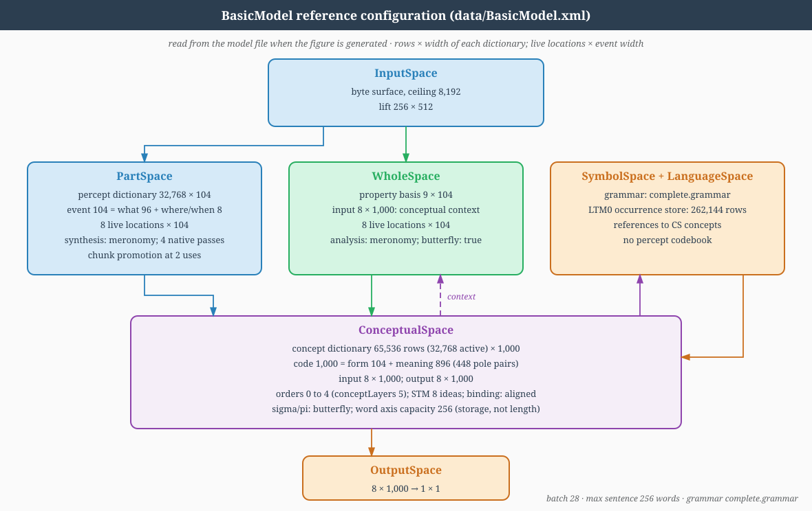

# Basic Model

***The Basic Model of Cognition is a neural network of four spaces: real space, perceptual space, conceptual space, and symbolic space.***

**Model Entities:**

| Entity | Meaning |
| --- | --- |
| $x$, $\widehat{x}$, $X$ | Actual and predicted input (experiences), input space |
| $y$, $\widehat{y}$, $Y$ | Actual and predicted output (actions), output space |
| $p$, $P$ | Percepts, perceptual space |
| $c$, $C$ | Concepts, conceptual space |
| $s$, $S$ | Symbols, symbolic space |
| $W_e$ | Experiencing, experiential weights |
| $W_a$ | Acting, action weights |
| $W_k$ | Knowing, knowledge weights |
| $W_t$ | Thinking, thought weights |

***Background***

Based on the Basic Model of Cognition at
[cognitivesciencesociety.org/framework-cognitive-science](https://cognitivesciencesociety.org/framework-cognitive-science/);
see also [The Whole Part](https://thewholepart.com).

## Relation to the article and the book

The article, *A Common Framework for Cognitive Science*, and the book, *The
Whole Part*, describe the model that this network implements. The article is
the third part of the book in short form: its last figure is the book's
Figure 3i, the basic model of cognition. This section sets the three side by
side: what they share, where the model differs from the book, and what only
one of them has. The book is cited by chapter, and by page where the page is
known.

### What the three share

**The frame.** The article has three spaces (objective, sensory and
conceptual) and six relations: sensation, action, conceptualization,
visualization, symbolization and interpretation. The book counts six spaces,
adding the physical, the subjective and the symbolic (Part 3; chapter 6,
Epistemic Universes). The model has four: real, perceptual, conceptual and
symbolic. Its real space stands where the article's objective space does, as
what sensation comes from and action goes to, and its perceptual space is the
sensory one. It defines symbolic space as the book does: the percepts that
reference concepts, a part of perceptual space. Its three major operations
are the book's part, whole and reference: intersection, which divides from
the top down; union, which collects from the bottom up; and equality, by
which a symbol maps between percepts and concepts. Interpretation and
symbolization are one operator of the grammar and its reverse, `interpret`
and `name`.

**Two relations, not one.** The book keeps parthood and reference apart as
two analyses (chapters 3 to 5). The article does the same: conceptualization
and visualization are subsymbolic and relate parts to wholes, where
symbolization and interpretation are symbolic and relate a reference to what
it refers to. A symbol is neither a part nor a whole of what it stands for,
and need not resemble it. In the model the form of a word and its meaning lie
in two spaces that meet only at a symbol, and a word is tied to its object by
a definition and not by a shared region. The book's forced choice, between
conceptualizing a symbol as a thing in itself and interpreting it (chapter
8), is the model's choice at each word: leave it as itself, take it as a
sign, or interpret it.

**Every relation has its dual.** The book states each relation with its
partner: sensation with action, conceptualization with visualization,
symbolization with interpretation (chapter 7). In the model perception is
[bidirectional](#symmetric-perception-the-single-layer-linear-case), the
grammar's operators compose and, in reverse, generate, and imagination is
perception run backwards. The way down keeps the book's order, interpretation
and then visualization: from symbols to concepts by the grammar's inverse,
then from concepts to percepts by perception's.

**Parthood.** The book has five relations between two things (disjoint,
part, whole, identical and overlapping) and measures parthood by degree, as
the share of the first thing that lies in the second, which is not symmetric
(chapter 3; the Formal Summary, pages 184 and 185). The model uses that
measure and reads the five relations from its two directions. In both a
whole is made by union and a part by intersection, and both begin in the
middle, at the basic level, and work down to parts and up to wholes.

**Orders.** In the book a zeroth-order concept is a whole of sensation and a
higher-order concept is a whole of symbols. The order of a concept is the
number of symbolizations needed to build it, and joining wholes without a
symbol raises the level and not the order (chapters 6 and 8). In the model
an order-0 concept collects basic percepts and a higher order collects
symbols, only symbolization raises the order, and a higher-order concept
need not be a contiguous region, as in the book
([below](#order-extension-and-intension-2026-07-02)).

**A symbol is a point.** A reference in the book is a discrete atom that
cannot be divided, and a whole of references has one dimension more than what
the references refer to (chapters 4, 5 and 8). In the model a symbol is a
zero-dimensional point with no internal extent, symbols can be combined and
cannot be cut, and forming symbols raises the dimensionality of conceptual
space ([below](#symbolic-space)).

**Naming.** The book's metaconcept is a higher-order concept that holds the
symbol of a word and the symbol of its object. The two are equated by being
members of one whole and not by an association, and the example is Helen
Keller learning the word for water (chapter 8; page 112). `interpret` builds
the same structure, meta-concept(symbol(word-concept),
symbol(object-concept)), and equality is the third of the model's major
operations.

**Sentences.** In the book a sentence about an event is a formula for
building a concrete concept, and each word narrows what is visualized. A noun
lacks time and a verb lacks space, so only a noun phrase and a verb phrase
together have the full dimensions of an event. There are two kinds of
sentence, about events and about identity or definition, and possibility is
a fifth dimension, of other timelines (chapters 8 and 9). In the model words
are a formula for narrowing attention; a noun phrase with its verb phrase
lands one order down, at an occurrence; a sentence that states an event is
kept as an idea, and one that relates two things, as a definition does, is
kept as a relation; and a modal ranges over alternative timelines.

**The two systems, and animals.** The article divides the mind into what is
conceptual and what is not, and aligns the division with dual-process theory.
The book assigns sensation and the zeroth-order concepts to System 1, which
works in parallel, and symbols and the higher-order concepts to System 2,
which is serial (chapter 13). The model draws the same line: at symbols, or
equivalently at higher-order logic, which is what symbols allow (Alec,
2026-11-18). An animal in the book is the model without interpretation and
symbolization, and it takes a word as a sign and not as a symbol (chapter
14). In the model the animal is the mind that lacks `interpret`.

**Negation and truth.** In the book sensation has no negation; a negative
entity, such as a hole, has relations and no sensory content; not-x is the
affirming negation and non-x the non-affirming one; and a predicate holds by
degree of a thing that has parts, so that a soccer ball is neither simply
white nor simply not white (chapter 12; Appendices A and B). In the model a
percept is a presence whose opposite is its complement and never a negative
value; negation begins with concepts; a concept has two lanes of evidence,
for and against, which `not` exchanges and `non` withholds; and the ball that
is black and white is *both*, one of four corners (true, false, both and
neither). In both, truth is read as existence, by degree.

**Attention by exclusion.** A symbol in the book activates its concept from
the top down by inhibiting everything else, which is why symbolic thought is
serial (chapters 13, 15 and 16). The model's top-down activation is serial
as well, and what it attends to is what remains when the rest is excluded.

**Identity.** The book takes every event to be unique and identity to be
nominal, given by a name (chapter 10), and it reads the objective world and
the self each in two ways, as an intersection or as a union (chapters 18 and
22). In the model no two things are the same at order zero, an identity is
its occurrences, a path through place and time, and an identity is read by
intersection or by union.

**Feeling, attachment and self.** In the book feelings are sensation;
attachment to a symbol in place of what it stands for biases what is thought;
and the self is a higher-order concept (chapters 17, 21 and 22). In the model
attraction and aversion warp perceptual space and bias concepts, feeling is
direct and comes before concepts, attachment is to an identity, and no
identity of the model itself is built in.

**Examples and sources.** The model's documents use the book's examples (the
soccer ball, ice known only by its definition, Helen Keller at the
well-house) and many of its sources: Kant, Augustine, Locke, Boole, Simons,
Lewis, Gärdenfors, Kahneman, Evans and Stanovich, and Percy. The article
holds that first-order logic, syntactic hierarchies and mathematical sets
can each be built from conceptualization and symbolization. The model has
one of each: its logic, its grammars and its orders.

### Where they differ

**Grounding.** In the book a dictionary defines every word by other words,
and the regress ends only in what is known by experience (chapter 4). A model
that reads only text cannot know an object except through its word, so the
object is first made for the word and known through what is said of it. The
model is to end the regress as the book does, by experience: continuous
values, given as scalars or perhaps as images (Alec, 2026-11-18).

**Filling in.** In the book top-down visualization fills in what sensation
does not give, as at the blind spot of each eye (chapter 15). In the model
expectation adds nothing to what is perceived
([below](#perceptual-space)); filling in belongs to the way back from
concepts to basic percepts, which is imagination. The vertical spread reaches
the first Pi: a part that is present raises the basic percepts that read it,
and each basic percept gives a share to each of its parts, so a part that is
missing receives from the rows its neighbours raised; where the percepts of
an area are withheld, the way back reads the expected ones in their place and
fills the area in on reconstruction (Alec, 2026-11-17;
[Architecture](Architecture.md#sigma-and-pi-layers)).

**Idea and field.** The book's glossary calls an idea a concept taken
together with all of its parts and wholes. The model divides that in two
(Alec, 2026-11-18): an idea is a point in space, which is the intension, and
the field is the extension of that concept, which is its parts and wholes
([below](#order-extension-and-intension-2026-07-02)). The book's idea is thus
the model's idea together with its field.

**Underlap.** In the book two things underlap when some larger whole
contains both. The model's `underlap` marks two things that have no mutual
parthood.

**Apoha.** A note in the book credits the theory of apoha, on which a
concept appears by the exclusion of what it is not, to Vasubandhu (chapter
15). The doctrine is Dignāga's and Dharmakīrti's, and the model's documents
credit them; Vasubandhu did the work that prepared it. This is a correction
to the book (Alec, 2026-11-18).

### What only one of them has

**The book alone** treats the physical and the objective universe and their
dimensions (chapter 6), beauty (chapter 18) and kindness (chapter 19).

**The model alone** has what a network that learns needs and a theory can
leave unsaid: the two lanes of evidence, trust in what is stated, the memory
stores, expectation, and training.

**A speculation on feeling** (Alec, 2026-11-18) is in neither the article
nor the book. A feeling may be a felt continuous sense that corresponds to a
continuous variable in nature. A sign, in Peirce's sense, and a symbolic
system differ from it in that the correspondence does not hold for them. It
continues the hypothesis of 2026-11-16, that what a model is given as
continuous values, and not as symbols, may be seen as its feelings. Both are
hypotheses.

## Relation to LLMs, Formal Concept Analysis, and DisCoCat

BasicModel is a language-capable architecture, but it is not organized like a
standard transformer LLM. A transformer LLM usually represents token context,
semantic association, syntactic composition, and memory inside dense hidden
state. BasicModel makes those roles explicit: percepts ground the input,
concepts bind part/whole support, symbols provide addressable references, and
grammar/reasoning layers compose or test those references.

In Formal Concept Analysis terms, a concept has both an **extension** (the
percepts and members that fall under it) and an **intension** (the attributes
that define it). BasicModel implements a fuzzy neural version of
that split rather than a strict binary concept lattice. In DisCoCat terms, the
grammar path composes word/object vectors into sentence-level meaning through
typed reductions. BasicModel extends that DisCoCat-style composition with
bidirectional reconstruction, truth weighting, and explicit meronymic codebooks.

## Inputs and Outputs

Inputs and outputs derive from a real space that is ineffable. The original
theory framed learning as tabula-rasa perturbation at temperature; the current
implementation expresses that as initialized weights plus ergodic `bias`/`var`
buffers driven by gradient energy. See [Ergodic.md](Ergodic.md).

Measured inputs scale to `[0, 1]` via global data min/max: a percept is a
one-sided presence, 0 absent and 1 present, whose opposite is the complement
`1 - x`, not a negative value. Signed text embeddings and outputs keep
`[-1, 1]`. Paraphrasing Augustine, *negative is the privation of the
positive*: absence is the lack of a presence, not a quantity of its own.

Action is a function of perceptual space and our expectation, filtered by
conceptual projections. Performance errors are defined relative to action,
desired effect, and exhaustion. Expectation errors are defined relative to
perception and perception-as-reconstructed.

To accommodate a changing input context window, input is augmented with
relative spatiotemporal encoding by extending its dimensionality. The
attention mechanism treats what and where pathways separately.

## Perceptual Space

Perceptual spaces are composed of perceptual prototype vectors, or
***percepts***.[^1] Expectation adds nothing to what is perceived, so a
percept is never predicted into existence: a *hallucination* is not a
percept but a concept conceived without perceptual evidence
([Philosophy](Philosophy.md#absence-is-inferred-never-perceived)).

Percepts form a Voronoi tessellation using prototype and/or exemplar vectors,
related via Self Organizing Map connections, operating in parallel as
prototype-theory categories.

Perceptual accuracy is the distance between inputs and prototype vectors ---
similar to cosine similarity, becoming a simple distance measure for poorly
known percepts.

Attraction and aversion warp perceptual space: attraction is a pole at the
percept's location, aversion is a zero. A percept's code lies on the positive
unit hypercube, on two lanes, evidence for and evidence against: its parts
half is built up from all zeros by its parts and its wholes half down from
all ones by its wholes, so it lies between the two
([Mereology](Mereology.md)). A concept is one signed value in the signed
hyperball, whose size is its certainty. Two percepts can be joined into one
concept without loss.

## Conceptual Space

***Concepts*** create boundaries in conceptual space, grounded in the support
vectors of perception. Concepts support logical negation; they may refer to
negative entities. Conceptual spaces are capable of representing negative
entities. Concepts that do not correspond to percepts are *false*.

Concepts collect percepts into fuzzy sets --- linear separating hyperplanes
partitioning conceptual space, or sets defined as linear combinations of
percept activations.

Concepts are relative: meaningful only insofar as they partition a meaningful
space. As concepts approach certainty, decision boundary slope becomes
infinite. A single unknowing state is common to all knowledge vectors
(activation slope zero).

Conceptual spaces are similarity spaces partitioned by decision boundaries
imposing positivity and negativity on a hypersphere of knowing.

Within conceptual space, attraction/aversion to concepts expresses as
hyperplane bias. Certainty is the slope of the activation function (tuned
after other parameters stop changing).

A concept can be split into two percepts without loss.

### Order, extension, and intension (2026-07-02)

Concepts occupy an **order**. An **order-0 concept** is a Sigma over the basic
percepts, each of which is a row of the first Pi over its parts and wholes —
it is defined **extensionally**, by its perceptual support (the percepts that fall under it),
and it is **subsymbolic**: a conceptual-space citizen with no relational
definition yet. It is grounded directly. A **higher-order concept** is defined
in terms of other symbols (its sparse constituent edges), and its grounding is
inherited transitively through its constituents down to order-0's support and
refinable by direct experience. Ascending the orders, the grounding becomes
increasingly *mediated* (reached through the definitional graph rather than
directly from percepts), and a row above the basic percept carries no
perceptual form of its own —
which is why superordinate concepts feel more theoretical and less perceptual
(Rosch et al. 1976; the basic $\to$ superordinate trajectory). This is the
reconciliation of the prototype-vs-definition tension: a concept is *both* its
point and its definition, carried by two different structures over the same
object. Concretely, the point is the **intension** and what it implies is the
**extension** (Frege's sense / reference; Carnap's intension / extension). For
a sentence (Alec, 2026-11-12), the composed vector, the idea, "is the intension
of the sentence-concept", and the field of known concepts it implies "is the
extension of the sentence-concept"; "For kinds, a token implies a type. For
mereology, a whole implies a part." A kind's extension is its stored members,
reached through the sparse edge-graph ([Extend](Extend.md)).

Because every concept, at any order, is a point placed by the contexts it
occurs in, specific and general objects share **one conceptual space**: a single
dictionary holds each concept as a *point*, and the relational graph is
structure laid *over* that space, not a second space. The single-space claim is
not a new assumption — it follows from grounding (symbols are a subtype of
perceptual objects; see [Symbolic Space](#symbolic-space) below). One
refinement matters: a concept's home in the space is its **point/atom**, *not*
necessarily a convex region. Gärdenfors's convexity holds for *natural*
concepts and is the **order-0 / extensional limit**, cleanest at the grounded
base; **discontiguous, high-order** objects still live in the same space as
points, but their extension is **graph-defined** (the things reachable through
their definition), not a convex region, which is why a word is tied to its
object by a definition, a stored relation between the two that implies no
order, and not by a shared region: no convex set is specific enough
([STM](STM.md#10-ltm-as-the-chain-of-stm-end-states), "Definitions"). So:
**one space of points plus a relational graph, with convexity as the
basal/extensional reading.** The cognitive grounding for the
dense-perceptual / sparse-symbolic split is in
[doc/Architecture.md](Architecture.md) "Cognitive grounding."

The seam between perceptual and relational definition is operational in the
forward, which has one terminal cutover
([Architecture](Architecture.md#a-symbolic-weights-the-two-phase-forward)).
At it each order-0 concept reads the combined code of the basic percepts
present through the dense Sigma of order zero, and above it the one structure
repeats: a Pi makes symbols over the concepts of every lower order, and a
Sigma makes the concepts of the next order from those symbols
([Architecture](Architecture.md#sigma-and-pi-layers)).
An order-0 concept is thus
defined by its perceptual features, and a concept of order $\ge 1$ by its
edges to other symbols. Three relational primitives carry the graph (Alec,
2026-07-02): the ordered pair $[\text{whole}, \text{part}]$ (whole
$\Rightarrow$ part, if $\to$ then); the singleton, a whole containing exactly
one symbolic part, the unit set $\{x\}$ that Lewis resisted and here the
constructive primitive; and the vine, an ordered chain of nested pairs whose
order comes from the nesting, since each row is set-like. At the storage
level, each sparse entry pairs one concept index with one symbol index.
Repeating the same concept index across entries accumulates its set-like
definition; recursively nesting relation concepts supplies vine order. See the
relation-table entry contract in
[Architecture.md](Architecture.md#relation-table-entry-contract).

## Symbolic Space

*Symbolic Spaces* are composed of percepts that reference concepts --- a
subtype of perceptual spaces mapping onto conceptual spaces.

As a reference a symbol has no internal extent: it is a zero-dimensional point.
Symbols are split from concepts and have no dimensions (Alec): a symbol is
held in a tensor of its own, as two unsigned rows, one for each lane, of the
Pi above the concepts it reads, and it has no vector, place, form or trust
content read as a direction. It stores no `.where` or `.when`; its `.where`
is written when STM reads it, this activation at this place and time. Each
symbol that MTM nominates brings one concept, a Sigma over it. In humans, perceptual space projects onto a 3D cerebellar
subspace before symbolic encoding.

Symbols are independent, permanent, and integral (as references). The
top-down serial activation differs from bottom-up perceptual activation ---
it casts shadows.

The formation of symbols increases the dimensionality of conceptual space
(outer product); the formation of concepts from percepts decreases the
dimensionality of perceptual space (inner product).

Symbols are erroneous if their associated concept is not true. Participation
in multiple sets creates structural relations that replace positional
information.[^2]

## Reasoning

Reasoning in symbolic spaces involves computing with parts and wholes ---
Venn-diagram computations enabling dynamic Bayesian-type statistics. Learned
probabilities can be stored as unidirectional connection weights between
concepts, possibly with part-whole structure imposed by corresponding
symbols.

## Symmetric Perception: the Single Layer Linear Case

Perception is bidirectional: we see the world and the world sees us. The
egocentric/cultural view treats perception as passive; in neural networks
this manifests as forgetting the influence of outputs on inputs.

Symmetric Perception finds $f(x)$ minimizing MSE with respect to:

$$
\begin{pmatrix} in \\ out \end{pmatrix} \cdot \begin{pmatrix} f(x) & 0 \\ 0 & f^{-1}(x) \end{pmatrix} = \begin{pmatrix} out \\ in \end{pmatrix}
$$

In the linear case, $f(x)$ becomes a single invertible matrix $A$. When the
mapping is nonlinear and an inverse may not exist:

$$
\begin{pmatrix} in \\ out \end{pmatrix} \cdot \begin{pmatrix} f(x) & 0 \\ 0 & g(x) \end{pmatrix} = \begin{pmatrix} out \\ in \end{pmatrix}
$$

This resembles $Ax = b$, except $x$ is known and we want weights $A$ mapping
one space to another. The standard LLS solution $x = (A^\top A)^{-1} A^\top b$
becomes finding $A$ such that $Ax = b$ and $A^{-1} b = x$.

Retrocausality suggests an additional objective: $A$ should be optimal for
both forward and inverse transforms. Approximately: $A$ as a product of two
matrices, each performing a perfect surjection: $A \cdot A^{-1} = I$.

$$(\frac{b}{2} * x^{-1}) \cdot (\frac{x}{2} * b^{-1}) = I$$

Best $A$ requires iterative solution (NN learning, ping-pong style) or
Gram-Schmidt orthogonalization with respect to $A$ and $A^{-1}$.

## Symmetric Perception: the Single Layer Nonlinear Case

If $f(x)$ and $g(x)$ share weight matrix $W$:

Forward computation and gradient:

$$\widehat{y} = f(g^{-1}(x) W)$$
$$e_{y} = \frac{1}{2}(\widehat{y} - y)^{2}$$
$$\Delta W_{y} = \eta(\widehat{y} - y)\delta_{f}(W^\top \cdot g^{-1}(x)) g^{-1}(x)$$

Reverse computation and gradient:

$$\widehat{x} = g(W^\top f^{-1}(y))$$
$$e_{x} = \frac{1}{2}(\widehat{x} - x)^{2}$$
$$\Delta W_{x} = \eta(\widehat{x} - x)\delta_{g}(W \cdot f^{-1}(y)) f^{-1}(y)$$

Since $W$ is shared, summing the partial derivatives gives:

$$\frac{\partial e_{y}}{\partial W} + \frac{\partial e_{x}}{\partial W} = \eta(\widehat{y} - y)\delta_{f}(W^\top \cdot g^{-1}(x)) g^{-1}(x) + \eta(\widehat{x} - x)\delta_{g}(W \cdot f^{-1}(y)) f^{-1}(y)$$

Setting gradient to zero, both errors going to zero when $x = i$ and $y = o$.
But $xy - iy = ox - yx$ may hold --- simultaneous gradient descent
ping-pongs. A better cost function multiplies the two error partials ---
intersection of the spaces satisfying both:

$$\frac{\partial e_{y}}{\partial W}\frac{\partial e_{x}}{\partial W} = \eta(\widehat{x} - x)(\widehat{y} - y)\delta_{f}(W^\top \cdot g^{-1}(x))\delta_{g}(W \cdot f^{-1}(y)) f^{-1}(y) g^{-1}(x)$$

## Distance Metrics

$$d(x_{1},x_{2}) = \frac{\lVert x_{1} \rVert^{n} \cdot \lVert x_{2} \rVert^{n}}{\lVert x_{1} - x_{2} \rVert^{2n}}$$

Z-plane form:

$$d(x_{1},x_{2}) = \lVert x_{1} - x_{2} \rVert \cdot \frac{(x - z_{1})}{(x - z_{2})}$$

where $z_1$ is a zero and $z_2$ is a pole.

## Exploration/Exploitation as a function of temperature

$$y = x \cdot \frac{(W + rt)}{\lVert W \rVert}$$

where $r$ is a random vector and $t$ is temperature.

## Transfer Functions

Current invertible transfer functions use factorized linear maps rather than
the earlier SVD-rotation sketch. `InvertibleLinearLayer` parameterizes the map
with triangular factors and a diagonal scale so forward and reverse share the
same learned transform without forming a dense inverse on every call. Each lane
of a square `PiLayer3` is such a map in the log domain, so the Pi inverts
exactly; `SigmaLayer3` is $\tanh(x\,U)$ with signed weights and no bias, and
returns its input by least squares where there are enough concepts. See
[Architecture.md](Architecture.md#sigma-and-pi-layers) for the contract.

[^1]: Perceptual space is known as "embedding space" in transformer literature.

[^2]: For example, {0,1} and {0,1}, if orthogonal, pose no constraint on the
location of the 1 in their 2x2 grid. However, {0,1,1} and {0,1} partition a
3x2 space and require two 1's on the same row --- a fact present in neither
set alone.
