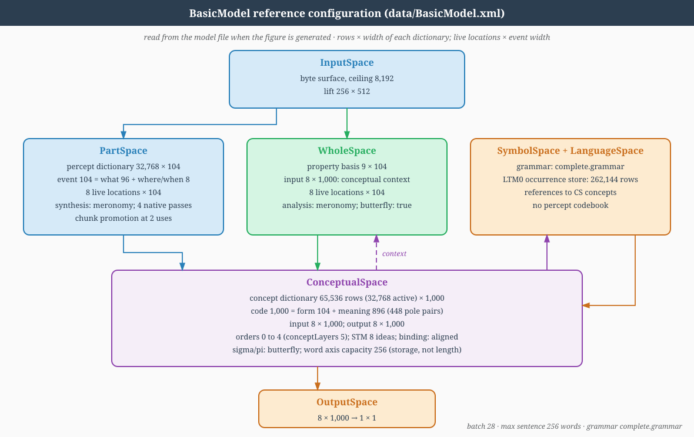

# Basic Model

***The Basic Model of Cognition is a neural network of four spaces: real space, perceptual space, conceptual space, and symbolic space.***

**Model Entities:**

| Entity | Meaning |
| --- | --- |
| $x$, $\widehat{x}$, $X$ | Actual and predicted input (experiences), input space |
| $y$, $\widehat{y}$, $Y$ | Actual and predicted output (actions), output space |
| $p$, $P$ | Percepts, perceptual space |
| $c$, $C$ | Concepts, conceptual space |
| $s$, $S$ | Symbols, symbolic space |
| $W_e$ | Experiencing, experiential weights |
| $W_a$ | Acting, action weights |
| $W_k$ | Knowing, knowledge weights |
| $W_t$ | Thinking, thought weights |

***Background***

Based on the Basic Model of Cognition at
[cognitivesciencesociety.org/framework-cognitive-science](https://cognitivesciencesociety.org/framework-cognitive-science/);
see also [The Whole Part](https://thewholepart.com).

## Relation to LLMs, Formal Concept Analysis, and DisCoCat

BasicModel is a language-capable architecture, but it is not organized like a
standard transformer LLM. A transformer LLM usually represents token context,
semantic association, syntactic composition, and memory inside dense hidden
state. BasicModel makes those roles explicit: percepts ground the input,
concepts bind part/whole support, symbols provide addressable references, and
grammar/reasoning layers compose or test those references.

In Formal Concept Analysis terms, a concept has both an **extension** (the
percepts that support it) and an **intension** (the attributes, relations, or
symbolic edges that define it). BasicModel implements a fuzzy neural version of
that split rather than a strict binary concept lattice. In DisCoCat terms, the
grammar path composes word/object vectors into sentence-level meaning through
typed reductions. BasicModel extends that DisCoCat-style composition with
bidirectional reconstruction, truth weighting, and explicit meronymic codebooks.

## Inputs and Outputs

Inputs and outputs derive from a real space that is ineffable. The original
theory framed learning as tabula-rasa perturbation at temperature; the current
implementation expresses that as initialized weights plus ergodic `bias`/`var`
buffers driven by gradient energy. See [Ergodic.md](Ergodic.md).

Measured inputs scale to `[0, 1]` via global data min/max: a percept is a
one-sided presence, 0 absent and 1 present, whose opposite is the complement
`1 - x`, not a negative value. Signed text embeddings and outputs keep
`[-1, 1]`. Paraphrasing Augustine, *negative is the privation of the
positive*: absence is the lack of a presence, not a quantity of its own.

Action is a function of perceptual space and our expectation, filtered by
conceptual projections. Performance errors are defined relative to action,
desired effect, and exhaustion. Expectation errors are defined relative to
perception and perception-as-reconstructed.

To accommodate a changing input context window, input is augmented with
relative spatiotemporal encoding by extending its dimensionality. The
attention mechanism treats what and where pathways separately.

## Perceptual Space

Perceptual spaces are composed of perceptual prototype vectors, or
***percepts***.[^1] Expectation adds nothing to what is perceived, so a
percept is never predicted into existence: a *hallucination* is not a
percept but a concept conceived without perceptual evidence
([Philosophy](Philosophy.md#absence-is-inferred-never-perceived)).

Percepts form a Voronoi tessellation using prototype and/or exemplar vectors,
related via Self Organizing Map connections, operating in parallel as
prototype-theory categories.

Perceptual accuracy is the distance between inputs and prototype vectors ---
similar to cosine similarity, becoming a simple distance measure for poorly
known percepts.

Attraction and aversion warp perceptual space: attraction is a pole at the
percept's location, aversion is a zero. Perfectly recognized percepts lie on
the unit hypersphere within conceptual space. Two percepts can be joined into
one concept without loss.

## Conceptual Space

***Concepts*** create boundaries in conceptual space, grounded in the support
vectors of perception. Concepts support logical negation; they may refer to
negative entities. Conceptual spaces are capable of representing negative
entities. Concepts that do not correspond to percepts are *false*.

Concepts collect percepts into fuzzy sets --- linear separating hyperplanes
partitioning conceptual space, or sets defined as linear combinations of
percept activations.

Concepts are relative: meaningful only insofar as they partition a meaningful
space. As concepts approach certainty, decision boundary slope becomes
infinite. A single unknowing state is common to all knowledge vectors
(activation slope zero).

Conceptual spaces are similarity spaces partitioned by decision boundaries
imposing positivity and negativity on a hypersphere of knowing.

Within conceptual space, attraction/aversion to concepts expresses as
hyperplane bias. Certainty is the slope of the activation function (tuned
after other parameters stop changing).

A concept can be split into two percepts without loss.

### Order, extension, and intension (2026-07-02)

Concepts occupy a **ramsified order**. An **order-0 concept** is the output of
mixing a part and a whole at the corpus callosum — it is defined
**extensionally**, by its perceptual support (the percepts that fall under it),
and it is **subsymbolic**: a conceptual-space citizen with no relational
definition yet. It is grounded directly. A **higher-order concept** is defined
in terms of other symbols (its sparse constituent edges) and so acquires an
**intensional** definition (its *sense* — the relations that fix it), while
still retaining extensional grounding, inherited transitively through its
constituents down to order-0's support and refinable by direct experience.
Ascending the orders is therefore a **graded extensional $\to$ intensional
shift, never a hard switch**, and the grounding becomes increasingly *mediated*
(reached through the definitional graph rather than directly from percepts) —
which is why superordinate concepts feel more theoretical and less perceptual
(Rosch et al. 1976; the basic $\to$ superordinate trajectory). This is the
reconciliation of the prototype-vs-definition tension: a concept is *both* its
region and its definition, because intension and extension are carried by two
different structures over the same object. Concretely — **intension is the
sparse edge-graph; extension is the atom's position** (Frege's sense /
reference; Carnap's intension / extension, realized as graph-over-geometry).

Because every concept, at any order, has an extensional footprint (a grounded
atom), specific and general objects share **one conceptual space**: a single
dictionary holds each concept as a *point*, and the relational graph is
structure laid *over* that space, not a second space. The single-space claim is
not a new assumption — it follows from grounding (symbols are a subtype of
perceptual objects; see [Symbolic Space](#symbolic-space) below). One
refinement matters: a concept's home in the space is its **point/atom**, *not*
necessarily a convex region. Gärdenfors's convexity holds for *natural*
concepts and is the **order-0 / extensional limit**, cleanest at the grounded
base; **discontiguous, high-order** objects still live in the same space as
points, but their extension is **graph-defined** (the things reachable through
their definition), not a convex region, which is why a word is tied to its
object by a definition, a stored relation between the two that implies no
order, and not by a shared region: no convex set is specific enough
([STM](STM.md#10-ltm-as-the-chain-of-stm-end-states), "Definitions"). So:
**one space of points plus a relational graph, with convexity as the
basal/extensional reading.** The cognitive grounding for the
dense-perceptual / sparse-symbolic split is in
[doc/Architecture.md](Architecture.md) "Cognitive grounding."

The seam between extension and intension is operational in the forward,
which has one terminal cutover
([Architecture](Architecture.md#a-symbolic-weights-the-two-phase-forward)).
At it each order-0 concept reads its membership from the attended percepts
through its feature definition over basic percepts, which is its extension,
and each higher order is then composed from the preceding order's symbols
over the sparse edge-graph, which is intension. An order-0 concept is thus
defined by its perceptual features, and a concept of order $\ge 1$ by its
edges to other symbols. Three relational primitives carry the graph (Alec,
2026-07-02): the ordered pair $[\text{whole}, \text{part}]$ (whole
$\Rightarrow$ part, if $\to$ then); the singleton, a whole containing exactly
one symbolic part, the unit set $\{x\}$ that Lewis resisted and here the
constructive primitive; and the vine, an ordered chain of nested pairs whose
order comes from the nesting, since each row is set-like. At the storage
level, each sparse entry pairs one concept index with one symbol index.
Repeating the same concept index across entries accumulates its set-like
definition; recursively nesting relation concepts supplies vine order. See the
relation-table entry contract in
[Architecture.md](Architecture.md#relation-table-entry-contract).

## Symbolic Space

*Symbolic Spaces* are composed of percepts that reference concepts --- a
subtype of perceptual spaces mapping onto conceptual spaces.

As a reference a symbol has no internal extent: it is a zero-dimensional point
within perceptual space. It is nevertheless situated (decided 2026-10-20). A
symbol is the situated side of the index it shares with its concept, this
activation at this place and time, so it carries `.where` and `.when`; its
concept is the unsituated fold of its occurrences, which keeps their extent and
never the clock. In humans, perceptual space projects onto a 3D cerebellar
subspace before symbolic encoding.

Symbols are independent, permanent, and integral (as references). The
top-down serial activation differs from bottom-up perceptual activation ---
it casts shadows.

The formation of symbols increases the dimensionality of conceptual space
(outer product); the formation of concepts from percepts decreases the
dimensionality of perceptual space (inner product).

Symbols are erroneous if their associated concept is not true. Participation
in multiple sets creates structural relations that replace positional
information.[^2]

## Reasoning

Reasoning in symbolic spaces involves computing with parts and wholes ---
Venn-diagram computations enabling dynamic Bayesian-type statistics. Learned
probabilities can be stored as unidirectional connection weights between
concepts, possibly with part-whole structure imposed by corresponding
symbols.

## Symmetric Perception: the Single Layer Linear Case

Perception is bidirectional: we see the world and the world sees us. The
egocentric/cultural view treats perception as passive; in neural networks
this manifests as forgetting the influence of outputs on inputs.

Symmetric Perception finds $f(x)$ minimizing MSE with respect to:

$$
\begin{pmatrix} in \\ out \end{pmatrix} \cdot \begin{pmatrix} f(x) & 0 \\ 0 & f^{-1}(x) \end{pmatrix} = \begin{pmatrix} out \\ in \end{pmatrix}
$$

In the linear case, $f(x)$ becomes a single invertible matrix $A$. When the
mapping is nonlinear and an inverse may not exist:

$$
\begin{pmatrix} in \\ out \end{pmatrix} \cdot \begin{pmatrix} f(x) & 0 \\ 0 & g(x) \end{pmatrix} = \begin{pmatrix} out \\ in \end{pmatrix}
$$

This resembles $Ax = b$, except $x$ is known and we want weights $A$ mapping
one space to another. The standard LLS solution $x = (A^\top A)^{-1} A^\top b$
becomes finding $A$ such that $Ax = b$ and $A^{-1} b = x$.

Retrocausality suggests an additional objective: $A$ should be optimal for
both forward and inverse transforms. Approximately: $A$ as a product of two
matrices, each performing a perfect surjection: $A \cdot A^{-1} = I$.

$$(\frac{b}{2} * x^{-1}) \cdot (\frac{x}{2} * b^{-1}) = I$$

Best $A$ requires iterative solution (NN learning, ping-pong style) or
Gram-Schmidt orthogonalization with respect to $A$ and $A^{-1}$.

## Symmetric Perception: the Single Layer Nonlinear Case

If $f(x)$ and $g(x)$ share weight matrix $W$:

Forward computation and gradient:

$$\widehat{y} = f(g^{-1}(x) W)$$
$$e_{y} = \frac{1}{2}(\widehat{y} - y)^{2}$$
$$\Delta W_{y} = \eta(\widehat{y} - y)\delta_{f}(W^\top \cdot g^{-1}(x)) g^{-1}(x)$$

Reverse computation and gradient:

$$\widehat{x} = g(W^\top f^{-1}(y))$$
$$e_{x} = \frac{1}{2}(\widehat{x} - x)^{2}$$
$$\Delta W_{x} = \eta(\widehat{x} - x)\delta_{g}(W \cdot f^{-1}(y)) f^{-1}(y)$$

Since $W$ is shared, summing the partial derivatives gives:

$$\frac{\partial e_{y}}{\partial W} + \frac{\partial e_{x}}{\partial W} = \eta(\widehat{y} - y)\delta_{f}(W^\top \cdot g^{-1}(x)) g^{-1}(x) + \eta(\widehat{x} - x)\delta_{g}(W \cdot f^{-1}(y)) f^{-1}(y)$$

Setting gradient to zero, both errors going to zero when $x = i$ and $y = o$.
But $xy - iy = ox - yx$ may hold --- simultaneous gradient descent
ping-pongs. A better cost function multiplies the two error partials ---
intersection of the spaces satisfying both:

$$\frac{\partial e_{y}}{\partial W}\frac{\partial e_{x}}{\partial W} = \eta(\widehat{x} - x)(\widehat{y} - y)\delta_{f}(W^\top \cdot g^{-1}(x))\delta_{g}(W \cdot f^{-1}(y)) f^{-1}(y) g^{-1}(x)$$

## Distance Metrics

$$d(x_{1},x_{2}) = \frac{\lVert x_{1} \rVert^{n} \cdot \lVert x_{2} \rVert^{n}}{\lVert x_{1} - x_{2} \rVert^{2n}}$$

Z-plane form:

$$d(x_{1},x_{2}) = \lVert x_{1} - x_{2} \rVert \cdot \frac{(x - z_{1})}{(x - z_{2})}$$

where $z_1$ is a zero and $z_2$ is a pole.

## Exploration/Exploitation as a function of temperature

$$y = x \cdot \frac{(W + rt)}{\lVert W \rVert}$$

where $r$ is a random vector and $t$ is temperature.

## Transfer Functions

Current invertible transfer functions use factorized linear maps rather than
the earlier SVD-rotation sketch. `InvertibleLinearLayer` parameterizes the map
with triangular factors and a diagonal scale so forward and reverse share the
same learned transform without forming a dense inverse on every call. `SigmaLayer`
and `PiLayer` wrap those maps for additive and multiplicative composition. See
[Architecture.md](Architecture.md) for the implementation contract.

[^1]: Perceptual space is known as "embedding space" in transformer literature.

[^2]: For example, {0,1} and {0,1}, if orthogonal, pose no constraint on the
location of the 1 in their 2x2 grid. However, {0,1,1} and {0,1} partition a
3x2 space and require two 1's on the same row --- a fact present in neither
set alone.
