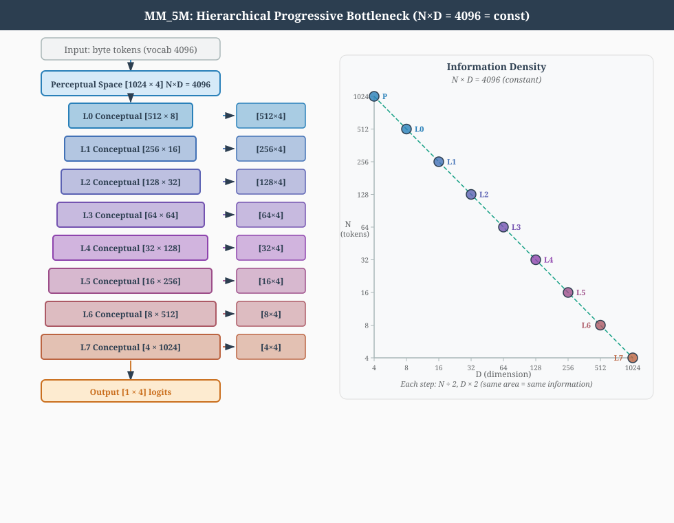
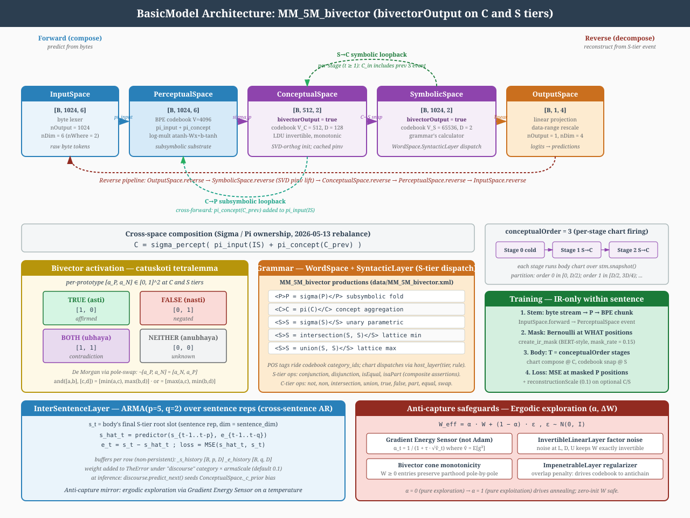

# Development history

Sections moved here from the main documents because they describe
mechanisms, proposals or measurements the current contract has superseded.
Each is as it stood, with the labels of the development process removed
(2026-11-12), under a heading naming its source document, with the
lines it occupied there on the day it moved. The main documents keep a
pointer at each site. Nothing here governs; the governing records are the
current documents. The store names changed on 2026-10-21: LTM0 is the
occurrence store (LTM1 in older text here), LTM1 its relation stratum (older
LTM2), and the old LTM3 name is retired.

# Architecture.md

*From `Architecture.md` lines 211-240, moved 2026-10-30.*

> **Status (2026-05-29 update):** further architectural pivots landed
> on top of the 2026-05-27 substrate refactor:
>
> - **PerceptStore $\to$ RadixLayer.** The radix-trie input encoder is
>   now a first-class `Layer` subclass in `bin/Layers.py`;
>   `PartSpace.reverse` invokes `RadixLayer.reverse` for the
>   structural decode.
> - **MetaLayer $\to$ SymbolizeLayer.** The binary GrammarLayer that
>   promotes a freshly-seen percept to a symbolic prototype is now
>   `SymbolizeLayer`; no semantic change.
> - **Auto-META moves PS $\to$ CS.** The cross-codebook bind (META entry:
>   PS chunk-id $\leftrightarrow$ SS prototype-id) fires from
>   `ConceptualSpace._maybe_autobind_meta` at stage 0; PS no longer
>   holds a back-ref to SS.
> - **Clean-stack STM.** `ConceptualSpace.forward` bypasses
>   `sigma_in` / `sigma_cs` on forward — `folded = primary` at stage
>   0, `folded = sym` at k > 0. The Stage-10 additive composition is
>   retired; per-stage space-role attribution is trivially invertible.
> - **`basis=` kwarg for grammar reverses.** `UnionLayer.reverse(parent,
>   basis=None)` / `IntersectionLayer.reverse(parent, basis=None)`
>   accept a Codebook / Basis object (typically
>   `WholeSpace.subspace.what`) instead of a raw `W` tensor;
>   `bin/Language.py::unreduce()` dispatches accordingly.
> - **LSE soft-max kernels.** `Ops._disjunction_kernel` /
>   `Ops._conjunction_kernel` default to LogSumExp smooth variants
>   when `monotonic=False`; the hard branch is retained for
>   monotonic-mode and exact idempotency tests.
> - **LBG-style WS property splitting.** Gray (1990) EMA + per-row variance
>   tracking can split a dynamic property along its top-variance
>   eigendirection. This grows properties, never concepts or symbols.

*From `Architecture.md` lines 242-256, moved 2026-10-30.*

> **Historical status (2026-05-27; ownership superseded 2026-07-20):** the
> **substrate refactor** had landed end-to-end.
> PS is a single-arg input processor (synthesis front end + sigma fold). CS is a STM container +
> grammatical CPU (no atomic forward fold; sigma_percept retired). The paired
> word-codebook ownership described then no longer belongs to WholeSpace. The
> CKY `Chart` and STM shift-reduce parsers retire entirely; `LanguageLayer`
> (signal router) is the canonical parser. `LiftLayer` / `LowerLayer` are
> binary `GrammarLayer` subclasses with internal Sigma / Pi (no longer
> borrowing substrate folds). `GrammarLayer` gains an optional butterfly
> cascade mode for cross-position mixing — closes the XOR convergence
> target. Two operating modes selected by `<serial>`: **SERIAL/GRAMMATICAL** (per-word PS with
> grammar dispatch over STM) and **PARALLEL** (T = `<subsymbolicOrder>`
> iterations of PS over CS). The `<parserBackend>`, `<routerKind>`,
> `<chartTau>`, `<chartTopK>`, `<chartNoiseEps>` XML knobs are retired;
> `<symbolicOrder>` is now the symbolic / relational loop budget.

*From `Architecture.md` lines 340-357, moved 2026-10-30.*

> **Historical note (forward composition superseded 2026-07-10).** The v3
> iterated-symbolic-loop design (landed 2026-07-03)
> ran the store as an ITERATED WAVE with an additive source term every
> step, $a^{i+1} = \tanh(W [a^i \mid 1] + s)$, $i = 0..K{-}1$, over a row
> space split 50/50 into a SNAP block (rows $[0, n_{\text{snap}})$,
> order-0 concepts, no in-edges) and a RELATION POOL (the rest, minted
> relations, first-come with a loud overflow warning). A fresh probe on
> `MM_sparse_concept` found the wave DARK end-to-end -- sign-then-clamp
> annihilation at the order-0 rectifier, scale-blindness between the
> settled field and the codebook, and a capacity gap where `<nVectors>`
> never reached the per-stage store (the dual-towers rev-2 design's
> "Why"). Rev 2's correction: the concept base is the 8-tile corpus-callosum
> frame, not the codebook inventory, so attention is a top-K taper over
> that frame rather than a settling recurrence -- replacing the wave with
> the feedforward pyramid above closes the darkness (no trivial fixed
> point left to go dark). The `(n_snap, n_pool)` split above is the only
> surviving trace of the v3 design, kept as the `_order_caps` off-path
> fallback.

*From `Architecture.md` lines 379-419, moved 2026-10-30.*

The two-truths clause closing
uses the native concept allocator for word and object addresses. An ended
clause's identity is its occurrences in LTM, tied by the references in their
slots; it takes no concept inventory row. Each LTM row has `row_ids`, three `refs`, an `order` stamp, independent
`c_plus`/`c_minus` identification evidence, a separate scalar source `trust`,
and the ended field's four-coordinate `.where` and `.when`. Trust concerns
the event's veridicality; changing it never replaces the evidence pair.
An abstract row is decoded through the sigma inverses down its stamped
order. An idea occupies
one point slot containing the actual end state. Its two pre-fusion operand
references are a cache; no factored target or derivation persists. A
relation occupies three slots and has kind `part`, `implies` or `operator`;
there is no catch-all relation. Referenced relations have null point slots
and are read by row identity, including implication over two relations.

The September 29 amendment adds a fourth relation kind, `REL_DEF`:
`word DEF object`. Its operands name native identities in `refs[0]` and
`refs[2]`; their vector slots are null, and the middle slot has the fixed
DEF atom. Learning either concept's code cannot redirect the definition.
Word and object operands belong to the grammar registry's ConceptualSpace,
including bodies with independent stage dictionaries; another stage's allocator
cannot supply their identities. The DEF utterance and each ended clause have
stable LTM source-address keys. A grammar predicate has one identity per operation,
tied by the relation slots in which it occurs, without an inventory row. A
referenced phrase likewise keeps its point in its LTM row. An identity-to-row
cache locates these occurrences. A full inventory refuses optional
symbolization atomically and the reading continues.
Only `interpret` writes definitions; only the closing writes what a sentence
asserts. A definition is keyed by `(DEF, word, object)`, has an unlocated zero
`.when` band, remains in recency, and may be forgotten. Re-reading refreshes
its timestamp without changing its address.

The taxonomy is the native concept hierarchy, read by sigma union. A part
row between object concepts places the parent one order above its child;
word identities are never taxonomic operands. One index derived from DEF
rows supplies form/unit → word, word → objects, and object → words, without
lookup scans. It rebuilds on load and store compaction. The word/object META,
its fold and its part edge are retired in every reading; old checkpoint
bindings migrate to DEF rows. WholeSpace owns only properties. Evidence and
source trust stay on the LTM row. Clause admission and witnessed context
discovery write the hierarchy; testimony does not pass the discovery gate.

*From `Architecture.md` lines 437-447, moved 2026-10-30.*

**Groundedness and cycles -- REMOVED (2026-07-10).** `cs_groundedness_probe`
does not exist in the current codebase (zero grep hits). It was the KRIPKE
grounded/ungrounded reading of the v3 iterated wave, in two runs (source-driven,
then source-released) -- a diagnostic over settling dynamics that the
feedforward pyramid does not have. The design pass that replaced the wave
accepted the loss outright ("the wave was dark anyway," per the rev-2
design's "Theory"). The posture on cycles it used to report stands as a design
statement even without the probe: loops are a documented FACT -- of
un-ramsified taxonomies and of human minds -- and nothing in the current
codebase observes or damps them at runtime. Solutions are invited -- for
both human and machine minds.

*From `Architecture.md` lines 854-861, moved 2026-10-30.*

The legacy `SubwholeSpace` and `SyntacticSpace` classes have been
retired. The subsymbolic role is filled by `PartSpace`; syntax /
grammar dispatch lives on `SymbolSubSpace.languageLayer` (the signal router,
which subsumes the retired `Chart`). The `MereologicalTree` sidecar that
backed `part` / `equals` / `query` is also retired --- those operations are
pure-geometric clipped-cosine projections over WholeSpace codebook
activations.


*From `Architecture.md` lines 1492-1514, moved 2026-10-30.*

**Historical (Alec, 2026-09-25; row `.where` superseded above): every LTM
row carried a `.where` and a `.when`**, the field's pair, written once by
the closing. **`.where`
uses one address space over input and stored percepts**: input positions
come first, then PartSpace and WholeSpace rows, then one address per symbol
pole. A word's percept and symbol occurrences carry its input byte start,
not its stored row's location. Thought-produced symbols use their symbol-row
address. The same row can therefore appear at several input locations
without reserving extra symbol slots. Codebook identity stays the row index
per Spaces' Codebook Uniqueness Contract.
Stable slices use fixed physical capacity for every perceptual codebook,
with logical admission into existing rows. Exhaustion names
`nVectors`; it never replaces a Parameter or migrates optimizer state.
The `.where` band itself carries the registry address.
One model-owned two-rung ladder is shared by input, part, whole and symbol
spaces. Its long period covers the entire fixed registry; its short period
resolves adjacent locations. Captured programs retain these bands, and an
integer location is decoded from them when needed. There is no second saved
integer address and no separately configured 8192-byte period. `.when` uses
one shared bracket encoder; every word of a sentence receives the same
relative index. Per-word objectives exclude that shared band. Sentence
addresses include source document, relative index and identified content;
`.when` alone does not distinguish documents.

*From `Architecture.md` lines 1721-2069, moved 2026-10-30.*

### Proposal: bounded pi and sigma folds as normalized means (Alec, 2026-09-21)

**Decided: dropped (Alec, September 25).** These means were evaluated in
real grammar folds and rejected. The normalization mixin, constructor
arguments, XML parameters and mode tests are removed. Native min/max perception
and the max concept pyramid remain the definition.

#### 1. Problem

The current SigmaLayer is tanh(W·atanh(x) + b) and the current PiLayer is
tanh((W·2atanh(x) + b)/2). These are the same map up to a factor of 2 in W
and b. Multiplying odds is adding log-odds, so pi and sigma operate in the
same chart, and any stack pi(sigma(...)) collapses to a single affine map
in the atanh chart followed by one tanh (verified numerically to 1e-16).
The network can only express a nonlinearity by driving values into the
clamp at ±(1 − eps), where the chart derivative 1/(1 − x²) explodes.
This is the root of both the wasted tanh/atanh pairs and the gradient
blow-up in the packed-row folds.

#### 2. Principle

A sigma-pi network gets its nonlinearity from the mismatch between the
chart where it multiplies and the chart where it adds. Therefore:

- sigma adds in the raw chart, with no entry or exit transform;
- pi multiplies in the log chart, and exits back to the raw chart.

Boundedness comes from making both folds *means*: every output lies between
the min and max of its inputs. A stack of means of any depth stays inside
the interval with no squashing and no clamp (only a log floor for pi).

#### 3. Definitions

All folds run on the perceptual chart u in [0, 1]. Conceptual space
x in [-1, 1] enters through u = (x + 1)/2 and leaves through x = 2u − 1.
Both maps are affine and exactly invertible; a signed product would give
parity rather than AND, so the rescale is not optional for pi.

Row-vector convention as in Layers.py: y = u @ W, so columns are outputs.

Weights. W = L D U as in NonNegativeInvertibleLinearLayer (softplus, so
every entry >= 0; init raw = −5 so W ~ I). Define the column sums
s = 1ᵀ W (a vector of length nOutput, s_j >= nInput · eps > 0) and

    W_n = W / s          (each column of W_n sums to 1)

W_n is a convex combination per output. It is invertible iff W is,
because W_n = W diag(1/s) and diag(1/s) is invertible.

Sigma (weighted arithmetic mean):

    forward:  y = u @ W_n
    reverse:  u = (y * s) @ W^-1          (the existing LDU solve)

Pi (weighted geometric mean):

    forward:  y = exp( log(max(u, EPS_LOG)) @ W_n )
    reverse:  u = exp( (log(y) * s) @ W^-1 ).clamp(0, 1)

Bias. An additive bias is what broke boundedness. Replace it with a convex
mix against a learned constant c in [0, 1] and a gate beta in [0, 1):

    sigma:  y = (1 − beta) * (u @ W_n) + beta * c
    pi:     y = (u-fold)^(1 − beta) * c^beta      (same thing in log chart)

with beta = sigmoid(raw_beta) and c = sigmoid(raw_c), init raw_beta = −5
so beta ~ 0 (no bias at init, matching today's near-identity init).
Reverse: u @ W_n = (y − beta c)/(1 − beta), then the solve above. Exact
because beta < 1 by construction.

#### 4. Invertibility and reconstruction

- The normalization is a rescale of the *weights*, computed from W alone,
  so it is a fixed positive diagonal and inverts exactly. It does not
  normalize activations and loses no degree of freedom in the data.
- Uniform averaging (W = 11ᵀ / n) is rank one and NOT invertible. That is
  why the fold must be a learned convex combination, not a plain average.
  Near-identity init gives an invertible start.
- Unary reverse: exact when y is in the image of the interval under W_n.
  When y is a reconstruction seed that no in-interval u produces, the
  solve can leave [0, 1]; clamp on the way out, as PiLayer2.reverse
  already does. No other guard is needed.
- Binary compose (chart parser): y = w_l * a_l + w_r * a_r per element
  (sigma) or the same in log chart (pi), with w_l + w_r = 1.
  Balanced split: a_l = a_r = y. The mean of equal operands is the
  operand itself, so generate() becomes the identity instead of
  tanh(s/2). synthesize_over_set: all M constituents = y.
  Known-reference split: a_r = (y − w_l a_l)/w_r, requires w_r > 0,
  which softplus guarantees; clamp to [0, 1].
- Gate on the LDU diagonal: unchanged. It scales columns before
  normalization; s is recomputed from the gated W.

#### 5. Sharpness (optional, same framework)

Means have no saturation, so crisp fits (XOR) may converge more slowly
than with tanh. If needed, both folds are members of the power-mean
family, which stays bounded for every exponent:

    M_p(u) = ( u^p @ W_n )^(1/p)

p = 1 is sigma, p -> 0 is pi, p -> +inf is max (OR), p -> −inf is min
(AND). One learned or scheduled p per layer buys sharpness without
leaving the interval. Reverse for fixed p: u^p = (y^p * s) @ W^-1, then
the 1/p root, clamped at 0 from below.

#### 6. Cost

Per element and layer today: atanh, clamp, matmul, tanh, plus a
singular gradient. Proposed: sigma is one matmul; pi is log, matmul,
exp. The reverse adds one elementwise multiply by s to the existing
solve. No custom autograd Function, no slope cap, no clamp inside the
grammar folds.

#### 7. Minimal implementation path

1. NonNegativeInvertibleLinearLayer: add a `normalize=True` mode that
   computes s = 1ᵀ W in compute_W_current and returns W / s; the
   reverse multiplies by s before the LDU solve. Gate flows as today.
2. SigmaLayer(nonlinear=False, invertible=True, monotonic=True,
   normalize=True): remove the atanh/tanh branches on this path; add the
   (beta, c) convex bias in place of the additive bias.
3. PiLayer: same inner layer; forward log -> matmul -> exp with the
   EPS_LOG floor; reverse as in section 3; drop _to_mult/_from_mult and
   _BoundedLogMult on this path.
4. generate / generate_functional / factorize_over_set: balanced split
   returns y; known-reference split per section 4.
5. Conceptual-space call sites: wrap with the [-1, 1] <-> [0, 1] affine
   rescale.
6. Tests: 30-deep alternating stack stays in [0, 1] without clamp;
   round-trip reverse(forward(u)) == u to solve tolerance; compose /
   generate round-trip; test_sigmapi and test_explicit_dimensions
   (crisp XOR) as the regression gate for section 5.

#### Evaluation (Claude, 2026-09-21)

Measured with small scratch scripts outside the repository, unseeded, every
run reported. The real-layer evaluation below repeats them.

**The algebra holds.** Sigma and Pi are one map in the atanh chart today, so
the diagnosis is right (the September 21 seed audit reached the same identity).
Weighted arithmetic and geometric means with convex weights stay inside
`[min, max]` of their inputs at any depth; `W_n = W diag(1/s)` is invertible
iff `W` is; the reverse formulas and the convex bias invert exactly; and the
rescale to `[0, 1]` is needed for pi.

**1. As written this is the monotone form, and that is its place.** Every
fold is non-decreasing in every input, for every power-mean exponent, and so
is any stack of them. That is what parts and wholes need — it is what keeps
parthood through a fold — and it is why this form cannot fit XOR (MSE .2500
in every run, a constant ½), and need not. That was the proposed placement before the perceptual fold layers were deleted (September 24);
the current native membership read remains min/max.

**2. XOR belongs to conceptual space, with the monotonic flags off** (Alec,
2026-09-21). Conceptual space needs no monotone operations, so its folds
take signed weights, and a negative weight *is* the complement: weight `−w`
on `x` is weight `w` on `not x`. No second rail is needed. What conceptual
space does need is that sigma and pi stop sharing a chart, and that they are
not *both* normalised: a mean has gain at most one, and a crisp XOR needs one
fold that can amplify. Inputs ±.9, targets ±1, eight runs each:

| signed pair in conceptual space | 2 hidden | 4 hidden |
|---|---|---|
| today: sigma and pi both in the log-odds chart | 0 of 8 (MSE 1.0) | 0 of 8 |
| pi → sigma in the raw chart, plain weights, tanh exit | 2 of 8 | 8 of 8 |
| **mean sigma in the raw chart → pi as it is today** | 6 of 8 | **8 of 8** |
| mean sigma → pi with normalised exponents too | 0 of 8 (MSE ≥ .63) | 0 of 8 |

The third row is the pair to try: **sigma** a signed, normalised combination
in the raw chart, with the convex bias toward a learned `c` in `[−1, 1]`,
inverting exactly as in §3 with `s` the column norm — feeding **pi
unchanged**, linear in the log-odds chart, where a signed exponent is a
literal (`m(−x) = 1/m(x)`) and the exit tanh bounds the result whatever the
weights. The gate should have at least four hidden units: at two it is
solved in six runs of eight, and a gate written at the minimal width invites
a seed again.

**Which norm: L2 for signed weights, L1 for the monotone means** (Alec,
2026-09-21: "signed weights will need an L2 norm, not an L1 norm (or both),
otherwise they might go unstable"). Measured on a signed near-identity
`L D U` (off-diagonals ±.0067):

| signed fold, column-normalised by | own-input weight at width 1032 | energy kept by one layer | gain of the reverse | 20 layers at width 264: energy kept / reverse gain |
|---|---|---|---|---|
| L1, `Σ|W|` | .13 | .13 | 10.8 | .0000 / 1.3 × 10⁹ |
| L2, `‖W‖₂` | .98 | 1.00 | 1.4 | 1.00 / 2.3 |

Under L1 the many small signed entries count in full in the normaliser and
cancel in the output, so the signal dies and its reverse explodes. L2 keeps
the energy and keeps the reverse tame, and it removes finding 4's width
problem for signed folds. Its bound is Cauchy–Schwarz, `|y| ≤ ‖w‖₂ ‖x‖₂`, so
it is exact on inputs of **at most unit energy** — which isolated normalized codes are. Actual grammar operands also include
composed values; their energy must be measured rather than inferred from
the codebook normalization. On cube-valued activations
(coordinates near ±1, energy above one) L2 alone overshoots into pi's clamp:
with XOR inputs of ±.9 per coordinate it was solved in 4 of 8 runs with a
third of sigma's outputs at the clamp, against 8 of 8 and none at the clamp
once the input vectors had energy .9. So: L2 for signed folds over unit-energy
vectors; L1, the plain column sum, for the non-negative means over
memberships; and where a signed fold must take cube-valued activations, both
— rescale to unit energy at entry, or keep the L1 bound there.

For the record, the monotone form can be made to fit XOR by giving it the
complement `[u, 1 − u]` and a learned power-mean sigma (`p` → 20): unsolved
with an arithmetic sigma (MSE .1669 every run; .125 is the best possible,
above the test's bar of .1), solved in 2 of 8 runs at two hidden units and
8 of 8 at four. That is not the recommended route — it puts negation into
the chart that does not carry it.

**3. The power mean must be computed in the log chart.** The literal
`(u^p @ W_n)^(1/p)` returned NaN in every run once an input sat at the floor.
`exp(logsumexp(p·log u + log W_n) / p)` is stable, and it is what the
complement runs above used.

**4. Near-identity does not survive normalisation at width.** With the
documented init (`raw = −5`, off-diagonals ≈ .007) the dense `L D U` product
has many small entries per column, and after column normalisation:

| width | own-input weight | spread kept by one layer | cond(W_n) |
|---|---|---|---|
| 8 | .95 | .96 | 1.1 |
| 64 | .66 – .70 | .68 | 1.5 |
| 264 | .23 – .36 | .27 | 4.4 |
| 1032 | .03 – .13 | .06 | 33 |

At production width one layer is already close to the uniform average the
proposal rules out as rank one. The off-diagonal init has to scale with
width (`raw ≈ −10` restores .95 at 1032), or the normalisation has to be per
node in butterfly mode, where every 2 × 2 node stays near identity whatever
the width. §7 step 1 should say which.

**5. The singular gradient moves; it does not vanish.** The atanh chart is
singular at both rails. The geometric mean is singular only at zero — but
zero is the common value of a sparse membership, and for a weight `w < 1`
the slope `w·u^(w−1)` is unbounded there. "No slope cap" needs checking in
the packed-row folds: a larger floor, or a cap at the floor only.

**6. Where inputs sit near ½, pi and sigma agree.** For `u = ½ + δ`,
`AM − GM ≈ (δ₁ − δ₂)² / 4`: second order. Coordinates of unit-norm codes at
production width are ≈ ½ ± .015, so folds over idea vectors stay close to
linear under this design, as they do under today's. The mismatch does its
work on memberships and activations, which span the interval. That may be
the right division — superposition is what keeps an idea decodable — but it
should be measured: the distribution of fold inputs in a trained model.

**7. A stack of means drifts to consensus.** Each layer's Jacobian is a
stochastic matrix, so spread and gradient both contract with depth (row 4
shows how fast when the weights are not near identity). The 30-deep test
should assert that spread survives, not only that the range holds.

**8. It does not help stored-idea generativity.** The balanced split returns
the parent for both children, which is what the reference-free inverse does
today. A mean is bundling: two codes are recovered from it by
correlation against the codebook, and their order only if the two weights
differ.

**9. Cost.** Sigma loses its chart entirely (one matmul and the bias mix);
pi goes from about nine elementwise kernels to about six; the custom
autograd function and the rail clamps go. The model is bound by kernel
launches, so that is where a gain would come from. Swapping one chart for
another, by itself, measured no faster.

**10. Where sigma alone builds higher orders, a normalised mean kills the
signal** (Alec's question, 2026-09-21). The concept pyramid is sigma only:
one hop per rung, a higher-order symbol from its members. A higher-order
symbol denotes a kind — any of its members — and activity is sparse, so usually
one member of several is active. A mean then gives the symbol the *share* of
its members that is active, and the shares multiply up the orders. With
equal weights and the leaf at 1:

| sigma at each rung, 8 members | one member active, orders 1 → 4 | all members active |
|---|---|---|
| normalised arithmetic mean (L1) | .125 → .016 → .002 → .000 | 1 at every order |
| L2-normalised, non-negative | .354 → .125 → .044 → .016 | 2.8 → 8 → 23 → 64 |
| power mean, `p = 20` | .90 → .81 → .73 → .66 | 1 at every order |
| max (`p → ∞`) | 1 at every order | 1 at every order |
| probabilistic sum `1 − ∏(1 − u)` | 1 at every order | 1 at every order |
| pre-11 tanh of the sum at weight 1 | .76 → .64 → .57 → .51 | 1 at every order |

At 32 members the mean is at .001 by the second order. The L2 form is worse
here: it still decays when one member is active and it grows without bound
when all are. So the arithmetic mean is the wrong sigma wherever sigma means
*union*. The laws this document already gives for sigma — identity 0,
absorber 1 — say the same: a mean has neither (`mean(x, 0) ≠ x`), while max
and the probabilistic sum have both, and neither decays. In the family of §5
that places the pyramid's sigma toward `p → ∞`. The probabilistic sum is the
other candidate, and it may be the cleaner monotone form: it is pi's De
Morgan dual, adding in the chart `log(1 − u)` where pi adds in `log u` — two
charts, so §2's mismatch holds — with non-negative exponents that need **no
normalisation** to stay in `[0, 1]`, and the same exact reverse through the
`L D U` solve. Its risk is the opposite of the mean's: many weakly active
members accumulate toward 1, which learned exponents below one and the
pyramid's top-K taper have to hold down. The arithmetic mean remains right
where an average is what is meant.

*Does pi build higher orders too?* The September 21 proposal predates native
perception (September 24).
Perceptual towers now use native min/max and have no learned fold layers;
subsymbolic passes retarget perception. Pi intersects located concepts only
in the order-0 field. Higher orders use max sigma over symbols of the
preceding order. Their sigma is a union that does not decay, and the store
rejects conjunctive edges above order 0. The comparison above does not
authorize an alternating pi/sigma symbolic pyramid.

**September 21 recommendation.** Evaluate behind a `normalize` mode, turned on
selectively. First the two XOR gates, in conceptual space with the monotonic
flags off: the signed mean sigma in the raw chart feeding today's pi, at
least four hidden units. Then the membership folds of the perceptual towers,
which already live on `[0, 1]`, comparing the monotone means as proposed
against the union forms of finding 10; the concept pyramid keeps a sigma that
does not decay. The grammar's idea-vector folds last, after finding 6 is
measured. Where a form
is adopted, the path it replaces is deleted rather than kept as a second
mode.

#### Real-layer evaluation: dropped (September 25)

Alec decided to **drop normalized means**. The experimental mode is deleted,
including its lift/lower arguments, configuration and mode tests. The
following measurements explain that decision; they describe the
evaluation source, not a callable production mode.

Signed L2 raw-chart Sigma followed by unchanged Pi solves all eight declared
unit-energy XOR runs at both widths 4 and 8, without reaching Pi's clamp.
The same-chart control and the both-normalized control solve none. On
cube-valued inputs the selective pair solves 0/8 at width 4 and 1/8 at width
8. Actual native grammar operands exceed unit energy: 25 of 68 operands in
34 retained binary windows, with a maximum norm of 1.7753 and a coordinate
of 1.0695. Normalized codebook leaves do not establish the required bound
for composed operands. No activation rescaling is added.

Width-scaled monotone initialization restores the own-input weight at width
1032 from .0486 to .9482, but 30 alternating arithmetic/geometric means keep
only about .166 of the input spread at width 264. The geometric floor has
zero gradient below it and a slope of 353.6 immediately above it in the
two-input probe. Convex bias and the log floor produce nonzero outputs on
all-zero membership input, conflicting with exact unknown evidence. They
are therefore unsuitable replacements for the native membership read.

The serial measurement ends at reconstruction .0891618710 with the current
folds and .0914028883 with selective normalization. Two timing pairs disagree
on the direction of the throughput difference; no consistent speedup is
shown. Balanced binary reverse reproduces the parent but cannot recover
distinct children without a known reference. Mean union decays through the
pyramid; max and probabilistic union preserve a single full member. The
historical projection limit of 256 positions (September 23) remains in that
comparison; under the located membership read (September 24) unrelated
membership evidence is exactly zero and has no such accumulation limit.

*From `Architecture.md` lines 2244-2346, moved 2026-10-30.*

6. **A pool of unminted concepts, learning all the time, with a gate on
   participation — in place of minting by significance** (Alec, 2026-09-22:
   "the minting of a term is difficult, since it may mean that we miss
   things that are not seen as significant, but they turn out to have large
   effect. I would prefer to have some number of 'unminted' concepts
   learning at any given time, with a gate that allows them to participate
   as concepts… almost like unassigned vectors in a VQ pool"). Concrete
   form, settled by the September 22 handoff:

   - **The pool becomes rows.** Each order keeps `P` provisional concepts
     in the store beside its minted ones (`P` a `model.xml` element). A
     provisional concept computes forward like any concept, but the next
     rung, the taper and the symbolic layer read it only through its
     **participation gate** `g ∈ [0, 1]`: they see `g · y`.
   - **Assignment, as in VQ.** By default (kinds): when two concepts'
     contexts match above a bar — the same where on different occasions —
     and no kind already holds both, the pair is assigned to the least-used
     provisional concept as its first two disjunctive parts; a concept whose
     context matches an existing kind's is added to it. With `<conceptualPi>`
     on (wholes as well): an incoming co-present set that no whole matches
     above the bar — cosine over conjunctive parts, as now — is assigned to
     the least-used provisional concept as its conjunctive parts, all of
     them, each necessary. Assignment is among unminted concepts only;
     minted concepts do not compete for input.
   - **Learning before minting.** A provisional concept's parts are tracked
     by EWMA — as the entry's member weights are now — and trained by the
     ordinary gradient through `g`, as the pyramid's weights are. Its
     context signature, the entry's context weights, is its where. This
     applies to what the mind witnesses: words and other percepts.
     Object-concepts are not witnessed, so their kinds are written by the
     closing from testimony, not discovered by the pool. The gate is **use,
     not gradient**: an EWMA of the concept's own activation being above a
     floor on recent inputs — earned by recurring, never optimised, so a
     concept cannot learn to participate by making itself cheap. `g` rises
     with use and decays without it.
   - **Where, for a concept, is its context — and that makes co-presence
     and substitution one rule** (proposal for Alec's question of
     2026-09-22: "We need to integrate the 'same space and time' that
     creates wholes and parts, and the 'substitution' that creates
     syntactic categories and parts of speech. I think we proceed by
     defining 'where' in terms of context, or perhaps by using the location
     as embedded in conceptual space (which reflects previous embeddings)").
     A percept has a `.where`, its span in the input. A concept has none;
     define its **where as its context**: what else is present in the field
     when it is — the leave-one-out bag the promotion observer already keeps
     as an entry's context weights, and the rotation updater already uses to
     place codes. Then one rule has two consequences:

     | | same time, different where | same where, different time |
     |---|---|---|
     | what it is | co-presence: parts of one whole | substitution: alternatives at one position |
     | fold | pi, a conjunction over what is present together | sigma, a union over what fills the same context |
     | in the towers | adjacent spans at one `.when`: a whole of its parts — its presence the conjunction of theirs, its extent the union of their spans (the synthesis fold) | one span position filled differently on other occasions: a type (WholeSpace's property rows) |
     | in the pyramid | with the switch on, the assigned co-present set: conjunctive parts, a whole | concepts whose contexts match: disjunctive parts, a kind — the default |
     | in linguistics | the syntagmatic axis | the paradigmatic axis (Saussure; Harris 1954) |

     Sigma over pi is then paradigmatic over syntagmatic: a concept is a
     union, over occasions, of conjunctions over what was present. The two
     definitions Alec offers are one thing at two time scales. The
     occurrence's where is its context *now*, and the code's location in
     conceptual space is its where *accumulated* — the rotation updater is
     the EMA that turns the first into the second, so "codes by
     distribution" is exactly substitution learned over time. Discovery uses
     the first within a pass (two concepts whose contexts match; with the
     switch on, a co-present set) and the second as the cue across passes (a
     nearby code is a candidate alternative). Geometry is the *evidence*; the edge is the
     *record*: a category is still membership, written when two concepts'
     wheres coincide above a bar, and a nearby code that is never seen in a
     matching context writes nothing. The category this discovers is the
     one the contexts distinguish: syntactic when the context is the frame
     ("the __ is": Mintz 2003; Redington, Chater & Finch 1998), semantic
     when it is the predicates ("__ purrs"), which is the distributional
     hypothesis at each grain. It applies to what the mind witnesses.
     Object-concepts have no witnessed where until there is a video feed, so
     their categories still come only from testimony; a word's discovered
     categories reach its object only through what language asserts.
     The context weights therefore stay in the pool: they are the where.
     The philosophical reading — particulars now, universals over time; the
     paradigm as the domain of exclusion; testimony for the unwitnessed — is
     in [Philosophy](Philosophy.md#where-is-context-particulars-universals-and-the-two-axes-2026-09-22).

   - **Discovery.** At `g ≥ θ_mint`, the
     concept is discovered: it gets its symbol and its code, LTM may
     reference it, and it is no longer recyclable. Use management is cleared
     and its gate is fixed at one, so its symbol survives non-use. Below `θ_recycle`, the
     least-used provisional concept is recycled when a new set needs one.
     Nothing is missed for being insignificant at first sight: every
     recurring substitution, and with the switch on every recurring
     co-present set, has a concept from its first recurrence, and an effect
     that shows late raises the gate then.
   - **Cost.** `P` rows per order in the store, dense within the pool's
     edges at first and pruned to the strong edges at minting; the host
     dictionaries go. The forward cost is that of `P` more rows per rung.
   - **The XOR gate.** Four or eight provisional conjunctions observe
     located primitive-input cases, without seeded selection. A sigma row
     learns which symbolized cases supply XOR. Its positive pole must match
     the truth table; a corner read cannot satisfy the gate.
   - **The switch, restated.** `<conceptualPi>` (default off) is whether the
     pyramid discovers wholes from co-presence as well as kinds from
     substitution: off, it is a taxonomy of kinds and every discovered
     concept is a union of sufficient parts; on, co-present sets also mint
     wholes of necessary parts, and the two stages of the computation both
     run.

*From `Architecture.md` lines 2348-2361, moved 2026-10-30.*

**Implementation and evidence (September 22–23).** The original
landing implements the union
replacement, both sparse part matrices, provisional rows and context weights,
transpose, checkpoint and optimizer ownership. The default remains sigma
alone; `conceptualPi` enables the conjunction stage. The
review correction implements the
paired representation, scoped dual folds, measured admission floor, dense
host contexts, permanent discovered gates and one sidecar owner for part
values. Rung and declared-part XOR checks establish composition. At those
commits, the two unseeded learning gates remained null and the serial
reconstruction baseline was unchanged; the trained live parallel measurement
records its weak-evidence limitation. The September 23 landing supplies learned
primitive properties and replaces the expected-failure learning assertions.

# STM.md

*From `STM.md` lines 23-40, moved 2026-10-30.*

> **2026-06-02 update (subsymbolic analyzer).** Operators no longer enter
> the STM idea space. They are kept in the SS **codebook**
> (`WholeSpace.insert_operations`, wired into `SymbolSubSpace.__init__`)
> and resolved as a soft superposition over the operator-prefixed parse
> tree; the STM idea slots hold only **combined meanings** -- an operator
> defines *how* meanings combine, contributing none of its own.

> **Status (2026-05-30):** new chapter for the STM serial / parallel
> modes work.
> Documents the per-batch STM buffer, the predict-then-perceive cadence
> (serial and parallel), the attentional-filtering regime (serial runs
> **with** attention by design — the old serial-vs-attention guard was
> lifted), the routing-parser SS-analysis / CS-execution split, the
> in-STM `IntraSentenceLayer` AR predictor, masked-word reconstruction
> via priming, the relative-vs-absolute end-state preservation with its
> grammatical clause closing, and the LTM chain of end-states feeding
> inter-sentence prediction. Where a piece is a deliberate scaffold or a
> deferred wiring, this chapter says so.

*From `STM.md` lines 472-541, moved 2026-10-30.*

## 6. IntraSentenceLayer

**Retired (recorded 2026-10-30).** `IntraSentenceLayer`, `intraLossWeight` and
`consume_intra_loss` no longer exist; the one predictor is `ActivationPredictor`
([ExpectationRetention](ExpectationRetention.md)). This section is the record.

`IntraSentenceLayer` ([Layers.py](../bin/Layers.py)) is the in-STM
autoregressive predictor — the layer that stakes the prediction in
predict-then-perceive. It is owned by ConceptualSpace (`self.intraSentenceLayer`).

**Architecture: combined PI-then-Sigma, no intermediate $\tanh$.**

- `self.pi`: `PiLayer(concept_dim $\to$ working_dim)`, `invertible=True`,
  `nonlinear=True` — the log-domain multiplicative boundary fold lifts
  each STM slot into the working width and bounds it to $[-1, 1]$.
- `self.sigma`: `SigmaLayer(working_dim $\to$ concept_dim)`,
  `invertible=True`, **`nonlinear=False`** — a raw linear $W x + b$ that
  collapses the lifted slots into the predicted idea.

The defining requirement is that there is **no extra activation
interposed** between the PI body and the Sigma body: `sigma` is built
`nonlinear=False` (a raw $W x + b$), so no additional $\tanh$ sits
between PI's output and Sigma's input. This is **not** a linear fusion —
`pi` is `nonlinear=True` (its symmetric log-domain $(1+x)/(1-x)$
embedding is an intrinsic nonlinearity), so the composite is a nonlinear
PI followed by a raw-linear Sigma, not two fusable linear cores.
`working_dim` defaults to `concept_dim`, keeping both sublayers square
isomorphisms so the parallel per-slot round-trip
$\text{reverse}(\text{forward}(x)) \approx x$ is exact up to the LDU
inverse tolerance.

**Forward signature.** `forward(prior_slots, routing=None, parallel=False)`
with `prior_slots: [B, K, D]`:

- **Serial collapse** (`parallel=False`, the primary regime): PI-lift
  every slot, **sum-fold over the slot axis**, then Sigma-collapse to one
  idea $\to$ `[B, D]`.
- **Parallel per-slot** (`parallel=True`): PI$\to$Sigma per slot, no
  cross-slot mixing $\to$ `[B, N, D]`.

The serial collapse is many-to-one (sum over $K$ slots), so its
`reverse` is necessarily approximate (it divides the recovered fold
equally across the $k = \text{stm\_capacity} - 1$ slots); the parallel
per-slot path is width-preserving and exactly invertible.

**Loss.** $\mathcal{L}_\text{intra} = \mathrm{MSE}(\hat{c}_t, c_t)$.
`IntraSentenceLayer.intra_loss(pred, target)` ([Layers.py](../bin/Layers.py))
is a plain `F.mse_loss` helper documented as the training-path wiring
point, but the live path does **not** call it: `ConceptualSpace.
_accumulate_intra_loss` ([Spaces.py](../bin/Spaces.py)) inlines the same
math (`(prediction - target).square()`) directly. `intra_loss` is
exercised only by `test/test_intra_sentence_layer.py`, not by any forward
call site — an unused-but-documented helper, not dead code to delete.

`_accumulate_intra_loss` keeps each per-word step's scalar loss in a
**list** rather than folding it into a running `accum + step_loss` sum
(2026-07-08 fix): the old running-sum pattern built a per-word add-chain
*inside* the compiled forward, which Inductor inlines transitively into
one kernel with a buffer argument per step — over Metal's 31-buffer
kernel-arg limit on wide configs (e.g. `N=64` produced a 34-arg
scalar-sum kernel, a fullgraph blocker immune to fusion caps). As a list,
each step's scalar stays an independent graph output, and
`consume_intra_loss` ([Spaces.py](../bin/Spaces.py)) chunk-sums the list
**eagerly** (post-body, pre-backward, mirroring the ARMA term) and
returns the per-step mean, resetting the accumulator. The weight is
`<intraLossWeight>` (default `0.1`); the term is gated off when grad is
disabled or the weight is non-positive.

---


*From `STM.md` lines 563-590, moved 2026-10-30.*

> **Routing conditioning of the intra predictor is LANDED.** Every
> `SymbolSubSpace.compose` call (per-word or boundary, default-only or
> full-router) builds a first-class `RoutingState`
> ([Language.py](../bin/Language.py)) ADDITIVE to the unchanged
> `current_rules` host-side rule dict: `_synthesize_rule_probs`
> ([Language.py](../bin/Language.py)) turns the fired rule_ids into a
> dense `rule_probs: [B, n_rules]` distribution — a gradient-bearing
> soft-marginal aggregation (`_synthesize_rule_probs_soft`) whenever the
> router ran tensorially, or a DETACHED hard scatter
> (`_synthesize_rule_probs_hard`: unit mass onto the fired rule-ids,
> L1-normalized per row) on the default-only fast path — and stashes it
> on `symbolSpace.routing_state.rule_probs`.
> `ConceptualSpace._intra_routing_for_predict`
> ([Spaces.py](../bin/Spaces.py)) reads that tensor, returns it only when
> its last dim matches `n_rules == len(TheGrammar.rule_table)`
> (`IntraSentenceLayer.routing_proj`'s expected width) and aligns its
> batch dim to the predictor's STM-snapshot context (broadcast when one
> side is `B=1`; `None` on an unreconcilable mismatch, fail-loud on a
> non-finite tensor). Both `_stm_predict_then_perceive_serial` and
> `_stm_predict_then_perceive_parallel` ([Spaces.py](../bin/Spaces.py))
> pass the resolved routing tensor into `intraSentenceLayer.forward`,
> which projects it `[B, n_rules] \to [B, concept_dim]` via
> `routing_proj` and adds it as a bias to the Sigma output
> ([Section 6](#6-intrasentencelayer)) — so the per-word fire now DOES
> make the in-STM predictor rule-aware, not just the SS dispatch context.
> `routing=None` (no reachable `symbolSpace`, wrong width, or an
> unreconcilable batch mismatch) degrades to the un-biased predictor,
> byte-identical to the pre-wiring behaviour.

*From `STM.md` lines 827-867, moved 2026-10-30.*

### Structured production path

`sentenceExpectationScope=structured` is the model default when sentence
prediction is enabled. `SentenceExpectation` reads the bounded
chronological observation view as `[K, 3, D]` values plus `[K, 3]` occupancy.
The three positions are NP1, VP and NP2. Padding is masked before the network;
role and chronological positions remain distinct. It predicts three separate
vectors, three presence logits and one clause-kind logit. The loss combines
role MSE with binary cross entropy for presence and clause kind. Targets are detached;
current-step source representations remain live under the objective-local
boundaries in [GradientFlow](GradientFlow.md). For individual-reference
grammars, the latest source is re-encoded through the current identity
columns before each trial. Older context and the observation target detach.
Once columns exist, role prediction error is measured in their coordinates;
presence and clause-kind losses keep their existing meanings. This preserves
sentence optimizer boundaries without keeping a preceding compose graph
across an update. See [Layers.py](../bin/Layers.py) and
[IndependentComponents.py](../bin/IndependentComponents.py).

The independence population comes from retained external observation rows,
excluding definitions, estimates and asserted facts. It is snapshotted before
reading, independently of the batch partition. Accumulated innovations use
identified object coordinates and retain occurrence addresses. A has at most
two active noun columns per ordinary frame; B has at most one change column.
The same expectation objective owns both dictionaries. Recurrence admission
and witness counts happen only after the kept closing. These are mechanism
contracts under review, not a finding of learned identity or verb reuse.

The packed observer uses the existing ended end-slot/depth outputs for each
sentence, with an explicit STM-to-infix permutation. Corpus source addresses
identify each sentence's document, including changes within a packed row.
`begin_document` clears only the selected prediction stream; already-scored
losses, other rows and durable history survive. Soft packed-brick resets keep
the same document stream; only hard resets or document changes make it cold.
Weight restore starts the
observation view cold. These are sequence and local-role contracts; retained
compound references remain part of the separate nesting migration.
See [Layers.py](../bin/Layers.py) and
[Models.py](../bin/Models.py).


*From `STM.md` lines 868-956, moved 2026-10-30.*

### Historical root baseline (`sentenceExpectationScope=root`)

A **lifted `IntraSentenceLayer` instance** (`_inter_predictor`,
[Layers.py](../bin/Layers.py)) predicts the next end-state over the
external observation sequence — the same predictor class as the in-STM one,
instantiated at the inter-sentence level. Its transient `_inter_context`
view is bounded and per-row; durable LTM retains detached observations.
Current-step source context keeps its encoder graph. Consuming the prediction
loss and entering the next brick detach that view without deleting history.
Document resets clear the selected view and pending estimate, preserving
other rows and durable LTM ([Layers.py](../bin/Layers.py),
[Layers.py](../bin/Layers.py),
[Layers.py](../bin/Layers.py)). Its chain window is
$K = \min(\text{ltmCapacity}, 8)$ (`_inter_chain_window`): the AR signal
that predicts the next end-state lives in the last handful of sentences,
so a small bounded window is used rather than the full `ltmCapacity`.

`predict_next_end_state(b=0)` ([Layers.py](../bin/Layers.py))
produces the next end-state **shape** $(\hat{d}, \hat{p}[\hat{d}, D])$:

- **Chain reduction (ragged $\to$ fixed), mode-dependent.**
  Each chain entry is reduced to its **root** by
  `_reduce_end_state_to_root` ([Layers.py](../bin/Layers.py)) — but WHICH
  slot is the root depends on the LTM mode ([Section 10](STM.md#10-ltm-as-the-chain-of-stm-end-states)):
    - **Legacy mode.** The end-state is stored newest-first, so the root
      lives at the **last** slot ($\text{depth}-1$): for an absolute
      end-state (depth 1) that is slot $0$ (the collapsed idea); for a
      relative end-state (depth 3) it is slot $2$, the predicate (the head
      the relative structure hangs off).
    - **Consolidated mode.** The payload is the store's native INFIX
      `[idea1, predicate, idea2]` order, and the root is always **slot
      $0$** = idea1 — the subject/topic, present even when there is no
      predicate (an absolute row has no `predicate`/`idea2`, only
      `idea1`), so it is the one slot every row shares regardless of
      depth.

  The last $K$ roots form a `[1, K, D]` context, left-padded with
  zeros so the most recent sits at the tail (newest-at-$-1$, like the ARMA
  ring).
- **Root prediction.** `_inter_predictor.forward(context, routing=None,
  parallel=False)` $\to$ `[1, D]`, the predicted root.
- **Loss.** $\mathcal{L}_\text{inter} = \mathrm{MSE}(\hat{p}, p)$ on the
  roots, accumulated by `_accumulate_inter_loss`
  ([Layers.py](../bin/Layers.py)) and drained by
  `consume_inter_loss`, weight `<interLossWeight>` (default `0.1`). The
  actual root is detached for this comparison, while live preceding context
  can train the encoder as well as `_inter_predictor`. Teacher reconstruction
  does not disable this term. `observe_stm_end_state` scores each arriving
  observation once. Evaluation does not accumulate training losses. Joint
  gradients use the [objective-local gradient contract](GradientFlow.md).
- **InfoNCE next-idea contrastive term (optional, additive).** When
  `<interContrastiveWeight>` is positive (default `0.0`, off),
  `observe_stm_end_state` also ranks the actual next root above the
  chain's past roots (negatives) under $\cos(\hat{p}, \cdot) /
  \text{temp}$ (`<interContrastiveTemp>`, default `0.1`) via
  `_accumulate_inter_contrastive` $\to$ `consume_inter_contrastive_loss`
  ([Layers.py](../bin/Layers.py)) — a `torch.nn.functional.cross_entropy`
  over `[pos_root; neg_roots]` with the positive at index 0. Best-effort:
  a short/odd chain simply yields fewer negatives (the accumulator no-ops
  with none; the MSE term above still runs regardless). Fail-loud on a
  non-finite step.

The prediction is subtracted only at the closing, as described in
[ExpectationRetention](ExpectationRetention.md). The observation remains in STM
and LTM unchanged; the conceived roles are derived evidence for the chooser.
`generate_sentence` sends a positive predicted idea directly to `<generate>`.
There is no comprehension-time prediction injection.

The following depth-copy behavior describes the explicit **root benchmark**;
production structured expectation predicts three distinct vectors and presence.

> **Honesty — $\hat{d}$ is a copy-last AR prior.**
> The predicted **depth** $\hat{d}$ is a simple AR prior: the depth of the
> **most recent** end-state in the chain (a relative sentence tends to be
> followed by structure of the same shape; an absolute by an absolute).
> This delivers `depth in {1, 3}` without a separate learned head, but it
> is a **scaffold** — a tiny `concept_dim $\to$ 2` argmax head is the
> documented upgrade path. The chain reduction always collapses each
> end-state to ONE root vector rather than mean-pooling over depth (the
> root carries the sentence-level signal, mirroring the ARMA
> `_pool_sentence_rep`) — but which physical slot is "the root" is
> mode-dependent (see the "Chain reduction" bullet above): it is
> "slot-0" only in consolidated INFIX mode, where idea1 is always at
> slot 0; in legacy mode the root is the OLDEST slot
> ($\text{depth}-1$), which is slot 0 only for a depth-1 absolute
> end-state. A non-finite predicted root raises.

---


*From `STM.md` lines 957-1006, moved 2026-10-30.*

## 12. nanochat comparison framing

The trainable target is `MentalModel.xml`:
`<symbolicOrder>1</symbolicOrder>`,
`<data><dataType>embedding</dataType>`,
`<sentenceExpectation>true</sentenceExpectation>`,
FineWeb data (`<shardDir>data/fineweb</shardDir>`). This is the
configuration that exercises the full STM stack — serial sequencing, the
CS$\to$PS windowing and CS$\to$SS taxonymic mask
([Section 4](STM.md#4-attentional-filtering)), the in-STM and inter-sentence
predictors, and the LTM chain. It does **not** set `<attention>`, so that
knob resolves to its default `"off"` — see the correction in
[Section 4](STM.md#4-attentional-filtering); the legacy `<hasAttention>` boolean
is deprecated and inert regardless.

The comparison loss, as trained by `runBatch`, is

$$
\mathcal{L} = \mathcal{L}_\text{IR} + \mathcal{L}_\text{intra}
+ \mathcal{L}_\text{inter} + \mathcal{L}_\text{ARMA}
+ \mathcal{L}_\text{inter-contrastive},
$$

the masked-LM information-reconstruction term at the subsymbolic (PS) (see
[Spaces.md](Spaces.md#within-sentence-ar-retirement-2026-05-14)) plus the
in-STM next-idea term ([Section 6](#6-intrasentencelayer)) plus the
inter-sentence next-end-state term ([Section 11](STM.md#11-inter-sentence-prediction))
plus the discourse ARMA($p$, $q$) term (`BasicModel._discourse_arma_loss`,
[Models.py](../bin/Models.py); `InterSentenceLayer.observe`,
[Architecture.md](Architecture.md) — a separate ring-based sentence-rep
predictor on the SAME `InterSentenceLayer`, distinct from the STM-chain
`_inter_predictor` of Section 11) plus the optional InfoNCE next-idea
contrastive term ([Section 11](STM.md#11-inter-sentence-prediction), off by
default via `<interContrastiveWeight>`). This is analogous to a
transformer language model's next-token cross-entropy, but computed **in
concept space** rather than over a token vocabulary:
$\mathcal{L}_\text{intra}$ predicts the next idea within a sentence,
$\mathcal{L}_\text{inter}$ the next sentence's end-state shape,
$\mathcal{L}_\text{ARMA}$ the next sentence-level representation over the
discourse AR/MA rings, and $\mathcal{L}_\text{IR}$ reconstructs masked
content — together the concept-space counterpart of the autoregressive LM
objective a system like nanochat trains.

> **Out of scope.** The comparison harness itself — running this against a
> transformer baseline and reporting the numbers — is a **separate plan**.
> This chapter documents the loss that *would* be compared and the
> configuration that produces it; it does not build the benchmark.

---


# Spaces.md

*From `Spaces.md` lines 1058-1069, moved 2026-10-30.*

### AR cursor unfold retirement (2026-05-13)

The legacy AR-training path padded + unfolded the embedded sentence
into `[B, K, N, D]` cursor windows so the body could see a
`[B*K, N, D]` parallel view of every prefix. At `bs=128`, `K=128`,
`N=1024`, `D=10`, the unfolded tensor alone was ~320 MB.

The unfold was retired for AR training on 2026-05-13, replaced with a
serial K-cursor loop (`_forward_per_stage_no_unfold`) that walked
the same prefixes with a `[B, N, D]` tensor and a per-cursor causal
mask.


*From `Spaces.md` lines 1428-1443, moved 2026-10-30.*

## SyntacticSpace --- retired

The standalone `SyntacticSpace` class has been retired. LanguageSpace owns
one operation-selection layer for compose, the serial STM reducer and the
shared numerical grammar catalog. It chooses one binary or unary operation
per round, with STOP eligible only when the sentence fits its row.

WholeSpace supplies property memberships and has no word dictionary or
symbolic compose path. The temporary reading record supports reconstruction
and the forced explore deviation while a sentence is open. A completed row
stores its one-slot or three-slot end state; readback generates from that state.

See [Language.md](Language.md) for grammar and parser dispatch.

---


# Language.md

*From `Language.md` lines 498-520, moved 2026-10-30.*

## STM Shift/Reduce

`ShortTermMemory.shift` / `.reduce_step` / `.reduce_step_soft` and the
`_RuleScorer` MLP (`bin/Layers.py`) are a typed admissibility-masked
shift/reduce driver — SHIFT snaps an input vector to the nearest live
reference and pushes `(payload, category, order, ref_id)`; REDUCE masks
rule logits by typed admissibility, softmaxes over what's admissible,
and records the argmax. It has **zero production callers**: every call
site is `test/_stm_test_fixtures.py`, which keeps the surface alive as a
compat shim for tests written before the 2026-05-21 SymbolSubSpace
refactor. The live parsing mechanism is `LanguageLayer.compose`'s
single softmax over operations and locations; see [STM.md Section 5](STM.md#routing-parser)
for the accurate, audited account of SS-analysis vs CS-execution.

`ConceptualSpace.stm` (a `ShortTermMemory` instance) is, in the live
model, a plain payload/idea stack, not a typed parser stack: its
per-batch slab and depth pointer (`_buffer` / `_depth`) are ordinary
tensors written by `push_step_masked(ideas, gate)` (the gated
newest-at-slot-0 push) and read back by `snapshot()`. It carries no
category / order / ref-id typing — that typed buffer is what the dead
shift/reduce driver above expects, and nothing in the live model
populates it.


*From `Language.md` lines 604-653, moved 2026-10-30.*

### Soft Operator Superposition

`operator_superposition(query_vec)` is a softmax over the cosine
similarity between a query and every operator vector.
`soft_operator_compose(dist, left, right)` is the distribution-weighted
sum of each operator's `compose`, evaluated per operator *arity* ---
unary operators such as `exist` are called as `compose(a)`, binary
operators as `compose(a, b)`. A one-hot distribution reduces exactly to
the typed grammar; a spread distribution superposes operators, and that
superposition is the mechanism that discriminates `A AND B` from
`A OR B` while a single layer is chosen.

`shape_operators(examples, op_names, steps, lr, seed)` trains the
operator vectors by backpropagating an MSE between the superposed
prediction and the supervised result, writing the shaped vectors back
into `_operation_vectors`. The op set may span the whole grammar, so the
shaper filters to layers of arity 1 or 2 and dispatches `compose` by
arity.

**Status (D1 gate --- met).** Role-collapse does not swap declared POS for
another single-label POS system; it replaces declared shared categories
with operator-local participation categories that a word may fill several
of (overlaps are expected). The D1 gate is therefore not a single-label POS
recovery test --- it asks whether those participation patterns are
*structured enough to drive a learned collapse* into the smaller
mutually-exclusive category set the live parser needs. They are:
`participation.learned_collapse` proposes merges by participation similarity
and accepts only those that keep every grammar rule distinguishable
(`collapse_conflicts == 0`); on the transitional `complete.grammar` it
compacts 43 context-unique symbols into 14 mutually-exclusive categories
with zero parser conflicts (`test/test_d1_pos_recovery_gate.py`). The exact
substitutability congruence is trivial there (every symbol is
context-unique), so "recovers the grammar" means the parser's rule
decisions survive the collapse, not exact rule regeneration. With the gate
met, the former standalone role-collapse file has been absorbed into
`complete.grammar`, which is the broad live role-only grammar used by
`MentalModel.xml`. The part relation is unified there: role-labelled structural
faces declare `part` and its converse `whole`, and the loader derives their one
canonical thought-operation family. There are no separate boundary declarations
and no `query` rule attribute. A `what` structural wrapper marks a completed
idea interrogative; only the completed-row boundary dispatcher can execute it.
[Relation declarations](../data/complete.grammar#L99),
[thought contract](QueryContracts.md).

The historical `_SURFACE_TO_KIND` aliases remain an isolated compatibility
adapter for the older reasoner. They do not define a production grammar
operator, native VP, selected thought action, or learned feature.
The declared thought catalog and participation clustering are live and tested.
Production compose uses the hard derivations described below.


*From `Language.md` lines 898-941, moved 2026-10-30.*

## Future work: nouns from PartSpace, adjectives from WholeSpace

> **Mostly superseded (Alec, 2026-09-28).** The opening of this section is
> now decided in direction: a noun is the same kind of function as an
> adjective, already mapped over the top domain, and that top domain is the
> domain of discourse at its widest
> ([above](Language.md#words-narrow-the-domain-of-discourse-2026-09-28)). The
> conjecture that follows it — concrete nouns sourced from PartSpace and
> adjectives from WholeSpace, so that part of speech falls out of the pole a
> symbol is pre-applied to — is "an old conjecture, mostly undone by the
> hypothesis that words are projection operators onto lower-dimensional or
> smaller subspaces". Part of speech is a role in a derivation. The section
> is kept for the record.

The signed-space snap models a concrete
noun as an adjective pre-applied to the top domain --- `black(cat($\ldots$))`
treats "cat" as the same *kind* of function as "black", the later one
already mapped over $\mathbb{1}$. That modeling choice is probably already
latent in the mereology poles. The lattice poles are vectors of the
presence domain (see `doc/Architecture.md`): **NOTHING** $= [0,0,\ldots]$
is the part/bottom pole, **EVERYTHING** $= [1,1,\ldots]$ is the whole/top
pole. So:

- a **whole (property)** is pre-applied to EVERYTHING --- narrowing the
  wide-open $\mathbb{1}$ object downward (the `assert_concept_relation`
  first-concrete-whole-replaces-EVERYTHING move); this is the *adjective*
  shape, a modifier that carves the domain;
- a **part (particle)** is pre-applied to NOTHING --- building presence up
  from $\mathbf{0}$ (the first-concrete-part-replaces-NOTHING move); this
  is the *concrete-noun* shape, an object accreted from constituents.

The conjecture for a future pass: source **concrete nouns from PartSpace**
and **adjectives from WholeSpace**, so the grammatical part-of-speech
distinction falls out of which pole a symbol is pre-applied to, rather than
being a learned category. This would give the snap's ADJ(N) intersection a
principled home --- the noun's broad PS-side support and the adjective's
narrowing WS-side mask are then *typed by origin*, and the
support-restricted metric (score over the parent's support, unaffected by
the modifier's attenuation) becomes the natural recovery law rather than a
tuning choice. Open questions: how order-raising (`maybe_raise_order`)
interacts with a PS/WS part-of-speech split; whether abstract nouns want
the WholeSpace (property-like) or PartSpace (object-like) origin; and how
the `<Anchors>` technical operator spellings sit relative to this axis.


# Componentization.md

*From `Componentization.md` lines 154-160, moved 2026-10-30.*

> **Packed-root scan experiment (2026-07-26).** Replacing the detached
> `[B,S,D]` sentence-root FIFO with a per-word `torch.scan` output preserved
> roots bit-for-bit, but PyTorch 2.14's prototype scan increased saved
> autograd state from 720,900 to 2,742,395 bytes on the W16 canonical probe
> (3.8×). A same-width integer bit-transport probe also left peak memory
> unchanged, confirming that AOTAutograd already excludes the detached FIFO
> from the effective differentiated tape. Neither variant is retained.

# SymbolFirewall.md

*From `SymbolFirewall.md` lines 137-152, moved 2026-10-30.*

### A. MetaSymbol participation categories — *a typed symbol owns a latent

*Record (audit 2026-10-30): `MetaSymbol` and the category codebook no longer exist in the code; promotion is MTM recurrence. The section is kept as written.*

category* (invariants #3, #7)

A word's syntactic category is learned as its **frequency of participation across
operator roles** (`<method>_I<n>` inputs / `<method>_O1` outputs), stored as a
small `VectorQuantize` codebook keyed by the **MetaSymbol** (the equivalence
class uniting a word with its object). The latent category is therefore *owned*
by an addressable symbol — not floating in a residual stream — and recurrent
role profiles are *promoted* into stable centroids that decay when unused
(`codebook_retire=False`). The structured grammar layers condition routing on
this typed category context through `<categoryCodebook>` for all transform
choosers. Design: [Language.md](Language.md) "Participation Categories".


*The whole of `NanoChatGrammarPilot.md` (263 lines), moved 2026-10-30.*

# NanoChat-sized grammar pilot


> Historical gate record. These fixed W=64 comparison fixtures predate the
> current `data/BasicModel.xml` architecture. Use `basicmodel.txt` and
> `data/BasicModel.xml` for current training; retain this cohort only for
> reproducing the original held-out evaluation.

## Question and falsifiable first milestone

The comparison-sized experiment asks whether the serial grammar architecture
can acquire predictive language structure from FineWeb-Edu, measured against
Karpathy's default NanoChat speedrun tier, depth 20 (Alec, 2026-09-25;
replaces the earlier matched-parameter depth-4 reference). The two are not
parameter-matched: the comparison is by bytes seen and wall time on the
common held-out item set, and the depth-20 result is the ceiling reference —
what the default $100 speedrun does on these items — not a matched curve.

The first milestone is deliberately narrower:

> After training only on the train documents, use the preceding words to pick
> the true next word from 16 surface-word candidates in held-out FineWeb-Edu
> documents.

For BasicModel, the evaluator uses the shared expectation owner's
**word-level categorical distribution**, conditioned on the observed prefix.
All 16 candidates share one bank and are scored by negative log probability.
Candidate completions never enter the predictor's prefix history. NanoChat
scores its same candidates by conditional log probability. Top-1 and reciprocal
rank remain directly comparable; this finite-bank likelihood is not token
perplexity.

**Scope clarified by Alec, 2026-10-03:** the check is of the evaluator's mechanism
on a small configuration over a few unchanged manifest items. The language gate
waits for a trained checkpoint. It does not call for scoring the fresh
BasicModel now.

The evaluator stages the normal native word readings, then scores the complete
candidate bank under `no_grad`. It does not build sentence composition or the
answer output, which cannot change the staged word snapshot. Tests compare its
scores exactly with the full-forward boundary. Native evidence and priming
omit inactive padding during eager staging; the returned word buffers retain
their configured dimensions. No item, candidate, or live word is removed.

This is a better language gate than reconstruction loss.  An invertible model
can learn to copy an ill-formed sentence, and its raw MSE is not a normalized
language likelihood.  The multiple-choice task requires context to identify an
unseen held-out word.  A shuffled-prefix control tests whether word order, not
only unigram frequency, supplies the gain.

Use 500 fixed held-out items.  Each has a configured 4--16 word prefix, the true
next word, and 15 frequency/length-matched distractors sampled only from the
held-out documents.  The checked-in realization has 4--7 word prefixes because
it was frozen while the prototype still spent one flat 32-percept slab across
the sentence.  Keep it frozen for comparison, but that restriction is no longer
architectural: the corrected model has an independent 64-word sentence axis and
set-synthesizes every raw constituent inside that word's iteration. PS, WS, CS,
and STM remain eight wide/deep. The evaluator rejects an item if its candidate
falls beyond the outer word cap or if raw-constituent staging ever reports a
cut (which is now an implementation failure, not a PS-capacity condition). The
initial gate is:

- top-1 at least 12.5% (twice the 6.25% chance rate),
- at least 5 percentage points above the same initialized model,
- shuffled-prefix accuracy below intact-prefix accuracy, and
- the result repeats for three seeds before scaling the model.

Also record candidate-bank negative log likelihood, candidate mean reciprocal rank,
and the variance/effective rank of target ideas.  Those last checks catch a
latent-collapse shortcut.  Exact surface reconstruction is useful smoke-test
telemetry, but is not a language pass criterion.

## Two model tiers

| Tier | Config | Parameters | W / F / D | Percept rows | FineWeb-Edu documents |
|---|---|---:|---:|---:|---:|
| Architecture gate | `data/MM_nanochat_grammar_gate.xml` | 8,518,478 | 64 / 8 / 256 | 8,192 | 200 |
| Comparison pilot | `data/MM_nanochat_grammar_pilot.xml` | 41,679,182 | 64 / 8 / 512 | 32,768 | 2,000 |
| NanoChat reference | Karpathy's default speedrun, depth 20 | about 560M (per the nanochat defaults; record the exact count from the run) | context 2048 / -- / 1,280 | 65,536 BPE vocab | the speedrun's own FineWeb-Edu shards, about 11B tokens |
| Existing FineWeb config | `data/MM_20M_fineweb.xml` | 118,256,431 | legacy 64 / -- / 1,024 | 65,536 | 10,000 default |

Counts include the bounded STM reducer that is registered during the standard
pre-training warmup. The pilot is roughly one-thirteenth the size of the
depth-20 reference and sees roughly one five-hundredth of its bytes; the
comparison is deliberately unmatched, and the numbers are reported with
those ratios beside them. The old "20M" name is not a reliable budget: its
current live graph is about 118M parameters. Nothing NanoChat has been built
locally yet: the reference tier is trained on rented hardware (eight H100s,
about four hours for the depth-20 speedrun), and the evaluator's NanoChat
scorer — conditional log-probability of each of the 16 candidates given the
prefix, top-1 and reciprocal rank on the same item file — is still to be
written.

Here `W=64` is only the outer serial-loop bound. `F=8` is the simultaneous PS,
WS, and CS field width and the STM workspace depth. Raw radix width is not a
model capacity: at iteration `w`, PartSpace gathers `[B,P_raw,D]` for the
complete current word and applies its configured sigma set-fold. PS and WS then
bind in CS; one current-word concept, carrying its derived order, enters STM.
Concepts remain a
growing relation inventory, commonly one-part/one-whole identities, rather than
being capped at the instantaneous 8+8 percept field.

Both tiers therefore use:

- `subsymbolicOrder=4`, `symbolicOrder=4`, uniform eight-wide conceptual
  stages, and unbounded `syntacticOrder=0`;
- serial word traversal and `mereologyRaise=true`;
- the learned MLP transform chooser and category codebook;
- one routing pass (`learning=false`) for the first gate; and
- reconstruction, intra-sentence prediction, inter-sentence prediction, and
  contrastive discourse losses.

The tier table and configuration choices above are historical. Current runs
use `data/BasicModel.xml`: the mandatory paired grammar walks, one attention
budget and level-indexed expectation replace the old mode and order switches.
The frozen 500-item manifest and all numerical learning bars remain unchanged.
No fresh-model gate is scheduled.
Qualification still requires the million-sentence prerequisite and
ordered/shuffled/context-free controls at equal updates for the three
predeclared seeds.

## Corpus ladder

All counts below come from the currently downloaded
`data/fineweb/shard_00000.parquet`; the loader splits whole documents
deterministically 8/1/1 into train/validation/test.

| Stage | Documents | Sentences | Whitespace words | Purpose |
|---|---:|---:|---:|---|
| Launch check | 20 | 769 | 13,090 | finite forward/backward and obvious overfit |
| Language gate | 200 | 8,452 | 141,228 | held-out next-word retrieval |
| Comparison pilot | 2,000 | 89,189 | 1,504,570 | first NanoChat-sized learning curve |

Do not move to 2,000 documents because training loss merely decreases.  Move
only after the 8.52M gate beats initialization, chance, and shuffled context on
the fixed held-out item manifest.

The frozen evaluator now lives at `bin/eval_nanochat_grammar.py`; its checked-in
manifest is `data/eval/nanochat_grammar_gate.json`.  The manifest contains 500
items from all 20 test documents in the 200-document gate, has randomized answer
positions, and is pinned by item SHA-256
`ad594aa33ae1ac2f0bc49cc16c2822144fe26c73897f6b17228f641abc9773d7`.
`train.py --test` remains reconstruction telemetry; use this evaluator for the
language claim once a trained checkpoint exists. The commands below
are historical reproductions, not instructions to run a fresh gate:

```sh
cd basicmodel
.venv/bin/python bin/eval_nanochat_grammar.py generate

# Deterministic initialized baseline; explicitly bypass any XML autoload file.
.venv/bin/python bin/eval_nanochat_grammar.py score \
  --device mps --fresh --item-batch-size 32 \
  --output output/nanochat_grammar_gate_stm8_initialized.json

# Trained model. The reducer is prewarmed before checkpoint loading so all
# learned reducer/router weights are restored rather than ignored as lazy keys.
.venv/bin/python bin/eval_nanochat_grammar.py score \
  --device mps --checkpoint output/MM_nanochat_grammar_gate_stm8.ckpt \
  --item-batch-size 32 \
  --output output/nanochat_grammar_gate_stm8_trained.json
```

All prior initialized/trained results and checkpoints used either the flat
sentence-percept axis or the rejected 64-deep STM. They are diagnostic only and
must not be compared with this model. The current trained-checkpoint comparison
and its controls wait for a trained checkpoint.

Before training or scoring, run the explicit reduction audit:

```sh
.venv/bin/python bin/eval_nanochat_grammar.py trace --device mps --words 64
```

Add `--timeline` only when the per-word confidence/depth sequence is needed;
the default audit prints the compact aggregate.

The audit counts a reduction only when STM depth decreases and separates soft
occupancy-pressure decisions, hard capacity demands, grammatical boundary
closure, and any unlicensed fallback. The controller removes the binary-rule
count prior before deciding SHIFT versus REDUCE, then lowers the configured
`0.75` threshold as STM fills. At full depth it demands the best grammatical
operator; absence of such an operator is an error rather than a dropped word.

On a fresh MPS build, 64 pushes produced 61 soft-pressure reductions, zero
capacity demands, two grammatical boundary reductions, and zero unlicensed
reductions. Peak depth was 4 and final depth was 1, so all 63 required depth
decreases were accounted for inside STM8. The fresh operator mix (60 online
`conjunction`, one online and two boundary `disjunction`) is initialization
telemetry, not evidence of learned grammar diversity.

The depth-20 reference trains on the speedrun's own shards, not on the
BasicModel manifest. Two consequences. First, **contamination**: the speedrun
consumes the first FineWeb-Edu shards, and the checked-in gate draws its
held-out items from `shard_00000`; regenerate the item manifest from a shard
outside the speedrun's shard list before scoring the reference, or state
plainly that the reference has seen the test documents. Second, the
**matched curve is a separate, cheap run**: a small NanoChat (depth 4 to 8)
trained on the exact BasicModel document manifest exported to NanoChat train
and validation parquet files, minutes on one H100, reported beside the
depth-20 ceiling. Budget every run by source UTF-8 bytes seen and wall time,
not optimizer steps or tokenizer tokens.  Report parameter count, peak
memory, bytes/second, top-1/MRR on the common word-choice set, and learning
curves.  Do not compare BasicModel's reconstruction MSE to NanoChat
bits-per-byte or cross-entropy as though they were the same quantity.

## ArborStudio MPS launch posture

The corrected architecture runs locally on `ArborStudio.local` from
`/Users/arogers/github/WikiOracle/basicmodel`; MPS tensors are on `mps:0`. The
command-approval boundary does not move execution to another host or checkout.

Fresh measurements with the independent 64-word axis, eight-wide fields,
STM8, rule-count-neutral pressure controller, and no checkpoint load/save are:

| Gate operation / device | Result | End-to-end wall time |
|---|---:|---:|
| 64-word reduction audit / MPS | peak depth 4; 63 grammatical reductions; 0 unlicensed | 5.2 s |
| One optimizer update / MPS, batch 1 | reconstruction loss 0.5954 | 7.87 s |

These are launch checks, not learning results. The optimizer smoke used 20
FineWeb-Edu documents, stopped after one batch, and wrote no checkpoint. Batch
4 remains the XML's conservative training default but has not yet been measured
on this corrected pressure-driven model; the older batch 4/8/16 measurements
belonged to rejected flat-axis or STM64 prototypes and do not set current
limits.

The axes have independent truncation telemetry. Over all 7,360 complete
batch-4 corpus rows previously audited, 30 sentences (0.41%) exceed the outer
64-word traversal. Raw word-constituent width is dynamically staged rather
than capped at PS width; the observed corpus maximum was 17, and the regression
trace deliberately passes a 20-constituent word through PS8 without a cut.

The serial path currently contains a host `Tensor.tolist()` boundary that
strict `torch.compile(fullgraph=True)` rejects.  Run eagerly until that boundary
is hoisted out of the captured forward:

```sh
cd basicmodel
BASICMODEL_DEVICE=mps MODEL_COMPILE=none .venv/bin/python bin/train.py \
  --model data/MM_nanochat_grammar_gate.xml --data text --batch-size 1
```

After the behavioral gate passes, launch the comparison tier conservatively
and raise batch size only after observing MPS memory:

```sh
cd basicmodel
BASICMODEL_DEVICE=mps MODEL_COMPILE=none .venv/bin/python bin/train.py \
  --model data/MM_nanochat_grammar_pilot.xml --data text \
  --batch-size 4 --test 20
```

The XML defaults retain resumable, periodic checkpoints. Both tiers still need
batch-size probes before a long run; only gate batch 1 is established for the
corrected controller.

*The whole of `KernelRetirement.md` (190 lines), moved 2026-10-30.*

# Frame-kernel test migration

September 20 frame-kernel retirement audit against BasicModel `08eebe5`.
`test_thinking_kernel.py` had 67 tests. The first landing retained five
TruthInterval tests and the grammar depth campaign; its 61 deletions appear
below. The review removes the unused TruthInterval and its five tests as well;
the grammar campaign remains. Additional dispositions follow this first table.
“mechanics, dead” names behavior intentionally removed with its controller;
it is not a passing behavioral test.

## Closure status contract

The normal controller preserves two explicit support degrees. At the existing
0.5 posture threshold, conflicting support on both sides is `BOTH`. The old
`mixed` categorical closure is dropped: one supported side yields `TRUE` or
`FALSE`, while the weaker opposing degree remains visible. Both weak sides
remain `UNKNOWN`. A budget cutoff with no supported result is `UNKNOWN` plus
`work_budget` incompleteness and a cutoff record; acquired support is not erased
by later exhaustion. The old `bounded_unknown` label and frame closure enum are
not part of the public result. TruthInterval is now removed; no runtime consumer existed. These choices are exercised by the fact-conflict and cutoff probes
below. An early conclude cannot invent a verdict.

Speculative proof execution never materializes a world lemma. Retaining a
completed nested grammatical description is a separate occurrence-write
boundary: embedded content remains unverified or a question, never a fact.

## Every removed test

| Former test | Replacement or disposition |
|---|---|
| `TestLookup.test_stored_idea_is_true` | [test_complete_fact_lookup_preserves_conflicting_and_mixed_degrees](../test/test_replacement_kernel_contracts.py#L81) — Restated on the normal controller. |
| `TestLookup.test_empty_store_is_unknown` | [test_complete_fact_lookup_preserves_conflicting_and_mixed_degrees](../test/test_replacement_kernel_contracts.py#L81) — Restated on the normal controller. |
| `TestLookup.test_no_chaining` | mechanics, dead — the separate direct-only kernel lookup stage is gone; the canonical taxonomy reader traverses a bounded path. |
| `TestLookup.test_direct_taxonomic_edge` | [test_direct_and_depth_one_two_chains_keep_native_premises](../test/test_replacement_kernel_contracts.py#L23) — Native one-, two- and three-edge proofs; premise ablation and no world-lemma write. Reader traversal is not evidence of policy-induced depth. The separate `test_policy_selects_nested_what_part_and_receives_actual_episode_credit` review probe covers chooser-selected descent and credit; useful decomposition remains unproven. |
| `TestLookup.test_negative_world_relation_is_not_taxonomic_evidence` | [test_world_refutation_or_conflict_never_closes_taxonomy_false](../test/test_replacement_kernel_contracts.py#L70) — Restated on the normal controller. |
| `TestLookup.test_conflicting_world_relations_are_not_taxonomic_evidence` | [test_world_refutation_or_conflict_never_closes_taxonomy_false](../test/test_replacement_kernel_contracts.py#L70) — Restated on the normal controller. |
| `TestLookup.test_open_binary_query_is_unknown` | [test_open_part_form_executes_a_taxonomy_set_without_an_alias](../test/test_thought_operation_catalog.py#L255) — Changed contract: an open operand returns a typed set, including an empty set, instead of an unsupported scalar lookup. |
| `TestPart.test_up_and_down` | [test_canonical_form_derives_closed_and_open_roles_without_alias_methods](../test/test_thought_operation_catalog.py#L231) — Typed open-role assignment replaces mode/direction strings. |
| `TestPart.test_mode_and_domain_match_the_actual_source` | [test_canonical_form_derives_closed_and_open_roles_without_alias_methods](../test/test_thought_operation_catalog.py#L231) — Typed open-role assignment replaces mode/direction strings. |
| `TestPart.test_bad_mode_or_direction_raises` | mechanics, dead — mode/direction strings are removed; grammar role/domain validation remains in the checked registry tests. |
| `TestCurriculum.test_depth0_lookup_answer` | [test_complete_fact_lookup_preserves_conflicting_and_mixed_degrees](../test/test_replacement_kernel_contracts.py#L81) — Restated on the normal controller. |
| `TestCurriculum.test_depth0_direct_edge` | [test_direct_and_depth_one_two_chains_keep_native_premises](../test/test_replacement_kernel_contracts.py#L23) — Native one-, two- and three-edge proofs; premise ablation and no world-lemma write. Reader traversal is not evidence of policy-induced depth. The separate `test_policy_selects_nested_what_part_and_receives_actual_episode_credit` review probe covers chooser-selected descent and credit; useful decomposition remains unproven. |
| `TestCurriculum.test_depth1_syllogism_nested_think` | [test_direct_and_depth_one_two_chains_keep_native_premises](../test/test_replacement_kernel_contracts.py#L23) — Native one-, two- and three-edge proofs; premise ablation and no world-lemma write. Reader traversal is not evidence of policy-induced depth. The separate `test_policy_selects_nested_what_part_and_receives_actual_episode_credit` review probe covers chooser-selected descent and credit; useful decomposition remains unproven. |
| `TestCurriculum.test_depth2_two_hops` | [test_direct_and_depth_one_two_chains_keep_native_premises](../test/test_replacement_kernel_contracts.py#L23) — Native one-, two- and three-edge proofs; premise ablation and no world-lemma write. Reader traversal is not evidence of policy-induced depth. The separate `test_policy_selects_nested_what_part_and_receives_actual_episode_credit` review probe covers chooser-selected descent and credit; useful decomposition remains unproven. |
| `TestCurriculum.test_world_refutation_does_not_close_taxonomy_false` | [test_world_refutation_or_conflict_never_closes_taxonomy_false](../test/test_replacement_kernel_contracts.py#L70) — Restated on the normal controller. |
| `TestCurriculum.test_dead_end_is_unknown` | [test_dead_end_and_cycle_terminate_unknown_without_speculative_ltm](../test/test_replacement_kernel_contracts.py#L38) — Restated on the normal controller. |
| `TestCurriculum.test_isolated_leaf_unknown` | [test_complete_fact_lookup_preserves_conflicting_and_mixed_degrees](../test/test_replacement_kernel_contracts.py#L81) — Restated on the normal controller. |
| `TestFramesAndBudget.test_budget_exhaustion_bounded_unknown` | [test_budget_exhaustion_is_bounded_unknown_with_diagnostic](../test/test_replacement_kernel_contracts.py#L49) — Restated on the normal controller. |
| `TestFramesAndBudget.test_stack_pops_clean` | [test_nested_cutoff_drains_the_actual_depth_without_fresh_work](../test/test_unified_thought_controller.py#L195) — Restated on the normal controller. |
| `TestFramesAndBudget.test_child_returns_result_not_scratch` | [test_subgoal_carries_the_typed_child_result_into_the_answer](../test/test_thought_answer_adapters.py#L53) — Restated on the normal controller. |
| `TestFramesAndBudget.test_cycle_terminates` | [test_dead_end_and_cycle_terminate_unknown_without_speculative_ltm](../test/test_replacement_kernel_contracts.py#L38) — Restated on the normal controller. |
| `TestFramesAndBudget.test_unknown_op_raises` | [test_structural_operator_without_thought_declaration_is_not_a_boundary_action](../test/test_thought_operation_catalog.py#L92) — Undeclared operations cannot enter the executable menu. |
| `TestInvariants.test_unsupported_assertion_refused` | [test_concluding_without_evidence_cannot_assert_truth](../test/test_replacement_kernel_contracts.py#L59) — Restated on the normal controller. |
| `TestInvariants.test_speculation_does_not_write_ltm` | [test_dead_end_and_cycle_terminate_unknown_without_speculative_ltm](../test/test_replacement_kernel_contracts.py#L38) — Restated on the normal controller. |
| `TestInvariants.test_success_without_materialize_flag_does_not_write` | [test_direct_and_depth_one_two_chains_keep_native_premises](../test/test_replacement_kernel_contracts.py#L23) — Native one-, two- and three-edge proofs; premise ablation and no world-lemma write. Reader traversal is not evidence of policy-induced depth. The separate `test_policy_selects_nested_what_part_and_receives_actual_episode_credit` review probe covers chooser-selected descent and credit; useful decomposition remains unproven. |
| `TestInvariants.test_taxonomy_derivation_does_not_materialize_a_world_lemma` | [test_direct_and_depth_one_two_chains_keep_native_premises](../test/test_replacement_kernel_contracts.py#L23) — Native one-, two- and three-edge proofs; premise ablation and no world-lemma write. Reader traversal is not evidence of policy-induced depth. The separate `test_policy_selects_nested_what_part_and_receives_actual_episode_credit` review probe covers chooser-selected descent and credit; useful decomposition remains unproven. |
| `TestInvariants.test_direct_hit_does_not_rewrite` | [test_direct_and_depth_one_two_chains_keep_native_premises](../test/test_replacement_kernel_contracts.py#L23) — Native one-, two- and three-edge proofs; premise ablation and no world-lemma write. Reader traversal is not evidence of policy-induced depth. The separate `test_policy_selects_nested_what_part_and_receives_actual_episode_credit` review probe covers chooser-selected descent and credit; useful decomposition remains unproven. |
| `TestQueryTestimony.test_registered_addressee_returns_testimony` | mechanics, dead — the addressee registry, testimony object and incorporation API are removed. Explicit fact admission and the checked prediction operator remain separate contracts. |
| `TestQueryTestimony.test_unknown_addressee_zero_trust` | mechanics, dead — the addressee registry, testimony object and incorporation API are removed. Explicit fact admission and the checked prediction operator remain separate contracts. |
| `TestQueryTestimony.test_testimony_is_not_truth` | [test_prediction_and_observation_occurrences_cannot_certify_their_content](../test/test_existence_ingestion.py#L16) — Unaccepted external/predicted content has no fact authority; the testimony API itself is gone. |
| `TestQueryTestimony.test_incorporate_above_floor_moves_lookup` | mechanics, dead — the addressee registry, testimony object and incorporation API are removed. Explicit fact admission and the checked prediction operator remain separate contracts. |
| `TestQueryTestimony.test_incorporate_below_floor_refused` | mechanics, dead — the addressee registry, testimony object and incorporation API are removed. Explicit fact admission and the checked prediction operator remain separate contracts. |
| `TestQueryTestimony.test_incorporate_false_testimony_negative_row` | mechanics, dead — the addressee registry, testimony object and incorporation API are removed. Explicit fact admission and the checked prediction operator remain separate contracts. |
| `TestQueryTestimony.test_legacy_incomplete_relation_cannot_certify_taxonomy` | [test_world_refutation_or_conflict_never_closes_taxonomy_false](../test/test_replacement_kernel_contracts.py#L70) — Restated on the normal controller. |
| `TestQueryTestimony.test_arma_addressee_registered_with_model` | mechanics, dead — the addressee registry, testimony object and incorporation API are removed. Explicit fact admission and the checked prediction operator remain separate contracts. |
| `TestTestimonyInLoop.test_reliable_oracle_grounds_true` | mechanics, dead — there is no automatic oracle consultation or frame-local testimony. Only checked evidence may support an answer; no testimony-derived truth is retained. |
| `TestTestimonyInLoop.test_refuting_oracle_grounds_false` | mechanics, dead — there is no automatic oracle consultation or frame-local testimony. Only checked evidence may support an answer; no testimony-derived truth is retained. |
| `TestTestimonyInLoop.test_unreliable_testimony_stays_unknown` | mechanics, dead — there is no automatic oracle consultation or frame-local testimony. Only checked evidence may support an answer; no testimony-derived truth is retained. |
| `TestTestimonyInLoop.test_testimony_in_loop_does_not_write_ltm` | mechanics, dead — there is no automatic oracle consultation or frame-local testimony. Only checked evidence may support an answer; no testimony-derived truth is retained. |
| `TestTestimonyInLoop.test_tensor_testimony_is_content_not_truth` | [test_typed_prediction_result_is_detached_before_history_or_checkpoint](../test/test_normal_thought_controller.py#L171) — Prediction remains a typed estimate with no truth support. |
| `TestTestimonyInLoop.test_consult_gate_off_skips_query` | mechanics, dead — there is no automatic oracle consultation or frame-local testimony. Only checked evidence may support an answer; no testimony-derived truth is retained. |
| `TestTestimonyInLoop.test_each_addressee_asked_once` | mechanics, dead — there is no automatic oracle consultation or frame-local testimony. Only checked evidence may support an answer; no testimony-derived truth is retained. |
| `TestRewardsAndTraces.test_success_earns_terminal` | mechanics, dead — verifier-derived terminal bonuses are removed; the one policy uses supplied-answer quality and actual work. |
| `TestRewardsAndTraces.test_step_costs_charged` | [test_policy_charges_shared_episode_work_not_the_number_of_choices](../test/test_unified_thought_controller.py#L132) — Restated on the normal controller. |
| `TestRewardsAndTraces.test_valid_unknown_is_not_failure` | [test_dead_end_and_cycle_terminate_unknown_without_speculative_ltm](../test/test_replacement_kernel_contracts.py#L38) — Unknown is valid; no separate verifier success/failure reward exists. |
| `TestRewardsAndTraces.test_unsupported_assertion_is_failure` | [test_concluding_without_evidence_cannot_assert_truth](../test/test_replacement_kernel_contracts.py#L59) — Unsupported closure cannot assert true; its old terminal-penalty compiler is removed. |
| `TestRewardsAndTraces.test_trace_examples_only_from_grounded` | mechanics, dead — baseline trace cloning and its exporter are deleted; no imitation labels are manufactured. |
| `TestNextOpPolicy.test_featurize_and_logits_shapes` | [test_normal_controller_policy_sees_all_mandatory_roles_and_gets_credit](../test/test_normal_thought_controller.py#L346) — Restated on the normal controller. |
| `TestNextOpPolicy.test_untrained_head_is_neutral` | [test_untrained_chooser_exactly_reproduces_baseline_at_every_level](../test/test_replacement_kernel_contracts.py#L101) — Restated on the normal controller. |
| `TestNextOpPolicy.test_next_op_loss_trains_the_head` | [test_runbatch_credits_each_controller_row_from_its_own_answer](../test/test_unified_thought_controller.py#L147) — Real optimizer membership and a nonzero parameter update from distinguishable row-local policy loss; no claim of held-out utility. |
| `TestNextOpPolicy.test_empty_examples_returns_none` | [test_policy_masks_other_rows_and_drops_failed_episode_graphs](../test/test_unified_thought_controller.py#L215) — No eligible completed records means no policy loss or baseline update. |
| `TestNextOpPolicy.test_head_prefers_stop_short_circuits` | [test_concluding_without_evidence_cannot_assert_truth](../test/test_replacement_kernel_contracts.py#L59) — Restated on the normal controller. |
| `TestNextOpPolicy.test_head_preferring_explore_keeps_baseline` | [test_untrained_chooser_exactly_reproduces_baseline_at_every_level](../test/test_replacement_kernel_contracts.py#L101) — Restated on the normal controller. |
| `TestModelIntegration.test_knob_parsed` | [test_gates_on](../test/test_reasoning_cde_model.py#L33) — Restated on the normal controller. |
| `TestModelIntegration.test_truthset_provisions_rows` | [test_truthset_provisions_source_rows](../test/test_reasoning_cde_model.py#L39) — Restated on the normal controller. |
| `TestModelIntegration.test_off_returns_none` | [test_public_disabled_budget_never_opens_an_episode](../test/test_replacement_kernel_contracts.py#L115) — Restated on the normal controller. |
| `TestModelIntegration.test_think_about_honest_unknown` | [test_reason_about_returns_honest_posture](../test/test_reasoning_cde_model.py#L105) — Unnamed vectors are rejected before a native taxonomy request is formed. |
| `TestModelIntegration.test_syllogism_over_live_taxonomy` | [test_direct_and_depth_one_two_chains_keep_native_premises](../test/test_replacement_kernel_contracts.py#L23) — Native one-, two- and three-edge proofs; premise ablation and no world-lemma write. Reader traversal is not evidence of policy-induced depth. The separate `test_policy_selects_nested_what_part_and_receives_actual_episode_credit` review probe covers chooser-selected descent and credit; useful decomposition remains unproven. |
| `TestModelIntegration.test_thinking_loss_head_built_and_in_optimizer` | [test_runbatch_credits_each_controller_row_from_its_own_answer](../test/test_unified_thought_controller.py#L147) — Restated on the normal controller. |
| `TestModelIntegration.test_thinking_policy_loss_graceful` | [test_policy_masks_other_rows_and_drops_failed_episode_graphs](../test/test_unified_thought_controller.py#L215) — Restated on the normal controller. |
| `TestModelIntegration.test_answer_query_kernel_attachment_gates` | [test_public_answer_accepts_the_completed_meaning_without_surface_dispatch](../test/test_unified_thought_controller.py#L36) — One selected summary; no kernel attachment or detector shim. |

## Additional parity-test migration

The full September 20 run also exposed two old presentation-loop tests in
`test_what_spacetime.py`. Their causal-child and bounded-return contracts are
restated by `test_child_context_can_refine_before_returning_its_causal_result`
and `test_nested_cutoff_drains_the_actual_depth_without_fresh_work` in
[test_unified_thought_controller.py](../test/test_unified_thought_controller.py).
The old `test_thinking_uses_completed_subquestion_context_and_restores_parity`
and `test_thinking_limit_forces_every_nested_question_closed` now test the
single-presentation wrapper and rejection of an unfinished presentation without
fabricated closure. Its old repeated-forward and forced parity-close mechanics
are dead. Standalone LTM slot/lifecycle tests remain.

## Nineteen additional deletions in `288b56b`

Audited by qualified test names against `08eebe5`, not by deleted line count.
The descriptions distinguish retired mechanics from surviving contracts.

| Removed test | Disposition |
| --- | --- |
| `test_truth_grounded_reasoning.py::TestLegacyVectorProposalTools.test_generator_surfaces_verified_intermediate` | Retired vector-proposal generator; no replacement claim for learned bridge discovery. |
| `test_truth_grounded_reasoning.py::TestLegacyVectorProposalTools.test_ideas_ranked_by_relevance` | Retired vector-proposal ranking; the ordinary chooser scores grammar requests. |
| `test_truth_grounded_reasoning.py::TestLegacyVectorProposalTools.test_inert_without_spaces_falls_back` | Retired fallback controller; public disabled/unavailable requests are covered by `test_public_disabled_budget_never_opens_an_episode`. |
| `test_truth_grounded_reasoning.py::TestLegacyVectorProposalTools.test_iterations_capped_and_terminates` | `test_budget_exhaustion_is_bounded_unknown_with_diagnostic` on the shared meter. |
| `test_truth_grounded_reasoning.py::TestLegacyVectorProposalTools.test_leaf_istrue_delegates` | `TestEvaluate.test_is_true_true` and ordinary complete-fact probes retain checked fact lookup; facade delegation is retired. |
| `test_truth_grounded_reasoning.py::TestLegacyVectorProposalTools.test_stored_chain_without_generator` | `test_direct_and_depth_one_two_chains_keep_native_premises` retains native chain evidence, without a world-row proposal route. |
| `test_truth_grounded_reasoning.py::TestReasonPredictNext.test_blend_differentiable_masks_absent_arma` | Retired `reason_predict_next` blend/scorer. Typed ARMA prediction remains covered by `test_typed_prediction_result_is_detached_before_history_or_checkpoint`. |
| `test_truth_grounded_reasoning.py::TestReasonPredictNext.test_none_without_generator` | Retired prediction generator; no fallback module is manufactured. |
| `test_what_thinking_episode.py::test_checkpoint_round_trips_the_step_chooser` | `test_normal_controller_checkpoint_rebuilds_its_width_owned_policy`; the obsolete parity schema is discarded. |
| `test_what_thinking_episode.py::test_forced_closure_answers_are_row_shaped_in_a_batch` | Parity closure mechanics retired; normal row isolation/answer ownership covered by `test_runbatch_credits_each_controller_row_from_its_own_answer`. |
| `test_what_thinking_episode.py::test_limit_forces_lifo_closure_with_a_scoreable_root` | `test_nested_cutoff_drains_the_actual_depth_without_fresh_work`; no fabricated parity answers. |
| `test_what_thinking_episode.py::test_rows_reach_parity_independently` | Parity protocol retired; normal row separation covered by the two-row credit and memory-isolation probes. |
| `test_what_thinking_episode.py::test_scripted_episode_opens_executes_and_closes_in_lifo_order` | `test_child_context_can_refine_before_returning_its_causal_result` plus the actual MLP descent/credit probe. |
| `test_what_thinking_episode.py::test_subanswer_is_conditioned_on_the_active_subquestion` | `test_normal_controller_policy_sees_all_mandatory_roles_and_gets_credit` and the causal-child probe; old lexical subquestion wrapper retired. |
| `test_what_thinking_episode.py::test_subquestion_answers_condition_the_root_through_ltm` | `test_child_context_can_refine_before_returning_its_causal_result` checks causal sources; review memory-attention probe checks actual read content. |
| `test_math_thinking_training.py::test_episode_boundary_keeps_slots_live_until_the_step` | `test_episode_end_releases_question_and_trace_credit_together` and actual two-row runBatch credit; ordinary history replaces parity slots. |
| `test_math_thinking_training.py::test_policy_credit_trains_the_step_chooser_and_is_reported` | `test_runbatch_credits_each_controller_row_from_its_own_answer` uses the sole policy and actual optimizer. |
| `test_math_thinking_training.py::test_root_loss_reaches_earlier_iteration_state_under_episode_detach` | Old repeated-forward parity path retired. Live root/active gradient and episode teardown are covered by normal-controller and thought-checkpoint credit tests; no equivalence claimed for deleted parity topology. |
| `test_math_thinking_training.py::test_runbatch_drives_an_episode_and_scores_the_root_after_parity` | `test_runbatch_credits_each_controller_row_from_its_own_answer`; root answer is scored after its ordinary episode, with one optimizer step. |

## Deletions in the corrective review

The rejected codec gate remains **open**. Removing its tests is not counted as
passing grammar learning. The ordinary generation walk retains its existing
word/work-budget tests, typed-answer ownership probes and real optimizer tests.
The fitted nested-choice test establishes selection/credit only, not utility.

| Removed test | Disposition |
| --- | --- |
| `test_chooser_architecture.py::test_default_step_head_preserves_legacy_weights_rng_and_answer_tie` | Replaced by `test_default_step_head_preserves_rng_and_first_candidate_tie` for the sole SelectedThoughtChooser. |
| `test_learned_linguistic_meaning.py::test_meaning_supervision_trains_through_runbatch_after_output` | Rejected fourth interpreter/realiser. Grammar-owned natural-wording gate reopened; no replacement learning result claimed. |
| `test_learned_linguistic_meaning.py::test_natural_parthood_is_learned_then_shared_with_thought_and_generation` | Rejected fourth interpreter/realiser. Grammar-owned natural-wording gate reopened; no replacement learning result claimed. |
| `test_reasoning_cde_model.py::TestReasoningCDEModel.test_answer_loss_actually_trains_the_head` | Separate soft bridge policy, loss and optimizer mechanism retired. Actual sole-controller credit/optimizer behavior is covered by `test_unified_thought_controller.py`. |
| `test_reasoning_cde_model.py::TestReasoningCDEModel.test_eager_generator_joins_optimizer` | Separate soft bridge policy, loss and optimizer mechanism retired. Actual sole-controller credit/optimizer behavior is covered by `test_unified_thought_controller.py`. |
| `test_reasoning_cde_model.py::TestReasoningCDEModel.test_training_step_runs_the_hook_without_crashing` | Geometric/world-row parthood and lemma-writing experiment retired. Native taxonomy contracts remain in `test_taxonomy_view.py`, `test_taxonomy_unknown.py` and `test_replacement_kernel_contracts.py`; numerical containment does not establish taxonomy truth. |
| `test_selected_nested_meaning.py::test_learned_lexical_policy_cannot_replace_an_explicit_nested_fold` | Codec precedence mechanic retired. Pure nested selected-fold recovery and three observation writers remain tested in this file. |
| `test_taxonomy_unknown.py::test_empty_legacy_interval_is_unknown_at_zero_threshold` | Unused numerical compatibility value retired. Native support/posture contracts remain in `test_replacement_kernel_contracts.py` and `test_taxonomy_unknown.py`. |
| `test_thinking_kernel.py::TestTruthInterval.test_below_tau_is_unknown` | Unused numerical compatibility value retired. Native support/posture contracts remain in `test_replacement_kernel_contracts.py` and `test_taxonomy_unknown.py`. |
| `test_thinking_kernel.py::TestTruthInterval.test_conflicting_two_sided` | Unused numerical compatibility value retired. Native support/posture contracts remain in `test_replacement_kernel_contracts.py` and `test_taxonomy_unknown.py`. |
| `test_thinking_kernel.py::TestTruthInterval.test_empty_is_unknown` | Unused numerical compatibility value retired. Native support/posture contracts remain in `test_replacement_kernel_contracts.py` and `test_taxonomy_unknown.py`. |
| `test_thinking_kernel.py::TestTruthInterval.test_mixed_luminous_straddle` | Unused numerical compatibility value retired. Native support/posture contracts remain in `test_replacement_kernel_contracts.py` and `test_taxonomy_unknown.py`. |
| `test_thinking_kernel.py::TestTruthInterval.test_one_sided_true_false` | Unused numerical compatibility value retired. Native support/posture contracts remain in `test_replacement_kernel_contracts.py` and `test_taxonomy_unknown.py`. |
| `test_thought_answer_adapters.py::test_generated_set_shares_one_row_word_budget` | Codec-specific budget mechanic retired. Typed set members survive resolve/reverse in the same file; the ordinary generate walk has bounded-output tests in `test_output_walk.py`. |
| `test_truth_grounded_reasoning.py::TestAnswerLoss.test_answer_loss_differentiable` | Separate soft bridge policy, loss and optimizer mechanism retired. Actual sole-controller credit/optimizer behavior is covered by `test_unified_thought_controller.py`. |
| `test_truth_grounded_reasoning.py::TestAnswerLoss.test_answer_loss_lower_when_correct` | Separate soft bridge policy, loss and optimizer mechanism retired. Actual sole-controller credit/optimizer behavior is covered by `test_unified_thought_controller.py`. |
| `test_truth_grounded_reasoning.py::TestAnswerLoss.test_proof_score_maps_signed_to_unit` | Separate soft bridge policy, loss and optimizer mechanism retired. Actual sole-controller credit/optimizer behavior is covered by `test_unified_thought_controller.py`. |
| `test_truth_grounded_reasoning.py::TestAnswerPolicyLoss.test_examples_from_store_builds_transitive_pairs` | Separate soft bridge policy, loss and optimizer mechanism retired. Actual sole-controller credit/optimizer behavior is covered by `test_unified_thought_controller.py`. |
| `test_truth_grounded_reasoning.py::TestAnswerPolicyLoss.test_policy_loss_none_without_examples_or_spaces` | Separate soft bridge policy, loss and optimizer mechanism retired. Actual sole-controller credit/optimizer behavior is covered by `test_unified_thought_controller.py`. |
| `test_truth_grounded_reasoning.py::TestAnswerPolicyLoss.test_policy_loss_skips_oversized_space` | Separate soft bridge policy, loss and optimizer mechanism retired. Actual sole-controller credit/optimizer behavior is covered by `test_unified_thought_controller.py`. |
| `test_truth_grounded_reasoning.py::TestAnswerPolicyLoss.test_policy_loss_trains_generator_head` | Separate soft bridge policy, loss and optimizer mechanism retired. Actual sole-controller credit/optimizer behavior is covered by `test_unified_thought_controller.py`. |
| `test_truth_grounded_reasoning.py::TestGrammarOps.test_part` | Geometric/world-row parthood and lemma-writing experiment retired. Native taxonomy contracts remain in `test_taxonomy_view.py`, `test_taxonomy_unknown.py` and `test_replacement_kernel_contracts.py`; numerical containment does not establish taxonomy truth. |
| `test_truth_grounded_reasoning.py::TestGrammarOps.test_parts_is_inverse_of_wholes` | Geometric/world-row parthood and lemma-writing experiment retired. Native taxonomy contracts remain in `test_taxonomy_view.py`, `test_taxonomy_unknown.py` and `test_replacement_kernel_contracts.py`; numerical containment does not establish taxonomy truth. |
| `test_truth_grounded_reasoning.py::TestGrammarOps.test_wholes_proximal_frontier` | Geometric/world-row parthood and lemma-writing experiment retired. Native taxonomy contracts remain in `test_taxonomy_view.py`, `test_taxonomy_unknown.py` and `test_replacement_kernel_contracts.py`; numerical containment does not establish taxonomy truth. |
| `test_truth_grounded_reasoning.py::TestLegacyChain.test_beam_caps_candidate_count` | Geometric/world-row parthood and lemma-writing experiment retired. Native taxonomy contracts remain in `test_taxonomy_view.py`, `test_taxonomy_unknown.py` and `test_replacement_kernel_contracts.py`; numerical containment does not establish taxonomy truth. |
| `test_truth_grounded_reasoning.py::TestLegacyChain.test_direct_ranks_first` | Geometric/world-row parthood and lemma-writing experiment retired. Native taxonomy contracts remain in `test_taxonomy_view.py`, `test_taxonomy_unknown.py` and `test_replacement_kernel_contracts.py`; numerical containment does not establish taxonomy truth. |
| `test_truth_grounded_reasoning.py::TestLegacyChain.test_min_trust_is_weakest_hop` | Geometric/world-row parthood and lemma-writing experiment retired. Native taxonomy contracts remain in `test_taxonomy_view.py`, `test_taxonomy_unknown.py` and `test_replacement_kernel_contracts.py`; numerical containment does not establish taxonomy truth. |
| `test_truth_grounded_reasoning.py::TestLegacyChain.test_no_chain_returns_empty` | Geometric/world-row parthood and lemma-writing experiment retired. Native taxonomy contracts remain in `test_taxonomy_view.py`, `test_taxonomy_unknown.py` and `test_replacement_kernel_contracts.py`; numerical containment does not establish taxonomy truth. |
| `test_truth_grounded_reasoning.py::TestLegacyChain.test_socrates_syllogism` | Geometric/world-row parthood and lemma-writing experiment retired. Native taxonomy contracts remain in `test_taxonomy_view.py`, `test_taxonomy_unknown.py` and `test_replacement_kernel_contracts.py`; numerical containment does not establish taxonomy truth. |
| `test_truth_grounded_reasoning.py::TestLegacyConsolidation.test_chain_to_target_is_shared_loop` | Geometric/world-row parthood and lemma-writing experiment retired. Native taxonomy contracts remain in `test_taxonomy_view.py`, `test_taxonomy_unknown.py` and `test_replacement_kernel_contracts.py`; numerical containment does not establish taxonomy truth. |
| `test_truth_grounded_reasoning.py::TestLegacyConsolidation.test_wholes_is_canonical_conceptualspace_method` | Geometric/world-row parthood and lemma-writing experiment retired. Native taxonomy contracts remain in `test_taxonomy_view.py`, `test_taxonomy_unknown.py` and `test_replacement_kernel_contracts.py`; numerical containment does not establish taxonomy truth. |
| `test_truth_grounded_reasoning.py::TestLegacyIsPartDirect.test_disjoint_is_none` | Geometric/world-row parthood and lemma-writing experiment retired. Native taxonomy contracts remain in `test_taxonomy_view.py`, `test_taxonomy_unknown.py` and `test_replacement_kernel_contracts.py`; numerical containment does not establish taxonomy truth. |
| `test_truth_grounded_reasoning.py::TestLegacyIsPartDirect.test_geometric_containment` | Geometric/world-row parthood and lemma-writing experiment retired. Native taxonomy contracts remain in `test_taxonomy_view.py`, `test_taxonomy_unknown.py` and `test_replacement_kernel_contracts.py`; numerical containment does not establish taxonomy truth. |
| `test_truth_grounded_reasoning.py::TestLegacyIsPartDirect.test_negative_trust_row_not_accepted` | Geometric/world-row parthood and lemma-writing experiment retired. Native taxonomy contracts remain in `test_taxonomy_view.py`, `test_taxonomy_unknown.py` and `test_replacement_kernel_contracts.py`; numerical containment does not establish taxonomy truth. |
| `test_truth_grounded_reasoning.py::TestLegacyIsPartDirect.test_stored_partof_row` | Geometric/world-row parthood and lemma-writing experiment retired. Native taxonomy contracts remain in `test_taxonomy_view.py`, `test_taxonomy_unknown.py` and `test_replacement_kernel_contracts.py`; numerical containment does not establish taxonomy truth. |
| `test_truth_grounded_reasoning.py::TestLegacyMaterialize.test_below_floor_not_written` | Geometric/world-row parthood and lemma-writing experiment retired. Native taxonomy contracts remain in `test_taxonomy_view.py`, `test_taxonomy_unknown.py` and `test_replacement_kernel_contracts.py`; numerical containment does not establish taxonomy truth. |
| `test_truth_grounded_reasoning.py::TestLegacyMaterialize.test_materialize_noop_without_store` | Geometric/world-row parthood and lemma-writing experiment retired. Native taxonomy contracts remain in `test_taxonomy_view.py`, `test_taxonomy_unknown.py` and `test_replacement_kernel_contracts.py`; numerical containment does not establish taxonomy truth. |
| `test_truth_grounded_reasoning.py::TestLegacyMaterialize.test_verified_chain_becomes_direct_hit` | Geometric/world-row parthood and lemma-writing experiment retired. Native taxonomy contracts remain in `test_taxonomy_view.py`, `test_taxonomy_unknown.py` and `test_replacement_kernel_contracts.py`; numerical containment does not establish taxonomy truth. |
| `test_truth_grounded_reasoning.py::TestLegacyPartialOrder.test_materialize_accepts_acyclic` | Geometric/world-row parthood and lemma-writing experiment retired. Native taxonomy contracts remain in `test_taxonomy_view.py`, `test_taxonomy_unknown.py` and `test_replacement_kernel_contracts.py`; numerical containment does not establish taxonomy truth. |
| `test_truth_grounded_reasoning.py::TestLegacyPartialOrder.test_materialize_rejects_cycle` | Geometric/world-row parthood and lemma-writing experiment retired. Native taxonomy contracts remain in `test_taxonomy_view.py`, `test_taxonomy_unknown.py` and `test_replacement_kernel_contracts.py`; numerical containment does not establish taxonomy truth. |
| `test_truth_grounded_reasoning.py::TestLegacyPartialOrder.test_materialize_rejects_self_loop` | Geometric/world-row parthood and lemma-writing experiment retired. Native taxonomy contracts remain in `test_taxonomy_view.py`, `test_taxonomy_unknown.py` and `test_replacement_kernel_contracts.py`; numerical containment does not establish taxonomy truth. |
| `test_truth_grounded_reasoning.py::TestSoftGenerator.test_generator_proposes_and_recurs` | Separate soft bridge policy, loss and optimizer mechanism retired. Actual sole-controller credit/optimizer behavior is covered by `test_unified_thought_controller.py`. |
| `test_truth_grounded_reasoning.py::TestSoftGenerator.test_query_head_is_differentiable` | Separate soft bridge policy, loss and optimizer mechanism retired. Actual sole-controller credit/optimizer behavior is covered by `test_unified_thought_controller.py`. |

`TestSoftGenerator.test_where_read_grounds_in_real_keys` is retained unchanged as
`TestSoftRead.test_where_read_grounds_in_real_keys`; only its class label changes
now that the generator is gone.

*The whole of `BasicModelStabilityPlan.md` (160 lines), moved 2026-10-30.*

# BasicModel numerical-stability plan

Status: proposal only. This document describes the smallest intended path to
make the canonical `BasicModel.xml` run stable on MPS. It is not authorization
to commit the current experimental worktree changes, and it deliberately does
not change legacy models by default.

## What has been observed

The compiled six-hour MPS trial stopped at batch 35 before its optimizer step:
the radix PartSpace codebook gradient contained 4,096 NaN/Inf values. The
failure was caught before weights were written. Replaying from the checkpoint
immediately before that batch still failed after a conservative verb-spectrum
clamp, so that clamp is not a sufficient explanation or repair.

Two independent numerical risks are now known:

1. The old membership butterfly performs power/log-domain mixing close to the
   membership corners. Its forward values can be finite while the derivative
   of a cross term becomes very large at 0 or 1. A De Morgan word union makes
   such near-corner values ordinary, not exceptional.
2. Some concept paths still use a positive `softplus` atom. That is incompatible
   with the desired signed, bounded concept carrier and can create a value
   larger than 1 at the first symbolic/conceptual order.

The first item is the leading hypothesis for the batch-35 gradient failure,
but it is not yet a proven causal trace. The plan therefore begins with an
instrumented reproduction rather than silently converting a bad gradient into
a good one.

## Contracts to preserve

| Carrier | Contract | Notes |
| --- | --- | --- |
| PS/WS WHAT | `[0,1]` membership | `0` is absent, `1` is fully present. WHERE/WHEN remain signed auxiliary coordinates. |
| Base word assembly | `1 - product(1 - m_i)` | Many-to-one; its reverse uses constituent IDs and fold provenance, not a numerical inverse. |
| Unary order raise | invertible `[0,1]^D -> [0,1]^D` sigma/pi | The subject of this stability fix. |
| Concept atom | signed unit row | A bounded activation times that row is coordinatewise in `[-1,1]`. |
| Concept dimension increase | indexed conceptual-codebook read | This is not a sigma dimensional transform. |

No `tanh`/`atanh` carrier chart is required to enforce these contracts. A
straight-through range rail may protect against producer drift, but valid
values must pass through unchanged.

## Proposed canonical-only repair

### 1. Reproduce and localize the failure

Run the saved pre-batch-35 checkpoint against the same shard/order with a
diagnostic mode that records, for each word iteration:

- min/max and finite counts for PS and WS WHAT before and after each fold;
- min/max and finite counts for each fold's input and parameter gradients;
- the first tensor/operation that becomes non-finite.

The diagnostics must stop at the first non-finite value and preserve the
checkpoint. A finite-gradient preflight remains a safety stop before
`optimizer.step`; it is not the proposed cure and must not clip, replace, or
mask gradients.

### 2. Add an opt-in bounded membership fold for BasicModel

Create a new canonical-only sigma/pi implementation, selected explicitly by
`BasicModel.xml`. Do not globally replace the existing meronomy adapter while
this is being validated.

Its butterfly node is a composition of endpoint-safe monotone coupling maps.
For a non-negative bounded coefficient `c`, sigma uses an extensive shear and
curve such as:

```text
E_c(u, v) = u - (1-u) * expm1(-c*v)
h_c(u)    = u + c*u*(1-u)
```

`expm1` matters: the algebraically equivalent `1 - (1-u)*exp(-c*v)` loses
very small memberships to subtraction in float32. Pi is implemented directly
as the complement-conjugate contractive flow, rather than forming `1-x` around
the entire butterfly:

```text
P_c(u, v) = u * exp(-c*(1-v))
k_c(u)    = u - c*u*(1-u)
```

Each scalar curve and shear has a closed-form inverse. Thus sigma/pi preserve
the membership cube and remain invertible for a single unary order raise;
they are not being asked to invert the many-to-one word union.

The trainable coefficients will be smoothly capped and initialized near zero.
For `L` butterfly levels, the cap is budgeted conservatively so the complete
inverse's Jacobian gain is bounded. In particular, the exponential-shear
cross-derivative must be included in this budget; treating `dMaxStable=4` as
only a diagonal cap is not sufficient. Reject non-finite or sub-unit
`dMaxStable` configuration values at construction.

### 3. Keep concept formation bounded without softplus

For the canonical aligned serial path:

1. take each PS/WS native-fold RMS activation in `[0,1]`;
2. perform the indexed lookup of a signed, unit-norm conceptual row;
3. multiply activation and row to produce a conceptual WHAT vector in
   `[-1,1]`;
4. average P0's RMS(union), H0's RMS(property state), the six learned PS/WS
   sources, and an existing prior-STM peer, which
   retains the coordinate bound.

The parallel conceptual decoder must follow the same signed-row rule: remove
the `softplus(dictionary)` atom transform. At initialization and after an
optimizer update, only the touched conceptual rows are reprojected to unit
norm. This is compatible with a million-row codebook because it does not scan
the whole dictionary.

### 4. Keep membership reads on the membership path

The canonical PartSpace radix store and the small WholeSpace property basis
must read `[0,1]` membership rows through a single transformed-read surface.
This includes indexed lookup, full prototype reads, and property
materialization. It prevents an out-of-range master parameter between updates
from re-entering the forward path through a raw read.

## Scope boundary

The initial repair should be limited to the canonical BasicModel path:

- an explicit `BasicModel.xml` opt-in for the bounded membership fold;
- its construction and call sites in the BasicModel PS/WS path;
- the aligned conceptual decoder and its sparse, touched-row projection;
- targeted CPU/MPS tests and the diagnostic runner.

It should **not** initially change the global `SubSpace.normalize` semantics,
the default behaviour of the shared `MeronymicFoldAdapter`, or signed
Lexicon/XOR/legacy configurations. Those use different carriers and require a
separate compatibility decision. Existing uncommitted broad changes should be
split, reduced to this boundary, or discarded before any reviewable commit.

## Validation gates

1. Unit tests: exact 0/1 and adjacent float32 memberships; sigma and pi
   round trips; finite input/parameter gradients; comparable-pair
   monotonicity; and no cross-word-slot mixing.
2. Concept tests: an activation times a signed unit row stays in `[-1,1]`,
   including first-order construction; untouched codebook rows do not change.
3. Compile test: MPS `torch.compile` forward/backward for the unary fold at
   `D=128`. Keep inverse/reconstruction outside the compiled training graph
   until it has its own compiled-MPS buffer-budget test.
4. Reproduction test: resume the pre-batch-35 state and pass batch 35 with no
   non-finite value or gradient. Record loss and sentence rate.
5. Fresh run: at least 60 batches, then a 15-minute run. Start the six-hour
   run only if loss is finite and decreasing and MPS memory is stable.

## Decision points

If the instrumented replay identifies a non-fold source first (for example a
router or loss term), fix that source instead and keep the bounded fold as a
separate experiment. If the canonical-only bounded fold passes the gates, its
behavior and compatibility with older model families can be reviewed as a
second, explicit migration rather than being included in the instability fix.

# Mereology.md

*From `Mereology.md` lines 95-104, moved 2026-10-30.*

> **Codebook IS the meronymic structure.** The standalone
> `MereologicalTree` sidecar that formerly stored explicit parent /
> equality links was retired in favour of pure-geometric parthood
> on the `WholeSpace` bivector codebook. The grammar layers
> `PartLayer`, `IsEqualLayer`, `EqualLayer`, and `QueryLayer` operate directly on
> codebook bivector activations via clipped cosine projection --- no
> separate adjacency table, no `<architecture><mereologicalTreeSize>`
> XML knob (silently ignored if present). Asserted meronymic
> relations are learned by training pulling the codebook geometry
> into the right configuration.

*From `Mereology.md` lines 163-170, moved 2026-10-30.*

**Exact dominance vs. retrieval score.** `part`/`whole`/`equal`/`overlap`/
`underlap`/`boundary`/`copart` above are the graded clipped-cosine *score*
(see the Meronomy reconciliation note above, item 1). The boolean dominance
trio `Ops.partOf(S1, S2)` / `Ops.wholeOf(S1, S2)` / `Ops.overlapOf(S1, S2)`
(`bin/Layers.py`) is the separate exact ground truth: elementwise $\le$ /
$\ge$ reduced over the last dim with `all` (`overlapOf` is the zero-directed
elementwise min, `Ops._radmin`) --- not a `part`-suite formula, and not what
this page's scores approximate at retrieval time.

*From `Mereology.md` lines 227-300, moved 2026-10-30.*

## ImpenetrableLayer: Five-Relations Regularizer

`ImpenetrableLayer` regularizes the WholeSpace whole-percept codebook. It
classifies each ordered pair of codebook rows $(i, j)$ into one of the five
mereological relations (using `Basis.part`), and penalizes partial overlap
when paired with a trust mismatch. The learned half of the [Codebook
Uniqueness Contract](Spaces.md#codebook-uniqueness-contract).

### Penalty

$$
\mathcal{L} = \mathrm{overlap\_weight} \cdot
   \frac{\sum_{i \neq j} \mathrm{overlap}(i, j)
                        \cdot |\mathrm{trust}(i) - \mathrm{trust}(j)|}
        {K(K-1)}
   + \mathrm{variance\_floor\ term}
$$

Overlap strength is damped to zero as the pair approaches `equal`:

$$
\mathrm{overlap\_strength}(i, j) =
   \min(P[i,j],\ P[j,i]) \cdot
   \left( 1 - \max(P[i,j],\ P[j,i])^k \right)
$$

with $k = \mathrm{equal\_suppression}$ (default 4.0). This is a continuous
formula, not the discrete five-way classification below it: $\min(P[i,j],
P[j,i])$ already reads near-zero for `disjoint` and strict `part` (one or
both scores near 0), so only `equal` needs an explicit damp --- the
$(1 - \max(\dots)^k)$ factor pushes the penalty toward zero as a pair's
mutual parthood approaches 1.

A separate `variance_floor` term guards against row collapse.

### Trust

Per-row usage frequency, derived from VQ EMA counts:

$$
\mathrm{trust}(i) = \frac{\mathrm{cluster\_size}[i]}{\sum_j \mathrm{cluster\_size}[j]}
$$

When VQ is absent, trust falls back to $\|cb[i]\| / \max_j \|cb[j]\|$.

> **Relative relations and tetralemma trust.** A relative sentence in
> the `part` / `isEqual` predicate family is preserved at depth 3 as
> `[predicate, idea1, idea2]` and may be learned into the codebook as a
> ternary META edge (predicate as parent, the two ideas as children) via
> `WholeSpace.insert_relation`. An accepted relation carries a
> **tetralemma trust 4-tuple** $(t, f, b, n)$ (TRUE / FALSE / BOTH /
> NEITHER, summing to $1$) from the TruthSet posture, gated by the
> content-aware learn-score against `<truthCriterion>`. See
> [STM.md Section 9](STM.md#9-relative-vs-absolute-end-states).

### Diagnostics

After `forward()`: `last_overlap_loss` and `last_variance` populate whenever
their weight is nonzero. `last_relation_counts` (dict summing to $K(K-1)$)
populates only under `MODEL_DEBUG` --- the five `.sum().item()` calls it
needs are host syncs that would otherwise break CUDA-graph capture.

### Configuration

XML knobs (under WholeSpace):

| Knob | Default | Meaning |
|------|---------|---------|
| `impenetrableOverlap` | 0.0 | Weight of overlap $\times$ trust-diff penalty |
| `impenetrableVariance` | 0.0 | Minimum variance regularizer weight |
| `impenetrableAntisymmetry` | 0.0 | Legacy antisymmetry weight, still accepted by schema |
| `impenetrableTransitivity` | 0.0 | Legacy transitivity weight, still accepted by schema |

---

*From `Mereology.md` lines 306-312, moved 2026-10-30.*

> **Terminology note.** The cross-tower link that ties one part-percept to one
> whole-percept by reference is a **concept** (a `ConceptualSpace` relation);
> `insert_meta` allocates it into the **Concept codebook** --- the
> `WholeSpace.taxonomy` / `taxonomy_parent_map` / `meta_pair_to_idx` /
> `meta_trust` / `part_chain` tables. The earlier `_sym_*` placeholder name
> no longer exists in code (it survives only in older comments); prose below
> uses "concept" for the relation.

*From `Mereology.md` lines 344-371, moved 2026-10-30.*

Parts are synthesized automatically (the join over atoms, every pass);
wholes are analysed automatically too, by division, and the mechanism is
the Linde-Buzo-Gray split already on WholeSpace (`bin/Spaces.py`,
`record_lbg_pull` / `maybe_split_lbg`, 2026-05-28). As implemented:

- **Pull accumulation.** Every time a percept binds to a WholeSpace row
  (the autobind path in `ConceptualSpace`), the row records the pull the
  percept's code exerts on it: per row, the displacement sum
  `Σ (v − W[row])`, the sum of squares `Σ (v − W[row])²` and the count.
  Cost O(D) per binding; only WS-side rows (raw wholes and META rows
  whose vectors live on the WS codebook) participate; non-finite pulls
  raise (fail loud).
- **Trigger.** A row splits when its count is at least `lbgMinCount`
  (default 8) and the maximum per-coordinate assignment variance,
  `E[x²] − E[x]²` over the accumulated displacements, exceeds
  `lbgThreshold` (default 0.5): the positions bound to the row have
  come to lie in (at least) two places.
- **Direction and split.** The split direction is the unit-norm mean
  displacement, the principal pull (no eigendecomposition). The
  original row moves to `old + ε·d` in place; a fresh row is allocated
  at `old − ε·d` through `insert_whole` (`lbgEpsilon`, default 0.1). The
  split-off row inherits the original's fold provenance, and if the
  original was the child of a META node a META edge is registered for
  the new row too, so both halves stay reachable on the reverse walk.
  The accumulators of the original row reset.
- **Unsupervised.** Nothing about the trigger reads a loss: the
  variance is a property of where the bound codes lie. Training only
  shapes the code geometry over time; the division itself is automatic.

*From `Mereology.md` lines 412-506, moved 2026-10-30.*

### The corpus callosum links the towers (part `isa` whole)

The full mechanism: the **corpus callosum** in ConceptualSpace (the
learned `[2N,N]` `self.callosum` glue) is what joins the towers into one meronomy. A
part-percept `A` (PartSpace) and a whole-percept `B` (WholeSpace) have `.what`
codes from *different* codebooks (incomparable), but their **`.where` is
comparable** — so the callosum asks whether `A.where` is *part of* `B.where`
(a direct span-tuple containment test, `record_cross_tower_meronomy`; see the
2026-07-09 delta below for why this is no longer a `WhereEncoding` decode);
when it is (and no greater part / lesser whole intervenes, per codebook
activation) it forms the **concept `A isa B`** (token `isa` type; the type *names*
the token). Co-occurrence at the same `.where`/`.when` drives the link, weakening
when they dissociate — a **Hebbian** coupling between codebooks.

Since the 2026-06-16 redesign `.where` carried an **endpoint-sum bracket**
`[start, end]` (angle = span center, magnitude = extent); containment was
`A.start >= B.start && A.end <= B.end`, and **contiguity** (adjacency / gap)
between sibling parts was the same endpoint comparison. An instant snaps to
zero extent, so atoms compare as points. (See `doc/Spaces.md` for the
encoding. 2026-07-04: `.when` left the bracket — it is the 4-dim start
ladder; temporal extents ride the record store / exact clock, not the band.
**2026-07-09:** the muxed `.where` band itself moved to a 2-rung quadrature
*ladder* over the byte START only (`WhereEncoding`, `bin/Spaces.py`) — range
rung + resolution rung, no END in the band. `WhereEncoding.decode_span` is
retired. The standalone analyzer's distinct `EndpointSumWhere` codec was
also retired in the October 1 suite trim; the live WhereEncoding tests remain. The
runtime containment test above no longer goes through a `WhereEncoding`
decode at all: `WholeSpace.record_cross_tower_meronomy` (`bin/Spaces.py`) and
`RunStructureLayer.contained_mask` (`bin/Layers.py`) read `.where` span
tuples directly.)

**Design decision (2026-06-29, REVISIT) -- the `.where` support of percepts vs
symbols.** Every PERCEPT (a part from PartSpace or a whole from WholeSpace) MUST
carry a real `.where` (`nWhere > 0`): a definite `[start, end]` extent. A percept
with no location is not admissible. A SYMBOL (a concept-level relation entry, or an
SS reference) MAY instead either (a) carry `nWhere = 0` (no location of its own), or
(b) carry a RECOMBINED `.where` equal to the bounding span of its constituents --
`start` = the leftmost constituent's `start`, `end` = the rightmost constituent's
`end` (the support of a symbol is the sum of the supports of its members). If the
recombination is hard to implement, the fallback is to give every symbol a `.where`
of "everywhere" (universal support). THE ANT-COLONY QUESTION: is the location of an
ant colony IN each ant (distributed -- every ant keeps its own `.where`), or is
there a SINGLE location that subsumes all the ants' locations (the bounding region)?
The recombined bounding-span (b) takes the single-subsuming-extent view; "everywhere"
is its degenerate limit. This choice determines whether a concept's `.where` is
distributed over its parts or collapsed to one subsuming extent, and should be
revisited.

Word $\leftrightarrow$ object cannot be linked this way (too unlike; no convex set is specific
enough), so a **second-order meta-object** is synthesized in PartSpace, **outside
`.where`/`.when`**, fusing the word-code and object-code into the symbol used in
serial communication (the MetaSymbol). *(Language update 2026-07-02, revised
same day by the two-phase rework: in the ramsified CS this is a FIRST-order
META-concept -- the sec-4c ORDERED PAIR $[whole=word\text{-}symbol,
part=object\text{-}symbol]$, roles as positional slots of an ordered pair
rather than containment claims; the typed read-out recovers (word, object) by
INTERSECTION with the word-symbol class (`meta_word_object`), and the
reference-table pairing remains the serial-mode access path. See
doc/Architecture.md sec A.)* Because symbols are outliers, the
part$\leftrightarrow$whole **concepts** live in a **two-code LUT** and the symbolic taxonomy is
**relations over symbol indices** — which are the TruthLayer's **absolute truths**
(propositions) and **relative truths** (`RelativeTruthStore`), to be integrated.
Taxonomy relations are also learned **explicitly from trusted language** ("cats are
furry" $\to$ `[cats] <= [furry]`).

**Granularity / the part-whole ratio** is the correctness signal (and the MM_20M
mean-collapse fix): *many parts $\to$ one whole* = under-analysed; *one part $\to$ one whole*
= over-analysed. An incorrect ratio is the criterion to request **further synthesis
($\sigma$, e.g. radix) or analysis ($\pi$, property tiling) within the problematic `.where`** —
until words emerge as parts. MM_20M collapses because its byte chunker never climbs
and its analyser never descends, so no word-granularity parts exist for XOR.

**Design decision (2026-06-29, REVISIT; brake updated 2026-07-03) -- locking in the
"basic level" of analysis.** The mereological analysis should converge on and
STABILISE at Eleanor Rosch's BASIC LEVEL -- the granularity where the part-whole
ratio is correct (neither many-parts-one-whole nor one-part-one-whole). The radix
climb builds parts UPWARD (byte -> prefix -> word -> ...); left unbounded it
over-climbs (a whole short sentence promotes to one percept). Two principled brakes
hold it at the basic level: (a) a STRUCTURAL bound -- word tiling: a chunk cannot
cross a word boundary, where the cut is WHITESPACE AND PUNCTUATION (separator runs
-- whitespace or punctuation -- are themselves maximal same-class tiles that get
observed/promoted just like word tiles; see ``PartSpace._embed_radix`` under
``_meronomy_words`` and ``RadixLayer``'s ``word_bounded`` promotion gate); and (b)
the part-whole-ratio convergence signal above (request more synthesis/analysis
until the ratio is right). The ideal is to LOCK IN whatever basic level the corpus
implies. As a pragmatic HEDGE -- and because **word-level is essentially the basic
level for a symbolic LLM** -- the analyser cuts on the word tiling (PS
observes/promotes per tile so parts top out at word size), which is a hard
structural bound rather than a size threshold: the earlier ``<basicLevelMinSize>``
/ ``<basicLevelMaxSize>`` letter-count bounds were too loose to separate a short
sentence from its words on their own, could not express "don't cross a boundary"
at all, and are now REMOVED (dead config, never wired to anything -- the word
tiling supersedes them); the full ratio-driven basic-level convergence remains the
to-revisit principled version.


*From `Mereology.md` lines 517-524, moved 2026-10-30.*

> **Terminology note.** This section formerly called the explicit part$\leftrightarrow$whole
> relation entry a "symbol." Per the convention, that relation — one part-percept
> tied to one whole-percept by reference, held in the Concept codebook's
> `taxonomy` / `taxonomy_parent_map` / `meta_pair_to_idx` / `meta_trust` /
> `part_chain` tables — is a **concept**. The 0-D `SymbolSpace` **symbol** is a
> separate, intensional reference *to* such a concept and is not what those
> entries are. Prose below says "concept"; the code no longer carries a
> `_sym_*` placeholder (that name survives only in older comments).

*From `Mereology.md` lines 586-590, moved 2026-10-30.*

- **Overlap penalty (not antisymmetry).** Legacy `ImpenetrableLayer`
  penalized mutual parthood $P[i,j] \cdot P[j,i]$ directly, pushing
  *every* overlapping pair apart including synonyms. The five-relations
  design leaves `equal` pairs alone and only penalizes the ambiguous middle
  region, gated by trust mismatch.

# Orders.md

*From `Orders.md` lines 201-214, moved 2026-10-30.*

- **Ramsify over conceptual spaces.** A concept at order *n* is defined by
  its relations to the symbols of order *n−1* — a kind by which symbols
  are its members, an individual by which occurrences are its, with the
  truth lanes as degree (§3). Those relations are its coordinates: order
  *n*'s conceptual space is the cube over the order-(*n−1*) symbol index,
  a concept there is its characteristic vector, and similarity at order
  *n* is overlap of relation sets — the meet of two sparse membership
  vectors. This is §2 made geometric: intension at order 0, extension
  above. It is never meaningless: a discontinuous type is a sparse vector
  over disjoint members. Order 0 is the base case, its concepts placed by
  context in a dense similarity space — a compression of the same kind of
  relation set, the symbol's contexts ([FutureWork, placement](FutureWork.md#placement-from-the-registered-priming-surface-one-metric-for-sbow-diffusion-and-bind-alec-2026-10-20-proposed-with-the-objective-to-decide)).
  Nothing is stored for the orders above 0 beyond LTM2's `Part(member,
  whole)` edges: the edges *are* the vectors.

*From `Orders.md` lines 248-266, moved 2026-10-30.*

- **The priming surface is the same object, read stratified.** It is one
  vector of energy over the codebook rows with each row's order known
  (`priming_row_orders`). Restricted to the symbols of order *n−1* it is a
  fuzzy set of them — a point in order *n*'s conceptual space: the
  activation over words is the current context as a point in order 1's
  space, over individuals the current scene in order 2's. One vector, one
  point in every order's space at once. **The diffusion kernel per
  stratum:** across orders, along the Part edges (member to whole, whole
  to its other members — the existing two-hop); within an order above 0,
  the same two-hop through shared members, so no code-derived channel
  exists there; within order 0 only, the geometric overlap in the dense
  similarity space — the one code-derived channel, which placement must
  not read. **Read points per consumer:** placement reads the order-0
  stratum after the seen bumps and the edge diffusion, before the
  order-0 geometric channel; `bind` reads the request's order as its
  expectation term and the Part edges for the verb's participants;
  attention and the chooser read all strata; thought's desire channel
  bumps the stratum it names. Decay, bumps, energy conservation and the
  capped read are unchanged ([Architecture, priming](Architecture.md)).

*From `Orders.md` lines 406-423, moved 2026-10-30.*

**The surface places the concepts (Alec, 2026-10-22).** "We are doing
explicit spreading over the priming surface, and then using the activation
of the priming surface to distribute vectors in conceptual space, including
the order-zero concepts. That said, the priming is across orders, and the
concepts each have their own space, so there is still some disconnect."
Agreed, with §9's resolution of the disconnect (reversed in the next
paragraph): the spread crosses orders
along the Part edges and the shared occurrences, but the read is per
stratum. Restricted to the symbols of order n-1, the surface is a point in
order n's space, so each concept is placed by the one surface read at its
own stratum. One energy, many strata, no shared space. In the code the
spread crosses orders (`Priming.propagate` over
`similarity_codebook.mereology.placement`; the `Priming.diffuse` and
`priming_row_orders` names are gone, audit 2026-10-30) and each row's order is
known through the allocator's `order_of`, but no reader yet restricts the surface to a
stratum; that read, with placement, was not yet built. Placement itself is
unchanged: the same meet-raising objective at every order, over the stratum
the concept's order names.

# Logic.md

*From `Logic.md` lines 98-115, moved 2026-10-30.*

## 2. Symbolization

> **Historical (design note only).** The norm-projection formula below has
> no implementation: `Basis.symbolize` was removed in the 2026-05-01
> cleanup (no live callers), and live symbol emission is the
> WholeSpace codebook snap (the quantize/lookup that names a
> whole-percept's prototype row). The formula is kept as the original
> design reading of "symbolization = norm projection".

For $X \in (B, N, D)$:

$$
s(X) = 2 \cdot \mathrm{mean}(\lVert x_i \rVert) - 1 \quad \in [-1, 1]
$$

Interpretation: $+1$ = strong presence, $0$ = neutral, $-1$ = absence.

---

# Philosophy.md

*From `Philosophy.md` lines 557-582, moved 2026-10-30.*

### The rule

With `o` the idea composed from a sentence, $\hat{e}$ the idea that was expected,
$\kappa$ how strongly each role was expected to be filled, `g` a gain and `m` the
attention on each role, what is **conceived** is

```text
$c = o - g \cdot (1 - m) \odot \kappa \odot \hat{e}$
```

A sentence that was perfectly predicted conceives nothing. One that departs
from its prediction conceives the departure. A role that was expected and did
not come conceives $-\hat{e}$: an absence. And $o = c + g(1 - m)\kappa\hat{e}$ exactly while
the estimate is kept, so nothing of the input is lost: the sentence is met
from the expected point instead of from zero. It is a change of origin, not a
distortion.

This is the opposite sign to the natural first idea, that expecting something
should *raise* it in the mind. Raising the expected makes comprehension lean
toward its own prediction: the input is no longer accepted as it is, and a
predictor trained on what was understood is then trained on its own echo.
Subtracting leaves the understanding alone. "If we do not predict, we process
exactly what is there" (Alec); under this rule that is equally true when we
do predict, and the difference expectation makes is confined to what is
*new*.


# ExistenceEvidence.md

*From `ExistenceEvidence.md` lines 142-171, moved 2026-10-30.*

## Historical validation (September 16)

The repository's 51 new probes pass in 3.11 s; ten affected existing files
pass 281 tests with one skip and three warnings in 89.56 s. The full suite
passes with exit status zero: **4279 passed, 51 skipped, 7 xfailed, 185 warnings, 4 subtests passed in 4175.57s (1:09:35)**.

Original lookup, metadata and ingestion probes failed before implementation.
Follow-up candidate probes exposed lost final-result provenance, incomplete
checkpoints, replaced scope, public-input flattening and incomplete legacy
fact admission; each failed before its corresponding fix.

The isolated candidate checks are preparation evidence. Repository checks
above describe the September 16 runtime. Grammatical routing, ordinary thought
history and nested retention now use the one controller. Residual policy credit
remains open. Taxonomy evidence is documented separately
in [Taxonomy queries](TaxonomyQueries.md).

# TaxonomyQueries.md

*From `TaxonomyQueries.md` lines 109-141, moved 2026-10-30.*

## Historical validation (September 16)

The repository's **37 new probes pass in 3.33 s**. The sixteen affected
files pass **277 tests, with one skip, two expected failures and seven
warnings, in 173.39 s**. The full suite passes with exit status zero: **4317 passed, 51 skipped, 7 xfailed, 184 warnings, 4 subtests passed in 5604.66s (1:33:24)**.

Full-suite command:

```sh
OMP_NUM_THREADS=1 MKL_NUM_THREADS=1 DEVELOPER_DIR=/Library/Developer/CommandLineTools \
  .venv/bin/python -m pytest test -q -x -p no:cacheprovider
```


The existing public-routing probes failed before the fix. Further failures
caught native read accounting, public entry points, operation-head curriculum,
unrelated child testimony, public-helper bypasses and zero-threshold unknown
classification. Each received a regression test.

# WhatSpacetimeDesign.md

*From `WhatSpacetimeDesign.md` lines 466-502, moved 2026-10-30.*

For each protected perceptual/conceptual parameter tensor, let `r` and `o` be
the reconstruction and output gradients **after** their actual loss weights
and truth modulation. The accepted policy is asymmetric:

```text
if dot(r, o) < 0 and ||r|| > 0:
    q = o - dot(r, o) / dot(r, r) * r
else:
    q = o

q = q * min(1, rho * ||r|| / ||q||)  # zero q stays zero
if r is missing or zero: q = 0
shared_gradient = r + q + separately named auxiliary gradients
0 <= rho < 1                       # initial rho = 0.5
```

Remove only the conflicting projection, preserving useful aligned output
credit. This gives `dot(r, q) >= 0` and `||q|| <= rho * ||r||` within numerical
precision. Reconstruction itself is not projected or downscaled. Independent
symbolic/output heads receive ordinary output credit. Parameters tied into
both analysis and synthesis receive protection on their complete derivative.
Sparse codebooks must stay sparse over touched rows.

This guarantees non-opposing output credit at the gradient level. It does
not guarantee a decrease in reconstruction loss after a finite Adam/momentum
step, nor protect against arbitrary auxiliary objectives; monitor actual
reconstruction quality as well. Report branch norms, alignment, and the
removed/capped contribution when joint output training is active.

The zero-reference case is consequential: an exact inverse identity, detached
reconstruction, or a disconnected encoder gives output no budget on protected
parameters under this policy. Independent output heads can still learn. The
current BasicModel uses `detachedReverse=true` and a non-grad, context-rotated
concept dictionary; enabling projection does not create a reconstruction
gradient through either boundary. Completing the field/answer architecture
must resolve those ownership and credit paths explicitly. No residual channel
is introduced merely to manufacture a reconstruction error.

*From `WhatSpacetimeDesign.md` lines 604-639, moved 2026-10-30.*

## 8. Context for the grammar chooser

> **Target update, 2026-09-12:**
> Sentence-boundary thinking
> supersedes the shared-chooser decision below with separate sentence and
> thought/query controllers. It defines their phase boundary and common
> semantic interface for linguistic subgoals and typed tools. It also replaces
> Q/A pairing and parity with depth-labelled thought contexts and implicit
> serial LIFO return. Preserve append-only history, target isolation and
> reconstruction/output separation; the Q/A layout here describes the earlier
> runtime, not the replacement target.

The grammar chooser already operates over a richer context than a new
address-specific list would describe. Its context includes symbolic
activation, STM, LTM, percepts, and grammatical operations, among the other
state already supplied by the model.

This design does not replace or duplicate that context. It requires the
chooser to be able to distinguish only the new, relevant state:

- the temporal meaning contained in the active `what()` question;
- the input and output sides of LTM slots;
- whether unmatched input-only slots remain; and
- the current closure pressure while thinking.

The chooser may use that context to answer, to leave an input unanswered
while posing a subquestion, or to emit an output for the latest pending input.
Those are grammatical/model choices within the existing run path, not calls
to a separate query planner.

The chooser also controls output realization after the answer is resolved. Its
context includes the answer symbol, current derivation, output sentence
location, already constructed output, and the perceptual/conceptual references
available for synthesis. These values let it choose the next grammatical
derivation and where that derivation contributes to the answer surface.


# Testing.md

*From `Testing.md` lines 535-925, moved 2026-10-30.*

### Fast aggregate-runner evidence (September 19)

The reviewer probes were intentionally red: the old runner had neither an
eight-GiB-reserved default budget nor a parallel-worker API. After the pool
implementation, the aggregate-budget/real-overlap probe passed.
It proves two isolated workers overlap while their
independent caps remain subject to one aggregate reservation.

The complete resource, recycling and device selection then passed **28/28**.
A first 80%-recycling attempt correctly failed its
128 MiB allocator fixture before the hard cap; the fixed 64 MiB headroom made
that same fixture recycle safely, while the time probe verified the new 80%
deadline boundary. The MPS-routing file passed **7/7**, including the
two-worker probe that confirms two
accelerator training workers do not overlap.

### Complete diagnostic coverage (September 19)

The reviewer probe `test_test_failure_does_not_cancel_remaining_worker_coverage`
was red under the old policy: a deliberate first
assertion failure left the inner run at its first selected case. The repaired
policy passed the focused probe: it retains exit
status `1` and `test_failure` for the deliberate red case while completing the
second and third selected cases. Resource, deadline, protocol and coverage
failures remain fail-fast; only ordinary pytest failures receive complete
diagnostic coverage. The complete bounded-runner file then passed **25/25**.

### Selected direct-unary meaning (September 19)

The reviewer probe for a completed `what(quantize(x))` action program was red:
the former binary-only adapter returned no
meaning. The direct concept-unary adapter passed its recovery/gradient probe;
its normal-controller `code` result probe passed
alongside it. The companion arbitrary-ID guard,
which proves that a direct leaf cannot manufacture the description occurrence
needed by `arma`, passed. The source-matched full
default run then passed **4,664/4,664** in **195.2 s**, peaking at
**18.7 GiB** aggregate.

Claude's throughput review then supplied five concrete follow-ups. Their new
reviewer probes were red; the repaired policy passed
5/5: no `-b` throttle, `nice -n 10`, `cpu−4`
execution capacity, full-run-only lock, recorded-but-noninvalidating prose,
and direct xdist iteration. The aggregate-memory kill probe passed: two
workers below their individual caps were stopped
when their combined footprint crossed 256 MiB. These focused runs establish
the resource and routing mechanism only; the current source still requires a
full default run and measured end-to-end throughput before the gate closes.

After those policy changes, the full runner/recycling/device selection passed
**35/35**. It includes the restored direct-xdist
iteration target, lock/snapshot behavior, real child cleanup and recycling,
aggregate cap, ordinary CPU dispatch, explicit MPS routing, and the one-lane
accelerator concurrency probe.

The current fast **default** run passed **4,649/4,649** selected cases once:
31 fresh workers, 10 execution slots,
8 GiB per-worker caps, a 20.20 GiB observed aggregate peak, and 196.80 seconds
end-to-end. The prior serial run took 4,164.65 seconds for 4,640 cases, so
this is a measured current throughput result, not an extrapolation from a
microbenchmark.

**September 18 default-suite coverage record.** The September 17 checkpoint
attempt remains an incomplete historical run: it exited 124 after 5,136
seconds with 2,907 of 4,458 selected cases completed. After the OS update,
Alec directed the runner to finish every case without re-running cases that had
already passed. The resulting composite record covers all **4,502**
node IDs in the then-current default selection exactly once after deduplication:
the last remaining selection passed 273/273 in 386.55 seconds.

Two real failures found while completing that record were fixed and their
specific nodes were re-run green: the output-only walk (30/30), and the peer
language pipeline (23/23). The latter revealed that a local
`LanguageSpace` without an output loop must not construct legacy output-rule
keys.

This is deliberately a **no-rerun composite coverage gate**, not one fresh
single-snapshot success run: source marker changes and the VQ tile-bound
fix occurred while the historical coverage was being completed. It is the
validation form explicitly requested for this session; future source changes
require their ordinary affected tests and a fresh bounded full run.

### Thought-operator catalogue record (September 18)

The catalog-unification snapshot was run through the bounded default selection:
all **4,623** selected node IDs
completed once in 38 serial fresh workers. Exactly one node failed:
`test_signal_router_has_grammar_ops_attached` still assumed that unary grammar
kernels were unwrapped, while the common structural-face contract now wraps
both unary and binary kernels. The production code was not changed for that
failure; the reviewer assertion was corrected to inspect the wrapped layer and
its exact bounded re-run passed **1/1** (19.8 seconds, 0.41 GiB peak).
The explicit guard that keeps deferred `true` out of the production catalogue
also passed **1/1**.

The earlier catalog/contract regression selection passed **137/137**;
direct context/catalog probes passed
**38/38**. Per Alec's explicit
no-rerun instruction, the 4,622 nonfailing default nodes were not rerun after
the assertion-only repair. This is current composite coverage evidence, not a
fresh single-snapshot all-green run; no source behavior changed after the
full selection.

The audit retained every assertion. Full server construction, full traversal
and compiled `runBatch` integration checks are marked `slow`, while their
compact contract checks remain default. A real VQ failure showed that the
former 4 GiB default distance-tile budget could exceed the 8 GiB bounded-worker
cap through allocator retention. The default is now 512 MiB. Its two
large-flat OOM probes passed under the explicit slow CPU gate (2/2; about 29.4
seconds and 1.41 GiB peak per case).

The explicit current supervised MPS training check also passed:
requested and resolved device were MPS, the worker
took 170.806 seconds, and peak aggregate footprint was 2.36 GiB. This proves
routing and bounded execution, not a controlled MPS speedup or a held-out
utility result.

### Explicit `<thought>` catalogue (September 19)

The corrected catalogue began with red bounded reviewer probes:
a `<thought>` selection was ignored, structural-only
forms leaked into the registry, and a conflicting role declaration was
accepted. A selected thought-only form then correctly exposed the missing
structural-family assumption, and an exact
`isPart` declaration exposed its missing checked descriptor.
The repaired loader retains thought declarations
separately, allows selected thought-only forms, joins matching structural
faces only after role validation, and fails closed when no executor exists.

The final affected selections passed **114/114** and the broader
grammar/controller selection passed **311/311**. They cover explicit membership,
structural omission, thought-only forms, exact `isPart`, descriptor failure,
legacy `<Queries>` rejection, phase gates, query VP boundaries and lifecycle
contracts.

The first current default run collected 4,655 nodes and completed
1,727 before one warm 194-case worker jumped to 12.96 GiB and was killed. Its
aggregate peak was only 13.97 GiB, below the 28 GiB suite reservation; this was
worker accumulation, not an aggregate-cap breach or a test assertion failure.
Per the explicit no-rerun instruction, the remaining node IDs were recovered
only once in fresh 16/32-case batches. Green runs covered 1/1, 700/700,
225/225, 1,000/1,000, 2/2, and 46/46. A transient source-snapshot invalidation
occurred after 751 otherwise passing nodes. The stateful
`test_what_thinking_episode.py` module was consequently checked once in its
native collection order (**10/10**) after an
alphabetically reconstructed shard demonstrated that its module fixture cannot
be meaningfully split by node ID.

Together these runs exercise every one of the 4,655 collected default
nodes on the unchanged source, with the corrected thought catalogue tests
green. This is deliberately composite coverage, not a single fresh green
default run: future source changes require their own affected tests and a
new frozen full run.

### Direct lexical meaning and normal-route quarantine (September 19)

The reviewer probe for an unreduced lexical `[NP1, VP, NP2]` relation was red
(**2/2 expected failures**): the
adapter returned no meaning when the middle word was an installed native VP.
The repaired direct adapter passed **2/2**,
preserving the live signed noun leaves,
the canonical native VP, and the intended operand-only gradient route.

The normal-route reviewer probe was red (**1/1 expected failure**) because an
unselected surface prompt still called `answer_query()`. After the production
handoff was removed, its exact rerun passed **1/1**; the dense compatibility
topology was also protected by **2/2**.
The combined meaning/catalogue/controller/phase/work selection passed
**116/116**. This verifies the
narrow adapter and normal-path quarantine; it does not claim completion of
paraphrase, nested-reference, residual-credit, learned-utility, or full-suite
gates.

The affected dense output-synthesis module also passed **26/26**.
The first current default run then
collected 4,658 nodes and passed 2,812 before the old
`TestWriteMask.test_partition_isolation` smoke test exceeded its worker cap
after twelve earlier legacy-model constructions in that same process
(11.23 GiB). The still-uncompleted node passed alone
**1/1** at 1.76 GiB, proving cumulative worker
state rather than an intrinsically oversized test. The exact remaining 1,845
node IDs then passed in fresh 8-case workers
(302.13 seconds; 12.24 GiB aggregate peak).

The three runs together cover
each current default node exactly once: **2,812 + 1 + 1,845 = 4,658** passing
cases. This is current-source composite default coverage under the explicit
no-rerun policy, not a single green run.

### Anchored lexical converse provenance (September 19)

The reviewer probe for an unreduced lexical `whole` converse was red
(**1/1 expected failure**): recovery
selected the first shared-VP form (`part`) and reversed the canonical roles.
The repair passed **8/8** focused selected-meaning/native-ID cases.
It retains a detached grammar-form
classification rather than a raw surface, row, or native-ID feature.

A second owner probe was red
(**1/1 expected failure**): it proved that form classification had incorrectly
read the raw InputSpace record rather than the PartSpace word segmentation.
That exact probe and the anchor-spelling/converse check passed **2/2**;
the complete affected thought,
registry, phase, and selected-meaning set then passed **135/135**.

The first fresh default attempt exposed a clone-safety regression from using a
non-pickleable `MappingProxyType` for the private grammar snapshot:
it stopped at **1,654/4,660**, with the two
deep-copy tests in `test_compiled_word_chunk.py` failing. The two failures
were reproduced red, then the
clone-safe copied snapshot plus lexical probes passed **4/4**.

In the new frozen full default run, **4,660/4,660** cases passed in 195.49
seconds, at a 18.74 GiB aggregate peak under the 28 GiB cap.

### Forward-owned lexical forms (September 19)

The review of `943a64f` identified a second text lookup at program capture:
`_word_lexical_forms` reclassified PartSpace's transient `word_texts` through
the anchor table instead of retaining the forward's decision. The row-dispatch,
missing-provenance, and ordinary-forward probes were red.
That run also caught a packed-fixture
bucket mismatch; after using a fixed 16-word fixture, both ordinary and packed
forward probes failed for the intended missing-form reason.

The eager word-row staging now resolves each WORD's form once and retains it
by WORD row. Capture neither reads text nor repeats the anchor lookup, and
unresolved words remain unclassified. The selected-meaning file passed
**22/22** selected cases. The final affected
selection, including additional soft/hard-reset and restaging assertions,
completed **172/172** selected cases green.
It covers packed and ordinary capture, distinct WORDs
sharing an OBJECT, unknown provenance, detached recall, native IDs, the normal
controller, structural checkpoints, compiled word loops, output ownership,
reconstruction, word storage, and batch isolation.

Two fresh full attempts stopped at the unchanged per-worker memory cap:
the first completed **2,521/4,667** cases with the default
256-case/16-file batches, and the second completed
**2,725/4,667** with 32-case/4-file batches. Neither recorded a pytest failure;
neither is a passing full run. The second run's active reasoning case
passed alone at **1.76 GiB**. Both affected worker
groups then completed **155/155** cases using
eight-case, one-file batches; the largest worker peaked at **5.78 GiB**.
This changes process lifetimes only, with no omitted tests, assertion changes,
or higher resource limits.

A subsequent eight-case full run stopped at
**389/4,667** because an existing category fixture temporarily wrote an XML
file inside `data/`. The source hashes matched again after fixture cleanup,
but the run correctly rejected the transient mutation. The new fixture
isolation probe was red. Eight temporary XML
creation sites across six test files now use the system temporary directory.
Their affected selection passed **44/44** cases,
including the existing guard that rejects actual source mutations. Model
assertions and the runner's source validation are unchanged.

The next full run completed **4,668/4,668**
cases with two failures and no resource or source-validation error. Isolated
workers exposed a peer-pipeline probe that inherited its eager gradient-anchor
setup from an earlier test, and a routing-credit probe whose linear-sum loss
is invariant under its addition operator. The peer fixture now initializes
the required anchors itself; the routing probe uses squared values to give
different pairings different costs, with a fixed seed and the same nonzero
gradient assertions. Both files passed **27/27** cases, each in its own fresh
worker.

The final frozen default selection passed with **4,668/4,668** cases completed
(1,039.56 seconds). It used
`DEVELOPER_DIR=/Library/Developer/CommandLineTools .venv/bin/python
test/test_report.py --batch-size 8 --max-files 1`, with the unchanged ten-worker
pool, 8 GiB worker cap, and 28 GiB aggregate cap. Peak worker footprint was
**7.19 GiB**, and aggregate peak was **11.33 GiB**.
The default 256-case/16-file grouping's memory instability remains a runner
residue in `todo.md`; smaller batches validate the same default selection.

This closes the anchoring review note only. General non-anchor and
nested-reference meaning, typed answer adapters, and controller unification
remain in `todo.md`.

### Query-phase evidence (September 18)

The rebased phase reviewer probes first failed
before the mask existed. The expanded
reviewer set then passed 23/23 in 166.9 seconds;
it includes real fullgraph forward/backward and
trace/eager-island negatives. The broader phase-affected selection passed
280/280, using three bounded fresh workers with a
1.56 GiB peak. This is affected-file evidence for the changed phase code, not
a claim of a new single-snapshot global run under the no-rerun policy.
See [Query phases](QueryPhases.md).

### Nested-retention evidence (September 18)

The rebased nested-retention reviewer probes first failed
(22/22 expected failures). The focused
selection passed 68/68 in 76.1 seconds at a 0.50 GiB peak.
The broader LTM, sidecar,
thought-history, query-occurrence and checkpoint selection passed 309/309,
using two fresh workers (73.5 and 28.9
seconds; 0.50 GiB peak). These are affected-file evidence after the historical
no-rerun composite, not a newly rerun global snapshot. See
[nested retention](NestedRetention.md).

### Shared query-work evidence (September 18)

The rebased reviewer run was red because the QueryWork module did not
exist. The focused reviewer selection then passed 13/13 in 20.1 seconds at a
0.40 GiB peak. The broader,
non-overlapping query/phase/taxonomy/expectation/history/retention selection
passed 372/372, with fresh workers
at 1.05 GiB, 0.50 GiB, and 0.40 GiB peaks. This is affected-file evidence
after the historical no-rerun composite, not a new single-snapshot global
run. See [shared query work](QueryWork.md).

The actual MPS sequence-training check passed: 877.81 seconds in `runEpoch`
for two batches, 1.24 seconds for construction and a 2.54 GiB peak aggregate
footprint. All 137 parameter tensors, including the predictor, were on MPS.
This used the current `eager` backend and was slower than an earlier 280-second
CPU test call under different run conditions. It is not a controlled speedup
comparison, a held-out utility result or a current supervised-answer throughput
measurement. GPU performance tuning remains open.

### Expectation-retention evidence (September 18)

The retained-estimate reviewer probe first failed as intended:
no observation occurrence could yet be
bound to the row-local expectation view. The implementation probe then passed
1/1. Its capacity and actual pending/packed writer
selection passed 10/10; this includes the rule
that the last free LTM slot belongs to the understood external observation,
not its forecast. The first broad pass correctly exposed an old two-observation
count assertion after a new estimate row made the durable history three rows;
the assertion now checks the explicit pair and observation-only predictor
view instead.

The final affected selection passed **236 passed, 5 slow-skipped**
(278.55 seconds, 1.06 GiB peak). It
covers structured prediction/lifecycle, all three observation writers,
consolidated LTM and checkpoint sidecars, origin compaction/nested retention,
typed prediction query consumers, and ordinary thought-history boundaries.
It validates retained occurrence ownership and detached checkpoint fidelity;
it does not establish metadata prediction, residual-policy credit, learned
utility, or throughput gates.

A subsequent full run reached 4,010/4,639 cases before the seeded depth-3
relative-end-state probe exposed a lifecycle regression.
The new writer had attempted to bind provisioning
rows while external observations were suspended; the provisioning wrapper
recovered the exception per text, leaving that parse lifecycle incomplete.
The reviewer probe was red; after gating retention
to actual external boundaries, the direct chain, slow global-LTM and depth-3
probes passed 4/4, and the affected LTM,
expectation, chain and thinking selection passed 192/192.
Generic LTM recurrence and attention now exclude
estimate rows; this is still ownership containment, not residual-policy or
learned-utility evidence.


*From `Testing.md` lines 933-3012, moved 2026-10-30.*

## Selected meaning and one controller (September 20)

**Review correction:** `288b56b` passed regression but did not complete the selected-meaning work.
Its standalone language codec violated the three-grammar architecture, and its
natural-wording experiment is not accepted learning evidence. The review
correction below removes that path. Grammar-owned wording remains open and
learned questioning utility remains unproven.

The original landing consolidates public and normal reasoning in `run_selected_thought`,
retires the other controllers and next-idea selector, carries typed
set/code/child answers, retains nested meanings through all three writers, and
adds a separate supervised codec, subsequently rejected and removed.
[SelectedMeaning](SelectedMeaning.md) specifies ownership, credit and limits;
[KernelRetirement](DevelopmentHistory.md#frame-kernel-test-migration) maps all 61 removed frame-kernel tests.

The final checkpoint correction passed: 7/7 selected
cases completed, exit 0. This includes native-width and legacy strict reloads,
the trained natural-language experiment and the real model's language
loss/optimizer/checkpoint integration. The broader affected run had already
passed the controller, row-local rewards, output, nested meaning, taxonomy and
retirement contracts. Neither run substitutes for the full landing gate.

The rejected language experiment trained 36 annotated examples at seed 19 for 240 Adam
steps, then checks held-out nouns, the parthood sense of “has,” “contains,”
converse roles, alternate-sense negatives, execution, generation and
recomposition. All relation wordings appeared in training; its programs were
synthetic, and its function vocabulary was restricted to `a`, `has`, `equals`.
These results do not demonstrate grammar-owned interpretation or generation.
The controller tests separately establish exact zero-init baseline
behavior, actual-work policy credit and a real optimizer update. This is not the
multi-seed learned reasoning utility study, which remains open; on FineWeb,
controller reward awaits residual credit.

The first full default run completed
4,630/4,630 cases in 1,029 seconds with three failures. One expected inline
candidate descriptions to be rejected before retaining their complete children;
two expected the retired repeated-presentation/parity loop. The updated tests
check no-write candidate formation, refusal to execute before occurrence binding,
retention without fact authority, one presentation, and no invented closure.
Their preserved controller contracts are linked in the retirement audit.
The implementation source was unchanged by these final test migrations.

The corrected boundary/presentation tests and normal-controller regression
selection passed: 42/42 cases completed, exit 0.

In the final **source-matched default run**,
**4,630/4,630 selected cases completed, exit 0**, in **1,026.3 seconds**.
Unique outcomes are 4,299 passed, 330 skipped and one expected failure; there
are no failures. The full selection used `--batch-size 8 --max-files 1`, ten
workers and unchanged limits (8 GiB per worker, 28 GiB aggregate, 1,800-second
worker and 10,800-second suite deadlines). Peak footprints were 7.19 GiB per
worker and 10.80 GiB aggregate. No selector or test exclusion was added.

This establishes the original regression result only. The review reopens the
work; expectation/residual credit, the generation-catalogue migration and the
full learned-utility study remain open.

## Three-grammar review correction (September 20)

The separate `LinguisticMeaningCodec`, its fallback and pre-generate route,
`WhatStepChooser`, `TruthInterval`, nearest-word realisers and the soft bridge
policy are removed. The sole controller now receives mode, polarity,
alpha-renamed bindings/scope and bounded attended visible STM/LTM content.
Incomplete-context checkpoint policies and their optimizer moments reset;
current policies restore strictly. The chooser can select the active question
as a nested `what(Q)` through its already-owned occurrence.

The depth-one/two probe fits the real MLP to authored routing examples, then
runs its selections and actual episode credit without a scripted chooser.
That is mechanism evidence only, not useful learned decomposition. The
natural-wording replacement must run through compose/generate on actual
forward text and a normal generation vocabulary; that gate is still open.
The matched-compute, multi-seed utility comparison remains open and gates
every learned-utility claim.

All 19 previously unexplained test deletions have individual dispositions in
[KernelRetirement](DevelopmentHistory.md#frame-kernel-test-migration), along with the tests removed or
migrated in this correction. The taxonomy public-entry probe now asserts the
bridge builder is absent and still forbids the global vector-read route.

In the final **source-matched full default run**,
**4,599/4,599 selected cases completed, exit 0**, in **1,029.4 seconds**.
Unique outcomes are **4,268 passed, 330 skipped and one expected failure**.
The selected and completed case sets are identical; no selector or exclusion
was added. The default selection includes the documented slow-test skips and
does not establish any open learning or throughput gate.

Command from `basicmodel/`:

```sh
DEVELOPER_DIR=/Library/Developer/CommandLineTools .venv/bin/python test/test_report.py --batch-size 8 --max-files 1
```

Ten workers used the unchanged 8 GiB worker / 28 GiB aggregate limits and
1,800-second worker / 10,800-second suite deadlines. Peak footprints were
4.46 GiB per worker and 12.56 GiB aggregate.


## Grammar-owned wording architecture (September 20)

`d1d8b5b` is an architecture/wiring increment, not completion of the work. Its
initial completion claim incorrectly moved the working natural-wording gate to
the learned-utility study. The user's clarification relaxed structural-preference and routing-share
measurements, not that original gate. At that commit language quality remained
unproven and the work remained open. See [SelectedMeaning](SelectedMeaning.md).
No additional LM, interpreter, realiser or auxiliary language loss is added.

The existing compose MLP now retains ordered operand and role context. A zero
input projection into its existing first hidden layer preserves old predictions
and initialization order; ordinary reconstruction/answer credit trains it.
BasicModel enables the declared generate walk and its existing supplied-answer
policy objective. The natural word `equals` is removed from the shipped
technical anchor tables. The ordinary forward program and output trace own the
actual choices; no hand-annotated `AnswerProgram` supplies the new text probe.

The text probe presents “a bicycle has a wheel” and “a wheel belongs to a
bicycle” through the real input/forward/reconstruction path and `runBatch`.
It checks live compose-MLP updates and generate-path invocation, while missing
answer labels leave generate-policy weights unchanged. It does **not** assert
that those sentences have learned canonical meanings or fluent outputs. The
existing supplied-answer output tests separately check actual policy updates.
All prior tests are retained; the new probes add coverage rather than replacing
language-quality evidence or retiring any further tests.


In the final **source-matched full default run**,
**4,608/4,608 selected cases completed, exit 0**, in **1,036.3 seconds**.
Unique outcomes are **4,277 passed, 330 skipped and one expected failure**.
Selected and completed case sets are identical. The full default selection
has no added selector or exclusion; its documented slow-test skips do not
establish the remaining language-quality, utility or throughput goals.

Command from `basicmodel/`:

```sh
DEVELOPER_DIR=/Library/Developer/CommandLineTools .venv/bin/python test/test_report.py --batch-size 8 --max-files 1
```

Ten workers used the unchanged 8 GiB worker / 28 GiB aggregate limits and
1,800-second worker / 10,800-second suite deadlines. Peak footprints were
7.19 GiB per worker and 10.80 GiB aggregate.


## Working grammar wording gate (September 20)

This completion keeps the original natural-wording gate with this work. A selected
`surface` attachment preserves the complete right semantic subtree while
retaining the marker numerically. Both attachment and wait decisions are made
by the existing grammar MLP; a small marker prior is computation inside the
operator. The normal generate grammar emits word concepts before the lexical
inverse compares against every known spelling. No LM or fallback interpreter
is introduced. [SelectedMeaning](SelectedMeaning.md) records the design and
the scope of the result.

The explicit slow run uses seed 931, 1,599 actual forward-parsed training
sentences, 1,000 generate-learning steps and 8,000 compose-learning steps. It
holds input encodings fixed for this focused grammar study. Annotated operand
variables get teacher-state full-code augmentation. There are 32 development
cases and 24 additional cases with three previously unused complete marker
wordings and eight previously unused nouns, in both orders. Result: 56/56
comprehension/control cases, 53/53 natural relation outputs and 53/53 meaning
recompositions. The three alternate `have` cases do not invent part relations.
All 178 observed word spellings compete in lexical inversion. This is a small
supervised compositional result, not general English, unsupervised learning,
or useful learned questioning. The causal utility study remains open.

The shipped XML validates against `model.xsd`. This ordinary CLI smoke exited
0 after one training batch (reconstruction loss 1.2483), and saved its normal
checkpoint. Its untrained diagnostic output is **not** language-quality evidence:

```sh
BASICMODEL_DEVICE=cpu MODEL_COMPILE=eager BASIC_MAX_BATCHES=1 DEVELOPER_DIR=/Library/Developer/CommandLineTools .venv/bin/python bin/Models.py data/MM_grammar_wording.xml
```

Reproduce the focused language gate with:

```sh
BASICMODEL_DEVICE=cpu RUN_SLOW=1 DEVELOPER_DIR=/Library/Developer/CommandLineTools .venv/bin/python test/test_report.py test/test_surface_grammar.py::test_real_text_has_a_complete_selected_meaning --batch-size 8 --max-files 1
```

In the final explicit slow run,
**1/1 passed**, 154.5 seconds, 1.24 GiB peak on CPU. It reruns all 56 cases, 53 generated
relations and 53 recompositions from fresh training at seed 931 on the final source.
The default suite skips this marked slow study. No existing tests are deleted.

In the final **source-matched full default run**,
**4,616/4,616 selected cases completed, exit 0**, in **1,039.3 seconds**.
Unique outcomes are **4,284 passed, 331 skipped and one expected failure**.
Selected and completed case sets are identical. No selectors or exclusions
were added to the default suite; the explicit slow run above supplies the
separate language-quality evidence.

Command from `basicmodel/`:

```sh
DEVELOPER_DIR=/Library/Developer/CommandLineTools .venv/bin/python test/test_report.py --batch-size 8 --max-files 1
```

Ten CPU workers used the unchanged 8 GiB worker / 28 GiB aggregate limits and
1,800-second worker / 10,800-second suite deadlines. Peak footprints were
4.46 GiB per worker and 8.70 GiB aggregate. Learned questioning utility
remains unproven.

The first full run completed all 4,615 cases
in 1,055.3 seconds with five failures. Two revealed that separate-stage
taxonomy configurations must retain their terminal registry owner; readers now
use the registry's actual owner. One exposed a structural taxonomy neighbor
without a numerical payload: the bounded reader now retains its unavailable
reference and reports incompleteness without allocating or aborting. One width
assertion still expected the symbol's content slice; it now checks the full
opaque concept width. The fifth required identical float32 top-k index order
across GEMM tilings. Seed 2385 reproduces a two-neighbor swap with distance
differences no greater than 2.4e-7. That test now checks unique selected rows and
distances against a float64 projective-distance oracle, with a 16-epsilon
absolute bound. No production ranking code changes. These are corrections,
not deleted tests or exclusions. The complete source is rerun after the fixes.

The focused correction run passed 41/41 cases,
including both taxonomy ownership/checkpoint failures, actual per-row controller
credit, the new missing-payload case, opaque grammar width and lexicon geometry.
The next full run was interrupted at 377/4,616 cases
(exit 130), with no observed failures, after a direct MPS check showed that the
new float64 oracle needed CPU storage. Its concurrent slow run was also stopped.
All workers exited before the test was edited. Only the reference calculation
moves to CPU; the lookup under test stays on its selected device.

The portable lexicon checks passed **27/27 on MPS**.

The next full run completed all 4,616 cases in
1,038.9 seconds: 4,283 passed, 331 skipped, one expected failure and one
failure. Its remaining failure exposed cancellation in the codebook's
straight-through estimator, `e + (q - e).detach()`: a small quantized value
can be rounded away even for unit-scale encoder values. A deterministic
probe reproduced it. The implementation now forms
the zero-valued gradient carrier first, `q.detach() + (e - e.detach())`,
preserving the quantized forward value exactly and the identity encoder
gradient. The retained test now checks those values, gradients and the absence
of target gradients on fixed cancellation cases. All 11 affected checks passed
on CPU and MPS. All full-run
workers had exited before either source or test was changed. Both the full
default suite and the fresh slow language study are rerun after this correction.


## Gradient factorization (September 20)

This landing replaces the global reconstruction-priority projection with ordinary
shared gradients and a measured boundary: output receives a detached concluded
idea and detached contextual inputs, while the generation operator's own
parameters train. Expectation still reaches current-step preceding encodings;
its target and previous-step context detach. The thought chooser's credit
trains its policy only. [Contract](GradientFlow.md).

At this landing, the production dictionary used the shared optimizer
(`conceptualContextLearningRate=0`); the September 21 corrections below restore
rotation ownership.
That landing's normal-batch diagnostic verified nonzero codebook reconstruction credit
and actual operator reconstruction/output overlap, in addition to standalone
cosine arithmetic. Sparse measurements never densify the inventory. The run
harness logs weighted R/O/E norms, R/O and R/E cosines and names persistent
opposition. No per-operator guard was justified by these short observations.

The first boundary probe failed both output paths on leaked conclusion-state
credit. The pre-removal diagnostic run passed 9/9 cases with the old
projection still present. Only then was the projection deleted. The recheck
covered corrected boundaries, the executed tied inverse and diagnostics.

The final explicit slow run passed both
real packed reconstruction/expectation studies with `RUN_SLOW=1` in 362.8 s.
The final **source-matched full default run** exited 0: all 4,609 selected
cases completed (4,277 passed, 331 skipped, one expected failure), 1,055.7 s
and 14.93 GiB peak aggregate memory. Command:

```sh
DEVELOPER_DIR=/Library/Developer/CommandLineTools .venv/bin/python test/test_report.py --batch-size 8 --max-files 1
```

`test_reconstruction_priority.py` becomes `test_joint_objectives.py`. Its
real packed prediction, exact reconstruction-family learning, shared ownership,
independent heads, sparse updates, AMP, one-backward/one-step, truth scaling and
closing-layout checks remain. The retired tests' dispositions are:

| Old check | Disposition |
|---|---|
| prediction_can_refine_a_reconstructable_representation; model_balances_prediction_and_thinking_without_answer_labels | Projection-specific synthetic checks replaced by the actual joint sum and retained real packed training checks. |
| fidelity_tolerance_uses_unscaled_loss_under_amp; invalid_reconstruction_tolerance_fails; invalid_ratio_fails | Deleted knobs reject configuration; ordinary AMP scaling remains tested. |
| projection_and_combined_norm_budget; zero_and_missing_reconstruction_keep_bounded_output_credit; enormous_opposing_output_does_not_erase_reconstruction | Projection/budget behavior is retired; ordinary sums and observational opposition reporting replace it. |
| large_finite_gradients_do_not_overflow_projection; sparse_projection_matches_dense_without_capacity_allocation | Large finite and sparse/missing/dense cosine checks moved to `test_gradient_factorization.py`; no gradient modification remains. |

The immediate-stop generation fixture proves the state cut and generator
credit. A separate real `lower` inverse fixture executes the shared operator
and proves its nonzero gradient; an unused operator is never counted as evidence.


## Accessible-mind effects (September 20)

This landing replaces descriptor scope strings with ten checked subsystems and
explicit effect targets. The ordinary controller commits detached effects;
structural reads stay live owned snapshots. Order-zero `part` leaves its
vector residual, while higher-order parthood emits bounded symbolic support.
The existing LTM writer owns per-role leaf-code tensor columns and their
checkpoint/compaction lifecycle. Cued `what` retrieves an old matching frame
into ordinary thought history; the chooser's recent-store scan is gone.
[Current contract and limitations](AccessibleMind.md).

| Coverage | Evidence |
|---|---|
| Grammar permissions, structural capability refusal, detached thought effects | `test_accessible_mind.py`, `test_thought_operation_catalog.py` |
| Meronymic residual and higher-order symbolic value, including missing paths | `test_accessible_mind.py`, `test_query_vp_boundaries.py`, `test_grammatical_query_vps.py` |
| Old-row cue retrieval, priming, scope, fan, familiarity and contiguity | `test_accessible_mind.py`, `test_query_contract_boundaries.py` |
| Exact leaf postings, forward-forest indexing, checkpoint, compaction and actual codebook remap | `test_accessible_mind.py`, `test_nested_retention_owners.py` |
| Normal `what` effect, detached knowing, retained frame ownership and no implicit recent-LTM read | `test_accessible_mind.py`, `test_thought_review.py` |
| Budget cutoff, nested return/finish, typed result retention | `test_normal_thought_controller.py`, `test_nested_retention.py`, `test_thought_checkpoint_credit.py` |
| Chunk trust and `.where` addressing, `infer` in both directions, D8's graded answer cost, the worked line's replay | `test_thought_infer.py` |
| Measured recovery by depth, training since storage and distinct-code chain length | `test_mind_generativity.py`; limits in [AccessibleMind](AccessibleMind.md#measured-limits), rates [below](#accessiblemindmd) |

No existing tests were deleted. Taxonomy fixtures now use higher-order symbols;
order-zero `part` has its own geometric checks. Structural fixtures carry the
geometry capability and expect live cloned compose inputs. Description
occurrences use a charged direct address, so one record of allowance reaches
an old row; zero allowance still rejects it. `lookup` checks a previously held
frame and first proves that an unseen row is inaccessible. The controller
trace includes its ordinary explicit conclusion when reduced read work leaves
room for that action.

The final distinct-code measurement passed all
22 selected measurement/index cases. At 0, 1 and 8 updates, a single code
recovered exactly; chains of lengths 2, 3 and 5 recovered at rate zero.
These are reported null results, not successful learned generativity.

The first complete default run completed all
4,632 cases with eleven failures. Old taxonomy fixtures used order-zero
points, two standalone fact fixtures supplied no index cues, and interface
checks still expected an empty write scope or an obligatory `what` child.
Those checks now cover the corresponding subsystem effects without deleting
cases. Public vector questions assert a meronymic result and no taxonomy
identity/proof; native taxonomy fixtures use higher-order symbols. Fact
support retains bounded occurrence/origin/text/trust provenance without
retaining the stored meanings as frames. The existing conflicting-source
check verifies both source texts and occurrence identities.

The first correction run completed 72 cases
and found one additional candidate-contract defect: a trained chooser could
select open `part` with an unnamed vector. Closed `part` accepts full-width
vectors, but grammar-open taxonomy enumeration now requires a native
reference consistently in formation, candidate construction and dispatch.
The new regression check asserts that no such invalid open candidate is offered.

The expanded correction recheck passed all
140 selected cases, including the public model entry, taxonomy provenance,
checkpoint restore, index and normal controller contracts.

The final **source-matched full default run** exited 0: all 4,633 selected
cases completed (4,296 passed, 336 skipped, one expected failure), 1,041.8 s
and 14.11 GiB peak aggregate memory.
Command, from the isolated BasicModel checkout:

```sh
DEVELOPER_DIR=/Library/Developer/CommandLineTools .venv/bin/python test/test_report.py --batch-size 8 --max-files 1
```

The full run repeats the distinct-code recovery measurement and reports the
same zero compound rates. Five optional `sentence.pt` embedding probes skip
in this isolated checkout because that locally built artifact is absent;
the main-checkout supplemental run below exercises the existing artifact.


The supplemental main-checkout run completed all 17 `test_testpoint.py`
cases with exit 0 (five passed, twelve skipped), including all five
embedding probes using the existing `sentence.pt`.


## Rotation-owned dictionary: review corrections (September 21)

The baseline includes documentation commits `7d4c290` and `e13c4ea`. The
dictionary correction was made and measured first, as requested. All 11
configurations changed by `7c2fa5a` restore
`conceptualContextLearningRate=0.01`: the shared concept dictionary is a
non-grad buffer, with the existing sentence-local unit-sphere rotation updater
as its sole owner. Objectives train operators and code-to-operation
projections; dictionary positions and `codebook.*` entries are absent from
the gradient diagnostic.

The prepared-answer boundary applies when `answerSynthesis=true`; the direct
head still trains the whole input state. Combining reconstruction and
supervised outputs without answer synthesis now warns at configuration, or
first training use if the data arrives later. The supplied-answer tied
benchmark now samples operator gradients every batch. Diagnostic exceptions
warn without aborting backward or the optimizer step; checkpointed opposition
streaks survive unused samples and reset on measured nonnegative agreement.

`QuerySignature` inherits checked `Subsystem` scopes from its canonical
thought descriptor. The allocator caches row-to-concept identities, restoring
the cache from its existing checkpoint owner. The leaf-code column grows
geometrically and stores its used prefix in the checkpoint tensor; reset,
compaction, remap and subsequent appends retain the existing index contract.
The current docs now describe ordinary gradients and
the state boundaries, rather than the deleted projection. `lxml` was added to
requirements only; no dependency was installed. The 11 XML files validate
under `xmllint`; pytest's optional `lxml` cases still skip in this environment.

### Fixed-seed reconstruction baseline

Probe, seed 42, CPU, one Torch thread,
Torch 2.14.0, native eager tensor loop, `data/MM_ladder.xml`, batch size 2.
Each run uses four validation batches, seven ordinary training updates, then
the same four validation batches. The training mean and rate exclude two
warmup batches. Both runs begin from the same seeded initialization and data;
the dictionary update setting is the intended configuration difference.
Checkpoint writes and compilation are disabled.

| Measurement | Optimizer-owned dictionary | Rotation-owned dictionary |
|---|---:|---:|
| Initial validation reconstruction | 0.100593256 | 0.100593256 |
| Training reconstruction, last five batches | 0.092587703 | 0.092793070 |
| Validation reconstruction after seven updates | 0.092143942 | 0.092326729 |
| Training sentences/s, after warmup | 0.56807 | 0.56798 |

The post-update validation shift is **+0.000182787 (+0.198%)**. This records
the changed baseline; it is not evidence of improved learning.

### Thought-enabled throughput

The fixed thought config declares
the complete grammar and enables the ordinary LTM owner. For each parsed
sentence, the probe executes one declared `quantize` request on a retained
leaf through the normal controller. This deliberately exercises thought
effects and retention; it is not learned question selection or a wording
gate. It measures native parsing, reading, appends, the thought call and the
epoch's post-tick compaction together. Two warmup batches precede ten measured
batches, comprising 20 sentences and 20 executed thought requests.

| Measurement | Before cache/capacity changes | After |
|---|---:|---:|
| Sentences/s with thought | 14.65773 | 14.64366 |
| Reconstruction | 0.102225167 | 0.102225167 |
| Executed thought requests | 20 | 20 |

The rate changes by −0.096%, a **null throughput result** on this small
workload. The amortized allocation and absence of a per-effect dictionary
scan are mechanism checks, not a demonstrated end-to-end speedup.

### Regression evidence and dispositions

All 112 affected cases passed, including the actual normal-batch operator
diagnostic, prepared-answer state boundaries and checkpoint/index lifecycle.

That native training batch measured `operator.CS.surface` reconstruction norm
0.000749390, output norm 1.829513384 and R/O cosine 0.087219789. Expectation
was unused in that batch and has a null cosine. This is an actual shared
operator measurement, not evidence about persistent agreement or useful
learning.

The mistaken selector run exited at collection
because `test_query_contracts.py` does not exist. The corrected affected run
above selects `test_query_contract_boundaries.py` and `test_query_registry.py`.

No existing tests were deleted. The real-batch optimizer-ownership assertion
is inverted: the dictionary must be a non-grad buffer outside all optimizer
groups, while shared operators still receive actual reconstruction/output
credit. Generic sparse cosine tests retain their numerical coverage under
operator names. Added checks exercise all 11 configs, direct-head warnings,
nonfatal diagnostics, integrated opposition checkpoint restore, checked
signature scopes, geometric growth and cached thought effects. The existing
structural checkpoint test also verifies the reconstructed reverse cache.

The first full run was explicitly interrupted at
3,228/4,651 completed cases with no observed test failure. Review found that
PyTorch serializes a tensor view's entire backing allocation: saving the used
leaf-column slice still retained spare capacity. All workers exited before
edits. The strengthened serialization probe failed
as intended (4,096 stored bytes for 3,072 logical bytes). Checkpoint export now
clones the used prefix, and the test exercises an actual save/load round trip
before appending. This checkpoint-only correction does not change the timed
workload, whose checkpoint writes are disabled. The corrected
checkpoint/index/retention run passed all 31 cases before the final full run.

The final default run exited 0: all
**4,651/4,651** selected cases completed (**4,319 passed, 331 skipped, one
expected failure**), 1,045.1 seconds and 13.06 GiB peak aggregate memory.
Command from `basicmodel/`:

```sh
DEVELOPER_DIR=/Library/Developer/CommandLineTools .venv/bin/python test/test_report.py --batch-size 8 --max-files 1
```

Optional slow learning studies are not part of this default run, and
the unavailable `lxml` schema cases remain skips. Nothing here closes the
remaining learning gates or starts the expectation work.

## Negative-image expectation (September 21)

This landing implements pure composition, the per-role signed image at the closing,
all-role surprise, observation/estimate retention, grammatical object masks,
and residual credit on the existing controller. The design, configuration and
checkpoint migrations are in [ExpectationRetention](ExpectationRetention.md).
The situation context and its three configuration variables are untouched.

The initial failing probes exposed absent negative-image helpers, erased
residuals on empty roles and missing durable surprise. Native exploration then
exposed two integration defects: `what` could bind a declarative description,
and a subsequent declarative input attempted to append a legacy parity slot to
ordinary thought history. The catalogue now uses known question occurrences
for `what`; ended observations stay with their existing observation owner.
The final generation smoke also caught raw text crossing the tensor input API.
Packed native exploration exposed the new object-mask lookup's one-record
limit: a later serial occurrence could not be read. It now scans the bounded
history on the shared meter and handles exhaustion through the controller's
normal cutoff. A separate delayed-contrastive probe found that replay had
covered MSE but not the optional contrastive objective; both now replay current
predictor parameters while retaining the original estimate as evidence.

Affected validation: **235 passed, 14 skipped** across the prediction,
retention, controller, output, migration, reset and retired-prior files. After
strengthening the absence probe and cleaning obsolete test descriptions,
**92 passed, 1 deselected** in the relevant focused selection. The native
unlabelled run includes three real `runBatch` calls, tied reconstruction,
backward and optimizer updates to the same chooser. No answer is supplied.
The generation correction passed **29 cases, 2 skipped, 1 deselected**.
After the final history and contrastive corrections, the focused prediction,
controller and work-boundary selection passed **71 cases, 1 skipped,
3 deselected**. The first full run was explicitly stopped before editing
source for these corrections.
The next full run completed all 4,665 cases and found two controller
regressions.
Reads could consume the last work unit before history recorded it; exhaustion
now records the already-paid work and enters the ordinary zero-cost drain.
The explicit routing-calibration fixture now initializes only its selected
feature subspace, so ignored columns cannot change its initialization. Its
800-update limit, actual learned descent, depth and credit assertions are
unchanged. Cutoff coverage now runs both with and without a prior comparison.
The corrected controller selection
passed **80 cases, 4 deselected** before the final full run.

Learning is measured separately
from these mechanisms. Three-seed frozen synthetic and parsed-English studies
beat shuffled/context-free prediction controls. The existing wording recipe
again parses all 56 held-out examples and generates/recomposes the expected
meanings. Related unexpected text leaves a smaller conceived remainder in
120/120 comparisons. Residual policy updates run without labels, with their own
baseline and measured return variance.

Six native runs cover unpacked and packed input, each with prediction plus
queries, prediction alone, and reconstruction alone. The packed runs each
complete 78 observations and 74 pairs in seven optimizer steps. None beats its
context-free prediction control; none demonstrates joint quality benefit.
Native reconstruction uses a 16-row basis and still reports truncated rows,
so it does not establish full-basis fidelity or discrimination.

**Reasoning utility is null:** at gains 0 and 1, held-out questions take the
same two thought steps and 17 work units, and have identical unsuccessful
positive-assertion answers (Brier score 1.0). This does not pass the useful-query
or reasoning-work learning gate. The remaining joint/causal learning evidence
stays with the expectation work in `todo.md`; it is not transferred to the
learned-utility study.

Retired assertions and their replacements are dispositioned in
[ExpectationRetention](ExpectationRetention.md#migration-and-regression-dispositions).

Final source-matched default selection:
**4,338 passed, 330 skipped, 1 expected failure, 1 compiler-cache failure**;
all **4,670 selected cases completed** in 371.338 s. The sole failure was
`test_normal_batch_trains_supplied_grammar_lessons`: clang rejected a generated
precompiled header whose recorded PyTorch header timestamp predates the
installed header. It was not an assertion failure. The old generated-header
directory was preserved as a backup so compilation can rebuild it. No package
or repository source was changed to address the environment error.
The affected case then passed in 185.99 s
against the same source after rebuilding the generated headers.

The user explicitly waived another full rerun: **“No need for the full rerun.”**
This is a completed full run with a documented exception, not a claim of a
green full run.
The runner used its default 256-case/16-file batches, 10 one-thread workers,
8 GiB per worker and 28 GiB aggregate cap; peak aggregate memory was 18.83 GiB.
Optional slow learning studies are separate; unavailable `lxml` checks
remain skips.


## Retention score and pair lookup: review corrections (September 21)

This correction repairs the expectation landing's retention score and pair
lookup. The retained scalar normalizes over the soft union of observed and
expected roles, so equally surprising idea and relation rows score equally;
the predictor still trains against the full all-role residual. Native purity
checks now include nonuniform priority and live reading scope. Indexed pair
reads are checked after restore and compaction. The harness performs one
visible fresh-worker retry for a typed stale precompiled-header failure, with
PCH reuse disabled and compilation still active; genuine test failures remain
failures. Operator reports now include both norm ratios beside cosine.

The affected run completes **131/131** cases: **128 passed, 3 skipped**,
exit 0. The full run completes
**4,683/4,683** cases: **4,352 passed, 330 skipped, 1 expected failure**,
exit **0**, in **1,059.92 seconds**, with **no waived failure and no cache retry**.
The previously failing grammar-lesson compiler case passes. These are unique
case counts.

The full run used `--batch-size 8 --max-files 1`, ten workers, the unchanged 8 GiB
per-worker / 28 GiB aggregate caps, and a 14.34 GiB peak aggregate footprint.

The native gradient report
measures output/reconstruction norm ratio **2,441.3373** for
`operator.CS.surface`, with cosine **0.08721979**. This is one diagnostic batch,
not a learning gate. The earlier null useful-query result remains open.

## Generation ownership (September 21)

The September 17 generation candidate is rebased onto the shared-operator
contract. Both output modes retain a declared generation catalogue, ordinary
output inverse dispatch uses its model's scoped catalogue, and numerical hosts
keep one optimizer owner and their existing checkpoint names. Chooser weights
and Adam moments retain rule-meaning migration. The concluded idea remains a
detached operand for output; supplied output trains the active conditioner and
any shared maps actually executed. No independent operator copy, objective or
global gradient budget is installed.

The non-loop fixture's shared-map credit is absent. This
landing validates mechanisms and normal supervised updates; useful learned
language, expectation and reasoning remain open.

The broad affected run passes **212 cases, 18 skipped**; explicit slow
supervised integration passes **4/4** on MPS. After correcting the compatibility
and adapter fixtures, the final affected run completes
**76/76** cases: **60 passed, 16 skipped**, exit 0.

The full run completes **4,695/4,695** cases:
**4,364 passed, 330 skipped, 1 existing expected failure**, exit **0**, in
**1,059.34 seconds**, with **no waived failure and no cache retry**.
The run uses `--batch-size 8 --max-files 1`, ten workers, the unchanged 8 GiB
per-worker / 28 GiB aggregate caps and a **14.73 GiB** peak aggregate footprint.

An existing untrained MentalModel overflow reproduced at seed 3 with identical
inputs and scores on that landing's baseline and runtime. This landing pinned the
compatibility fixture to a successful seed and separately asserted rejection
of the failing initialization. **The seed audit removes that workaround:** consumed
operands were reused by recursive soft compaction. See the correction and
seed-selection audit below.

Final documentation-link run passes **69/69** cases, exit 0.

## Reconstruction baseline and seed audit (September 21)

A seed may make a measurement reproducible; it cannot be selected to make a capability
assertion pass. Known failing initializations remain useful regression cases
beside unseeded compatibility assertions. Convergence failures remain failures,
with no replacement passing seed, relaxed threshold or new expected-failure
marker.

The corrected compaction matches exhaustive small tilings and enumerated
derivatives, including a fullgraph capture. The known failing MentalModel
seed 3 now forwards successfully beside an unseeded smoke test. The declared
32-seed measurement passes 32/32. The native fixed-seed reconstruction baseline
is exactly unchanged; the tied packed/single comparison is a null for parity,
with mean costs **.7866926491 / .6838697642**.

The bounded Pi/Sigma pair's hidden tanh is cancelled by the next atanh;
its old seed-selected XOR assertion is replaced by an interior algebra check.
The adjacent exponential-feature XOR learning gate retains its original bar.
The explicit slow audit exposes a grammar-XOR miss, zero free-derivation
recovery and two unsupported W=6 configurations. Those failures remain
open. A default run does not close these learning gates.

The final source-matched full selection completes
**4,706/4,706** cases: **4,375 passed, 330 skipped, 1 existing expected failure**,
exit **0**, in **1,064.73 seconds**, with **no waived failure and no cache retry**.
The run uses `--batch-size 8 --max-files 1`, ten workers, unchanged 8/28 GiB
caps and a **10.78 GiB** peak aggregate footprint. The corrected affected
selection passes **48/48**.

Final documentation links pass **70/70**.

## Concept parts and provisional rows (September 22)

The implementation
covers the live union default, optional
conjunction/union passes, signed exponents, provisional row pool, context
weights, detached use gate, transpose reverse and checkpoint/optimizer
ownership. The host promotion dictionaries and additive conceptual hop are
removed. Object testimony and sequence removal remain open.

The layer retains presence .9999998808 through four orders with one of eight
parts present. Thirty-two weak parts at .001 give .0315085351, below the
stated .031 excess bound. Balanced transpose checks recover conjunction parts
at .9 from .81 and union alternatives at .6 from .84, within 1e-6. Context
matches assign a provisional pair immediately; use promotes it in place,
non-use permits recycling, and the optional co-present whole requires all
its parts. Both matrices and their state survive a fresh model checkpoint;
sparse growth/pruning preserves optimizer moments and pending credit by edge
allocation identity.

The affected selection
completes **140/140** cases, **133 passed and 7 skipped**, exit 0. The explicit
unseeded XOR selection
completes **3/3**, exit 1: the four-conjunction signed representation passes,
but four and eight zero-initialized conjunction concepts both finish 900 Adam
updates at **MSE .5**, against the unchanged **< .1** bar. There is no seed
selection, retry of an initialization, relaxed threshold or expected-failure
marker. This learning residue stays open.

The repeated `d4dc385` native reconstruction means are unchanged with the
switch off and on. The native workload is serial and does not exercise the
sparse pyramid; trained sparse-pyramid reconstruction remains unmeasured.
The packed/single payloads remain unchanged, including the .7866926491 /
.6838697642 mean tied byte costs. Diagnosing that gap is left to the
packed/single parity landing (September 25).

Scratch XML fixtures now live outside the validated source tree, with a
regression checking the snapshot while a scratch file exists. The runner's
source guard, finite limits and coverage requirements are unchanged.

The source-matched full selection completes
**4,717/4,717** cases: **4,384 passed, 332 skipped and one existing expected
failure**, exit **0**, in **1072.14 seconds**. There is no waived
failure and no compiler-cache retry. Peak aggregate footprint is **10.63 GiB** under
the 20 GiB cap, with 8 GiB per worker. The two new default slow skips are
explicitly measured XOR failures, not capability passes.

Final documentation links pass **71/71**.

## Paired evidence: review corrections (September 23)

The implementation
replaces the half-present snap background with independent `(c⁺, c⁻)`
evidence per occurrence. Sigma and pi compute dual folds, with nonnegative
exponents and explicit source polarity. Both survives independently of
neither through the transpose, thought effects, symbol leg and conceptual
checkpoint. Context matching uses a dense host tensor over the taper span;
alternative exponents normalize by their maximum, discovered gates stay at
one, and sparse values have one checkpoint owner.

The production-snap regression reproduces the old `.75 / .9375 / .99609375`
false presences with 2 / 4 / 8 inactive parts and now reads zero throughout.
The trained parallel smoke model supplies a measured `.005` admission floor;
independent feature-permutation controls are rejected at 8, 64 and 256 slots.
The live eight-slot batch retains weak evidence below the discovery use floor.
This is a bounded calibration and live measurement, not learned XOR or
successful discovery. The `d4dc385` serial reconstruction means match exactly
with pi off and on. Packed/single parity remains open.

The final affected selection
completes **247/247** cases: **219 passed, 28 skipped**, exit 0. The explicit
slow selection completes
**37/37**: **35 passed and two strict expected failures**, exit 0. Both
unseeded zero-definition XOR gates retain MSE **.5** after 900 updates and
the unchanged **< .1** learning bar. The expected-failure disposition is
the September 23 review decision; the primitive-properties landing below owns
the end-to-end learning gate.
The paired LTM closing and object testimony remain open.

The final source-matched full run
completes **4,743/4,743** cases: **4,410 passed, 332 skipped and one existing
expected failure**, exit **0**, in **1,061.76 seconds**, with no waived
failure or compiler-cache retry. Peak aggregate footprint is **17.003 GiB**
under the unchanged 20 GiB aggregate / 8 GiB per-worker caps.

The final documentation-link check
completes **72/72** cases, all passed, exit 0.

### Primitive properties and grounded extents (2026-09-23)

The implementation
replaces the canonical WholeSpace tag lookup with learned memberships over
byte primitives. Its eight supplied properties reproduce all 256 byte
memberships exactly, including the four requested properties; all 160
constant-signature runs in the 32-sentence ladder idiom fixture are unchanged.
Independent tower codes meet through one input extent and retain their
positions through concept composition, symbol readout and checkpoints.

The new native XOR learning assertions use six unseeded runs, pool sizes four
and eight, and four actual conjunction definitions in each. Primitive naming
receives 900 updates and paired XOR supervision 600. The native tower folds
supply OR and AND; negative parts start unwritten and are learned. The gates
pass in both the affected selection and fresh full-suite processes, whose
paired errors range from
.00001935 to .00002694. This is supervised learning, not an unsupervised
concept-discovery result. The old strict-expected-failure pyramid assertions
are replaced.

The affected selection
completes **187/187**: **178 passed, 9 skipped**. The explicitly enabled
slow selection completes
**12/12**, all passed. The final full run
completes **4,767/4,767**: **4,436 passed, 330 skipped, one existing expected
failure**, exit 0, in **1,083.18 seconds**. No failure is waived and no
compiler-cache retry ran. Ten one-thread CPU workers use eight-case,
one-file batches, with 8/20 GiB worker/aggregate caps and a 16.99 GiB peak.

The corrected serial reference reader restores the exact `d4dc385`
pre-training reconstruction mean. Learning the new memberships changes the
training-window mean by +2.28% and the after-training mean by +.142%
(.0924575571 versus .0923267286); freezing just those memberships reproduces
all old means exactly. Pi off/on are identical in this serial control.
The calibrated .112 floor uses unit-ball units and permits native evidence
above the discovery threshold. Its synthetic controls remain below that
threshold at eight slots but accumulate false support at 256; this is a
bounded calibration, not a universal absence detector. The normalization
lifetime remains a review decision.

The final documentation-link check
passes **74/74** cases, exit 0.

### Located parts and pervading wholes (2026-09-24)

This correction closes
the residue of the first membership-read landing.
Word definitions reference one native fused PartSpace group, with its
ordered constituents retained in that tower. A part may occupy a proper
subspan; a WholeSpace property must pervade the occurrence. Different
witnesses supply alternative percept conjunctions on ordinary concept rows,
and survive meronomic refinement. The corrected slow smoke guard requires
positive evidence at position, extent and symbol scope after one epoch.

All **186 affected cases pass**, including explicit slow smoke and optimizer
checks and six unseeded native XOR runs at pool sizes four and eight. The
serial comparison is unchanged from the first membership-read landing: after-training reconstruction is
0.142% above `d4dc385`, and freezing primitive memberships reproduces that
reference exactly. Prior memberships and all 160 runs over 32 sentences
remain unchanged. Normalization is limited to assigned provisional
disjunctive rows; the accepted primitive-properties residue is closed.

The full run
completes **4,782 unique cases: 4,451 passed, 330 skipped, one existing
expected failure**, exit 0.


### Recurrent parts and attended rows (2026-09-24)

The correction covers recurrent part
formation, containment over canonical ids, and concept fields rebound per
sentence. Twelve distinct words are read through eight order-0 slots, both
across turns and in one batch. Checkpoints, symbols, priming and thought
retain concept identity across those bindings. The landed negative-pole
formula, witnessing, location and XOR gate are preserved; located XOR and
native perception are not part of this landing.

All **44 affected cases pass**, including the explicit slow optimizer and
training smoke checks. Serial reconstruction remains unchanged from the membership-read landing:
the after-training mean is 0.142% above `d4dc385`; frozen primitive
memberships reproduce the reference exactly. All eight prior rows over
256 bytes and the 160 runs over 32 sentences are unchanged.

The final full run
completes **4,794 unique cases: 4,463 passed, 330 skipped, one existing
expected failure**, exit 0. All six fresh unseeded XOR runs pass.


### Extent containment and restored raw smoke (2026-09-24)

The extent correction
fixes PartSpace containment at the subject
extent and raw analysis regions extending into padding. A subject shares
its contained parts across its positions, while WholeSpace retains pervasion
at each position. Separate extents retain separate evidence. Uniform raw
carrier regions now stop at the last observed byte; padded regions are empty.

All **129 affected cases pass**, including explicit slow tests. The smoke
guard again runs `MM_sparse_concept.xml` through a real optimizer epoch and
asserts positive evidence and exactly zero negative evidence for every
present word at extent, retained position, carrier and symbol scope. Each
of the four inputs reads `(1,0)` at extent and symbol scope. The six unseeded
native XOR runs pass; the accepted recurrence, attended-field and identity
behavior is preserved.

Serial reconstruction is unchanged from the accepted membership-read landing: the after-training
mean remains 0.142% above `d4dc385`, and frozen primitive memberships
reproduce that reference exactly. The eight prior rows over 256 bytes and
segmentation of 32 sentences into 160 runs are unchanged.

The full run
completes **4,798 unique cases: 4,467 passed, 330 skipped, one existing
expected failure**, exit zero. All six fresh unseeded XOR runs pass again.
The bounded run takes 1,092.1 seconds with a 12.39 GiB aggregate memory peak;
no compiler-cache retry ran.


### Located XOR and native perception (2026-09-24)

The current XOR gate learns a row's positive pole from primitive input.
Four unlabelled located cases are formed by pi at order 0 and symbolized;
a zero-initialized sigma row learns which cases are XOR at order 1.
Pools four and eight each have three unseeded runs, with no run selection.
The gate asserts nonzero initial error, the final positive pole, and that
no pi edge exists above order 0 or in the symbolic loop. A pooled both
corner cannot satisfy this gate. The classical DNF expression is a
composition check over retained positions only.

Unrelated content must remain exactly zero at position, extent, carrier
and symbol scope. Other affected probes cover per-pole witnessing,
unwritten inventory addresses, getter purity, transient field identity,
nonzero pass-back focus, grammar reference resolution and checkpoints.
The native priors and constant-signature segmentation are checked against
the primitive-properties landing. Serial reconstruction is measured against `d4dc385` and reported
without a tolerance gate.

The fixed serial measurement gives after-training reconstruction
**0.0891618710**, against **0.0923267286** at `d4dc385` (3.43% lower in
this comparison). Pi off, pi on and frozen priors agree. All eight prior
rows over 256 bytes and 32 sentences / 160 segmentation runs are unchanged.
This measurement sets no tolerance and does not close the separate
learning gates.

The final source-matched full run
completes **4,812 cases: 4,485 passed, 326 existing skips, and 1 existing expected failure**, exit zero. The final correction selection completes
**98 cases: 80 passed and 18 existing skips**, and the explicit relevant slow selection passes
**19/19**, including the restored raw smoke.
All six unseeded XOR runs improve from MSE .5 to 0.


### Refinement residue and normalized-means evaluation record (2026-09-25)

The refinement implementation
uses actual retained witness spans, preserves extent containment, removes
count-triggered raising, and gates promotion beyond order 1 on discontiguous
both support after local refinement stalls. Three completed updates without
strict local improvement was accepted by Alec on September 25.

All six native XOR row-learning runs still improve from MSE .5 to 0. The
normalized raw-Sigma/current-Pi pair solves all 16 declared unit-energy
measurement trials at widths 4 and 8; all six additional explicit learning
assertions pass. The recommendation was **drop as a production replacement**;
Alec accepted it and the evaluation mode and its switches are deleted.
Native min/max perception and the
max concept pyramid remain unchanged.

Serial reconstruction is .0891618710 after training versus .0923267286 at
`d4dc385`, without a tolerance gate. Pi off/on and frozen priors agree.
All eight prior rows over 256 bytes and all 160 segmentation runs across
32 sentences are unchanged. The native smoke has positive evidence and no
negative evidence for every present word.

The full run
completes **4,829 unique cases: 4,502 passed,
326 existing skips and 1 existing expected failure**,
exit zero. The affected selection passes 140 cases and the final fixture
correction selection passes 34/34. The explicit slow selection
is **27 passed and one failed**. Its inherited `XOR_exact` CLI crisp-output
gate fails at .61838 unseeded; untouched `606683a` also fails. At measurement
seed 42, baseline, current defaults and selective normalization report the
same predictions and MSE .27634. Its unary tower-fold hosts were deleted with
native perception, so the normalization switch cannot affect that fixture. The assertion
remained in place. Alec required the gate to pass through native conceptual
space; the review resolution below replaces this failed configuration.
No skip, expected-failure marker, or selected initialization was added.

Three later fixture corrections are
direct GrammarLayer inheritance with an auxiliary mixin, and distinct known
codebook rows for the relation-insertion probe, and omission of deleted
WS count-raise state from checkpoints. The final documentation-link check
passes **82/82**.


### Normalized means dropped and native CLI XOR — historical (2026-09-25)

This resolution
precedes the final review. Its saved native perceptual views
were rejected; the forward-artifact correction below supersedes that inverse.
It implements Alec's initial three decisions. Refine-before-raise keeps three completed
optimizer updates without strict improvement of the worst local both residual,
reset by improvement and cleared by pure/unknown evidence. Normalized means are **decided:
dropped**. The normalization mixin, lift/lower arguments, XML/schema parameters
and mode tests are deleted. The reasons: composed operands exceed unit energy, depth
loses spread, the geometric floor has a dead gradient below and steep slope
above, convex bias breaks all-zero input, reconstruction is worse and there
is no consistent speedup.

`XOR_exact.xml` now uses symbolic order 1, conceptual pi and native aligned
perception. Two primitive positions lie in one extent. Primitive/name lessons
teach “is a one”; the ordinary unlabelled observer forms located pi cases at
order 0. A zero-initialized order-1 sigma learns the XOR cases, and the output
reads that concept's positive pole by persistent identity. No pooled both
corner or pi edge in the symbolic loop supplies the result. Grammar owns
`lift` and `lower`; no unary tower fold is restored. The understanding retains
native perceptual views for the ordered inverse. A serial derivation or free
inverse cannot substitute the latest live field for owned reconstruction.

Both existing end-to-end CLI tests pass unseeded with unchanged function
bodies, decorators and thresholds. All nine declared native learning runs return
`[0, 1, 1, 0]` from initial MSE .5. The three added native curriculum runs
reconstruct all four inputs and assert exact-zero unrelated controls.
The restored native smoke and serial ownership checks pass with slow tests
enabled.

The single final full run
completes **4,818 unique cases: 4,497 passed, 320 existing skips and one existing
expected failure**, exit zero, with no red outcomes. The affected selection
completes **423 cases: 361 passed, 61 existing skips and one existing expected
failure**. The two CLI gates pass **2/2**, and the explicit slow selection
passes **23/23**. A pre-correction full run was interrupted; it contributes
nothing to these final counts. A memory-limited slow attempt was rerun with
one worker. No new skip or expected-failure marker is added.

Serial reconstruction after training remains **.0891618710**, against
**.0923267286** at `d4dc385`, with no tolerance gate. Pi off/on and frozen
priors agree; all eight prior rows over 256 bytes and all 160 segmentation
runs over 32 sentences are unchanged. Changes remain uncommitted and unpushed
for review; no parent bump has been performed. The final
documentation-link check passes **83/83**.

### Forward-artifact reconstruction: final review correction (2026-09-25)

The final correction
replaces the saved-view inverse. The native understanding retains concept ids,
paired field evidence, occurrence evidence and brackets. `_reverse_body`
resolves those identities and uses `cs_percept_attribution` to reach native
memberships and radix rows. Radix activity decodes the input; no saved event,
input stack, code-neighbour match or later live perception supplies the read.
An equal-length subject extent locates an ordered part group even when the
WholeSpace runs are finer. Property attribution follows written memberships;
an absent primitive receives no inverse gradient.

The initial CLI attribution attempt reconstructed **1/4** and failed crisp
output. The extent-placement and absent-membership-gradient probes exposed
the defects above. The corrected CLI reconstructs **4/4** and passes MSE < .05.
The reconstruction test's name said fifty percent but its old assertion
checked twenty-five; it now enforces the stated **50%** requirement directly.
No seed is selected and no learning-rate, epoch or tolerance adjustment is
used. Poisoned-access tests preserve a prior inverse after another perception,
and zero retained evidence reconstructs no bytes.

The mode-exclusion tests assert that serial grammar executes no field sigma,
pi or not, and parallel perception dispatches no grammar lift/lower. The
grammar category-learning smoke fixture now runs in serial mode, preserving
its assignment and role-learning assertions. `XOR_exact.xml` removes its
unexercised grammar and says that the lesson teaches only memberships and one
name, never XOR; reconstruction is best effort from forward artifacts.

The serial measurement remains **.0891618710** after training against
**.0923267286** at `d4dc385`, without a tolerance gate. Pi off/on and frozen
priors agree. All eight property rows over 256 bytes and all 160 runs
over 32 sentences match their preserved reference.

The final source-matched full run completes **4,824 cases**: **4,502 passed**, **321 skipped** and **1 existing expected failure**, with no red outcomes. The new slow serial exclusion check is included in the explicit passing selection. Alec approved publication on September 25; implementation `99207a3` matches all 648 reviewed source blobs.

Final documentation-link verification: **84/84 passed**.


## Packed/single reconstruction parity (September 25)

This landing diagnoses the
current-tree gap before the expectation-learning experiment. Actual endings and
leaves are identical on the declared four-sentence workload. Packed inverse
search and byte scoring previously admitted neighboring sentences' candidates;
saved programs also read an unfilled final root slot. Candidate ownership now
follows sentence ids, and the final closing completes the saved-state bank.

Earlier packed-answer measurements, including the September 16 supplied-answer
runs at batch size 2, reconstructed from zero-filled saved states instead of
the sentences' actual final states, so their answer-quality numbers are unreliable
and must not be cited.

Parity uses atol 1e-6 and rtol 1e-5 for every sentence, with three ambient
initializations in the regression and the historical seed 42 only for the
measurement. Every measured closing, saved program root, retained/recovered leaf
and byte cost agrees exactly. Mean byte cost is **.6839025617** in both layouts;
the native serial baseline remains **.0891618710** after seven updates.

The initial parity review's source-matched full default run completes **4,829 cases**:
**4,504 passed, 324 skipped and 1 existing expected failure**. The default
affected selection is **62 passed / 39 skipped**. The slow-enabled affected
audit covers all 101 cases across bounded runs: **100 pass and 1 fails**. The
nonzero compose-gradient assertion in the reconstruction-cache probe fails
on both the patched and committed runtime, before its cache assertion; that
failure remains open. Both inherited trace-fixture failures were
reproduced before correcting their operation preconditions without selecting
a seed or weakening their assertions.
The operand-provenance fixture now retains leaves until binary consumption;
that particular probe no longer covers a unary rewrite followed by a binary fold.

Expectation-learning utility remains unproven and belongs
to a subsequent landing; the accepted review correction below owns publication.

Initial parity documentation-link verification: **85/85 passed**.

The bank-contract review follow-up
investigates first-sight inventory growth and removes silent reconstruction
fallbacks for missing staging or a sentence with no usable candidates. Its
full run completes **4,839 cases: 4,514 passed, 324 skipped and 1 existing
expected failure**, with no red outcomes. The affected selection is **125 passed /
68 skipped**; the explicit slow selection passes **24/24**, including compiled
reconstruction and all three ambient parity cases. Packed/single measurements
and the serial baseline remain exactly unchanged.
Documentation-link verification passes **87/87** for that review snapshot.

The accepted host-sync correction
keeps the bank invariants on device with asynchronous assertions. Fake-tensor
and native MPS profiler probes reproduce the previous scalar host reads and
require their absence after the fix. Alec accepted Claude's review and
authorized publication of the full tree after this correction and validation.
The final source-matched run completes **4,844 cases: 4,519 passed,
324 skipped and 1 existing expected failure**, with no red outcomes. The
affected selection is **129 passed / 68 skipped**; all **24 explicit slow
checks pass**. Packed/single means remain **.6839025617** and the serial
after-training baseline remains **.0891618710**.
Final documentation-link verification: **88/88 passed**.

Implementation `0e70001` matches all 650 reviewed source blobs; the shared-fields landing below follows this parity landing, while the expectation-learning gates remain open.

### Shared fields, interpretation and fixed capacities

Serial and parallel passes share definitions and
checkpoint identities. Native percept poles pool inside one field bracket
before concept folds; events retain inverse attribution. The `interpret`
operator runs before every serial word composes, owns provisional testimony
and its reverse, and supplies grammar-selected references to the closing.
The original schedule replayed N serial sentences in parallel and then applied
label read-back. That order is superseded by the parallel-first follow-up;
ordinary serial reading now supplies the symbolic processing. All perceptual codebooks have fixed physical
capacity with logical admission and stable where-space slices.

The three-seed erosion measurement completes all nine conditions. It supports
the lower native FineWeb CP and higher within-category distance under parallel
training, but does not establish the full predicted erosion/restoration
mechanism. Native XOR CP is zero throughout this short measurement, and
FineWeb label read-back lowers CP in all conditions. These findings are
not learning-test failures to tune away. The native XOR
learning checks remain separate, with their truth and error assertions intact.

Fixture migrations follow the changed contracts: locations belong to native
events, physical reserves must fit the initial alphabet, and testimony reads
its naming word instead of ATOM/UNIVERSE bounds. META associations are
structural; the history-projection test targets the object row that references
the word. The former refinement fixture already had an exact answer under
native negative evidence, so it now learns a missing predicate link while
retaining its initial-loss and refine/raise requirements. Seeds and tolerances
are unchanged.

The original reviewed full sweep completes **4,888 cases: 4,562 passed, 325 skipped and one
existing expected failure**. The final affected selection passes **46/46**,
the explicit slow selection **24/24**, and erosion/native-boundary checks
**3/3**; all 34 changed XML configurations pass schema validation. The final
review run also passes all **91** documentation-link checks. Claude accepted
this original implementation for commit.

### Parallel context first

`interleave:N` reads the coming N complete sentences in native parallel mode
before their serial reading. There is no separate label read-back. The old
interleave rows are void for this order; the retired three-seed experiment and
its findings remain in FutureWork. The fixed-probe distance reducer stays
as a logged measurement with no pass/fail ordering.

The serial seven-update comparison is re-baselined at the reviewed shared-fields source:
mean training cost **.0949082300**, after-training cost **.0882481802**. The
previous values were .0879226878 and .0891618710. The fractional-gradient fix
changed the training trajectory: insertion credit now applies only to an
unwritten edge, while an existing fractional edge uses its true exponent
derivative. This is a new comparison baseline, not a claim of improvement.
The follow-up rerun reproduces all three phases exactly. Packed and single
sentence reconstruction also match exactly at **.6839025616645813**.

The final follow-up run
completes **4,905 unique cases: 4,580 passed, 324 skipped and one existing
expected failure**. The affected selection passes **110/110**, and the explicit
reconstruction selection passes **4/4**, including three ambient initializations.
No skip, expected-failure marker, selected seed or tolerance change was added.

Two earlier full attempts stopped at the worker memory cap. The reasoning
fixture now collects completed cases' model callback cycles; its entire file
passes in one worker at 3.13 GiB, and the final full run passes under the same
8 GiB per-worker limit. The work remains uncommitted, awaiting Claude's review.

Final documentation-link verification: **93/93 passed**.

### Shared-field corrections and the expectation-learning comparison (September 26)

This correction pass
covers all four corrections. The parallel context pass now runs without
gradients or an optimizer step before serial training. `interpret` reuses the
object already associated with a word, including a kind; order 1 is the
default only when a new object is needed. The larger physical
reserves needed for the intended vocabulary and corpus are recorded as open work.

The fourth correction restores the spatial and temporal bands themselves.
One model-owned `.where` ladder spans all preallocated input, part, whole
and symbol ranges, and captured programs carry that band. Its periods derive
from total capacity; an integer address is decoded when needed. One shared
`.when` ladder spans LTM capacity, and all percepts in a field share one time.
The exact clock remains available. Concepts retain their full content width;
the later closing work still owns writing field coordinates into LTM rows.

The source-matched serial seven-update baseline is **.1505906619 before,
.1347484022 during and .1362805218 after training**. The corrected coordinate
bands change the reconstruction objective's event inputs and the resulting
training trajectory. The later occurrence/time correction below isolates the
extra initial .05 as the cost of reconstructing the shared timestamp on every
word. These values are historical; use the new baseline below for subsequent
comparisons.
The serial baseline never enters the parallel context pass. Packed and single
sentence reconstruction still agree exactly at **.6839025616645813**.
Earlier packed-answer quality numbers, including September 16 batch-2 runs,
remain invalid because the saved programs held zero roots rather than the
sentences' completed states.

The declared learning comparison finishes
all **12 native arms: three seeds, four conditions, 64 optimizer updates**
per arm, with 16 identical held-out batches before and after. Ordered
prediction does not beat both trained controls on feature MSE and presence
BCE across seeds. Its FineWeb discrimination is worse than reconstruction-only
in every seed; byte reconstruction also loses that comparison in seed 1.
No run reaches the 512-candidate basis limit, but incomplete reverse programs
remain in the losses, with unavailable operators recorded. Each native
thought comparison has 25 unsupported question pairs: the meanings have no
grammatical VP, so answer error and work are unmeasured.

The separate frozen-text study retains a **red wording prerequisite: 5/56
held-out strings fail after the unchanged 9,000 curriculum updates**. Its
fixture now reserves 4,096 percept rows at construction instead of relying
on growth from 64; seeds, updates and assertions are unchanged. After
recording the assertion failure, the diagnostic continues and deliberately
exits nonzero. Ordered prediction beats its controls and related
continuations leave smaller remainders in that imperfect frozen encoder,
but both thought conditions return `(0, 0)` on every question: Brier error
1.0 and mean work 17. The later follow-up below identifies an invalid truth
target in this measurement, so these Brier values cannot establish an
advantage or a null. Alec subsequently required substantial FineWeb training
before evaluating learning quality.

The explicit reconstruction selection passes **4/4**, including three ambient
initializations. The older compose-gradient/cache probe remains unverified
and open: its assertion fails before reaching the cache check.

The final source-matched default sweep completes **4,920 unique cases:
4,595 passed, 324 skipped and one existing expected failure**, with no
unexpected failures. It uses one file and at most 32 cases per fresh worker,
two workers, and the unchanged 8 GiB per-worker cap. Peak worker memory is
7.19 GiB; elapsed time is 1,880.10 seconds. This follows an eight-file worker
that exceeded its cap after 3,731 completed cases. The isolated STM file and
the final sweep both pass without changing assertions, seeds or source.

The global-band probe also passes on CPU and MPS: **6,144 spatial addresses
and 4,096 temporal addresses per device**, with exact recovery. Its CPU
spatial check additionally runs through a full Inductor graph. The slow
wording failure described above remains separate from this passing default
sweep. Changes are uncommitted for Claude's review.

Final documentation-link verification: **96/96 passed**.

### Quality gates require substantial FineWeb training (September 26)

Alec clarified that significant success is not expected from the small,
undertrained examples. The follow-up
makes learning-quality evaluations conditional on a checkpoint with at least
**one million completed FineWeb training sentences**. The exact count and
source manifests are recorded at successful main training updates and survive
checkpoint restoration. Missing evidence skips these evaluations; a qualified
model runs the assertions normally. Small correctness tests remain unconditional.
The old wording curriculum is preserved as a development diagnostic, including
its 5/56 failures; those are not failures of a sufficiently trained model.

The earlier assertion-thought Brier scores above used an invalid target:
observing a statement does not establish its truth. They provide no answer-error
or reasoning-utility evidence. The new test scores an executable next-meaning
forecast after its target arrives. Context-free scoring also now removes role
masks, matching native training; the old context-free numbers are not a valid
clean-control comparison. These corrections do not claim a learning benefit.

With slow tests enabled, the affected selection passes **32 checks** and skips
the **three quality evaluations** for the missing qualified checkpoint.
The default full sweep completes **4,938 unique cases: 4,611 passed, 326 skipped
and one existing expected failure**, with no unexpected failures. It takes
1,408.68 seconds, peaking at 7.19 GiB per worker under the unchanged 8 GiB cap.
The serial seven-update reconstruction baseline remains
.1505906619 / .1347484022 / .1362805218. A real restore regression also fixes
the shape audit rejecting LTM's valid variable-length index column before
its owner can load it. No qualified model's learning performance was measured.
Final documentation-link verification passes **98/98**.
Changes remain uncommitted for Claude's review.

### Occurrence positions and shared-time loss (September 26)

Claude's reduced-period experiment did not remove the loss jump. The new
occurrence/time correction
implements Alec's resulting decision: input percept and symbol occurrences
carry their byte starts, symbol poles reserve one address each, and the
advancing field timestamp stays in the grammar but is excluded from per-word
reconstruction. D3, leaf distillation and both detached reverse layouts apply
that exclusion. General event comparisons can still score temporal differences.

The unchanged seven-update serial measurement gives **.1005906649 before,
.0948241442 during and .0928765051 after training**. At initialization, a zero
reverse prediction against the new sine/cosine timestamp had added exactly
`.1 × .5 = .05` through the time-channel weight. Removing that repeated target
restores the earlier initial cost exactly. The training mean is within 0.1% of
the earlier .0949082300, but final cost is **5.245% above** the earlier
.0882481802. The predicted recovery within 1% did not hold for the final phase;
no seed or budget was changed, and the remaining trajectory difference has not
been isolated. Use the new values as the baseline, not as a learning claim.

Packed and single runs match exactly in their initial parameters and
dictionary, four sentence roots, reference/recovered ideas and byte costs.
Mean byte reconstruction remains **.6839025616645813**. The source-matched
affected selection has **40 passes and 14 opt-in skips**; the explicit slow
selection passes **5/5**, including three ambient native parity runs and the
real D3 position-weight check. The final full sweep completes **4,948 unique
cases: 4,621 passed, 326 skipped and one existing expected failure**, with no
unexpected failures.

The full sweep takes 1442.23 seconds and peaks at 4.81 GiB per worker,
with no compile-cache retries or memory-limit stops. Three workers use one
file and at most 32 cases per batch under the unchanged 8 GiB per-worker cap.

The million-sentence FineWeb learning prerequisites remain unchanged. These
measurements use a tiny training budget and provide no evidence of mature
prediction or reasoning performance. Final documentation-link verification
passes **101/101**. Claude accepted the correction after the green sweep, and
Alec authorized publication.

Implementation `8bc710a` matches all 669 reviewed source blobs.
Claude's review and Alec's publication approval close this implementation.
The mature-checkpoint learning gate remains deferred.
Publication documentation-link verification also passes **101/101**.

### Structural preference and evidence candidate (September 26)

The uncommitted candidate
starts at `074093ec`. Ordinary grammar selection prefers structural operators
on exact learned-score ties; better opaque scores and the existing soft and
sampled distributions are preserved. Boundary measurements count committed
grammar operations and sentences using opaque operations. The measured catalog
contains no opaque candidate: its zero shares do not demonstrate declining use.
The predeclared protocol fixes the
held-out direct-answer and equal-actual-work comparisons across seeds 0/1/2,
retains reconstruction/discrimination and renamed-vocabulary controls, and
reuses the million-sentence FineWeb qualification requirement. Those qualified
comparisons remain pending; learned utility remains unproven.

The unchanged reviewed serial baseline matches exactly at
.10059066489338875 / .09482414424419403 / .09287650510668755. Packed and single
artifacts also match exactly at .6839025616645813 mean byte reconstruction.
The warmed serial observation is .55197 sentences/second with post-batch
routing reads and concurrent CPU work; it is not an isolated speed comparison.

W=6 now preserves every stage and feedback delay in the existing static
scheduler. Both unchanged XOR_grammar CLI gates reach the next failure during
the first epoch's reset/autobind: legacy word/META allocation exhausts the
six-row WholeSpace inventory. The historical unseeded MM loss failure is not
resolved by the new diagnostic. All declared seeds were attempted once: 0 and
2 complete 900 updates below the inherited .20 bar; seed 1 stops at the 8 GiB
guard without a numerical completion record. No seed, capacity or assertion
was substituted or weakened.

The final affected correction passes 108/108 checks, including unconditional
arithmetic poison probes, native-reference/vocabulary renaming and a real
optimizer update. The earlier 207-case affected selection had 204 passes,
two opt-in skips and one retired-context fixture failure; the final fixture
port resolves that failure. Explicit final gates retain two CLI failures and
three quality skips for unavailable qualifying checkpoint evidence.
The single full default sweep completes **4,968 unique cases: 4,641 passed,
326 skipped and one strict XPASS**. It exits 1: the unchanged expected-failure
word-overlap test unexpectedly satisfies its assertion. Its marker and
threshold remain intact, and this unseeded result has not been rerun to change
the outcome. The overlap helper only scores the common position prefix;
the implications need review before making a reconstruction-quality claim.

The full sweep takes 1,419.71 seconds and peaks at 4.82 GiB per worker under
8 GiB per worker / 24 GiB total, with no memory stops or compile-cache retries.
The initial candidate was left uncommitted for Claude's review, with no green
full-sweep claim.

### Structural preference: review corrections (September 26)

The review correction
removes the catalog-dependent scoring-tensor switch: functional selection and
the reconstruction trace both apply structural tie preference to the committed
marginal. The cleared-cache overlap helper requires matching batch/position
counts, so a correct prefix cannot satisfy a per-position reconstruction
criterion. Five deterministic probes fail before the fixes; all eleven new
probe cases then pass. The peer-pipeline fixture, strict expected-failure
marker, overlap threshold and XOR assertions/configurations remain unchanged.

Affected checks complete 140 cases: **124 passed, 15 opt-in skips and one
expected failure**. The single corrected-source full sweep passes **4,980
unique cases: 4,653 passed, 326 skipped and one expected failure**, with no
unexpected failures. The overlap gate scores zero against the original .8
threshold. The sweep takes 1,417.84 seconds and peaks at 7.19 GiB per worker,
under the unchanged 8 GiB per-worker / 24 GiB aggregate limits, with no memory
stops or compile-cache retries.

Serial reconstruction remains exactly .10059066489338875 / .09482414424419403 /
.09287650510668755, and packed/single artifacts exactly match at
.6839025616645813 byte cost. Warmed serial throughput is .49777 sentences/second
with concurrent CPU work and routing reads; no isolated speed claim follows.

The two explicit XOR capacity failures and three missing-qualified-checkpoint
skips remain visible. Learned utility and decreasing opaque routing remain
unproven. These review corrections are validated for the requested commit.

### One operation per round (September 26)

The implementation
replaces compose tiling with one joint tempered softmax over binary operators,
unary operators and eligible STOP. Both hard derivations retain the selected
candidate's probability-weighted straight-through gradient. Explore masks one
uniformly chosen used exploit round, trains, and restores exploit's runtime
records. The tiling DPs, compaction, DP-prior objective, flattened-temperature
pass and separate unary layer are deleted.

Affected validation completes 142 cases: **109 passed and 33 opt-in skips**.
Four explicit compiler/trace checks and 17 ownership/word-store checks pass.
The packed budget/record group passes 20 cases. Later full sweeps expose two
synthetic fixtures requiring the new trace layout; both corrected files pass
all 18 cases. Their changes do not alter production code, configuration or
measurement inputs.

Submission-source coverage completes all **4,945 cases: 4,622 passed, 321
skipped, one failed and one expected failure**. The original pool stopped after
868 completed cases when a relative-STM worker crossed the 8 GiB cap (observed
peak 8.55 GiB). Its three unfinished cases pass in fresh workers at the same
cap; a continuation completes the remaining 4,074 cases. The 868 completed
cases are not repeated. Execution time totals 3,297.45 seconds. All runs
retain the original 1,800-second / 8 GiB worker limits, three-worker / 24 GiB
reservation and total suite deadline.

Serial reconstruction before/during/after training is
.10405020788311958 / .10417700409889222 / .10392807051539421, versus the reviewed
.10059066489338875 / .09482414424419403 / .09287650510668755. Packed/single byte
costs are .787799209356308 / .6835970133543015, versus .6839025616645813 for both
reviewed controls. Initial parameters and dictionary hashes match across the
two layouts, but sentence artifacts and costs do not: exact parity is lost.
These are recorded movements under the existing measurement protocol.

The unchanged MM_grammar gate passes its <.20 assertion; both XOR_grammar CLI
gates fail at the six-row WholeSpace inventory during reset/autobind. The
historical unseeded MM result of .21757 remains visible. The unchanged relative
depth campaign still observes only depth-one end states: STOP is eligible at
depth three, not compulsory. Its assertion is preserved. Mechanism checks and
these short measurements do not establish mature learned utility. Code remains
uncommitted pending Claude review.

## One operation per round: review corrections (September 27, superseded whole-batch draft)

The development draft
uses the shared zero-default sampling temperature, untempered model credit,
raw-logit tie rule, deterministic exploit-only evaluation and forced-prefix
replay under updated weights. This draft retained one whole batch
using the existing scalar objective. Alec subsequently confirmed the amended
per-sentence transaction; the sentence-endings work below
supersedes this draft. Its measurements below remain historical evidence.

Affected tests: **132 passed, 13 skipped**. The focused winner/ownership group
passes all 32 cases, four explicit compiler/packed/graph checks pass, and 109
documentation-link checks pass. The unchanged XOR_grammar CLI gates both fail
at the six-row inventory. MM passes this run; the historical .21757 failure
remains visible. The unchanged depth-3 campaign fails again with all 16 depths
equal to one. No threshold, training budget or gate was changed.

Serial reconstruction before/during/after is
.1040863823145628 / .10699735879898072 / .10230774991214275. Packed/single byte
cost is .7846425250172615 / 1.1408610492944717 with matching initial parameter
and dictionary fingerprints. Parity remains absent; both layouts report
truncation. These are untuned measurements under the existing seed-42 protocol.

Warmed per-batch CPU timings are: exploit/explore forward .359613 / .364350 s,
exploit/explore backward 6.587968 / 6.621047 s, snapshot .025297 s and restore
.001249 s, plus .018701 s for other work. The two backwards account for 94.50%
of the 13.978225-second batch; snapshots/restores account for .19%. This does not
establish long-training utility, and no million-sentence campaign was run.

Nothing has been committed.


## Sentence endings (September 27, reviewed baseline)

Each sentence index
across rows has two optimizer updates from one cached perception: exploit,
then explore under the updated parameters. Reconstruction and prediction stay
per sentence and row; the strictly lower-cost row wins, with exploit winning
ties. Its program and observation commit before the next sentence's perception.
Teacher answers have a separate batch-end backward. Evaluation runs exploit
only; zero-temperature exploration replays the exploit prefix before the
uniformly selected forced alternative. Model credit uses the untempered softmax.

The final targeted selection completes **47 cases: 46 passed, one failed**.
Sentence-closing, causal-context, gradient, temperature, tie, winner, ownership and
reconstruction mechanism checks pass. The remaining output-mode assertion sees
a zero question-conditioner gradient and remains red. The seven explicit checks
complete with **five passes and two unchanged XOR_grammar capacity failures**.
MM passes this run; the historical **.21757** failure remains visible. No quality
threshold, gate source or learning seed was tuned, and no million-sentence
campaign ran.

Reissued serial reconstruction before/during/after training is
**.1065397672355175 / .1001331090927124 / .10013789683580399**. Packed and single
byte cost is exactly **.6496902331709862**, with identical initial parameters,
dictionary fingerprints and per-sentence records. Both layouts still mark every
row truncated. These short measurements do not establish learned utility.

The unchanged two-warm-up/five-measured-batch CPU protocol yields
**.9189261373 sentences/s**, including epoch tails. Measured batch calls average
**2.167488242 seconds**; exploit/explore compose take **1.106395225 / .230206750**,
their backwards **.269424950 / .269619625**, scoring **.111816675**, snapshot
**.000000742** and restore **.000276658** seconds. The first training batch takes
**555.77970 seconds**, chiefly initial capture during scoring. The first measured
batch still takes **5.65698 seconds** and remains in the fixed protocol. Earlier
timings that omitted the sentence reconstruction objective are explicitly
superseded.

The single full sweep completes all **4,968 cases exactly once: 4,636 passed,
321 skipped, ten failed and one expected failure**, exit 1. It takes **5,459.09
seconds**, with **6.19 GiB** peak worker memory and **13.42 GiB** peak aggregate
memory, within the unchanged 8 / 24 GiB limits. No continuation or cache retry
is needed. The ten unwaived failures are the shared-operator reconstruction
gradient diagnostic, the output question-conditioner gradient, four obsolete
evaluation-call expectations, three native observation/prediction-retention
checks, and the unchanged relative-depth campaign. The latter records
**[1, 1, 1, 1]**, with no depth-three state. Both explicit XOR CLI failures and
MM's historical **.21757** result remain visible alongside its current pass.

Work is stopped for Claude's review. Nothing is committed or pushed.

## Reduction pressure (September 27, review stop)

The pressure work
implements the second review's findings and decision 7. The declared default is
`reducePressure=1.0`, adding `d/a + max(0,d-a)/r` to every binary logit, zero
when empty. Online allowance reserves the next word's slot; endings use one
absolute slot or three relative slots. Hard deadlines mask unary and STOP
when every remaining round must reduce. Overflow is an assertion.

Per-closing reconstruction and prediction gradient vectors are captured before
their graphs are released, including the exact cached-perception pullback,
and aggregated into the batch operator report. Four obsolete evaluation call
lists follow the amended exploit-only contract. The observation, conditioner,
operator-gradient and depth-three assertions remain unchanged.

The targeted selection completes **35 cases: 34 passed and the unchanged
depth-three failure**, still `[1, 1, 1, 1]`. All three observation tests, both
output-gradient modes, the operator-gradient report, all 16 interleave tests,
nine sentence-closing tests and three pair-driver tests pass. The explicit
selection has **five passes and two unchanged XOR CLI capacity failures**.
MM passes this run; the historical **.21757** failure remains visible.

The unchanged short reconstruction protocol gives serial before/during/after
values **.11755186505615711 / .10999541729688644 / .09888161532580853**.
Packed/single byte reconstruction matches exactly at **.18002260848879814**,
including initial fingerprints and all sentence records. Every truncation flag
is now false. The fixed two-warm-up/five-measured-batch window yields
**1.5262840033 sentences/s**, including epoch tails. The prior window included
late capture in its first measured batch; the new one does not, so this is not
a clean steady-state architecture speed comparison.

The restored report's overlapping `operator.CS.surface` has reconstruction
norm **1.92338e-13**, output norm **1.73030**, cosine **-.0550583** and
output/reconstruction norm ratio **8.99614e12**. This is measured imbalance,
not evidence that the objectives are balanced or language utility is learned.

The single source-matched full sweep completes **4,988 cases exactly once:
4,663 passed, 321 skipped, three failed and one expected failure**, exit 1,
in **5,631.21 seconds (93.85 minutes)**. All nine failures addressed by the
feedback pass in the full sweep. All 18 new pressure/gradient mechanism cases
also pass. Peak worker / aggregate memory is **6.08 / 13.89 GiB**, within the
unchanged 8 / 24 GiB limits; no retry, continuation or cap stop occurs.

The unchanged depth-three campaign remains red. Two additional fixtures assert
superseded behavior: an externally injected full STM now raises the required
assertion instead of setting `_compose_overflow`, and unary preference no longer
leaves a user sentence incomplete without an LTM row.
The measured and swept source remains intact for the requested review stop.
Both XOR CLI failures and MM's historical result remain visible. No gate, seed
or threshold was tuned, no million-sentence campaign ran, and nothing is committed
or pushed.


## One operation per round: accepted landing (September 27)

Claude's third review and Alec's acceptance authorize the two remaining
fixture patches. The full-STM fixture now expects the admission assertion;
unary preference now expects a completed user sentence and one LTM row.
Production/configuration source is unchanged from the pressure review.

Both complete fixture files finish **60 passed and five skipped**. The one
source-matched full sweep completes **4,989 cases exactly once: 4,666 passed,
321 skipped, one failed and one expected failure**, exit 1, in **5,674.50 seconds
(94.57 minutes)**. Its sole failure is the unchanged depth-three campaign,
still **[1, 1, 1, 1]**. No assertion, threshold or seed is relaxed. Both corrected
fixtures pass in the sweep, as do the observation, conditioner and
shared-operator report regressions. Peak worker / aggregate memory is
**6.16 / 14.19 GiB**, within the unchanged 8 / 24 GiB limits, without retries,
continuations or resource stops.

Serial reconstruction remains the recorded
**.1175518651 / .1099954173 / .0988816153**; packed/single parity is exactly
**.1800226085** with no truncation. Both XOR CLI capacity failures and the
historical MM **.21757** failure remain visible. No million-sentence campaign
ran. Nonzero training temperature and a sentence work term await later specs;
the diagnostic assertion and native context-read flag have recorded follow-ups.

Implementation `6906727` contains all 671 frozen source files. The deferred
compose decisions remain in the task list.

## Two truths, indexed definitions and row-free predicates: accepted landing (September 30)

Claude's review and hand-off, followed by Alec's publication request,
authorize the three remaining fixture ports. A row-free part/implies predicate
primes no inventory row and posts no inventory term; renamed vocabularies
share that predicate while their operands retain independent identities.

The six cases pass, their six complete files pass **59/59**, and all
**202 affected cases pass**, without skips or resource stops. Documentation
links are checked after the final prose. Production code, configurations and
all other tests match the reviewed full sweep. Per the hand-off, no new sweep is run:
the original **4,793 passed, six failed, 322 skipped and one expected failure**
remains intact, and the six test-fixture failures are closed by these checks.
All sixteen failures carried from the two preceding reviews already pass in that sweep.

The sweep took **89.6 minutes**, with unchanged 8 GiB per-worker / 24 GiB
aggregate guards. Graph release passed at **7.631 GiB**. Both XOR_exact CLI
gates pass; both XOR_grammar gates remain red and exact MM_20M_xor round trips
pass **12/15**, with rates .75, .75 and .25 on the three failures. All ten
MM_grammar runs complete, median ending MSE **.1066178977** against HEAD's
**.0696157217**. The older eight-seed reconstruction campaign remains
earlier evidence, with no re-baseline, and the prior depth-three campaign
remains red. The XOR baseline and equal-trial comparison come next;
none of their runtime changes is included in this landing.

Implementation `9810fc7` contains all 712 validated source files and
four supporting fixtures.
The final documentation check passes all 169 links, including todo.md.

## XOR_grammar answer path: stop after five changes (September 30)

The uncommitted work
starts from published `d679df2b`. It implements five changes in order:
the class gate reads the four saved answers at the settled bar; numeric
serial answers read the detached concluded state; grammar word leaves use
the full object code in every binding; code negation reflects the full
code while explicit poles exchange; both sentence trials are scored before
either trains. Each backward owns its perception pullback and prediction
graph. All 35 final affected checks pass.

The mandatory assessment meets the class bar in **0/10 unseeded runs** at
the unchanged 400 epochs, MSE **.2044415629–.5855241919**. The current
reconstruction gate fails 10/10. Per Alec's instruction,
implementation stops before the three remaining changes;
grammar reconstruction, immediate-inverse exclusion and the sum-only
negative control are not implemented or claimed.

All six checkpoints (before changes and after each implemented step)
retain full HEAD/candidate XOR tables, 49 named attempts per tree including
slow proofs and fifteen independent exact round trips. The final table has
**44 passed / 5 failed** on HEAD and **43 passed / 6 failed** on the
candidate: both grammar gates are red, and exact round trips are **12/15
and 11/15**. The historical accepted candidate's 12/15 remains intact.
All ten 900-update MM_grammar runs complete per tree; final median ending
MSE is **.1139670797 / .0686401706** (HEAD/candidate). Starting identical
trees measured **.0647774097 / .0008435599**, showing substantial unseeded
variation. No no-regression claim is made.

The native timing measurement
records final reconstruction MSE before/during/after training
**.1149501931 / .1138415950 / .1189210640**, warmed throughput
**.491403460 sentences/s**, and **5.349 GiB** peak worker memory.
Against the immediately preceding pair, warm batch time is **1.4410×**
and whole-run peak memory **1.0111×**, with all late graph captures kept.
These are different unseeded initializations and concurrent workloads,
not paired causal measurements. The historical parity fixture fails to
load on both HEAD and candidate because its `propertyBasis` element was
retired; no configuration is changed to bypass it. The depth-three check
skips without the mature FineWeb checkpoint, leaving the historical red
campaign and its assertion intact.

The final source-matched full sweep
completes all **5,161 cases exactly once: 4,832 passed, six failed,
322 skipped, one expected failure**, in 5,985.72 seconds. There are no
missing cases, resource stops or compile cache retries. Peak worker and
aggregate memory are **5.002 / 17.909 GiB**, under the unchanged 8/24 GiB
guards. All 12 added regression cases and 27 added documentation cases
pass; no previous selector was removed.

The six unresolved failures cover two real full-graph numeric-head paths,
one unaligned object-reference assertion, definition identity, and two
truth-ingestion evidence assertions. The full-graph head reads concluded
state through an attribute unavailable during tracing instead of receiving
the explicit sentence products. These failures and their unchanged
assertions are retained for review after the mandatory stop. The earlier
sweep's six fixture failures were already ported in the accepted September 30 landing;
their passes are not attributed to this candidate.

No seed, optimizer, epoch budget or other configuration was changed. The
candidate stops for Claude's review without a commit.

## XOR_grammar repairs and isolated measurements (October 1)

Alec and Claude's October 1 instructions replace repeated HEAD/candidate
measurements with one candidate attempt per named case, including one
MM_20M_xor exact round trip. The accepted September 30 record remains the baseline:
XOR **44/49**, exact **12/15**, MM_grammar median ending MSE **.1066**.
No test body or assertion changes in this follow-up.

The compiled answer head now receives the concluded state explicitly.
The mixing binding stages object leaves for grammar without publishing
word-symbol rows, IDs or evidence; this also repairs the definition identity
alias and both stored-truth evidence failures. All **12 affected checks
pass**, including all six previously failing cases and the object-leaf and
answer-gradient boundary checks. The candidate XOR table is **33/35**;
both grammar gates remain red and the single exact round trip passes.
All named slow proofs are included. This sample does not replace the
historical exact-round-trip rate.

The three requested probe patches are installed only in measurement
processes; the candidate remains at its fifth change with its answer gradient cut.
At 400 epochs with all four classes correct and MSE below .05, ten fresh
unseeded runs meet the bar in **0/10** for detached answer comparison,
**0/10** with four explore trials, and **9/10** with the answer gradient
reaching codes and chooser. Median MSE is **.2382143314**, **.2939883538**
and **.0010992477** respectively. Every trial is costed before training any
trial, under identical parameters. The four-explore probe trains all five
trials, so its additional optimizer steps accompany its wider search.

The final MM_grammar measurement
contains ten unseeded 900-update runs. Median ending MSE is
**6.575284761e-11**, with range **2.220446049e-16–.25**.
The helper matches the accepted September 30 landing byte for byte and uses the
same `eager` compilation setting. The environment was not rebuilt:
before/after `pip freeze` matches exactly.

Two harness issues are disclosed: a two-slot derivation
observer needed the full STM, and the initial MM dispatch inherited the
variant compilation setting. No completed statistical failure was
retried. The measurement patches and candidate source are unchanged by
these harness repairs. The next part of the plan has not started; no new full sweep or commit
is made before review.


*From `Testing.md` lines 3053-3133, moved 2026-10-30.*

## October 3 decoder exploration, operators and one attention — review candidate

The candidate starts from `802abb1a` in the existing working tree and remains
uncommitted for Claude's review. The final default suite completes all **5,115**
selected cases: **4,829 passed, 285 skipped, 1 existing xfailed**, exit 0, in
123.65 seconds. Aggregate peak is 14.03 GiB; maximum worker peak is 3.74 GiB.
The 8 GiB / 1,800-second worker guard, 28 GiB aggregate cap, ten-worker maximum
and CPU-headroom policy remain unchanged. This is not a replacement for the
previous failed weekly slow run.

The unchanged MM_xor acceptance test passes at **.1826079786** within its
200-epoch allowance (49 observed loss evaluations). All twelve grounded and
word-boundary XOR variants pass at exact zero, and both original XOR_exact CLI
checks produce **MSE 0 and reconstruction 4/4**. Forty-six retained reading/global
capability checks pass, and the four actual shipped reference configurations
pass finite forward and answer-reader gradient checks. The nine WholeSpace row
increases required for the fixed word whole are disclosed.

**Held for the ten-run measurement, not rejected.** The candidate's single shared 400-epoch training
records MSE **.3207185981**, three correct class labels and reconstruction **0/4**,
with **zero ownership conflicts** over 1,200 backwards. The accepted XOR_grammar baseline
remains **.1147481948, 0/4, zero conflicts**, with prior class **9/10** and
reconstruction **5/10** unchanged. All five completed source-stage measurements,
including the earlier bad operator-stage result, remain visible. None is a
paired-initialization campaign. The candidate's single runs span .0013 to .875;
the .321/.115 comparison is not a regression finding. The requested ten-run
comparison uses one training per run for both unchanged bars against 9/10 and
5/10, with ten MM_xor acceptance runs and ten sum controls.
The decoder explores strictly better reconstructions but its greedy operation
inference still stops at one leaf.

Alec clarified that the NanoChat gate waits for a trained checkpoint.
Fresh BasicModel scoring stopped. One small evaluator mechanism check passes on
`MM_grammar_wording.xml` over the first three unchanged manifest items, all 16
choices and both prefix controls. No partial result is a language gate.

Operators and
one-attention mechanisms are implemented as a review candidate. The October 4 review
requires sampled departures, the decoder's logit-margin/gradient audit and
frozen evaluation without definition admission before the ten-run measurement.
Nothing is committed until Claude reviews those results.

**October 4 measurement, completed once on frozen source:** XOR_grammar
class **7/10**, reconstruction **0/10**, joint **0/10**; MM_xor **10/10**;
sum control **0/10**. Each XOR training supplied both unchanged original bars.
XOR final-error bands are **7 at 0, 0 at ¼, 1 between, 2 above ¼**. The
class/reconstruction/sum counts are below the prior 9/10, 5/10 and 10/10.
The audited tenth run records zero ownership conflicts over 1,200 backwards,
decoder kept-path stability **.610763**, and nonzero gradient-driven margin motion,
while STOP stays ahead of both binary undo choices throughout the budget.
The targeted checks pass **129 tests with one existing skip**, and the
one-batch observer check passes. No new full sweep or native run was added.

**October 4 measurement, completed once on frozen model source:** the
numeric reader is affine and decoder eligibility follows the disclosed
single-code/pair residual comparison. XOR_grammar class **2/10**,
reconstruction **6/10**, joint **2/10**; MM_xor **10/10**; sum control
**10/10**. Bands: **2 at 0, 5 at ¼, 3 between, 0 above ¼**. Class is below
the 9/10 comparison; reconstruction is above 5/10. No measured model was
repaired afterward. The tenth run has zero ownership conflicts and decoder kept-path
stability **.339487**. STOP is ineligible at all audited first steps and the
fixed-parent policy-margin change is zero.

The focused checks plus the reader and echoic fixture ports cover **139
distinct passing checks**, and the one-batch audit check passes. Two
test-only fixture ports followed measurement. Compiled decoder checks pass;
one optional full-model compile probe was interrupted before measurement and
is not counted as passing. No full sweep or attribution training was added.
Fresh BasicModel scoring remains stopped, with the trained-checkpoint gate pending.
Nothing is committed; the result is held for Claude's review.


*From `Testing.md` lines 3134-3199, moved 2026-10-30.*

## Forgetting candidate (2026-10-19)

The initial candidate default sweep
completed **5,805 cases: 5,470 passed, 334 skipped, one expected failure,
zero failures**, in 464.38 seconds. Peak worker memory was 4.58 GiB under
the unchanged 8 GiB limit. XML schema validation and `git diff --check` pass.

The 44 forgetting-specific cases cover per-stream age, source trust distinct
from both evidence poles, one-step proofs, protected/live references, gradual
coarsening, expectation unlinking, taxonomy provenance, slot reuse without
identity reuse, optimizer moments, relevance pruning and checkpoint state.
The focused packed/single and existing nested/expectation retention selection
passed 113 cases before the final protected-metadata fix; the final full sweep
includes that fix and its regression.

The cleared-cache word-overlap test remains expected-failing. Copular identity
(1), FineWeb (5) and stage 4e (1) retain their phase prerequisite skips.
This work starts no separate NP, identity or corpus learning experiment and
makes no mature-checkpoint learning claim. Claude reviewed that candidate;
the repair pass below supersedes its source and is approved for landing.

### Forgetting review repair pass (2026-10-19)

Stored surprise now governs ordinary
three-role sentence rows as well as bare ideas. Unused mints without
structural or reference evidence can be reclaimed independently, smallest
magnitude first; defined and referenced concepts remain protected from
smallness-based reclamation.

The real BasicModel certificate logs the first document's **11→6** LTM
pass at capacity 16, then reads and writes a second document. Its post-pass
checkpoint restores occupancy, addresses and all four forgetting counters
exactly. Focused checks had **93 passed, 2 existing skips**; the final isolated-source
forgetting/concept selection passed **47**. XML and whitespace checks pass.
No existing assertion is relaxed, no test seed is selected, and no separate
learning experiment is run.

The single default sweep on **b1a19c5b8ec94941d09f74190913f149d42484c1**
completed **5,808 cases: 5,471 passed, 334 skipped, one existing XFAIL and
two failures**, in **472.34 s** (exit 1). All three new repair certificates
and both registered artifact-restoration certificates passed. The source
remained unchanged throughout; peak worker/aggregate memory was
**4.80/16.29 GiB**, below **8/28 GiB** limits. There were no compile-cache
retries. Phase skips are unchanged: copular identity 1, FineWeb 5, stage 4e 1.
The isolated checkout reported no weekly slow-test record; none was run.

| Default-sweep failure | Classification and disposition |
|---|---|
| `test_relative_links_resolve[doc/Params.md]` | **Environmental:** the isolated checkout lacked the existing parent repository's `doc/Ethics.md`. The companion path is now present; source and assertion are unchanged. The scoped recheck is recorded below. |
| `test_both_training_trials_share_bootstrap_snapshot` | **Carried finding:** **0.0517** where `audit['components'][..., 0]` must be zero. Claude identifies the same paired zero-cost counterexample reproduced on accepted main on October 15, with the sampled row varying across runs. Alec carried it to the full training session on October 17, outside this landing's conditions. The assertion is unchanged and captured output has no forgetting report. No rerun was used to obtain a pass. |

Claude and Alec approved landing with these classifications. The subsequent
approved cleanup uses utility 1 directly in the proof-loss raise, deleting the unreachable
`REL_NONE` surprise branch because `_supports` only keys part/implication
rows. Alec explicitly requested **no re-sweep**; none was run.

The scoped link recheck passed **4/4** after restoring the companion path. The
default result remains unchanged, and the paired zero-cost counterexample
remains carried to the full training session.


*From `Testing.md` lines 3200-3246, moved 2026-10-30.*

## Carried invariants and gates: second repair (2026-10-19)

The landing source is **`bfc834d79`**, resolving the reviewed `c4e3520a2`
mechanism failures. The production prime
is on and uncapped. Under parity, certificate (b) measures the existing
chooser's own content score with form and expectation held out: 5,204
menus and 3,864 retained alternatives lie at **1.0–1.000000030** of
uniform, inside the unchanged [.9, 1.1] band. Known antecedents train the
existing form/content terms by marginal likelihood.

At the original one-successor initialization, **4199722147**, sentence A
had compared whole-question surface reconstruction before the episode.
The component diagnosis
records the old 1.92 versus 1.05 and the repaired binding judge. After
the proof, the correct binding costs **0**, versus **.66483945** for the
wrong departure. An open reference whose menu contains only self-inverse
negation can conclude without pretending it found an antecedent.

Both unchanged decomposition certificates pass in both gain arms,
with constructor parameters matched to the original runs. All eight
companion questions have the required bindings and witnessed chains.
The complete scoped selection finishes **47 passed, one copular
prerequisite skip**. The final boundary selection passes **475/475**,
including the original paired reconstruction certificate and all five
compiled-boundary cases.

The single standard landing sweep completes **5,861 cases: 5,540 passed,
322 skipped, one existing XFAIL, one failure**, in **1,353.24 seconds**.
The paired reconstruction and common-constructor PerceptMoments cases
pass. Peak worker/aggregate memory is **2.88/7.55 GiB**, within 8/28 GiB.
The empty-menu failure exposed that the new `not advances` condition was
also true when there were no operations. Its repair requires a nonempty
menu, preserving the original `no_legal_operation` finish. Scoped
controller/reference checks and the complete file finish **113 passed,
one copular skip** after that repair. Both unchanged decomposition
certificates pass again in both original arms (**4/4**); all eight companion
questions retain their correct bindings, witnessed chains and work counts.
The final certificate (b) observation has 3,320 menus and 3,864 retained
alternatives in the same **1.0–1.000000030** band. There is no second full
sweep. The copular
producing lesson remains after stage 4e in the mechanism residue. Graded/shuffled,
derivation-optimality, long-run collapse and the separate learning
track remain open; no failed learning run is resumed or regraded.

# GradientFlow.md

*From `GradientFlow.md` lines 547-587, moved 2026-10-30.*

The eager training audit additionally records the first decoder step's raw
logits and `STOP − undo` margin for each binary action, on both decoder paths
within each compose trial. Hooks record the gradient reaching those logits
only during the actual owned backward; diagnostic gradient queries do not
count as training. Each optimizer step records those gradients, their
`dL/dSTOP − dL/dundo` difference, and the margin before and after the update
with the same detached parent held fixed. This distinguishes policy motion
from changes to its input representation. Steps that do not reach decoder
logits are recorded with no walks. No RNG draw, extra backward or optimizer
update is added. Raw gradients and actual margin changes must both be read:
shared policy parameters and momentum can move a margin differently from
independent descent on its two logits.

The saved campaign measures
class **2/10**, reconstruction **6/10**, joint **2/10**, MM_xor **10/10** and
sum control **10/10**, once on the frozen model source. The class count is
below 9/10 and remains for review. On the tenth run, ownership conflicts
are zero (23 active, 64 inactive parameters over 1,200 backwards). Every
audited first-step row/path masks STOP as compound. Its raw margin remains
near 2, but its gradient is zero; undo-gradient differences are at most
1.96e-9 and all fixed-parent margin changes are exactly zero. Changing raw
epoch means reflect changing parents, not an observed policy update.
Decoder kept-path stability is **.339487**, with zero explore wins and zero
strict-rule violations. The audit supplies these observations without assigning
a cause to the class failures. The candidate is uncommitted for Claude's review.

The composition-mechanism campaign
measures class **0/10**, reconstruction **7/10**,
joint **0/10**, MM_xor **10/10**, and sum **10/10**.
All ten sum controls were read before the gates started. Comparison is the
saved campaign (2/10, 6/10, 2/10, 10/10, 10/10); below-comparison counts:
**class_pass 0/10 versus 2/10, joint 0/10 versus 2/10**. The final run records **0 ownership conflicts**
and decoder kept-path stability **0.009387**. Its first-step eligibility
counts are `{"compound": 6400}`, and the largest absolute
fixed-parent margin change is **0.000302553177**. No attribution training or retry was added.
The saved campaign remains as measured: only its tenth run saved final compose operators,
all mean disjunction; the other runs' operators cannot be recovered from their
scores. The five-run mean hypothesis is unconfirmed. This candidate remains
uncommitted for Claude's review.

*From `GradientFlow.md` lines 743-759, moved 2026-10-30.*

## Expectation at the closing

At the sentence closing, `ClosingImage` forms detached $n = -g \cdot (1-m) \odot \kappa \odot \hat{e}$
and `c = o+n` on the concept complement only. The complete perceptual block,
including its reserved coordinates, is protected. Thought reads this closing's
`c`; storage and predictor targets retain `o`. The retained image restores
`o = c−n` at float precision. This supersedes the ad-hoc image formerly
constructed in the thought context. Prediction still minimizes its unchanged
all-role relative squared error and presence/kind BCE against detached targets;
the confidence gate changes comparison costs, not predictor training. Empty
roles have zero targets, not zero residuals. There is no new loss or owner.
At the credit landing (`3de37eef5`), XOR_grammar and MM_grammar had zero complement coordinates (22 total,
22 in the perceptual block, of which 14 carry form content). The October 7 work adds
bipolar meanings; these gates still have a zero image because no prior
forecast is available. The predictor takes only the committed row as target.


*From `GradientFlow.md` lines 852-899, moved 2026-10-30.*

## Score-function attention, exact pair recomposition and the teacher-forced walk (October 5)

**Attention uses the same estimator as compose.** The input walk samples one
eligible round uniformly and one non-greedy legal action uniformly. With K
alternatives and R eligible rounds, its surrogate is
`K·R·p(a_departure)·detach(C_explore−C_greedy)`. Both native-percept byte costs
are measured before any owner step, with the greedy cost as baseline. Features,
keys and priming are detached; hard attention values have no straight-through
credit. The term is consumed once at reconstruction's first sentence owner
step (or the batch owner step for a field-only path). Exact ties attach no
gradient or momentum-only update. Compose retains
its own sentence comparison; both terms have the same reconstruction owner.
The tenth-run audit records costs, actions, K and R, advantages, probabilities
before/after the actual update, analytic gradients and finite differences.

**Exact pair recomposition precedes learned context.** The bounded shortlist
and candidate limits are unchanged. A squared relative residual at most
`(8·finfo(dtype).eps)²` is float-roundoff exact; if one exists, the residual
argmin wins independently of all context weights. Equal residuals retain bank
order. The pair scorer's CE still sees every eligible pair. Each operand's
projection coefficients are centered and divided by their population standard
deviation over its valid shortlist; constant features become zero and invalid
slots contribute neither mean nor variance. Codes and these features are
detached. Missing targets are still counted without a CE term.

**The walk policy is teacher-forced.** Each actual compose parent teaches its
declared undo or unary generate face; each input leaf teaches STOP. The states
are detached saved values. Cross-entropy averages nodes within a sentence and
then active rows; it is added as `reconstruction.walk_policy` after the paired
byte-cost comparison, alongside `reconstruction.decomposition`. No imitation
loss enters the forward chooser or trial selection. At inference the policy
chooses freely under the existing eligibility mask, with no compose journal.
Its straight-through transition blend is removed. The free decoder logits
receive no gradients.

In the tenth measured run, all 1,600 attention advantages and all
1,600 compose advantages were zero. Those records confirm tied-cost behavior,
not a nonzero score-function learning signal; the positive/negative-advantage
analytic and finite-difference checks are separate focused tests. The 3,200
walk-teacher records match CE gradients within 7.45e−9 and show actual policy
logit updates. Code displacement, sentence-path perception gradients and
ownership conflicts remain zero. The measurement originally missed the standing MM_xor count (9/10). Alec
accepted this work on October 6 after an audit established that its
MM trajectories were identical to the landing. The landing is `73cd7b71b`.


*From `GradientFlow.md` lines 900-943, moved 2026-10-30.*

## The target scheme (October 6; decided)

Decided, with the architecture statement in
[Architecture](Architecture.md#the-scheme-confirmed-2026-10-06-expectation-and-surprise-through-the-architecture).
The sections above describe what is implemented; this one what each step
changes in the gradient's ownership and path.

- **The trial cost (October 6, corrected twice that day).** The chooser is credited by
  the owner-step total `R + E + A`; only reconstruction `R` decides the keep.
  *(Superseded 2026-10-19: keep and credit both read `R + A`; `E` trains the
  predictor only.)*
  Expectation is gated per role by $g \cdot \kappa$; the supplied answer is read on both
  detached roots before either step. The reader takes one mean-loss step on
  both compose roots, or one step on the kept root for a narrowing departure.
  Strictly lower reconstruction keeps explore; a tie keeps greedy. The SCG
  surrogate, reduction, registration and ownership remain unchanged.
- **One departure over both walks (October 6).** Narrowing and compose share the
  sentence's single departure (`R` over both walks' eligible rounds); a
  narrowing departure runs through the sentence; the percept-stage selection
  and the separate attention surrogate retire. The walk's poles are handed off
  with the scope, so a field departure can change a cost.
- **The gain at the closing (October 19).** `c = m*a*o`, with one
  scalar per native identity. The raw observation remains stored. Independent
  excess and omission lanes train the local predictor and set surprise. At
  zero gain, restoration reads retained `o`, never divides by the gain.
- **Identity by construction (October 7).** Pairs plus length as the parts; the
  content width for a sparse superposition; the narrowing-weighted ceiling
  and the centroid. Reconstruction of forms becomes exact by construction.
- **Expectation across the model.** One shared activation predictor
  is read at S, R and D, from detached observed activations and STM. P uses
  running mean and variance. Prediction by inversion and the broader
  invertible-path audit are deferred; they do not make E's sources live.
- **Attention is a mask over `.where`** (Alec, 2026-10-07), not a relevance
  filter: the narrowing walk from the sentence's global scope to each word,
  every word visited. Its loss is what the mask leaves out of the target,
  charged by the owner-step trial cost and credited to the walk's choices by
  the score-function term; the region inside the mask pays the
  percept/concept chain's cost. No per-word relevance weight is trained.
- **Unchanged throughout.** Perception's codes have one writer; the forward is
  a tree; the committed root is what the readers see at test and what the
  class bar measures; no straight-through, no mixed forward.


*From `GradientFlow.md` lines 944-992, moved 2026-10-30.*

<a id="credit-october-6-uncommitted-candidate"></a>

## Credit: one departure and the owner-step trial cost (October 6; rejected candidate)

The candidate starts from the
accepted October 5 source. Sentence comparison uses the Error registry's relative
`R+E+A`, with all three components and their signed differences retained for
review. Presence and role errors are multiplied by detached $g \cdot \kappa$ in the
numerator; their uninformed baseline is unchanged, so zero confidence cannot
cancel out of the ratio. Kind error uses the mean role gate. Predictor training
keeps its original ungated registry. The supplied answer is a detached read of
each complete trial, and reader updates remain restricted to the kept rows.

One uniform departure ranges over narrowing and compose. Its sole surrogate
is `K·R·p(a_departure)·(C_explore−C_greedy)`, registered under the existing
`reconstruction.compose_score_function` name and reduced over active rows.
Exact ties disconnect the policy term. Percept-stage byte selection and the
separate attention surrogate and consumer are retired. Packed sentences use
their own eligible rounds and retain the shared input work allowance.

Narrowing hands off each operated bracket's bilattice pole pair to the words
inside it. Unoperated words keep native evidence; a native descent supplies
its identification witness. Scope, admission and poles belong to the trial.
The operated extents survive splitting; their field operations resolve in
walk order over the completed native witnesses, including words identified
by a later descent. An earlier unknown pair cannot erase that identification.
The sentence consumes the explicit pair where declared, or its detached net
evidence as leaf activation, and the closing carries its polarity. No field
value is handed off, and no stored code or binding kernel implements negation.
The closing image described above is the other mechanism in this candidate.

Pair search, exact-fit precedence, teacher-forced decomposition, reconstruction
objectives, owner lists, budgets and the bands are unchanged. Focused
checks cover both departure gradients, total-cost selection, pole evidence,
the image table and restoration, and the committed-root answer.
Implementation alone does not establish the standing gate.

The frozen campaign completed all thirty unseeded trainings without
retry. It **missed the standing gate**: class 4/10, reconstruction 6/10,
MM_xor convergence 9/10, sum 10/10; the full sweep is green and the ownership
zeros are retained. Across XOR, 5,426 of 16,000 sentence records have nonzero
advantage, including 1,074 narrowing departures; both walks' logits move.
The initial observer omitted both reference-slab consumers and therefore
incorrectly treated MM as inactive. The first forward differs from the landing
at identical construction parameters and RNG state. MM's 9/10 is a live miss.
The candidate was not accepted.


*From `GradientFlow.md` lines 993-1036, moved 2026-10-30.*

## Keep and credit separated; the sign-only pole handoff (October 6; rejected candidate)

The keep
and the policy's credit are distinct: strict improvement in `R` commits explore,
while `Δ(R+E+A)` supplies the unchanged `K·R·p(a)` score-function surrogate.
The audit records both components per trial, the reconstruction decision,
the advantage sign, and whether the answer reverses credit against the keep.
Both detached roots train the answer-owned reader on every active supplied row.
The single departure, predictor training, reconstruction teachers and owner
lists are unchanged.

The handoff changes only activation sign, retaining its magnitude and the
leaf event exactly. A tied pair retains the prior sign. Explicit-pole grammar
reads the full pair. Untouched scalar references use the landing's exact
signed-activation conversion, including saturation to `[0,1]`; reached fields
choose its expressed pole. `ModelAttention.POLE_CONSUMERS` declares and the
observer counts the sentence payload, explicit-pole pushed slab, and both
reference-slab publication paths. The closing reads the resulting evidence.
The concept-only image is unchanged and remains zero in the two grammar
configurations whose complement width is zero.

The pre-training disjunction replay exposes a remaining downstream form
change: `InterpretLayer.forward` multiplies the signed activation into the
resolved object code. With negative poles, the unchanged disjunction receives
negative directions, whose composition is not the negative of the positive
composition. Merely removing handoff rescaling does not repair this inverse.

The bank-wide inherited-part audit is read-only and covers order-zero forms.
It checks all distinct row pairs whose positive-net part sets are included,
using intersections of the part postings. It reports pair counts and maximum
coordinatewise violations before and after supplied placement snapshots;
current codes are `L` on both sides. The conceptual complement is unconstrained.
No centroid placement or higher-order enforcement is added in this candidate.

The campaign completed all thirty unseeded trainings: class 1/10, reconstruction 6/10, MM 10/10, sum 10/10. Its standing gate failed; the sweep is green. All three paired MM trajectories differ from the landing at the first forward, so MM is live. The candidate remains uncommitted for review.

Forward-only tracing distinguishes the MM configurations: `MM_xor` bypasses
all four declared pole consumers, while `MM_grammar` reaches both reference
paths. The paired MM_xor trajectory difference is established independently;
its causal attribution to the reference slab is not supported by that trace.


*From `GradientFlow.md` lines 1037-1086, moved 2026-10-30.*

## Form and meaning signs; one reader update per sentence (October 6; not accepted)

Interpretation
and retained leaf values apply activation magnitude to the form block, signed
activation to the meaning complement, and leave occurrence coordinates alone.
The binding kernel receives forms without a negation sign. The explicit pole
pair and closing polarity still express negation. Reference publication uses
the resolved grammar rows as the word brick does; an absent serial row must
not erase a resolved leaf's evidence. Both publication paths use this rule.

The reader receives one optimizer update per supplied sentence. For a compose
departure its objective is the mean of the two detached-root losses; for a
narrowing departure it is the kept root's loss. Mixed batches weight each row
separately. Both reads precede either trial update; the first reconstruction
step omits the reader, and the second carries the combined reader gradient.
The batch-end answer remains observable without training the reader again.
Actual reader Adam counters are recorded alongside the loss weights.

Reconstruction alone keeps a trial, strictly; `Δ(R+E+A)` still credits the
single departure under the existing SCG registration. Predictor and
reconstruction updates, owner lists, the image and containment audit remain.
In the two grammar configurations the meaning complement is empty: a forced
narrowing `not` flips evidence and closing polarity but leaves the root and
all comparison costs identical. A nonzero-complement fixture checks that only
meaning changes sign. The saved negative-pole disjunction fixture recovers
four multisets with zero pair-argmin residual and exactly the actual one-attention
landing's owner reconstruction cost at the same saved initialization, before
any gate training.

MM_xor's changed first forward is caused by RNG consumption, not a pole
consumer. The retired percept trial draws advance the generator used later
by `create_ir_mask`'s Bernoulli input mask. At seed zero its byte costs tie,
its kept walk and scope match, and restoring the old trial restores the
landing output. Restoring the RNG to the state after the greedy walk restores
the credit candidate's output. MM remains a live gate, with three paired trajectory
replays recorded separately from the thirty unseeded trainings.

The thirty trainings produce class **5/10**, reconstruction **10/10**, sum
**10/10 at the quarter floor**, and live MM_xor **9/10**. The gate as read at
that measurement was missed on class and MM; it subsequently excludes the
bisection-proven RNG-only MM path. Every final grammar root uses conjunction; the five
class misses remain above the MSE bar. All 10,650 XOR and 16,000 sum
narrowing departures tie. All 5,350 XOR compose departures have nonzero
credit; each grammar run's reader Adam counters end at 400 after 400 epochs.
The full sweep is green (4,971 passed, 285 skipped, one xpassed), and perception
gradient, code displacement and ownership conflicts remain zero. All runs
and failures are retained without retry. This candidate is held for Claude's
review and is not committed.


*From `GradientFlow.md` lines 1087-1131, moved 2026-10-30.*

## The departure proposal over both walks and its correction (October 6; review candidate)

The only
runtime change is the sentence departure's proposal and correction. Eligibility
is computed on both greedy walks for this sentence. A uniform draw among the
nonempty walks precedes a uniform eligible-round draw within the selected
walk. The existing uniform alternative draw then chooses the departure action.
One available walk gives `W=1`; no available walk gives no departure. The
surrogate multiplies by `K·R_walk·W`, canceling that proposal exactly. Its
active-row reduction, greedy baseline and reconstruction registration remain.

The strict reconstruction keep, `Δ(R+E+A)` advantage, one reader step (mean
detached roots for compose; kept root for narrowing), magnitude interpretation,
owners, budgets, image and containment mechanisms remain as in the preceding candidate.
Every observed sentence records its walk, `W`, `R_walk` and `K`; both walks
have analytic and finite-difference checks. The focused proposal check gives
equal walk frequencies despite unequal numbers of eligible rounds.

A path changed only by global RNG consumption,
established by bisection, is not a regression gate. The seed-zero MM bisection
is repeated on this candidate; raw counts and paired trajectories are still
reported. The thirty gate trainings remain unseeded, without retries or
replacement runs. This candidate is held for Claude's review before a commit.

Measured: class **2/10**, reconstruction **10/10**, sum **10/10 at ¼**,
and raw MM_xor **10/10**. The standing class gate is missed. All forty final
grammar roots are conjunction and all labels are correct; eight runs remain
above the MSE bar. The three all-disjunction starts become all-conjunction
from epochs 22, 65 and 106, and three failed runs already use conjunction
throughout. Faster selection has not recovered the class count.

There are **7,978 compose** and **8,022 narrowing** XOR departures; every
narrowing advantage is exactly zero, as are all 16,000 sum advantages.
Every recorded correction equals `K·R_walk·W`. All compose advantages are
nonzero; the answer credits against reconstruction's keep on 1,375 rows.
Every sum/XOR run has 400 reader updates and final reader Adam counters of
400. Across all recorded sentence rows, maximum analytic and finite-difference
discrepancies are `2.23517418e-8` and `1.76165817e-8`; focused checks also cover
a nonzero narrowing advantage. Chooser logit ranges move in every XOR run.
The full sweep is green, with zero sentence-path perception gradients,
code displacement and ownership conflicts. The repeated MM bisection confirms
the RNG-only path and all three paired trajectories differ. No retry or
replacement changes the count. The candidate remains uncommitted for review.


*From `GradientFlow.md` lines 1132-1174, moved 2026-10-30.*

## Presented and comparison readers (October 6; review candidate)

The candidate separates two uses of the answer read. The presented reader takes
one step on the reconstruction-kept root alone. The comparison reader has
the same form and independent answer-owned parameters; it retains the preceding candidate's one
step on the mean of both root losses for compose departures, or the kept
root for narrowing departures. Only the comparison reader's answer cost
enters `Δ(R+E+A)`. Presentation, writing and the class gate use the presented
reader. Its weight on the rejected root is exactly zero.

The comparison weights are cloned before the first update without consuming
RNG. Both roots remain detached. Each reader's independently reduced loss
enters the existing answer objective, so each takes one update without an
extra batch-end step. The strict reconstruction keep, walk-first draw,
`K·R_walk·W` correction, other components, registration, reduction and owner
boundaries remain as in the preceding candidate. The frozen AST comparison verifies the unchanged
reader computation and credit functions; focused tests verify separate
gradients, tied-parameter restoration, counters and public-output isolation.

Each run records both readers' MSE before the trial updates on the same kept
roots, their active weight norms and the stable greedy conjunction epoch.
Final class evaluation remains the ordinary presented read after training.
The MM seed-zero bisection is repeated and the paired diagnostics remain separate
from the thirty unseeded gate trainings. There is no retry or replacement.

Measured: class **9/10**, reconstruction
**10/10**, sum **10/10 at ¼**, and raw MM_xor
**10/10** under the repeated RNG-only bisection. The measured
standing gate is met; acceptance remains pending Claude's review.
Final evaluation has 40/40 conjunction roots and 40/40 correct labels.
Every run uses greedy conjunction throughout from epoch 140 at the latest.
All twenty sum/XOR runs have
400 updates per reader, zero presented weight on the rejected root, and
final active reader Adam counters of 400. The complete source sweep is
green; ownership conflicts, sentence-path perception gradients and
code displacement are zero. All thirty unseeded gate trainings are
retained without retries or replacements. No commit or push.


*From `GradientFlow.md` lines 1175-1234, moved 2026-10-30.*

## Identity by construction: the fixed word form (October 7; review candidate)

The native word form is now fixed by boundary pairs, cumulative length
parts and recorded collision mints. The pair block has 64 coordinates;
the separate 32-coordinate length block is a thermometer. Fixed rows are
read independently of optimizer weight decay or updates to the learned
byte rows. Atom codes and the dense projection use private generators, so
admission consumes no global training RNG. The projection is a buffer,
not an optimizer parameter.

The sparse form addresses the native index and supplies the containment
and exact rung-zero byte audits. Binding and pair search read its fixed
96-by-64 dense projection; activation still supplies magnitude. The
projection changes code directions, not the conjunction or disjunction
kernels. Resolved live conceptual references already have their binding
directions and are not projected again. Journal leaves retain the directions
used by the operation that produced their root.

An identified word's byte reconstruction cost is exactly zero. This term
audits identity and does not train a byte decoder or the fixed form. Other
reconstruction terms remain in R, and an R tie keeps the greedy trial.
The presented reader still trains on the kept root; the comparison reader
still trains on both compose trials or the kept narrowing trial. Their
detached roots, independent answer ownership, walk-first proposal,
K·R_walk·W correction and registration/reduction remain as in the two-reader candidate.

Signed ingestion trust now sets the row's positive/negative pair; negation
exchanges its poles. A derived signed difference replaces the independent
provenance column. This changes ingestion evidence, not the binding kernels.

The thirty unseeded gate trainings and MM seed-zero bisection
remain separate; no retry or replacement changes a gate count.

Measured on the frozen candidate: class 10/10, reconstruction 10/10,
sum 10/10 at ¼ and raw MM 10/10 under the RNG-only amendment. All forty
final XOR roots are conjunction with all forty labels correct; every run
is permanently all-conjunction by epoch 41. All 32,000 sum/XOR comparisons
tie on R and keep greedy. The 8,040 compose departures carry answer credit;
all narrowing departures have zero advantage. The presented reader's
rejected-root weight, ownership conflicts, sentence-path perception
gradients and code displacement remain zero. The rung-zero audit reports
256,000 identified reads with zero errors. The complete frozen sweep has
5,003 passes, 285 skips, one XPASS and no failures across 5,289 cases.

Both operators' projected roots are affinely separable. The saved centered
singular values are (0.877855, 0.800607, 0.482921) for conjunction and
(0.691670, 0.523711, 0.0588575) for disjunction; their nonzero condition
numbers are 1.82 and 11.75. Disjunction requires a larger affine read but
its separating direction is well above rounding noise. These spectra
support a convergence difficulty difference without proving the cause of
the comparison reader's preference. Three passing presented readers retain
late common-offset oscillations; their roots are identical to the other
runs. No commit or push has been made.


*From `GradientFlow.md` lines 1235-1246, moved 2026-10-30.*

## Bipolar meanings and the committed-row predictor (October 7; superseded by the combined step)

The order-zero
bootstrap and bilattice rules above supersede the empty/signed-complement
statements in the historical October 6 sections. Sentence identity is fixed,
recomputable and detached. The expectation predictor now takes one update
on the committed trial's rows only, using the reconstruction keep mask;
comparison costs still inspect both trials at the same parameter version.
The two answer-reader rules are unchanged. A narrowing `not` can now
change a root's meaning and earn credit through the answer term.


*From `GradientFlow.md` lines 1247-1285, moved 2026-10-30.*

## The occurrence's address (October 7; isolated historical measurement)

Sentence identity is a source address, not a presentation counter. The writer
hashes the document key, sentence index and content key into a full 64-bit
address, stored as an int64 bit pattern. Content identity hashes the identified
word bytes in order; it excludes document, model clock, composed vectors and
random state. `refs`, predictor pairs, object references and thought provenance
retain addresses while the derived address-to-row index follows compaction.
Definitions use `(DEF, word, object)`; produced thoughts use their source turn
and ordinal. The retired occurrence counter and random store namespace have
no role in new writes.

The `.when` band is the source-relative unit bracket `[i, i+1]`, encoded by
an endpoint sum on the two spatial-scale quadrature rungs. The exact model
clock goes to `timestamp` only; recency still reads that column. The complete
reader inventory
and its test fixture distinguish value readers from carriers and Teacher's
separate objective-address API.

*Reversed: this per-document `.when`, decided 2026-10-03 against a global clock that moved trained answers, returned to model time for stored entries (2026-10-20, 2026-10-23) and then everywhere (2026-11-10), with both clocks put back at each epoch boundary ([Architecture](Architecture.md#one-where-one-when-many-whats-the-field-attention-and-the-two-modes)).*

A repeated address replaces the detached committed vectors, refreshes the
clock timestamp, and combines each evidence pole by maximum. It cannot add a
second occurrence or keep obsolete leaf postings. Only a new address appends;
capacity exhaustion raises and requires forgetting. No optimizer, reader,
trial choice or gradient boundary changes in this step. Meanings and E remain
empty/zero on the fixed-form gate configuration. The separate meaning implementation
is preserved pending this review.

The isolated measurement retains four sentence rows throughout all 400
sum/XOR epochs (8/1,024 rows including DEFs). Reconstruction and raw MM pass
10/10; class passes 9/10. The additive sum control passes 10/10, with 9/10
within the final ¼ band. The two MSE misses show late common-offset reader
errors; the measurement does not establish a causal `.when`-reader attribution.
All forty final XOR roots are conjunction, R/E comparison differences remain
zero, and narrowing carries no advantage while meanings remain empty. The
raw MM path retains four DEFs and has no completed sentence closing. These
deviations are held for Claude's review; there is no retry, replacement or
commit.


*From `GradientFlow.md` lines 1286-1339, moved 2026-10-30.*

## Combined step: source address, meanings, centroid and membership priming (October 7; uncommitted review candidate)

The combined step supersedes the
separate meaning and address handoffs. The source address is mandatory. The model.xml
switches `meaningWidth` (zero disables bootstrap), `symbolCentroid`, and
`membershipPriming` default on; disabling bootstrap preserves the reserved
vector layout so attribution does not silently change the model's parameters.

Membership priming joins the existing concept edges in one degree-normalized
outflow budget. Word energy reaches containing sentence nodes and returns to
their words, detached and forward-only, through the existing retrieval prior.
It adds no per-word relevance weight. Attention remains the `.where` mask
walk; its omitted target cost remains in the owner-step comparison.

The expectation predictor learns only from the committed trial's row. Trial
comparison still reads both costs before updating. Form normalization and
meaning composition are separate, including for parameterized structural
maps: their form input has a zero complement, and an undeclared meaning write
passes the designated operand's meaning through.

The combined measurement has class 10/10, reconstruction 9/10, additive sum
10/10 with 9/10 at ¼, and MM 10/10. Both grammar semantic certificates are
exact; one passing XOR run finishes with mixed connectives. Every sum/XOR
training stores four sentence rows, each witnessed 400 times, plus four DEFs.
The full sweep initially had 20 failures; the retained focused repairs pass
250 cases with 18 skips before the thirty trainings. There is no replacement
sweep or standing training.

R is not identically zero: XOR has 1,221 nonzero reconstruction-cost
differences on narrowing departures. The last twenty epochs' 47 `not`
departures all receive credit against the departure, with contributions from
both R and the answer. E stays zero. On the failed XOR-09 entry, switching
meanings or the centroid off restores reconstruction; switching priming off
does not. All three individual controls restore sum-08 to the ¼ band. The
paired MM comparison also changes beyond RNG: the relative band stamped by
`PartSpace._embed_radix` changes its first forward. These are review findings.
No commit is made; the independent-components work awaits review.

The first repair sweep completed 5,354 cases with three failures.
The authorized repair now has a green 5,500-case sweep
on its exact measured source, followed by 10/10 sum at ¼, 10/10 XOR class
at zero, 10/10 reconstruction and 10/10 MM_xor. R and E are identically zero
on all 64,000 grammar training trial rows. Final XOR operators are 36
conjunction and 4 disjunction. All narrowing credit is from the answer;
`not` receives credit against 753 departures, for 289, and ties on 57.
Priming remains in [1,2]; every grammar store ends training with four
sentence rows and four DEF rows out of 1,024. Alec
accepted the repair as the landing on October 7.
Independent components follow, with magnitude as definedness first.


# Training.md

*From `Training.md` lines 92-112, moved 2026-10-30.*

The enabled sentence predictor defaults to distinct local NP1/VP/NP2 targets
and an occupancy objective. Empty roles have zero targets and remain in
the MSE. Closing gain and object masks affect conceived evidence only, never the
predictor objective; [ExpectationRetention](ExpectationRetention.md) specifies
the subtraction, row surprise and residual query credit. The root-only predictor remains an explicit
benchmark option. Prediction targets and durable history are detached;
preceding source encodings within a training step remain live under the
objective-local state boundaries in [GradientFlow](GradientFlow.md). Cursor
document addresses reset the affected transient
prediction view without discarding already-scored pairs. No supplied-answer
label is manufactured by this objective. Expectation is on by default, with
`interLossWeight=0.1`, `armaScale=0` and `interContrastiveWeight=0`.
BasicModel now selects tied completed-input reconstruction.
Full nested meaning and reasoning remain separate acceptance gates.
See [Layers.py](../bin/Layers.py) and
[Models.py](../bin/Models.py).

*From `Training.md` lines 748-759, moved 2026-10-30.*

Inter-sentence MSE/contrastive losses are consumed independently of Teacher's
legacy ARMA/intra gate. Prediction sees a bounded per-row view of external
predecessors, with detached preceding context and detached observed targets;
compiled and eager packed boundaries score each observed pair once. Durable
LTM remains detached. Expectation is now on by default and predicts local roles. Retained nested
meaning and the reasoning migrations remain pending.
The observation and cleanup code is in
[Layers.py](../bin/Layers.py) and
[Layers.py](../bin/Layers.py); the training gates are in
[Models.py](../bin/Models.py) and
[Models.py](../bin/Models.py).

*From `Training.md` lines 761-769, moved 2026-10-30.*

SBOW loss uses the same negative-sampling objective, with $s(a, b)$ the
wrapped-MSE torus similarity (`_wrapped_mse_score`) rather than a dot
product:

$$\mathcal{L}_{\text{SBOW}} = -\frac{1}{N} \sum_{i=1}^{N} \left[ \log \sigma\big(s(c_i, v_{w_i})\big) + \frac{1}{K}\sum_{k=1}^{K} \log \sigma\big(-s(c_i, v_{w_k^-})\big) \right]$$

This SBOW formulation is historical. Distributional code
pressure is now off: reconstruction alone owns the codes. It uses
momentum SGD; expectation predictors keep their separate Adam state.

*From `Training.md` lines 974-1286, moved 2026-10-30.*

## Historical reconstruction objectives and migration (2026-09-12)

This section records the September 12 implementation and measurements. Its
student default, inverse fallbacks, output stamps and placement claims are
historical. The student runtime, D3 path and old mode selectors were
retired. The one-way loader migration remains because `data/BasicModel.ckpt`
contains twelve student parameter keys; no runtime recreates that student. The current objective and gradient contract are described under
[Within-sentence reconstruction objective](Training.md#within-sentence-reconstruction-objective) above.
The tied migration's native measurements and full-suite verification are
complete.

What trained on the serial per-word path at that date:

- With `<detachedReverse>true</detachedReverse>` (the production
  `BasicModel.xml`, with `<teacherReconstruction>`), `lossIn` is the
  detached idea-only student `ReverseConstructionChooser`
  (`_detached_reverse_construction_loss`): its own parameters (an idea
  projection, a per-step slot embedding, a kind head and a rule head)
  predict the ReconstructionStack's *detached* arity, rule and leaf targets
  from a *detached* root idea. No gradient reaches the forward through it.
  `reverseReconstruct` is deduplicated out of the training step and serves
  evaluation (the trace-driven un-fold and the stage-walk reverse).
- Without it, `lossIn` is the D3 per-word reconstruction objective
  (`_d3_reconstruction_loss`, `reverse(S)` from the root scored against
  the unmasked input), or the masked-event loss where neither applies.

Declared migration:
`<reconstructInLoop>` selects one bounded compiled traversal of the
completed sentence's retained derivation with the compose path's tied
inverse transforms (the existing `invertible=True` forward/reverse
pairing). The first part (2026-09-12) is in: after the final closing, a
`torch.while_loop` replays the recorded choices backward from the root
(`_reconstruct_sentence_traversal`; the reverse steps
`LanguageSpace.reverse_binary_step` / `reverse_unary_step` through the
gate-free `generate_functional` inverses and the exact residual for
`chunk`/`sum` against the word's dictionary row), recovers each word's idea
at its position, and scores it against the word's retained reference (the
leaf the forward pushed: the word's symbol row's dictionary atom, its
object concept's where it has one, scaled by the word's signed activation;
built after the loop from the staged atoms and the loop's activation slab,
not carried, since the loop's autograd stacks every carry once per step;
until 2026-09-14 the reference was the unscaled word atom while the
forward folded the object atom, so the residual reverses were measured
against the wrong leaf); that cost is the idea-level diagnostic, and a per-row truncation flag reports a
derivation that did not account for a word. The second part (2026-09-12) adds the
byte-level fidelity that is `lossIn`: each recovered idea is softly assigned
(`softmax(|cos| / 0.1)`: a symbol's value is its signed activation and its
identity its row, so the snap ignores the sign) to the sentence's own word rows (the retained
constituent references, bounded by the word width), the assignment's
expected bytes are scored by cross-entropy against the word's own bytes over
its byte window (the percept store's byte atoms), and the gradient flows
through the assignment into the recovered ideas and the tied inverses. A concept
row is an identity code, not a fold of the word's byte atoms (concept
rows are relational identities; the byte fold lives in the perceptual
ladder), so the tied inverse of the concept lookup is the snap to a row
and the inventory row belongs to the object. Candidate surfaces come from
the surviving DEF rows: the derived index resolves `object → words`, and
the word's definition metadata supplies its UTF-8 form. Neither operand's
learned vector is compared to find that link. `word_surface_for_row()`
returns no surface for an unresolved lexical ambiguity
([Spaces.py](../bin/Spaces.py)). The brick's bounded dictionary snapshot contains
only its staged object rows (`_ar_concept_lookup_rows`) and resolves
their candidate bytes through that index (`_ar_bank_bytes`); input part IDs
provide the byte-window shape and scoring targets, never candidate bytes
([Models.py](../bin/Models.py)).

Definition metadata persists alongside the common store's tensor state.
Load and compaction rebuild the same derived index; old META bindings
migrate into DEF rows. The independent row-spelling caches and their
`concept_word_surfaces` writer are retired, so forgetting a definition
cannot leave its spelling available through a second cache. Strict load
also materialises a saved lazy chunk prior before the key audit, so no
preparatory input pass is required ([Models.py](../bin/Models.py)).

A missing WORD surface removes that candidate. A missing snapshot never
falls back to the presented words' bytes. A null candidate of similarity
zero and uniform bytes remains available alongside admitted candidates.
A sentence with no admitted candidate contributes no term, is excluded from
the reconstruction average and is counted as unavailable. Its zero cost is
not a fidelity success ([Models.py](../bin/Models.py)). Rows absent from the snapshot do
not enter the score. The
score is taken at the pop step, inside the traversal, and the loop carries
only the running sums (idea cost, byte cost, word count) besides the
reverse stack: the loop's autograd stacks every carried tensor once per
step, so a `[B, W, D]` slab of recovered ideas in the carry did not fit the
accelerator at the production width; the slab is kept only when
`_recon_keep_ideas` is set (the tests' diagnostic), and the expected byte
distribution is accumulated by scatter, never as one-hot tensors.
The reconstruction runs in two bounded passes that share the forward's
word index (`_reconstruct_sentences`): pass A, one `torch.while_loop` trip
per sentence slot up to the row's highest sentence id (a tensor bound; a
host sentence count specialised the graph once per distinct count, a
recompile of about 45 s on every brick), un-endings each sentence from its
end state: the top three STM slots and the depth at the sentence's end
(a relative sentence keeps its depth-3 end state, the three LTM slots; an
absolute one its single root), carried per sentence by the word loop for
intermediate ends and read from the ended buffer for the row's last
sentence (the live root the loop stored at
the sentence's intermediate end; `S` after the final closing for the row's
last sentence) through the recorded closing binaries into its pre-closing stack;
pass B is one `torch.while_loop` over the word index, latest word first,
that loads a sentence's pre-closing stack at the word that ends it, undoes
the word's recorded unary, post-binary and pre-binary folds, and pops and
scores the word. Operand identity: the trace records each
binary fold's operand concept rows (left = STM slot 1, right = slot 0,
read before the reduce moves the stack, including every intermediate
packed sentence closing; `record_choice` on the eager path, two bank slabs
on the compiled one), and an undo routes the
residual reverse to the operand that is a word of the sentence, on
whichever side the fold put it, with that word's retained reference; a
compound operand (a composite folded earlier) takes the residual. A fold
recorded without rows keeps the positional fallback: the endings fold
newest-first, so the k-th closing undone, last first, returns word `lo + k`
on the left, and a per-word fold's known operand is the pushed word on
the right. Where the recorded op is declared lossy (the set ops,
`part`, `whole`) or a balanced split (`lift`, `lower`), the recovered
ideas are not the words: the fidelity of those derivations is what the
byte cost measures and trains, not an exactness the reverses could
promise. Under the tied contract no legacy reconstruction runs: the
per-word reverse-from-S objective and the training call to
`reverseReconstruct` are skipped. Costs accumulate per sentence slot (`[B, slots]`,
reported) and the row cost is the mean over the sentences present. The
earlier form, one traversal per sentence over a schedule the width of the
row, cost a sentence count times the loop steps of the forward (about
150 s per brick at the production width); the two-pass form costs one
loop step per word. Measured on `data/BasicModel.xml` with
`<reconstructInLoop>` (B = 4, 400 documents, MPS, the eager compile
backend), the reconstruction adds about 0.7 s to the 8.4 s forward and
2 s to the 20 s backward of a batch. `BASICMODEL_RECON_PLACEMENT`
(`graph`, the default; `compiled`, its own compiled call after the
forward; `eager`) selects where the traversal runs, for the performance
protocol.

The answer-materialisation boundary (revised 2026-09-28).
`Understanding.sentence_states` owns each row's final `SentenceEndState`;
`sentence_fields` indexes every packed sentence. Each record holds its actual
one-slot or three-slot meaning, references and field coordinates, cloning
values while retaining current gradients. A selected question retains its
typed semantic request. Completed records contain no leaves, actions or
compose program ([Understanding.py](../bin/Understanding.py)).

The temporary `AnswerProgram` exists only while reading. Its numerical journal
supplies actual pre-fusion operands for prediction and cached reference fields.
Reconstruction inverts the chosen operations there, and exploration uses the
record to force a different choice. The sentence driver discards these records
after scoring and committing the chosen end state. Raw forward and evaluation
use this same driver with one exploit path and no optimizer.

Resolution selects a current field, a detached recalled field, a prediction,
or a checked thought result. It generates from that structure. Lexical
reference questions use the native concept index; they do not search a saved
input leaf list. `AnswerDerivation` owns the resolved conceptual answer and the
question's target-free context ([Output.py](../bin/Output.py)). Discourse
retains detached sentence fields including packed slots, so later staging
cannot replace a held answer ([Models.py](../bin/Models.py)).

`_materialize_answer_idea` applies one conceptual-width conditioner to the
resolved root, once. Missing fields are explicitly unresolved; a future
prediction without a conceptual predictor has no completed field
([Models.py](../bin/Models.py)). Replaying the identified compose actions recovers
the idea; output chooses its own generate derivation. Reconstruction
targets remain metadata and never choose output actions
([Models.py](../bin/Models.py)).

Both output modes consume the full-width concepts directly. With
`outputInLoop`, the three opaque slots enter a bounded traversal, newest
at slot 0; the generate walk emits concepts for the shared reverse chain
([Models.py](../bin/Models.py), [Models.py](../bin/Models.py)). Otherwise, the conditioned
concepts enter the dedicated conceptual synthesis operator, then the shared
reverse body and perceptual inverse, the dedicated perceptual operator,
and the output adapter ([Spaces.py](../bin/Spaces.py), [Models.py](../bin/Models.py)). The
native 1032-wide concept / 136-wide percept path needs no dense symbolic
seed; topologies without row programs retain the dense compatibility path
([Models.py](../bin/Models.py)).

Historical conditioner widths remain in the checkpoint registry. Strict
loading restores their exact weights and initializes a missing active
conceptual width to zero when migrating a narrow-only checkpoint
([Models.py](../bin/Models.py)). Already materialized answer parameters join a newly
created optimizer; later lazy modules join the live optimizer once
([Models.py](../bin/Models.py), [Models.py](../bin/Models.py), [Models.py](../bin/Models.py)).

Realized-answer supervision (2026-09-15).
Answer preparation is explicit: `resolveAnswer(understanding, questions)`
returns the owned, target-free derivation accepted by `reverseOutput`.
Generation cannot rerun answer/query resolution, and the conceptual handoff
retains gradients within the current optimizer step
([preparation](../bin/Models.py),
[realization](../bin/Models.py), [owned value](../bin/Output.py)).
Training accepts only available, separately supplied answers to supervised
questions. It filters rows before selecting numeric or text scoring, so an
automatic text target cannot displace a supplied numeric label. For text,
the fixed answer percepts are realized in input-event space without desired
content, then scored against the embedded supplied text
([Models.py](../bin/Models.py)). Evaluation retains automatic present/past/future
metrics. Missing labels and automatic input targets provide no dedicated
answer gradient or optimizer update, including after an earlier Adam step;
thinking policy credit also excludes these rows, including closure costs
([Models.py](../bin/Models.py), `test/test_output_path_supervised.py:284`). Shared
understanding parameters can still learn input reconstruction.

The output walk's generate policy (2026-09-15).
`LanguageSpace.generate_policy` is a linear chooser created only under
`<outputInLoop>`. Its parameters belong to SymbolSpace's explicit optimizer
list. BasicModel enables it with `outputPolicyWeight=1.0`; unlabeled FineWeb
still gives it no answer credit. A training `reverseOutput` samples its own
actions from the chooser;
it does not follow the input's identified compose derivation. The loop
returns the sequence negative log probability of those choices. It draws
one fixed-shape random slab before entering the loop and detaches the
policy's top-slot features, so policy credit trains the chooser while the
ordinary realised-answer error trains the selected numerical transforms.

`runBatch` resolves supplied desired answers after generation, then applies
answer-error credit only to available `What.supervised` rows. For row `b`,
let `E_b` be the realised output's error against that supplied answer and
`C_b` the sequence negative log probability. The credit is
`mean((-E_b - baseline) * C_b)` over eligible rows, with detached errors and
the previous exponential moving return baseline (initially zero; updated
with decay 0.9). `outputPolicyWeight` multiplies this term in the actual
training total, and `output_policy` reports it. Zero weight, missing
supervision, present/input targets and prediction-only trials supply no
policy gradient. The previous batch's cost is cleared at entry even when
the next batch skips output generation. This follows the answer-error
credit pattern used by the thinking chooser; no gold parse is assumed.

Evaluation uses the chooser's highest-scoring action. The rule inventory
comes from the grammar's `<generate>` section, with the number of LHS
outputs determining binary/unary expansion; it can differ from `<compose>`
and can contain rules absent there ([Language.py](../bin/Language.py)). The numerical
inverse kernels remain shared with reconstruction, while the catalogs,
policies and traversal state are independent ([Models.py](../bin/Models.py)). An
explicit output-owned generate stamp can replay an output rule; an input
compose stamp cannot. The low-level `targets` argument is retained only as
an ignored compatibility argument. There is no `outputTeacherForcing` knob.
Reconstruction continues to follow the input's identified compose parse;
that parse is not assumed correct and provides no output imitation credit.

Checkpoints record stable generate-action keys. Loading maps chooser rows
and Adam moments by those keys, preserving stop and giving new actions
fresh weights and zero moments. Older checkpoints without keys map from
the legacy compose catalog ([Language.py](../bin/Language.py),
[checkpoint_migrations.py](../bin/checkpoint_migrations.py)).
A completed constituent is popped into the emitted sequence and the walk
continues with its pending constituents. A row completes when no live slot
remains; exhausting the budget with pending slots reports truncation.
Emitted words are returned left to right.

The eager trace replay (`_reverse_reduce_unfold`) and the exact leaves
teacher (`_reverse_method1_leaves`) are retired (2026-09-13): in
evaluation `reverseReconstruct` with `<reconstructFromIdea>` takes the
sentence's end state and unwinds the recorded derivation through the
same traversal (`_recovered_word_ideas`), then realises the recovered
per-word ideas through the reverse chain.

The grammar ops treat the concept event as opaque (Language, "Concept
events are opaque to the grammar ops"): the lift/lower inner layers are
sized to the muxed concept width, so checkpoints written before
2026-09-13 re-initialise those layers on load.

Loop gradients (2026-09-13). The tying gate found that the reconstruction
cost reached the references but not the fold weights, and the cause is in
`torch.while_loop`'s autograd (torch 2.14 and 2.15 nightlies): the
per-trip checkpoints inherit the initial carry's `requires_grad`, so a
carry that enters a loop as plain zeros returns a zero gradient from every
trip. The chain across trips is cut, parameters used in the body are
credited from the last trip only, and closures loaded mid-loop get
nothing. The forward word loop was affected too: on the ladder fixture 26
of 42 parameters received no gradient through the loop and 13 more a
different one. Every loop's carries now pass through
`Models._carries_with_grad`, which adds a zero scalar leaf that requires
grad (a per-device anchor created eagerly, since a tensor factory with
`requires_grad=True` cannot be traced inside a compiled region); with it
the loop's gradients equal a plain Python loop's on every parameter.
`test/test_while_loop_gradients.py` pins the defect and the fix. The
same node also keeps its per-trip checkpoints alive after the brick
(it outlives the brick through the C++ graph), so
`Models._release_loop_checkpoints` drops them at brick entry, after the
optimizer step, walking only the previous brick's own graphs (from its
published tensors), so a pending graph held elsewhere keeps its loops; the STM's live state and the trace's loss slab, both
updated in place, are detached there too. The traversal is part of the tensor word
pipeline's sentence state (the compiled path and its eager `while_loop`
form); the legacy static scheduler produces no such state, and `lossIn`
there falls back to the D3 objective. A checkpoint carrying the detached
student's parameters loads under the tied contract with those keys dropped
(reported), and a tied checkpoint under `<detachedReverse>` rebuilds the
student fresh. The third part (2026-09-12): with `<outputInLoop>`, `reverseOutput`
runs the resolved answer's generate walk as a second, separately compiled
`torch.while_loop` (`_output_generate_walk`): the top slot's `.where`
stamp is decoded in tensor form, a rule stamp applies that rule's tied
inverse (binary opens the slot above; unary in place), children are
stamped empty as the eager `unreduce` does, and the walk ends when no row's
top is a rule or the budget (`N - 1`) is spent (reported truncation). The
walk owns its state and termination and reads nothing of the input
reconstruction; the spaces' reverse chain and the output decode follow it
unchanged. It
is a change of learning contract, so before `<detachedReverse>` retires:

- objective: sentence reconstruction fidelity (byte cross-entropy over each
  word's window) plus the diagnostic idea-level cost, reported separately
  from linear-inverse accuracy;
- parameter ownership: the traversal owns no parameters; it moves the tied
  transforms and the forward's fold parameters; the student's parameters
  leave the state dict;
- gradient boundaries: the cost stops at the recorded discrete choices
  (credited through the existing policy credit) and at constituent
  references (indices); the two knobs are mutually exclusive;
- checkpoint migration: loading a checkpoint that carries the student's
  parameters under the tied contract ignores them; the reverse direction
  (tied checkpoint under the detached contract) rebuilds the student fresh.


# ThoughtHistory.md

*From `ThoughtHistory.md` lines 61-89, moved 2026-10-30.*

## Evidence

The reviewer probes first failed against the pre-installation state. The
focused contract set then passed 9/9, its expanded lifecycle/checkpoint set
passed 33/33, and the affected integration selection passed 69/69. These
prove the storage, replay,
credit and occurrence-read foundation only; they do not prove normal thought
selection, learned utility, or end-to-end answer quality.

The later typed-result retention probe first failed because a `ThoughtRecord`
had no result field, and its prediction-shaped boundary probe then caught
live `MeaningExpectation` tensors. The detached restore, prediction,
integrated checkpoint, and v1-compatibility cases each passed 1/1; the final
bounded controller/history/query selection passed 134/134. This is a
typed-boundary and replay result only, not
evidence of learned controller utility.

The nested-result reviewer probe then failed because v2 serialized a complete
meaning as an ordinary mapping. The v3 tag restores
the typed detached meaning while accepting v1/v2 sidecars; the focused repair
passed 1/1 and the full history-boundary file passed 14/14. The affected
controller/history/query selection then passed 136/136.


# AccessibleMind.md

*From `AccessibleMind.md` lines 161-182, moved 2026-10-30.*

The deterministic generativity probe uses distinct concept codes in each chain.
It writes one compound per condition, keeps
its stored idea fixed, then unfolds it with the current generate MLP and shared
operator after 0, 1 and 8 small training updates. Original trees and leaf codes
are used only to score the result; they are not unfold inputs. It compares both
codes and operations.

| Chain length | Composition depth | Exact codes and derivation at updates 0 / 1 / 8 |
|---|---|---|
| 1 | 0 | 1/1, 1/1, 1/1 |
| 2 | 1 | 0/1, 0/1, 0/1 |
| 3 | 2 | 0/1, 0/1, 0/1 |
| 5 | 4 | 0/1, 0/1, 0/1 |

These null results establish no learned compound generativity or chained-episode
recovery. Those historical measurements used the earlier recorded-leaf index.
Under the September 28 decision the index itself depends on generation from
the actual field, making weak generativity a retrieval limitation too. The
historical values are retained; they are not a passing learning claim for the
new index. The small probe
is also not a corpus estimate, multi-seed study or causal-utility comparison.
[Probe](../test/test_mind_generativity.py).

## Retired figures (2026-11-01)

These figures describe designs that are no longer built. They are kept as
the record and are no longer generated; the current figures are produced by
`doc/diagrams/gen_diagrams.py` and the `fig_*.py` scripts beside it.



MM_5M held $N \times D = 4096$ constant across eight conceptual levels. It
was the reference figure of [Architecture](Architecture.md) and
[BasicModel](BasicModel.md) until 2026-11-01. No configuration defines it
now: the 2026-10-02 configuration review deleted its last variants. The
reference figure is now generated from `data/BasicModel.xml`.



The bivector variant of MM_5M, drawn in May 2026. Its generator was never
committed, and no configuration defines the model.

## Work recorded in todo.md until 2026-11-03

*Moved here from `todo.md` on 2026-11-03, when each of these blocks collapsed to a Done line after an audit of its remaining work (the audit's outcomes are the Done lines and the "Carried ... 2026-11-03" paragraphs in `todo.md`). The blocks are as they stood, in their original order; their links are written relative to the repository root, as in `todo.md`.*

### Mature-checkpoint learning evidence, as it stood in todo.md

- **Mature-checkpoint learning evidence.** The mechanism, checkpoint exposure
   counter and quality-evaluation machinery are reviewed and implemented. Learning
   acceptance remains deferred until a checkpoint has at least **one million
   completed FineWeb training sentences**; missing exposure skips, never passes,
   the quality evaluation. Correctness checks stay unconditional. No qualifying
   checkpoint has been evaluated. Then run the loaded-model wording, prediction
   and predictive-thought checks; the full causal gate still needs separately
   trained, equal-update controls across at least three seeds, with tasks, run
   length and thresholds declared first. Ordered prediction must beat shuffled
   and context-free controls without worsening reconstruction/discrimination
   against reconstruction-only; thought must improve error at matched work or
   reduce work at matched error. Same-checkpoint ablations do not establish this
   causal result, and fused AMP conservatively undercounts exposure. Preserve the
   tiny-run nulls, incomplete reverse programs and 5/56 wording failures as
   development diagnostics;
   old context-free and assertion-thought scores are invalid controls.
   **The independent-components learning gates** — held-out anaphora against `206a0146`, verb
   reuse, prediction control, shuffled order, renamed vocabulary and
   determiner control — remain pending the million-sentence checkpoint,
   across **seeds 0/1/2**, and are **not claimed** by its mechanism acceptance.
   **The math-chain learning measurement** (MM_math_chain: held-out binding 9 of 10,
   the chain bar, the expectation-only and zero-budget controls) also waits
   here, at the full training session's checkpoint:
   one-step problems first, worked steps as intermediate answers, binding a
   found candidate, and budget in steps with each query's record charge bounded
   separately.

### Learned utility and structural preference, as it stood in todo.md

- **Evidence: learned utility and structural preference.** Prefer
   understandable structural operators when they carry the meaning; any opaque
   operator must be an ordinary grammar-MLP choice, with the structural face
   preferred at equal fit. Measure the opaque routing share and its decrease
   as structural coverage grows on the same corpus. Held-out causal utility
   against direct-answer and equal-compute baselines across seeds;
   reconstruction/discrimination controls; warmed training throughput; the
   preserved arbitrary-symbol poison probes and renamed-vocabulary controls.
   Numerical values or symbol IDs never supply learner arithmetic or answer
   seeds. Learned utility stays explicitly unproven until these comparisons
   pass. The seed audit of `d4dc385` left the unseeded MM-grammar XOR gate
   failing (.21757 after 900 epochs, bar <.20), and the two `XOR_grammar.xml`
   CLI gates stopped before training at unsupported W=6. Keep these failures
   visible; no passing-seed selection or expected-failure waiver.
   *Compatibility:* `XOR_grammar.xml` composes `not` / `conjunction` /
   `disjunction` over symbols on the serial path and never used the deleted
   tower folds, so its gate stands as written. Reconstruction comparisons use
   the reviewed shared-fields baseline:
   serial before/during/after .1005906649 / .0948241442 / .0928765051;
   packed/single byte reconstruction .6839025617 with exact parity. Learning
   quality gates follow the million-sentence prerequisite; mechanism
   and regression checks remain unconditional.
   The implementation adds
   exact-score tie preference and committed-program routing measurements;
   its protocol predeclares the
   qualified causal study. Learned utility and declining opaque routing remain
   unproven. W=6 scheduling now reaches the next unchanged
   CLI blocker: the six-row symbol inventory exhausts during the first epoch's
   reset/autobind, after batch execution. Keep both CLI assertions and the
   historical MM failing-seed result visible. All three declared diagnostic
   seeds were attempted; seed 1 hit the 8 GiB guard and remains incomplete.
   The initial 4,968-case full sweep exits 1 on an unchanged strict-XPASS
   reconstruction marker. Claude's review corrections
   use the marginal uniformly and require complete reconstructed positions;
   the marker and threshold remain intact. The corrected source passes its
   single 4,980-case full sweep: 4,653 passed, 326 skipped and one expected
   failure. Reconstruction exactly matches the reviewed shared-fields baseline. The review corrections
   are validated for the requested commit; the empirical gates remain open.
   The MM_xor bar stays as written: its bests sit within 10% of the bar in
   every campaign, and the rule — a miss whose path differs
   from the landing only in global-RNG consumption, shown by bisection, is
   not a regression of the candidate — is what handles that margin.
The non-blocking compose follow-ups of one operation per round (the training
temperature and parsimony term) are in
[FutureWork](FutureWork.md#compose-follow-ups-2026-09-27);
its 2026-09-29 costing finding is closed by scoring both sentence trials before
either trains (XOR_grammar, September 30), and the depth-three
campaign stays a recorded red in the
accepted landing, not work.
Remaining operators work stays where it was assigned: surface, tense,
morphology, aspect, null and situation codes with occurrence, tense and surface
form; forgetting's truth-kind bias with forgetting; trained-checkpoint
evaluation with the run harness; the concept-face negative
image's learning measurement with the mature-checkpoint evidence (its mechanism landed at
`3de37eef5`, and the complement it reads is populated since the October 7 landing); the
open-read/teacher-loss host island with the compiler work; expectation across the
architecture as separate work; the bank's collision and merge rules in
[FutureWork](FutureWork.md#one-bank-the-collision-rule-for-property-rows-and-a-merge-rule-decided-2026-10-06-unscheduled). The
[FutureWork list](FutureWork.md#left-unbuilt-by-the-one-attention-2026-10-04)
retains the dynamic stop, the remaining operator names and other deferred work. The
reading residue around forced `interpret` and digit boundaries remains open.
Deferred from independent components (non-blocking): the detached role view's
retirement is with housekeeping; learned-column pruning is with forgetting.

Alongside occurrence, tense and surface form, retain the closing mechanism's open learning findings:

- Stored-idea recovery beyond two words remains a learning gate after
  the constituent lesson; no noun-side sparse-coding mechanism remains. Initial-source list free recovery is 0/4 throughout; enabled
  two/four-word derivation recovery is 2/4 and 0/4. The order lesson's CE
  stays at .3465735912 / .7945134640 through 64 presentations, with zero
  scorer gradient. These inverse and credit findings remain active work.
  The valid part-2 two-word checkpoint reads its stored derivations at 4/4,
  but free readback is 0/4. A read-only probe
  finds every attention tanh unit saturated at ±1 and candidate logits tied;
  that study left saturation unchanged. The bounded-context candidate
  bounds the shared context and removes saturation in the retained 64-step
  continuation. Fresh two-/four-word CE improves to .0320/.0166 but remains
  above .01; free recovery remains 0/4. New adverse result: the later relation
  trace falls from 4/4 to 2/4, swapping `than` and the final operand.
  Pair teaching also skips compound operands without identities in its word
  shortlist; the successful lexical-pair probe does not establish sufficient
  teaching credit for free reconstruction of longer constituents.
- MM grammar recovery: the 1,024-row LTM exhausts in epoch 2 before evaluation;
  there is no new recovery rate. Forgetting may not discard derivations yet.
- Compiled retention: the 64/312-element mismatch (max .2556) has no identified
  cause. Later passing runs do not close it. Also retain the accepted support-mask landing's packed
  LTM retention and pending-premise order-`False` findings.
- c's retained supplied answer does not match `five`; its assertion stays.
  The old eight-sentence fork diversity contract was retired by decision
  and replaced with bounded coverage on a trained artifact.
  Question-sensitive answering also remains unproven in the current staged
  warm-up: noun–verb answers are 0/4 and relations 1/4; the earlier 4/4
  identity and noun-phrase scores match a last-word baseline.
- The October 14 sweep
  has three failures new relative to the accepted forward-discard repair's passing sweep. The
  supplied-answer failure and eight-sentence fork failure (now only round
  24) recur from the support-mask landing. `test_forced_ordinary_bound_declaratives_open_no_episode`
  is new relative to that landing too: no open slots or episodes appear, but every
  recorded compose departure is 6, failing the diversity assertion.
  The October 15 source-boundary replay
  finds no exemption effect: the shared fixture has an empty meaning slice,
  so both implementations charge zero and produce identical departures and
  keep decisions under matched initialization. The two diversity assertions
  demand more than the independent reservoir/walk sampler guarantees; on the
  recorded menus their failure probabilities are 2.15% and 26.21% respectively.
  Those are conditional probabilities, not full-test failure rates. c's
  immediate failure is different: its filled reference points to an order-one
  child associated with `the`, with no lexical path to `five`. All assertions
  remain unchanged; no repair or learning claim is made.
- The forward-discard sweep
  adds `test_review17_measurement_wiring_on_one_ordinary_batch` as a new
  failure relative to both the support-mask landing and the bounded-context candidate: its observer has no epoch-1 chooser
  logit entry (`KeyError: '1'`). The accepted inverse-domain repair resolves
  the cause: the observer dropped detached training calls on narrowing-only
  departures. It now counts those separately from gradient calls; the native
  regression and unchanged ordinary-batch certificate pass.
- Per-position cleared-cache overlap remains 0.000 against .800. The
  follow-up bisection
  separates the initial self-pair obstruction (repaired in part 1) from the
  current reversed pair. The first part-2 candidate removes the exact-fit
  override: learned weights give 1.000 overlap, against 0.000 with the old
  override on those same weights; the cold probe remains 0.000. Keep the order lesson, content
  coverage, walk order stamps and family-metadata use under part 2.
- The identity corpus preparation
  exposes a native exploratory trace/admission mismatch: an admitted leaf is
  filtered from reconstruction, which then underflows a binary operation.
  The first part-2 candidate repairs the trial/commit masks and verifies the
  preserved passive-input trace; it landed as preparation in `af634ed35`. The corpus drops
  unverified object fronting and reports the introduction-role/position confound.
  This probe has not been bisected against the support-mask landing; do not call it a regression.
- The first part-2 warm-up stopped on a non-concept `sym` cue entering the
  taxonomy order reader (four-word presentation 8; all experiment branches
  unreached). The candidate restricts that reader to positive concept handles.
  The corrected run passes that point and retains a negative address tagged
  `sym`; its old-reader replay raises and the corrected boundary unfolds the
  payload. The producer's typed-reference provenance remains open.
  Native checkpoint loading also changed eight shared-codebook tensor aliases
  in the smoke probe; the experiment restores frozen tensors for matched starts,
  without claiming a production retention repair.
- Supplied-answer warm-up adds 16 lazy comparison-reader weights that native
  strict checkpoint preflight rejects before the child's load hook can restore
  them. The first part-2 run has eight failed branch starts. Its measurement adapter restores
  the child first and verifies all 874 saved tensors; production loading remains
  unchanged. This newly observed retention finding has not been bisected against
  the support-mask landing. The retained branch continuation reused the warm-up without extra exposure.
- The initial native identity experiment used a word-chunk fixture with no
  meaning complement. Its four completed zero-identification results are
  invalid admission measurements; the unfinished identity branches were stopped.
  A fresh run with 64 meaning pairs and a verified
  nonzero warm-up signal completes recovery at 0/240 on all four branches:
  no new columns or merges, and every row selects mint, so the on/off gate
  changes no eligibility. All 192 added observations have zero meaning-band
  content despite nonzero full vectors. Four frozen replays locate the loss:
  word meanings are nonzero, but selected `non` clears them and `lower`
  repeatedly keeps the newer operand. Resolve why compose keeps these lossy
  readings before claiming an ICA recovery or admission-gate lesson.
  The bounded-context replay
  still has zero closed meaning and `lower`–`non`–`non` in all 48 held-out
  rows despite a content charge of about 1.0. Four sampled paired walks
  charge both erased readings equally; this retention outcome remains unmet.
- The bounded-context matched rerun
  completes all eight branches with the same seed, budgets and revision-3
  corpus. Recovery remains 0/240; all identity branches remain 0/146 bindings
  and 0/20 row pairs. Each now resolves 150/690 mentions to written individuals,
  but no probe has a complete candidate set or a valid selected reference.
  The other 540 mentions have named missing reasons; grading has no sentinels.
  Balanced unadmitted leaves rise from two in the old retained audit to 43.
  The balanced gate contrast is no longer vacuous: off mints 58 columns versus
  on's 57, without accuracy gain. Recovery and biased training remain vacuous;
  the admission lesson fails. The retained observer audit
  accounts for the old 690 unresolved mentions separately. Solve the missing
  individuals/requests before interpreting binding and recency controls as
  learned choices. Reviewed and accepted for landing by Alec,
  with no learning claim; no rule is retired and part 2 remains open.
  The next candidate adds the forward
  discarded-meaning charge after the forced-reading diagnostic, with the
  scoped four-clause and two-branch recovery measurement (factorial/confounded,
  gate on), reusing the accepted bounded-context warm-up. Identity branches wait for
  nonzero closed meaning. Candidate `0cd221d74` on
  `codex/item6-r2-forward-discard` passes the 4/4 local keep regression, but
  both completed recovery branches have 0/48 nonzero closed meanings
  and identify 0/240 atoms. Factorial mints zero columns; confounded mints four;
  neither forms a measured kind/property merged pair. Confounded selects mint
  on 136/192 observed commits versus factorial's 192/192; the off contrast is
  unmeasured. All 96 kept readings still use `non`. No learning gain or rule
  retirement is claimed. This candidate was rejected. The
  inverse-domain repair
  restores the accepted zero-cost certificates and scopes the forward charge
  to the local field inverse's undefined coordinates. The observer's missing
  epoch is repaired by counting detached training calls separately from
  gradient calls. Accepted `348fb86c7` + `90ef40a42` landed on main, pushed
  October 14 with WikiOracle bump `066fb5d`. It retains nonzero closed meaning on
  44/48 factorial and 4/48 confounded held-out rows (previously 0/48 each),
  but identification remains 0/240 on both. No new columns or merged pairs;
  all kept programs use `verb` and omit `non`. The retained four cat clauses
  still close at zero. Both branches select mint on 37/192 observed commits;
  the off contrast and identity lessons remain unmeasured. The one final
  sweep completes all 5,790 cases: 5,502 pass, 287 skip, one XFAIL, no failures.
  No new ordinary failures versus the accepted support-mask landing or the rejected
  forward-discard candidate; cleared-cache
  overlap remains adverse to that landing's XPASS. No rule is retired.
  The scoped gate-off measurement
  reuses the same bounded-context warm-up, seed and revision-3 corpus. Factorial off
  mints two columns (60 total); confounded off mints four (62 total), versus
  zero new columns on. Both still identify 0/240 atoms and 0/24 for each
  kind, with no measured merged pairs. Programs and norms match gate-on:
  `verb` only, 44/48 and 4/48 nonzero closed meanings. The admission contrast
  is no longer vacuous, but its retirement lesson fails; the gate stays.
  The frozen singleton audit finds 16/24 zero stored meanings despite
  nonzero word vectors, and 0/58 warm-up columns aligned at |cos| ≥ .9.
  The confounded trace loses nonzero word meaning at each `verb` fold from
  a zero `the` accumulator. The separately applied search-kind exemption
  makes exact field OR pay zero forward discard while keeping kappa = 0 in
  the field reader; it does not change the preceding learning comparison.
  Candidate `c647e1506` completes the one full sweep: 5,503 pass, 287 skip,
  one XFAIL and three failures, with the new/recurring failures named above.
  Accepted zero-cost certificates, the observer and the 4/4 retained-clause
  keep regression pass. The parts-of-speech pass waits for a
  reading with NP structure; no rule is retired.
  The fresh corrected-objective warm-up
  completes the same stages 1–4 budgets with seed 20261010: **8/24** singleton
  rows carry their atoms, below the required 20; 16 remain zero despite word
  meaning norms of .2. It mints **zero A columns**, confirmed in the saved
  checkpoint. The native `black` trace loses .2 → 0 at `non` before closing.
  All 76 singleton presentations are observation-only, with one greedy trial
  per batch, so the corrected keep charge never compares an alternative on
  those writes. Both order CE gates still fail (.032051/.016668 versus .01),
  and all four final stage-4 supplied-answer readbacks are 0/4. Under the
  identity-per-order amendment, balanced order-1 identity is not run because
  the singleton gate fails; kind recovery is deferred to order 2. No
  production change, new sweep, learning claim or rule retirement in this pass.
  The positional-operands and paired-warm-up candidate
  (`6a14ba151` measured source) removes the name-to-order table and carries
  actual operand stamps through `argin1`, `argin2`, `argout1`; the order-3
  regression passes and operation-owned mint/bind/kind behavior stays.
  Its paired stages 1–2 retain **20/24** singleton atoms, so the balanced
  gate-on identity branch runs: 136 training and 166 held-out documents,
  **zero columns minted, 0/146 bindings and 0/20 row pairs resolved**.
  All 556 held-out clauses have zero closed meaning under `equal`-only
  programs; all 690 annotated references report `no_individual_request`.
  None reports an unadmitted leaf in this run; the earlier 43-leaf artifact
  is not retested. The bounded trained-artifact certificate covers **80/80**
  eligible rounds; the two batch-diversity tests leave the default suite.
  The one full sweep has ten failures, with subsequent targeted repairs
  leaving c's carried `five` structure failure; the paired zero-cost
  counterexample reproduces on accepted main. No clean final sweep or
  identity-learning claim is made, and no identity rule is retired.

The cleared-cache empty inverse was **new with the closing-mechanism candidate**, not an
unchanged failure of the support-mask landing. Part 1 repairs the candidate-search self-pair obstruction
and checks the unchanged drivability assertion. It also repairs the native
retrieval `meta`-reference error, scopes stored-read operator activations,
charges dropped support in the keep cost, and isolates captured walk inputs.

**The closing mechanism's carried learning, alongside occurrence, tense and surface form:**
**stage 4e first**, then identity matching, VP vectors taught by the individual's
before/after temporal difference, and word classes from direct operand participation
(never phrase heads). Order-2 kinds are deferred; neither a second dictionary nor
a taxonomy computation for their intension is chosen. Stage 4e's declared gate
(Alec, 2026-10-17) is ≥90% exact held-out free brackets, one occurrence for
≥95% of singular NPs with zero duplicate writes, one order-1 occurrence at
every lowered NP, and no occurrence for an unlowered description. The October 17
review replaces the 2→1 condition: the description's stamp is reported, not
required; mint/bind construct order 1 and kind constructs order 2. The lesson's
CE supplies waits and folds; annotations never replace the student's kept
program. No native identity run is authorized before that gate passes.
The stage 4e candidate completes its
144-presentation budget but fails the gate: **8/32** exact free brackets,
**0/48** NP occurrences and **0/48** 2→1 reductions; zero duplicate writes,
and **8/8** unlowered controls without an occurrence. The controls are vacuous
with no occurrence writes anywhere. Native `compound` cases are unavailable
in 160/288 teacher traces; all held-out referent stamps remain 0. The corpus,
wait/fold CE path and measurement are landed preparation, not a passing learning stage.
The constructed-order pass
repairs mint/bind/kind output stamps. Its checkpoint diagnostic finds live,
unsaturated chooser CE gradients, but no native sigma cases for compounds.
The one rerun stopped in its first commit because trial detachment dropped
the close-reference flag; that defect is repaired and reproduced on the
first batch. No held-out result or new learning claim was reached; the
full experiment was not restarted. This preparation is landed at `89621bc61`
(WikiOracle `c78c292`). The review corrects the adjective annotation: it is
`intersection`, not case-dependent noun–noun `compound`, so this corpus needs
no case lesson. The next pass trains the fold-pressure gain and uses the order
lesson's optimizer for compose lessons, with a 16-presentation CE pilot before
a conditional rerun at the unchanged budget.
The intersection/pressure pass
completes that rerun after a passing 16-presentation pilot. Every teacher
trace is available and wait/fold CE moves, but the free gate fails:
**0/32 brackets, 10/48 NP occurrences, 0/48 lowering certificates**;
22 unexpected occurrences, zero duplicates/collisions, 8/8 clean controls.
Its default sweep is green (5,466 passed, 333 skipped, one XFAIL), including
c this time; the broader carried findings remain open. **Stage 4e is not
learned; identity and the further surface-form mechanism work remain gated.**
That preparation is landed at `b09c6c3d4` (WikiOracle `c8c2cda`).
The student-state pass
adds stage 3 before 4e, targets the student's actual compose states, and
suppresses extra batch-end optimizer steps in the experiment. Final free
source order is **8/8** on the order-lesson fields, but both CE gates remain
failed at their recorded training endpoints (**.0320–.0323 / .0165–.0168**,
threshold **.01**). After repairing the native action-index mapping, the
corrected pilot passes (wait CE **5.775928→2.680222**, fold CE
**7.941597→3.586233**). The full 144/40 run still fails: **0/32** brackets,
**8/48** matching occurrences, **7/48** lowering certificates, **19** unexpected
occurrences, zero duplicates/collisions, and **3/8** clean controls, despite
**40/40** source-order readings. No identity run follows.
The requested stage-3 diagnostic uses the saved checkpoint with no updates:
two-word CE now passes (**.000224–.000227**, after the later four-word lesson),
four-word CE still fails (**.016268–.016439**), gradients are live and the scorer
is unsaturated. The saved training trace was still improving at the fixed
budget's end. No warm-up repeat or budget extension. The final default sweep
has **5,466 passed, 335 skipped, one XFAIL, one carried c failure**; exact
NOT/OR and paired zero-cost pass, without retiring their broader findings.
Work is on `main`; Claude approves the preparation landing. **No constituent
or identity learning claim.**
The balanced identity corpus and grader remain the measurement; the earlier
factorial/confounded recovery belongs to order 2. Keep the inverse, order-CE,
relation-trace, MM grammar, compiled-retention and c findings above.
The carried-invariants repair (2026-10-19) owns and repairs the paired zero-cost counterexample.
Acceptance retires mechanisms by decision,
not by a passing identity lesson.

### Occurrence, tense, aspect, the preposition and surface form, as it stood in todo.md

- **Where and when a sentence occurred; tense, aspect, the preposition
   and surface form**,
   after the closing mechanism; VP phase learning needs the deferred temporal-difference teacher;
   one check-in (Alec,
   2026-09-30). **Relative `.when` and address upsert moved to operators
   landing (accepted October 7)**:
   source-relative `[i, i+1]`, stable document/content address keys,
   re-witnessing and fail-loud capacity.
   The 10-03 amendment keeps `.when` in percepts and concepts; the absolute
   model clock is written to the `timestamp` column by the occurrence address (October 7) — this item
   decides its fate with the recency use
   (Alec's 09-30 age ruling: the document index suffices). Remaining here:
   documents as situation codes in content; learned before/after; tense,
   aspect, prepositions and surface transformations. Interleaving is
   delivered by one attention's open read (`serial`/`modeSchedule` are
   rejected at load); tense and aspect are
   prepositions of the verb phrase with none written, the
   compound selecting among the verb phrase's phases; the preposition is
   one operation with two attachments; markers are leaves, minted on
   recurrence, and `surface` is one operator with four suboperations,
   trained by reconstruction under parsimony. Removes the old tense, aspect
   and morphology code and its table of English forms. Dimensional
   `lift`/`lower` is not here (FutureWork; Architecture's statement that it
   remains here is corrected under housekeeping). Exit: the remaining mechanism tests;
   learning measurements after independent components, recorded and not tuned.
   Replace the legacy `get_stm_chain` recency across batch rows and test
   lookup by the row's occurrence address. The later Orders theory
   governs order operations.
   **Sequence (Alec, 2026-10-17):** stage 4e alone first, with its fixed budget.
   Stop at a failed gate.
   The separate mechanism work retires the legacy clock timestamp and
   `Clause.eternal`, replaces recency with the row's source-addressed chain,
   and replaces the analyzer with learned surface transformations (two faces remain in the grammar: absorb and transpose)
   and their inverses. Measure the clock-independence,
   offset-independence, addressed-chain, interleaving, preposition and
   surface-inverse certificates. Tense/aspect on VP phases waits for the
   carried identity sequence. **Remainder collected as the mechanism residue (Alec,
   2026-10-19), after the run harness.**

### Run harness and resume test, as it stood in todo.md

- **Run harness and resume test.** *Once pulled forward for the
   conference (Alec, 2026-09-27; no freeze since 2026-10-03, so it is built
   with one attention and evaluated here):* the word-level predictor as the NanoChat gate's
   evaluator — the model's own expectation of the next word scored on the
   frozen item manifest (top-1, reciprocal rank, shuffled-prefix control),
   living in `eval_nanochat_grammar.py` rather than the training loop; it
   is the first level of one attention's expectation at every bracket. Also logged
   per bracket level once one attention lands: the both-rate and the
   categorical-discrimination index. One logger per interval: reconstruction
   loss; expectation discrepancy; LTM occupancy and forgetting passes;
   [categorical discrimination](../bin/CategoricalDiscrimination.py) from the
   fixed four XOR and 68 FineWeb probes, reporting CP and within/between
   distances without pass thresholds. Reuse captured readings and budget their
   collection cost; the three-seed experiment is archived in FutureWork.
   Also log rows deleted per origin, value cut-off; luminosity of provisioned truths;
   the held-out two-truths
   probe and a fixed reconstruction sample; and from the concept-parts and
   native-perception landings: order-0
   inventory rows used against `nVectors`, provisional-pool occupancy and
   exhaustion warnings, raises per order with their run counts and stalled
   patience, refinement requests, lexical references left unknown per order.
   (The per-shared-operator gradient cosine and "persistent opposition"
   logging is withdrawn: each parameter has one objective owner since the XOR_grammar ownership change,
   so there is no shared operator to measure — [GradientFlow](GradientFlow.md);
   the dissonance diagnostic guards E against O
   on the maps instead.)
   And a resume test proving
   a mid-epoch checkpoint restores cursor, stream count, `refs` / surprise
   columns and forgetting counters with the next batch byte-identical —
   including the concept sidecar (feature groups, located brackets, sparse
   context, refinement buffers), the radix part groups and pending groups,
   the word-form index and the understanding's conceptual field, and the
   state added since: the address index and witness counts, the
   identity atoms and mints, the independent-components identity/change columns and
   relevance scales, the comparison reader's copy of the answer path
   and the math chain's pending relational rows. Exit:
   one command on a small config; the test in the suite.

### Mechanism residue, as it stood in todo.md

- **Mechanism residue of the closing mechanism and of occurrence, tense and
   surface form** (Alec, 2026-10-19: "even
   though we are on 4, 6 and 5.5 have incomplete work"; completed after
   the run harness, before the orders work). Mechanism work only; every learning *claim* stays at
   the full training session's gates. The copular c artifact belongs
   after stage 4e and the NP continuation; the paired `.0517` invariant
   is repaired in the preceding carried-invariants repair. Each line below lands or is moved to
   the full training session or FutureWork with the reason written here; when the list is
   empty those two entries collapse to Done lines.

   Native binding, MTM and participant menus are published at `cf61b5678`.
   Remaining root-participant semantics are [review follow-ups](FutureWork.md#root-participant-positions-review-follow-up-2026-10-21);
   the reference sites' grammar contract and reconstruction term are Done at reviewed
   source `3a9db635e`.
   Named token content before the close is Done at landing `e243d7bdf` (WikiOracle `2ffda78`), reviewed
   source `23a41540f`: the named preview token
   retains content, and its approved fixture correction passes every scoped
   gate.
   The store rename and cull are complete: separate rename `804d8adcb`, sole cull `0b030e3eb`
   (WikiOracle `baa2e7f`). Frozen cull source `d4f316411` has 223 passes,
   seven existing skips and Claude's approval. The storage-only change is Done at
   `39272e7a6` (WikiOracle `ade0399`), reviewed source `6a36b7cee`:
   1,144 scoped passes, nine existing skips, Claude verdict LAND.
   Tags, mention readings and the
   occurrence-only occupation ports await the derivation removal;
   identity threading comes first. No completion of the storage and identity
   step is claimed. All subsequent work stays on main.

   *The storage and identity step closed 2026-10-23* (identity threading,
   reading consolidation, one sweep; BasicModel
   `3624f6204`, WikiOracle `c9b19d4`). **The rest of the residue runs as two
   passes** (Alec, 2026-10-23): the constituent lessons, the verb and the modal, with the swap to
   operations on meaning and centroids on form brought forward from the orders work
   ("The whole swap now"), in the order swap, verb, constituent lessons rerun,
   modal; then the occurrence and surface-form remainder with context wholes
   and direct-operand word classes.
   The swap/verb freezes before the lesson rerun and the modal freezes
   after it; one combined review through Alec, gates sized to the change,
   one full sweep at the end.
   *First pass published 2026-10-24:* BasicModel `f306fc28aa`, WikiOracle
   `319a793`, Claude LAND:
   swap, verb and modal landed on the paired configurations; the constituent lessons'
   rerun stopped at description (1/4) and the modal corpus failed 0/4 in
   both forms, both carried to the full training session without rescue; six carried notes.
   The corpus's retained keep records show no alternative timeline was
   ever opened and neither teacher fired: the chooser never applied
   `adverb` to the marker, so the training session's retry starts from operator choice.
   The lessons, verb and modal therefore leave the residue at those landing hashes, with their
   learning remainder explicitly carried to the full training session. **The second pass is
   the surface-form remainder and the word classes only**, reviewed against the code; implementation is released.
   A short lesson smoke precedes each
   line's single freeze, then scoped gates and review through Alec.
   *Second pass landed 2026-10-24:* reviewed BasicModel `75345f891e`; published
   main `4f136f76faabafc24397765f4ffe90d01d3dc4bc`, WikiOracle
   `69f82f5f77a3980020841fe859a09afb7733e7be`, Claude LAND:
   covers and `.when` segments, centroids on form, VP phases as case
   selection, direct-operand occupations, the presentation boundary with
   persistent cover concepts (Alec), capacities 18/20/20 by derivation.
   Six placements 0/6 → the full training session (run before the boundary).
   History note (2026-10-25): history after `f306fc28aa` was rewritten before the push (`537523ae04`); `75345f891e`, `a34325c85d` and `f095569a1f` are respectively `2067dbc25a`, `3561f39aa0` and `31c3e4a59e` on origin.
   **The residue closes as a mechanism landing; its learning remainder goes to the full training session.**

   *From the closing mechanism*,
   described below by origin; the first-pass order above supersedes the older sequencing:
   - **Stage 4e, constituents — learning remainder moved to the full training session
     (2026-10-24):** on swap/verb source `65451694e`, original budgets
     pass source order 8/8 (both CE bars fail), lower and definite 1/1;
     description stops at answers 1/4 with brackets 4/4. No rescue.
     Adjective, definite-adjective, final evaluation and copular identity
     remain unrun.
     The retained learning contract is a passing gate
     (behaviors, no operator named): the next pass from the stage-3
     artifact with stage scoping of the menu and, **decided (Alec,
     2026-10-22), one action per operator**: the per-referent copies of a
     determiner leave the compose menu, the grammar chooses the
     operation, and the close's `bind` chooses the member.
     Grounding is textual; no perceptual
     grounding stage. Then the NP continuation: adjective and
     definite-adjective lessons, final evaluation, default sweep.
   - **Identity lessons** (a singular NP is a short-term concept, minted by recurrence in LTM1; matching at the close,
     revision); no native identity run before 4e passes. **`bind` as a
     thought operation (Alec, 2026-10-19, decided):** one operation named
     `bind` in the thought grammar, called once per referent, so the
     primary thought process sees binding as a step it chooses; its
     forward is the existing close-time resolver (`ReferenceClose`:
     native concept/occurrence candidates, follow-up credit and
     salience — the evidence still chooses whom), its reverse re-emits the
     description or determiner. **A site** (Claude's reading of the code,
     2026-10-19, confirmed by Alec) is any of three, none a word class:
     (1) an **open role** in the verb's frame — the verb (a group element) applied and
     an expected participant (the rebuildable cache of retained LTM participants)
     unfilled — which is the elided subject or object, with no word at
     all; (2) an operand that interprets to **no object of its own** (the
     pronoun: empty explanation, resolved by prediction,
     recency, role and the learned surface cue); (3) a **definite** phrase,
     today's only cue, kept as one source among three. The vestigial
     `ContextualBindLayer` was deleted when source (2) replaced its
     pronoun route. Called once per site; `bind` adds no scorer. The native-binding step
     replaces the shared resolver's features with two native meet ratios,
     participant prediction, prime, form-region containment, recency and
     the two roles; the cue matrix and identity dictionary are retired.
     **Concrete design:**
     declaration, executor over a `ReferenceClose.score` refactor, the
     three sites in code terms, with the native participant cache and
     `expected_roles` for elision, order of work, gates G1–G3; the vestigial binary `bind` layer in
     `Language.py` (left operand returned, reverse raises; the retired
     nearest-left rule)
     is deleted. This supersedes the pending choice on
     the chooser's reference variants: the variants collapse to the
     determiner mode on `lower`, and the individual is `bind`'s. One rule
     called per referent (minimality).
     **With it, the row amendment**
     (Alec 2026-10-19): three positions stay (argument, kind, argument;
     kinds `DEF`, *said*, *if-then*; arguments ideas or REFs); parthood
     and kinds are folds in the main tree, not rows; two forms of LTM named by
     their slots — **LTM1** (one concept per row, possibly unminted; ideas
     and their addresses; retention by surprise) and **LTM2** (two
     symbol references and the truth pair — one relation, `Part(x, y)`,
     read by its arguments' types; the same structure as the taxonomy over
     symbols; only minted concepts) —
     with STM as **STM1** — one wide concept vector per entry (the concept
     space's full width; computed in STM, never written to LTM, no
     inversion gate) plus the index of recent rows and the activation
     field; all of LTM2 in the native-binding step;
     the three signed-chart phase artifacts are retired and regenerated
     only when their lessons are next needed, strict rejection permanent; a concept is
     minted by recurrence in LTM1 (the access count, the type criterion
     again) and `bind`
     resolves references among minted individuals;
     the definitions index becomes a rebuildable cache over the DEF rows
     (verify forgetting clears it). **Row shape decided
     2026-10-20**:
     slots (1 or 3), `.when` as model time sinusoidally encoded and never
     read by composition, `truth_plus`/`truth_minus`, access count,
     `surprise`; the document and the stream become context wholes in
     WholeSpace; every other column and sidecar key is derivable, moved,
     cached or deleted per the table; LTM1 carries no identity.
     *The storage and identity step also carries (Alec, 2026-10-21):*
     one LTM store in strata: LTM0 rows (one concept, occurrences), LTM1
     relation rows `R` with two references to LTM0 objects (occurrence
     addresses or minted symbols; "S1 R S2"), LTM2 relations over LTM1
     rows; today's Part store merges in as the LTM1 stratum; a relation's
     argument needs no mint (recommended: the close-time mint ends,
     minting by recurrence only), and a referenced LTM0 row is protected
     from forgetting while referenced. Alec, 2026-10-21: the classes are
     renamed to match, `TernaryTruthStore` → `LTM0` and `PartStore` → `LTM1`,
     as the first commit of the store rename.
     *Sequence decided 2026-10-22 (Alec):*
     no sentence derivation in LTM, MTM stores working content,
     identity first. The **storage-only change** is Done at `39272e7a6`;
     **identity threading** is Done at landing `148953f9b` (reviewed source `65ab7fbe9`);
     **reading consolidation and the step's one full sweep** are Done: reviewed `fcaff2d19`,
     test-only sweep repair `9f5500870`.
     *Layout
     decided 2026-10-23:*
     LTM0 one slot (ideas), LTM1 two tagged references that chain, no
     sentence row; **moved to the orders work** (Alec, 2026-10-23) with STM's eight
     shared chunks.
     The storage and identity step here ends with identity threading, reading consolidation and the sweep.
   - **VP vectors by temporal difference — Done at `f306fc28aa`**
     (WikiOracle `319a793`). The per-identity
     teacher and verb-group action are landed; learning stays with the full training session.
     The following earlier formulation is retained as the decision record.
     *Formulation (Alec, 2026-10-19):*
     the **first difference** — the verb is a group element acting on
     the identity's frame (object before -> object after; a diagonal in a
     **shared basis per verb group**, groups learned by joint
     diagonalization and minted on recurrence — 2026-10-20;
     `<verbSpectrum>` is the one-group case);
     identity element = the undefined verb = unknown; support = the
     nonzero log-eigenvalues, zero by default; teacher = the coordinatewise
     log-ratio of the after- and before-frames read from the stream's
     occurrence rows; states are relations, not group elements (Claude's
     reading to confirm); and the **second difference** —
     modals and counterfactuals extend the event into possibility space, a
     whole of which the actual is a part — *de re* as membership evidence
     in the taxonomy, *de dicto* as an S located in a world that is a
     context whole (the minimal mechanism decided, defaults
     NP=everything / VP=exists (read "occurs") / MP=all worlds).
   - *Direction (Alec, 2026-10-21, tentative):* "probably verbs do too"
     become objects at their determination, "so we can bind those to help
     Modality": a verb's event, determined by its tense, aspect or modal
     operation, would be an MTM object bindable like a noun phrase.
   - *Direction (Alec, 2026-10-22, [Orders §10](Orders.md#10-orders-are-learned-definitions-raise-three-compositions-lower-alec-2026-10-21)):*
     modals are of the same order as verbs and nouns; "MPs are differences
     of VPs just as VPs are differences of NPs (not really differences, but
     diagonals within quadratics)"; "running and walking are both
     possibilities for Joe's movement"; treat them analogously to VPs.
     The modal is built as the verb is built: a group over
     a noun phrase's alternative verb phrases, a diagonal per modal in a
     shared basis. This answers the possible situation:
     an alternative VP, neither a minted world nor a lane.
   - **Modal mechanism — Done at `f306fc28aa`** (WikiOracle `319a793`;
     failed corpus learning moved to the full training session). *Superseded 2026-10-23
     (Alec):*
     a counterfactual is an alternative **timeline** of the one identity
     (MTM holds identities, connected NPs, and timelines, connected VPs on
     one identity); a modal clause is the ordinary composition with the
     lowering withheld, an abstraction above order 0, never an order-0
     occurrence; form is the `adverb` rule; minted worlds and `position`
     are withdrawn; continuation default and lifetime through promotion.
     The bullet below is the record.
   - **The second difference: the modal as the verb phrase's preposition
     over worlds** (Alec, 2026-10-19),
     after the tense pass: `position` called with a world as object,
     test part-of; worlds minted as individuals like the document; the
     *de re* reading is `S REL S` written as membership evidence in the
     taxonomy (`[Alec]` in `[running things PP(W)]`, a relative truth, a
     fold not a row) and the *de dicto* reading writes `S` (`[Alec runs]`,
     an LTM1 row whose concept carries the world as a context whole, an
     absolute truth) — Alec's two-truths syntax, 2026-10-19; the bracketing is learned by exposure; the teacher is the
     extension itself. No `MP` rule. Needs the world individual and
     nothing from the orders work. Gate: generated corpora with a modal marker as
     a free leaf and as a verb affix; both bracketings reachable; "did"
     vs "could" questions answered from the right store.
   - **Direct-operand word classes** — the distributional categorizer;
     output typing deferred.

   *From occurrence, tense and surface form* (its entry above):
   - *Checked 2026-10-22:* the legacy `timestamp` column is dropped at load
     and `Clause.eternal` is gone; nothing to retire. **Recency is store
     order, as landed** (Alec, 2026-10-22): `get_stm_chain` reads a stream's
     rows oldest first and re-witnessing keeps a row's place. When context
     wholes replace the stream column, preserve that store order; equal
     model ticks do not determine it.
   - The **learned surface transformations and their inverses** (absorb and transpose; split and insert left the grammar)
     — the old analyzer and tense/aspect/morphology layers are already
     absent. Verify the two remaining capabilities through paired native
     composition and inverse, trained by reconstruction under the existing
     step cost; remove stale language-naming text.
   - **Tense and aspect on VP phases** (the compound selecting
     among the verb phrase's phases; the preposition as one operation with
     two attachments), after the identity lessons above; the inert markers
     if tense is built on the preposition face. **Across languages**
     (Alec, 2026-10-19: "operators replace the table; if we don't have the
     operators to do that, our grammar is not universal"; "the operators
     should be minimal … just one rule called twice"): three
     rules — `position` (one rule, called once per selection, with or
     without a leaf; not called = whole = unknown), one marker-leaf kind
     (its reading = how `position` is called; nested wholes made at
     admission, not by a rule) and `surface` (absorb either side,
     transpose; nothing else) — and the claim that they reach every
     placement by exposure; **no language is named or special-cased anywhere in
     code, config, fixtures or tests** (the two "English" docstrings
     in `Models.py` go with this landing); gate = one grammar, one
     configuration, six generator variants of where the marker is
     written, no change to the mechanism; does not wait for the developed
     corpus.
   - The **nested-admission criterion** and its performance: the old
     shared-run probe carved 7 of the 17 4e words; Alec superseded the
     broader statistic with one named marker lesson, default off. Keep
     that decision and verify native paired use and reindexing cost.
   - *Specified 2026-10-24, third version:* context wholes:
     batch indexing on LTM and STM plus `.when` segment the store; a
     document starts with a cover row holding an automatically minted
     per-document concept in its batch's LTM stream; no run rows, no
     blend; a perceptual cover is FutureWork; the centroid is the center
     of parts and wholes, each averaged over its count.
   - **Documents (and streams) as context wholes** in WholeSpace, their trace in content (2026-10-20); learned before/after. *Added (Alec, 2026-10-22):* word adjacency is removed
     in the storage-only change with no replacement here: neighbours are distributional
     information, already carried into a word's meaning by the sentences it
     occurs in; a whole built from left/right neighbours "is not really
     characterizing the whole" (withdrawn the same day).
   - The certificates, measured: clock-independence,
     offset-independence, addressed-chain, interleaving, preposition and
     surface-inverse.

   - **Priming diffusion** (Alec, 2026-10-20): the first part (default
     `primingSpread` 0.05, diffusion along the one store's `Part(x, y)` edges
     and word-to-sentence membership) landed with native binding (`cf61b5678`);
     strata, order-0 geometry and placement belong to the orders work.
   Moved to the orders work (Claude, 2026-10-21, at Alec's invitation): order-2
   kinds, kind-level verbs and the generated math suite.
   Not here: dimensional `lift`/`lower` (FutureWork); the earlier learning
   gates and empirical evidence (the full training session). Exit: the
   list above empty.

### Priming as location-based diffusion, as it stood in todo.md

- **Priming as location-based diffusion in the one conceptual space.**
   *Decided (Alec, 2026-10-26).*
   Successor to Orders §9's stratified surface, which §10 withdrew. The
   placed meaning codes are the network: `Priming.propagate` applies the
   dot-product kernel to the stream's active rows once per sentence in the
   pre-composition `prime_seen` (decay, bump, propagate), stored and
   conservative; receivers within an adaptive radius, at most
   `geometricNeighbours`; class rows placed at the membership-weighted
   centroid of their members, valid while contiguous within that radius;
   `_priming_seen` ledger for placement; `diffuse`, `geometric` and
   `primingSpread` retire, `part_edges` stays as the membership cache. One
   pass: smoke, freeze, the gates, ports, the five
   scoped groups. Exit: the gates green on
   one hash, Architecture's priming guard reworded to the ledger.
   reviewed on b031b11ee9f2, approved, both document repairs applied.

### Order-0 concepts sorted over the perceptual mereology, as it stood in todo.md

- **Order-0 concepts strictly sorted over the perceptual mereology:
   two subspaces, one call.** *Decided (Alec, 2026-10-26;
   [Spaces](Spaces.md#the-cube-as-a-lattice-two-form-subspaces)).*
   The percept width splits at construction into an identity subspace
   (`WordIdentity`'s pair and length coordinates) and a property subspace;
   identity sorts by atom containment, property by extension over bytes
   (subtype smaller); location selects the set, never codes; a part's
   property subspace is the meet of the types over its bytes, a type's
   identity subspace is one; the concept form is the join of its parts and
   the meet of its types; `Ops.partOf` over the whole code is the one call;
   the interval rule and `_interval`'s upper bound retire. One pass: the
   layout split, the form rule, the certificate (tower 0 as respecified,
   tower 1 subtype pairs, cross-level at-most relations, nested order-0
   concepts strictly sorted; `containment_audit` becomes that check) and
   the context-wholes form ports. Independent of location-based priming. Exit: the certificate
   green on one hash.
   **Built (2026-10-27), unlanded:** the certificate and native lesson pass
   on `be4514dedea8d`; Alec's governing partial-order clarification: no required
   part/type inequality; equal-code ties allowed.
   **Gate blocked:** the core native worked-document test fails in thought
   persistence; all other scoped groups complete without failures. Slow
   cases and old-width snapshot regeneration remain deferred to November.
   Return through Alec for review before another revision.
   **Latest freeze, gate-complete (2026-10-27), unlanded:** `555e63e2f521`;
   both demonstrated boundary defects repaired; all requested scoped
   groups pass, both former core failures pass, slow cases deferred.
   Return through Alec for Claude's review; no commit, push or WikiOracle bump.
   **Landing approved (2026-10-27):** reviewed and approved on
   `555e63e2f521`. Deferred slow cases and D5's snapshot regeneration
   remain scheduled for the November sweep.

### Corpus at target size, as it stood in todo.md

- **Corpus at target size.** **Closed code-complete (2026-10-29):** review freeze
   `472f5000850e`, reviewed.
   Lesson-13 completed 160/160: ideas pass (two distinct order-1 objects),
   relations fail (no shared order-2 kind), answers **0/80 with text**.
   Final curriculum completed **131/304**: proper phase passes, mass
   phase fails, count and kind-verb phases not reached. These are the
   measured results; code completion does not claim acquisition or the
   November landing. The thirteen scoped groups at the review freeze
   passed (2,545 passes, 57 skips); no tests or `RUN_SLOW` rerun for this
   close.
   **Carried work and owners:**

   - **The November landing:** capacity search and the run
     on this computer, D5's snapshot regeneration, the slow suite and
     one full sweep. Before those runs: repair the supplied `yes`
     admission defect; build D7 (the inverse's output as the correction);
     capture and repair the rejected MTM identity value, the non-finite
     owned meaning-kernel gradient, the final curriculum's unavailable
     query concept reference at sentence 132, and the earlier
     order/parts disagreement. These producer failures remain unresolved.
   - **Thinking:** D8, graded binding cost plus text cost so a
     better binding can win and credit the chooser. Done (landed,
     `3718d9d0dc`).
   - **The full training session's learning remainders:** the unforced 1-to-2 raise and
     the mass, count and kind-verb measurements, with their budgets.
   - **The next change opening `WordIdentity`:** atom property fill.

   **Earlier implementation record (superseded by the closing status above):**
   Corpus assembly, stage-preserving packing and native checkpoint continuation
   are built; 157 scoped checks pass after the capacity, centroid and serial
   discovery repairs. The 12-sentence native diagnostic now runs the serial
   observer and passes identity checks, but acquires no named objects or classes.
   The full target constructs within a 28 GiB guard; training memory and
   the separate relation/witness capacities still need provisioning. The
   completed-understanding inverse has a native mechanism certificate.
   Shared initial class learning, exactness of the remaining approximate
   paths and unforced acquisition remain open; no completion or landing is claimed.
   **Familiar tier (2026-10-28):** built on frozen
   source `4b83dec0bd0e` (938 files), including shared initial class learning.
   All scoped groups passed: 2,236 passing executions and 44 skips across
   overlapping groups, zero failures. The native lesson completed all 48
   sentences, four presentations per stage, with clean form identity audits;
   acquisition failed: neither proper name acquired an object, and `cat`
   did not acquire the shared order-2 kind. The existing presentation boundary
   clears MTM between repetitions.
   Return through Alec for Claude's review; no commit or publication.
   **Reading and epoch (2026-10-28):** repairs and
   supplied-answer lesson-13 are built. Freeze `b84b983d2ddc` preserved the first
   inverse performance repair; its partial lesson was stopped for the additional
   repair. Freeze `103c66621c4c` passed 81 acceptance checks and 2,388 scoped
   executions (53 skips). Its lesson was paused at 44/160 sentences and then
   terminated for the generation repair.
   A native 144-step walk is exactly preserved at 9.74 s before / 0.62 s
   after. The separate c/e sample is 19/20
   against baseline 20/20. It and the earlier introduction failure remain
   review issues.
   **Generation repair:** frozen at `aa1b32288f71`; the unary-chain
   bound, completion-first comparisons, winning-departure credit and creation-time
   identity order are built. All twelve groups pass: 2,421 passes, 55 skips,
   zero failures; the native smoke passes. The fresh lesson completes 37/160
   sentences (median 11.77 s) then fails at sentence 38 with a dangling local
   constituent reference in a supplied query result. Relations were not reached;
   the cube failure did not recur and remains carried. The 48-sentence diagnostic
   did not reproduce the reference error; the candidate-table-loss probe is a
   lead, not a confirmed native cause. Returned through Alec for Claude's review;
   no commit or publication.
   **Reading census (2026-10-29):** source `765e7667a680`
   repairs the candidate binding/table defect; the requested diagnostic finds no
   MTM candidate scan/charge defect. All twelve groups pass (2,423 passes,
   55 skips), and lesson-13 completes 160/160 sentences without a fill or
   cube crash. Acquisition fails: Felix gains an order-1 object, Ciao does
   not, no shared order-2 kind forms, and answers score 0/80. The census
   records 3,306 of 3,520 walks ending at the unary bound and zero departure
   wins; the supplied yes is absent from all 576 applicable terminal banks.
   **Final design proposed (2026-10-29):** generation,
   two-lane DEF learning, percept recombination/inversion, noun/kind
   measurements, guarded B28/W256 capacity search and corpus run, then the
   November snapshots/slow cases and landing sweep. **F1–F3 approved by
   Alec (2026-10-29):** F3 is percept expectation, trained in the
   processing loop as percepts arrive, with one local update per external
   arrival and a frozen prior shared by both trials. Full content and the
   signed residual remain separately available. Claude approved the design
   with A1–A4. **Final implementation (2026-10-29):**
   F1–F3 and the percept-only residual split are built in the live tree;
   source verification, scoped gates, lesson measurements and guarded capacity
   work are in progress.
   No acceptance freeze or landing is claimed. The conceptual residual half
   remains with the thinking work; D5, slow cases and the landing sweep await November.
   **Alec's deferral (2026-10-29):** large-file B28/W256 capacity search and
   selected-prefix training are registered in `test/test_corpus_large_slow.py`
   for November; the partial search has no final fit. Scoped gates and the
   lesson curricula continue now, with `RUN_SLOW` unset.
   **Review freeze `ccc5e461740f` (2026-10-29):** 956 files;
   2,515 scoped passes, 57 skips, two core failures. Lesson-13 completed
   160/160: ideas pass, relations fail, answers 0/80; no acquisition artifact.
   The final curriculum stopped at sentence 15 with an unwritten-introduction
   bind. The residual split's current chart conversion retains the full reconstruction
   gradient and needs explicit review. These remain open; return through Alec
   for Claude, with no landing claim.
   **Producer repairs:** freeze `0be76c6f84f4` passes all thirteen
   scoped groups (2,541 passes, 57 skips). Lesson-13 completes all 160
   sentences: ideas pass, relations fail, text available for all 80 answers
   but exact accuracy 0/80. Final curriculum exposes two further failures;
   the native-symbol origin repair and epoch capture continue.
   The correction-output form of the residual split awaits Alec's D7
   confirmation and is unbuilt.
   **Review handback `472f5000850e`:** all thirteen scoped
   groups pass (2,545 passes, 57 skips), with native smoke and allocation
   checks. Diagnostic lesson-13 completes 160/160: ideas pass, relations
   fail, answers 0/80 with text present. Final curriculum stops at sentence
   132 with an unavailable query concept reference; earlier MTM-value and
   owned-gradient failures remain unresolved. D7 is pending and unbuilt;
   return through Alec, no landing claim.
   **Clarified 2026-10-27 (Alec):** expectation predicts at each level;
   the approximately inverted object is the fully processed grammatical
   understanding.
   *Earlier scope (ownership now follows the carried work above):* the unforced 1-to-2 raise certificate; the
   fold trained from DEF rows with explicit and implicit definitions judged
   in the two lanes; parts of speech learned in order (proper, mass, count)
   and measured, not forced; order-2 kinds and kind-level verbs; the
   generated math suite under `RUN_SLOW`; the invertible-path program and
   the content width audit; the capacity, load and run-config measurements
   of the Exit below; the age-ordered corpus assembled; and, from the mechanism
   residue's list, the paired native surface route and counted centroid inverse
   certified for absorb and transpose. The learned-orders ledger
   inside is history. *Moved from FutureWork (Alec,
   2026-10-21):* **orders are learned, not written into the grammar**
   (design record below).
   **Carried from the learned-orders landing (2026-10-26):** certify the 1-to-2 raise on unforced text, “Felix is a cat. Ciao is a cat.”, measuring the shared word's object and both members without `force_order`.
   Alec: "we need not create an ordered grammar, because we have the
   rule that raises order." Parts of speech stay order-free.
   - **The definition: IS and its raise.** An equality writes an LTM1
     row and changes no order. When a second, distinct member joins
     the same side, the shared referent is raised one order and the
     word is given the raised concept as its object. "The same side"
     is the symbol the mentions read to, through their reading rows.
     Distinct means two events at different places or times, or two
     different identities in MTM, so "y is three. x is three." raises
     nothing. The trigger is the second member joining the singleton
     the equality's close marks (`PartClosing` ≈325);
     `ConceptIndex.index_part_row` performs the raise, which has no
     live caller today and must wait for that second row. This creates
     individuals ("this is Felix, that is Felix": 0 to 1) and kinds
     ("Felix is a cat, Ciao is a cat": 1 to 2).
   - **Return to S0 by lowering** (amended 2026-10-22, [Orders §10](Orders.md#10-orders-are-learned-definitions-raise-three-compositions-lower-alec-2026-10-21)).
     One composition lowers one order: NP + VP, predication. The modal
     does not (Alec, 2026-10-23, reversing 2026-10-22): it withholds the
     lowering, so a modal clause stays above order 0 as an abstraction on
     an alternative timeline of its identity.
     A determiner does not: it selects one
     of a plurality, and the phrase's order is that of what it selects,
     by lookup (a member of a kind, or a shaped portion of a mass, is an
     individual; "the water" is order 1). Order assignment is by lookup
     throughout: `lift` and `lower` keep their sigma and pi folds, and the
     stamp machinery (`ReferenceContext.operation_order`, `result_order`,
     `LiftLayer.order_delta`) gives way to reading the denoted concept's
     order, set by the equivalence classes. The mechanism residue builds the modal
     itself; its lowering is this line's. Raises carry no price; binds
     are credited through the derivative, since MTM feeds output
     prediction. The comments at `Language.py` ≈627 and ≈1577 still say
     `lift` raises order.
   - **Every symbol's order; folds with definitions** (Alec, 2026-10-21;
     design record below).
     Every concept has an order, but 0 doubles as "unknown", a recorded
     order overrides structure unchecked, relation rows always read 0,
     and a test-only API keeps an outdated ladder. Alec: keep both the
     explicit and the implicit definitions. Several DEF rows in LTM1
     that share a side train the fold the symbolic order loop uses,
     and "their match or mismatch is a judgement process, just as in
     human cognition", carried in the two truth lanes. Both raises
     still need two distinct members, with thresholds by strength of
     evidence. The fold raise runs only in `XOR_exact.xml` today.
   - **Learning parts of speech** follows the same order: proper
     nouns, then mass nouns, then count nouns where the language has
     them. Until this lands, the mechanism residue's order-1 stand-ins stay, and unit
     tests force parts of speech.
   - **Certainty** (Alec, 2026-10-24; "if the only work is the certainty
     work, let's act on it in item 3"): an order-0 concept is a point on the
     hypersurface with one scalar certainty; a higher-order representation
     is a region containing its members' points; certainty is orthogonal to
     the positive and negative evidence (Alec), which stay the row's two
     poles. Claude's reading of certainty, to confirm: the determinacy of
     the content, how sharply the point is located, which grows with
     witnessing (today `defined_code` over `witness_count`), one scalar per
     point, never the evidence magnitude. *Alec, later: the mixture in
     today's readers is right:* `Queries.extent` and `gain` read a lane's
     norm, which is definedness times evidence, and "values of one are
     well-defined and certainly categorized"; a support of 1 means the
     concept is learned and the categorization certain. So no separation
     is built; this bullet is the design record of the geometry, and the
     only work left under it here is an extent for higher-order regions
     if that is ever asked for. Centroids stay the symbol side's; a
     concept's meaning stays placed by context. *The geometry (Alec, 2026-10-24):* "the concept
     vector magnitude approaches 1 as we learn it; the magnitude of the
     candidate object has evidence, and the sum of the positive and
     negative evidence determine its length; the dot product is then 1 if
     we have only positive evidence, and are certain of the definition of
     the concept." Certainty is the concept's magnitude, evidence the
     candidate's magnitude split over the two orthogonal lane subspaces,
     and the two multiply in the dot product; negative evidence lies in the
     against lane, orthogonal to a positively defined concept, so it
     lengthens the candidate without entering the dot (it lowers the
     cosine). Audit of today's length and sphere readers in
     [FutureWork](FutureWork.md#concepts-as-regions-certainty-from-evidence-no-sphere-alec-2026-10-24).
   - **Layout and removal** (Alec, 2026-10-23: "the layout spec should be
     done with 3.0"): LTM0 one slot (ideas), LTM1 two tagged references
     that chain, no sentence row, the stored derivation and its readers
     removed, `AnswerProgram` renamed `Reading`; then STM as eight shared
     chunks. Lands with placement from the priming surface and the
     geometric channel, which it needs; it also removes the per-forward
     scans of the whole store (placement's context means, priming's
     membership pairs). The layout step is approved; Alec commits source SHA256
     `34848e154f0fa9912223d4117136d7eb63657cefaeca94a76c6574559a73819e`; the interim
     context source and remaining scans
     are addressed by placement,
     approved by Claude; Alec commits source SHA256
     `1e94238b57c99ba2b1003de2467e6f6acf543b68dc425263bed708509677d55e`:
     **1,003 passes and seven standing prerequisite skips under the documented
     protocol**.
     **The third step's repair is approved**, source `4b7fa2aaf7`.
     Both closing items are implemented: placement's unchanged replay has
     greedy coverage 1.0 too, carrying the 6/8 companion residual to the full training session;
     estimates carry zero time, keep current time as input and consume no
     arrival tick. Closing source `cd49a1e845` passes **1,113 cases with seven
     standing prerequisite skips and zero test failures**, plus the smoke.
     The fourth step's repair `acac0b3448` is approved as mechanism work. The approved
     two-stream port closes gate 6: the file and both decomposition arms
     pass 6/6, companions 6/8.
     **Orders learned**, the fifth step, is approved on `c4a1d92e3f`:
     1,647 passed, ten existing skips, zero failures, plus the smoke;
     companions remain 6/8.
     **Learned orders LANDED — 2026-10-26**, approved. The landing names orders learned `c4a1d92e3f`, serializer `caece43fc0`, sweep repair `03fbbf2a7d9c`, final model repair `6fe273d2f12a7`, and test budgets `ee7ca4e920bc`. The learning records stay with the full training session at their listed budgets; the four runtime failure groups move to the compiler work as named below; the unforced 1-to-2 raise certificate for “Felix is a cat. Ciao is a cat.” moves to the corpus at target size.
     *Decided later the same day (Alec):* every mental event
     has a perceptual and a conceptual part; episodic memory is the
     percept part of STM and LTM, semantic memory the concept part;
     `.when` belongs to the percept part, so `LTM0.when` and `LTM1.when`
     retire into the band and recall by time is a cue with only the
     percept `.when` filled; an order-0 concept is an event with `.where`
     and `.when`, higher orders abstract them; a sentence's percept part
     is its surface (the form block's fold over its words, the retained
     wording), stamped at the sentence level only; STM rows have the
     LTM0 form; STM is eight shared chunks with least-recently-read
     eviction off the stack; the object supplies its own Q basis for
     transitive verbs (the fourth step).
     *Decided (Alec, 2026-10-23):* **operations on meaning, centroids on
     form.** Today the learned kernels act on the form block and headed
     operations pass one operand's meaning through ("Felix runs" is
     Felix's meaning). In this work every grammar and logical operation acts
     on the meaning block, logical ones by their exact rules and
     grammatical ones by learned kernels; the percept part of a reduce is
     the centroid of its constituents' forms; zeroth-order concepts start
     random and are moved by the priming surface; generation reverses
     meaning composition and reaches forms through the symbol index.
     *Moved to the mechanism residue the same day* (Alec: "The whole swap now"): built in
     its first remaining pass.
   - **Retire mode** (Alec, 2026-10-22: "Removing mode should be a part
     of 3.0"; moved from FutureWork).

     Alec: "The model produces output when it wants to, and it calls ask() or
     query() when it wants." Inside a thought episode that is already so: the
     chooser picks query, conclude or output. What remains is whether an episode
     opens at all. `ThoughtReferences.needs_episode` opens one for a closed
     sentence with an open slot ("what is x?"), and otherwise only when its live
     mode is interrogative and its evidence empty, which is how a yes/no
     question ("is x three?") gets one. Without mode, that question looks
     exactly like an unasserted "x is three": no open slot, no evidence. The storage step
     stops storing mode;
     retiring the live mode means offering the episode at every close, with not
     thinking among the chooser's options, so the decision is learned from the
     parse's form. The remaining live uses go with it: `question()` in
     `ThoughtClosing`, the record kind `question` set at write, the asked
     roles' mask in the expectation image (`Models` ≈20276), and the answer
     seed that skips interrogative fields (`Models` ≈8700).

     Alec: "The model always gets a chance to say something. But it should
     learn to say nothing unless it is asked a question." The first half
     already holds: an output is produced for every row. The second does not:
     the answer loss masks out rows with no supplied answer (`Models` ≈14193,
     `_what_answer_target`), so silence is never taught. The teacher, which
     knows from the data where an answer is expected, gives silence as the
     target on every other row, and the model learns from the form when to
     speak. Its gate is a learning claim, measured at the full training session.

   - **Design record: order in the parts of speech** (moved from
     FutureWork, 2026-10-21).

     Alec: "Would the grammar benefit from order? … how do we learn that some
     nouns are categorically different than others in a cognitive sense, and
     live at a higher order? A collapse to NP is, in some real sense, not
     correct." Moved here from FutureWork (Alec, 2026-10-21). The
     paragraphs below are the design record of the lines above, in the
     order they were written; later paragraphs supersede earlier ones.

     **The gap.** Parts of speech are recorded as occupations of operand
     positions, with no order (`PartsOfSpeech.observe_kept`), so every noun
     falls in one category. Participation cannot separate "cat" from
     "species": both take determiners. Only order relations across a sentence
     can: in "the cat is a species", species sits one order above the cat.
     Kind-level verbs such as "die out" or "spread" likewise take
     only kinds as subjects, which a flat category cannot say.

     **Two order-1 stand-ins in the mechanism residue.** Without order in the parts of
     speech, it works with two assumptions:

     - A determiner always outputs order 1 (`ReferenceContext.operation_order`),
       whatever its noun, and never raises the noun. "The cat" comes out
       right. "The explosion" should pick out one event at order 0, and
       "a species" one kind at order 2; both come out as order-1 individuals.
     - A bare word is order 0, a type standing for itself, until something
       says otherwise. A bare name such as Felix should be order 1. The parse
       cannot tell a name from an event word, so the fixtures supply the
       name's order.

     **History.** The May 2026 order-typed grammar (git `6c92c790c`)
     declared `NP3`, `NP4`, `VP1` and `S4 = lift(NP3, VP1)`, with polymorphic
     forms `NP*`, `NP*+1` and `NP*-1`; lift raised order and lower lowered
     it. The grammar was later collapsed to role-only positions, with
     categories recovered from participation ([Language](Language.md#grammar)).
     `Grammar._parse_category` still accepts the old forms, and
     `test_role_collapsed_grammar` bans them from shipped grammars. That scale
     also differs from [Orders](Orders.md): lift now keeps its subject's
     order.

     **Claude's recommendation.**

     - *Relations, not constants.* Each rule states how its operands' orders
       relate: lowering one down, membership one up, equality the same. Fixed
       labels such as `NP3` would declare a word's order in advance, a lexical
       fact the grammar-only contract excludes.
     - *Inferred, not filtered.* The parse solves for orders as type
       inference does, and a word whose position requires a higher order is
       raised through the existing raise (`ConceptIndex.index_part_row`). The
       chooser does not filter by order, so nothing is blocked while every
       word starts at order 0.
     - *Parts of speech carry it.* Occupations are recorded by position and
       order, so a noun at order 1 and a noun at order 2 are different parts
       of speech, learned from participation.

     This replaces both stand-ins: a name becomes a noun at order 1 by its
     occupations, and a determiner's output follows its noun's order. It
     changes the parser, the occupation records and the determiner fixtures,
     so it belongs with the order-2 kinds and kind-level verbs, not in
     the mechanism residue.

     **Learning parts of speech (Alec, 2026-10-21).** "We need to learn parts
     of speech. Much of that work will be in virtue of learning certain words
     first (proper nouns, then nouns (mass and non-count), then count nouns
     (for languages that have them)." Claude's reading: this order follows
     the orders. Names are individuals at order 1 and need no determiner.
     Mass nouns are types at order 0. Count nouns are kinds at order 2, which
     a determiner lowers. Each stage therefore gives the parse one new order
     class to infer. Stages 4a and 4b of the
     [curriculum](Training.md#the-generated-supervised-curriculum-in-order-alec-2026-10-09)
     are where this order would go. Until parts of speech are learned, unit
     tests force them. Alec: "Unit tests can force parts of speech; they may
     take a while to learn, and we need to test without that."

     **Historical marker occupations (Claude's review of the reference sites, 2026-10-21).**
     The grammar-only contract is implemented as specified: any recorded
     `surface_argin1` occupation makes that symbol a literal in implicit
     participant reads and a marker in `PartRead.argument_reader`. This is a
     history-based classification, not a check of the present occurrence's
     position. Revisit that distinction with parts-of-speech learning. The
     `ReferenceContext` comment still calls it an "objectless marker"; update
     that wording with the future classification work. This is distinct from
     the root-position and re-identification findings. No source change or
     new learning claim is made.

     **The learning sequence (Alec, 2026-10-21).** "This is Felix, that is
     Felix: 0 → 1. Felix is a cat, Ciao is a cat: 1 → 2." Demonstratives
     ("this", "that") point at events, at order 0. Alec: "'Is' does not
     cross order by itself, but when used with multiple identical RHS or
     LHS, it creates an equivalence class." The class is one order above its
     members: the events this and that make Felix, and Felix and Ciao make
     cat. This is Frege's definition by abstraction, as a direction is the
     class of lines parallel to a given line. Since no one asserts "a is a",
     nearly every definition adds a second member to some class. "Paris is
     the capital of France" is the identity case: both sides pick out one
     individual, and the definite article allows no second subject, so no
     class forms and nothing is raised. A determiner's lowering picks a
     member out of such a class. In the code today, binding occurrences into one identity yields
     an order-1 identity concept, but the word itself stays at order 0. The
     raise of a parent above its part (`ConceptIndex.index_part_row`) has no
     live caller, so closing "Felix is a cat" does not raise cat yet.

     **Where the two sentences are stored (open; decide with this entry).**
     Alec: "in the two sentences I gave, we have an S1 and an S2, possibly
     (which would be stored in LTM1 and LTM2, I guess?)". As decided for the storage step, strata are
     structural: a relation over LTM0 objects is LTM1, and one whose argument
     is a relation row is LTM2. Both sentences are therefore LTM1 rows, and
     their orders 1 and 2 belong to Felix and cat, in the conceptual order.
     Alec's reading would put each relation in the stratum of the class it
     adds to, so "Felix is a cat" would be LTM2. LTM2 is derived when read, so
     this changes how rows are read, not how they are stored, and the storage step
     proceeds as decided. In either reading, the sentence as read is an
     order-0 occurrence in LTM0, linked to its content by the reading row;
     closing a sentence changes no order.

     **Learned orders instead of an ordered grammar (Alec, 2026-10-21).** Alec:
     if UG learns the ordered grammar, none need be written, "because we have
     the rule that raises order." Claude checked this against the code the same
     day. The operations already express the ordered rules: lift, verb and the
     relations keep order, and equality is stored as membership in a singleton,
     changing no order. Three pieces are missing before the orders are learned:

     1. **The raise is not wired.** `ConceptIndex.index_part_row` is called
        only by tests, the close's `_index_part_row` hook is never read, and a
        grammar-requested order only selects an existing concept
        (`ConceptualSpace.resolve_word_concept`); it never creates a raised one.
     2. **Nothing forms a class from repeated "is".** Equality rows that share
        a side are never grouped, and a word's object is set only inside
        `Interpret`, never from a closed sentence. After "this is Felix, that is
        Felix", Felix still reads at order 0.
     3. **The determiner's output is fixed at order 1**
        (`ReferenceContext.operation_order`). It can follow its noun's order
        only after nouns are raised, since every word starts at order 0.

     The raise needs one condition: the shared side must hold two different
     identities, or two different events. Otherwise "y is three. x is three."
     would raise three, though x and y are both bound to three itself. With
     these three pieces, parts of speech can stay order-free, because the order
     lives in the concepts. Claude's earlier recommendation to record
     occupations by position and order would then be unnecessary.

     **One raise, three lowerings (Alec, 2026-10-21).** "So we need IS and it
     needs to raise the order when necessary. And two things lower the order:
     a determiner and the combination of NP and VP." He added the third, "vp
     mp for modal". Why predication lowers
     (Claude): a noun phrase names a class at order n, the invariant across
     its members, as an individual is the class of its occurrences. A verb is
     the step between two of those members (the first difference), so it
     holds at some members, not at the class as a whole.
     "Felix runs" therefore picks out occurrences of Felix, at order 0, one
     below Felix. A kind-level verb does the same one order up: "dodos died
     out" is a change across the kind's members, at order 1. At order 0 the
     step stops: a mass noun's instances are located portions, still order 0
     ("water flows"). The determiner lowers for the same reason, picking a
     member out of a class, and IS raises, collecting members into one. The
     modal lowers the same way: it ranges over possible worlds, so a verb
     phrase under it holds in some of them, not all, and the combination
     lands among those possibilities, one order down. In the
     code, `LiftLayer.order_delta` would become one down, stopping at 0. That
     leaves sentences about individuals at order 0, as now, and changes only
     sentences whose subject is a kind.

     **Creating individuals by the same rule (Alec, 2026-10-21).** Alec: "def
     will create LTM1 that, once there are multiple LTM1 that have the same
     side, raise the order of the referent LTM0. Might this work even for
     creation of Felix in the first place?" Claude: yes. "This is Felix" writes
     one LTM1 row from the event "this" to Felix, and nothing is raised.
     "That is Felix" writes a second row with the same right side and a
     different event, so Felix is raised to order 1: the class of those events,
     which is what an individual is. Hooks in the code: an equality's close
     already marks its right side a singleton (`PartClosing`, ≈325), so the
     raise fires when a second, distinct member joins that singleton.
     `ConceptIndex.index_part_row` already performs the creation, making a
     concept one order up that inherits the name's forms and holds the member;
     it raises on its first call, so the trigger must wait for the second row.
     Three conditions are new:

     1. "The same side" is read through each mention's reading row, since
        every mention of Felix is its own LTM0 occurrence; what the rows share
        is the symbol those mentions read to.
     2. The other sides must be distinct: two events at different places or
        times, or two different identities in MTM.
     3. The word must be given the raised concept as its object. Today a
        word's object is set only inside `Interpret`, so "Felix" would keep
        reading to itself at order 0.

     In the mechanism residue, Felix is created differently: with its order forced to 1, its
     first mention becomes its own identity in MTM, later mentions bind to it,
     and identity threading promotes the identity after three sentences. This rule comes
     before that, as the way a name reaches order 1 at all; binding and
     promotion then proceed unchanged.

     **Every symbol's order; folds and definitions (Alec, 2026-10-21).** Alec:
     "please verify that all symbols have an identifiable order, and let's
     coordinate the use of folds to increase order and the use of definition;
     it may amount to implicit vs explicit learning, but we need to make sure
     they play nicely with one another." Claude checked the code the same day.

     *Orders.* Every concept has an order from `ConceptAllocator.order_of`: a
     recorded order first, else one above its highest symbolic part, else 0.
     Words record 0 at admission, identities 1, and a raised taxonomy parent one
     above its member. LTM rows carry their own order column, read when a row is
     not an allocator concept. An unnamed learned row takes the order of its
     storage slice (`ConceptualSpace._row_order`). MTM tokens record no order
     but hold only individuals. Four gaps:

     1. 0 is also the default, so "order 0" and "never identified" read the
        same; a new name and an event type cannot be told apart.
     2. A recorded order overrides structure unchecked. One disagreement exists
        today: a raised symbol over raw codes reads 0 from the allocator and 1
        from `ThoughtConceptualCapability.order`, which takes the larger of its
        order and its raised flag.
     3. A relation row's handle has no parts, so every LTM1 relation reads
        order 0 as a symbol, whatever it relates.
     4. `conceptualize`, called only by its own test, keeps an outdated ladder
        (order 1 "object isa word", order 2 "higher-order object").

     *Folds and definitions.* The fold raise (`ConceptualSpace.maybe_raise_order`,
     in the promotion pass, enabled only in `XOR_exact.xml`) gives two rows of
     one order that occur in matching contexts a parent row one order up,
     recorded as weighted edges between rows, which `order_of` does not read.
     The definition raise (`ConceptIndex.index_part_row`, unwired) writes a Part
     edge and a recorded order. So one class could be made twice, with its order
     read two ways. Orders §9 already decided the remedy: above order 0 nothing
     is stored but `Part(member, whole)` edges, and centroids are derived
     caches. Claude's proposal:

     - *One membership record.* Both raises add the class's members as Part
       edges, so one reader derives every order; the fold's row weights become a
       cache over that membership.
     - *One class per member set.* A definition whose members already form a
       fold class names that class instead of making a second one, and a fold
       over members of a named class joins it. Implicit learning finds classes,
       explicit learning names them, and they meet when a word is given a class
       already found.
     - *One distinctness rule.* Both need two different members. The fold raise
       already requires the matched row to be absent from the current field.
     - *Thresholds by strength of evidence.* A definition raises at its second
       distinct member. The fold raise keeps its context match and, above
       order 0, its stalled-refinement gate.

     **Integration by training (Alec, 2026-10-21).** "I think that multiple
     DEF in LTM1 can be used to train the fold being used in the symbolic
     order loop, and that's really all we need for integration. We can
     keep the explicit and implicit definitions, and their match or
     mismatch is a judgement process, just as in human cognition." This
     supersedes the proposal above of one membership record and one class
     per member set; its distinctness rule and thresholds stand. Claude's
     reading: a class built from DEF rows supplies the fold's target, so
     the fold over those members should reach that class. The judgement
     needs no new machinery. A definition is evidence for membership and
     the fold's own reading is evidence too; agreement fills one lane,
     and a mismatch fills both, the corner already decided to prompt
     refinement (Alec, 2026-09-23). The lanes are never netted.

     **Clarified 2026-10-27 (Alec):** raised classes need initial learning
     to cover their members; explicit and implicit classes receive the
     same treatment.
     Synchronizing explicit and implicit meanings is a separate
     [future-work item](FutureWork.md#synchronize-explicit-and-implicit-meanings-alec-2026-10-27).

   *Added 2026-10-20 (Alec):* placement from
   the registered priming surface — SBOW's context is the surface after
   the seen bumps and the symbolic diffusion, before the conceptual
   channel; the objective in the cube's own metric (raise the meet ratio
   with the registered context, lower it against negatives; the collapse
   diagnostic as the gate); one metric for SBOW, diffusion and `bind`
   ([FutureWork](FutureWork.md#placement-from-the-registered-priming-surface-one-metric-for-sbow-diffusion-and-bind-alec-2026-10-20-proposed-with-the-objective-to-decide)).
   *Reversed 2026-10-22 (Alec; [Orders §10](Orders.md#10-orders-are-learned-definitions-raise-three-compositions-lower-alec-2026-10-21)): one conceptual
   space, concrete and abstract intermingled; the per-order spaces and the
   stratified surface read below are withdrawn, while the symbol tree, the
   Part edges as membership, membership by edge and the cross-order
   diffusion stand. The record:*
   *Added 2026-10-20 (Alec; [Orders §9](Orders.md#9-per-order-conceptual-spaces-ramsified-over-one-symbol-tree-the-stratified-priming-surface-alec-2026-10-20-decided)):*
   **per-order conceptual spaces, ramsified over the one symbol tree** —
   order *n*'s space is the cube over the order-(*n−1*) symbol index, its
   concepts characteristic vectors realized by LTM2's Part edges, similarity
   the meet of membership vectors, centroids above order 0 only as
   validated caches, cross-order comparison by membership; and **the
   stratified priming surface** — one vector read per order (a point in
   every order's space at once), the kernel edge-based across and above
   order 0 and geometric only at order 0, read points declared per
   consumer (placement: the order-0 stratum before the geometric channel;
   `bind`: the request's order; attention and the chooser: all strata).
   *Added 2026-10-21 (Alec):* **`intuit`, one layer of order-0
   prediction in the parallel calculus**:
   union, intersection and negation (lane exchange) as one max–min layer
   over remembered `S1 → S2` LTM1 rows (Mamdani: fire at the meet ratio,
   union of clipped consequents; no parameters; after the storage step); it leaves the knowing set, from
   which the answer and output are composed; expectation stays the
   bottom-up gain and its three top-down reads move to `intuit`.
   *Moved from the mechanism residue (Claude, 2026-10-21, at Alec's invitation):*
   **order-2 kinds** and **kind-level verbs**
   (the verb groups acting on a kind's extension over time, such as
   "die out" or "spread"), both on the per-order spaces above; and
   **The generated math suite under `RUN_SLOW`** (Alec, 2026-10-20): a
   generated, graded corpus of mathematical sentences in English that
   trains a grammar for real, at scale, with the learning claims as its
   gates (names and equality, roles, decomposition, `what` bound,
   conditionals and counterfactuals, ellipsis, generics, attribution,
   the inverse verb and the verb groups' exact bases, the carrier
   variants) — [Testing](Testing.md#fast-regression-and-slow-experiments),
   coverage in [Training](Training.md#the-generated-math-suite-what-it-exercises-and-what-it-cannot-2026-10-20).
   The same run is the compiler work's parity test at scale (compiled and
   eager agree in actions, probabilities, costs, updates). Built from the
   `MM_math_chain` generator in the Viterbi order; throughput recorded,
   since the compiled runtime is where it bites.
   *Takes from the expectation mechanism (Alec, 2026-10-19):*
   the invertible-path program — exact inverted targets for the maps,
   sources going live, reconstruction retiring to an audit where the
   inverse is exact, the width `D ≈ c·k·log N` for the audit to read zero
   ([FutureWork](FutureWork.md#expectation-by-inversion-and-the-reconstruction-audit-decided-2026-10-06-unscheduled)).
   Expectation no longer depends on it; the full training session's condition reads it from
   here. Raise `maxDocs`, exercise multi-shard if needed,
   measure sentence-list/address-table memory and loader time, confirm
   `resume_skip` with the run's stream count. Revisit forgetting's retention cost
   and long-run capacity at this scale; its learning measurements remain with
   the full training session. Measure admitted PartSpace rows
   on the target corpus and raise the current 32,768-row reserve before the
   million-sentence run. The required capacity depends on admitted parts,
   not one row per sentence; exhaustion now stops training. Record the chosen
   physical `nVectors`, occupancy and dictionary/optimizer memory cost.
   Target about 200,000 English word forms plus one associated object per
   word, with further room for non-verbal concepts: roughly one million
   physical ConceptualSpace rows (about 4.3 GB at width 1032 in float32,
   without Adam moments on the rotation-owned dictionary). Reserve a few
   hundred thousand PartSpace rows and measure WholeSpace admission for the
   same vocabulary and non-verbal coverage. The current CS 65,536 / PS 32,768
   settings are small-run values, not production capacity estimates.
   Set `SymbolSpace.ltmCapacity` for the intended million-row run; its default
   1,024 also sizes the shared `.when` ladder. Record retained-row memory, the
   actual subjective-clock range needed by the run and the ladder's resulting
   periods, so a long training history does not silently reuse temporal phases.
   *The content width* (never derived): exact
   clean-up of `k` bound items against `N` bank entries needs
   `D ≈ c·k·log N`; derive it for the run's vocabulary and run the R==0
   identity audit (of October 7) at that width on the run's config. Its
   reading decides the full training session's condition below
   ([FutureWork](FutureWork.md#expectation-by-inversion-and-the-reconstruction-audit-decided-2026-10-06-unscheduled)).
   Exit: the load and capacity measurement recorded, the width and the
   audit's reading, and
   `maxDocs`/`shardDir`/stream count/PS-CS-WS `nVectors`/`ltmCapacity` in the run config.
   *Added (Alec, 2026-10-08, from expectation across the architecture):* the age-appropriate corpus
   ([gradual training](FutureWork.md#gradual-training-an-age-ordered-corpus-read-in-stages-proposed-2026-09-29))
   is assembled here so the full training session reads it in order; the
   Viterbi toy
   shows the order, not only the content, is what lets one departure escape
   multi-step minima.


### 2026-11-08: formal arguments reuse general conceptual learning

Alec replaced the occupation-count/probability representation with explicit formal-argument concepts, initially zero, one native order above words. He clarified that upward member centroids and downward contextual influence belong to the general concept architecture; parts of speech have special construction and grammar use only. The implementation introduces `ConceptHierarchy` as that shared path, keeps form and meaning separate, reads operation trust from input argument radii, and leaves empty lift classes at zero gate readiness. Scalar uses remain telemetry. Schema 4 rejects count-only checkpoints for producer replay. Acceptance awaits Alec and Claude's review.
