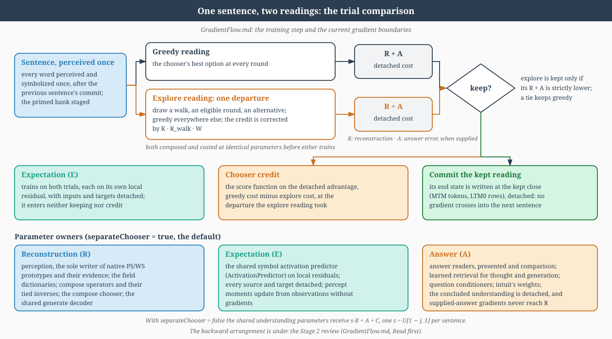

# Gradient flow across the architecture

## Current gradient boundaries and loss normalization

Gradient ownership and the numerical definition of a loss are separate choices.
Alec's direction is to avoid balancing terms where possible. No term is
balanced adaptively by running losses or gradient norms; each relative term is
normalized by its own detached uninformed baseline (below), which fixes the
units in which terms add. Whether that normalization suits a loss is judged
for each loss; the choice of owners neither requires nor removes it.

| Parameters | `separateChooser=false` (default) | `separateChooser=true` |
|---|---|---|
| Understanding parameters: codes, grammar operators and their inverses, conceptual definitions, the compose chooser | Reached by reconstruction R and by the answer side A; A loses only its component that opposes R in each unit | Written only by R-owned costs; the owner-restricted backward excludes supplied-answer gradients |
| Expectation predictors, including `ActivationPredictor` | Their own local objectives; sources, targets and consumed forecasts are detached | Same |
| Candidate attention | Its reading lesson (R) and departure credit (A); consumers detach its output | Its own owner, which also receives the sentence's R and A through the admission read |
| Intuit's learned weights | Output only; no reconstruction or expectation gradient | Same |

`separateChooser` defaults to `false` (`data/model.xml`): each sentence takes
the gradients $g_R$ of R and $g_A$ of A over every optimizer parameter,
removes from $g_A$ only its component that opposes $g_R$ in each unit, and
makes one optimizer step with $g_R + g_A$
([projected gradients](#item-20-round-34-default-projected-gradients-2026-11-09)).
`separateChooser=true` is a supported option, not a legacy path: each cost
then trains only the parameters of its declared owner, whatever its side
([owners and sides](#parameter-owners-and-sides)). `reconstructionJitter`
(default 0) draws one strength $s \sim U[1-j, 1]$ per sentence and scales the
reconstruction owner's R term alone, in either mode. Thought and generate
chooser features remain detached. A separate output residual band was
considered and not adopted; the conceptual residual split remains
[future work](FutureWork.md#the-residual-split-a-stopped-subtraction-or-the-correction-alec-2026-10-29).

Both settings compare completed paths by detached `R + A` in
`SentenceCredit.comparison`; that difference supplies chooser credit. Even with
disjoint parameter owners, rescaling a cost can change which path is kept.
This makes the units of those costs consequential without establishing a need
for automatic balancing or any particular normalization formula.

### The normalization contract and the generation exception

The general rule (2026-10-01) is implemented by `Layers.Error.error`: register raw errors and a **detached**
uninformed baseline, sum contributions over the same active entries of a named
term, then divide once. For squared error this is
`sum((prediction - target)^2) / stop_gradient(sum(target^2))` when the baseline
is positive. Categorical/binary baselines are `log K`/`log 2`. An exactly zero
squared baseline gives an ordinary squared penalty; an empty mask gives zero.
The purpose was comparable loss units before configured priorities, not equal
gradient norms or forcing nearly solved losses back to equal magnitude.

The generation residual is the exception to a target baseline.
`Generative.absolute_residual` measures per-lane mean squared error in the
walk's own chart: cube codes in their coordinates, numeric walks after `asinh`
on both values. The walk sums the chosen steps and the unresolved frontier, and
the sentence registers form, for and against separately through `Error.error`,
each with baseline one and the active-stream mask
([the generation residual](#the-generation-residual-how-it-is-used-and-its-repair-alec-2026-10-30)).

**Numerical failures are repaired at their producer.** A non-finite value is a
producer's bug and is repaired where it is made. A choice's menu is an
observation: it is built without autograd, and only the selected inverse is
differentiated as an operand, per stream; a losing trial or a rejected proposal
contributes no edge, so a rejected operator receives no gradient and keeps its
momentum. A quotient whose derivative can overflow, such as the boundary
solution of the mean inverse in `MeaningCodes.recover_lanes`, keeps its exact
forward and bounds each local partial at the `_BoundedAtanh` slope,
$1/(1 - 0.9^2) \approx 5.26$, before the arriving cotangent is applied
(`_BoundedInverseRatio`); a non-finite cotangent still propagates. No
`nan_to_num`, clamp, floor, detached denominator or gate hides a value. Before
every optimizer step `preflight_finite_gradients` (`bin/Optimizer.py`) checks
every optimizer-owned gradient, coalescing sparse ones, and raises
`NonFiniteGradients`, which names every affected parameter and carries the
per-objective gradient vectors already collected. `MODEL_FINITE_GRAD_GUARD` is
`auto` (on unless a parameter is on CUDA), `on` or `off`.

## Parameter owners and sides

**One forward, one update.** A sentence runs forward once per path. Every
reader sees live values: output reads the understanding in STM, attention
reads perception, the decoder reads the completed understanding. The graph is
differentiable end to end. Every registered cost has an owner and a side, R or
A, which `Error.add` and `Error.error` record separately. By default the side
decides: the R and A gradients are taken over all optimizer parameters and A
is projected against R. With `separateChooser=true` the owner decides:
`ObjectiveOwnership.backward_owned` calls `torch.autograd.grad` once per owner,
only with respect to that owner's parameters, so an error can be
differentiable through a parameter without training it, and an audit fails if
any parameter receives a second writer (Alec, 2026-10-02: "the gradients
separate over the weights"). Either way each sentence makes one optimizer step.

**Who owns what** (`Models.objective_parameter_groups`):

| Owner | Parameters | Trained by |
|---|---|---|
| reconstruction | perception codebooks, conceptual definitions, the compose and generate operators, the compose chooser, and every parameter no other owner claims | the input and order-zero reconstruction losses and compose lessons; the chooser rewards (owner `chooser`) use the same parameter set |
| expectation | the conceptual components (`IndependentComponents`, including the bind resolver `reference_close`), the shared `ActivationPredictor` (`_inter_predictor`) and word predictor, the concept predictor and the percept predictor (`PerceptExpectation`: context and moments update at each arrival, and its parameters receive the accumulated arrival error once, in the sentence's update) | expectation terms whose targets and sources are detached, so a predictor never trains what it predicts; also `expectation.bind_score_function` |
| output | output space, answer attention and record reader, `intuit`'s weights and the generate policy; named output concepts also own their sparse coefficients | supplied-answer costs; the generate policy also takes the generate lessons (owner `generate_lesson`) |
| attention | the candidate attention | `attention.reading_lesson` and `attention.candidate_departure`, plus, in the separate backward, the sentence's R and A through the admission read (`AttentionCredit`, a cotangent to the candidate attention only) |

**Sides (2026-11-10).** Compose and thought rewards are
`output.compose_score_function` and `output.thought_score_function`, owner
chooser, side A; the chooser's parameter set is the reconstruction set. The
output walk's departure credit is owner chooser, side A; its residual lanes
are side A and, since their objective is reconstruction, owner
reconstruction. The reconstruction walk keeps its residual and departure
credit under owner reconstruction, side R (Alec, 2026-11-10). Bind and
candidate-departure rewards are expectation/A and attention/A.

**Where reconstruction is a loss and where it is an audit.** The input's
live parallel field trains `reconstruction_reverse.what/where/when` through
basic percepts and the common native decoder. The sentence's untransformed end
slots traverse the generate grammar, the occurrence writer and the same reverse
to train `reconstruction_order_zero.what/where/when` against the same detached
native input. Generated word order and brackets come from the writer's cursor. The decoder's byte identity and
coverage are value-only audits; the compose-forest inverse remains a System 2
report and tool. `reconstruction.free_percept` keeps its forecast residual,
with context read from the parallel field rather than the sentence's end slots.

**Expectation and reconstruction (decided 2026-10-29).** Percept
expectation predicts each arrival from prior context; its context and moments
update at that arrival, and its predictor's parameters receive the accumulated
local arrival error once, in the sentence's update (`PerceptExpectation`). The
forward path carries the full signal, `expected + residual`. The inverse side
is split by residual: the completed understanding's inverse learns only
`observed - stop_gradient(expected)`, using the value frozen at arrival, so no
top-down gradient reaches expectation and expectation's loss reaches nothing
else. At the conceptual layer the expectation is `ActivationPredictor`, whose
predicted next state is also the spread that primes attention, the chooser
and retrieval in place of the retired location diffusion, trained only by its
own error against the detached next state; `intuit` is the top-down
component, a Sigma over Pi with its own weights trained only by output. The
conceptual split and the correction-output form are
[future work](FutureWork.md#the-residual-split-a-stopped-subtraction-or-the-correction-alec-2026-10-29)
(Alec, 2026-10-29/30). At the percept level this supersedes the 2026-10-20
amendment below that describes expectation as a gain field "never a
subtraction": the residual is signed (an expected absence is negative), and
the full signal is recovered as `expected + residual`.

## Alternatives under exploration (Alec and Claude, 2026-10-29; not decided)

The question: should output be able to shape the understanding by
gradient, not only by selection, without the conflict 6.9 removed (output
and expectation pulling the codes away from what reconstruction needs)?

- **A. A residual band for output.** The understanding gets two parts: a
  base owned and trained by reconstruction, and a residual band owned by
  output. Output reads `stop_gradient(base) + residual`, so its error
  propagates through the operations back to the input, but only into the
  residual band's weights. Every parameter keeps one writer. The band's
  magnitude per question measures what the base lacks for answering.
- **B. Slack in reconstruction.** For approximate maps, the reconstruction
  loss gets a tolerance, `max(0, error - eps)`, with `eps` relative to its
  own error scale, and output reads the base fully. Inside the tolerance
  only output shapes the understanding; at the boundary reconstruction
  pushes back. This is the constrained problem "the best answer, subject to
  the understanding still explaining the input within `eps`". The base then
  has two writers, an extension of 6.9. Exact maps keep zero tolerance.
  *A note on random perturbation (Alec, 2026-10-29).* A zero-mean random
  perturbation of the reconstruction target leaves reconstruction's
  expected gradient unchanged, so on average it gives output no extra
  influence; it adds jitter only. Output's influence comes from the
  tolerance band (B) or from weighting (C): at perfect reconstruction the
  reconstruction gradient is zero, so output moves the understanding until
  reconstruction's restoring pull balances it. A randomized tolerance width
  has the average effect of a fixed one, plus exploration.
  Alec's intent (same day) is to keep reconstruction slightly wrong on
  purpose, so output always has a gradient. Forcing reconstruction or
  expectation to be wrong adds a gradient on reconstruction's side (a pull
  toward a wrong target, and an inverse that fits the injected error), not
  output's; output's gradient comes only from its own error, through the
  cut. With a leak or slack, perfect reconstruction leaves output the most
  room: reconstruction's gradient is zero there, so output shapes the
  understanding unopposed whenever its answer is wrong. For a force that
  persists when answers are right, a margin or confidence term on output is
  the principled form; for robustness, perturb reconstruction's input
  (denoising), not its target.
  Alec's settled intent: expectation stays exact (if it does all the work,
  so much the better), and the jitter goes on reconstruction. Jittering
  reconstruction's *strength* (randomly scaling or dropping its term per
  step) or its tolerance does give output influence: while reconstruction
  is weak, output moves the understanding unopposed, and on average this
  equals the leak (C) or slack (B), plus exploration. Jittering its target
  does not. Either way output's gradient must first be allowed to reach the
  understanding (A, B or C); under the ownership cut of that date it never was.
- **C. A leak.** Output reads the base through a gradient-scaling read,
  `stop_gradient(base) + a * (base - stop_gradient(base))`: the forward
  value is unchanged and output's gradient reaches the base scaled by `a`.
  Simpler than B, but it pushes against reconstruction everywhere.
- **D. One backward instead of several.** If every place one objective
  reads another's value is a stop-gradient in the forward (as A writes it),
  the objectives' losses can be summed and differentiated by a single
  backward with one optimizer; each parameter still receives only its
  intended gradient, and the ownership audit becomes a certificate that the
  single backward equals the per-owner gradients. B and C fit a single
  backward too. One caveat: perception's gradients are pulled through a
  separate traversal then (`pullback.gradients`), which must join the same
  graph or remain a second call.

- **E. One objective for syntax and semantics.** With hard choices the
  model is a stochastic computation graph, and the gradient of one expected
  cost, `E[reconstruction + answer]`, has two parts: the pathwise gradient
  through the values the choices produced (the signal gradient), and the
  score-function gradient, the cost times the gradient of the choice's log
  probability with the other trial's cost as baseline (the chooser's credit,
  already computed by `_compose_score_function_loss` from the paired
  trials). Both come from one surrogate loss and one backward:
  `total_cost + sum over choices of detach(cost - baseline) * log_prob(choice)`.
  Two things kept syntax and semantics apart then: the chooser read
  detached features, so its credit never reached the meaning representation
  that made a choice easy or hard; and the ownership cut kept the answer
  out of the understanding. Lifting the first lets the meanings learn, in
  part, to make good parses likely, while the parses are learned from the
  meanings they produce. The risk is variance: the score-function term is
  noisy, and in shared parameters Adam's per-coordinate scaling can let that
  noise dominate, so it needs its own scale and a measurement first.

Alec's reading (2026-10-29): expectation and attention are well handled by
removing a band and stopping its gradient; output and reconstruction need
slack or a leak; a single gradient is the ideal, since a strongly
partitioned syntax and semantics is doubtful as a psychological model.
Claude's recommendation: D with A in a round of its own after item 2.7,
then measure what the band learns; add B only if the base itself must
move for answers; E as the next step once A and D are measured.

**Decided direction (Alec, 2026-10-29).** Stop-gradient for attention and
expectation; jitter of reconstruction's strength against output (a leak
with a random strength, so the understanding's parameters have two
writers); and the chooser's log-probabilities summed into the same
objective with live features (E), all differentiated by one backward (D).
Each band is stopped at its output where it is consumed, and the 6.9 drift
risk returns in weighted form; the private per-arrival optimizer gives way to
state adaptation and the sentence update. Built and accepted (Alec,
2026-11-01). Also decided (Alec, 2026-10-30): `intuit`'s own Sigma and Pi
weights are output's, trained only by its use in output; `ActivationPredictor`
is an expectation band, its prediction also the conceptual spread. Since
2026-11-09 the default
[gradient projection](#item-20-round-34-default-projected-gradients-2026-11-09),
not the jitter, is how output shapes shared parameters; the jitter stays at
its default of 0.

> **Amendment of 2026-10-20 (read first).** Decisions of 2026-10-19/20 supersede statements below where they conflict; the text is kept as the record.
> - Naming (2026-10-21, Alec): LTM0 is the occurrence store (old LTM1); LTM1 is its relation stratum (old LTM2); LTM2 denotes relations over relations. The old LTM3 name is retired. Earlier names below belong to the retained record.
> - Expectation is a **gain field** $c = m \odot a \odot o$ (attention's gain $m$, expectation's gain $a$, the arriving signal $o$) with the residual in two lanes, never a subtraction or a sign-reversed image; per level with a local error (no inversion across levels — the invertible path is item 3's); one activation predictor over the symbol bank (the slot-structured `SentenceExpectation`, `BracketExpectation`, the byte level and the ARMA heads are retired); keep and credit both read `R + A`; defaults gains 0, prime on, `φ = .5`.
> - Amended 2026-10-29/30 (Alec): at the percept level the residual is signed and the forward path carries `expected + residual`, so "never a subtraction" is superseded there (built in item 2.7's final round); at the concept level the expectation is `ActivationPredictor`'s predicted next state, which at item 2.5 round B is also the spread that primes attention, the chooser and retrieval; `intuit` is a separate top-down layer with its own weights, trained only by output. Round B and the one-backward path are built (accepted as implemented, Alec, 2026-11-01). Current boundaries and the normalization review are recorded at the top of this document.
> - Rows: an LTM1 row is **one** concept slot; an LTM3 row is **three symbol references** (argument, kind, argument) of kind definition, attribution or conditional. The three-slot relation row with a REL code in the middle, null outer vectors, `refs`, `rel_type`, `role_mask`, `order`, `polarity`, `grammatical_mode`, `row_ids`, the address columns and the semantic sidecar are superseded: a row holds its slots, `.when` (model time, a column composition never reads), `truth_plus`/`truth_minus` (the lanes, renamed from `c_plus`/`c_minus`), the access count (renamed from `witness_count`) and `surprise`, and nothing else. **Amended (decided 2026-10-23; recorded 2026-10-30):** an LTM1 row is two tagged references (each to an LTM0 occurrence, a symbol or another LTM1 row, its tag saying which) with its kind read from the referents, not three. The unused `LTM0` columns are removed and the row has this layout (Alec, 2026-11-01).
> - A committed Part row retains both tagged endpoints. `SituationFrame.from_row` projects its head into the one-point context read by the next sentence. That context does not carry the second endpoint, its tag or the two-role layout. The original row remains available for a relational read.
> - `.where` is inside the concept's reserved band (no column); **symbols have `.where` and `.when`**, concepts keep the extent and never the clock; `.when` is model time, sinusoidally encoded; a stream is the batch row that wrote a row, and a document is the cover row that starts it in that stream (reused at every later presentation; a row belongs to the document of the latest cover before it), so "sentence *k* of document *d*", source address hashes, timestamps and situation wholes are superseded (2026-10-24).
> - Identity lives only in the major structures: a **minted** concept row at the shared index (its content the fold of its occurrences, rebuildable) or a **short-term** concept (the NP's fold point with its `.where`/`.when` band, for the situation). The nouns dictionary, the resolver's count tables and the ICA event chart are off the identity path; minting is by recurrence in LTM1; **`bind`** is the only binder (a thought operation, once per site), determiners are cue inputs, and its content term is the meet, not distance.


The sections below record the contract as it grew from item 6.9's (October 3:
one objective owner for each optimizer parameter, the supplied answer stopped
at the understanding, sampled exploration, the decoder margin audit, affine
numeric reading and support-governed decoder eligibility). That contract
survives as the `separateChooser=true` option; by default the answer reaches
shared parameters less its component that opposes reconstruction. Item 6.5's
accepted mechanism adds fresh current-source encodings through the live
identity columns; older context, routing evidence and observed targets remain
detached (accepted with the sparse-coding energy, October 7). Step 5a's uncut
answer and the October global projection (`reconstructionPriority`,
`outputGradientRatio`, `reconstructionLossTolerance`, now rejected at
configuration) are retired. Forward representations and numerical operator
hosts remain shared.

<a id="the-training-step-october-1"></a>

## The training step (October 3)



*Superseded where it differs by [whole paths](#whole-path-credit-and-concept-episodes-2026-11-11)
(2026-11-11): a departure is drawn over the whole path, each sentence makes
one optimizer update, and no comparison reader remains.*

A sentence has a greedy and an explore derivation. Both are composed and
costed at identical parameters before either trains. Each trial then takes
its own restricted backward and optimizer step, including its own perception
pullback for reconstruction. Saved forward parameter values preserve the
second graph. A batch-end step runs only when its remaining registered total
has a derivative. No extra step is added for diagnostics.

Under Item 4's October 19 rule, explore is kept only when `R + A` is
**strictly lower**. A tie keeps greedy. The chooser's detached advantage uses
that same owner-step total: registry reconstruction and relative answer error
when supplied. E trains the shared predictor independently on its local
residual; it enters neither keeping nor departure credit.
Each answer is read from that trial with the understanding detached, before
either optimizer step. Reconstruction and expectation train on both trials.
Round 2e gives the answer owner two independent readers of the same form.
The presented reader takes one step on the kept root only.
The comparison reader supplies A and takes one step on the mean of both root
losses for compose departures, or the kept root for narrowing departures.
Both readers see detached roots. The batch-end answer read uses the presented
reader and reports its error without another update. The kept state is committed detached;
no gradient crosses that boundary into the next sentence.

Input narrowing and compose share one departure per sentence. Round 2d draws
uniformly among the `W` walks with an eligible round, then among that walk's
`R_walk` eligible rounds, then among the selected round's `K` eligible
alternatives. The unmasked policy probability supplies the
`K·R_walk·W`-corrected score-function credit. A
narrowing departure continues through admission and compose greedily; a
compose departure uses greedy narrowing and replays its compose prefix.
Ordinary thought, anticipation and generation retain their existing paired
walks and owner boundaries. No learning rate, optimizer or budget changes
accompany the sentence comparison.

| Parameter owner | Weights and permitted update |
|---|---|
| Reconstruction (R) | Perception, basic percepts, field dictionaries, compose operators and their shared numerical inverses, and compose chooser. The common order-zero decoder is trained by input and order-zero losses; generate policy belongs to output/A. Grammar lessons train their chooser. Codes have no EMA refresh or contextual rotation. |
| Expectation (E) | Item 4's shared symbol activation predictor receives local residual gradients. Every source, including the latest one, and every target is detached; the entire gain saturation is detached. Percept moments update from external observations without gradients. Existing independent auxiliary objectives retain their own owners. ARMA and structured contrastive heads are retired. |
| Answer (A) | Numeric head and affine root/end/echoic-bank reader; learned memory retrieval for thought and generation, question conditioners, answer adapters and controllers, and the generate policy. Under the separate option the concluded understanding is detached. |

Under `separateChooser=true`, [ObjectiveOwnership](../bin/ObjectiveOwnership.py)
reads the trained named terms from `Layers.Error` and obtains gradients only
for their owner lists.
A differentiable numerical operator can transmit a generation derivative to
the conditioner while its own parameters receive no answer update. Regularizers
are unnormalized and follow the parameters they use. The diagnostic operand
term of a grammar lesson trains no operator.
The chooser reads detached expected activations and attenuated content separately; excess and omission never substitute for content.

Two spaces share an index (2026-10-04): a symbol's form
lives in perceptual space and its concept's meaning in conceptual space.
The index pairs the symbol with its concept. The implementation stores the
pair as `[form | meaning]` in a refreshed buffer, without a free word row or
a learned percept-to-concept map. Letters used to derive a form do not gain
conceptual rows merely by being percepts. XOR_grammar and MM_grammar restore
their concept capacities to 6 and 8; perception retains its native inventory.

Perception's codes have one writer: perception's reconstruction. Native PS/WS
prototypes and 11b evidence are detached when the sentence path derives a
symbol's form. Pair search and byte scoring also detach their candidate banks;
the recovered leaf and root stay live so sentence reconstruction trains the
choosers through the root. The affine answer has its own owner and cannot
write these sources.

A native word's lower bound is `L = max_parts(part_code)` over present
parts. Its wholes are adjacent-word pairs witnessed in addressed sentence
rows. Their joins give `U(w) = L(w) ∨ ⋀ L(neighbour)`. The detached placement
is `c = L + α(U−L)`, with `α = W_U/(W_P+W_U)`: `W_P` counts native part
atoms (including length and collision atoms), and `W_U` counts distinct
`(sentence address, pair position)` witnesses. Re-reading does not increase it.

In decreasing part count, containment caps each word by all its containers,
never below `L`; equal part sets are capped together. The index recovers
`L = [c == 1]`; binding projects `c` through round 3a's fixed matrix. The
room pass is retired. Placement is a detached index computation with no
optimizer owner. The audit records movement, all-pair cosine, identity, and
containment before and after the cap.

The serial leaf is `[form × |activation| | meaning × |activation|]`, with
meaning poles exchanged for negative activation. Location bands remain with
the occurrence. Field-path dictionaries retain their existing ownership;
`XOR_exact`'s answer coefficients are unchanged.

The first block stores the symbol's perceptual position. Its content coordinates
carry the placed form `c`; its reserved location/time positions are zero for
a generally characterized type, not an occurrence stamp. The complement stores
the concept's conceptual position. In the final operators update, every stored sentence row
has a fixed sparse identity: `s` ones of `K`, generated privately from its
content key. Identified word bytes define the text sentence's key; occurrence
addresses remain provenance and never seed the code. Direct opaque rows use
native roles and metadata as a fallback content key. The content lookup retains all
distinct occurrences; repeated presentations re-witness one addressed row.

Each fixed identity direction has magnitude `n/(n+4)`, with
`n` the row's witness count. Order-zero meaning takes the detached,
recency-weighted mean of those identities, normalizes its nonzero direction,
and scales it by `n/(n+4)` for the number of containing rows. It remains
on the **for** pole, with zero on the **against** pole. The flat complement is
`[for_0 … for_K−1 | against_0 … against_K−1]`. References and inverted leaf
postings retain their membership; only REL_NONE rows contribute and DEF rows
are excluded. `1/(1+age)` supplies recency independently of truth evidence.
One snapshot of meanings and centroids precedes lexical staging, including
the eager staging used by compiled forwards. Composition, inverse search and
readback share it across both trials. It is not refreshed until committed
writes finish; a current closing becomes context on the next forward. Composed meanings remain
stored as `o`, but no longer supply their own bootstrap.

The bootstrap is resolved by an index, with no learning owner, parameter or
new objective. Grammar gates have 64 pairs and three bits per identity
(128 meaning floats after the unchanged 104-dimensional form event).
BasicModel keeps 896 meaning floats: 448 pairs, six identity bits.

Composition keeps the round-3a form kernels and their normalization. Meanings
compose independently: conjunction/intersection `(min⁺, max⁻)`,
disjunction/union `(max⁺, min⁻)`, sum the mean of each pole, and `not` the pole
exchange. No normalization joins the blocks. Operators without a meaning
write preserve that block. `(0,0)` is unknown, so `a ∧ not b` has no for
evidence and has b's extent against; it does not assert a closed-world
complement. Interpretation applies signless identification presence to form
and the independent evidence magnitudes to two copies of the context code:
`[form × presence | code × c⁺ | code × c⁻]`. `non` clears only the for lane.

The static semantic certificate checks all word pairs against sentence
postings, including negation. It is exact on the grammar vocabularies and a
false-membership diagnostic on BasicModel's corpus. The sparse code carries
composition and similarity; exact membership remains a posting query. Both
connectives can support the XOR read, so mixed final operators are valid.
Membership priming and the adjacent-word centroid are included in the combined step.
The dictionary has no EMA refresh or contextual rotation. Ownership audits
distinguish absent gradients from zero ones and retain inactive weights.

The inverse identifies each word by its signless form: one bank entry per
word, form-only shortlists, pair residuals and STOP eligibility. After word
selection it reads each evidence lane independently against that word's
frozen context code. For each lane, the min inverse chooses the least compatible operand magnitudes and the max inverse the greatest.
A mean uses a nonnegative two-code solve. An ambiguous inverse recovers a compatible
reading, without consulting the input derivation. Readback uses the form,
including when both lanes are full or empty.

## One understanding record, two consumers

[SentenceUnderstanding](../bin/SentenceUnderstanding.py) is built once per
trial. The tied reconstruction and the supplied answer receive that same
object. It carries the concluded root, three end slots and depth, packed
sentence roots/depths, per-word target values/rows/validity, sentence id,
and a primed-symbol snapshot. No rule IDs, arities, operand positions or
journal columns enter the record or the answer reader. It carries no
witness offsets or numerical operation frames. Temporary clause-closing
frames preserve the performed relation semantics and are discarded at the
closing; neither reconstruction nor the answer reads them. Addresses select evidence;
they are not semantic magnitudes.

The snapshot contains each row's own sentence symbols plus up to
`reconstructionBasisLimit` others whose relevance weight is above neutral. It
is taken after the sentence's seen write and shared by every path.
`Space.prime_seen` decays the per-stream `[B,V]` seen ledger and bumps the
seen rows; the relevance weight it returns is one plus the signed desire
channel and, where the parallel path supplies it, the detached predicted
concept activation of `ActivationPredictor`, so the prediction is the spread.
No diffusion over definition edges or occurrence rows remains, and no stream
primes another. Symbols with surfaces are byte candidates; all valid rows
enter answer context with their priming weights. Signed inhibition below
neutral is preserved.

The numeric head reads detached end slots plus an answer-owned, zero-initialized
linear reader of the root (D), three masked end slots (3D), and the echoic
priming-weighted code sum (D). Its extra width is 5D. There are no rule
histograms or original per-word features. The linear reader preserves additive
evidence for the sum-only control. With `readerBlockNormalization=true`,
each form and meaning block is divided by the maximum norm of that block
in the shared code snapshot, clamped below by one. The echoic bank uses its
own shared block scales. These scales are common to all trial roots and
streams; a composed root is never normalized by its own norm. Thus the
reader remains affine and the sum control remains additive. This scaling
is a reader operation and never changes composition or stored meanings.
Generated answers detach the same conceptual
state and bank before the question conditioner; no extra record reader rewrites
that answer. The focused test checks that both consumers receive the same object.

The learned `PrimedSymbolReader` is excluded from `_forward_head` for every
configuration, including `XOR_grammar.xml` and `MM_xor.xml`. Its scorer and
consume gate remain available to `reverseOutput` and to the row-owned STM/LTM
reads of selected thought. Generation consumes an owned operand without changing
the reconstruction carrier. Thought preserves its metadata and charges its
existing shared work meter. Keys remain detached. Neither numeric gate can
learn a nonlinear bag-of-words answer through this reader.
The shipped configurations declaring `answerSynthesis=true` are `BasicModel`,
`BasicModel_answers_tied_benchmark`, `BasicModel_corpus`, `MM_add`,
`MM_add_verb`, `MM_corpus_lessons`, `MM_corpus_orders`, `MM_grammar_wording`,
`MM_ladder`, `MM_ladder_idiom` and `MM_math_chain` (all under `data/`).
Their generated answers use this retrieval path; explicit `reverseOutput`
calls can use it in other configurations. `MM_global` and `MM_qa` keep their
numeric heads affine too; their retrieval probes now exercise generation.

## State paths and shared parameters

`resolveAnswer()` prepares an owned `AnswerDerivation`; `reverseOutput()`
consumes it without repeating resolution. Both numeric and generated answers
cut the concluded state, all contextual operands and the record features.
Generation keeps the declared numerical hosts and their tied interfaces,
without a second optimizer owner or checkpoint copy. Grammar lessons cannot
move those hosts. Catalogue migration still follows rule meaning, preserving
unchanged chooser weights and optimizer moments.

Reconstruction and output share one **order-zero decoder** (item 2.0
round 6, 2026-11-10). Its two reconstruction chains are:

```text
System 1: perception -> live a_0 -> reverse (basic percepts -> native parts) -> reconstruction_reverse
System 2: untransformed sentence end slots -> generate -> occurrence writer -> the same reverse -> reconstruction_order_zero
```

Both losses use the detached per-byte native input as target. Both compare the
full event extent, padding the shorter sequence with zero events; missing and
extra events remain charged. The second enters generate; the common `reverse`
itself remains grammar-free and reads no compose forest. Reconstruction scores
the completed sentence, never word by word: a per-word recovery cannot show
that later folds and the sentence's ending retained the earlier input, so the
ending is inside the fidelity check, and input targets only score, never
seed. Configurations without the serial sentence path (`word_brackets=False`)
book only `reconstruction_reverse`. `reverse(x, *, field)` requires a field
on aligned configurations and reads no input perception spans. Its sparse
native activity holds one selected row, strength and continuous percept vector
per covered position. The native spelling buffers are allocated at construction;
vectorized decoding never allocates a batch-by-position-by-inventory slab.

**Episodic entries and time bands (item 2.0 round 7, accepted 2026-11-11;
added 2026-11-11).** An episodic entry is selected under `torch.no_grad` and
stored detached (`EpisodicMemory.select`, `write`), and a field reinstated by a
recall by time books no loss term of its own: the percept side of long-term
memory is System 1's content and trains nothing. Every learned reader takes a
`.when` as an age or a difference (`RowTime.age_interval`, `age_band`,
`relative_idea`, `relative_to`, `difference`), so no learned read depends on
the clock's phase. See
[Architecture](Architecture.md#episodic-and-semantic-memory-in-the-two-systems-2026-11-11).

Output is `generate -> occurrence writer -> reverse`. Generate infers binary
undo, unary undo or STOP over its bounded bank. The existing legal-action and
recomposition tests still determine eligibility. Its emitted terminals select
the bank's lexical row by unprimed `readback_scores`, using priming only to
break exact identity ties; their independent for/against
activations and new output brackets become the field. Input spans and desired
answers do not choose these rows. The output comparison gives the departure
its detached cost advantage through score-function credit, owner output/A.
Its three residual lanes are side A (owner reconstruction, by their objective). The reconstruction walk uses
the same generate, writer and reverse implementation, and compares its native
reconstruction loss plus its selected residual. Its `reconstruction.walk_residual`
lanes and `reconstruction.walk_credit` belong to reconstruction/R. The
compose-tree policy teacher remains retired. Shared numerical inverse operators retain their ownership;
`separateChooser=true` still restricts parameter writes by owner.

Thought deposits carry a differentiable order-zero reading, so this same
native reverse can credit selected intuition weights. Expectation reads a
detached order-zero target after the kept thought episode, on serial and
parallel paths. Thoughts in STM are found by their `.when`, with empty `.where`;
no thought-only column is appended to the field. Numeric heads retain their
forward readout with `answerSynthesis=false`. Conceptual and perceptual synthesis
layers and the second answer-surface decoder have retired; checkpoint loads
report and drop their keys and associated optimizer state.

The antipode objective and its reporting key are removed; no repulsion
objective replaces it.

XOR_grammar's class reader and the sum control read the raw root through the
same output-owned affine head; the root is not normalized, since a
normalization is a nonlinearity the additive control cannot hold. Reader
weight norms are saved per epoch, including each contributing weight tensor.

Under conjunction a repeated native reference returns that reference; equal
vectors at distinct addresses remain distinct references. `sum` is the mean
control, and `not` exchanges the meaning poles while preserving form. The
catalogue retains `min` and `max` under their own names and all three faces,
but current grammar files do not select them. Compose, generate and reverse
share each kernel; a free inverse searches through that same compose kernel.
These operations impose no code norm constraint.

Reconstruction uses gradient descent with momentum 0.9 at the configured
learning rate. Its compact row-local form retains a float32 momentum prefix,
updates only observed nonzero-gradient rows (or rows with an active proximal
penalty), and leaves unobserved rows unchanged. It does not divide a step by
gradient magnitude. Readers and expectation predictors keep Adam. The L1
proximal threshold for a reconstruction-owned coefficient is `lr * strength`;
answer-owned adaptive coefficients keep their existing Adam metric. Current
saved Adam checkpoints retain the readers' moments and explicitly discard
adaptive moments for parameters now owned by reconstruction's SGD.
Reconstruction steps by momentum descent because of indifference: once it is
satisfied it is indifferent among many derivations and code placements, and
its gradient to the chooser and the codes becomes tiny and noisy. Adam divides
each gradient by its running magnitude, so such a gradient would still move a
weight about one learning rate per step in a random direction, and the
derivation and the roots would drift under the reader; a step proportional to
the gradient leaves a weight whose objective is at its floor where it is.
The audit records every anchor/code/decoder-chooser gradient and displacement coordinate,
code geometry, VQ counts, and each sentence's modal-derivation fraction and
number of distinct recorded rule sequences.

Every compose and decoder derivation in the audit names its rules
beside their IDs, including positions and arities for compose. Names come from
the model's held catalogue, not a later global grammar configuration. Each XOR
run's summary captures its final greedy compose derivations, one per sentence,
at the existing evaluation boundary before the temporary trace is discarded.
There is no additional forward or training run. The decoder's first-logit
audit also gives the binary rule names beside their indices and rule IDs.

The binding kernels take magnitude from the operand activations, not the
lengths of their form codes. With `u=unit(x)`, `v=unit(y)` and activation
magnitudes `a,b`, conjunction returns `a*b*unit(u*v)` and disjunction returns
`(a+b-a*b)*unit(u+v-u*v)`. A present native word has activation one regardless
of its form norm; a composed root carries activation in its norm. The free
inverse searches through the same kernels. The mean remains `sum`, the additive
control; both gates retain the raw-root affine reader. These changes introduce no parameters,
loss, learning rate or optimizer change. The XOR table is the composition
mechanism gate; its class and reconstruction bars remain unchanged.

*A superseded passage beginning "The eager training audit additionally records the first deco" moved to [DevelopmentHistory](DevelopmentHistory.md) (2026-10-30).*


The compose chooser has no straight-through estimator: its choice is a hard
argmax, trained by the score-function credit at a sampled departure. Target spellings,
priming weights and selection addresses are detached. Durable LTM writes,
finished episodes and retained expectations detach; they cannot reopen an old
graph. Query masks, reference matching and work accounting remain hard
bookkeeping. These mechanisms do not establish useful learned reasoning.

## Trained total and diagnostic objectives

`Layers.Error` owns the trained sum. Its targeted APIs register the error
and a detached uninformed baseline over the same active entries. Repeated
contributions to one named term combine before division: `sum(error) /
sum(baseline)`, a ratio of means, with no epsilon floor or running scale.
For squared errors the baseline is the target's squared norm about the
origin. For categorical errors it is `log K`, and for binary errors `log 2`.
A constant target therefore has a usable baseline. If every active squared
target is exactly zero, the term is an unnormalized penalty toward zero.
An empty active set contributes zero.

Every relative term has weight 1 unless the configuration supplies a
priority, including inherited, explicitly stated `model.xml` priorities.
`reconstructionScale` multiplies reconstruction terms independently.
`Error.total(kind='relative')` and `Error.total(kind='penalty')` report the
two sums separately; `total()` supplies their trained sum. A row registry
normalizes with the shared target sum, then returns row contributions whose
active-row mean is that same training objective. A small-target row does
not get a separate large inverse scale. `breakdown()` records raw error,
baseline, entries, weight, contextual multiplier, kind, ownership and row
selection values. `trained=False` metrics never enter the optimizer total.

All retained serial grammar readings reconstruct through their understanding.
The old reading modes, D3 path and detached student runtime are retired. A
reading without a grammar keeps perceptual reconstruction. A sentence with no
admitted surface candidate has no reconstruction term and is counted.
A zero-weight term does not require its source registry.

The inventory below gives each active term's definition. “Origin” means the
detached target mean square over exactly the error's active entries. R is the
input and order-zero reconstruction; A is the answer side; E is the
expectation predictor. While the `separateChooser=true` option is selected, every A term
stops at the understanding, in a trial and at batch end. With it false (the default), the
answer reads the understanding live and shares the trunk with R, less its component that
opposes R in each unit.
Every E term detaches both its source and target. Lesson inputs are detached,
so grammar lessons train only their choosers and write no operator; under
`separateChooser=true` the restricted backward also prevents it.

**Round-6 inventory (2026-11-10).** Owner and R/A side are independent.
The observed-field chain replaces the compose-forest inverse. The generated
order-zero chain retains its grammar-walk residual and departure credit.
The full route is `ObjectiveOwnership.registry_costs`.

| Registered term | Comparison and uninformed baseline | Priority | Owner and gradient |
|---|---|---|---|
| `answer.what/where/when` | Numeric output or generated surface band vs supplied target; origin per band | corresponding event-band scale | Trial and batch; A |
| `reconstruction.free_bytes`, `reconstruction.coverage` | Common reverse bytes vs observed input; identity and missing-position audits | `reconstructionScale` | Value only, `trained=False` |
| `reconstruction.what/where/when` | Masked percept prediction vs detached arrival; origin per band | reconstruction scale × band scale | reconstruction/R |
| `reconstruction_reverse.what/where/when` | Live input field reversed against detached native events; origin per band | reconstruction scale × band scale | reconstruction/R; perception, definitions and basic percepts, no grammar |
| `reconstruction_order_zero.what/where/when` | Untransformed sentence end slots → generate → new occurrences → common reverse against the same native events | reconstruction scale × band scale | reconstruction/R; compose, grammar inverse, selected definitions and native decoder |
| `reconstruction.free_percept` | Decoded native percepts against the frozen percept forecast residual | `reconstructionScale` | reconstruction/R; field context, detached predictor |
| `reconstruction.part` | Test lesson's common-reverse percept readback | `reconstructionScale` | reconstruction/R |
| `output.compose_score_function`, `output.thought_score_function` | Detached completed-trial cost advantage times the selected log probability | whole term | chooser/A for compose and reconstruction-category thought |
| `output.walk_credit` | Generate departure's score-function credit | whole term | chooser/A |
| `expectation.concepts` | Prediction against detached post-thought order-zero knowing | 1 | expectation/R; predictor only |
| `leaf_distill` | Historical root decoder's predicted exact leaves vs retained leaves; origin | `leafDistillWeight` | Batch; decoder and live input root where enabled |
| `expectation.activation` | Predicted two-lane bank activation vs the next row's actual activation; bounded MSE | `sentenceExpectationLossWeight` | Trial or batch, once; shared predictor only, sources and targets detached |
| `expectation.word` | Pre-arrival word activation vs the admitted word's two lanes; bounded MSE | `wordExpectationLossWeight` | Trial or batch; shared predictor at the word read, sources and targets detached |
| `expectation.symbols` | Pre-compose bank activation vs the resulting symbolic field's two lanes; bounded MSE | `wordExpectationLossWeight` | Trial; shared predictor at the S read, sources and targets detached |
| `expectation.components` | Retained innovations plus the current sentence's; one-sparse sparse-coding energy over the change columns only (below) | `independenceWeight` | Trial; E owns columns and relevance; the existing closing comparison credits the global grammar choice |
| `grammar.compose.choice` | Joint compose probability vs annotated operator; `log(choice count)` | `grammarLessonWeight` | Trial; compose chooser; unlabelled waiting sites excluded |
| `grammar.generate.choice` | Generate action logits vs annotated action; `log(choice count)` | `grammarLessonWeight` | generate_lesson/A; generate policy only |
| `grammar.generate.operands` | Generated children vs annotated detached codes; origin | `grammarLessonWeight` | Reporting only (`trained=False`); no operator gradient |
| `embedding.positive/negative` | Sampled lexical logits vs positive/negative membership; `log 2` separately | `embeddingScale` | Batch; joint perceptual embedding |
| `conceptual_sbow.positive/negative` | Cosine logits vs context/non-context membership; `log 2` separately | `conceptualSimilarityScale` × existing SBOW strength | Batch; conceptual codes on the enabled parallel path |

`expectation.components` is a sparse-coding energy over change only.
Individuals are native concept rows (`IdentityRows.individuals`) and receive
no sparse-coding pressure. A kept sentence's innovation, its fused meaning
minus the expectation's prediction, is read in the coordinates of those rows
for each of the three roles, and the change dictionary
(`IndependentComponents.verbs`) explains it as $\Delta_t = B\,e_t$: the columns
of $B$ are fixed patterns of change over individual coordinates and $e_t$ is
one-sparse (one verb phrase per sentence), so the coding is a vector
quantization of change. The energy is squared reconstruction plus a Laplace
activation prior, unit column directions, column incoherence and a learned
relevance scale per column; inference is one projection to a bounded support,
one small differentiable normal-equation solve and a soft threshold. The
population is the retained observations plus the current sentence, so the
statistic does not depend on batch size; an innovation leaves it when its
occurrence leaves retained LTM.

Targetless terms retain their strength and are recorded apart from relative
errors. They have no fabricated target or normalization denominator:

| Term | Definition and strength | Owner and gradient |
|---|---|---|
| `definition_sparsity` | Rank-ordered soft-L0; `definitionSparsityScale` | Batch; definition coefficients |
| `gate_l1` | Absolute lift/lower raw gates; `gateL1Lambda` | Batch; operator gates |
| `concept_readout_l1` | Active sparse readout L1; configured `l1Lambda`, averaged over distinct observed concepts | Trial/batch report only; one proximal application per applicable optimizer step, never another autograd penalty |
| `truth.falsity`, `truth.balance` | Stored-truth incompatibility and forbidden-corner penalties; the caller's `truth_loss_weight` (default 0) and balance strength | Batch; live operands if present |

The selected-thought policy loss and its EMA return baseline are retired
(`selectedThoughtPolicyWeight` is rejected at configuration); a thought choice
learns by the whole-path score function like every other choice. Raw `output`, reconstruction, reverse and
embedding totals, already-trained grammar-lesson summaries, and missing-candidate
counts are reporting-only entries. The old `ws_codebook_recon` and
`ws_semantic_arrangement` stash consumers have no production writer.
Standalone embedding pretraining is separate from these costs. Contextual
sphere rotation is retired; it is not an additional dictionary optimizer.

<a id="terms-on-internals"></a>
### Terms evaluated on the model's own internals (Alec, 2026-11-03)

Rule (Alec, 2026-11-03): a teacher does not reach into the model's internals.
No term takes its target from the model's own derivation to force a choice.
Every chooser (compose, attention, bind, thought and both generate walks)
learns only from its own comparisons, by the proposal-corrected score
function, plus lessons where labelled data supplies a target. The walk-policy,
decomposition, verb and modal teachers are retired under this rule; verbs and
modals learn by their participation and by memory's state errors. The field,
iteration, forward-discard, content and reference reconstruction terms are
retired too; the generated order-zero reconstruction replaces the content
loss. A term evaluated on the model's own states is kept only when it supplies
no target to a choice; the kept terms follow (Alec, 2026-11-03: "keeping them
for this round seems fine"; the reconstruction walk's residual and credit
restored on 2026-11-10). What remains to revisit is in
[Future work](FutureWork.md#terms-evaluated-on-the-models-own-internals-alec-2026-11-03).

| Term | What it constrains | Weight, owner and side |
|---|---|---|
| `reconstruction.walk_residual.{form,for,against}` | Reconstruction walk's selected inverse recomposition and unresolved frontier | Weight 1, baseline 1; reconstruction/R, whole rows |
| `reconstruction.walk_credit` | Reconstruction departure's proposal-corrected score function on its complete native loss and residual | Weight 1; reconstruction/R, whole rows; exact ties have no graph |
| `output.walk_residual.{form,for,against}` | Output walk's selected inverse recomposition and unresolved frontier | Weight 1, baseline 1; side A, owner reconstruction (its objective), whole rows |
| `<category>.definition_fold` | Witnessed member evidence against the class's sparse definition | Weight 1; existing category owner and side |
| `memory.link_coverage` | Coverage of the selected retained reference's link | Weight 1; detached value in choice comparisons, live derivative in reconstruction/R |

The reconstruction targets are native percept events; conceptual activation
and symbols are intermediate states. Generated bytes remain detached reports,
while the continuous face carries each native event loss.

<a id="per-operator-agreement"></a>

## Ownership audit

`branchDiagnosticsEvery` reports `[objective-ownership]`: every trainable
optimizer parameter, its sole declared owner and the writers actually observed
during backward. Inactive parameters remain listed and are not counted as
reached. Under `separateChooser=true` a duplicate owner or a second objective
writer raises an error; under the default the observed writers are the two
sides, R and A, and the epoch report adds each unit's projection statistics
([projected gradients](#item-20-round-34-default-projected-gradients-2026-11-09)).
Writer separation is not an acceptance claim or a guarantee that the
objectives improve together.

The October per-operator projection, opposition streak, norm rebalance and
persistent conflict counter are retired; the one projection in training is
the default per-unit projection of A against R, which keeps no state beyond
the epoch report. The stateless gradient math utilities remain available for
read-only measurements. Separate weights remove direct shared-weight
competition, but reconstruction can still change the forward inputs of the
answer or expectation predictors.

## Verification and retired checks

[Ownership tests](../test/test_objective_ownership.py) check restricted writers,
expectation source/routing cuts, perception pullback ownership, a common trial
record and the answer cut. [Priming tests](../test/test_sentence_priming.py)
check that batch rows never prime each other, that serial reading keeps its
prediction apart from placed rows, and the part graph's constructed capacity.
[Selection tests](../test/test_reconstruction_precedence.py) retain reconstruction
precedence; [sentence comparison tests](../test/test_sentence_comparison.py)
check equal-parameter costs before updates. The old uncut-answer, projection
and expectation-encoder training tests are retired with those behaviors.

*Moved to [DevelopmentHistory](DevelopmentHistory.md#expectation-at-the-closing) (2026-10-30): "Expectation at the closing".*
## Codes are perception's; the chooser is trained from the trial comparison (October 4)

Decided 2026-10-04 (item 6.8).

- **Perception's codes have one writer, perception's reconstruction.** In the
  conceptual derivation the percept prototypes and the 11b evidence are
  detached; the sentence path's pair search, byte scorer and answer head
  reach no gradient to them. An earlier collapse was the straight-through
  pair-search blend pulling every candidate code onto every read-back target
  with uniform weights; an erosion came from the shared wholes' term of the
  midpoint, moved by the room clamp. Both paths are closed: no code moves
  under the sentence path.
- **The sentence handoff detaches input attention's credit.** The
  attention and compose walks share a scorer. Byte reconstruction previously
  reached it through the attention straight-through value, cached perception
  and the perception pullback even when the two compose costs tied. Detaching
  that credit closes this additional sentence-path writer; the original
  no-movement tie assertion passes. Round 1 adds attention's own paired-cost
  score-function objective; the sentence handoff remains detached.
- **The compose chooser's gradient is the score-function estimator (Alec,
  2026-10-05: "So we are doing SCG?"; supersedes the comparison step of
  2026-10-04 and the straight-through of the same morning).** The chooser's
  parameters enter the path only through which operation is chosen, so the
  exact gradient of the expected cost with respect to them is the
  score-function term at the sampled departure, with the exploit path's cost
  as the paired baseline (self-critical sequence training): the surrogate is
  $p_\theta(a_{dep} \mid s)\,(C_{explore} - C_{exploit}) / q(a_{dep})$, with the
  costs and the proposal probability $q$ detached, one term per departure;
  $\nabla p / q$ is the importance-weighted $\nabla \log p$. The departure is
  drawn walk first, then round, then alternative: `W` counts walks with an
  eligible round and `R_walk` eligible rounds in the drawn walk, and the
  alternative comes from a proposal that mixes a uniform floor over the
  value-distinct eligible alternatives (`explorationUniformFraction`) with the
  tempered policy, so $1/q = W \cdot R_{walk} / q_{alt}$, which is
  $W \cdot R_{walk} \cdot K$ when the draw is uniform over $K$ alternatives.
  No differentiable decoder is needed; a tie teaches nothing and the greedy
  argmax supplies no chooser gradient.
- **Why reconstruction alone cannot judge a choice.** Operators with exact
  inverses, such as conjunction and disjunction over the same two words,
  recover the same words, so their reconstruction costs tie. What the choice
  asserts shows only in the answer and in what follows, which is why paths
  are compared on R + A rather than on reconstruction alone.
- **No soft relaxation.** DARTS-style superposition, Gumbel-softmax sampling
  and mixture-of-experts routing all need the loss to be smooth in the mixed
  output downstream of the choice. Here it is not: the hard pair pick makes
  the reconstruction cost piecewise constant in the root, so a router
  gradient through a mixture is zero almost everywhere, and the mixture
  gradient that favours whatever already dominates (the documented DARTS
  collapse) is the mechanism that once merged codes through a
  straight-through blend. The paths therefore serve three purposes besides
  the estimator: coverage independent of the chooser's confidence (the
  proposal's uniform floor), the commit (the understanding kept is the better
  of actual derivations) and an exact zeroth-order cost comparison. A dense
  pathwise signal, if ever wanted, enters as a control variate (REBAR,
  RELAX), not as a second sum.
- **The pair search is hard.** Candidate codes detached, the residual
  absolute in the code's own chart (relative to the parent's mean square
  until 2026-11-03), the straight-through blend deleted: with codes
  perception's and operators parameterless, nothing on the compose side
  needs a gradient through the inverse, and the blend's gradient was a biased
  proxy (the true pair's margin) weighted by the decoder's uncertainty. The
  byte scorer's bank codes are detached. Selected numerical inverses retain
  operand gradients, but the free walk supplies no policy gradient.
- **Decomposition teacher retired (2026-11-04).** The
  bottom-up operand-identity teacher and `reconstruction.decomposition`
  registration are removed. `DecompositionChooser` has the constant weights
  `[1, 0, 0, 0, 0]`, outside every optimizer group, and selects the joint
  residual argmin over form and both meaning lanes. The shortlist, eligibility
  masks, exact-pair branch and tolerances are unchanged. Legacy learned chooser
  values are dropped and reported on checkpoint intake. No replacement learning
  rule is introduced. `reconstruction.walk_policy` retired with the walk teacher
  in item 2.0.
- **One affine reader for both gates.** XOR_grammar's class reader and the
  sum control read the raw root through the same output-owned affine head;
  the root's address bands are zero. A normalization of the root is a
  nonlinearity the control cannot hold and is not the affine read (an
  earlier unit-norm reader is withdrawn).
- **Certainty is the activation.** Forms are at full presence; the leaf's
  activation, the projection coefficient, carries how sure the reader is.

## Attention's credit detached; the kernels' magnitude from the activation (October 5)

- **The input-attention walk shares the compose chooser's parameters** and its
  straight-through credit reached them through the perception pullback (the
  byte cost's cotangent at the forked leaves pushed back through the cached
  perception graph), a second, pathwise writer beside the score-function term
  that was below float32 resolution at the old code scale. Attention's credit
  remains detached at the sentence handoff. Round 1 trains the attention
  choices by the score-function estimator below. Reconstruction remains
  the shared chooser's sole gradient owner.
- **The binding kernels take magnitude from the activation**, codes entering
  as directions: conjunction $a \cdot b \cdot \mathrm{unit}(u \circ v)$, disjunction
  $(a + b - ab) \cdot \mathrm{unit}(u + v - u \circ v)$ with $u, v$ unit codes and $a, b$ the operand
  activations (1 for a present word). Roots carry unit certainty; identity is
  in the direction. The code's norm is no longer read as certainty (the
  reading retired 2026-10-04); at full presence the old `a + b − ab` on norms
  above 1 was non-monotone and the product leaked form length.
- **Full-presence admitted rows:** `RadixLayer.insert()` initializes an
  admitted percept row at full presence (unit L2 norm, then the cube clamp).


*Moved to [DevelopmentHistory](DevelopmentHistory.md#operators-update-round-1-october-5) (2026-10-30): "Operators update round 1 (October 5)".*
*Moved to [DevelopmentHistory](DevelopmentHistory.md#the-target-scheme-october-6-decided-scheduled-by-rounds) (2026-10-30): "The target scheme (October 6; decided, scheduled by rounds)".*
*A superseded passage beginning "<a id="operators-update-round-2-credit-october-6-uncommitted" moved to [DevelopmentHistory](DevelopmentHistory.md) (2026-10-30).*
*Moved to [DevelopmentHistory](DevelopmentHistory.md#operators-update-round-2b-october-6-rejected-candidate) (2026-10-30): "Operators update round 2b (October 6; rejected candidate)".*
*Moved to [DevelopmentHistory](DevelopmentHistory.md#operators-update-round-2c-october-6-not-accepted) (2026-10-30): "Operators update round 2c (October 6; not accepted)".*
*Moved to [DevelopmentHistory](DevelopmentHistory.md#operators-update-round-2d-october-6-review-candidate) (2026-10-30): "Operators update round 2d (October 6; review candidate)".*
*Moved to [DevelopmentHistory](DevelopmentHistory.md#operators-update-round-2e-october-6-review-candidate) (2026-10-30): "Operators update round 2e (October 6; review candidate)".*
*Moved to [DevelopmentHistory](DevelopmentHistory.md#operators-update-round-3a-october-7-review-candidate) (2026-10-30): "Operators update round 3a (October 7; review candidate)".*
*Moved to [DevelopmentHistory](DevelopmentHistory.md#operators-update-round-4a-october-7-superseded-by-the-combined-step) (2026-10-30): "Operators update round 4a (October 7; superseded by the combined step)".*
*Moved to [DevelopmentHistory](DevelopmentHistory.md#operators-update-round-4a-0-the-occurrences-address-october-7-isolated-historical-measurement) (2026-10-30): "Operators update round 4a-0: the occurrence's address (October 7; isolated historical measurement)".*
*Moved to [DevelopmentHistory](DevelopmentHistory.md#final-operators-update-october-7-uncommitted-review-candidate) (2026-10-30): "Final operators update (October 7; uncommitted review candidate)".*
## The lanes at the leaf (Alec, 2026-10-07)

The combined step's interpretation rule — the form takes `|a|`, the meaning
takes `|a|` with its poles exchanged when `a < 0` — and `pole_activation`'s
`net = pair⁺ − pair⁻` collapse the walk's pole pair into one signed scalar,
which cannot distinguish *both* from *neither*. The repair
pass carries the pair to the leaf: `[form × presence | code × c⁺ | code ×
c⁻]`; the for lane receives `c⁺`, the against lane `c⁻`; no difference or
sign is formed anywhere between the walk and the stored row; the inverse
identifies a word by its signless form and reads both lanes with the
leaf's pair. The row's `(c⁺, c⁻)` is the required-evidence read: min
over nonzero contributions on each pole independently.

## The generation residual: how it is used, and its repair (Alec, 2026-10-30)

*Decided in conversation on 2026-10-30 and built in item 2.5's repair round
([as built](#the-repair-as-built-2026-10-30)).*

**What the residual is.** Generation reads a concept back into words by a
walk over a stack: at each step the top code (the parent) is split by an
inverse binary operation, rewritten by an inverse unary operation, or
emitted as a word (STOP). For every legal proposal at the step, the menu
(`Generative.eligibility_menu`) composes the proposed pieces forward again
and measures how well that reproduces the parent, separately for the form
block and the two meaning lanes (for and against). That measurement is the
residual. It is used four ways:

1. *Chooser features.* Each proposal carries five detached numbers into the
   generate chooser (`InverseMenu.features`, scored by
   `LanguageSpace.generate_policy_logits`): the form residual, the two lane
   residuals, an exactness flag and the stack effect ($+1$ binary, $0$
   unary, $-1$ STOP).
2. *Exactness.* A proposal is exact when its residuals are at most
   $10^{-8}$; an exact binary pair or exact terminal pre-empts every
   approximate proposal at that step (the pair-first rule).
3. *Admissibility.* A proposal whose residual is not finite is removed from
   the menu.
4. *The loss.* The chosen proposal's residual at each step, summed over the
   walk, plus the energy left unresolved on the stack, is the reconstruction
   term `reconstruction.walk_residual`. On the gradient path it is recomputed
   through the chosen recomposition (`Generative.selected_residual`), so its
   gradient trains the grammar operators and their inverses.

**What was wrong.** Before the repair every residual was a ratio: the step's error energy
divided by the parent's own energy, per lane, with the parent live
(`Generative._relative_energy`). The against lane is usually exactly zero,
where the code falls back to the raw error, or nearly zero, where the ratio
is the raw error times an arbitrarily large factor: the measure is
discontinuous at zero. That produced the loss of about $10^{29}$ and the
non-finite gradient of the one-backward arm. Within one
step every proposal shares the parent, so the division never changed the
ranking among proposals; it only rescaled the features by a step-dependent
factor, and through use 3 it could remove a correct proposal from the menu.

**The repair, decided (D-i).** The loss is registered through the error
registry like every other term, never as a finished scalar:

1. The per-step measure (`relative_residual`, renamed `absolute_residual`)
   returns, per lane, the step's absolute error in the code's own chart
   (below) and no longer divides.
2. `walk_residual` sums the chosen steps' errors over the walk and adds the
   unresolved stack energy, per lane, without dilution by the step count.
3. The sentence close registers three terms,
   `reconstruction.walk_residual.form`, `.for` and `.against`, through
   `Error.error(name, per_stream_sum, 1., mask=active,
   category='reconstruction')`, one entry per active stream, so the registry
   averages over streams and divides once per term. Three terms keep each
   lane in its own units; what goes is the per-step
   division.
4. No floor, cap, detachment of the error, or dropped term anywhere. The
   per-step live-denominator derivative has no site, so the overflowing
   terminal becomes a passing certificate.

**The measure, decided (D-ii; Alec: no ratios of error terms).**
The residual is an absolute error in the code's own chart, in all four uses:

- *Symbolic codes* are membership vectors in the unit cube (every admissible
  symbolic proposal is checked `in_cube`), so the mean squared error per
  lane is already bounded in $[0, 1]$ and in fixed units. The symbolic
  exact-pair test in `LanguageSpace.decoder_eligibility` already uses exactly
  this measure.
- *Numeric codes* (the math chain's walks, `cube_domain=False`) are not
  membership coordinates and span magnitudes. Their error is the squared
  difference in an $\operatorname{asinh}$ chart,
  $(\operatorname{asinh} r - \operatorname{asinh} p)^2$: absolute near zero,
  logarithmic for large magnitudes, continuous, and with no division.
- *Exactness* reads the same absolute error against the same tolerance.
- *Admissibility*: an absolute error of finite codes is finite, so the
  finiteness gate becomes an assertion that fails loud instead of a silent
  exclusion.
- *The loss* then registers with the registry's constant unit baseline, as
  `reconstruction.free_percept` and the expectation terms do. D-i as first written divided by the
  sentence's detached parent energy per lane; that is still a ratio, and for
  the against lane, usually zero or nearly so, it keeps the same
  discontinuity at sentence scale. With the absolute measure no
  data-dependent denominator remains anywhere in the generation residual.

The absolute measure changes the scale of $R$ against $A$ in the kept-trial
comparison ($R + A$) and, under `separateChooser` false, in the single
backward. No balancing weight is introduced to compensate. Decided in full
(Alec, 2026-10-30: "Yes, let's try that").

### The repair as built (2026-10-30)

The generation residual now implements the decision above. For each of form,
for and against, let `chart(x)=x` on symbolic cube walks and `chart(x)=asinh(x)`
on numeric walks. Each chosen step contributes
the mean of $(\operatorname{chart}(\mathrm{recovered})-\operatorname{chart}(\mathrm{parent}))^2$ in that lane. The walk adds these
errors and the unresolved stack's per-entry mean-square chart energy, without
averaging across steps. Its three outputs remain separate until the error
registry and the kept-trial comparison sum the named terms.

`reconstruction.walk_residual.form`, `.for` and `.against` each use
`errors.error(name, per_stream_sum, 1., mask=active, category='reconstruction')`.
Thus the registry's aggregate-before-division contract remains intact and the
baseline is exactly one; neither the parent nor its magnitude is a denominator.
The retired `_relative_energy` and `relative_residual` names remain in this
historical explanation only. Symbolic exactness is absolute MSE at most `1e-8`;
numeric exactness uses the same threshold in the asinh chart. A finite-domain
proposal with a nonfinite residual fails at its producer. The five menu feature
columns and the detached thought/generate chooser inputs are retained.

The read-only epoch report (`SentenceTraining.gradient_receipt`) includes
`understanding.reconstruction_norm`
and `understanding.output_norm`. These are Euclidean norms of the weighted
parameter-coordinate vectors accumulated over the epoch, not averages of step
norms. Understanding coordinates are optimizer-owned codebooks, grammar
operators/inverses and conceptual definition matrices in reconstruction's
ownership group. Placed code buffers and answer-owned readers are excluded.
The existing diagnostic collection supplies the vectors without another
backward or a `.grad` write. Under `separateChooser=true`, the actual A
contribution to these coordinates is zero by construction; the existing
per-operator dissonance still reports hypothetical cross-owner directions.
Under false, the report reads the actual R and A contributions to the shared
surrogate. Diagnostic time remains excluded from training step time.

The R/A report groups each epoch's already collected vectors by stable
parameter name. For a sparse definition it sums surviving edge coordinates by
allocation ID across replacements. A removed edge retains its earlier
contribution to that epoch, and a recycled coordinate begins a new one.
Parameter and element counts describe the understanding at the end of the
epoch. This read takes place within diagnostic time.

### Selected fields and the verb reflection (2026-11-02)

For a mixed batch, the concluded sentence and the costed thought output replay the selected integer actions once. Each stream keeps the fields of its selected trial, and only that realization supplies the pullback from those fields. The parameterized verb reflection rescales its direction by an exact power of two before taking the squared norm. This preserves the reflection for every nonzero direction and avoids underflow in its intermediate divisor. [Tests for the selected fields](../test/test_generation_selection_backward.py) · [Reflection certificate](../test/test_meaning_kernels.py)

**Decomposition pair residual (2026-11-03; teacher retired 2026-11-04).** The fixed inverse chooser scores each shortlisted dictionary pair in the code's own coordinates. `LanguageSpace._bounded_binary_reconstruction` uses `Generative.absolute_residual` on its fold and its observed parent. Its selected feature is the negative of the sum of the form MSE and the mean of the two meaning MSEs. A parent whose evidence tends to zero therefore gives a continuous pair score. Historically, the former parent-relative residual could dominate the decomposition teacher's loss and gradient when the parent's evidence was tiny. The absolute residual remains; the teacher and its learned weights do not. [Maintained producer certificate](../test/test_reconstruction_magnitudes.py)


**Committed field inverse (2026-11-03).** The consumer of a compose operation can refresh its operand from a bound STM identity. The numerical journal contains both the preceding publication and the operand actually read. For form coordinates the inverse adds the recorded publication minus the operand actually read. For the two membership lanes it translates the publication by the recovered-minus-read discrepancy in the operation’s centered atanh cube chart. A direct numerical edge returns the recovered value exactly, including at either rail. A reread with zero discrepancy returns the recorded publication. A chunk also publishes its own where and when after the operator runs. The paired centroid inverse reads those positions from the occurrence journal and applies the inverse to the form that was actually composed. Unpaired full-width maps use their native content kernel. The measured target leaves do not supply any of those values. [Committed forest](../bin/DerivationReconstruction.py) · [Deep-centroid certificate](../test/test_reconstruction_magnitudes.py)

**Whole presence and gradients (2026-11-04).** For total membership $t$, the whole's presence is $p=\min(1,t)$. A centroid moves its parts form $x$ toward the whole mean $m$ by $p/2$, using a lerp for exact rails. Its differentiable carrier is $\sum_r w_r c_r/\max(1,t)$, so no presence consumer divides by a small mass. For $0<t<1$, the membership pullback is $g\mathbin{\cdot}(c_r-x)/2$; for $t\ge1$, it is $g\mathbin{\cdot}(c_r-m)/(2t)$. The code pullback is $w_r g/(2\max(1,t))$. At $t=0$ the consumer contributes nothing and sends no whole gradient. The inverse first recovers $(parent-(p/2)m)/(1-p/2)$, then splits the counts; candidate search uses the same equations. Its forward uses the detached exact-rail mean and presence, while its derivative comes from the direct carrier expression. At $t\ge1$ this forward is bitwise $2\,parent-m$. This supersedes the earlier full-half-weight whole read. [Presence and inverse certificates](../test/test_whole_presence.py)

**Literal whole membership gradients (2026-11-03; restored 2026-11-04).** The independent `weighted_mean` read still returns the convex mean of the property codes at their active weights. `_WholeMean` interpolates one property at a time to retain exact cube rails. Its derivative uses the complete span. For a mean $m$, total positive mass $T$ and incoming gradient $g$, membership $w_i$ receives $g\mathbin{\cdot}(c_i-m)/T$ and code $c_i$ receives $(w_i/T)g$. A zero cumulative prefix inside an occupied span has no role in those derivatives. An entirely empty span keeps its existing zero value and first-membership tangent. This literal read retains its normalized derivative; presence consumers use the bounded carrier described above. [Producer and compiled derivative certificate](../test/test_form_centroid_numerics.py)

**Unfinished retained forests (2026-11-03).** The signed sentence-depth tag records completion status. When the closing budget is insufficient, the committed-tree reconstruction consumes every surviving root from the trial’s live STM and checks its actual depth against the action journal. Those roots retain their gradients, including when there are more than three. The admission path excludes the incomplete reading. [Retained inverse](../bin/DerivationReconstruction.py) · [Gradient and publication certificates](../test/test_reconstruction_magnitudes.py)

### Hierarchical conceptual conditioning (2026-11-08)

`ConceptHierarchy.condition` executes under `torch.no_grad` at the kept sentence boundary. It applies the existing conceptual placement step to native membership context, from higher orders downward, with a shared snapshot per order, then refreshes member centroids. This directional update preserves forms and stored confidence radii; the unscaled conceptual-content cache follows the changed direction. Optimizer projection separately keeps concept lengths at their stored radii. Generic member views own the confidence counters. Grammar argument concepts use exactly these paths, and no hierarchy update sends a gradient or placement target into perceptual form coordinates. [Architecture](Architecture.md#hierarchical-conceptual-context-alec-2026-11-08) specifies the chart and membership rules.

### 2026-11-08: recorded action context in the derivation inverse

The committed derivation retains the selected forward action's object value,
object-presence flag and verb group beside its numerical operation frame.
`DerivationReconstruction.inverse_step` and forward-discard accounting use that
same witness. A missing non-adverb action record raises instead of selecting an
identity basis. The object and grouped-intransitive direct cases recover their
inputs to double-precision roundoff; the adverb action retains its single basis.
Free proposals use their proposed object and the shared verb-group assignment
lookup in pair ranking, the selected inverse and `Generative.native_recompose`.
An absent object or unknown group has the identity basis; a missing input
record is not an error on this path. The proposed context comes from the
supplied concept bank, without the input's compose history or live STM.
Object-vector contraction uses a linear weight view so the compiled selected
branch's pullback has the parameter's native layout. It preserves the action's
values and gradients.

### Item 2.0 round 3/4: default projected gradients (2026-11-09)

This update supersedes the earlier default ownership and teacher descriptions
above. The separate-owner implementation remains available with
`separateChooser=true`. The default takes two `autograd.grad` traversals over all
optimizer parameters, preserving the reconstruction gradient and projecting only
the opposing answer component before one optimizer step.

| Side | Owner in the optional separate path | Costs as implemented |
|---|---|---|
| R | reconstruction | Input and order-zero reconstruction (`reconstruction_reverse`, `reconstruction_order_zero`), `reconstruction.part`, `reconstruction.free_percept`, the reconstruction walk's residual and departure credit, memory link coverage and state errors, definition folds. |
| R | compose_lesson | Compose lessons. |
| R | expectation | Predictor terms. |
| R | attention | Reading lessons and candidate cross-entropy. |
| R | Each parameter's owner | Regularizers, once in the projected aggregate. |
| A | output | Answers, prediction and readers. |
| A | generate_lesson | Generate lessons. |
| A | reconstruction | The output walk's residual lanes (their objective is reconstruction), whole. |
| A | chooser | Output-walk credit, compose rewards and reconstruction-category thought rewards, whole. |
| A | expectation | Bind and expectation-category thought rewards, whole. |
| A | attention | Candidate-departure rewards, whole. |

`Error.add` and `Error.error` retain owner and side separately. Registry keys use
the owner alone for its default side, or append `.A`/`.R` for the other side.
The separate path strips that suffix and routes to the owner's parameters,
including its existing perception pullback. The default reads the sides of the
same costs. Both default traversals retain the batch graph; sentence-boundary
cuts release completed sentence writes without cutting batch perception.

Only the `reconstruction` key's R aggregate is multiplied by the drawn
`reconstructionJitter` strength; its default remains zero jitter. A shared
regularizer enters R once. Unit projection uses a tensor, concept row or durable
definition edge; Adam coordinates have weight `1/(sqrt(v_hat)+eps)` from existing
state, with identity before the first step. A single-writer unit is unchanged.
Sparse row gradients retain sparse support, without densifying the concept table.

For each unit $u$ whose two gradients oppose, $\langle g_A^u, g_R^u\rangle_M < 0$,
the answer's gradient becomes
$g_A^u - \frac{\langle g_A^u, g_R^u\rangle_M}{\lVert g_R^u\rVert_M^2}\, g_R^u$,
with inner products in the unit's optimizer metric $M$. Reconstruction's
gradient is never altered, and output keeps every component that does not
oppose it: that is output's slack. No weight, tolerance or balance of
amplitudes enters. Geometry alone fixes the removed component, which does not
depend on the scale of $g_R$, so jittering reconstruction's strength would only
reweight the final sum; the projection replaces the jitter as the way output
shapes shared parameters. Concept tables are projected per concept row and
definition coefficients per edge: over a whole table, agreement on one concept
would offset a conflict on another, and the added multiple of $g_R$ would
enlarge the step on rows output never touched. The guarantee is first order:
output's gradient adds no first-order increase of the reconstruction loss.
Reconstruction-owned parameters step by momentum descent, so it holds for the
gradient and not exactly for the step.

Why this conflict, and only this one: reconstruction, the model seeing what is
there, takes precedence over a supplied answer. Removing only the answer's
opposing component in each shared unit states that precedence directly, so to
first order a step taken for the answer cannot make reconstruction worse,
while parameters reconstruction does not use receive the answer's gradient in
full. General multi-objective gradient surgery (PCGrad, MGDA and their
variants) is not adopted: well-weighted plain sums usually match it, and this
precedence is the one conflict decided. If persistent opposition appears, the
options are separate owners (`separateChooser=true`), refinement of a
persistently conflicted code into two, and different learning speeds.

`SentenceTraining.gradient_receipt` adds per-unit epoch averages
`cosine_before`, `fraction_projected` and `fraction_answer_removed`, with a step
count. The cosine and removed norm use the unit's optimizer metric; zero-vector
cosines and removed fractions are reported as zero. `realized_steps` reports
root-sum-squared actual displacements divided by root-sum-squared pre-step
parameter norms for codes, lift and adverb, with null for a zero denominator.
The existing read-only `measure()` dissonance and understanding norms are retained.

The decoder and answer generate credits use their own complete paired costs,
including residuals, and the same proposal-corrected score function as compose.
Exact ties do not create a gradient. No walk, verb or modal teacher remains.
A stored MTM value receives only the current action's local straight-through
pullback from its recorded forward input; earlier sentence graphs stay cut.

## Memory readers and state errors (item 2.0 round 5, 2026-11-09)

| Term | Owner | Side | Live derivative |
| --- | --- | --- | --- |
| `memory.link_coverage` | reconstruction | R | What the chosen link's coverage reads; choice discrete |
| `memory.verb_state` | reconstruction | R | Lift action readout on recorded operands; later reference target detached |
| `memory.modal_state` | reconstruction | R | Modifier action on equal-time actual/alternative references; targets detached |

`reconstruction.reference` and its weight are retired. Link trial comparison uses a detached coverage value; the kept-close registry carries the live coverage derivative in the single backward. State errors are registered at the kept close only in training, with the no-change squared cube-chart distance as baseline. The actionRateRatio parameter groups, assigner and re-read remain. Parallel-field, compose-centroid and typed-slot property gradients now pass through basic percepts; the presence derivative remains the directly weighted carrier.

## Whole-path credit and concept episodes (2026-11-11)

The whole-path design replaces the local pair keeps and twin answer reader described above. Each path follows reading → reconstruction generate → occurrence writer and reverse → thought → answer generate and reverse. Its comparison cost is R + A. On data that supervises output, a path's A is its answer cost on every row: the supplied answer where one was asked and silence otherwise, so a path that speaks where nothing was asked pays for it, and silence takes part in which path is kept. The direct field reconstruction remains grammar-free. The numeric modality uses the path's composed state through one affine head.

A single departure is drawn over attention, compose, candidate, bind, reconstruction, thought or output. Every departure receives its whole-path change in R + A with the proposal correction of that draw, reading its own path's compose departure mask and attention state. Every ordinary cost trained on every path is scaled by 2/(1+K): reconstruction, expectation, compose and generate lessons, attention and their regularizers. The answer trains on the union of the kept path, explore paths departing in compose, and the greedy path when that set includes a compose departure; weights sum to one per stream. Both compositions train the reader because a reader trained only on what is kept reads the kept composition better because it is kept, which biases the comparison toward the incumbent; the retired twin reader existed to offset that bias, and with one reader it returns unless the reader sees both. A departure in attention, among the candidates or in a bind is another reading of the input, to which the supplied answer does not apply, and a path that departed in the thought or a read-out is not asked to answer from a conclusion it did not keep. The rule's known cost is that the rejected composition's share does not decay as the chooser commits. Answer costs and `penalty.output` already carry those reader weights; chooser and `.A` departure costs are booked once and receive no additional all-path multiplier. The exploit's one reading lesson is added once outside the path sum. A no-departure path has an independent registry container, so subsequent bookings cannot leak between paths. The reconstruction/output walk residuals and credits retain their declared owners and R/A sides. Default gradient projection and optional separate owner pullbacks each make one sentence update. There are no `thought_comparison` terms or separately trained comparison-reader parameters.

Hard derivations train only what they select: a path's costs reach the operators it applied, and an operator that no path selects receives no gradient beyond the negligible derivative through its candidate score. Its route to credit is a departure, an explore path that selects it, trains it with that path's costs and is compared with the exploit on R + A. The proposal's uniform floor (`explorationUniformFraction`) gives every eligible alternative a positive probability at each departure, and `explorePaths` sets how many explore paths a sentence draws; the two set how quickly an unused operator is tried.

New question-conditioner widths join the optimizer before the same sentence's first backward. Live thought results and output conditioning retain the selected path's graph; only choice evidence and durable storage use their existing detach boundaries. Batch-end reporting uses the recorded output without another walk or loss. On data without supervised outputs, paths compare on R and only the kept reconstruction runs a thought.

Omission's original contents are detached loss-side targets only, captured before identity admission. `reconstruction_order_zero` restores the original input; `reconstruction_reverse` scores visible positions. `reconstruction.free_percept` excludes omitted brackets from both its numerator and its normalization. Loss-only codes for unseen target bytes neither admit percepts nor consume the forward random stream. Expectation excludes omitted observations that would otherwise leak content into state. Rates and accuracy averages are checkpointed statistics, with no gradient. Episodic concept entries are also detached: only their references and signed values are stored, while fields and semantic truth rows retain both poles. Time-only recall rebuilds the poles from the signs, lays out references in reading order and publishes their field directly, and direct `reverse` can read it without a reconstruction charge in this round.


## Item 1.8 amendment (2026-11-12)

`FieldLogic.power` supplies the weighted least/greatest arithmetic for sparse definitions and intuition, retaining exact Boolean rails and live exponent derivatives. A numeric input has no learned transform: f(n) occupies a fixed axis. The linear output owns concept/lane weights; retired seats clear weights, gradients and optimizer moments. Its input reconstruction reads the field captured by the understanding. Examination-only paths train reconstruction over their field and supervised numeric output where supplied, with a single attention departure per explored path. Scalar boxes and counted definition evidence have no gradient-trained boundary. Their evidence is a separate modality, and the text residual ledger excludes the placeless reading.
