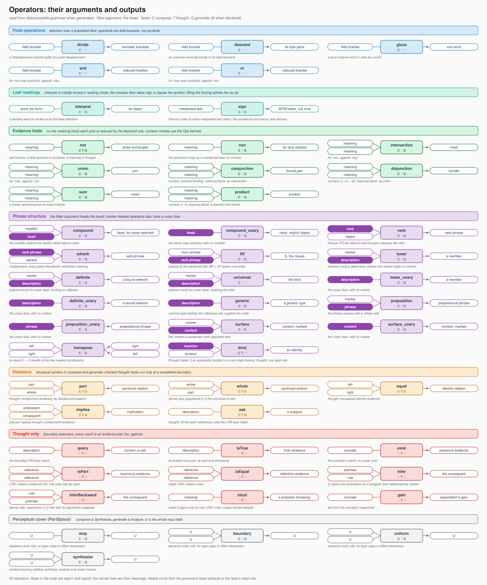

# Language

> **Amendment of 2026-10-20 (read first).** Decisions of 2026-10-19/20 supersede statements below where they conflict; the text is kept as the record. Record: [two truths §1, "The row, field by field"](specs/2026-09-16-two-truths-ideas-and-relations.md#1-definitions-decided); [bind plan §6–§6.3](plans/2026-10-19-bind-thought-operation.md); [occurrence spec §13–§14](specs/2026-09-30-occurrence-tense-aspect.md); [expectation spec rev 5](specs/2026-10-08-expectation-at-every-level.md).
> - Naming (2026-10-21, Alec): LTM0 is the occurrence store (old LTM1); LTM1 is its relation stratum (old LTM2); LTM2 denotes relations over relations. The old LTM3 name is retired. Earlier names below belong to the retained record.
> - Expectation is a **gain field** `c = m⊙a⊙o` with the residual in two lanes, never a subtraction or a sign-reversed image; per level with a local error (no inversion across levels — the invertible path is item 3's); one activation predictor over the symbol bank (the slot-structured `SentenceExpectation`, `BracketExpectation`, the byte level and the ARMA heads are retired); keep and credit both read `R + A`; defaults gains 0, prime on, `φ = .5`.
> - Amended 2026-10-29/30 (Alec; [thinking spec §§16, 22](plans/2026-10-27-item2-5-thinking.md), [2.7 record §42](plans/2026-10-27-item2-7-corpus.md)): at the percept level the residual is signed and the forward path carries `expected + residual`, so "never a subtraction" is superseded there (built in item 2.7's final round); at the concept level the expectation is `ActivationPredictor`'s predicted next state, which at item 2.5 round B is also the spread that primes attention, the chooser and retrieval; `intuit` is a separate top-down layer with its own weights, trained only by output; one backward with each band stopped at its output is the decided direction. The round B and one-backward parts are not built.
> - Identity lives only in the major structures: a **minted** concept row at the shared index (its content the fold of its occurrences, rebuildable) or a **short-term** concept (the NP's fold point with its `.where`/`.when` band, for the situation). The nouns dictionary, the resolver's count tables and the ICA event chart are off the identity path; minting is by recurrence in LTM1; **`bind`** is the only binder (a thought operation, once per site), determiners are cue inputs, and its content term is the meet, not distance.
> - Amended 2026-10-23 (recorded 2026-10-30): `bind` is live both as a compose operation (`BindLayer`, `bind.forward` in `<compose>`) and as a thought operation (`bind.thought`), once per site; see [Architecture](Architecture.md)'s read-first box.
> - Operators are minimal: tense, aspect, the preposition and the modal are one `position` operation (the modal with a world as object; no `MP` rule); the verb is a group element (`verbSpectrum` diagonal, log-ratio teacher); `surface` is absorb and transpose only; no language is named or special-cased in code, configuration, fixtures or tests. Defaults: NP = everything, VP = *occurs* (read for "exists"), MP = all possible worlds.
> - Rows: an LTM1 row is **one** concept slot; an LTM3 row is **three symbol references** (argument, kind, argument) of kind definition, attribution or conditional. The three-slot relation row with a REL code in the middle, null outer vectors, `refs`, `rel_type`, `role_mask`, `order`, `polarity`, `grammatical_mode`, `row_ids`, the address columns and the semantic sidecar are superseded: a row holds its slots, `.when` (model time, a column composition never reads), `truth_plus`/`truth_minus` (the lanes, renamed from `c_plus`/`c_minus`), the access count (renamed from `witness_count`) and `surprise`, and nothing else. **Amended (decided 2026-10-23, [step 2 §71](plans/2026-10-21-step2-one-ltm.md); recorded 2026-10-30):** an LTM1 row is two tagged references with its kind read from the referents, not three. As built at `3718d9d0dc`, `LTM0` still carries `c_plus`/`c_minus`, `source_trust`, `order`, `row_ids`, `origin`, `record_kind`, `polarity` and `witness_count` columns; only `refs`, `grammatical_mode` and the index columns are retired (audit 2026-10-30; decided 2026-11-01, Alec: the unused columns are removed and the row brought to this layout, [thinking spec §32.2](plans/2026-10-27-item2-5-thinking.md) item 17).
> - `.where` is inside the concept's reserved band (no column); **symbols have `.where` and `.when`**, concepts keep the extent and never the clock; `.when` is model time, sinusoidally encoded; the document and the stream are **context wholes** in WholeSpace, so "sentence *k* of document *d*", source address hashes, timestamps and situation wholes are superseded.


The live grammar is owned by `LanguageSpace` in `bin/Language.py`.
The September 28 item 7 revision stores a sentence's end state and discards
its temporary reading record after reconstruction and the explore trial.
WholeSpace supplies primitive properties; ConceptualSpace owns word and
object concepts, their index and learned taxonomy.

## Relation to LLMs, Formal Concept Analysis, and DisCoCat

### Input reconstruction (October 3, item 6.9 §§21–22)

The input's recorded rule sequence and operand positions determine the
inverse traversal. Reconstruction is free read-back from the concluded root:
no retained operand and no witness offsets. Both binary operands are found
by bounded search over the sentence's primed concept bank, including when
the operator has an analytic balanced split. Candidate word scoring is
signed activation × cosine × priming, shared with the reconstruction gate.
Hard retrieval addresses are detached; candidate codes and the soft search
gradient remain live. `reconstructionBasisLimit` bounds candidates per side;
no candidate contributes no reconstruction term and is counted.

Input realization does not enter the answer's free generate chart.
`Understanding` owns the result; the answer consumes its detached record.
[GradientFlow](GradientFlow.md) lists its fields, ownership and trained cost.

### Product, probabilistic sum, and the operator catalogue

The searched operators use the same numerical binding in all three faces.
Reverse and generate search a supplied concept basis through the compose
kernel; absent a legal pair they fail loudly. Conjunction of the same native reference is
that reference, whereas coincident codes at different addresses still bind.
The code parameters have no norm constraint.

| Name | Compose / forward | Generate | Reverse |
|---|---|---|---|
| `conjunction` | `norm(x) * norm(y) * unit(x*y)`; repeated reference → `x` | Search a pair through product binding | Same search |
| `disjunction` | `(norm(x)+norm(y)-norm(x)*norm(y))*unit(x+y-x*y)` | Search a pair through probabilistic sum | Same search |
| `sum` | Arithmetic mean `(x+y)/2` | Direct balanced split; free decoder searches the primed bank | Direct `(parent,parent)`; known operand gives `2*parent-witness` |
| `not` | `-x` | `-x` | `-x` |
| `min` | Coordinate minimum | Search a pair through minimum | Same search |
| `max` | Coordinate maximum | Search a pair through maximum | Same search |

`complete.grammar`, XOR_grammar and MM_grammar select product conjunction
and probabilistic-sum disjunction (MM_grammar through `default.grammar`).
No current grammar file selects `min` or `max`; both are live catalogue entries
with tests, available to later grammars. `sum` keeps the mean as the additive
control. Under [6.8 §12.1](plans/2026-09-27-item-6-8-one-attention.md#121-the-composition-gate-not-a-grammar-gate-alec-2026-10-04),
the XOR table measures the composition mechanism: nonlinear composition,
decoding, affine reading and single-objective ownership. The four-sentence
fixture does not measure which operator a grammatical construction means.
The unchanged bars measure convergence; nonlinearity does not guarantee it.

### Concept composition

The language layer is the architecture's DisCoCat-facing surface. Like
Categorical Compositional Distributional semantics, it treats grammar as a typed
composition discipline over vector meanings: reductions such as lift, lower,
union, intersection, `part`, and `equal` decide how meanings combine. Unlike a
typical transformer LLM, these reductions are explicit operators rather than
latent behaviors distributed across heads. Their operands are tied back to the
Formal Concept Analysis side of the model through concept order, role
participation, and part/whole support in the codebooks.

The grammar's historical `<WholeSpace>` section name denotes symbolic
rules (`ws_rules`); it does not give the property tower a word dictionary.
PartSpace rules describe perceptual analysis. LanguageSpace shares numerical
operators across compose, generation and the declared thought faces.
ConceptualSpace's index supplies native concept references; WholeSpace has
no operator codebook, terminal emitter, word rows or META taxonomy.

> **2026-05-29 deltas:**
>
> - `unreduce()` passes the space-role-local Basis to binary reverses.
>   The lattice `UnionLayer` / `IntersectionLayer` use `Ops.unionReverse`
>   and `Ops.intersectionReverse`. Product/mean and min/max use bounded
>   search through their own kernels. No-basis lossy inverses fail loudly.
> - `MetaLayer` was renamed to `SymbolizeLayer` (no semantic change).
> - Word-mode parse appends a `\x00` null sentinel after the words
>   slab for explicit end-of-sequence on the forward path.

## Current Parser Surface

`SymbolSpace.compose()` and `SymbolSpace.generate()` are the public parser
entry points. There is no longer a backend selector: the signal router
(`LanguageLayer`) is the single canonical parser.

The `<parserBackend>` knob is RETIRED (Stage 3, 2026-05-27). The CKY chart
and the STM shift/reduce parsers it used to select have been deleted in
favour of the signal router. The retired `parserBackend` values
(`chart` / `stm` / `parallel`) no longer exist.

`<routerKind>` is also RETIRED alongside the chart; the `signal` behaviour
it once selected is now unconditional. The retired
`<parserBackend>`, `<routerKind>`, `<chartTau>`, `<chartTopK>`, and
`<chartNoiseEps>` elements raise a loud `ValueError` at config load if a
`<SymbolSpace>` config still sets them
(`Language._assert_retired_chart_knobs_absent`); see `data/model.xsd`.

## Sentence expectation and interaction memory

`SymbolSubSpace` always owns one `WhatInteractionMemory`; expectation uses
its own `InterSentenceLayer`. Construction is in
[`SymbolSubSpace.__init__`](../bin/Language.py), and model thinking
reads the owner through [`_what_memory`](../bin/Models.py).
The retired `whatThinkingMemory` switch and discourse delegates are removed.

`sentenceExpectation` defaults to true, with structured NP1/VP/NP2 expectation.
Composition has no expectation capability. Subtraction belongs to the closing;
the chooser receives detached conceived roles. A declared `not.thought` may
conclude a serial inference, but absence itself executes nothing. The positive
production prior seeds `<generate>` only. See
[ExpectationRetention](ExpectationRetention.md).
[`set_sentence_expectation`](../bin/Models.py) can switch it at runtime;
[`ensure_sentence_expectation`](../bin/Language.py) creates its parameters
once and registers them for optimization when first enabled. Re-enabling starts
a fresh observation stream. Soft packed-brick resets preserve an enabled
stream; hard resets and document changes make the affected row cold.
See [`InterSentenceLayer.Reset`](../bin/Layers.py) and
[the integrated specification](plans/2026-09-15-next-sentence-as-the-production-objective.md#11-code-review-2026-09-16-local-role-expectation-implementation).

## Open reading and completed fields

The selected compose operations are recorded while reading for the tied
inverse objective and the single forced exploration deviation. The numerical
journal captures operands and results at execution time; closing assigns
grammatical metadata without executing those operators again.

After the row is written, generation begins from its actual one-slot or
three-slot field and the current generate policy. Answer materialization and
recall use `SentenceEndState`, with no saved input program. The standalone
[`forward_binary_step`](../bin/Language.py) dispatch remains available for
explicit operation calls and its
[value and gradient checks](../test/test_recorded_compose_dispatch.py#L44).

## Retired XML Knobs

`SymbolSpace.chartCompose`, `SymbolSpace.softChartCompose`, and
`bivectorOutput` are no longer read by the runtime and should not appear
in `data/*.xml`.

`SymbolSpace.useGrammar` is a different case: it is **still read**, not
silently ignored. Its mere presence in a config trips a loud
`DeprecationWarning` and forces a fallback load of `default.grammar`,
discarding whatever `<grammar>` file the config actually named
(`Language.py:1607-1622`). A surviving `<useGrammar>` tag therefore
silently swaps in the wrong grammar rather than doing nothing — remove
the tag, don't rely on the fallback.

Grammar mode is no longer a `useGrammar` string at all; the retired
`"none"` / `"all"` vocabulary collapsed into one boolean,
`SymbolSubSpace._grammar_is_default_only`. It is `True` when every
compose rule is either an implicit passthrough or the default unary
`pi` / `sigma` substrate fold (no operator grammar loaded), and flips to
`False` the moment any non-default operator rule (`part`, `equal`,
`conjunction`, ...) is present.

**What the grammar's `sigma` and `pi` bind to (item 11c, 2026-09-24).** The
perceptual towers no longer own fold layers, so a unary `P = sigma(P)` or
`C = pi(C)` rule has no host layer and the dispatcher passes the operand
through unchanged (`_by_name` miss → `return subspace`); `sigma` and `pi`
are not in `GRAMMAR_LAYER_CLASSES` and no host layer is shared across
roles. The grammar's own folds are the `GrammarLayer` operators it declares
and owns: `lift` (a `SigmaLayer` inside `LiftLayer`), `lower` (a `PiLayer`
inside `LowerLayer`), `union`, `intersection` and the rest of the registry,
plus `symbolize`. They act within conceptual space at the field's current
order; what raises order is symbolization, not sigma
([11c plan, entry 9](plans/2026-09-24-item-11c.md)).

> **Orders are learned (Alec, 2026-10-21; built in item 3).** No ordered
> grammar is written; orders live in the concepts
> ([Orders §10](Orders.md#10-orders-are-learned-definitions-raise-three-compositions-lower-alec-2026-10-21-decided-built-in-item-3)).
> Definitions raise: several "is" rows that share a side, with distinct
> other sides, make an equivalence class one order up. One composition
> lowers one order, stopping at 0: `lift` as NP + VP (amended 2026-10-22
> and 2026-10-23: the determiner selects, the modal withholds the
> lowering). So `lift` will lower rather than keep the subject's order.
> Parts of speech come only from positions and occupations, never from
> definitions ([reconstruction spec §10](plans/2026-10-21-reconstruction-reads-the-bind.md#10-decided-alec-2026-10-21-later-parts-of-speech-only-from-the-grammar)).
> **Amended 2026-11-08:** formal arguments are explicit higher-order concepts. Their members come from kept grammar participation and their geometry learns through the general bidirectional hierarchy; see [Learned argument concepts](#learned-argument-concepts).

> **SS-analysis vs CS-execution.** `SymbolSubSpace.compose` is the
> SS-side *analysis* stage (it selects the per-space hard rule dict
> `current_rules`); the CS-side *execution* (applying lift / lower /
> union / intersection / swap / quantize / not to the concept tensors)
> runs in `ConceptualSpace.forward` and the per-space `SyntacticLayer`
> cursors. This split is a clean code boundary **only on the
> default-only path**: on the full-router path
> `LanguageLayer.compose` does both selection and tensor reduction, and
> the per-space cursors are deliberately bypassed
> (`not _grammar_is_default_only`). See
> [STM.md Section 5](STM.md#routing-parser)
> for the accurate, audited account.

## Grammar

Selected grammar roles resolve lexical references at the requested concept
order. The form-to-identity index, order assignments and missing/ambiguous
reference rule are defined in [Lexicon](Lexicon.md#word-forms-and-concept-orders).
The selected program owns those semantic addresses separately from its
input reconstruction leaves.

`TheGrammar` is the singleton `Grammar` instance. Rules are loaded from
XML `<SymbolSpace><language><grammar>` blocks or from a configured grammar
CFG. A `RuleDef` stores:

```text
(space_role, canonical, arity, method_name, lhs, rhs_symbols,
 width_min, width_max, query, thought_family, thought_permutation)
```

`query` is a retained false compatibility slot in the in-memory tuple; XML
`query` attributes are rejected. `thought_family` and
`thought_permutation` are grammar metadata for a canonical structural family
(for example, `whole` as the `(I2, I1)` converse spelling of `part`), never a
second executable catalogue.

The grammar file has three peer sections in this order: `<compose>`,
`<thought>`, `<generate>`. Compose holds forward rules
(`op_O1 = op.forward(op_I1, op_I2)`), thought holds the per-model boundary
allow-list (`op_O1 = op.thought(op_I1, op_I2)`), and generate holds reverse
rules (`op_I1, op_I2 = op.reverse(op_O1)`). Only `<thought>` creates
`Grammar.thought_operations`; compose/generate membership does not imply
thought permission. Matching faces share one identity and role contract but
receive their phase-specific context. The capitalized `<Queries>` section is
rejected, not treated as a parallel catalogue.

The field candidates `divide`, `descend` and `gloss` are declared in
`<compose>` with field operands and no predefined word surfaces. Their
`<generate>` face is absent: the closing owns their bracket witness. `and`,
`or` and `not` also act within a field; order-dependent operators require
symbol operands between brackets. Parser validation enforces this distinction.
The pinned word stop masks gloss above words and descent below known words.
The same chooser scores priming, bracket actions and typed space reads.

All executable operators declare their reads, writes, operand kinds, order
change and head roles. One round permits one writer per affected subsystem.
`sum` averages, `chunk` adds, `non` excludes without a faithful inverse, and
`not` exchanges observed poles. `true`, `exist`, `lookup` and the binary
`SymbolizeLayer` are retired. `quantize` and `arma` are thought-only;
`generic` has its own identity. Compound operators select eligible primed
cases before applying their ordinary algebra. See the
[operator catalogue](specs/2026-09-29-operator-catalogue.md) for each face and
its exact witness inverse.

Compose/generate rules are parsed into `rules_upward` / `rules_downward` and
concatenated into the one flat `TheGrammar.rules` table. Both structural
directions carry the BARE `method_name` (the `.forward`/`.reverse` suffix is
stripped and survives only in `canonical`), so a generate rule resolves the
SAME host layer compose uses. Note the arity asymmetry: a generate rule's
`RuleDef.arity` counts its RHS *call* arguments (1 for
`op.reverse(op_O1)`); its two-output nature is implicit in the LHS
string. Enumerating "the binary reverse ops" therefore filters on
`.reverse in canonical` and the HOST's `arity == 2`
(`BasicModel._grammar_reverse_ops`), not on `RuleDef.arity`.

Closed-class `<Anchors>` map each case-folded surface spelling to a grammar
form. The eager forward resolves that form while staging the PartSpace word
and records it by its retained WORD row. Completed-answer capture reads this
decision by row, without consulting text or the anchor table again; raw
spelling, dictionary row, and native address are not semantic features. The
row map belongs to the current staging and clears with the word rows on Start,
hard reset, or the next forward. Each captured program keeps its own form
strings across later staging and detached recall copies. That lets a
lexical `whole` (including a declared anchor paraphrase) recover the shared
canonical `part` VP with `whole`'s declared `(I2, I1)` permutation. A legacy
record lacking this metadata declines a shared-VP ambiguity rather than
choosing a declaration-order form.

The live grammar style is **operator-role categories**, not a declared
part-of-speech taxonomy: every operator contributes its own
`<op>_I1`, `<op>_I2` (inputs) and `<op>_O1` (output) categories. For
example, from `data/complete.grammar`:

```text
part_O1 = part.forward(part_I1, part_I2)
lift_O1 = lift.forward(lift_I1, lift_I2)
conjunction_O1 = conjunction.forward(conjunction_I1, conjunction_I2)
```

All four shipped `.grammar` files (`default`, `complete`, `xor`,
`shamatha`) are exclusively in this role-only form. See
[Role-Collapsed Grammar and the Operator Codebook](#role-collapsed-grammar-and-the-operator-codebook)
below for the full account, including how a word's category is
recovered from role participation rather than declared.

`RuleDef.lhs` / `.rhs_symbols` parsing (`Grammar._parse_category`) still
accepts an explicit conceptual-order suffix — `NP3`, `S4 = lift(NP3,
VP1)`, `NP*` Kleene forms — for backward compatibility, but that style is
now **explicitly legacy**: `NP3`, `NP4`, `VP1`, `MP1`, `S4`, and `S5` are
members of `_FORBIDDEN_STATE_TOKENS` in
`test/test_role_collapsed_grammar.py`, and no shipped grammar file
declares any of them. None is planned: orders are learned, not declared
([Orders §10](Orders.md#10-orders-are-learned-definitions-raise-three-compositions-lower-alec-2026-10-21-decided-built-in-item-3)).

### GrammarLayer forward / reverse inventory



*The figure is generated from `data/complete.grammar` (2026-11-01) and fails to generate when an operator is missing from it. The table below is the 2026-07-14 record; for the current operators see the figure and the [operator sheet](diagrams/grammar_operators.svg).*

The per-operator contracts, as implemented (2026-07-14; every op's
`forward` is what `<compose>` fires and its `reverse` is what
`<generate>` fires — see the section pairing above). "Recommender"
means the basis-threaded codebook walk (`Ops.intersectionReverse` /
`Ops.unionReverse` $\to$ `Ops._binary_op_recommend`); "snap"
means the op-respecting dot-metric word snap
(`snap=True` $\to$ `Ops.word_pair_snap`). Ops with no
faithful inverse raise (`raise_no_inverse`, the fail-loud contract) —
fabricating a split would corrupt the reconstruction.

| op (`rule_name`) | arity | role | forward | reverse |
|---|---|---|---|---|
| `not` | 1 | CS | sign negation | self-inverse (`forward(y)`) |
| `non` | 1 | CS | non-affirming complement | self-inverse |
| `intersection` | 2 | CS | `Ops.intersection` (RadMin / lattice min; ADJ mask, meet) | recommender w/ basis; `snap=True` $\to$ MEET-aware snap (priming-led — the meet is lossy); no basis $\to$ raise |
| `union` | 2 | CS | `Ops.union` (RadMax / lattice max, OR-region, join) | recommender w/ basis; `snap=True` $\to$ JOIN snap (fit-determined); no basis $\to$ raise |
| `chunk` | 2 | CS | additive `left + right` (PS-style chunking); in `ladder.grammar` a reducer candidate licensed only on a pair the analysis tiling places in one coarser whole (doc/plans/2026-09-10-meronomy-fold-ladder.md, Phase 2b); an admitted chunk is a concept over its member concepts | PEEL w/ basis: best-cosine row `x1`, exact residual `(x1, parent − x1)`; empty-set decomposition `(parent, 0)` without |
| `sum` | 2 | CS | arithmetic mean `(left + right)/2` | direct balanced split `(parent,parent)` recomposes; witnessed inverse `2*parent-witness`; free decoder uses pair search |
| `product` | 2 | CS | element-wise `left * right` | **raise** (zeros annihilate; many-to-one) |
| `lift` | 2 | CS | union fold within the current order (internal SigmaLayer; optional gate); order is raised by symbolization, not by this fold (11c) | `Ops.liftReverseAll` w/ basis ($\to$ unionReverse); balanced `_sigma.generate` split without |
| `verb` | 2 | CS | sparse verb-conditioned spectral operator | requires `verb_what` (`reverse_required_kwargs`); returns `(unapply_verb(parent, verb_what), verb_what)` |
| `adverb` | 2 | CS | VP eigenmodifier (`apply_adverb`) | **not dispatchable** (`reverse_dispatchable = False`; lossy) |
| `lower` | 2 | CS | intersection fold within the current order (internal PiLayer; DET); selects a particular under 11c's reference orders | `Ops.lowerReverseAll` w/ basis ($\to$ intersectionReverse); `_pi.generate` without |
| `preposition` | 2 | CS | `.where`-relation refinement of NP/VP | `(x, x)` with the `.where` rotation undone (content-exact, marker-lossy) |
| `bind` | 2 | CS | contextual missing/controlled-NP resolution | **raise** (context not preserved in the parent) | *(2026-10-19: deleted as a raise; 2026-10-23: `bind` is live as a compose operation, `BindLayer`, `bind.forward` in `<compose>`, and as a thought operation `bind.thought`, once per site; recorded 2026-10-30)* |
| `tense` | 1 | CS | phase rotation of the `.when` band (`shift_time(+delta)`) | exact inverse rotation (`shift_time(-delta)`) | *(superseded: tense is `position` over the verb phrase's phases; no concept carries a `.when` band — occurrence §4, §13)* |
| `aspect` | 1 | CS | identity (rewrite() planned; not a live rule) | identity |
| `morphology` | 1 | CS | surface inflection $\to$ `.when` (tense/aspect feature ops) | analyzes features, undoes aspect ops in reverse order, then tense |
| `symbolize` | 2 | CS | pure `(left + right) / 2` composition; no word/object admission | `(parent/2, parent/2)` numerical split; no store lookup |
| `conjunction` | 2 | SS | product binding; same reference is identity | reverse and generate: bounded pair search through compose; no basis → raise |
| `disjunction` | 2 | SS | probabilistic sum `(norm(x)+norm(y)-norm(x)*norm(y))*unit(x+y-x*y)` | reverse and generate: bounded pair search through compose; no basis → raise |
| `exist` | 1 | SS | identity (EXISTS roots the minimal event) | identity | *(retired; the default VP is *occurs* — occurrence §14.4)* |
| `isEqual` | 2 | SS | legacy identity-assertion truth bivector | **raise** (max-fold not bijective) | *(equality is singleton membership in the taxonomy, 2026-10-20)* |
| `isPart` | 2 | SS | legacy parthood-assertion truth bivector | **raise** (A's identity not preserved) | *(parthood is a fold in the meronomy/taxonomy, not a row, 2026-10-20)* |
| `part` | 2 | CS | returns the encompassing parent (parthood learned by codebook geometry) | **raise** (A's identity not preserved) |
| `whole` | 2 | CS | converse of `part` (PartLayer subclass) | **raise** (same) |
| `equal` | 2 | CS | geometric mutual-parthood on concept bivectors (Layers.EqualLayer) | lossy `(parent, parent)` pseudo-inverse |
| `query` | 2 | CS | legacy geometric parthood predicate | **raise** (two operands collapse to a truth value) |

Notes. (1) The binary lattice reverses (union/intersection) accept `left_rows` / `right_rows` (typed
candidate restriction), `left_priming` / `right_priming` (soft boosts),
`radial` (signed-magnitude order), and `snap` — recovery is owned by the
layer and DIFFERS by op: the join is fit-determined; the lossy meet leans
on priming (which words are present). (2) The trace-free free-derivation
decode (`_reverse_reduce_unfold` $\to$ `_reverse_choose_op`) CHOOSES
among the `<generate>` binary ops per un-fold step by round-trip fit —
`op.compose(op.reverse(parent)) \approx parent` — with no forward record.
(3) `VerbLayer`/`AdverbLayer` subclass `LiftLayer`; `WholeLayer` subclasses
`PartLayer`; `TenseLayer`/`AspectLayer` share `_WhenOpMixin`; `EqualLayer`
lives in `bin/Layers.py`, all others in `bin/Language.py`.

#### Concept events are opaque to the grammar ops (2026-09-13)

Percepts have explicit `.what`, `.where` and `.when` coordinates.
Concepts do not: a word that has been resolved to its object concept is a
code from a codebook lookup that has generalised over the where and when
modalities as well, so the conceptual event is a full-width thing that
cannot be cleanly divided (Alec, 2026-09-13). The CS grammar ops
(`LiftLayer`, `VerbLayer`, `AdverbLayer`, `LowerLayer`,
`PrepositionLayer`) are therefore sized to the muxed concept width and
compose and reverse the whole event; the split of a muxed event into
content, `.where` and `.when`, the tense shift of `.when` on lift and
lower, and the preposition's `.where` rotation that lived inside those
ops are gone. Splitting happens only where a percept or a symbol is
formed: the symbolic layer muxes and demuxes around `execute`, and the
perceptual layer reads coordinates.

#### `interpret`: word-concept to object-concept (item 9b, 2026-09-25)

Decided (Alec, 2026-09-25; amended for DEF rows on September 29 in
[item 7 §17](specs/2026-09-16-two-truths-ideas-and-relations.md#17-definitions-word-def-object-decided-alec-2026-09-29)). The
resolution the paragraph above describes — a word resolved to its object
concept — is a declared `<compose>` operator:

```text
interpret_O1 = interpret.forward(interpret_I1)
interpret_I1 = interpret.reverse(interpret_O1)     # generate face: lexicalization
```

Unary, like `not`; its second argument is implicit, the current attentive
field. `interpret_I1` is the **word-concept**: the code the word arrives
as, which PartSpace has already looked up as the recurring unit the fold
ladder admitted — `interpret` is never the byte-to-word step.
`interpret_O1` is the **object-concept** already associated with the word,
at whatever order that object has. For example, *cat* returns a known cat
kind if that is its association. Grammar selects among ambiguous existing
associations. A new object replaces the word in its inventory row, with
that row's order; no singleton fold raises it merely to bind a word.
A default call never adds a particular beside a known kind.
Reference orders follow
[Lexicon](Lexicon.md#word-forms-and-concept-orders); the operator never
reads the surface form, and no word is anchored to it.

It is not a mode and not chooser-routed: **every arriving word is
interpreted under every binding**. Its parts fuse before lookup, and its
concept retains its parts and wholes. Presence requires the part inside
the word's bracket; a shared property never evidences an absent word.
Re-reading the same canonical parts mints and writes nothing, regardless
of changes to the learned property reading. Different parts remain an
alternative witnessed definition.

A new word reserves one inventory row and one store row before allocating
its two identities. The object takes the word's inventory seat; the word
continues to exist by identity in `word DEF object`. DEF operands are
symbols named by identity, with null operand vector slots. `interpret`
alone writes these rows, and the closing alone writes assertions. Where
the field discovers objects, the DEF row is completed when that field
admits its case. Word admission never takes the case's place. Refusal
leaves no partial word or definition.

One derived index provides form/unit → word, word → objects, and
object → words. It owns generation's lexical inverse as well as forward
resolution; learned-code changes do not change its answers. The META
triple, its fold, `ReferenceTable` and the allocator's duplicate binding
records are retired. Old META checkpoints migrate to DEF rows.

The eager word transaction runs before a graph; the serial tensor face
publishes the resolved object's activation and atom. Sentence boundaries
retain recognized-word and category-codebook work. A DEF row has its own
fixed `.when`; re-reading refreshes its recency timestamp. It can be
forgotten, after which the word is interpreted afresh. It has ordinary
row provenance and does not inherit the sentence's source trust.

**Amended (Alec, 2026-11-01): `interpret` is optional and initially forced;
its interpretation is a sign or a symbol.** "Every arriving word is
interpreted under every binding" above stands while the forcing holds, and
in reading mode it holds: Alec, "interpretation can be initially forced
since words are so often meaningful beyond themselves." What the
architecture says is that `interpret` is optional, a leaf at which it is
not applied being the no-op, Peirce's icon, where the percept stands for
itself and the leaf value is `interpret_I1`, the word-concept code; and
that an interpretation, when it happens, is one of two readings chosen by
the compose chooser with ordinary credit: `sign`, Peirce's index, the
operation first declared as `witness`, which opens the pointed-at
occurrence's MTM token with the null-concept as its kind; or the symbol,
the object above, the interpreted leaf left standing as that object, with
no operation of its own. The eager word transaction remains the admission
of the form and the lookup of an existing association, mints nothing, and
is not the reading; the derived index and the DEF rows are unchanged. No
word is anchored to any reading, and `sign` is available at every
interpreted leaf. The forcing is lifted only with a field, or inside a
certificate ([Orders §11](Orders.md), "The three readings forced";
[thinking spec §32.3 and §32.4](plans/2026-10-27-item2-5-thinking.md),
item 22).

#### Tensor reverses for the compiled loops (2026-09-13)

`LanguageSpace.reverse_binary_step(parent, op_local, valid, reference,
inverses)` and `reverse_unary_step(x, op_local, valid)` are the fixed-shape
forms of the inventory above for a `torch.while_loop` body: every op's
reverse is evaluated on the parent and the recorded op selects
(`local_op_from_rule_ids` inverts the rule map). `reverse_inverses()`
returns each lift/lower inner layer's `W^-1` once per traversal.
`generate_policy` is the conceptual decoder for both reconstruction and output,
including numeric-answer configurations. It infers a binary undo, unary undo
or STOP from the current root/top. Binary undo searches the primed echoic
shortlist, including the sentence's own symbols and weighting candidates by
activation × cosine × priming. Unary undo invokes the operator's **generate**
face. The journal, stamps, rule sequence and operand positions never choose
decoder actions. Compose-only declarations expose those same operators'
generate faces implicitly; explicit generate declarations keep their catalogue.

Reconstruction owns the generate chooser, parameterized faces and codes.
Its hard stack choices have the straight-through numerical transition described
in [GradientFlow](GradientFlow.md). Output owns the question conditioner and
reads a detached conceptual state and shortlist. The byte loss, gate read-back
and output spelling use this same walk and shortlist. Clause closing still
reads its own journal to preserve the semantics of the operation that ran;
that journal is not a decoding recipe.

## Knowledge Artifacts

`embed.build_knowledge_section(grammar)` creates the parser knowledge
section, five sub-sections in all:

- `word_table`: bootstrap CSR word table (`build_word_table_initial(wv)`,
  `embed.py:857`) — UTF-8 surface-form bytes keyed by
  `keys_values`/`keys_offsets`, plus a `ref_ids` column initialized to
  `-1` (unassigned) until a curated POS lexicon / tagger populates it.
- `taxonomy`: base category refs plus explicit ordered refs.
- `reference_codebook`: scalar prototypes and `order` per ref.
- `typed_indexes`: `refs_by_category` and `refs_by_order`.
- `grammar.rule_order_signatures`: serialized rule typing.

The `taxonomy` builder (`build_taxonomy_from_grammar`) still supports
ordered-ref children of a base category — the machinery is generic,
parsing whatever `Grammar._parse_category` finds — but that shape is now
**legacy**: it only appears for a grammar declaring explicit-order
categories (`NP3`, `NP4`, ...; see the [Grammar](#grammar) section
above), and no shipped `.grammar` file declares any. On the live
role-only grammars every category is order-flat (`part_O1`, `lift_I1`,
...), so `taxonomy` has no ordered children in practice. Historically the
illustration was:

```text
NP
|-- NP3
`-- NP4
```

`KnowledgeView.category_of_ref(ref_id)` returns the base category
(`NP`), while `KnowledgeView.order_of_ref(ref_id)` returns the
conceptual order (`3`, `4`, etc.) — accurate for a grammar that still
uses this legacy style.

`SymbolSpace.category_codebook` has been retired. The live category
embedding is:

```python
SymbolSpace.category_embedding: nn.Embedding
```

*Moved to [DevelopmentHistory](DevelopmentHistory.md#stm-shiftreduce) (2026-10-30): "STM Shift/Reduce".*
## Syntax And SVO

`BasicModel.write_syntax_tree()` (`bin/Models.py`) is currently unwired
infrastructure, not a live path. The function hardcodes `chart = None`
and `traces = None` — the CKY chart is retired and the signal router
does not yet populate per-leaf derivation traces to replace it — so
every call emits a bare `<noTrace/>` element regardless of input. The
docstring's `<node>`/`<leaf>` format is what the function would produce
once a trace source is wired, not what it produces today.

SVO extraction has the same status. `SymbolSpace.set_last_svo` /
`get_last_svo` / `clear_last_svo` (`bin/Language.py`) exist, and
`clear_last_svo` does fire from production code (every CS-forward cycle
and at Reset / soft-reset boundaries), but `set_last_svo` itself has no
production caller anywhere in `bin/*.py` — it is exercised only by
`test/test_per_batch_state_isolation.py` and
`test/test_subspace_context.py`. Until something calls it, `_last_svo`
never leaves its post-clear zero state in the live model.

## Role-Collapsed Grammar and the Operator Codebook

The live role-only grammars replace part-of-speech categories with
*operator roles*. Instead of a fixed
`NP` / `VP` / `S` taxonomy, each operator contributes its own argument
and result roles, named `<op>_I1`, `<op>_I2` (inputs) and `<op>_O1`
(output). The rule `equal` therefore exposes `equal_I1`,
`equal_I2`, `equal_O1`, and the grammatical "category" of a span is
just the set of operator roles it can fill. Dimensionality is recovered
from participation (`bin/participation.py`) rather than declared up
front: symbols that fill the same roles cluster into the same category.

The grammar declares its perceptual start and its symbolic start separately.
The property tower has no grammar dictionary. The symbolic sentence finishes
as one `S` slot or three `S REL S` slots. A relation's middle slot holds the
native identity of `part`, `implies` or `operator`, supplied by the declared
thought registry. Numerical operators live in LanguageSpace and their
conceptual identities live in ConceptualSpace.

### Chooser architecture capacity

The grammar placement policy and the thought-step policy are separate modules.
`MLPTransformChooser` scores a grammar operation at a slot/pair from its current
state, candidate result, role context, tool embedding and position. With
`transformChooser=mlp`, `<architecture><transformChooserHidden>` selects its
hidden width (`0` means `max(8, d_model)`) and `transformChooserDepth` selects
the number of hidden Linear/GELU blocks (default `1`). Every block has the same
width; a scalar Linear head follows. The 29-dimensional What context still
enters through a separate linear operation bias, not through this MLP.

Binary heads retain operand and role **order**: means enter the established
feature layout, while signed left/right differences enter the same first hidden
layer through `operand_order`. This is an input projection of the existing MLP,
not another language policy. The projection starts at zero without changing
the RNG stream. Old checkpoints extend with zeros, preserving predictions and
existing optimizer moments; current checkpoints save its learned parameters.
Unary heads retain their existing layout. Raw WORD rows and native IDs never
enter these numeric features.

This grammar path owns natural word → operator learning. Numerical learning
inside a declared operator is allowed; a fallback interpreter or pre-generate
language decoder is not. Technical anchor spellings such as `partOf` and
`isEqual` are explicit syntax. Ordinary words, including `equals`, are not
bootstrap aliases. Structural preference and language-quality studies remain
the design goals in [SelectedMeaning](SelectedMeaning.md).

`SelectedThoughtChooser` is the sole thought policy. It selects catalogue
operations or `conclude` on the ordinary boundary controller, including a
`what(Q)` alternative addressed to the active question's owned occurrence.
Its input contains complete masked root/active/candidate roles, mode, polarity,
bounded binding/scope metadata, attended visible STM/LTM and execution context.
The MLP uses `whatThinkingHidden` (16) and `whatThinkingDepth` (1); a zero final
layer preserves the execute/conclude baseline. The retired `WhatStepChooser`
is deleted. The shared-context dimension and limits live in
[ThoughtFeatures](../bin/ThoughtFeatures.py) and
[SelectedMeaning](SelectedMeaning.md).

Sampling and supplied-answer REINFORCE use `selectedThoughtPolicyWeight`.
Old incomplete-context policy checkpoints reset their weights and optimizer
moments; current schemas restore their saved width/depth strictly. Capacity
and mechanism tests are not evidence of useful learned questioning.
See [chooser tests](../test/test_chooser_architecture.py) and
[review probes](../test/test_thought_review.py).

*Moved to [DevelopmentHistory](DevelopmentHistory.md#soft-operator-superposition) (2026-10-30): "Soft Operator Superposition".*
### Learned argument concepts

The [parts-of-speech specification](specs/2026-10-18-parts-of-speech.md) is amended by [item 2.3 §29.2 and §30](plans/2026-11-05-item2-3-trust.md#30-argument-concepts-and-general-hierarchical-context-codex-2026-11-08). `LanguageSpace.parts_of_speech` maps every declared formal input and output to a prebuilt native concept, including distinct semantic faces and both outputs of transpose. Word concepts have native order 0, these argument concepts order 1, and classes over arguments order 2. Declaration gives each argument a seat and a zero vector, radius and view count; it supplies no learned evidence.

Each carried lexical occurrence in a kept application supplies a member view through `ConceptHierarchy.observe_member`. Members teach the same centroid and view-and-agreement confidence as other explicit classes. Shared words can belong to several arguments and bring their directions together. The general concept hierarchy also conditions members from their higher-order context, so word meaning and class meaning influence one another. Parts of speech have special construction and grammar use only; their learning and hierarchical feedback are ordinary concept mechanisms. Operator names are not inserted into lexical context. Annotation operands and unkept trials supply no member views.

The chooser's existing argument carrier reads candidate coverage of the radius-bearing class vector by a word's unit meaning direction. Scores add once per carried occurrence, without normalization or exclusive labels. Zero classes score zero. Output arguments receive member views; the chooser reads inputs. Operation authority is the minimum input separability times view evidence; the fixed and identity-mechanics exemptions remain one. Empty measurable arguments supply zero readiness. A form-only chart supplies neutral operation authority and undefined clause readiness. Kept-use counts remain telemetry. Centroids refresh once at the kept boundary; only observed members and their ancestors receive contextual conditioning.

Word flow is unchanged: symmetric intersection, union, conjunction and disjunction retain every operand's words; not/non retain their operand's words. Headed operations retain the declared head operand's words, including lower/definite and their unary faces and verb. Adverb declares argin1 as head. Clause-forming operations retain none, including unary ask and generic. Thus both black and cat in `lower(a, intersection(black, cat))` occupy lower's second argument and travel with the description. Transpose swaps both carriers; repeated occurrences remain repeated contributions. Output typing remains deferred.

Argument vectors, memberships, orders and confidence use ordinary native concept checkpoint storage. Argument schema 4 saves the grammar-to-concept mapping and scalar uses; old occupation-count checkpoints require producer replay. Geometric cosines remain reported for inspection. The retired category VQ and probability/argmax table have no replacement side bank. The corpus controls the teaching sequence: word concepts, object concepts and early simple clauses/questions, then further operations; nouns and verbs precede the other parts of speech. The NP sequence below is the retained lesson-specific record, governed by the current curriculum specification.

The NP curriculum scopes the existing operation validity masks to STOP,
lower, definite and intersection. Reference-expanded candidates remain
unchanged. The bracket lesson labels the student's own visited states and
teaches operation choice; it never supplies member views.
The curriculum introduces one unknown at a time, against material already
established by a previous lesson. The first NP lesson teaches one determiner
construction over stage-3 words; the other determiner and adjective
composition wait for its measured result. Bare adjective–noun descriptions
teach intersection before a later lesson nests it inside a determiner NP.
This changes the examples, not UG:
there is no noun-aware mask or head rule. The corpus and budget are fixed
before training.

## One operation per round (item 7.5)

`OperationSelectionLayer` scores every binary operator at every adjacent live
pair and every unary operator at every live position. One model softmax
covers all of those candidates and, once the sequence fits its LTM row, STOP.
Exactly one candidate fires per active round. Binary operations remove one
operand; unary operations preserve length. Above the row's slot limit there
is no COPY, wait, or other no-operation candidate. STOP is eligible at depth
one for an absolute row and at depth three or below for a relative row.

The tensor slab and round budget stay fixed. An active mask freezes a row after
STOP; it does not change the compiled shape. The parallel budget is at least
twice the slab width. Serial STM uses this same owned layer on its newest two
slots, with three rounds after each word and a closing budget of twice STM capacity
(bounded by a positive `syntacticOrder`). Occupancy and the STOP test use the
whole STM's depth, not just the two-slot window. Online rounds allow `K - 1`
occupied slots, reserving admission for the next word. Endings allow one absolute
slot or three relative slots; two slots are a transient state, not an allowance.

With depth `d`, allowance `a`, and `r` rounds left including the current round,
the required reductions are `n = max(0, d - a)`. When `r - n <= 0`, only binary
candidates remain legal. Before that deadline, unary operations remain legal;
STOP also requires both the row limit and the phase allowance to fit. Every
binary logit receives `reducePressure * (d/a + n/r)`, with zero pressure on an
empty stack. `architecture.reducePressure` defaults to `1.0`; the fixed prior
adds no learned parameters and enters the model's gradient credit. See
[Params](Params.md) for the numerical guards and the declared measurement value.
Three online rounds and `2K` closing rounds suffice to admit every word and finish
each row. A deliberately infeasible initial budget may still yield an incomplete
forest that trains without publishing a row. Arrival at a full stack is an
assertion failure; compose has no overflow-dropping or overflow-incomplete path.

Training produces exploit and explore hard derivations. One XML parameter,
`architecture.composeTemperature` (finite, nonnegative, default `0`), controls
both hard choices. At zero the greatest logit wins; exact logit ties retain item
8's structural preference. Positive temperature samples
`softmax(logits / composeTemperature)`. The 90/10 mixture is deleted.
Explore uniformly selects one round used by exploit and masks its candidate.
At zero temperature it replays exploit's prefix even after the first optimizer
step changes the weights, chooses the best alternative at the forced round,
then takes argmax from its changed state. At positive temperature the other
rounds sample freely; earlier divergence or STOP already distinguishes paths.
Packed sentences each receive their own forced round. A catalog with no legal
alternative at that round raises explicitly.

At each eager sentence closing between compiled word bricks, exploit runs compose,
sentence reconstruction and prediction loss, backward and optimizer step.
Explore repeats compose from the same cached pre-compose word vectors and the
committed context after the preceding sentence, using updated parameters.
Perception runs once. Each row independently retains the strictly lower sentence
loss; ties retain exploit. Scratch STM and trace tensors are swapped into the
winning program, STM, LTM and observations before the next sentence is perceived.
There is no whole-batch snapshot or full-batch exploration forward. The retained
discourse chain supplies later prediction context. Batch-end-only objectives,
including teacher answer loss, keep their own backward and never enter the
sentence comparison. The batch clock and public training counter advance once.
Evaluation runs exploit alone, with deterministic logit argmax,
no exploration and no optimizer. This replaces the flattened-temperature pass.

For selected candidate `c` with probability `p`, the straight-through value is
`detach(c) + (p*c - detach(p*c))`: forward execution is hard while both the
operator and chooser receive the probability-weighted derivative. `p` is the
untempered model softmax including reduction pressure and deadline masks, before explore's forced exclusion;
neither temperature nor that exclusion changes the credit distribution. Reconstruction
and the existing task costs train compose directly. Compose has no advantage,
policy-gradient, or DP-prior objective. There is no tiling forward/backward,
Viterbi pass, expected tile compaction, length DP, separate unary layer, or
retained switch to run them.

Alec's rationale: training by softmax lets one gradient do all the optimization;
DP is the pre-backprop symbolic solution and should not be mixed into a working
MLP. The sampled alternative is a tractable approximation to the full
superposition over operators and locations, not an exact marginalization.
See the [7.5 specification](specs/2026-09-26-one-operation-per-round.md) and
[validation record](benchmarks/2026-09-27-item7-5-pressure/README.md). Reconstruction changes
are recorded without tuning; the XOR_grammar and MM learning gates retain their
original assertions.

## Words narrow the domain of discourse (2026-09-28)

**Item 6.5 mechanism, accepted by Alec (October 7).** An operation that
requests an individual now has variants for each bounded situation column
and, where permitted, mint. All variants use the grammar operator's existing
scoring parameters in the one global operation softmax. The numerical journal
keeps the original operator index and the chosen reference. The old local
reference argmax does not participate in this production path; ambiguous
interpretation returns unresolved instead of raising. Kind/extension
operations choose no individual. Mint is a choice during reading and a
recurrence-gated effect after the kept closing. No word spelling anchors any
of these choices. See [the specification](specs/2026-09-26-independent-components.md).

Expectation and population sparse-coding costs supply the existing sentence
choice credit. The columns' meanings exclude reference geometry; situated
operands retain it as binding evidence. Tests of this mechanism do not prove
that natural determiners or pronouns have learned the intended routing.

Decided in direction by Alec on 2026-09-28. The statement and its
consequences are in
[the accessible-mind specification §2.0.1](specs/2026-09-20-accessible-mind-subsystems.md#201-words-are-a-formula-for-narrowing-attention);
this section gives the language mechanics. The binding mechanism above is
implemented; the full narrowing account and its natural-language behaviour
remain unmeasured.

**The parse.** "A fake gun" is `lower(fake(gun(thing)))`. `thing` is the
domain of discourse. `gun()` and `fake()` are the same kind of operation,
each a projection that narrows it, and they commute, so
`gun(fake(thing))` means the same. The determiner's `lower` individuates
from what is left. The operator that narrows nothing is the symbol
`everything`, the top pole.

**Parts of speech are roles.** A codebook row is an operator. Read against
the whole domain it is a noun; applied to a narrowed domain it restricts.
English shows both directions: "a fake" is a noun, and in "gun oil" `gun`
restricts. This agrees with
[independent components §2.7](specs/2026-09-26-independent-components.md#27-tie-to-the-grammatical-derivation):
no word is anchored to an operator, and a row is routed per frame by
learned credit.

| word class | what it does | index |
|---|---|---|
| noun, adjective | narrows which thing | |
| determiner | individuates: "a" mints, "the" binds, "every" does not lower *(2026-10-19: a cue input to `bind`, the only binder)* | thing |
| verb, adverb | narrows which stretch of time, and what changes | |
| tense, aspect | individuates the time *(`position` over the verb phrase's phases)* | time |
| conditional | narrows which alternatives are in play | |
| modal | individuates: "might" some, "must" all *(`position` with a world as object; default all possible worlds — occurrence §14.3–§14.4)* | alternative |
| deictic: pronoun, indexical *(a reading, not a built class; Alec, 2026-10-31; [Orders §11](Orders.md), "No forcing; the class is the raise's outcome" and "The identity that empties is the identity across time")* | points: a word minted at its first definition and raised at `raiseCount` distinct relata, whose identity across time, what persists across the things it was, empties as they diversify, so it could be a symbol for anything; its mention then constrains nothing, and location, recency and expectation decide the bind; an indexical's candidates come from the field once there is one (future work) | thing |

**Which operators commute.** One that acts the same on any domain commutes
with the others (*fake*, *wooden*, *noble*). One that reads its scale from
the domain it is given does not, and must follow the noun (*big*,
*skillful*). Compounds are the plainest case: "gun oil is a kind of oil; oil
gun is a kind of gun", so order of application matters (Alec, 2026-09-28).
The Ground the modifier is read against is the head's own shape, its cases
at every order, which "already exists in virtue of the folds at every
order, so no new parameterization should be necessary". A head must
therefore have a shape: "'gun Felix' does not work precisely because Felix
is a proper noun, not a kind". Modification keeps the head's order, "oil
"Order only drops when the determiner is applied, adjectives do not perform
that role." (*Amended, Alec, 2026-09-29:* "the order drops at the
determiner and nowhere else" is "probably wrong"; what stands is that
adjectives do not drop it.) Order and part of speech are different things and "only
sometimes correspond": "Felix is a cat" and "cats are animals" are both
taxonomic relations and both can take part in the sigma fold, the first
between a proper noun and a count noun and the second between two count
nouns. A set and a part are different relations: "cats and dogs, two
discrete concepts, create animals, which is then necessarily of a different
order", while "blue cats is a part of the extension of cats" and keeps its
order. The determiner moves from a set to a member; the adjective moves
from a whole to a part. A compound is neither: "oil gun and gun oil may be
interesting cases of sub-typing without creating a new term, which is
masquerading as an adjective" (decided, Alec, 2026-09-29: "Compounds are
subtyping, which explains their order effects"). It sub-types
its head, so the order of its two nouns matters, and adjectives are left
free to commute. It does not lower the order: "I don't think compounds do
the work of determiners, but they select from the determined set. An oil is
a kind of oil, a gun oil is a specific kind of oil."  The order drops at the
determiner; the words "and nowhere else" are withdrawn (Alec, 2026-09-29).
The test is whether the word can stand as a noun over the
whole domain. In both cases the domain is kept as the Ground against which
the narrowed Figure has its meaning; it is not discarded as perceptual
attention discards what it excludes.

**"Every".** "Every cat sleeps" does not lower: "it remains a high-order
relation" between the concepts at their own order, the subsumption
`sleeps(cat) = cat`, and it is lowered only when thought applies it to a
particular. The grammar rule `lower(DET, NP)` therefore covers "a" and
"the"; "every" marks the subject generic, which by
[two truths](specs/2026-09-16-two-truths-ideas-and-relations.md) writes a
relation row. *Amended (Alec, 2026-09-30): "every lowers like all but has a
different plurality", and a bare plural lowers by an implicit plural
determiner, "all" or "some"; the determiner row of the table above is
superseded
([5.5 spec §6](specs/2026-09-30-occurrence-tense-aspect.md#6-surface-form-and-markers)).*

**Verbs.** A verb adds dimensions to the description and removes freedom
from the thing described. The noun is silent on when, and on what the thing
does; the verb constrains those dimensions. The verb operator already has
this form, `VP(NP) = tanh(e^{w} ⊙ atanh(NP))` with `w` sparse, so it is the
identity wherever the verb is silent ([Language.py](../bin/Language.py)).

**What the code does today.** The adjective rule `AP = lower(ADJ, NP)`
adds its two operands in the log-odds chart and applies one shared learned
map, `tanh(W·(atanh a + atanh b) + b/2)`, and `lift` has the same form. So
both commute by construction, and neither can treat a modifier differently
from its head: "gun oil" and "oil gun" get one vector. The fold accumulates
and is not idempotent, and its identity is the signed origin, not
`[1, 1, …]`. Decided by Alec on 2026-09-29: the noun phrase combines by an
idempotent election, "a red red bird is no more red than a red bird", "so
perhaps a form of intersection", and the adverb multiplicatively
([specification](specs/2026-09-20-accessible-mind-subsystems.md#201-words-are-a-formula-for-narrowing-attention);
[operator catalogue §4](specs/2026-09-29-operator-catalogue.md#4-noun-adjective-verb-and-adverb)).
`RadMin` is Boole's product only on presence. The verb's threshold `τ = 0.1` and clamp `±8` are
hard-coded. These are recorded in the specification's code notes and in
[FutureWork](FutureWork.md#modality-as-the-third-index-noted-2026-09-28);
none is changed here.

*Moved to [DevelopmentHistory](DevelopmentHistory.md#future-work-nouns-from-partspace-adjectives-from-wholespace) (2026-10-30): "Future work: nouns from PartSpace, adjectives from WholeSpace".*
## Exist and thought operations at the completed boundary

The pure `exist` compose wrapper retains its grammatical role; its structural
forward is an identity. At a completed boundary, the grammar-owned `exist`
thought operator reads accepted LTM evidence for the complete description,
preserving occupied roles, scope, bindings, references, and both support
polarities. It cannot execute during composition.

`part` reads native conceptual-taxonomy references; `equal` receives full-width
concepts; `lookup`, `quantize`, `arma`, and `what` receive only their declared
capability views. See [the common contract](QueryContracts.md) and [the
integrated specification](plans/2026-09-15-next-sentence-as-the-production-objective.md#2-one-grammatical-deep-structure-multiple-surface-forms).

## Common grammar-face signatures and shared VP identities

`Grammar.configure` rejects the legacy `<Queries>` spelling and `query`
attributes before changing existing rules. It derives structural contracts from
role-labelled `<compose>`/`<generate>` faces, then builds its immutable
catalogue only from the model's explicit `<thought>` declarations. Static
anchor strings remain whole when the loader expands order alternatives.
Complete and production ladder grammars include structural `what`, which marks
a completed question interrogative.
[Declarations](../bin/Language.py).

The explicit shared-VP adapter forms `[NP1, VP, NP2]` with native references,
mode, polarity, scope and bindings. `whole` reverses surface operands into the
same canonical relation as `part`; open `I1` returns parts and open `I2` returns
wholes. Formation does not execute. A selected question dispatches from its
middle VP and occupancy through the grammar-selected descriptor. No keyword
matching is used in this API.

`LanguageSpace.program_meaning()` is the current direct linguistic derivation
adapter. It recovers a completed binary relation from its immutable local
compose-action snapshot and preserves the actual signed leaves that a lossy
fold may have discarded. It also accepts an unreduced lexical
`[NP1, VP, NP2]` program when—and only when—the middle reference names an
installed native thought VP. That reference selects grammar identity and
provenance; the arbitrary surface VP tensor is not reinterpreted as a semantic
value. The registered canonical VP supplies the middle role while the two live,
signed noun leaves supply the operands. A structural `what` wrapper marks the
resulting completed meaning interrogative; it does not replace the compose face
with a geometric answering operator. A declared outer `not` or `non` changes
canonical polarity without changing the retained operands. The adapter
also recovers a direct-leaf unary thought whose descriptor takes exactly one
full-width `concept` (currently, for example, `quantize`): its registered
native VP supplies the grammar role and the selected signed leaf remains the
live operand. A unary `description`/reference operation (`exist`, `arma`, or
`what`) still requires an actual owned LTM or live-thought occurrence; a word
concept ID is never converted into one. The adapter intentionally declines a
nested physical fold until it has a stable existing occurrence reference;
declining it is safer than flattening, rebinding, or inventing a semantic role.
So the direct relation and direct concept-unary routes are live, while broad
sense selection, paraphrase realization and general syntactic nested-clause
adaptation remain separate work.
[Formation](../bin/Queries.py),
[dispatch](../bin/Queries.py),
[full contract](QueryContracts.md). Per-row thought permission is now enforced
at the completed answer boundary; the normal linguistic derivation adapter,
sense selection and paraphrase realization remain separate work. See
[Query phases](QueryPhases.md).

The learned-argument read is amended by trust §31.3: candidate coverage replaces cosine gain. Classes outside the shared 15-degree contiguity angle compete for their members; fit-weighted strict wins times view evidence determine definiteness. Conditioning follows kept participation at one boundary refresh. Class radius retains the existing coverage-agreement rule. A form-only chart contributes neutral operation authority and no clause-gate measurement.
