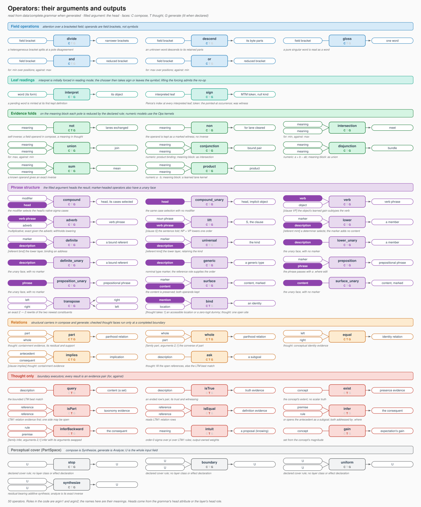

# Language

The live grammar is owned by `LanguageSpace` in `bin/Language.py`.
A sentence stores its end state and discards its temporary reading record
after reconstruction and the comparison of its paths.
WholeSpace supplies primitive properties; ConceptualSpace owns word and
object concepts, their index and learned taxonomy.

## Relation to LLMs, Formal Concept Analysis, and DisCoCat

### Input reconstruction

Reconstruction is free read-back from the concluded root by the generate
walk: no recorded rule sequence, operand position, retained operand or
witness offset chooses its actions. Both binary operands are found
by bounded search over the sentence's primed concept bank, including when
the operator has an analytic balanced split. Candidate word scoring is
signed activation × cosine × priming, shared with the reconstruction gate.
Hard retrieval addresses are detached; candidate codes and the soft search
gradient remain live. `reconstructionBasisLimit` bounds candidates per side;
no candidate contributes no reconstruction term and is counted.

Input realization does not enter the answer's free generate chart.
`Understanding` owns the result; the answer consumes its detached record.
[GradientFlow](GradientFlow.md) lists its fields, ownership and trained cost.

### Product, probabilistic sum, and the operator catalogue

The searched operators use the same numerical binding in all three faces.
Reverse and generate search a supplied concept basis through the compose
kernel; absent a legal pair they fail loudly. Conjunction of the same native reference is
that reference, whereas coincident codes at different addresses still bind.
The code parameters have no norm constraint, and a binding kernel takes its
magnitude from the operands' activations, never from the lengths of their
codes: below, $u$ and $v$ are the operands' unit directions and $a$, $b$
their activations, one for a present code that supplies none. These kernels
apply to operands
without a meaning block; on a meaning block a full-width concept composes its
form and meaning separately, as the
[inventory](#grammarlayer-forward--reverse-inventory) below describes.

| Name | Compose / forward | Generate | Reverse |
|---|---|---|---|
| `conjunction` | $a\,b\,\mathrm{unit}(u \odot v)$; a repeated reference returns $a\,u$ | Search a pair through product binding | Same search |
| `disjunction` | $(a + b - ab)\,\mathrm{unit}(u + v - u \odot v)$ | Search a pair through probabilistic sum | Same search |
| `sum` | Arithmetic mean `(x+y)/2` | Direct balanced split; free decoder searches the primed bank | Direct `(parent,parent)`; known operand gives `2*parent-witness` |
| `min` | Coordinate minimum | Search a pair through minimum | Same search |
| `max` | Coordinate maximum | Search a pair through maximum | Same search |

XOR_grammar and MM_grammar (through `default.grammar`) select `conjunction`
and `disjunction`. `complete.grammar` has them commented out, with `sum` and
`product`: its least and greatest are `intersection` and `union`, and its
arithmetic is `add`, `subtract`, `multiply` and `divide`
([The operators](#the-operators)). No shipped grammar file
selects `min` or `max`; both are catalogue entries with tests. `sum` keeps the
mean as the additive control. XOR_grammar offers only the nonlinear binary connectives,
so any derivation the chooser keeps can read XOR: its four sentences measure
the composition mechanism, not which operator a construction means, since
under reconstruction the chooser is indifferent among equally invertible
operations. Which operation a construction means is
grammatical learning, measured by the grammar lessons and over a corpus.

**Why these operators.** An adjective restricts its noun's extension, and applying it again removes nothing: a red red bird is no more red than a red bird. A restriction is idempotent; repetition on the surface is a different operator, as reduplication in Hawaiian intensifies or pluralizes (nui to nunui, wiki to wikiwiki; Elbert and Pukui, *Hawaiian Grammar*), a degree or number operator, not a second AND. Among t-norms only min is idempotent, and a product assumes independence, while the same predicate twice is maximally dependent ($P(A \wedge A) = P(A)$). Hence conjunction of the same reference is that reference, and numerically the conjunction of distinct references is their product: it binds two identities into a vector unlike either, invertible by division or by search, as binding is in vector symbolic architectures (Plate 1995, 2003; Gayler 2003; Kanerva 2009), where clean-up memory is search over known items. The product of two unit codes has norm about $1/\sqrt{D}$, so the direction is renormalized and the activations carry the magnitude. A mean is affinely dependent on XOR's four sentences and reads it only at the floor of one quarter, which is why `sum` serves as the additive control.

### Concept composition

The language layer is the architecture's DisCoCat-facing surface. Like
Categorical Compositional Distributional semantics, it treats grammar as a typed
composition discipline over vector meanings: reductions such as change, lift,
lower, union, intersection and `part` decide how meanings combine. Unlike a
typical transformer LLM, these reductions are explicit operators rather than
latent behaviors distributed across heads. Their operands are tied back to the
Formal Concept Analysis side of the model through concept order, role
participation, and part/whole support in the codebooks.

The grammar's historical `<WholeSpace>` section name denotes symbolic
rules (`ws_rules`); it does not give the property tower a word dictionary.
PartSpace rules describe perceptual analysis. LanguageSpace shares numerical
operators across compose, generation and the declared thought faces.
ConceptualSpace's index supplies native concept references; WholeSpace has
no operator codebook, terminal emitter, word rows or META taxonomy.

Binary reverses receive the space-role-local basis: the lattice `union` and
`intersection` reverse through `Ops.unionReverse` and
`Ops.intersectionReverse`, product, mean, min and max by bounded search
through their own kernels, and a lossy inverse without a basis fails loudly.

## Current Parser Surface

`SymbolSpace.compose()` and `SymbolSpace.generate()` are the public parser
entry points, and the signal router (`LanguageLayer`) is the single parser.
The retired `<parserBackend>`, `<routerKind>`, `<chartTau>`, `<chartTopK>`
and `<chartNoiseEps>` elements raise a `ValueError` at config load
(`Language._assert_retired_chart_knobs_absent`; see `data/model.xsd`). The
parsers they selected, and soft operator superposition, are recorded in
[DevelopmentHistory](DevelopmentHistory.md#stm-shiftreduce).

## Sentence expectation and interaction memory

`SymbolSubSpace` owns one `WhatInteractionMemory` and one
`SymbolExpectation`. Nothing estimates a sentence (no
predictive processing): no estimate is made at a sentence's open from
earlier closings, and none is compared with the sentence at its close.
Every sentence is read as the first sentence of a document is read.
`SymbolExpectation` keeps one activation predictor over the symbol bank,
shared by the two reads it serves during a sentence, the word read and the
field read ([Expectation](ExpectationRetention.md)). The field read keeps
its cost, `expectation.symbols`, weighted by `symbolFieldLossWeight`. It
also keeps the recent situation: at a kept close each retained row is
admitted with its symbols and activations (`include_occurrence`), and the
word read takes its context from those rows. Composition has no expectation
capability, and no syntactic structure is predicted.

The read from a field to one point has two forms. With no sentence
comprehended it is the field's centroid (`FieldProjection.key`). A model
that comprehends sentences also has a sigma-pi stack of its own
(`ConceptualSpace.idea_stack`; `ideaHidden`, default 64, and `ideaLayers`,
default 1) from the order-zero field on both lanes to one point. At each
kept sentence it is taught to give, from the field observed at the
sentence's open, the idea that comprehension left (`IdeaRead`, cost
`expectation.idea`). Read on the expected field it gives the expected
point; nothing in reading uses that point yet.

## Two stages: the read and comprehension

A sentence is understood in two stages. The meaning of a
sentence comes from the objects its words refer to, not from the words; but
the read's operations on words cannot help moving the concept activations,
so the meaning is made apart from them, from the objects, at the end.

**Terms**. A *concept* is, generally, a part of a
sentence: a word concept, an object concept, an identity held in memory. An
*idea* is reserved for the one vector in conceptual space that corresponds
to a sentence. "The cat sleeps" has the concepts *cat*, *sleeps* and their
objects; its idea is the single vector the sentence comes to.

1. **The read builds the formula.** The grammar builds a tree over the
   sentence's words: the well-formed formula (WFF) in its syntactic form,
   the record of the operations chosen and the words they took
   (`SentenceStrata.Tree`). The tree stays filled with word concepts. The
   reference operations (`bind`'s choice of an individual, and the order an
   operation asks of its operand) run during the read, and each records
   the reference it chose and the order it asked for. The recorded operations
   serve the tied inverse objective and the explore paths' departures.
2. **Comprehension executes the formula on the objects.** At the end of the
   read, comprehension (`Comprehension.Evaluation`) runs the tree's
   recorded actions in their order on a small stack, shifting each leaf and
   reducing at each operation as the tree has them. A leaf is the object
   that `interpret` gives for its word (`InterpretLayer.referent`), read
   with the word's form (`InterpretLayer.lexical_atoms`); an operand that
   the read resolved to a reference takes that reference and its recorded
   order. Each operation applies the same operator's compose to these
   object values. Comprehension is not in the tree: it writes nothing back
   into it.
3. **The stack is what long-term memory receives.** Its entries are ideas
   and the references between them, in the layout of LTM0's and LTM1's
   rows. They are held per sentence in an STM0 store
   with its STM1 (`SentenceStrata.IdeaStack`; STM0 and LTM0 share their
   row columns, `Memory.IdeaRows`), under the tree's own index, so a
   sentence's idea and its tree share one address. The closing
   (`PartClosing.stage`) stages the comprehended clause in that store, and
   the kept close writes that clause, with the stack's values, to LTM0 and
   LTM1 through the ordinary writer (`_commit_sentence`); there is no other
   writer. Comprehension runs inside the scoring of every complete path,
   and the kept path's result is admitted without running it again
   (`Comprehension.Result.admitted`).

An absolute sentence leaves one idea. A relative sentence ends as S R S: a relation, written to LTM1, over two ideas, written to
LTM0; the relation's operands are part of what comprehension leaves, not
working values. "This is Felix" is to be read so, as `part` over two ideas
([One operation per round](#one-operation-per-round)).
What cannot be reduced to one idea, such as chained phrases that refer to
each other (he said (she said (hello))), is left as ideas with the
references between them.

**A word with no object.** A word that had no object reaches comprehension
as a leaf whose object is the blank object `interpret` made for it with its
meta concept: its value is zero and its order is one above its word's
([below](#interpret-word-concept-to-object-concept)).

The two stages have ties with Frege: the read writes
the sentence as a formula whose form does not depend on what its signs
stand for, and comprehension computes its value from the references of
its parts ([Philosophy](Philosophy.md)).

After the row is written, generation begins from its actual one-slot or
three-slot field and the current generate policy. Answer materialization and
recall use `SentenceEndState`, with no saved input program. The standalone
[`forward_binary_step`](../bin/Language.py) dispatch remains available for
explicit operation calls and its
[value and gradient checks](../test/test_recorded_compose_dispatch.py#L44).

## Retired XML Knobs

`SymbolSpace.chartCompose`, `SymbolSpace.softChartCompose` and
`bivectorOutput` are not read by the runtime and should not appear in
`data/*.xml`. `SymbolSpace.useGrammar` is still read: its presence in a
config trips a `DeprecationWarning` and forces a fallback load of
`default.grammar`, discarding whatever `<grammar>` file the config named
(`Grammar` loading in `bin/Language.py`), so a surviving tag swaps in the
wrong grammar and must be removed.

Grammar mode is one boolean, `SymbolSubSpace._grammar_is_default_only`. It
is `True` when every compose rule is either an implicit passthrough or the
default unary `pi` / `sigma` substrate fold (no operator grammar loaded),
and `False` once any non-default operator rule (`part`, `equal`,
`conjunction`, ...) is present.

## Folds and orders in the grammar

**What the grammar's `sigma` and `pi` bind to.** Nothing. The
layers Pi, Not and Sigma are the model's one structure at every order, the
first of them over the percepts
([Architecture](Architecture.md#sigma-and-pi-layers)); they are not
operations a grammar chooses. So a unary
`P = sigma(P)` or
`C = pi(C)` rule has no host layer and the dispatcher passes the operand
through unchanged (`_by_name` miss → `return subspace`); `sigma` and `pi`
are not in `GRAMMAR_LAYER_CLASSES` and no host layer is shared across
roles. The grammar's own folds are the `GrammarLayer` operators it declares
and owns: `change` (numerically a `SigmaLayer`), `lift`, `lower`,
`union`, `intersection` and the rest of the registry. They act within
conceptual space. A constituent's order is read from the concept it denotes,
whose row lies in its order's block (`order_slice`), so nothing beside the
vector holds the order; definitions raise it, and three operators move it
(below).

**Orders are learned.** No ordered grammar is written;
orders live in the concepts
([Orders §10](Orders.md#10-orders-are-learned-definitions-raise-three-compositions-lower)).
Definitions raise: several "is" rows that share a side, with distinct other
sides, make an equivalence class one order up. One composition lowers one
order, stopping at 0: `change` as NP + VP. The determiner selects, and the
modal withholds the lowering. `lower`, with one operand, drops one order and
is admitted only on an operand of order one or more; `lift`, with one
operand, raises one. Parts of speech come only from positions and
occupations, never from definitions: whether a constituent is a noun phrase,
a reference site, a marker or a predicate is read only from the kept parse
(the declared operations' argument positions, the orders they stamp and the
recorded occupations), never from whether a word has an object or any other
lexical fact; otherwise the grammar would not be universal. Formal arguments
are explicit higher-order concepts whose members come from kept grammar
participation ([Learned argument concepts](#learned-argument-concepts)).

> **SS-analysis vs CS-execution.** `SymbolSubSpace.compose` is the
> SS-side *analysis* stage (it selects the per-space hard rule dict
> `current_rules`); the CS-side *execution* (applying change / lift /
> lower / union / intersection / not to the concept tensors)
> runs in `ConceptualSpace.forward` and the per-space `SyntacticLayer`
> cursors. This split is a clean code boundary **only on the
> default-only path**: on the full-router path
> `LanguageLayer.compose` does both selection and tensor reduction, and
> the per-space cursors are deliberately bypassed
> (`not _grammar_is_default_only`). See
> [STM.md Section 5](STM.md#routing-parser).

## Grammar

Selected grammar roles resolve lexical references at the requested concept
order. The form-to-identity index, order assignments and missing/ambiguous
reference rule are defined in [Lexicon](Lexicon.md#word-forms-and-concept-orders).
The selected program owns those semantic addresses separately from its
input reconstruction leaves.

`TheGrammar` is the singleton `Grammar` instance. Rules are loaded from
XML `<SymbolSpace><language><grammar>` blocks or from a configured grammar
CFG. A `RuleDef` stores the rule's spelling and shape (`space_role`,
`canonical`, `arity`, `method_name`, `surface_name`, `lhs`, `rhs_symbols`,
`width_min`, `width_max`), its grammar attributes (`thought_family`,
`thought_permutation`, `reference_roles`, `clause_form`, `head_role`,
`determiner_mode`, `operand_kinds`) and the declarations it copies from its
implementation (`Grammar._declared_rule`: effects, footprints, relation kind,
polarity effect, reference modes and the rest).

`query` is a retained false compatibility slot in the in-memory tuple; XML
`query` attributes are rejected. `thought_family` and
`thought_permutation` are grammar metadata for a canonical structural family
(for example, `whole` as the `(argin2, argin1)` converse spelling of `part`), never a
second executable catalogue.

The grammar file has three peer sections in this order: `<compose>`,
`<thought>`, `<generate>`. Compose holds forward rules
(`op_argout1 = op.forward(op_argin1, op_argin2)`), thought holds the per-model boundary
allow-list (`op_argout1 = op.thought(op_argin1, op_argin2)`), and generate holds reverse
rules (`op_argin1, op_argin2 = op.reverse(op_argout1)`). Only `<thought>` creates
`Grammar.thought_operations`; compose/generate membership does not imply
thought permission. Matching faces share one identity and role contract but
receive their phase-specific context. The capitalized `<Queries>` section is
rejected, not treated as a parallel catalogue.

### The looks

A sentence is read by one loop of looks (`SentenceLooks.Looks.run`). The
first look is the open run, in which the whole sentence is read at once; each
later look is one call of `attend`. A look is content based: it asks for
concepts, and what it returns is found by what the sentence's percepts are
and where they stand. It is not made of the word intervals the input is
split into, and no place is given to it as a number ("If
that is forced to words, then the lexer is doing the models job"). What is a
word is the level a request asks for. The mechanism, with its arithmetic, is
in [Architecture](Architecture.md#one-attention); what the grammar sees of it
is this.

- **The percept bank.** At a sentence's start one lookup reads its percepts
  into one bank. For each event the bank holds its row of the first Pi, which
  is what the event is (a form's row where the store knows the form, and the
  rows of the form's parts); its place, which is its start; its band of where
  wires; its time; the token it belongs to; and its activity on two lanes. A
  known form that spans several tokens (`ice cream`) is an event of its own
  at its start. The bank is read once: no look reads a span of the input
  again.
- **A look is an activity over the bank.** An event is in a look to the
  degree that both what it is and where it stands are salient. What is not
  active is absent on both lanes and is never evidence against.
- **The request** is the output of `attend`: a mask over all concepts, on
  two lanes, and learned. It names a place in the tree of concepts, and the
  more particular the concept asked for, the fewer words it selects. The
  first request is the concept "words", which every word's concept is a
  member of; it has a Not entry on the space character, so asking for words
  lowers a part that holds a space. A concept "objects", which every
  object's concept is a member of, is declared beside it ("Since we create the meta by hand, we might as well add the "objects"
  concept also").
- **The salience map** is the request carried down to the percepts as a
  gradient of the asked concepts by the percepts of the sentence, taken from
  the open run. Each Sigma is passed by its weights, before its squash, so
  that a concept already lit still returns its percepts ("You said weights were better, lets do that"). It is conceptual attention,
  the analysis from above: carried by the transposes of the matrices of the
  way up, through the Sigma, the Not and the first Pi's own entries, it
  reaches a row's parts and its properties, and it has no weights of its
  own. It lands on what each event is and on its band of where wires, and
  the look is the intersection of the two.
- **The returned set.** The way up is run again on the bank with the look's
  activity, and what it gives, each concept at its token, is the returned
  set. The salience map selects the level and the where selects the word.
  The grammar's option at a look is over this set.

`attend` gives the mask over concepts, carries it down as the salience map
onto what and where, intersects them, runs the way up and hands the
returned set to the grammar. No order of reading is built in. `attend` asks
for the word level in general and moves the place it asks for from the
state of STM, so as to find the next word not yet read; reading the words of
a sentence in order is taught by the reading lesson
([Training](Training.md)), and its test gates the grammar's tests. A look
with the same request gives the same result whatever was looked at before
it. A walk has one act of attention, `attend` ("you can
just use attend() , I don't see a need for explicit focus and unfocus
operators"): moving on to the next word is a request, and so is returning
to the whole sentence. There is no focus and no unfocus, and no rule forbids
a walk an act; a focused state is context, from which focus moves on to the
right, word by word, to the sentence's end. `attend` and the field operators
`intersection`, `union` and `not` act on the request's two lanes; none of
them acts on an interval of the input. Attention has no act that accepts a
word. What the walk has done is kept as concepts in the slots of episodic
memory, which the chooser reads ([STM](STM.md#1-stm-data-model)).

Every look is perceived and conceptualized, whether or not it returns a
word: the concepts of every order are given from its activity, and its field
is kept beside the sentence's own. Then, before `attend` acts again, the
grammar has its option. `interpret` takes the most active word concept of
the returned set, exactly: a selection, with no degree. Of forms that begin
at one place the largest is the word, so `is` is not taken at the token of
`This`. Where several are still equally the most active, the request has
identified no word, and one is taken by a draw that the outcome of its path
credits, as an explore path's departure is credited. Where the set holds no
word concept, nothing is interpreted. `architecture.interpretBias` (0 to 1, default 1) is
the probability that the call is made without asking the chooser; in the
remaining share the grammar's chooser decides it as it decides its other
one-operand rules (`OperationSelectionLayer.choose_interpret`, `interpret`
against abstaining), and that decision is recorded, explored and credited
like its others (`interpret_at_look`). At 1 every offered word is
interpreted; the bias is to be lowered later, so that a word is interpreted
when experience shows it is worth it. A word that is
interpreted is deposited in the tree and composed as it arrives, and it is
lowered in the bank's activity over its extent, so that the next request
finds the next word. A word that is looked at and not interpreted stays a
word: its concepts are active in the field, but it is no leaf and joins no
tree.

**A literal**. A word left uninterpreted may enter the
tree as a literal, a sign and not a symbol, as if it had been quoted. It
stands where a clause would, and it enters only where the grammar has a
rule that takes it, such as `sign` (`SignLayer`). Where no rule takes it,
the sentence is not well formed.

**Silence**. When the read of a sentence gives no
well-formed formula, the sentence is written by force as an empty sentence
that ends in NULL, by the rule `silence`, S → NULL, and the read ends there.
The rule is in no grammar file and nothing chooses it: "it is only a
fallback for a broken grammar". It is a rule's layer registered by its name
beside the others (`GRAMMAR_LAYER_CLASSES`), with no operand, applied where
the closing finds that the sentence's trees did not reduce to one
(`Models._stm_reduce_to_single_S`). The row it writes holds no word and no
concept, and MTM takes nothing from it; what is put back for the sentence is
NULL at every place. A read that gives no formula is an error: the
sentence's cost is booked, and that is how the error is propagated. A
literal with no rule to take it ends so.

Words are admitted only inside a sentence run (`BasicModel._sentence_run`),
where the sentence owns the read. A read with no sentence is attention's walk
alone (`ModelAttention.stage_input`): it admits no word, so it gives no
formula and ends in silence. The fast word evaluator
(`eval_nanochat_grammar.word_candidate_scores`) reads with no sentence, so it
lists every item as silent and ranks none until it reads sentences.

**A fragment read at one time**. "we don't need "the
cat" to be a form; we need both words to be processed by the basic level at
one time, but not necessarily as one symbol, and produce an idea that would
closely correspond to those words processed separately and grammatically."
It is an option of the grammar, off unless a configuration sets it, and no
form, row or symbol is made for the fragment.

- A look whose extent holds two or more words returns their percepts
  together, and the basic level reads them at one time: the first Pi's rows
  and the Not for all of them, and the concepts of order zero.
- The read from a field to a point (`IdeaRead`, `ConceptualSpace.idea_stack`)
  gives one idea for the look, as it gives one for a whole sentence.
- System 2 teaches it: when the grammar composes the same words one by one
  into a constituent, that constituent's idea is the target of the read on
  the look's field, as the kept sentence's root idea is the target of the
  sentence's read (`IdeaRead.complete`).
- At such a look the grammar may take the read idea as the meaning of one
  constituent and go on, in place of the operations that compose it. The
  constituent's part of speech is read from the same field, from the
  grammar's declared argument concepts, and is taught by the class the
  composed constituent filled. The option is taken with a probability that
  starts at zero, and the composition runs beside the read while the read is
  taught.

### Encodings and operator signatures

The line between a symbolic and a conceptual encoding is superposition against transformation. An encoding is symbolic when it can be written in symbol values alone, positive and negative: a field, or any signed superposition of rows, whether or not a row exists for the result. It is conceptual when it cannot: an adjective applied to a noun moves the noun to a point that need not be a symbol. Both kinds are indexed by order. The operations closed on a symbolic encoding are the coordinatewise ones on the signed pairs (`and`, `or`, `not`, `non`), which are also the order-independent ones, so they act within a field; `change`, `lift`, `lower`, `verb`, `modifier` and `preposition` displace a point off the span of the rows and need an identified concept between brackets. An operator's signature therefore has two axes: the encoding it takes and the cardinality it needs, a pooled plural reading or one identified concept. The four connectives "collapse to two, with extent/intent each": `intersection` and `union` act on a field, the symbolic encoding, and on two operands' vectors in conceptual space. `conjunction` and `disjunction`, a symbolic pair over activation patterns, are kept only by grammar files other than `complete.grammar`.

All executable operators declare their reads, writes, operand kinds, order
change and head roles: one capability declaration over the accessible
subsystems (`AccessibleMind.OperatorEffects`) and one footprint over form,
meaning and poles (`OperatorFootprint`), checked when the grammar loads. An
operator's effects are the same in every face that holds it (compose,
generate, thought): a face's permissions can only remove writes from the
declared set, never add one, and an operation that needs a different effect
in another face is a different operator. Aliases carry their
implementation's declarations, not their spelling. One round permits one
writer per affected subsystem (`EffectRound`). `sum` averages, `synthesize`
adds, `not` swaps the two evidence lanes, and `non` removes both and has no
faithful inverse. Retired names raise at load with their replacement: `chunk`
(`synthesize`, inverse `analyze`), `what` (`ask` or `query`), `lookup`
(`query`), `true` (`isTrue`), `quantize`, `arma` and `symbolize`; `exist`
keeps only its thought face. Compound
operators select eligible primed cases before applying their ordinary
algebra. No operator leaves a scalar: what it leaves is conceptual content, and
whether an idea is true is read from the evidence pair of that content.

Compose/generate rules are parsed into `rules_upward` / `rules_downward` and
concatenated into the one flat `TheGrammar.rules` table. Both structural
directions carry the BARE `method_name` (the `.forward`/`.reverse` suffix is
stripped and survives only in `canonical`), so a generate rule resolves the
SAME host layer compose uses. Note the arity asymmetry: a generate rule's
`RuleDef.arity` counts its RHS *call* arguments (1 for
`op.reverse(op_argout1)`); its two-output nature is implicit in the LHS
string. Enumerating "the binary reverse ops" therefore filters on
`.reverse in canonical` and the HOST's `arity == 2`
(`BasicModel._grammar_reverse_ops`), not on `RuleDef.arity`.

Closed-class `<Anchors>` map each case-folded surface spelling to a grammar
form. The eager forward resolves that form while staging the PartSpace word
and records it by its retained WORD row. Completed-answer capture reads this
decision by row, without consulting text or the anchor table again; raw
spelling, dictionary row, and native address are not semantic features. The
row map belongs to the current staging and clears with the word rows on Start,
hard reset, or the next forward. Each captured program keeps its own form
strings across later staging and detached recall copies. That lets a
lexical `whole` (including a declared anchor paraphrase) recover the shared
canonical `part` VP with `whole`'s declared `(argin2, argin1)` permutation. A legacy
record lacking this metadata declines a shared-VP ambiguity rather than
choosing a declaration-order form.

The live grammar style is **operator-role categories**, not a declared
part-of-speech taxonomy: every operator contributes its own
`<op>_argin1`, `<op>_argin2` (inputs) and `<op>_argout1` (output) categories. For
example, from `data/complete.grammar`:

```text
part_argout1 = part.forward(part_argin1, part_argin2)
change_argout1 = change.forward(change_argin1, change_argin2)
lift_argout1 = lift.forward(lift_argin1)
```

The shipped `.grammar` files declare their symbolic rules in this role-only
form. See
[Role-Collapsed Grammar and the Operator Codebook](#role-collapsed-grammar-and-the-operator-codebook)
below for the full account, including how a word's category is
recovered from role participation rather than declared.

`RuleDef.lhs` / `.rhs_symbols` parsing (`Grammar._parse_category`)
accepts an explicit conceptual-order suffix (`NP3`, `S4 = lift(NP3,
VP1)`, `NP*` Kleene forms) for backward compatibility only: `NP3`, `NP4`,
`VP1`, `MP1`, `S4`, and `S5` are
members of `_FORBIDDEN_STATE_TOKENS` in
`test/test_role_collapsed_grammar.py`, and no shipped grammar file
declares any of them. None is planned: orders are learned, not declared
([Orders §10](Orders.md#10-orders-are-learned-definitions-raise-three-compositions-lower)).

### GrammarLayer forward / reverse inventory



*The figure is generated from `data/complete.grammar` and fails to generate when an operator is missing from it. The [operator sheet](diagrams/grammar_operators.svg) adds what each face may read and write.*

Every operation's `forward` is what `<compose>` fires and its `reverse` is what `<generate>` fires. An operation with no faithful inverse raises (`raise_no_inverse`) rather than fabricate a split, which would corrupt the reconstruction.

**Form and meaning.** On a configuration whose conceptual width exceeds its form width (a meaning block), every grammatical and logical operation composes the two blocks separately (`GrammarLayer.compose_blocks`). The form block is the centroid of the operands' forms, each weighted by the number of leaves it covers; it has no parameters. The meaning block receives the operation: the declared exact rule for `not`, `non`, `conjunction`, `disjunction`, `intersection`, `union` and `sum` (`MeaningCodes.compose`); the chart arithmetic of `add`, `subtract`, `multiply` and `divide`; the gain of `change` and `modifier` and the basis that `verb` gives (below); the case selection of `compound`; the learned kernels of `marker`; and one lane-preserving kernel (`MeaningKernels.LaneKernel`) for every other face, `preposition`, `lift` and `lower` among them, while `interpret`, `bind`, `swap` and the field operations pass the head's meaning through. A kernel starts at the identity and keeps its derivative there, so a fresh model reproduces the head passthrough exactly; since centroids have no parameters, two faces with the same head compute the same value at initialization, and operator choice is learned by the chooser and its credit, not from forward differences. No kernel mixes the two evidence lanes. Leaf counts travel with the stack and the operation journal. `reverse_blocks` solves the centroid equation exactly given one operand and the counts, and inverts the meaning operation where it can; a binary inverse without a known operand needs a context witness or the candidate search, never a balanced pseudo-split. Configurations without a meaning block keep the numerical kernels the table names.

| op | arity | forward | reverse |
|---|---|---|---|
| `not` | 1 | exchanges the two evidence lanes, or an explicit pole pair; the form is unchanged | itself |
| `non` | 1 | removes both the positive and the negative evidence, asserting nothing in their place: both lanes, or an explicit pole pair, go to $(0, 0)$; the operand stays in the journal as a witness | none: raises |
| `intersection` | 2 | meet: for lanes by min, against lanes by max; numerically the coordinate min, a zero coordinate silent | candidate search |
| `union` | 2 | join: for lanes by max, against lanes by min; numerically the coordinate max | candidate search |
| `conjunction` | 2 | the meet on a meaning block; numerically product binding (table above); a repeated reference returns itself | candidate search through compose |
| `disjunction` | 2 | the join on a meaning block; numerically the probabilistic sum | candidate search through compose |
| `min`, `max` | 2 | numerically the coordinate min or max | candidate search |
| `sum` | 2 | arithmetic mean | `2*parent - witness` given one operand; free decoding searches the bank |
| `product` | 2 | numerically the Hadamard product | given one operand on a meaning block; numerically none (zeros annihilate) |
| `synthesize` | 2 | numerically adds two constituents, in the cube chart for native identity values | `analyze`: the other operand exactly, given one; with a basis the best row and its exact remainder; otherwise `(parent, 0)` |
| `change` | 2 | NP + VP: the verb phrase's gain applied to its subject, in the basis the phrase carries (below); numerically the sigma fold `tanh(W(atanh a + atanh b) + b)` | the action's inverse given the verb phrase |
| `verb` | 2 | VP + NP: gives the verb phrase (`argin1`, its head) its basis from the noun phrase (`argin2`), keeping the phrase's gain; numerically the object's sparse log-spectrum applied to the verb (`apply_verb`) | numerically `unapply_verb` given the object; on a meaning block the object is searched |
| `modifier` | 2 | the modifier's gain on its head, a verb phrase or a noun, in one shared basis | exact given the modifier |
| `compound` | 2 | case selection: the modifier's learned test selects among the head's native cases (`CaseSelection`) | case search over the primed case bank |
| `lift`, `lower` | 1 | `lift` raises its operand one order; `lower` drops one, admitted only on an operand of order one or more | from the operand alone; emits no leaf |
| `marker` | 1 | the chosen kernel of a family of learned kernels: the form passes unchanged and the kernel shifts the meaning in the chart (below) | exact given the kernel |
| `preposition` | 2 | a marker-headed phrase whose kernel takes its object as head; numerically the phrase passes through | given the marker |
| `surface` | 2 | a marker attached to a complete content constituent (below) | given the content; numerically given either operand |
| `swap` | 2 to 2 | exchanges the two newest constituents | itself |
| `bind` | 2 | reads the chosen off-stack field entry, or keeps the mention's own content | no generate face |
| `interpret` | 1 | word-concept to object-concept ([below](#interpret-word-concept-to-object-concept)) | `name`: lexicalization |
| `sign` | 1 | the sign's pointed-at token | no generate face |
| `part`, `whole` | 2 | numerically the relation's whole (`part` returns its second operand, `whole` its first); the closing writes the relation | none: raises |
| `equal` | 2 | numerically mutual parthood `part(A, B) * part(B, A)` | lossy `(parent, parent)` numerically; otherwise candidate search |
| `ask` | 1 | a carrier that records the operation; the value passes through (on a meaning block, through the lane kernel) | the same, inverted |

`add`, `subtract`, `multiply` and `divide` act in the chart: each operand coordinate $a$ is mapped by $\operatorname{atanh}$, combined, and mapped back by $\tanh$, so a sum is $\tanh(\operatorname{atanh} a + \operatorname{atanh} b)$ and every result stays in the unit range. A difference floors at zero on each lane, and a quotient by zero is silent. They act on concept points only, never on codes ([The operators](#the-operators)). `conjunction`, `disjunction`, `sum`, `product` and `equal` are declared by grammar files other than `complete.grammar`.

`WholeLayer` subclasses `PartLayer`. `EqualLayer` lives in `bin/Layers.py`, `InterpretLayer` and `SignLayer` in `bin/Interpret.py`, and all others in `bin/Language.py`. `isEqual`, `isPart` and `isWhole` have no compose face in `complete.grammar`; they are tools of thought ([Reasoning](Reasoning.md#the-tools-of-thought)).

**Two negations.** `not` exchanges a pair's poles, $(c^+, c^-) \to (c^-, c^+)$: an isometry of the resultant that keeps the dissonance and is its own inverse, the affirming negation; the clause it heads has its polarity flipped. `non` removes both kinds of evidence ("non- removes both positive and negative evidence, while not swaps the two types of evidence."). Nothing is affirmed in their place: the clause it heads carries the evidence pair $(0, 0)$, and the operand survives only as a witness (`ClauseJournal`), so reconstruction and expectation can read what was removed. It has no inverse; it is the non-affirming negation of attention.

**The verb's action.** `MeaningKernels.MeaningAction` is the positive-definite map $Q\,\mathrm{diag}(e^{w})\,Q^{\top}$, applied with the same $w$ and $Q$ to each evidence lane in the cube chart and restricted to each lane's defined coordinates, so an absent coordinate stays absent and the lanes never mix. Its two halves are two operators ("MeaningAction has to be an operator so that verbs can actually choose it ... split it into two binary operations"). `change(NP, VP)` applies the verb phrase's gain $w$ to its subject, in the basis $Q$ the phrase carries. $w$ is a linear readout of the verb phrase's meaning, zero-initialized and soft-thresholded (threshold .1, straight-through gradient, bounded to $\pm 4$), so a fresh verb is the identity and a coordinate enters its support only when its push recurs; at $w = 0$ the action is an exact passthrough that keeps its derivative. `verb(VP, NP)` gives the verb phrase its basis: $Q$ is built from `verbBasisReflections` Householder reflections read from the noun phrase's meaning and confined to its support, the identity elsewhere, and the phrase keeps its own gain; the result carries that basis to `change` by reference to its source. A phrase made by `preposition` modifies a verb phrase by the same `verb` operation, the phrase's meaning supplying the basis, so "on the mat" and "under the mat" give different bases; the preposition keeps its own lane kernel, with its object as head, which is where its word enters the phrase. A verb phrase given no basis carries its verb group's (`VerbGroups`): a verb whose fit residual exceeds `verbGroupFit` on a third distinct occurrence joins the best-fitting group or opens one, up to `verbGroups`, so the shared bases are a joint diagonalization learned by gradient. `modifier` applies a gain in one shared basis. The chooser may bind any word to `change`, `verb` or `modifier`. The inverse solves the same restricted system. A numeral object is a count, not a basis: "plus 2" is the successor applied twice, by thought.

**Centered forms.** When an order-0 result is composed with whole witnesses, the active wholes of its span (`FormCentroids`), its form is the parts' leaf-weighted centroid $\bar p$ moved toward the wholes' average $\bar w$: $(1 - \rho/2)\,\bar p + \rho\,\bar w/2$, with $\rho$ the wholes' presence capped at 1, so $\tfrac12(\bar p + \bar w)$ at full presence. The retained inverse receives the same witness and removes the whole center before splitting the parts. The free inverse has no witness: it reads whole support from the candidates' own forms, compares the plain and the centered equation, and keeps the centered hypothesis only when its recovered form is finite and inside $[0, 1]$; no value is clipped. A candidate with no known spelling supplies no whole witness, and the inverse stays approximate.

**Synthesis.** `synthesize` adds two constituents and `analyze`, its reverse spelling, returns the other operand exactly when one is given. A phrase beyond the word, an idiom, is a synthesized concept admitted by recurrence. WholeSpace's analysis of the field, its cut by wholes, is a separate process and not the reverse of a synthesis.

**Surface form and markers.** `surface` is the operator of surface form. One lexeme with its inflected and reordered forms is one word with its transformations, and a language's freedoms of word order are transformations of one structure, not separate syntaxes. `surface` attaches a marker to a complete content constituent: the meaning is the content's, with its polarity, scope and structure, while both operands stay in the numerical carrier for the next choice; the chooser, never a word table, decides whether a word is a marker. `swap` rewrites the two newest constituents in place, a 2-to-2 step that is exact and its own inverse, so a question read in its surface order can compose to the same meaning as its declarative. Splitting a word and inserting a silent element are not grammar operations: sub-word wholes nest inside the word whole ([Lexicon](Lexicon.md#word-forms-and-concept-orders)), and the word is the level that attention's request asks for. A marker belongs to its operator, and no operator has a one-operand face of its own: `lift` and `lower` take one operand, and what a marker does without a written word is the work of `marker`, a one-operand operator whose kernels are learned ([The operators](#the-operators)). Irregular forms are stored whole and block the rule. There is no morphology analyzer and no operation named for tense, aspect or morphology: tense and aspect are a selection among a verb phrase's phases by `compound` ([below](#words-narrow-the-domain-of-discourse)), or a kernel of `marker` that the sentence's context chooses. No language is named or special-cased in code, configuration, fixtures or tests: which selection a marker calls, and with what object, is learned by exposure.

#### Concept events are opaque to the grammar ops

Percepts have explicit `.what`, `.where` and `.when` coordinates.
Concepts do not: a word that has been resolved to its object concept is a
code from a codebook lookup that has generalised over the where and when
modalities as well, so the conceptual event is a full-width thing that
cannot be cleanly divided. The CS grammar ops
(those of `change`, `verb`, `modifier`, `lower` and
`preposition`) are therefore sized to the muxed concept width and
compose and reverse the whole event; the split of a muxed event into
content, `.where` and `.when`, the tense shift of `.when` on lift and
lower, and the preposition's `.where` rotation that lived inside those
ops are gone. Splitting happens only where a percept or a symbol is
formed: the symbolic layer muxes and demuxes around `execute`, and the
perceptual layer reads coordinates.

#### `interpret`: word-concept to object-concept

The resolution the section above describes, a word resolved to its object
concept, is a declared `<compose>` operator:

```text
interpret_argout1 = interpret.forward(interpret_argin1)
interpret_argin1 = interpret.reverse(interpret_argout1)     # generate face: lexicalization
```

Unary, like `not`; its second argument is implicit, the current attentive
field. `interpret_argin1` is the **word-concept**: the code the word arrives
as, the concept of the basic percept that MTM nominated for its form;
`interpret` is never the byte-to-word step.
`interpret_argout1` is the **object-concept** already associated with the word,
at whatever order that object has. For example, *cat* returns a known cat
kind if that is its association. Among several existing associations
`interpret` reads the one expected, and where none is expected the one of
highest order (below). A word with no object is given the blank object
(below). A default call never adds a particular beside a known kind.
Reference orders follow
[Lexicon](Lexicon.md#word-forms-and-concept-orders); the operator never
reads the surface form, and no word is anchored to it.

A word is found from its parts. Its form's code is the set of its parts
([Mereology](Mereology.md)), and its basic percept is a row of the first Pi
that reads it present where its parts are present and against where a part
that a form holding it adds is present
([Architecture](Architecture.md#sigma-and-pi-layers)); a shared property
never evidences an absent word. Re-reading a form writes nothing new.

A new word is perceived at once, but `interpret` cannot find it until MTM
nominates its basic percept, which MTM does when the form recurs
(`concept_mint_count` readings; a reading is one sentence of one stream, so
a form that stands twice in a sentence is read once). Its concept of order
zero comes with that row. When `interpret` interprets a
word whose meta concept does not yet exist, it makes the meta concept with
its structure. Where the word has no object, it makes with it the *blank
object*: a new concept with no members, one order above its word, whose
vector starts at zero ("Pure zero is even better, since
magnitude is certainty in that space"). Neither is nominated by MTM. The
word continues to exist by identity in `word DEF object`: an LTM1 row whose
two references are the object and the word, both symbols named by identity and
never by their codes, so what training does to either code never redirects a
definition; the row reads as a definition from its referents' types
(`DefinitionIndex`). `interpret` alone writes these rows (`Interpret.define`),
and the closing alone writes assertions. Where
the field discovers objects, the DEF row is completed when that field
admits its case. Word admission never takes the case's place. Refusal
leaves no partial word or definition.

One derived index provides form/unit → word, word → objects, and
object → words. It owns generation's lexical inverse as well as forward
resolution; learned-code changes do not change its answers. Old META
checkpoints migrate to DEF rows.

The eager word transaction runs before a graph; the serial tensor face
publishes the resolved object's activation and atom. Sentence boundaries
retain recognized-word and category-codebook work. A DEF row has its own
fixed `.when`; re-reading refreshes its recency timestamp. It can be
forgotten, after which the word is interpreted afresh. It has ordinary
row provenance and does not inherit the sentence's source trust.

**`interpret` is optional and initially forced.**
"Interpretation can be initially forced since words are so often meaningful
beyond themselves." A leaf at which `interpret` is not applied is the no-op,
Peirce's icon, where the percept stands for itself and the leaf value is
`interpret_argin1`, the word-concept code. An interpretation is one of two
readings chosen by the compose chooser with ordinary credit: `sign`,
Peirce's index, which opens the pointed-at occurrence's MTM token with the
null-concept as its kind; or the symbol, the object above, the interpreted
leaf left standing as that object, with no operation of its own. Two
things are forced now. The call of `interpret` at a look is made with
probability `architecture.interpretBias`, set to 1
([Grammar](#grammar)); a word never interpreted is no leaf. Given the call,
the leaf takes the word's object (`InterpretLayer.mandatory`), the chooser
takes the second decision only, and `Interpret.leaf_readings` checks that
every forced leaf ends as a sign or a symbol. The eager word transaction is
the admission of the form and the lookup of an existing association; it
mints nothing and is not the reading. No word is anchored to any reading, and `sign` is available
at every interpreted leaf. The forcing is lifted only with a field, or
inside a certificate. The no-op is built behind the forcing: at the kept
close a no-op leaf opens its own occurrence's MTM token with the
word-concept code as its content and the null-concept as its kind; later
mentions bind to the token, a definition names or kinds it, and the no-op's
reverse is the form itself. The tokens and the null-concept are in
[Orders §11](Orders.md#11-pointers-identity-and-relations-across-known-concepts),
"The three readings forced".

**Grounding is textual.** The model perceives word forms (letter parts and wholes) and forms word-concepts from them. A word-concept references an object-concept of any order: "Bill" an individual, "water" a mass, "chair" a count kind. Since the model experiences only text, a word gets an object-concept of its own, the blank object `interpret` makes for it, and the model learns about that object from what the text states: a definition ("a table has a top and four legs") adds parts to the conceptual mereology, and a kind statement ("tables are furniture") adds to the conceptual hierarchy. There is no perceptual grounding stage. A newly minted object-concept is nearly empty, resemblance between words arrives through what the text says of them rather than through percepts, and lessons demand behaviors, never non-empty meanings.

**What `interpret` creates.** "the interpret() operator in
our grammar should create a symbol, and we do not symbolize all concepts to
begin with, but we do symbolize words as a bit of a bootstrap." A symbol is
empty of percept: "if symbols are perceptually empty, then they do not
participate in feeling or the mereological hierarchy. relative to each other,
they may be sorted freely. So interpretation is the act of mapping such a
representation to an object, for which there is no initial basis."

- **The structure.** When a word is created, so is
  "meta-concept(symbol(word-concept), symbol(object-concept))". A meta-concept
  is a concept that combines the symbol for the word-concept and the symbol
  for the object-concept; meta-concepts are introduced on page 112 of *The
  Whole Part*, one of the books attached to the author's ORCID record
  ([0000-0002-6570-7571](https://orcid.org/0000-0002-6570-7571)). In the
  code the meta-concept is the DEF row `Interpret.define` writes, the
  dictionary below is `DefinitionIndex`, and the sibling search is
  `InterpretLayer.denotations`.
- **A symbol of one concept.** "The symbol of a single concept is admissible,
  and perhaps necessary for a zero-D thing."
- **Who makes a symbol.** Symbols are held apart from concepts and have no
  dimensions ([Orders](Orders.md)). A symbol is made when MTM nominates it
  on recurrence, or by `interpret` for a meta concept, and never when a
  concept is allocated.
- **Its two names.** "let's use name() and interpret()." `interpret` takes
  a word to its object and `name`, its generate face, takes an object to
  its word. Saying what a present thing is, with no word given, is `name`:
  recognition is `interpret` run backwards. Asked "what is this?" of a felt
  value with no object named, the model reads the present reading's class
  from the field, with no words, and says that class's word
  (`InterpretLayer.reverse`, `lexical_form`), accepted under the evidence
  kind `perception`.
- **The trust of the mapping** is one for now: "the trust of a words mapping
  is really something the architecture should be setting based on success.
  lets just use one, and flag it" ([FutureWork](FutureWork.md)). An object
  reached through a read word is at trust one as well ("which we should set at 1 for now, along with the object-concept's trust"). A stated definition keeps its speaker's trust.
- **How the mapping is learned.** "so we learn word
  generalizations, and we learn object generalizations, and THEN we learn
  word-object meta-concepts, because those are concsistently associated.
  there isnt a statistic that will magically produce identity across
  independent tokens." Helen Keller could feel the letters w-a-t-e-r spelled
  into her hand, and she could feel water; for weeks the two were unrelated.
  At the well-house the word was spelled into one hand while water ran over
  the other, and the two became one thing (Keller 1903; Percy 1975). The word
  had been learned from its own recurrences, and the object from its own, in
  another modality; the meta-concept that joins them was learned third, from
  their consistent association. In the model a word generalization and an
  object generalization are each a row that MTM nominates, with its
  concept, from their own occurrences; an occurrence keeps its place and
  time, and a generalization holds neither. Two words are joined in the same way,
  through what both are joined to: "Alec" and "he" by a common perceptual
  basis, and not by a likeness of their occurrences. A model with one
  modality cannot know an object except through its word, so it starts by
  making the object for the word out of what the word recurs with
  (`PerceptCollections.observe`, for a felt value beside the text): "It is
  not a great solution, but it may work with sufficient complexity".
  References: Keller, H. (1903), *The Story of My Life*, Doubleday, Page;
  Percy, W. (1975), "The Delta Factor", in *The Message in the Bottle*,
  Farrar, Straus and Giroux.
- **The dictionary.** "We can collect all meta-concepts under a symbol for
  fast access, which will basically act like a dictionary, and act as a cue to
  the architecture that an object should be interpreted."
- **The substitution.** `interpret`, "on seeing something interpretable, will
  replace word-concept with (one of) the object-concepts found under that
  meta-symbol (this will also handle polysemy)". It finds the object by its
  fellow member: "calling interpret(word-symbol) will do a sibling search
  under the meta-concept for the word; it already knows that it cant replace
  itself with itself." Where a word has several objects, `interpret` reads
  the one expected ("How one object is chosen when a word
  has several: expectation"), and where none is expected the one of
  highest order.
- **Accuracy first.** "we need to make interpret() more accurate, even though
  it is not efficient, and then we can create a cache or bootstrap if
  necessary" ([FutureWork](FutureWork.md)).

#### Tensor reverses for the compiled loops

`LanguageSpace.reverse_binary_step(parent, op_local, valid, reference,
inverses)` and `reverse_unary_step(x, op_local, valid)` are the fixed-shape
forms of the inventory above for a `torch.while_loop` body: every op's
reverse is evaluated on the parent and the recorded op selects
(`local_op_from_rule_ids` inverts the rule map).
`generate_policy` is the conceptual decoder for both reconstruction and output,
including numeric-answer configurations. It infers a binary undo, unary undo
or STOP from the current root/top. Binary undo searches the primed echoic
shortlist, including the sentence's own symbols and weighting candidates by
activation × cosine × priming. Unary undo invokes the operator's **generate**
face. The journal, stamps, rule sequence and operand positions never choose
decoder actions. Compose-only declarations expose those same operators'
generate faces implicitly; explicit generate declarations keep their catalogue.

Eligibility at the top of the walk (`decoder_eligibility`) compares the pair search's squared reconstruction residual with the best one-code least-squares explanation of the top; there is no tunable purity cutoff. A supported pair takes precedence over a single-symbol projection, and at equal fit two readable, progressing children are preferred, so a known synthesized concept is undone into its parts. Emitting a symbol is legal only at a singular top: a tie between different one-code explanations is not singular, and an inverse that merely repeats its parent is not a decomposition. STOP against undo is therefore eligibility, not a learned margin; the policy learns which operation to undo.

Reconstruction owns the generate chooser, parameterized faces and codes.
Its hard stack choices have the straight-through numerical transition described
in [GradientFlow](GradientFlow.md). Output owns the question conditioner and
reads a detached conceptual state and shortlist. The byte loss, gate read-back
and output spelling use this same walk and shortlist. Clause closing still
reads its own journal to preserve the semantics of the operation that ran;
that journal is not a decoding recipe.

## Knowledge Artifacts

`embed.build_knowledge_section(grammar)` creates the parser knowledge
section, five sub-sections in all:

- `word_table`: bootstrap CSR word table (`build_word_table_initial(wv)`,
  `bin/embed.py`): UTF-8 surface-form bytes keyed by
  `keys_values`/`keys_offsets`, plus a `ref_ids` column initialized to
  `-1` (unassigned) until a curated POS lexicon / tagger populates it.
- `taxonomy`: base category refs plus explicit ordered refs.
- `reference_codebook`: scalar prototypes and `order` per ref.
- `typed_indexes`: `refs_by_category` and `refs_by_order`.
- `grammar.rule_order_signatures`: serialized rule typing.

The `taxonomy` builder (`build_taxonomy_from_grammar`) supports ordered-ref
children of a base category only for a grammar that declares explicit-order
categories (`NP3`, `NP4`, ...; see [Grammar](#grammar)), which no shipped
`.grammar` file does. On the role-only grammars every category is order-flat
(`part_argout1`, `lift_argin1`, ...), so `taxonomy` has no ordered children.
`KnowledgeView.category_of_ref(ref_id)` returns the base category and
`KnowledgeView.order_of_ref(ref_id)` the conceptual order. The category
embedding is `SymbolSpace.category_embedding`, an `nn.Embedding`.

## Syntax And SVO

Syntax output has no trace source. The signal router records no per-leaf
derivation trace, so `BasicModel.write_syntax_tree()` (`bin/Models.py`)
emits a bare `<noTrace/>` element for every input, and nothing in `bin/`
calls `SymbolSpace.set_last_svo`, so the SVO read by `get_last_svo` stays at
its cleared value (`clear_last_svo` runs at every CS-forward cycle and at
reset boundaries).

## Role-Collapsed Grammar and the Operator Codebook

The live role-only grammars replace part-of-speech categories with
*operator roles*. Instead of a fixed
`NP` / `VP` / `S` taxonomy, each operator contributes its own argument
and result roles, named `<op>_argin1`, `<op>_argin2` (inputs) and `<op>_argout1`
(output). The rule `part` therefore exposes `part_argin1`,
`part_argin2`, `part_argout1`, and the grammatical "category" of a span is
just the set of operator roles it can fill. Dimensionality is recovered
from participation (`bin/participation.py`) rather than declared up
front: symbols that fill the same roles cluster into the same category.

The grammar declares its perceptual start and its symbolic start separately.
The property tower has no grammar dictionary. The symbolic sentence finishes
as one `S` slot or three `S REL S` slots. A relation's middle slot holds the
native identity of `part` or `implies`, supplied by the declared thought
registry; no relation carries an operator, and a sentence whose verb takes a
completed relation closes as an idea row. Numerical operators live in LanguageSpace and their
conceptual identities live in ConceptualSpace.

### Chooser architecture capacity

The grammar placement policy and the thought-step policy are separate modules.
`MLPTransformChooser` scores a grammar operation at a slot/pair from its current
state, candidate result, role context, tool embedding and position. It is the
only chooser of acts ("The Transform chooser should be
MLP-only"). `<architecture><transformChooserHidden>` selects its
hidden width (`0` means `max(8, d_model)`) and `transformChooserDepth` selects
the number of hidden Linear/GELU blocks (default `1`). Every block has the same
width; a scalar Linear head follows. The 29-dimensional What context still
enters through a separate linear operation bias, not through this MLP.

Binary heads retain operand and role **order**: means enter the established
feature layout, while signed left/right differences enter the same first hidden
layer through `operand_order`. This is an input projection of the existing MLP,
not another language policy. The projection starts at zero without changing
the RNG stream. Old checkpoints extend with zeros, preserving predictions and
existing optimizer moments; current checkpoints save its learned parameters.
Unary heads retain their existing layout. Raw WORD rows and native IDs never
enter these numeric features.

This grammar path owns natural word → operator learning. Numerical learning
inside a declared operator is allowed; a fallback interpreter or pre-generate
language decoder is not. Technical anchor spellings such as `partOf` and
`isEqual` are explicit syntax. Ordinary words, including `equals`, are not
bootstrap aliases. Structural preference and language-quality studies remain
the design goals in [SelectedMeaning](SelectedMeaning.md).

Thought is chosen by the compose selection layer: `OperationSelectionLayer.thought_logits`
scores the operations offered at a boundary and `conclude` from the masked root,
active and candidate roles and their context, and not thinking is the chooser's
free first choice; credit is the whole-path score on $R + A$. (The model
does not build the `SelectedThoughtChooser` class, which remains for
[its tests](../test/test_chooser_architecture.py); `whatThinkingHidden` and
`whatThinkingDepth` are parsed and unread.)

### Learned argument concepts

`LanguageSpace.parts_of_speech` maps every declared formal input and output to a prebuilt native concept, including distinct semantic faces and both outputs of `swap`. Word concepts have native order 0, these argument concepts order 1, and classes over arguments order 2. Declaration gives each argument a seat and a zero vector, radius and view count; it supplies no learned evidence.

Each carried lexical occurrence in a kept application supplies a member view through `ConceptHierarchy.observe_member`. Members teach the same centroid and view-and-agreement confidence as other explicit classes. Shared words can belong to several arguments, and draw those arguments together among arguments; an argument draws its words together among words. Neither a word's position nor an argument's moves the other's. Parts of speech have special construction and grammar use only; their learning and hierarchical feedback are ordinary concept mechanisms. Operator names are not inserted into lexical context. Annotation operands and unkept trials supply no member views.

The chooser's argument carrier reads the coverage of an argument's centroid of its words by a word's unit meaning direction, both among words, with the argument's expected activation at the word's place added. Scores add once per carried occurrence, without normalization or exclusive labels. Zero classes score zero. Output arguments receive member views; compose reads input occupation and generate reads both input and output occupation. An operation's definiteness (`PartsOfSpeech.operation`) is the minimum over its inputs of an argument's separability times its view evidence; separability is the fit-weighted fraction of its members that fit it strictly better than every populated argument outside the 15-degree contiguity angle (`CLASS_CONTIGUITY_COSINE`), so contiguous classes do not compete. It is reported (`corpus_lessons.readiness_report`) and gates nothing: no operator is gated inside the model, and the whole grammar of a file is open from the first sentence. "Operators are "a priori" concepts that we are using for the control of the architecture itself. Lets not do that; the gating of those operators might be able to be done *in the tests*, which would act like piagetian stages signalling that the test suite can move on to the next stage." The stages are the lessons' ([Training](Training.md)). Kept-use counts remain telemetry. Centroids refresh once at the kept boundary; only observed members and their ancestors receive contextual conditioning.

Word flow (`PartsOfSpeech.flow_mask`): symmetric `intersection`, `union`, `conjunction`, `disjunction`, `product` and `sum` retain every operand's words; `not` and `non` retain their operand's words. Headed operations retain the declared head operand's words, including `lower` and `verb`. `modifier` declares argin1 as head. Clause-forming operations retain none, including unary ask. Thus both black and cat in `lower(intersection(black, cat))` occupy lower's argument and travel with the description. `swap` exchanges both carriers; repeated occurrences remain repeated contributions. Generate reads parent argout and child argin occupation as policy features, as described below. The symmetric rule follows the coordination of likes: a symmetric result keeps its inputs' type, as a coordinated result has its conjuncts' type, and unlike conjuncts that satisfy the same selector ("a Republican and proud of it") fill the same formal argument, which is what argument-level classes provide. A selection such as tense applies once to a coordinated verb phrase, so conjuncts stay one part of speech; where a language uses different conjunction words by type, the difference is in the marker word, learned by exposure, not in the operator's result type.

Argument vectors, memberships, orders and confidence use ordinary native concept checkpoint storage. Argument schema 4 saves the grammar-to-concept mapping and scalar uses; old occupation-count checkpoints require producer replay. Geometric cosines remain reported for inspection. There is no side bank of categories. The corpus controls the teaching sequence, and no lesson gate names an operator ([Training](Training.md)): a lesson's adjective-noun annotation names a `modification` bracket, never an operator, its fold target sums the admissible `intersection` and `product` actions (`GrammarLessons.MODIFICATION_OPERATORS`), and which of the two the student keeps is reported, never required. A bracket lesson teaches operation choice and never supplies member views, and no lesson adds a noun-aware mask or head rule: lessons change the examples, not the grammar.

## One operation per round

`OperationSelectionLayer` scores every binary operator at every adjacent live
pair and every unary operator at every live position. One model softmax
covers all of those candidates and, once the sequence fits its LTM row, STOP.
Exactly one candidate fires per active round. Binary operations remove one
operand; unary operations preserve length. Above the row's slot limit there
is no COPY, wait, or other no-operation candidate. STOP is eligible at depth
one for an absolute row and at depth three or below for a relative row.
Every menu has a fixed layout: the number of variants per operation and the
candidate each slot denotes depend only on the row's own state and on global
sizes, never on other rows of the batch, and an unavailable candidate is
masked, never removed, so a flat action index names the same candidate in
every path.

The tensor slab and round budget stay fixed. An active mask freezes a row after
STOP; it does not change the compiled shape. The parallel budget is at least
twice the slab width. Serial STM uses this same owned layer on its newest two
slots, with three rounds after each word and a closing budget of twice STM capacity
(bounded by a positive `syntacticOrder`). Occupancy and the STOP test use the
whole STM's depth, not just the two-slot window. Online rounds allow `K - 1`
occupied slots, reserving admission for the next word. Endings allow one absolute
slot or three relative slots; two slots are a transient state, not an allowance.
An absolute sentence ends in one slot because its NP and VP fuse to one point:
the primitives of the model's reality are spacetime events, and a sentence
names one (`sentence_row_slots`). A relative sentence, S REL S, keeps its two
sentences and the relation in three slots.

With depth `d`, allowance `a`, and `r` rounds left including the current round,
the required reductions are `n = max(0, d - a)`. When `r - n <= 0`, only binary
candidates remain legal. Before that deadline, unary operations remain legal;
STOP also requires both the row limit and the phase allowance to fit. No
bonus is added to a binary operation's score: the load left is charged
as a cost under `architecture.reductionCost` (`WholePaths.load_cost`), and the
chooser is shown how much of its budget is left as a sinusoidal code
(`Language.budget_code`), so that it can learn to reduce before the cost falls.
The deadline masks are fixed. See
[Params](Params.md) for the numerical guards and the declared measurement value.
Three online rounds and `2K` closing rounds suffice to admit every word and finish
each row. A deliberately infeasible initial budget may still yield an incomplete
forest that trains without publishing a row. Arrival at a full stack is an
assertion failure; compose has no overflow-dropping or overflow-incomplete path.

In training, compose is one walk of a whole path
([Architecture](Architecture.md#whole-paths-and-concept-episodes)).
One XML parameter, `architecture.composeTemperature` (finite, nonnegative,
default `0`), controls the greedy path's hard choices: at zero the greatest
logit wins, exact logit ties keeping the structural preference, and a
positive temperature samples `softmax(logits / composeTemperature)`. Each of
`explorePaths` alternatives reuses the greedy prefix and departs once from
it, at a round where an action other than the greedy one is drawn from the
exploration proposal (`SentenceCredit.departure`). Each stream keeps its
strictly cheapest complete path on R + A, ties keeping the greedy path, and
only then commits its program, STM, LTM and thought effects; keeping the
cheaper neighbour is a hill climb in derivation space, one departure at a
time. Evaluation runs the greedy path alone, with deterministic logit
argmax.

For selected candidate `c` with probability `p`, the straight-through value is
`detach(c) + (p*c - detach(p*c))`: forward execution is hard while both the
operator and chooser receive the probability-weighted derivative. `p` is the
untempered model softmax including reduction pressure and deadline masks, before a departure excludes the greedy action;
neither temperature nor that exclusion changes the credit distribution (a
softmax tempered to zero would saturate and give the chooser no gradient). Reconstruction
and the existing task costs train compose directly through this derivative; a
departure also receives its whole path's change in R + A, corrected by the
drawn action's proposal probability
([GradientFlow](GradientFlow.md#whole-path-credit-and-concept-episodes)).
Compose has no DP-prior objective. There is no tiling forward/backward,
Viterbi pass, expected tile compaction, length DP, separate unary layer, or
retained switch to run them.

The rationale: training by softmax lets one gradient do all the optimization;
DP is the pre-backprop symbolic solution and should not be mixed into a working
MLP. The sampled alternative is a tractable approximation to the full
superposition over operators and locations, not an exact marginalization.

## Words narrow the domain of discourse

Words are a formula for narrowing attention: each word
is a projection operator that narrows the domain of discourse, the register
the situation seeds and the determiner individuates from. A projection is
idempotent, $P^2 = P$, which is Boole's $x^2 = x$; commuting projections
compose to the projection onto the intersection of their ranges; and a thing
lies in a projection's range exactly when the projection leaves it
unchanged, so membership is invariance (a thing $x$ is a gun if
$\mathrm{gun}(x) = x$) and subsumption is absorption (cats are animals if
$\mathrm{animal}(\mathrm{cat}) = \mathrm{cat}$). The consequences for the
architecture are in
[Architecture](Architecture.md#words-are-a-formula-for-narrowing-attention);
this section gives the language mechanics.

**The parse.** "A fake gun" is `lower(fake(gun(thing)))`. `thing` is the
domain of discourse. `gun()` and `fake()` are the same kind of operation,
each a projection that narrows it, and they commute, so
`gun(fake(thing))` means the same. `lower` individuates from what is
left. The operator that narrows nothing is the symbol
`everything`, the top pole.

**Parts of speech are roles.** A codebook row is an operator. Read against
the whole domain it is a noun; applied to a narrowed domain it restricts.
English shows both directions: "a fake" is a noun, and in "gun oil" `gun`
restricts. No word is anchored to an operator, and a row is routed per
frame by learned credit, so "run" is a noun in one frame and a verb in another,
by whichever use the sentence's credit keeps.

| word class | what it does | index |
|---|---|---|
| noun, adjective | narrows which thing | |
| determiner | takes a kind to its extension and selects there: "the" a known identity from MTM, "a" one generic member, "some" some subconcepts, "every" the entire extension ([Extend](Extend.md#determiners)); it is a modifier with no operator of its own, and `lower` drops the order ([below](#determiners-number-words-and-the-modifier)) | thing |
| verb, adverb | narrows which stretch of time, and what changes | |
| tense, aspect | individuates the time: a selection over the verb phrase's phases (below) | time |
| conditional | narrows which alternatives are in play | |
| modal | individuates: "might" some, "must" all; the second difference, a diagonal per modal in one shared basis (the `modifier` rule), learned on an identity's alternative timelines; a modal clause withholds the lowering; default all possible worlds | alternative |
| deictic: pronoun, indexical (a reading, not a built class; [Orders §11](Orders.md#11-pointers-identity-and-relations-across-known-concepts), "No forcing; the class is the raise's outcome") | points: a word minted at its first definition and raised at `raiseCount` distinct relata, whose identity across time, what persists across the things it was, empties as they diversify, so it could be a symbol for anything; its mention then constrains nothing, and location, recency and expectation decide the bind | thing |

**Choosing an individual.** An operation that requests an individual has
variants for each bounded situation column and, where permitted, mint. All
variants use the grammar operator's own scoring parameters in the one global
operation softmax, and the numerical journal keeps the original operator
index and the chosen reference. Reference variants share their operation's
score at initialization: the chooser's candidate-value columns and its
reference projection start at zero and receive ordinary gradients, so its own
content term is neutral among candidates until training moves it. `bind` is
the only binder and the one
compose operation that chooses an individual: it is a compose
operation (`BindLayer`, `bind.forward` in `<compose>`) and a thought
operation (`bind.thought`), run once per site. Its content term is the
meet, not distance (`IdentityRows.meet_ratios`): a request $q$ and a
candidate $c$ are compared in conceptual space by
$\sum_i \min(q_i, c_i) / \sum_i c_i$ and $\sum_i \min(q_i, c_i) / \sum_i q_i$,
and a candidate is offered only when one contains the other; priming enters
only through the prime, never the content term. Determination supplies an
object, never a reference alternative, and an operand reads its existing
typed concept at every order but one
([Orders §10](Orders.md#10-orders-are-learned-definitions-raise-three-compositions-lower)).
An ambiguous interpretation returns unresolved instead of raising, and kind
and extension operations choose no individual. Mint is a choice during
reading and a recurrence-gated effect after the kept closing. No word
spelling anchors any of these choices: a determiner is a cue for the choice,
never an anchor, "a" asking for a new individual and "the" for one already
present (Heim's novelty and familiarity), and "a cat" introduces a new
individual, not a new concept. The columns' meanings exclude reference
geometry; situated operands retain it as binding evidence.

**Which operators commute.** One that acts the same on any domain commutes
with the others (*fake*, *wooden*, *noble*). One that reads its scale from
the domain it is given does not, and must follow the noun (*big*,
*skillful*). Compounds are the plainest case. "gun oil is
a kind of oil; oil gun is a kind of gun", so order of application matters.
The Ground the modifier is read against is the head's own shape, its cases
at every order, which the folds already supply, so no new parameterization
is needed. A head must therefore have a shape: "gun Felix" does not work,
because Felix is a proper noun, not a kind. Modification keeps the head's
order; adjectives do not lower it. Order and part of speech are different
things and only sometimes correspond: "Felix is a cat" and "cats are
animals" are both taxonomic relations, the first between a proper noun and a
count noun and the second between two count nouns. A set and a part are
different relations: cats and dogs, two discrete concepts, make animals,
which is necessarily of a different order, while blue cats is a part of the
extension of cats and keeps its order. The determiner moves from a set to a
member; the adjective moves from a whole to a part. A compound is neither
("Compounds are subtyping, which explains their order
effects"): it sub-types its head, so the order of its two nouns matters, and
adjectives are left free to commute. It does not lower the order either: it
selects from the determined set, as an oil is a kind of oil and a gun oil a
specific kind of oil. The test is whether the word can stand as a noun over
the whole domain. In both cases the domain is kept as the Ground against
which the narrowed Figure has its meaning, as perceptual attention dims what
lies away from its request and does not cut it ([The looks](#the-looks)).

**Modification.** Intersection cannot serve every adjective: a relative adjective reads its scale from its noun, so what is small for a big noun is larger than what is small for a small noun, and a function relative to its argument fits it better. The grammar offers both `intersection` and `modifier`, whose gain scales the noun's own values, and the chooser picks at run time; a lesson's adjective-noun bracket names the constituent, never the operator ([Learned argument concepts](#learned-argument-concepts)). A noun is an adjective pre-applied to the universe, the all-ones vector that is a product's identity. Every operator has an identity element, and an operator applied without its written operand is applied to that identity (NP = everything, VP = occurs, MP = all possible worlds).

**Position.** Tense, aspect and the preposition are one operation: unfold the head into its cases, select among them by the object, fold what is left. The head decides what is selected: a noun phrase's cases are things laid out in space, a verb phrase's are its phases along the change (the state before, the change, the state after). The object decides the test: a place compares location ("sat on the mat"), a time or an event compares order ("the meeting after lunch"). The modal is not this selection but the second difference: a diagonal per modal in one shared basis, the `modifier` rule, learned between equal-time events on an identity's actual and alternative timelines (`ModalLearning`); a modal clause withholds the lowering and holds on some timeline for "might", on every one for "must". A preposition makes an adjective or an adverb by this selection, as a compound selects among its head's cases, and tense and aspect are a verb phrase's prepositions whose object is now or a reference event R and whose preposition is not written. Past keeps the phase in which now falls after the change, future the phase before it; the progressive asserts only part of the change, so "was crossing" does not entail "crossed". A selection is idempotent, not a gain: "on the mat, on the mat" says no more than "on the mat". So an adverb of degree is a gain, while an adverb made from a preposition is a further restriction of the event. Two selections (past, then perfect; a path with two landmarks) are the operation called again, and what a sentence marks without a written word is left to `marker`'s learned kernels, which read no cases. Not calling a selection keeps every case, which the answer reads as unknown, never as now. The claim is universality: any way a language writes a selection of time or place reaches these operations by exposure under one configuration, and a language that needed another operation would be a finding against them, never a case added.

The selection is `compound` (`CaseSelection`). The head supplies its cases (a noun phrase's native cases; a verb phrase's before, change and after from an accessible actual event's snapshots), and the object supplies content, including a referred-to event for the reference time R: the reference time is content, never a `.when` column. `CaseSelection.CaseView` keeps the head's cases, their two-lane memberships and an accumulated content test; a selection intersects the test, so repeating the same selection is idempotent, and the fold refolds each evidence lane without subtracting one from the other. `CaseFlow` carries the view beside the conceptual stack; the case bank is staged once per reading, before parsing, and no clock or lexical class enters it. A phase question is certified only when each lane covers the whole requested content: no selection, an empty selection or a proper fragment answers unknown, and an expired event history reports `phase_history_expired`. A phase selection keeps the verb phrase's order; only a modal `modifier` withholds the lowering. The preposition itself is a marker-headed phrase (`preposition`) whose content is its object.

**"Every" and generics.** "Every cat sleeps" is a relation between the
concepts at their own order, the subsumption `sleeps(cat) = cat`, and it
reaches a particular only when thought applies it to one. "every lowers like all but has a different plurality"; a bare plural lowers
by an implicit plural determiner, "all" or "some". In a generic, "every cat purrs" and "cats purr" write the same
relation between the two kinds, every cat-thing a purring-thing, and differ
only in number, which is the surface's; a cat that does not purr adds evidence
against beside the evidence for, the corner *both*, which prompts refinement,
so one exception does not make the relation false. The generic subject
decides, not the copula: "cats are animals" and "cats breathe" write
relations, while "the cat is an animal" and "this cat breathes" are ideas,
each a property of one situation. "Every" has no operator of its own, as no
determiner has ([below](#determiners-number-words-and-the-modifier)),
and in a generic it chooses no member.

**Relative truth.** "If a sentence like "cats have fur"
does not write a relation, then we have not correctly parsed the sentence as a
relative truth, or a relation between two ideas (have expresses parthood, is
expresses identity (unless predication), both are relations that are written
to STM1 by a correct grammatical parse, are stored in LTM1, and teach the
conceptual taxonomy)." The relation is one of the grammar's family
`relative_truth` (`part`, its converse `whole`, and `implies`). An identity
composes as `part`, and `define` in thought writes it as two relations,
`part` each way ([Reasoning](Reasoning.md#the-tools-of-thought)). It is
what pervades a claim about any member of the first kind
([Logic](Logic.md#existence-and-pervasion)). Which word an
operator is learned from is written in no code.

**Verbs.** A verb adds dimensions to the description and removes freedom from the thing described. The noun is silent on when, and on what the thing does; the verb constrains those dimensions. A verb phrase is an element of a group acting on its identity's frame: a map from the state before to the state after, with an identity element (the verb that changes nothing; an undefined verb is that element, read as unknown), an inverse (the change undone) and composition. It acts as a diagonal in a basis, $Q\,\mathrm{diag}(e^{w})\,Q^{\top}$ in the cube chart with $w$ sparse ([the verb's action](#grammarlayer-forward--reverse-inventory)), so it is the identity wherever the verb is silent. The basis is shared by a verb group, the verbs that change the same thing (motion, change of state, transfer), or for a transitive verb is supplied by its object. The object is not a second operand of the sentence but a modifier of the verb phrase that sub-types the verb, as a compound's modifier sub-types its head: "chased the mouse" is a kind of chasing as "gun oil" is a kind of oil. The verb is the head, and the object is kept by reference, so subject and object are not confused. The object enters by `verb`, which gives the phrase its basis, and the subject by `change`, which applies the phrase's gain to it. The action is taught by the identity's observed state after: its prediction from the state before is compared with that state in the chart, on the coordinates both define (`VerbLearning`), which for a diagonal teaches the log-ratio of after over before; where the before-state is zero nothing is learned. Selections and changes are two algebras: a selection is an idempotent meet with no inverse, while the verb proper is invertible and not idempotent (ran twice is more than ran once). States are relations, not group elements, and a verb with several participants is the verb-phrase rule applied again, each application its own diagonal on its own participant.

**Modification, compounds and modifiers in the kernels.** Adjective-noun modification composes by `intersection` or `modifier`, whichever the chooser keeps, and `lower` drops the order of a higher-order word. On a meaning block `intersection` is the meet of the evidence lanes, idempotent and commutative ("a red red bird is no more red than a red bird"): an adjective and its noun meet symmetrically, repeating the adjective adds nothing, and the noun phrase's reverse is a search among known words, the price of idempotence. `modifier` is a gain in one shared basis, read from the modifier word and applied to its head, a verb phrase or a noun ("which makes it play the role of both adv and adj"): it reads its scale from where the head is, does more when repeated ("a very, very fast runner"), and is inverted exactly given the modifier. The element-wise product `left * right` is kept inside `modifier`'s compose as commented-out code, the alternative to the gain. `compound` selects among its head's cases, so "gun oil" and "oil gun" differ by their heads. Without a meaning block the kernels are numerical: `intersection` the coordinate min, `change` the sigma fold. The verb's soft threshold (.1) and bound ($\pm 4$ in the meaning action, $\pm 8$ in the numerical spectrum) are hard-coded.

An earlier proposal, nouns from PartSpace and adjectives from WholeSpace, is
recorded in
[DevelopmentHistory](DevelopmentHistory.md#future-work-nouns-from-partspace-adjectives-from-wholespace).

## Determiners, number words and the modifier

A determiner and a number word are modifiers. Neither has an operator of
its own: no rule is named for "the", "a", "some" or "every", and which
operator such a word takes is chosen at run time, the word being a cue.

- **A word at several orders.** "I think we can have "cat" exist at
  multiple orders. So when it is found to be a count noun, we leave the
  old "cat" reference and create a new "cat": so it is an instance of
  polysemy. Seeing a determiner causes a choice at interpretation time to
  chose the higher-order one (maybe that can be the default, also)." The
  choice is `interpret`'s, as for any word with several objects: the
  object expected, and where none is expected the one of highest order
  ([Orders §12](Orders.md)).
- **`lower` drops the order.** "lets keep lower as something that is used
  for higher-order words. After we do that, the determiner is basically a
  special case adjective, as is number. So we don't need a special case
  number, that just gets muxed in with all the other adjectives and the
  architecture will sort it out." `lower` takes one operand, a word of
  order one or more, and gives a member of it. The sentence above, that
  the order drops when the determiner is applied, stands with `lower` in
  the determiner's place.
- **"a" against "the"** is the length of the vector: "For now Im happy to
  let that be encoded in vector length, since it is a measure or
  certainty." A referent met once is short, and one met again is longer.
- **Which operator a modifier takes is chosen at run time.** "Adjective
  may not map to intersection, that decision of which operator is bound
  is. run-time one." One fixed operator would be wrong: "I remember that
  intersection did not take account of where the noun currently was, so
  the idea of using a fixed intersection across all nouns was
  problematic: a small elephant is not a small paperclip." A least sets
  one ceiling for every noun. A gain scales the noun's own values, so it
  is read against where the noun is. This is the difference recorded
  above between a modifier that acts the same on any domain and one that
  reads its scale from the domain it is given.
- **No part of speech owns an operator.** "we should not presume which
  parts of speech go with which operators". `modifier` acts on what
  `change` takes as its changer, and on nouns, "which makes it play the
  role of both adv and adj".

## The operators

"Here are the operators I think we need for a UG, where each operator can
compose/generate and operate on both the extent and intent". The intent
is the idea's vector, and the extent is the field it leaves
([Extend](Extend.md)). `data/complete.grammar` declares these operators
and has the rest commented out.

| Operators | |
|---|---|
| `not`, `non` | negation; `non` withholds |
| `interpret`, `name` | a word to its object; an object to its word, `interpret`'s generate face |
| `sign` | keeps the word as a word, in compose only: "I think sign() only goes one way" |
| `bind` | ties a mention to its referent |
| `part`, `whole`, `implies` | the relations; `whole` is `part` with its operands exchanged |
| `ask` | "a placeholder: perhaps it can mark a position of uncertainty within the sentence" |
| `intersection`, `union` | a least and a greatest: "conjunction, disjunction, intersection, union (I think these collapse to two, with extent/intent each)" |
| `add`, `subtract`, `multiply`, `divide` | arithmetic, in conceptual space only |
| `change` | composes the sentence: "lets call the operation that lift was doing as change(), since it is a temporal modifier"; it applies a verb phrase's gain to its subject |
| `verb` | gives a verb phrase its basis, from a noun phrase or from a phrase a preposition made ([the verb's action](#grammarlayer-forward--reverse-inventory)) |
| `lift`, `lower` | one operand each: raise an order; drop an order, on an operand of order one or more |
| `modifier` | the adverb and the adjective: a gain in one shared basis |
| `compound` | selects among its head's cases: a noun's, or a verb phrase's phases |
| `marker` | one operand: a family of learned kernels |
| `preposition` | "is a compound modifier" |
| `surface`, `swap` | attach a surface marker; exchange two constituents |

- **No one-operand faces.** "I don't see a reason for the unary operator
  "faces": lift and lower are now unary".
- **`marker`.** "lets just make this a family of learned
  kernels: hopefully the architecture will be able to decide which family
  to apply: e.g. tense, aspect, plurality, based on sentence context."
  Each kernel is a stacked sigma-pi
  ([Reasoning](Reasoning.md#the-stacked-sigma-pi)) from the
  operand's form, its percept coordinates, to its meaning, its concept
  coordinates. The form passes unchanged; the chosen kernel gives, for each
  coordinate of the meaning on each lane, a raise and a lowering, and their
  difference shifts the meaning in the chart, so the reverse removes the
  same shift and is exact given the kernel. A new kernel is the identity.
  Each kernel is one candidate of the operator, chosen by the chooser from
  the sentence's context in compose and in generate, and taught by the
  costs of the path that applied it. No kernel has a name, a form or a
  language tied to it. `marker` reads no case bank; `compound` keeps the
  cases staged for it, a verb phrase's phases among them.
- **No `equal`.** An identity composes as `part`, and `define` in thought
  writes it `part` both ways; `isEqual` is the test ([Reasoning](Reasoning.md#the-tools-of-thought)).
  `generic`: "I think its the low-order "cat" word, so it doesn't need to
  exist." `noun`: "can be subsumed by interpret". `conjunction` and
  `disjunction`, since the four connectives collapse to two; `sum` and
  `product`, which the four of arithmetic replace; `definite`,
  `universal` and `some`, since a determiner is a modifier
  ([above](#determiners-number-words-and-the-modifier));
  and the one-operand faces of `preposition` and `surface`.
- **Arithmetic is not on codes.** "arithmetic do not operate on the
  codes: that would break codebook lookup. So even with number, we
  categorize it perceptually: that puts us in a codebook, and percept
  activations have a kind there but no magnitude. So for now, the
  arithmetic operations are conceptual-space only." It "can work in
  tanh-bounded space or something (0..inf)": computed in the chart, where
  a value runs from zero to infinity, and mapped back, so a sum
  $\tanh(\operatorname{atanh} a + \operatorname{atanh} b)$ stays in the
  unit range. A difference floors at zero on each lane, and a quotient by
  zero is silent. Arithmetic on numerals remains thought by chained
  successor ([Training](Training.md)).
- **Attention finds a word for grammar.** `attend` asks for concepts, and
  the look returns a set of concepts at their tokens. Where that set holds
  a word concept the grammar may call `interpret` on the most active one,
  with probability `interpretBias` and otherwise by its chooser
  ([The looks](#the-looks)).

## Exist and thought operations at the completed boundary

`exist` has no compose face; the default verb phrase is *occurs*. At a
completed boundary, the grammar-owned `exist`
thought operator reads accepted LTM evidence for the complete description,
preserving occupied roles, scope, bindings, references, and both support
polarities. It cannot execute during composition.

A linguistic question and a query the thought chooser selects form the same
deep structure, `[NP1, VP, NP2]` with the relation's VP in the middle. A
query-capable VP can be composed, reconstructed or generated without running
its executor, which runs only for a completed, selected question at a
boundary. `exist` reads the existence of the whole description's referent with
its degree: a missing match is unknown, never false, and a question or an
estimate cannot certify its own existence.
`part` reads native conceptual-taxonomy references, never the input parse tree
or concept-vector overlap; every other thought operation receives only its
declared capability views. See [the common contract](QueryContracts.md).

## Common grammar-face signatures and shared VP identities

`Grammar.configure` rejects the legacy `<Queries>` spelling and `query`
attributes before changing existing rules. It derives structural contracts from
role-labelled `<compose>`/`<generate>` faces, then builds its immutable
catalogue only from the model's explicit `<thought>` declarations. Static
anchor strings remain whole when the loader expands order alternatives.
`complete.grammar` includes the structural `ask`, which marks a completed
question interrogative; the retired `what` raises at load.
[Declarations](../bin/Language.py).

The explicit shared-VP adapter forms `[NP1, VP, NP2]` with native references,
mode, polarity, scope and bindings. `whole` reverses surface operands into the
same canonical relation as `part`; open `argin1` returns parts and open `argin2` returns
wholes. Formation does not execute. A selected question dispatches from its
middle VP and occupancy through the grammar-selected descriptor. No keyword
matching is used in this API.

`LanguageSpace.program_meaning()` is the direct linguistic derivation
adapter. It recovers a completed binary relation from its immutable local
compose-action snapshot and preserves the actual signed leaves that a lossy
fold may have discarded. It also accepts an unreduced lexical
`[NP1, VP, NP2]` program when—and only when—the middle reference names an
installed native thought VP. That reference selects grammar identity and
provenance; the arbitrary surface VP tensor is not reinterpreted as a semantic
value. The registered canonical VP supplies the middle role while the two live,
signed noun leaves supply the operands. A declared outer `not` or `non` changes
canonical polarity without changing the retained operands. The adapter
also recovers a direct-leaf unary thought whose descriptor takes exactly one
full-width `concept`: its registered
native VP supplies the grammar role and the selected signed leaf remains the
live operand. A unary `description`/reference operation (`exist`, for
example) still requires an actual owned LTM or live-thought occurrence; a word
concept ID is never converted into one. The adapter intentionally declines a
nested physical fold until it has a stable existing occurrence reference;
declining it is safer than flattening, rebinding, or inventing a semantic role.
The adapter therefore covers the direct relation and the direct
concept-unary routes, and declines nested clauses.
[Formation](../bin/Queries.py),
[dispatch](../bin/Queries.py),
[full contract](QueryContracts.md). Per-row thought permission is enforced
at the completed answer boundary ([Query phases](QueryPhases.md)).

### Generate reads learned argument concepts

The argout faces taught by `PartsOfSpeech.observe_kept` condition generation.
Each menu action supplies three occupation scores: the parent's fit to argout1,
and the proposed left and right children's fit to argin1 and argin2. The staged
argument directions and commitments use `PartsOfSpeech.argument_scores`'s
candidate-coverage measure on normalized meaning coordinates. STOP and an
undeclared fixed face supply zero. These are policy features, never eligibility
masks; their weights start at zero. The two free generate walks use compose's
configured proposal mixture and paired-cost score-function credit.
