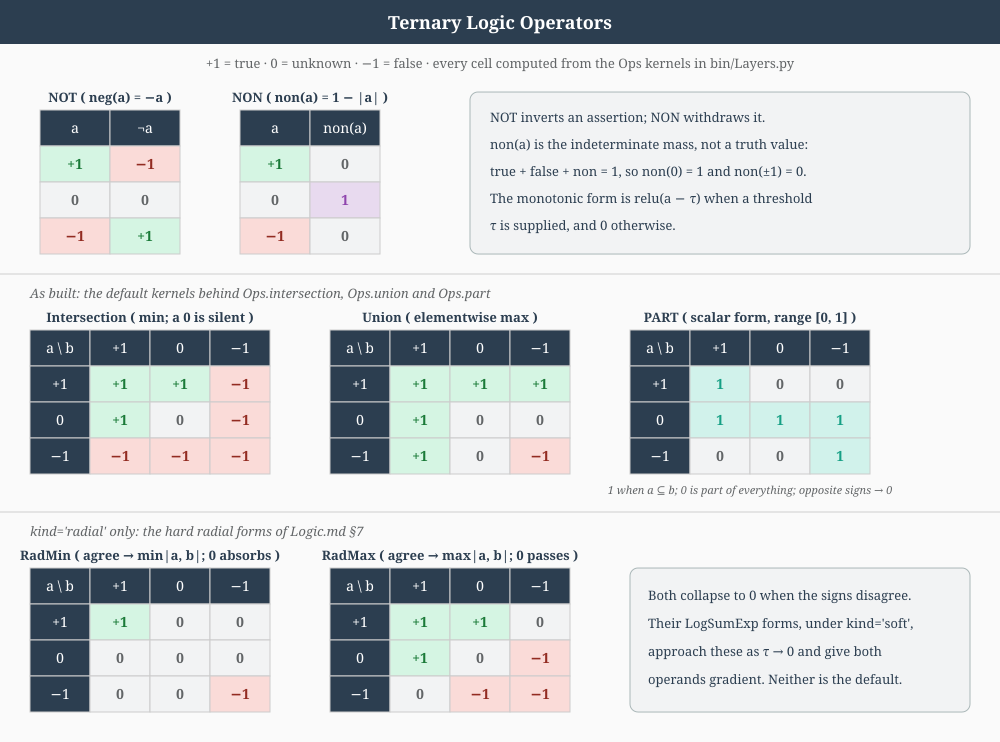
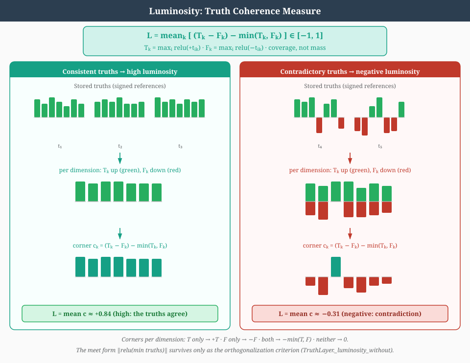

# Logic

## Overview

This document defines the logic system at three levels:

1. **Subsymbolic (vector / field level)** --- geometry in ConceptualSpace
2. **Symbolic (scalar level in [-1,1])** --- order + polarity in WholeSpace
3. **Rationality** --- propositional truth store built on both

Executable implementations of the subsymbolic and symbolic operators are the
`GrammarLayer` subclasses in `bin/Language.py` and the `Ops.*` kernels in
`bin/Layers.py` they dispatch to (see [Language.md](Language.md)).

## Relation to LLMs, Formal Concept Analysis, and DisCoCat

The logic layer states what a BasicModel sentence meaning can be trusted to do
after it has been composed. In an LLM this kind of inferential behavior is often
implicit in next-token priors. Here it is explicit: Formal Concept Analysis gives
the order-theoretic reading of concept support and intent, DisCoCat gives the
typed composition route that builds sentence meanings, and the truth operators
test or accumulate the resulting propositions.

> **Terminology.**
> One noun per-space: **percept** = a PartSpace/WholeSpace thing (dimensionally
> embedded, EXTENSIONAL; *part* = atom / bottom-up $\sigma$, *whole* = property/region
> / top-down $\pi$ are its two subtypes); **concept** = a ConceptualSpace relation
> tying one part-percept $\leftrightarrow$ one whole-percept (the Concept codebook,
> diachronic); **symbol** = a SymbolSpace thing (0-D, INTENSIONAL, references a
> concept; the symbol codebook). WholeSpace itself holds whole-percepts.

---

## 1. Subsymbolic Layer

Objects: vector sets $(B, N, D)$ interpreted as RBF / luminosity fields.

### Operators

- **Union**: `Ops.union` --- an elementwise `max` (the RadMax lattice fold
  applies only under `kind='radial'`, Section 7), not concatenation. The
  additive combine is the structural `synthesize` (`SynthesizeLayer`:
  `left + right`, residual-bearing; its reverse is `analyze`).
- **Intersection**: `Ops.intersection` --- co-supported regions: an
  elementwise `min` in which a zero coordinate is unspecified and yields the
  other operand.
- **Negation (affirming)**: `Ops.negation` (the `_negation_kernel`):
  `neg(x) = -x` on signed values, antipodal opposition on the hypersphere;
  on paired poles (monotonic) it exchanges the two poles.
- **Non (non-affirming)**: `Ops.non` (the `_non_kernel`) ---
  bitonic returns the triangular residual $1 - |\mathrm{clamp}(x, -1, 1)|$
  (completing the partition of unity
  $\mathrm{true} + \mathrm{false} + \mathrm{non} = 1$); monotonic is
  $\mathrm{relu}(x - \mathrm{threshold})$ when a threshold is supplied,
  else zero.

These two are signed subsymbolic kernels, not the grammar operators, which
act on evidence lanes.

### Evidence lanes

Evidence about a concept is kept in two lanes, $(c^+, c^-)$, for and
against. Their four corners are the tetralemma's (for, against, both,
neither), and the lanes are never netted into one signed scalar: *both*
(the region asserted and denied) and *neither* (no evidence) are different
states that a signed value would confuse.

- **`not`** (`NotLayer`) swaps the two kinds of evidence,
  $(c^+, c^-) \to (c^-, c^+)$, and is its own inverse.
- **`non`** (`NonLayer`) removes both the positive and the negative
  evidence, $(c^+, c^-) \to (0, 0)$, asserting nothing in their place.
  Alec, 2026-11-12: "non- removes both positive and negative evidence,
  while not swaps the two types of evidence." The operand survives as an
  explicit witness in the clause journal, so reconstruction and expectation
  can read what was removed; a removed dimension receives no expected prime
  and is spared attenuation. `non` is lossy and has no inverse.
- **Meet and join** act lane by lane: `intersection` takes the for lanes by
  min and the against lanes by max, `union` the reverse
  ([Language](Language.md#grammarlayer-forward--reverse-inventory)).
- **Heterogeneity tolerance.** Where candidate support is read into
  attention, `hetTolerance` $\tau \in [0, 1]$ acts on the lanes as
  $(c^+, c^-) \leftarrow (c^+, c^-) - (1 - \tau)\min(c^+, c^-)$. At
  $\tau = 1$, the default, nothing changes; at $\tau = 0$ *both* collapses
  to its net lane while *neither* survives, leaving three corners. No signed
  scalar appears at any setting.

Stored evidence only accumulates. A later close merges into a stored pair by
the per-lane maximum, so contrary evidence fills the other lane and never
lowers the first; trust and gates scale what is read from the pair, and a
stored pole otherwise changes only when its row is forgotten or an epoch is
restored.

Operators over the lanes fall into two algebras (2026-10-19). A selection,
which tense, aspect and the preposition are, is an idempotent meet with no
inverse: on the mat twice is on the mat. A verb is a group element acting on
its identity, invertible and not idempotent: ran twice is more than ran
once. A state ("the box contains apples") is a relation. The modal is the
second difference, over an identity's alternative timelines: possible holds
on some timeline, necessary on every one, the actual included, and the two
are duals in the lanes, necessity being possibility with the complement
withheld ([Language](Language.md#words-narrow-the-domain-of-discourse-2026-09-28)).

### Sign and parthood

> **Where the sign flip is licensed.** The
> sign flip `−x` is licensed only at the REFERENCE space-role — downstairs
> the sign is occupied (form content) or nonexistent (one-sided
> percepts); only at the reference space-role is it vacant of denotational
> duty and free to carry polarity (`a = −1` on A's row = present,
> certain denial; never negative mass in ground space). `non()`'s
> withdrawal reading is the prasajya move — lowering `|a|` toward 0
> without crossing — gated, never spontaneous. RadMin/RadMax below
> remain signed-scalar kernels at their own space-role; the odds embedding
> is retired from the meronymic path (legacy `PiLayer` keeps it for
> non-meronymic consumers).
- **Parthood** (fundamental): `Basis.part()` / `Ops.part`. The default
  (vector) form is the elementwise projection of $x$ into $y$'s unit
  direction:

$$
\operatorname{part}(x, y) = x \cdot \frac{y}{\lVert y \rVert}
$$

The `scalar=True` form is the clipped cosine projection:

$$
\operatorname{part}(x, y) = \frac{\max(0,\; x \cdot y)}{\lVert x \rVert \cdot \lVert y \rVert}
$$

(The `monotonic` flag is accepted for signature parity but unused by the
part kernel.) The scalar form satisfies Boole's contrapositive trivially
(dot product and norms sign-invariant under joint negation). The full suite
(`whole`, `equal`, `overlap`, `underlap`, `boundary`) composes through
`part`.

---

*Section 2, the norm-projection reading of symbolization, is retired: a
symbol is emitted by the codebook lookup that names a prototype row
([DevelopmentHistory](DevelopmentHistory.md#2-symbolization)).*

## 3. Symbolic Layer (Scalars in [-1,1])

`Basis` supports **monotonic** (plain min/max over positive-cone values,
including user-supplied truth-set bivectors) and **bitonic** (sign-aware).
Monotonic forms here; bitonic forms (RadMin, RadMax) in Section 7.
See [Spaces.md "Monotonicity of the lift / lower
chain"](Spaces.md#monotonicity-of-the-lift--lower-chain).

Let $a, b \in [-1,1]$.

| Operator | Bitonic | Monotonic |
|----------|---------|-----------|
| Negation (affirming) | $\operatorname{neg}(a) = -a$ | --- |
| Non (non-affirming) | $\operatorname{non}(a) = 1 - |a|$ (triangular residual) | $\operatorname{non}(a) = \operatorname{relu}(a - \tau)$ when $\tau$ is supplied, else $0$ ($\tau$ is a plain argument, not learned) |
| Union | elementwise max (RadMax under the radial and soft kinds, Section 7) | $a \cup b = \max(a, b)$ |
| Intersection | elementwise min, a zero coordinate unspecified (RadMin under the radial and soft kinds, Section 7) | $a \cap b = \min(a, b)$ |

### Parthood as Projection

Parthood is the **fundamental mereological operation**. The scalar
(`scalar=True`) form, for $A, B \in \mathbb{R}^D$:

$$
\operatorname{part}(A, B) = \frac{\max(0,\; A \cdot B)}{\lVert A \rVert \cdot \lVert B \rVert}
\quad \in [0, 1]
$$

(The default vector form is the elementwise projection
$A \cdot (B / \lVert B \rVert)$; see Section 1.) Boole's contrapositive
$\operatorname{part}(A, B) = \operatorname{part}(-B, -A)$ holds trivially.

The full suite composes through `part`:

| Method | Formula |
|--------|---------|
| `whole(A, B)` | `part(B, A)` |
| `equal(A, B)` | $\operatorname{part}(A, B) \cdot \operatorname{part}(B, A)$ |
| `overlap(A, B)` | $0 < \operatorname{equal}(A, B) < 1$ |
| `underlap(A, B)` | $\operatorname{equal}(A, B) = 0$ |
| `boundary(A, B)` | $|\operatorname{part}(A, B) - \operatorname{part}(B, A)|$ (zero under clipped cosine) |

Under clipped cosine, `part` is symmetric, so `equal` reduces to
$\operatorname{part}^2$. Asymmetric classical subsumption is recovered
**relationally** via figure/ground: compare $\operatorname{part}(A, B)$
against $\operatorname{part}(A, \neg B)$. See
[Mereology.md](Mereology.md).

For ternary scalar values (monotonic projection):

| part(a,b) | **+1** | **0** | **-1** |
|-----------|--------|-------|--------|
| **+1**    | 1      | 0     | 0      |
| **0**     | 1      | 1     | 1      |
| **-1**    | 0      | 0     | 1      |

Empty-set conventions (asymmetric): zero is vacuously part of everything
($\operatorname{part}(\emptyset, y) = 1$), but nothing non-empty is part of
the empty set ($\operatorname{part}(x, \emptyset) = 0$;
$\operatorname{part}(\emptyset, \emptyset) = 1$).

---

## 4. Key Insight

- Subsymbolic = geometry
- Symbolic = order + polarity

This separates representation (vectors) from logic (order and polarity).

---

## 5. Rationality

Rationality is the propositional logic layer, built on the grammar rules
`part(S, S)` (CS space-role, `PartLayer`) and `isEqual(S, S)` (SS
space-role, `IsEqualLayer`).

### Truth Statements

A **truth statement** is any assertion processed through the full pipeline.
The `TruthLayer` --- owned by the symbol tower, reached as
`self.symbolSpace.truth_layer` --- stores activations **scaled by**
DegreeOfTruth:

$$
\text{stored} = \text{activation} \times \text{degree}
$$

| Degree | Stored Vector | Effect |
|--------|--------------|--------|
| +1 | full activation | attractor |
| 0 < d < +1 | scaled activation | weak attractor |
| 0 | zero vector (inert) | prunable |
| -1 < d < 0 | scaled, negated | weak disperser |
| -1 | negated activation | disperser |

### TruthLayer (symbolSpace.truth_layer)

`TruthLayer` is instantiated in `SymbolSubSpace.__init__` (`SymbolSpace` is
a transparent forwarding container over the held `SymbolSubSpace`
coordinator, so `symbolSpace.truth_layer` reaches it). The canonical store
of asserted truths is the unified `LTM0` (`symbolSpace.ltm_store`), and the
`TruthLayer` is a read model over it: `attach_ltm` binds the store and
`sync_from_ltm` rematerializes its provisioned and user rows, each nonzero
evidence pole contributing a flat vector scaled by that pole, the two poles
kept independent. A source's scalar trust is kept beside the vectors and
never supplies a pole's magnitude. Its methods:

- **`record(activation, degree)`** --- store `activation * degree`.
- **`query(activation)`** --- find the closest stored truth; returns
  `(index, cosine similarity)` of the best match (or `None` below the
  threshold). The similarity is signed --- consonance (+) vs. dissonance
  (-) --- not the stored degree.
- **`field(concepts)`** --- project all stored truths into ConceptualSpace as a
  scalar field over concept vectors.

**Batch recording (`record_batch` / `compact`).** `record_batch(activations,
trust, degree)` stages a batch into a bounded pending buffer with per-entry
trust, making no per-cell storage decision inside the compute brick;
`compact(min_trust)` --- called outside the brick, after
forward/backward/step --- drops entries below the trust threshold and
promotes the survivors to the persistent `truths` buffer (its one host sync
per tick stays out of CUDA-graph capture).

**Admission governance.** `conflict_profile(extra=None)` measures the
per-dimension contested mass $\min(T_k, F_k)$ over the absolute store,
optionally with candidate row(s) added (measured, never stored);
`conflict_mass` is its per-dimension max. `admissible(candidate, threshold)`
is the commit-point gate: a candidate belief is admissible iff admitting it
would keep the corpus's conflict mass at or below the threshold.
`preemption_signal(threshold, hysteresis)` is the preattention trigger ---
it fires when the conflict mass exceeds the threshold and stays fired until
the mass falls below $\mathrm{threshold} - \mathrm{hysteresis}$ (chatter
guard); it returns `(mass, fired)`.

**Paraconsistent assessment (`assess`).** `assess()` is the terminal
paraconsistent read of the accumulator: `support` / `conflict` /
`ignorance` in $[0, 1]$, recovered from the affirming/denying poles of the
stored Degrees of Truth ($\mathrm{support} = a_P (1 - a_N)$;
$\mathrm{conflict} = a_P R_N + a_N R_P$;
$\mathrm{ignorance} = (1 - \max(a_P, a_N)) (1 - \max(R_P, R_N))$, where
$a$ are mean and $R$ max pole masses). Keeping *conflict* (the set splits
on a proposition) distinct from *ignorance* (the set is silent on it) is
exactly the degeneracy a scalar $a_P - a_N$ collapse loses.

### Truth Field

$$
f(c) = \frac{1}{n} \sum_{i=1}^{n} c \cdot t_i
$$

where $t_i = \text{activation}_i \times \text{degree}_i$. Two kinds of regions:

- **Attractors** ($f \to +1$): concept vectors near +DoT truths.
- **Dispersers** ($f \to -1$): concept vectors near -DoT truths.

### Consonance and Dissonance

1. **Internal consonance** --- stored truths should be mutually consistent.
2. **External consonance** --- incoming statements are evaluated against the
   truth field.

### Propositional Structure

Parthood and equality are grammar operations over activations:

- **`part(S, S)`** (CS space-role) --- `PartLayer.forward` passes the
  encompassing parent `right` through unchanged; the parthood relationship
  between the operands is carried by the codebook geometry (the codebook IS
  the meronymic tree), not by any output scaling.
- **`isEqual(S, S)`** (SS space-role) --- `IsEqualLayer.forward` is
  `torch.maximum(left, right)`, the lattice join on the bivector cone;
  asserted equality shows up as codebook co-location (mutual parthood)
  learned through training.

Together they define a partial order over symbolic activations.

A stated parthood, subsumption or kind relation ("cats are animals") is one
relation, $\mathrm{Part}(x, y)$: two references with the truth pair, read by
the types of its arguments, with no relation code stored in a row; equality
is membership in a singleton (Alec, 2026-10-20/21). `part` and `isPart` read
the conceptual taxonomy these relations build, never vector containment
([TaxonomyQueries](TaxonomyQueries.md), [Mereology](Mereology.md)).

### Truth Accumulation Pipeline

Truth entries arrive as `(text, trust)` pairs. `store_truths()` reads each
text through the ordinary sentence forward, so its row lands at the sentence
boundary as any read sentence's does; the landed row then receives its
effective degree of truth, its user origin and its source text, and the
`TruthLayer` view is rematerialized. A resubmitted set replaces the previous
user rows. The stored truth is

$$
t_i = \text{activation}_i \times \text{DoT}_i
$$

---

## 6. Consistency and Verification

### Internal Consistency (within a TruthSet)

The design reading is a leave-one-out check: for each $t_j$, evaluate the
field produced by the rest of the set at $c_j$:

$$
d_j = f_{\setminus j}(c_j) = \frac{1}{n-1} \sum_{i \neq j} c_j \cdot t_i
$$

- $d_j > 0$: consonant; $d_j \approx 0$: independent; $d_j < 0$: dissonant.

A disperser ($\text{DoT} < 0$) near an attractor ($\text{DoT} > 0$) naturally
produces negative field values, flagging the contradiction.

The $d_j$ field check is the design reading. The code's check
is `TruthLayer.consistency()` --- cross-truth contradiction detection
returning a scalar score (and, with `return_report=True`, the list of
contradicting index pairs) --- and `TruthLayer._luminosity_without(j)`, the
leave-one-out luminosity used as the orthogonalization criterion.

### Verification (incoming statement against stored truth)

The design reading: process the statement, then query the field:

$$
v = f(c_a) = \frac{1}{n} \sum_{i=1}^{n} c_a \cdot t_i
$$

| $v$ | Interpretation |
|-----|---------------|
| $v \to +1$ | strong support |
| $v \approx 0$ | no opinion |
| $v \to -1$ | strong contradiction |

The code's surfaces for it are
`TruthLayer.query` (nearest stored truth), `TruthLayer.assess` (the
paraconsistent support / conflict / ignorance read, Section 5), and
`TruthGroundedReasoner.evaluate` (posture over a `QuerySpec`;
[Reasoning.md](Reasoning.md)). For point lookups,
`symbolSpace.truth_layer.query()` returns `(index, cosine similarity)` of
the single closest truth --- the signed similarity, not the stored degree.

### Logical Entailment (symbolic closure)

Subsymbolic field checks detect *geometric* consistency but not *logical*
entailments. Example: `part(A, B) = +1` and `part(B, C) = +1` entail
`part(A, C)`, but $A$ and $C$ could be geometrically distant. The symbolic
closure layer:

1. **Extract propositions** by decomposing stored SS activations into
   relation + two operands.
2. **Compute closure** via transitivity:
   - $\text{part}(A, B) \wedge \text{part}(B, C) \Rightarrow \text{part}(A, C)$
   - $\text{equals}(A, B) \wedge \text{equals}(B, C) \Rightarrow \text{equals}(A, C)$
   - $\text{equals}(A, B) \wedge \text{part}(A, C) \Rightarrow \text{part}(B, C)$

   Each entailed proposition inherits DoT = min of the premise DoTs.
3. **Inject entailments** as new symbolic activations recorded in the
   TruthLayer.

This closure exists as a read: `TruthGroundedReasoner.is_part`
(`bin/reasoning.py`) searches the conceptual taxonomy within a step and beam
bound, a chain only as true as its weakest hop, and a missing path is unknown.
It writes nothing back: `materialize` raises, since query evidence cannot edit
conceptual definitions or assert world facts.
`TruthLayer.derive` performs the pairwise transitivity step and
`extrapolate` generalizes it to all two-argument methods, each derived
truth recorded with attenuated DoT inherited from its premises. The
geometric field alone remains sufficient for soft consistency checks and
nearest-truth lookups.

## 7. Radial Operators for Hypersphere Ternary Logic



*The figure is computed from the kernels in `bin/Layers.py`. Union is the elementwise max and intersection the minimum with a zero coordinate silent (Sections 1 and 3). RadMin and RadMax apply under `kind='radial'`, and their LogSumExp forms under `kind='soft'`.*

RadMin, RadMax, NOT, and NON operate over signed magnitude space `[-1, +1]`.
Sign = direction of assertion; magnitude = strength; zero = **unknown**.
$+1$ = True; $0$ = Unknown (no assertion); $-1$ = False. Magnitude ordering:
$x \subset y$ iff $|x| < |y|$.

> **Kernel kinds.**
> `Ops.union` is the elementwise max and `Ops.intersection` the minimum in
> which a zero coordinate is silent (Sections 1 and 3);
> neither is RadMin or RadMax. The `kind` argument of the lift and lower
> kernels selects the radial forms, and its default is `kind='strict'`.
> `kind='radial'` gives the hard forms in the table below. `kind='soft'`
> gives their LogSumExp forms (`Ops._soft_radmax` / `Ops._soft_radmin`),
> in which both operands receive softmax-weighted gradient per cell (hard
> RadMax routes gradient only to the winning operand) and which approach
> the hard forms as $\tau \to 0$.

| Op | Behavior | Ternary truth table |
|----|----------|---------------------|
| **RadMin** (`kind='radial'`) | Sign disagree $\to$ 0; else $\mathrm{sign}(x) \cdot \min(|x|, |y|)$. Zero absorbing. | `[+1,0,0; 0,0,0; 0,0,-1]` |
| **RadMax** (`kind='radial'`) | Sign disagree $\to$ 0; else $\mathrm{sign}(x) \cdot \max(|x|, |y|)$. Zero transparent ($\mathrm{RadMax}(x,0) = x$). | `[+1,+1,0; +1,0,-1; 0,-1,-1]` |
| **NOT** | $-x$. Involutive; preserves magnitude; $\mathrm{NOT}(0) = 0$. | input $\to$ -input |
| **NON** | $1 - |x|$ (triangular residual). Full indeterminacy at $x = 0$, zero at $x = \pm 1$; completes the partition of unity $\mathrm{true} + \mathrm{false} + \mathrm{non} = 1$. Withdraws assertion (vs. NOT which inverts). | input $\to 1 - |\mathrm{input}|$ |

Both RadMin and RadMax are commutative and collapse to zero on sign
disagreement. NOT and NON in this table are the signed kernels; the
grammar's `not` and `non` act on evidence lanes (Section 1).

---

## Luminosity



> **Two measures.** The **truth-set
> luminosity**, what `Mereology.Luminosity(truth_layer=...)` /
> `TruthLayer.luminosity` computes, is the catuskoti coverage
> measure over the stored codes: per conceptual dimension the signed
> references split into true/false pole coverage `(T_k, F_k)`
> (elementwise max of `relu(±row)`), and
>
> ```
> luminosity = mean_k[(T_k − F_k) − min(T_k, F_k)]   in [−1, 1]
> ```
>
> — total area weighted by sign, minus the regions where the sign
> differs (contradictory evidence). It is computed **on the codes**
> (no decode pullback) and is order-independent. The meet/GLB form
> below is only the **orthogonalization criterion**
> (`TruthLayer._luminosity_without`) and `darkness()`'s mirror, not the
> truth-set measure. (The diagram shows the coverage measure; the meet form is noted beneath it.)

The meet-form coherence scalar (orthogonalization criterion):

```
||relu(min(truths))||
```

Element-wise min computes the conjunction (point where all truths agree); relu
removes negative dimensions; L2 norm gives brightness.

- **High luminosity**: truths are coherent and mutually reinforcing.
- **Low luminosity**: truths are sparse, contradictory, or incoherent.

Two roles in the model:

1. **Top-down bias** (design only): concept input scaled
   by luminosity each conceptual iteration
   (`concept_input * (1 + truthBiasScale * luminosity)`). The
   `<truthBiasScale>` knob is parsed (`architecture.truthBiasScale` $\to$
   `truth_bias_scale`) and never read.
2. **Loss modification**: low luminosity increases training loss via
   `SymbolSubSpace.truth_modulated_loss`, the multiplicative factor
   $\mathrm{totalLoss} \cdot (1 + w_{lum}(1 - \mathrm{lum}) + w_{univ}(1 - u))$
   (see [Reasoning.md](Reasoning.md) "TruthLoss").

### Fusion

Fusion is the **mereological least upper bound** of the stored truth set:

```
fusion = max_i truths[i]
```

In bivector space (paired-index `[p0, n0, p1, n1, ...]`), fusion names the
top-right corner of the smallest hyperrectangle dominating every stored truth
componentwise. Geometric dual of luminosity:

- **Luminosity** = `||relu(min(truths))||` --- GLB / meet, scalar coherence.
- **Fusion** = `max(truths)` --- LUB / join, vector coverage.

Trust (DoT) is already baked into stored truths, so fusion is trust-weighted
automatically.

**Layout caveat.** TruthLayer's paired-index slicing (`[..., 0::2]` for
positive poles, `[..., 1::2]` for negative) assumes a *repeated* bivector
layout. The WholeSpace codebook uses a *leading* bivector plus positional
trailers: `[pos, neg, where..., when...]`. Callers feeding WholeSpace
activations into `luminosity()` must slice the leading 2 dims first
(`acts[..., :2]`); see the `SymbolSubSpace.truth_modulated_loss` call-site
in `bin/Language.py`.

### Supporting measures

- **Consistency** (`isConsistent()`): folds truths into a union via successive
  `Ops.disjunction`. In bitonic mode, conflicting +/- assertions
  cancel.
- **Grounding** (`ground()`): finds the minimal subset entailing a query.
- **TruthLoss**: additive penalty for contradictions, measured by overlap with the
  TruthSet’s opposite evidence. The lattice union preserves both evidence
  poles, so a union-norm reduction is not a contradiction measure. See [Reasoning.md](Reasoning.md).
- **Derive**: pairwise mereological inference via `part()`; generalized by
  `extrapolate()` to all two-argument methods.

### Existence and pervasion (Alec, 2026-11-13)

A question with no open operand asks about a region of order-zero
conceptual space, and its truth is read from how that region is lit. "A
yes/no question is a query into conceptual space. We can ask the positive
or negative form as an existence check within the region of order-0
conceptual space that is specified by that; the question is true if a
trusted object exists in that space." Each remembered statement has one
signed trust $t$ from $-1$ to $1$. It lights the lane for where $t$ is
above zero and the lane against where it is below, to $\lvert t \rvert$,
and lights nothing at zero. The brightest statement is taken and none is
added to another.

A lit region is read in two ways, which are kept apart:

- **Existence.** A trusted object lies in the region. A statement that is
  only like the claim is what analogy has: "we can do reasoning from
  analogy wi "the brightest statement in a region", but that is not
  sufficient for logical pervasion in the geluk sense."
- **Pervasion.** "For pervasion we need the entire space of the truth
  claim in conceptual space to be luminous, or have a positive value
  (non-negative is not contradicted, but unknown, so analogy is not
  deductively true)." It "is just coverage from a higher order": the
  region of the claim's subject lies wholly within the region that is its
  property's extension, by one relation between the two kinds
  ([Extend](Extend.md#regions-alec-2026-11-13)). Its measure is that
  relation's trust, and the least along a path of such relations.

The positive and the negative form are each read both ways. A form is
contradicted to the degree that the other form exists in its region, a
region lit in part and held false nowhere is unknown, and the two lanes
are never netted. Where the trust comes from is in
[Philosophy](Philosophy.md#the-three-sources-of-trust-in-the-model-alec-2026-11-13).

A contradiction changes nothing by itself: "logical contradiction is merely an
signal that something needs to be fixed, there is no automatic fixing routine
for inconsistency (but there is a measure of that inconsistency for users of
WikiOracle)."

---

## Semantic Summary

| Operator | Type | Role | Behavior on Contradiction |
|----------|------|------|---------------------------|
| Intersection | Binary | Meet, the default | Keeps the lower value; a zero coordinate is silent |
| Union | Binary | Join, the default | Keeps the higher value |
| RadMin | Binary | Radial meet (`kind='radial'`) | Collapses to zero |
| RadMax | Binary | Radial join (`kind='radial'`) | Collapses to zero |
| NOT | Unary | Sign-flipping negation | N/A |
| NON | Unary | Non-affirming negation | N/A |

---

## 8. Cross-references

The level-crossing operations (`lift`, `lower`, `intersection`, `union`),
`Pi`/`Sigma` layer ownership, witness-set / slab-lattice geometry, and the
`Ops.*` namespace inventory are documented elsewhere.

- **`Ops.*` reference**: [Language.md](Language.md).
- **PiLayer / SigmaLayer ownership** (`forwardPi`/`reversePi`/`forwardSigma`/
  `reverseSigma` aliases): [Spaces.md](Spaces.md).
- **Mereological suite** (`part`, `whole`, `equal`, `overlap`, `underlap`,
  `boundary`, `copart`): [Mereology.md](Mereology.md).
- **Tetralemma bivector layout** (TRUE/FALSE/BOTH/NEITHER corners):
  [Spaces.md](Spaces.md) and [Philosophy.md](Philosophy.md).
