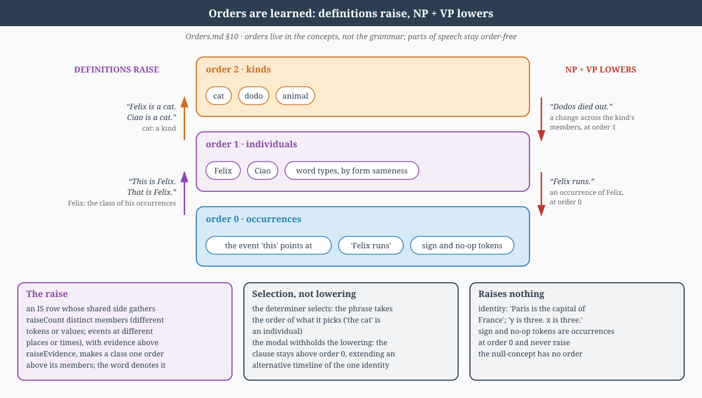
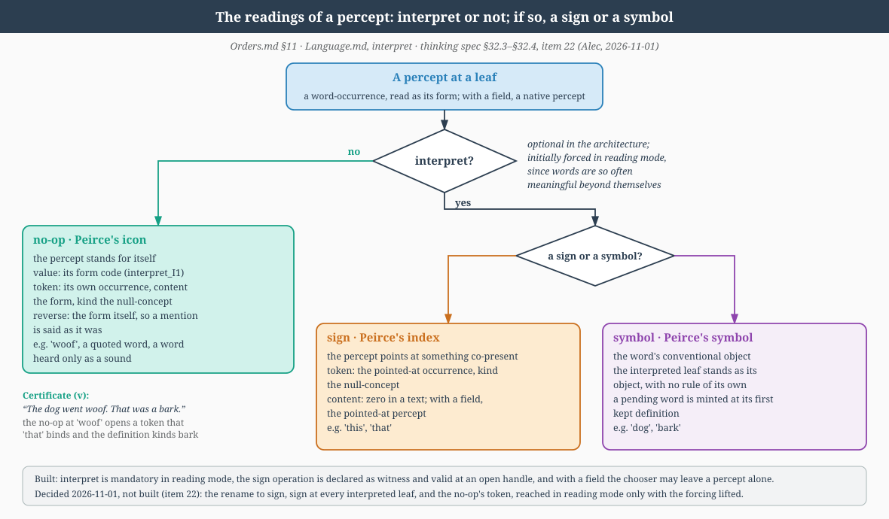

# Orders: sets, membership and the two ladders

*Decided theory (Alec, 2026-10-15 and after). Technique lives in the code;
this document is the framing it points to. It extends
[a concept is sigma over pi](Philosophy.md#where-is-context-particulars-universals-and-the-two-axes-2026-09-22)
and [symbolization establishes an order-1 individual](Mereology.md).*

## 1. Orders are sets of symbols

An object at order *n* ≥ 1 is a set of order-(*n*−1) symbols, with graded
(fuzzy) membership, exactly as in set theory. Order increases are always
over individuals: a set collects symbols, never field regions directly.

Order 0 is the field: percepts, located in `.where`/`.when`, and the
Boolean and mereological operations among them — union, intersection,
complement, parts and wholes. There is no "same" at order 0, only overlap
and containment; two identical percepts are not one thing until a symbol
collects their occurrences. Truth at order 0 is coverage of an extent (the
catuṣkoṭi's for/against lanes).

**The basic level (2026-11-09).** Parts and wholes bound one basic percept
in perception. An order-0 concept collects those basic percepts through
`2*bp + pole` literals, not through separate part and whole literal kinds,
and a property-only or part-only concept collects the basic percepts
carrying that boundary. Higher orders collect concepts. This is the common
basis of the order alternation. A recurring basic-level collection promotes
a percept row, not an order-0 concept.

## 2. Intension lives at order 0; orders above 0 are extensional

The pi (intersection) of a set's members is a field object, so every set
at every order carries an order-0 **type** as its characterization. The pi
is computed from the members, not stored as a second object. Orders above
0 are purely extensional; what differs between them is only the
*collecting relation*.

Consequences:

* **Mass terms** are a pi over events with no individuals (water-bearing
  events, say): order 0. That is why they behave as properties (no plural,
  "much" not "many") and why "wholes are types" covers them.
* **Count kinds** (cats) are sigma sets. Second order over individuals
  (these cats), or first order directly over occurrences — the mass
  reading of a count noun ("there's cat all over the sofa", the universal
  grinder) is the first-order quotient. Count/mass is which quotient the
  sentence licenses, not a lexical fact.
* A kind has two faces: its set (extension, who belongs and how much) and
  its pi (intension, the shared signature). Membership degree is computed
  from the pi: a symbol belongs to the extent the shared signature
  explains it.

## 3. Membership is by evidence, learned per set

The collecting relation is never fixed per order; it is evidence, and the
behaviour of each order follows from its evidence, not from set-hood.

| Order | Collects | Evidence | What follows |
| --- | --- | --- | --- |
| 1 | occurrences → an **individual** | continuity (`.where`/`.when` trajectory); witnesses are the degrees | identity and counting begin; persistence and change — verbs, tense, reference (names, pronouns, definites) apply here |
| 1 | tokens → a **word** | form sameness (exact; typos and variants are the fuzzy fringe) | the word index's DEF rows |
| 2 | individuals → a **kind** | explanation by the kind's pi | inclusion (cats $\subset$ animals), quantification, generic truth; kinds do not change, their members do |
| 2 | individuals → a **collection** | adjacency / plurality | location (the sum of members) without an identity criterion beyond membership |
| 2 | words → a **part of speech** | participation in operand positions | the learned grammar's classes |

Identity is per order: a generalization over occurrences (an individual,
which keeps its history) is never identified with a generalization over
individuals (a kind). Same point, different order stamp $\Rightarrow$ different thing.

Order zero has an identity too (Alec, 2026-11-12), in MTM rather than in
the field. MTM is ramsified: order-zero states joined by succession make a
sequence, an extended event, while the same order-zero reading met again is
an order-zero identity in MTM, the familiar-tier candidate that
`FamiliarTier.observe_candidate` opens and whose recurrence promotes it.
Identities at different orders are never joined. Recognition, the binding of
a present event to that identity, is decided in direction and is not part of
the mechanism.

**One relation records membership (2026-10-23).** An
LTM1 row is two tagged references and the two truth lanes,
$\mathrm{Part}(x, y)$, and its reading comes from its referents' types: two
situations a conditional, a situation and a speech individual an
attribution, an object and a word a definition, two kinds a subsumption, a
singleton an equality. LTM1 and the taxonomy over symbols are therefore one
structure, and its Part edges with their evidence are the membership
evidence of the table above. An LTM0 row is one concept, an idea, and
carries no identity.

**Continuity at every order (2026-11-09).** Order 1's continuity generalizes
to every collection's connected path: one member order and kind, a
kept-close horizon and containment, with place and first difference scored.
States form extended events and mentions form extended nouns. Promotion
retains the time-ordered path as membership and successor witnesses one
order above its members.

## 4. What an order increase abstracts

"Abstracting temporal information" is two different things:

* occurrences → individual abstracts the *moment* but keeps the
  *history* (the individual is a temporal object with a trajectory —
  object permanence is ordered persistence, not timelessness);
* individuals → kind abstracts the *index* (which one, where, when) but
  not temporal *content*: a kind of change (a B column) keeps its shape of
  change at any order; "sunset" is a kind defined by temporal structure.
  The split between the situation stamp and tense and aspect as
  content is this line: a row's `.when` records when the utterance
  occurred, written by the reading from outside the concept and never read
  by composition, while what a sentence says about time, its order and any
  stated amount, is content carried by the verb phrase through tense,
  aspect and its prepositions; the two never meet, and a date is worked out
  at recall.

Even a kind keeps a statistical trace of situation — cats occur in houses
— as an expectation, what the activation predictor learns to anticipate
when the kind is active, not as identity. An individual is indexed by its
continuity in the `.where`/`.when` bands and described by its content, the
object file; so the independence term excludes those bands, whose geometric
meaning, brackets and sinusoids, an independence prior would destroy, and
reads only the conceptual content (`IndependentComponents.EventChart`).

## 5. Two ladders, one fold

Forms and referents are parallel ladders with the same fold:

* **forms**: tokens (0) → words (1) → parts of speech (2) → grammar rules
  (3, relations over classes);
* **referents**: percepts (0) → individuals (1) → kinds and collections
  (2) → generic propositions (3).

Reference crosses between them at any order: a word (1) can refer to a
type (0), an individual (1) or a kind (2). Counting relations as type
theory does (a relation over order-*n* things is order *n*+1), a relation
between individuals is order 2, a generic sentence and a grammar rule are
order 3, and a document of generics or a reasoning chain over rules is
order 4. A predication is not such a relation: NP + VP lowers, so "Felix
runs" is an occurrence at order 0 (§10). Nothing in the fold stops at any
order; the only ceiling is where
the grammar stops reading: its operands are positional, and no table
declares a maximum order.

Every order has the same two faces — a fuzzy set of symbols one order down,
and a pi at order 0 — and the orders differ only in the collecting
evidence: form (words), continuity (individuals), explanation (kinds),
participation (word classes), co-occurrence in a row (relations).

## 6. Distributional for words, semantic for objects

A part of speech is a kind-of-word: a class formed by the same fold, with
participation as the evidence. Each formal argument is a
concept one order above the word concepts; its direction is the centroid of
the meaning directions of the words kept in it, each weighted by its fit, and
a word's fit is its coverage of the argument's vector (direction times
radius); see
[Formal arguments and shared hierarchical context](#formal-arguments-and-shared-hierarchical-context-alec-2026-11-08).
The grammar names its operands by position (`argin1`, `argin2`, `argout1`),
never by a kind of word, and whatever words work in a position become that
position's class; positions that share their words draw their arguments
together, which is how many formal arguments come to few parts of speech.
Participation is soft: a word's fit is a term the chooser adds to an
operation's score, never a mask on the position, and only a kept use teaches
the argument ([Language](Language.md#learned-argument-concepts)). The
hierarchy's downward conditioning moves each participating word concept
toward its classes, so a word's position is its degree of membership.
A kind of thing is formed by the same fold with explanation over meaning
coordinates as the evidence. Same machinery, one conceptual space.

Two definitions of "noun" caused the trouble in the literature —
thing-word versus NP-filler. They belong to different ladders: *thing* is
the referent's order and family (A/B/property), *noun* is the word's
participation, and their correlation is learned. The exceptions
(*thunder*, *arrival*) are where the ladders legitimately disagree, which
is what makes the correlation a fact rather than a definition.

**Pinker and Gleitman.** Semantic bootstrapping (things → nouns by innate
linking rules) and syntactic bootstrapping (a verb's meaning read off the
frames it appears in) were not a dispute about adult categories; both
agree those are distributional. They disputed the *bootstrap* — which
direction runs first when the child knows neither categories nor meanings,
with a UG stake in whether linking rules are innate. For this project the
curriculum settles the data order: stage 2 presents words *with* their
objects, so the first referents are given by the teacher, not inferred by
a linking rule; distribution then has grounded credit to work from.
Gleitman's direction survives as the one cross-ladder flow that is
evidence rather than rule: the scene underdetermines a change, so a verb's
B column is constrained by the frames its word fills.

## 7. Grammatical operations are order operations

Determiners select a member, and the phrase's order is the order of what
is picked (§10); bare plurals and `every` stay at order 2 (`every` lowers to
the extension and chooses no member); a determiner on a mass description
picks a shaped portion, so *the water* is an individual collected by
continuity like any other; count/mass, singular/plural and proper/common are
the grammar reading the order and the collecting relation. The determiner is
the name of the quotient. A definite with nothing accessible to bind to
writes its occurrence and stays **unbound** until a referent appears
(presupposition accommodation); it never asserts novelty.

The bare word *water* is not an order-0 mass term. Alec, 2026-11-01: "Water
is a count noun with an elided form/shape in some contexts, so it's not a
good example of a mass noun. Water would be order-1 at lowest, since it is
an abstraction of an event." A determiner lowers only a kind, order 2 or
more, and leaves an order-1 term at order 1.

*Worked example (Alec, 2026-10-16): "The water froze. It became ice," ice
never perceived.* `the water` selects a portion and
stays unbound; `it` binds to it; `ice` is a bare NP at order 2 with a
symbol but no content. The temporal difference on the portion is `+ice`
as a context coordinate; it teaches `froze` ("→ ice"), makes `became` the
copular identity once `froze` predicts ice, and gives the type *ice* its
first content from this context. The requirement on a VP's operation is
therefore "definable at order 0, however the coordinates were learned";
"over percepts" is its special case. The portion stays the same individual
while its kind changes — kinds do not change, members do.

## 8. Consequences for learning

* Identity is the first thing learned above the field: the same individual
  across sentences, minted on recurrence of the individual and bound on
  re-mention. The "recurrence" of admission is membership by evidence at
  order 1.
* Recovering kinds and properties, factorial against confounded, is an
  order-2 question, the pi over individuals' signatures with `.when`
  excluded, and can be measured only once individuals exist.
* Parts of speech are learned over words by participation: each formal
  argument is a concept one order above the word concepts, and a kept
  operation credits the declared head operand's words, a symmetric one every
  operand's, a clause-forming one none
  ([Language](Language.md#learned-argument-concepts)).

## 9. Per-order conceptual spaces, ramsified over one symbol tree; the stratified priming surface (Alec, 2026-10-20; decided)

Of this section's title one half stands. Alec, 2026-10-20: "ramsify over
conceptual spaces, but keep all symbols in the mereological space." The
per-order conceptual spaces and the stratified read of the priming surface
were reversed two days later: the conceptual space is one (§10; the
reversed design is recorded in [DevelopmentHistory](DevelopmentHistory.md)).
What stands:

- **All symbols in one mereological tree.** Every symbol of every order
  lives in one structure, the symbol index with its Part tree: a word form
  the centroid of its letters and wholes in the percept cube; a kind tied to
  its members, an individual to its occurrences, a sentence to its
  constituents, by Part edges. One tree, all orders, one relation; two
  carriers, geometric up to order 0 (forms) and recorded above it. The
  **centroid** of an order above 0 is a derived cache over its Part edges
  (the intersection model of identity), kept only while it passes the test
  that its meet with each member stays high; where that fails the type is
  discontinuous and the set is the only representation (the union model).
  The two identity models of [Philosophy](Philosophy.md) are these two
  representations.
- **Felix and *cat* are related in three ways, none of them nearness.**
  Felix and the *kind* cat: **membership**, a Part edge. Felix and a
  *typical* cat: **typicality**, the meet of Felix's vector with the kind's
  centroid cache, the fold over members like him. Felix and the *word*
  "cat": the word is an **axis** of Felix's representation (he was described
  as one), not a neighbour; the name "Felix" is another axis, the proper
  noun whose definition is the individual. A kind therefore has two
  representations, its member set and its centroid among its members, the
  second kept while the type is continuous.
- **Cross-order comparison is membership, not distance.** An individual
  against a kind is a membership read; an idea against a kind a membership
  read of its participants; `bind` compares candidates at the request's own
  order. Distance between orders is not a meaningful quantity.

**Centroids (Alec, 2026-10-24).** An order-0 concept's form is the center of
the space of its parts and its wholes, each averaged over its count; a
higher-order concept has no parts and wholes, so its content is the pure
centroid of its members' content, weighted by their positive and negative
evidence, never a max or a min. A class row's cover (`cover_members`)
weights each member by its net positive evidence $\max(0, p - m)$ and drops
non-positive members; consolidation's fold weights by $p + m$. The centroid
is a rule for forms, stored on the concept's symbol: the fold
(`MemoryConsolidation._fold`) averages its members' forms and never the
bands or the meaning, and a class's place in conceptual space is derived
separately (Placement, §10).

## 10. Orders are learned: definitions raise, three compositions lower (Alec, 2026-10-21)

Alec: "we need not create an ordered grammar, because we have the rule
that raises order." Orders live in the concepts, not in the grammar's
categories. Parts of speech stay order-free and come only from the
grammar's positions and occupations: whether a constituent is a noun phrase,
a reference site, a marker or a predicate is read only from the kept parse
(the declared operations' argument positions, the orders they stamp and the
recorded occupations), never from whether a word has an object or any other
lexical fact, which is what keeps the grammar universal. Of the title's
three compositions one lowers, NP + VP: the determiner selects, and the
modal withholds the lowering (2026-10-22 and 2026-10-23).

**Definitions raise, by equivalence class.** Alec: "'Is' does not cross
order by itself, but when used with multiple identical RHS or LHS, it
creates an equivalence class." The class sits one order above its
members; this is Frege's definition by abstraction, as a direction is the
class of lines parallel to a given line. The learning sequence:

- "This is Felix, that is Felix": 0 to 1. Demonstratives point at events,
  at order 0. Distinct events that are all Felix make Felix the
  class of his occurrences, an individual. The same rule therefore
  creates individuals in the first place.
- "Felix is a cat, Ciao is a cat": 1 to 2. Distinct individuals make
  cat a kind.
- "Paris is the capital of France" is identity: both sides pick out one
  individual, and nothing is raised. "y is three. x is three." raises
  nothing either, since x and y are both bound to three itself.

"The same side" is the symbol the mentions read to; the other sides must be
distinct, as events at different places or times or as different identities
in MTM; and the word is given the raised concept as its object. Each
definition is an LTM1 row, and the raise fires when `raiseCount` (default 3)
pairwise distinct members have joined the shared side (§11).

**NP + VP lowers, returning to S0.** A noun phrase names a class, the
invariant across its members, and a verb is the step between two of them
(the first difference). The verb holds at some members, not at the class, so
the sentence lands among them, one order down and never below 0: "Felix
runs" is an occurrence of Felix at order 0; "dodos died out" is a change
across the kind's members, at order 1. IS raises by collecting members, and
NP + VP lowers by landing among them.

**The determiner selects.** Alec, 2026-10-22: "Determiners might not even be
dropping the order: they might just be selecting one of a plurality, and
leaving the order untouched." A determiner picks one of a plurality, and the
phrase's order is the order of what it picks, read by lookup: a member of a
kind is an individual, and a shaped portion of a mass is an individual, so
"the water" is an individual at order 1 (§7). `lift` and `lower` keep their
numerical folds, and a constituent's order is read from the concept it
denotes, whose order the equivalence classes set.

**The modal withholds the lowering (Alec, 2026-10-23).** A modal clause is
the ordinary composition kept above order 0, an abstraction of a possible
event that extends an alternative timeline of the one identity, never an
order-0 occurrence. A lowered event extends the actual timeline and updates
the identity's actual state; an unlowered one extends an alternative
timeline and updates that timeline's value, never the actual, continuing the
subject's most recent alternative timeline and opening one only when none is
open (`MediumTermMemory.alternative`). Possible holds on some timeline,
necessary on every one, the actual included, and in the limit over a kind
the generic; "did Joe run?" reads order-0 occurrences, "could Joe run?" the
abstractions and the alternative timelines. The modal is the second
difference. Alec, 2026-10-22: "MPs are differences of VPs just as VPs are
differences of NPs (not really differences, but diagonals within
quadratics). Running and walking are both possibilities for Joe's movement."
It is a diagonal per modal in one shared basis (the `adverb` action),
learned from equal-time events on an identity's alternative timelines
(`ModalLearning`), as the verb is learned over an identity's occurrences.

Neither a bind nor a raise carries a price of its own: a bind adds to the
MTM pool, which is input to output prediction, and is credited through the
derivative.

**Explicit and implicit definitions, judged together.** Alec: "multiple
DEF in LTM1 can be used to train the fold being used in the symbolic
order loop, and that's really all we need for integration. We can keep
the explicit and implicit definitions, and their match or mismatch is a
judgement process, just as in human cognition." The implicit meaning is the
concept's place in conceptual space, set by the words that occur with it.
The explicit meaning is its definitions, LTM1 rows that give its members and
its classes. The fold raise collects two rows that occur in matching
contexts under a parent one order up, and definition rows supply its
targets. A definition is evidence for membership and the fold's reading is
evidence too; agreement fills one truth lane and a mismatch fills both, the
corner that prompts refinement. The lanes are never netted. Each meaning has
what the other lacks: the implicit one places a concept before anything is
said about it, and grades similarity; the explicit one is exact, can be
stated and recalled, and raises order. A concept with only an implicit
meaning is a placed order-0 type, and a concept with only an explicit
meaning has not yet been met in use. The basis of a class's identity, the
intersection that is its invariant or the union that is its extension, is
kept open in
[FutureWork](FutureWork.md#intersection-or-union-as-the-basis-of-identity-alec-2026-10-21).

**One conceptual space, not strata (Alec, 2026-10-22).** "I am not convinced
we should sort by stratum, which is good for LTM. Here we are connecting
priming across orders (good), and the more I think about it, the more I am
in favor of a single conceptual space (so concrete and abstract concepts all
intermingled)." Strata remain the structure of LTM: LTM0 occurrences, LTM1
relations, the derived LTM2. In conceptual space one `similarity_codebook`
holds every order's rows: a kind is placed among the words, individuals and
events it occurs with, and an abstract concept sits beside the concrete ones
it is used with. Crowding is answered by the placement objective's
negatives. What §9 keeps: all symbols in the one mereological tree, the Part
edges as the record of membership, and membership read by edge, not by
distance.

**Placement.** A row with members, a class made by a raise or by promotion, is derived: its place is the normalized centroid of its members' places, each weighted by the net positive evidence of its membership, $\max(0, p - m)$, with definition rows excluded, recomputed with lower orders first (`MereologicalCodes.derive_class_placements`). While any member is unplaced, the class stays unplaced, and a class whose members lie farther than 15 degrees from its centroid (`CLASS_CONTIGUITY_COSINE`) is marked noncontiguous. Every other row, an order-0 concept or an individual whose occurrences supply its contexts, is placed by the context objective at its kept close (`MereologicalCodes.place_rows`, reading the seen ledger), which skips derived rows.

**Every symbol's order.** A concept's order is its recorded order, else one above its highest symbolic part, else 0 when a percept row or its own identity record witnesses it, else $-1$, unknown (`ConceptAllocator.order_of`). Unknown is never read as 0: joins and lowering keep it, and a reader that needs a number converts explicitly at its site. A recorded order is checked against the concept's parts when it is settled, and a disagreement raises.

**What each composition denotes** (`ReferenceContext.denoted_order`). Order is read, never added: no layer or grammar rule carries an order offset. A leaf has its concept's order. `lift`, NP + VP, lands one below its subject, floor 0, and keeps the subject's order when the verb phrase carries a modal alternative. `verb` has the verb's order. A determiner (`lower`, `definite`, `universal` and their unary faces) selects: it lowers only a kind, order 2 or more, and otherwise keeps its noun's order. `equal` has its left operand's order; `part`, `whole` and kind relations the whole's; `bind` the identity's; `sign` 0. A headed operation has its head's order; the symmetric joins (`sum`, `product`, `intersection`, `union`, `conjunction`, `disjunction`) take the maximum, unknown if any operand is unknown; a unary operation keeps its operand's. No list of mass, count or event nouns exists: the determiner's occupations condition the words it is used with into their own part of speech.

**Typed operands.** At composition an operand's stamped order decides how it is read (`ReferenceContext.prepare_operands`): at order 0 or at order 2 and above it is resolved to its existing typed concept, value and reference (`resolve_order`); at order 1 it stays the raw mention, and individuals are reached only through an explicit `bind`. A literal keeps its own point.

**The determiner is inline.** A determiner's `lower` contributes no content of its own: without a meaning block it returns its description unchanged, and on a meaning block the description's meaning passes through the lane kernel with the marker as context, the identity at initialization. It changes the order only as `denoted_order` reads it. Its member is a token whose identity is its place in STM while the sentence is open. An individual gets a concept row only by recurrence (`conceptMintCount`) or a kept definition. The chooser's menu never reads concept capacity: masking options by pool state would confound the chooser's credit, so an exhausted inventory raises instead.

**Learning parts of speech** follows the learning sequence above: proper
nouns first, then mass nouns, then count nouns where the language has them.
Unit tests may force a word's part of speech or order (Alec: "unit tests can
force parts of speech").

**Where a definition is stored.** A relation's stratum is read from its
argument tags, so both "this is Felix" and "Felix is a cat" are LTM1 rows.
Reading each definition in the stratum of the class it builds would put the
second in LTM2; the stratum is derived when read, so that choice changes
reading, not storage.

## 11. Pointers, identity, and relations across known concepts (Alec, 2026-10-31)

**IS is not special; a row between known concepts is a relation across
them.** Alec: "We shouldn't mark 'is' as special, this is just a part of the
equals() operator that will eventually store known concepts across a
relation rather than as a single idea." A positive LTM1 row whose two
referents are both concepts with recorded orders is a member of the whole
only when the member is exactly one order below it, a class and its member
as §10 defines them (`ConceptAllocator.class_member`). Any other such row is
a relation across two known concepts. It is stored with its pair and read by
queries, thought, `intuit`, pervasion and the raise, but it is a member of
neither concept, so it derives no order and enters neither definition: the
definition fold and the class cover (`DefinitionFold.examples`,
`FamiliarTier.class_members`) read membership as the order projection does,
and content enters a class at the raise, through the cover of its members.
Occurrence members define as before. The kind is read from the referents;
nothing marks the operator or the origin of a row.

**One rule at every order.** The same holds at order zero: a positive row
between two order-zero symbols is a relation, a member of neither symbol,
and derives no order. What the level decides is the kind of relation. Alec:
"it's a part/whole relation if it's below symbols, and a set/superset if
it's above symbols." Below symbols is the mereology of the field; above
them, the sets of §1.

**Relations are immediate; order is evidence over trials.** Alec: "building
relations can happen immediately, but that will not immediately raise the
order; it serves as evidence over many trials. This will help us
disambiguate synonyms, indexicals, and relations of order." A relation is
built first, in STM1 or LTM1; the row is written at the sentence close, and
no single row moves an order. The raise reads the accumulated rows, by one
rule at every order: a concept joined by positive rows, above
`raiseEvidence` (default 0), to `raiseCount` pairwise distinct concepts at
its own order (`<ConceptualSpace><raiseCount>`, default 3; a value below 2
is rejected) acquires its class one order up, with those concepts as its
members (`PartClosing._observe_equality`). A row's positions are not read
for the count: the architecture is symmetric, and no separate symmetry
handling exists. Before the count
no concept exists one order above the shared side, and a word on that side
has no object; the rows stand as evidence. At the count one parent is
created, every kept member a structural row of it, and the word is defined
to it; a later member one order below joins it. What the accumulated rows
then settle, by reading and not by marking: two concepts whose members
coincide are synonyms; a word whose relata share nothing is a pointer; and
which concept sits above which is read from whether every member of one is a
member of the other, as `pervasion` reads the Part store. Nothing counts
broken transitivity: a concept joined to several distinct concepts at its
order is read off the LTM1 rows, by inspection.

**Minting and raising are different.** `raiseCount` governs raising only.
`conceptMintCount` governs minting only: it is the recurrence that promotes
a familiar candidate or identity, and a kept defining clause promotes its
pending subject without a count (`define_pending`). A row is raise evidence
wherever it is written, so the minted symbol's original row counts toward
`raiseCount` and is not a mint.

**Identity is marked by articles and shown by non-commutativity.** Alec:
"IS of identity typically carries a definite or indefinite article to
indicate differences of order; the lack of sentence commutativity makes
that clear (the cat is black, but black is not the cat)." A predication
does not commute; an identity ("Paris is the capital of France") does. The
determiners carry the difference by selection (§10),
learned from the grammar's positions; no article is named in code.

**Pointing words.** Alec: "This is a special word; it does not reference a
static concept, it draws attention to a region in space." A demonstrative
has no order of its own; what it points at may be an event, an individual or
a variable, and §10's demonstratives that point at events are the first
case, not the rule. Pronouns and indexicals are one reading, not noun, and
nothing marks a word as pointing in advance: no class is built or forced,
and there is no `point()` operation. A pronoun takes a word to an identity
that a mention has already introduced, so its candidates are MTM's entries,
and `bind` chooses among them by recency, role, location and expectation. An
indexical takes a word to a percept, what is present in the field at the
mention. Today the field is the text, so an indexical does what a pronoun
does and stays an MTM reference until the model has perceptual input
([FutureWork](FutureWork.md), "Indexicals under multimodal input").

**No forcing; the class is the raise's outcome.** When `interpret` handles a
pointing word, the ordinary mechanism runs. Alec: "Even 'This is a / this is
b' will create two LTM1 relations that both involve 'this', which will cause
a raise, but eventually the ambiguity of 'this' will cause its identity to
be empty (meaning that it could be a symbol for anything)." The word's first
kept definition mints the identity its mention named and defines the word to
it; later definitions with distinct relata write rows; at `raiseCount`
distinct relata the identity acquires its class one order up with the relata
as its members, and the word is defined to that class
(`PartClosing._admit_member`, `ConceptIndex.index_part_row`). The class's
content is the evidence-weighted centroid of its members, which prefers none
of them, and as the members diversify it carries no differentiating share:
the word's mention then constrains nothing, and location, recency and
expectation decide the bind. "Deictic" names that reading, a word whose
identity has emptied; it is read off, never written.

**The identity that empties is the identity across time, not a centroid.**
The centroid stays the content of a symbol or percept. What empties is the
identity an MTM token carries across time, in conceptual space, with its
current value after the latest verb: "he" and "Alec" are united by one such
identity, and after "he becomes tired" its value has the parts and wholes of
tired(Alec). A nominal identity corresponds to a worldline, in Alec's words
"a physics term denoting a spatiotemporal occurrent that is the basis for
identity": the `.where` and `.when` trajectory that §3 gives as the
continuity collecting occurrences into an individual. "This" has none of its
own: the things it was, Felix at one time and Ciao at another, are different
identities, and nothing persists across them.

**The three readings forced: no-op, sign, interpret.** Alec, 2026-11-01:
"let's force a three way decision of an object (no op, sign(), or
interpret() are the icon, sign, and symbol)". Peirce's icon signifies by
resemblance, his index by pointing and his symbol by convention. `interpret`
is optional, and a leaf at which it is not applied is the **no-op**, the
icon: the percept stands for itself and its value is its own code, the
word-concept the word arrives as. It is the reading of an onomatopoeia, of a
quoted word, and of an unknown word kept as its form. When a leaf is
interpreted, its reading is a **`sign`**, the index (first declared as
`witness`; `SignLayer`, whose reverse writes back the word it was applied
to), or a **symbol**, the word's conventional object, which is the
interpreted leaf left standing and needs no operation of its own. Both
decisions are the compose chooser's, by ordinary credit, anchored to no
word. In reading mode the first is forced, so every word is interpreted and
the chooser decides between `sign` and the symbol at every leaf
([Language](Language.md#interpret-word-concept-to-object-concept-2026-09-25)).
The forcing is lifted only with a field, or inside a certificate: "The dog
went woof. That was a bark." With it lifted, the no-op at "woof" opens a
token whose content is the form of "woof", "that" binds to it, and the
definition kinds it bark; nothing is minted for the word.

**Witnessing gives a perceptual identity a null-concept.** Alec, 2026-10-31:
"So witnessing is an alternative to interpreting that gives a perceptual
identity a null-concept, a concept that is not limiting because it is
unknowing. It must be a frozen concept, and it must be exempt from 'normal'
conceptual operations that rely on conceptual definition." `sign` opens an
MTM token for the pointed-at occurrence: a point on a worldline with its
`.where`, `.when` and occurrence address, its value the pointed-at percept's
content, zero in reading mode because nothing is co-present in a text but
words. Later mentions bind to the token, events attach to its timelines, and
it expires as any token does. The token's kind is the null-concept: one
reserved concept (`NULL_CONCEPT`), an id held outside both address
inventories so that it takes no learnable seat, with form and both lanes
zero and its certainty frozen at zero, which no evidence ever writes. It is
exempt from every operation that relies on conceptual definition: the
definition index, the definition fold and its reconstruction, the class
cover, membership and the raise, the taxonomy and pervasion, the order
projection, priming and expectation learning on its row, and forgetting. It
has no order and no members, and no row written at a sentence close has it
as an endpoint; the rows are at the occurrence. A kept definition resolves
the token as a pending identity is resolved, and never defines the pointing
word: an unbound label on the other side names the token, so "this is Felix"
with Felix new promotes the token under the name Felix; a known identity at
the token's order absorbs the occurrence as its part; a kind on the other
side gives the token that kind, as "a" mints. Recurrence promotion
(`promote_candidates`) skips such tokens: a witnessed thing is conceptualized
only by being named or kinded in a definition. A no-op leaf opens its own
occurrence's token in the same way, with the word-concept code as its
content. Both tokens are occurrences at order zero and never raise; the word
type stays at order one by form sameness. A token cannot be inferred over,
since inference runs over conceptual content, and it does not outlast its
use: what remains in LTM is the row at the occurrence, which belongs to what
was pointed at, not to the pointing. The reading in Buddhist terms is in
[Philosophy](Philosophy.md), "Witnessing Suchness".

### Formal arguments and shared hierarchical context (Alec, 2026-11-08)

Formal input and output arguments are explicitly constructed concepts one
order above the word concepts they generalize. In native code numbering
those orders are 0 for words and 1 for arguments, independently of the
leaf's referent order, and a class over argument concepts is order 2. They
reuse the ordinary member-centroid hierarchy: fit is coverage, and
definiteness is separability times view evidence. Higher-order conceptual
context also conditions members' meaning directions through that hierarchy,
including nested classes, following only participating members and their
ancestors. This rule is architectural; parts of speech are special only in
their a priori declaration and grammar use. Form coordinates and
view-derived radii are unchanged by downward directional conditioning. See
[Architecture](Architecture.md#hierarchical-conceptual-context-alec-2026-11-08).

#### Thought over grammatical classes (Alec, 2026-11-08)

`Priming.part_edges` carries argument-class memberships beside the relational ones, so `ThoughtTaxonomyCapability.evidence` may prove `part(word, formal argument)` and may traverse a grammatical class as a whole on its way to another; a relation a text asserts between a thing and a word class is written like any other, so what is said can join the two ladders, and a class of things in the world can then be treated as an instance of a part of speech. This is allowed deliberately. Alec's expectation is that such reasoning produces a samsaric logic for dealing with entities in the world, which are real and not grammatical; the broken rationality that results is to be observed carefully and recorded, as evidence that may help human understanding, not guarded against. No edge is excluded from the taxonomy on this account. The thought history records a membership proof whose path passes through a formal-argument class, so that these inferences can be found; the word-to-object binding itself is identity through the definition index and is not part of the traversal.
