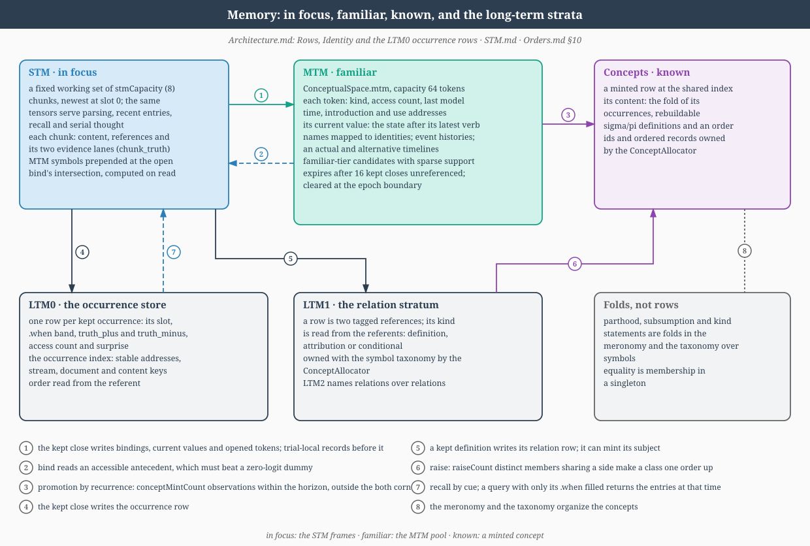

# Short-Term Memory

## Relation to LLMs, Formal Concept Analysis, and DisCoCat

STM is the local working set that replaces the anonymous residual-state view of
many LLM descriptions. It holds unquantized ideas while the parser decides which
typed DisCoCat-like reductions should apply. Those ideas are still grounded in
the Formal Concept Analysis side of the model: their slots point back to
part/whole support, concept order, and codebook rows rather than floating as
untyped context vectors.

## Overview

ConceptualSpace is an STM container plus a grammatical CPU; it owns no atomic
forward fold (see [Spaces.md](Spaces.md#shorttermmemory)). The **short-term
memory (STM)** is the structure CS manages: a per-batch working set of
unquantized CS "ideas" that the model accumulates across a sentence and
reduces at the sentence boundary. This chapter is the single reference for
what the STM is, how it fills, what reads it, and how its end-states chain
into long-term memory.



The stores are named by stratum (Alec, 2026-10-21). `LTM0` is the occurrence
store, one idea per entry; `LTM1` is its relation stratum, one pair of
references per row; and `LTM2` names relations over relations, an `LTM1` row
that references another row. `STM0` and `STM1` are their short-lived
counterparts, and MTM (`MediumTermMemory`) holds the identities in play
between working memory and the durable stores.

Two cadences write the STM, selected by `<serial>` (legacy configs derive
it from `symbolicOrder > 0`; see
[Architecture.md](Architecture.md)):

```
SERIAL    one idea per word (push)
PARALLEL  one whole-slab pass (set all slots)
```

The trainable target configuration is `MentalModel.xml`: serial,
`<data><dataType>embedding</dataType>`, `<attention>` unset (which resolves to
`"off"`; see [Section 4](#4-attentional-filtering)), sentence prediction on
and FineWeb data.

---

## 1. STM data model

`ShortTermMemory` ([Memory.py](../bin/Memory.py)) is a `Layer`
(not a `Space`): it carries no SubSpace and no forward / reverse
tensor-map contract. ConceptualSpace builds one at construction as
`self.stm` and treats it as the primary structure it manages.

**Capacity.** Default `8`, set via
`<ConceptualSpace><stmCapacity>N</stmCapacity></ConceptualSpace>`
(`DEFAULT_CAPACITY = 8`). Eight sits inside Miller's $7 \pm 2$ band, the
working-set size psycholinguistics ascribes to human short-term memory. The
capacity is the number of chunks, fixed at construction. Compose reserves a
free slot through the online reduction deadline before the next push, and an
arrival when every chunk is on the stack raises instead of dropping a word;
only the physical shifter of the ungated serial path (Section 2) rolls,
dropping the oldest.

**Chunks.** The working set is `B x stmCapacity` chunks held in
the fourteen `STMChunks.FIELDS` tensors; the stack is metadata over chunks,
not a physical shift. A chunk holds a vector `[form | meaning]`, as an `LTM0`
idea does, with its order, grammar order, concept row and activation; two
tagged references `(tag, value)`, each `SYMBOL`, `IDENTITY_REF` (an MTM
identity), `ACTION` (a journal column of this reading), `RELATION` (an `LTM1`
handle) or `OCCURRENCE` (an `LTM0` address); the bound identity and its
timeline; its stack position ($-1$ off the stack); the tick of its last read;
its `.where` and `.when` bands; and its two truth lanes. An arrival takes a
free chunk, else the least recently read off-stack chunk, and refuses when
every chunk is on the stack. A chunk is read when it is a compose operand,
when a bind to it is kept, when its value is refreshed into the window and
when recall returns it; being offered in a menu is not a read, so attention
chooses what is read and recency what stays. The physical shifter
`_stm_shift_and_push` described below remains only on the ungated serial
path.

A reduce writes its result into the head operand's chunk and frees the
other. When both operands are resolved (a concept symbol, a bound identity
with a value, or a compressed chunk) the result keeps its value and no
references; otherwise it keeps `ACTION` references to the operands' journal
columns, which is where the close finds the chain (Section 10). A composed
chunk carries the identity of its head: a unary result its operand's, a
headed binary result its head side's, and a bind its selected token, else its
head's identity, else a fresh one. A determiner that opens an individual of
order one also takes a fresh identity, and a clause carries its subject's. A
headless binary result and a verb phrase carry no identity ($-1$): `refresh`
reads such a chunk's own value, `bind_menu` never offers it as an
antecedent, and it never inherits the left operand's identity
(`ChunkJournal.apply`).

At the kept close the sentence's top chunk stays off the stack as a recent
entry, with a reference to the entry just written and that entry's stamp
(`keep_close`); its other stacked chunks are freed. Recall loads a returned
entry into a chunk with its references, vector, truth pair and stored
`.when`, and returns its identities to MTM (`EntryRead.recall_chunks`). A
concept entering STM is stamped now; a recalled entry keeps its stored stamp.
Each path of a sentence owns its chunks until the paths are compared, and the
kept path's chunks are what the close writes.

**MTM in the compose window.** MTM's accessible identities and candidates are
prepended to the symbol array that conceptual space reads, ahead of the
words, up to `mtmPrepend` entries fixed at construction and ordered by each
token's latest event, so identities and recalled chains lead the compose
window at every order (`PrependedSymbols.stage`). An unpromoted token's entry
carries a transient id from MTM's preallocated pool (`nVectors + i` for pool
seat $i$, taken when the token opens and released when it expires or is
promoted) and has no codebook row; a promoted token's entry carries its
symbol and row. The entry's form is its name's form, or the centroid of its
mentions' forms, and its meaning is the token's current value. A token with
an alternative timeline has a second entry carrying that timeline's value,
and a modal continuation binds to it explicitly. Each entry is deposited as
an off-stack chunk. `bind` is a binary compose operation (`BindLayer`): its
left operand is the mention on the stack and its right an off-stack identity
chunk, offered once per such chunk beside a dummy that keeps the mention's
own content (`bind_menu`), at any order. It returns the identity's current
value, and the kept close applies the kept binds to MTM once. `bind` is the
only binder: a determiner is a cue input to it, and its content test is
containment, not distance
([Mereology](Mereology.md#asserted-and-geometric-parthood)).

**MTM's life.** An MTM token, an identity or a candidate, expires when more
than `mtmHorizon` kept closes (16 by default) have passed in its stream since
its last reference, and at `mtmCapacity` (64 by default) the token with the
oldest access is evicted; neither changes an LTM row. The end of a document
leaves MTM as it is, and the epoch boundary returns it to its state at the
epoch's start. A token also records whether its name is resolved: a name read
with no antecedent opens a pending token, and a kind, a merge with a resolved
token or promotion resolves it, while a verb phrase that updates the token's
value does not.

**Buffer.** The data is a single per-batch tensor
`[B, cap, concept_dim]` plus a `[B]` long depth-pointer vector recording
how many slots each row has filled (saturating at `cap`). STM contents are
runtime working state, not learned weights. `concept_dim` is the full CS output
width reserved for the event payload; positional/temporal columns are preserved
when a config gives CS nonzero `nWhere` / `nWhen`. Each entry is thus one wide
concept vector, the full concept-space width of the composed value, held
beside the symbol activation field (Alec, 2026-10-20). The open sentence's
temporary identity is that vector, computed in STM and open to
reinterpretation; what persists is what the kept close writes. The
intersection that `bind` needs is computed on read, never stored.

**Spatial index (Alec, 2026-10-09).** The current conceptual eight-space
has its own range in the model's shared `.where` allocation.
`ConceptualSpace.where` exposes the slots' sinusoidal indices, using the
same encoding as the perceptual codebooks. A slot keeps its location when
ideas are pushed, reduced or cleared. The content's codebook address stays
separate. The kept close writes the sentence's semantic content to LTM,
with its episodic entry beside it (Section 10). A read places only its focus;
the earlier placements stay as the occupied slots with their `.where`/`.when`
stamps, and the read's mask is its candidate's support (below).

**Candidate support (2026-10-09).** Attention is a mask, not a
derivation: an item is admitted or not, and the derivation it feeds is
committed hard. Structural relations are exact masks that need no learning
(in this word, sentence or document by the address bands; recency on
`.when`; distance on `.where`); only relevance is learned. `CandidateAttention`
is the relevance scorer: one shared MLP (`Linear`, `Tanh` and a
zero-initialized readout, the additive form of Bahdanau attention) gives one
score per unread supported candidate, from a detached context that
`ModelCandidateAttention.context` assembles: the located activation after
spreading (activation times priming heat) and the heat itself, each item's
first and last time, the expectation prime and the percept expectation
residual, the part and whole keys, the occupied STM slots with their places,
times, salience and read stamps, and the needs (the open reference's query,
or the part a lesson names, and the gist). One hard choice supplies one word
read and one grammar step, and no pathwise derivative is fabricated through
it. The whole-path comparison credits the choice (attention is one of the
walks a path can depart in), and a part lesson that names the part to read
trains the scorer by cross-entropy.

The candidate's native paired evidence is its support mask, including
negative evidence; zero means no evidence, and `hetTolerance` acts on these
lanes, with 1 a no-op. An attended object appears as the negation of the
non-object: it has positive and negative evidence over parts and wholes, and
the parts that are evidence neither way are zeroed. So every concept or
conceptual candidate already has a mask, where it has no support, and the
mask is derived, not learned as a boundary. A learned region boundary cannot
be trained: a straight-through surrogate cannot see the read it did not
make, so its gradient pushes an admitted item further in and an excluded one
further out, and learned regions saturate open or collapse to nothing. With
the support mask the only gradient is the evidence lanes' ordinary gradient,
and an unsupported part gains support only as a candidate's lanes learn it.

During a sentence, `SentenceField` carries source-support indices beside
the eight STM slots: pushes move the previous placements, unary operations
retain their witnesses, and binary operations join their witnesses. The
indices refer to the sentence's native evidence bank and its original
`.where`/`.when` stamps. The scorer reads these stamps and all occupied
slots; it never places the earlier reads again. The field has its own
allowance and charges one `serial-word-loop` unit per read.

**`ShortTermMemory` owns its live buffers.** The idea stack is not proxied
off `SymbolSubSpace`. Each chunk field is a plain (non-`nn.Module`-buffer)
attribute `_live_<field>`, set with `object.__setattr__` so STM state stays
out of the traced graph's inputs; `_buffer`, `_depth` and the other fields
are views of them. `capacity` and `concept_dim` read an attached
`SymbolSubSpace`'s `_idea_capacity` / `_stm_payload_dim`, which must equal the
construction (`attach_word_subspace` raises otherwise), and nothing resizes
after construction. There is a single live store regardless of attachment.

**API.** Idea stack: `push(b, idea)`, `pop(b)`, `peek(b, n=0)`
(`peek(b, 0)` = most recent), `snapshot(detach=False)`, `size(b)`,
`is_full(b)`, `is_empty(b)`, `clear(b=None, hard=True)`,
`ensure_batch(batch)`, and `ensure_capacity(capacity)`, which refuses any
capacity beyond the construction. Batch push primitives (masked / whole-slab
writers used by the per-word and parallel forwards): `push_step(ideas)`,
`push_step_masked(ideas, gate_b_1)`, `push_window_batch(ideas)`. The
functional chunk operations (`deposit`, `apply_choice`, `keep_close`,
`refresh`, `bind_menu`, `locate`) live on `STMChunks`. The signal router
consumes `stm.snapshot()` as its slab input.

**Lifecycle.** At a sentence or document reset ConceptualSpace clears STM
softly: the unfinished sentence's stacked operands go, and recalled
identities and kept sentence entries stay off the stack until recency evicts
them (`STMChunks.soft_reset_rows`). The epoch reset clears STM hard, freeing
every chunk and expiring the thought stores (see "Memory module and thought
stamps" below and [Spaces.md](Spaces.md#reset-cascade-hard-vs-soft)).

---

## 2. Serial sequencing

In SERIAL / GRAMMATICAL mode each word traverses a per-word path: surface
lookup $\to$ `PartSpace.forward` (the synthesis front end; a word's code is
the max of its constituents' codes) $\to$ `ConceptualSpace.forward`, which
does the STM bookkeeping ([Spaces.py](../bin/Spaces.py)):

1. **Perceive (overwrite via `_stm_shift_and_push`).**
   `_stm_shift_and_push(idea)` ([Spaces.py](../bin/Spaces.py)) is
   the perceive step. At capacity, slots $0\ldots(\text{cap}-2)$ shift
   into $1\ldots(\text{cap}-1)$ and the new idea lands in slot $0$ (the
   newest slot); the oldest idea (the last slot $\text{cap}-1$) falls off.
   Below capacity it is a plain push: shift the occupants right and write
   slot $0$. Under `<serialObjectMeta>` (default off), `p` indexes the
   independent sentence-word slab. Inside that iteration PartSpace gathers
   **all** of word $p$'s radix/chunk constituents and takes the max of their
   codes (`synthesize_word_parts`); the batch-padded raw width may exceed the
   eight-wide PS field. The live PS and WS readings bind strictly by
   location; the resulting concept records its actual subsymbolic order and
   full ordered support. Its current-word location is selected for
   `stm.push_step_masked(idea_bd, commit_b_1, orders=..., grammar_orders=...)`,
   which commits once using the word-active column
   `inputSpace._word_last_slot_mask[:, p:p+1]`
   (`BasicModel._per_word_body_step`, [Models.py](../bin/Models.py)). The local
   raw staging resets for word $p+1$; it is not an STM or PS-capacity axis.
   Flag off (or a legacy input without the word-loop tensors) falls
   back to the original per-slot path.
2. **Language dispatch.** The signal router dispatches grammar ops over
   the STM contents (read-only via CS, write-required via SS).
3. **One operation per round.** `LanguageSpace.choose_operation` presents
   the newest two occupied slots to the shared `OperationSelectionLayer`.
   Binary candidates and unary candidates at both positions compete in one
   softmax. Three fixed rounds follow each word, with early STOP; the sentence
   closing runs up to twice capacity. A binary choice removes one slot, while a
   unary choice changes its selected slot without changing occupancy. STOP is
   forbidden until the complete STM fits the sentence's allowance (one slot
   for an absolute sentence, three for a relative one; Section 9) and the
   phase allowance; online rounds allow `K - 1` occupied slots, which reserves
   the next word's slot. A binary-logit prior grows with whole-STM occupancy
   and with the reductions still required per remaining round,
   $p = g\,(d/a + r/n)$ for depth $d$, allowance $a$, required reductions
   $r = \max(d - a, 0)$ and remaining rounds $n$. Its gain $g$ is a learned
   parameter of the compose chooser (`reduce_pressure`, initialized from
   `reducePressure`, default 1), so a grammar lesson can weaken or strengthen
   the preference to fold; the formula and the deadline masks are fixed. When
   remaining rounds equal required reductions, unary and STOP candidates are
   masked. An initially infeasible budget may still leave an incomplete
   sentence; an attempted push into a full stack is an assertion failure. The
   chooser and its training are in
   [Language](Language.md#one-operation-per-round), and the whole
   paths a sentence is read along in
   [Architecture](Architecture.md#whole-paths-and-concept-episodes-2026-11-11).

> **Convention pin — newest-at-slot-0, shift-RIGHT.** The **free / newest**
> slot is **slot $0$** and the rolling window shifts **right**, dropping
> the oldest (the last occupied slot, $\text{cap}-1$ at capacity).
> `peek(n)` counts $n$ back from the newest, so it reads slot $n$
> directly; `snapshot()` returns the live slab **newest-first**.
> `_stm_shift_and_push` shifts right and writes in one pass; the named
> primitive `_stm_shift_for_predict` ([Spaces.py](../bin/Spaces.py)), which
> only frees slot $0$, stays off the forward path for unit tests, since a
> separate physical shift would double-shift the buffer.
>
> A binary fold reads the two newest stack entries as `(left, right)`: left
> is the older, right the newest, and the recorded operand rows follow that
> order. A composite entry, the result of a fold, carries concept row $-1$;
> concept rows live at the leaves, and the structure above them lives in the
> reading's derivation record, which exists only while the sentence is read.

---

## 3. Parallel sequencing

In PARALLEL mode the per-stage forward sees the whole sentence at once:
the slab `[B, N, D]` **is** the STM, each of the $N$ positions its own
slot. `ConceptualSpace.forward` writes it through the `folded.shape[1] > 1`
branch: `_stm_set_all_slots(slab)` ([Spaces.py](../bin/Spaces.py)) writes
all $N$ positions directly as the slot stack (no shift, no mean-reduction).
The slab is position-ordered (position $0$ oldest, $N-1$ newest); under the
newest-at-slot-0 convention it is **flipped** along the position axis so the
slab's newest lands at slot $0$. If $N >$ cap it keeps the last `cap`
positions (dropping the oldest, as the serial rolling window does) and then
flips; if $N <$ cap it zeroes the unfilled (older) tail so a prior pass's
state cannot leak through. Mean-reducing the slab to one idea would destroy
per-slot identity and make the reverse emit the same reconstruction in every
slot.

---

## 4. Attentional filtering

Serial sequencing and attentional filtering are the same regime, not
mutually exclusive options: `<attention>` (off/primer/second-order/low-rank,
read per Space with default `off`) composes with `<symbolicOrder>` rather
than being gated by it. `data/MentalModel.xml` sets no `<attention>` element,
so the trainable target configuration runs the Gaussian / word-span window
below (CS$\to$PS) and the taxonymic mask (CS$\to$SS), and no `<attention>`
primer/second-order/low-rank retrieval mode.

**CS$\to$PS word input.** The word-major radix path and legacy serial inputs use
different representations.

- **Word-loop mereology (`<serialObjectMeta>` on).** The outer sequence is
  `[B,W,D]`, with one position per word and $W$ bounded independently by
  `<serialWordCapacity>`. BasicModel stages W=256 but its compiled
  `torch.while_loop` stops at the final live column in the batch. InputSpace
  owns iteration $w$ and presents that word's local state to PartSpace; only
  then does PartSpace gather its complete discrete ids `[B,P_raw]` and take
  the max of their codes inside the loop. $P_raw$ is the longest complete spelling
  in the current batch; it is not bounded by `PartSpace.nOutput`. PS and WS
  retain their eight-wide live fields in BasicModel, CS binds all three PS and
  three WS folds by equal location, and one concept carrying its actual order
  enters the configured STM (default capacity 8). Grammar reductions free STM
  slots while the outer loop continues.

  With packed training, consecutive complete sentences share the W=256 slab
  but not conceptual state: CSLang commits a row-local soft boundary between
  them. Full resolved concepts remain only in the CS-owned `[B,8,D_c]` STM.
  SymbolSpace receives a scalar `[B,W,1]` activation/reference slab and
  quantizes that value; it does not retain a dense `[B,W,D_c]` concept
  history.

Legacy serial inputs retain the following window policies:

- **Gaussian window (default).** `gaussian_window_word(full_seq,
  center_k)` ([Models.py](../bin/Models.py)) forms a single envelope
  centred on the processed word at $k$:

  $$
  w_i = \exp\!\left(-\frac{(i - k)^2}{2\sigma^2}\right), \qquad
  \sigma = \text{maskRate} \cdot T,
  $$

  normalized so the center weight $w_k \approx 1$. The peak sits at the
  current word; words far from $k$ are attenuated toward $0$ by the
  Gaussian tail. The windowed percepts are mapped into conceptual space
  and **summed**, so word $k$'s representation carries a faint meronymic
  trace of its neighbours (the local context *is* part of the embedding
  signal). This **replaces** the prior BERT-style hide-a-token
  `create_ir_mask` on the per-word grammar path; it is not
  target-hiding — the center word is preserved. The centring is
  **hardcoded**: peak at the current word.
- **`word_span_window` (legacy hard same-word fallback).**
  `word_span_window(full_seq, center_k, word_idx)`
  ([Models.py](../bin/Models.py)) replaces the soft Gaussian tail with a
  **hard** same-word mask: the masked **sum** over exactly the slots
  sharing word $k$'s id (`word_idx == word_idx[:, k]`), so PS processes
  the active word's own span only — no part of a neighbouring word leaks
  in via the tail. Falls back to the single slot `full_seq[:, k:k+1, :]`
  when no per-slot word index is available (e.g. byte mode). Whole-
  sentence context still re-enters serial processing via the read prelude
  gist/intent, not this window.

**CS$\to$SS taxonymic mask.** On the symbolic side the inverse
recommender zeros **non-admissible** codebook rows before a lift / lower
(union / intersection) reduction so an operand can only resolve to a row
of the right grammar category and conceptual order. The admissible row
set is built by `priming_kwargs_for_slots`
([Language.py](../bin/Language.py)) — intersecting `refs_by_category`
with `refs_by_order` per slot — and applied in the recommender's
`_row_mask` closure ([Layers.py](../bin/Layers.py), nested in
`Ops._binary_op_recommend`), which admits only the category/order-matched
rows plus the $\bot$ / $\top$ sentinels. A parallel `_row_weights` closure
multiplies a taxonymic **priming** mask over the admitted rows (the
`left_priming` / `right_priming` weights from `taxonomy.priming_mask`).

**Guidance-signal contract.** The mask is a *guidance signal*: it biases
which codebook rows / sequence positions the reduction may consult, given
the current word and grammar state. The centring policy (CS$\to$PS) is the
swappable seam — the present text-reading variant centres on the current
word; a future image-reading variant would swap that policy (centre on a
fixated region) without changing the rest of the pipeline.

**Hardcoded masks.** Both masks are **hardcoded** (Gaussian centring fixed
at the current word; taxonymic admissibility read structurally from the
codebook's category / order metadata). The learned part of attention is the
candidate relevance scorer over supported candidates (Section 1).

---

## 5. Routing parser: SS-analysis vs CS-execution {#routing-parser}

The grammar runs through the signal router (`LanguageLayer`,
[Language.py](../bin/Language.py)); `SymbolSubSpace` owns it as
`self.languageLayer`. Conceptually the work splits in two:

- **SS-analysis** — `SymbolSubSpace.compose`
  ([Language.py](../bin/Language.py)) is the analysis stage: a soft
  superposition over the taxonymic codebook that selects, per-space, a
  **hard rule dict** `current_rules = {space_role: list[list[int]]}` — an
  outer per-space_role entry holding one inner rule-id list **per batch
  row** on the full-router path, or a single batch-shared inner list on
  the default-only path (`_default_compose_rules`, `_flatten_selected_rules`
  tolerate both shapes, plus the legacy flat `list[int]` per-space_role
  form). It chooses *which* reductions fire.
- **CS-execution** — actually applying the chosen reductions (lift,
  lower, union, intersection, swap, quantize, not) to the concept tensors
  runs CS-side in `ConceptualSpace.forward` and the WholeSpace
  stack-route path, with the per-space `SyntacticLayer` cursors
  ([Language.py](../bin/Language.py)) executing the unary $\pi$ /
  $\sigma$ folds on reverse. Only lift / lower / union / intersection
  consult the codebook (inverse-recommended); swap / quantize / not are
  tensor-only.

> **The split is a clean code boundary only on the default-only path.**
> When the grammar is *default-only* (every rule is
> the unary $\pi$ / $\sigma$ fold), `compose` emits `current_rules` from
> the grammar XML and runs **no** tensor reduction, and the per-space
> `SyntacticLayer.forward` / `reverse` cursors do the CS-side execution,
> a clean analysis/execution separation. On the **full-router**
> path, however, `LanguageLayer.compose` does **both**: it selects the
> rules *and* folds the slab tensorially through the op modules
> (`OperationSelectionLayer.forward` $\to$ `op(left, right)`),
> caching the root state. The per-space `SyntacticLayer` cursors are then
> **deliberately bypassed** on that path, guarded by
> `not _grammar_is_default_only`
> ([Language.py](../bin/Language.py), the `SyntacticLayer.forward`/
> `.reverse` guard), so that the reduction is
> not double-applied. In the full-router case the SS-analysis and
> CS-execution stages are therefore **co-located** inside
> `LanguageLayer.compose` rather than separated across modules.

`_grammar_is_default_only` is computed from the configured grammar at
`SymbolSubSpace.__init__` ([Language.py](../bin/Language.py)) and gates
both `compose` and `generate`.

---

## 7. Per-word router firing

The `<routerWireSerial>` knob ([model.xsd](../data/model.xsd)) gates
when the router fires on the serial path:

| Value | Behaviour |
|---|---|
| `per-word` | fire per word; boundary fire off |
| `boundary` | fire only at the sentence boundary |
| `both` | **(default)** per-word AND boundary both fire |
| `off` | neither fires |

The **per-word fire** is the C stage of the peer pipeline:
`LanguageSpace.compose` runs over the B-stage STM snapshot and its timestamped
result becomes visible to B two symbolic indices later. On the normal MPS
fullgraph it is part of the tensor `while_loop` and the serial grammar route
remains capture-clean. With `BASICMODEL_MPS_WORD_LOOP_FULLGRAPH=0`, the same C
stage runs in the static host scheduler. The **boundary fire**
(`BasicModel._chart_compose_at_C`, [Models.py](../bin/Models.py)) runs
iff `router_wire_serial in ('boundary', 'both')`.

---

## 8. Masked-word reconstruction via priming

Masked words enter the pipeline as **all-zeros** percept slots. On
reverse, the router fills the blank via a best-fit codebook walk biased
by the taxonymic prior, POS selection, and accumulated prediction — it
reconstructs the most plausible word for the slot given the grammar
context and the codebook geometry.

**Priming machinery.** The bias enters through `left_priming` /
`right_priming` in `Basis.lift` / `Basis.lower`
([Spaces.py](../bin/Spaces.py)), forwarded down to the inverse
recommender's `_row_weights` closure ([Layers.py](../bin/Layers.py),
nested in `Ops._binary_op_recommend`) where
each admitted codebook row is scaled by its taxonymic priming weight (the
$\bot$ / $\top$ sentinels pinned to $1.0$). Primed rows are preferred in
the argmax that selects the operand. `test/test_primed_reverse_hard_mask.py`
exercises this path.

**Tests.** The reverse roundtrip and reconstruction tests are
`test/test_stm_reverse_roundtrip_lift_lower.py`,
`test/test_stm_reverse_roundtrip_union_intersection.py`, and
`test/test_stm_recon_from_cleared_cache.py`.

---

## 9. Relative vs absolute end-states

An absolute sentence ends in one working slot: its verb phrase applied to its
subject fuses into one idea point. A generic subject or an operand that
references a relation makes the clause relative: it ends in three slots,
`[left, predicate, right]`, with native references and no fused point, and
the stack holds them newest-first as `[right, left, predicate]`
(`sentence_row_slots`). STOP becomes eligible only when the stack fits this
allowance; the close then compresses the kept reading into memory (Section
10). `NP -> S` keeps an embedded absolute point; `NP -> REF(S)` carries a
relative clause by reference. Each path's clause journal records these
endings, and its references stay local to the path until the paths are
compared. The close registers children before the entry that encloses them,
and registration gives embedded content no assertion authority. An absolute
enclosing clause can fuse only when all its operands have points: a relation is
a constraint between entries, not a region, so a point fused over a relation
reference would differ from its neighbours only by an arbitrary row code, and
coverage over it would measure nothing. Relativity therefore propagates upward.
A bare noun phrase is an idea whose implicit verb phrase is *occurs*.

The operation budget of Section 2 bounds the close:
`_stm_reduce_to_single_S` runs at most $2K$ closing rounds for STM capacity
$K$, capped by a positive `syntacticOrder`. The default budget completes the
reduction. A manually undersized cap can still leave an incomplete forest,
which is tagged incomplete and cannot publish a program or a memory entry.

At the close each entry keeps two independent evidence poles, `truth_plus`
and `truth_minus`, so both and neither stay distinct; they record
identification evidence. A source's trust
is not stored: it scales the pair when the entry is written, and sentence
content never selects its own trust. Luminosity reads idea entries only. See
[Reasoning](Reasoning.md) for the relation readers and the declared `true`
thought operator.

---

## 10. LTM as the chain of STM end-states

`symbolSpace.ltm_store` is the one `LTM0` for all completed clauses, and its
relation stratum `LTM1` is `ltm_store.parts`; there is no alternative backing
store. Storage alone does not certify that a described referent exists, and
production observations must provide their owned end state.
[Clause admission](../bin/ClauseRow.py),
[observation writer](../bin/Models.py).

STM and LTM differ in form and in life: STM is position-addressed, live to the
gradient and displaced by what arrives next; LTM is content-addressed,
detached and forgotten by value. In use they are one chain: a recalled entry
lives in STM while it is active, working memory being the activated part of
long-term memory, and the kept close is the one writer from STM to LTM. A
composed idea enters LTM when its sentence ends; what was merely held is not
stored. Whether an entry stays is decided by its value, its surprise
included, so encoding is broad, retention selective, and there is no separate
admission gate (Craik and Lockhart 1972; Cowan 2001).

**Layout.** An `LTM0` entry is one idea: one paired vector `[form | meaning]`
in `slots[capacity, nDim]`, with its `truth_plus` and `truth_minus` lanes,
access count and `surprise`. The form block is the entry's percept part,
whose last four coordinates hold the model-time stamp; there is no separate
`when` column, no role table, no stored order (an entry's order is read from
its referents' recorded orders) and no stored derivation. Each field has its
reason: the stamp says when the occurrence was written, the lanes are the
entry's truth, the access count records exposure (definedness and forgetting
read it), and `surprise`, the residual at the moment of writing, is read by
retention and cannot be recomputed later. Stable addresses, stream membership
and the document and content keys are kept in the occurrence index beside the
entries (`LTM0.addressing`), not in them. Semantic
bindings keep only what is not structure: a question's open slots, bound
references, scope, source text and expectation provenance. An entry's kind
(fact, observation, question, estimate, inference, cover, episode or
unverified) is read from those bindings, its document and its lanes
(`LTM0.kind_of`), not stored. An `LTM1` row is two tagged references,
`refs[capacity, 2]` with `ref_kinds[capacity, 2]`: `OCCURRENCE` (an `LTM0`
address), `SYMBOL` (a concept or word) or `RELATION` (another `LTM1` row); a
zero tag marks an empty seat. The tags, never the integers' magnitudes,
decide traversal. A row has its own lanes, access count and surprise, and a
percept of only the `.where` and `.when` bands. It stores no type and no
composed value: if-then and temporal chaining, whole-part, definition and
type-token are told apart by what the references are, their tags and their
situations (`.when`, `.where`, symbol; `LTM1.readings`). The operator
reference and operation seat beside a row serve its authority, not its type.
A row that references a row is read as `LTM2` (`LTM1.stratum`). `LTM1` has no
polarity column, so trust-derived evidence on a negative statement is written
with its two poles exchanged.

**Compression at the close** (`ClauseRows.write_clause`). The kept reading is
walked from its leaves. A composition whose operands are all resolved (a
concept, a bound identity with a value, or an already compressed child)
compresses to one `LTM0` idea, its value. A composition with an unresolved
operand (a pending name, an unknown word standing for itself, an open slot)
is written as an `LTM1` row over its operands' entries, and the operation's
own value is stored nowhere. So a sentence whose words are all known concepts
becomes one idea, its verb phrase applied to its subject, and writes no
relation; a sentence that cannot compress is a chain whose top row is the
sentence, a verb and its object composing into a verb, so "he said she said
x" with x unknown is `(OCC he, REL (SYM said, REL (OCC she, REL (SYM said, OCC x))))`.
There is no separate sentence row. Parse-only operations (surface markers,
determiners that only select, order operations) never become rows: a chain
row's operands are the semantic operands. A directly asserted part, whole,
implication or equality pair stays an `LTM1` relation even when both sides
are known. A compressed idea keeps, in its bindings, the identity it was
composed over, as a chain keeps its occurrence reference. A chain whose
unknowns later resolve is not rewritten: thought writes the value to MTM and,
when kept, an inference idea. Reading an entry into words generates from its
vector and the current grammar; a sentence's structure is reconstructed from
its vector, inexactly.

References name whole entries, never a part of one, and only entries written
earlier (or planned earlier in the same close), so the reference graph is
acyclic: a self or later reference fails, and protection from forgetting is
transitive. An occurrence handle is an address, not an identity: identity,
and a mention's reading as a name/value pair, live in MTM. Several references
may tie to one identity and share its value without unfolding into one
another, so a relation may refer to itself through a shared identity while
the references between stored entries stay acyclic; readers stop at a
repeated occurrence, and neither a cycle nor a binding grants evidence.
Admission
preflights clause dependencies and native concept capacity: an insufficient
store raises before publishing a child prefix, re-witnessing an existing
address remains possible, and nested readings and expectation pairs reserve
their complete transaction. Embedded clauses register without assertion.
External TruthSet admission can assert the outer entry through provenance,
while a conversation observation, question or estimate cannot certify its own
referents.

**Time.** A stamp is the clock of the occurrence it records. A concept
carries no clock, so a particular event is a concept with few occurrences,
and a question about *when* reads its occurrences' stamps. The stamp sits at
the sentence level only. The entry that is the
sentence, the idea it compresses to or its chain's top row, carries the
sentence's tick of model time, as do the idea that holds an event's compacted
state beside its chain and an episode anchor; inner chain rows, mentions and
definition rows written by `Interpret.define` carry a zero time band, and
their time is their sentence's, reached by reference. An identity's event history is ordered by
its sentences' stamps, and forgetting's age reads the sentence's stamp for
what the sentence references. A recall by time returns sentence entries
(`EntryRead.recall_time`, which skips covers and estimates), and their chains
and mentions follow from them.

**Re-witnessing.** An `LTM0` write is addressed by its document, position and
content key (`Occurrence._address_for_write`). A second reading of the same
source within one presentation finds that entry instead of appending: it
replaces the content, joins each evidence pole with the stored one by maximum
(the same evidence is not added twice), keeps the original stamp and
increments the access count, which is definedness growing with exposure.
Across training epochs this does not arise, because the epoch reset discards
the epoch's experience. A reasserted relation likewise joins its two poles by
maximum rather than appending a duplicate claim.

**Retrieval.** There is no word index over memory. Retrieval by a word is
either a match by content or a lookup of the `LTM1` rows that reference the
word's symbol (`LTM1.rows_referencing(SYMBOL, word)`). A content read scores
one bounded window of `ltmWindow` candidates, the explicit references and the
rows referencing the cue's symbols first and then the newest entries; it
ranks by match, breaks ties by address, and skips estimates, covers, episode
anchors and questions without evidence (`EntryRead.cued_rows`).

**Streams and documents.** A stream is the batch row that wrote an entry, and
each `LTM0` entry records which streams witnessed it. A document is the cover
entry that starts it in a stream: an entry belongs to the document of the
latest cover before it in its stream (`DocumentCover.segments`), and a
document presented again reuses its cover's concept. A
stream's history is the entries it witnessed, in the store's own order,
oldest first (`stream_rows`); the legacy `get_stm_chain` adapter is a read
view of it that leaves out estimates and episode anchors, not a separate
writer. Entries written by another stream never become its predecessors, and
an internal thought or provisioned fact cannot become an external predecessor
through recency alone. Re-witnessing updates an entry in place and keeps its
position: an entry does not move to the front because it was read again.
Sentence expectation consumes its bounded stream and document view, including
owned references. [Prediction context](../bin/Layers.py),
[meaning roles](../bin/Meaning.py).

**Episodic entry.** Beside a sentence's entry sits its episodic entry: up to
`episodicConcepts` order-zero concepts of the sentence's open attention pass,
in reading order, each with one signed value (for minus against); when more
are present the largest magnitudes are kept, and zero readings are absent
(`episodic_concepts`, `episodic_values`). No place or pole pair is stored;
the entry's stamp supplies time. A close that writes only an `LTM1` relation
takes one `LTM0` entry of kind `episode` to hold the episodic entry (Alec,
2026-11-11: "An LTM0 anchor row"); the anchor has no content, and only recall
by time and review read it. Recall lays out the readings by their concepts'
owned surface lengths with one separator between; a missing surface gives an
empty extent and a stale concept id is skipped, each counted. Time-only recall
publishes the conceptual field directly and empties that stream's present
percept readings until the next open pass; other streams are unchanged.
`reverse` reads the episode without compose or generate. The review rebuilds
each reading's pole pair as $(\max(v, 0), \max(-v, 0))$ from its signed value
$v$, at the entry's stamp; the signed value belongs to these stored references
only, and the field and every entry's `truth_plus`/`truth_minus` stay a pair.
Only an input sentence writes an episodic entry, on its own row or its anchor,
never a thought's row; a stream with no nonzero reading writes nothing and
takes no anchor; a re-witness keeps the first entry, even an empty one; and
forgetting and the epoch reset carry the columns with their rows. The entry is
the reading of its moment, not perceptual memory: a percept that had no concept
when it was seen leaves nothing, where a word stood is not kept, and `reverse`
returns the percepts that the concepts' definitions give at the recall. See
[Architecture](Architecture.md#episodic-and-semantic-memory-in-the-two-systems-2026-11-11).

**Definitions.** `interpret` writes a new word's definition as one `LTM1` row
of two `SYMBOL` references, `(object, word)`, with no operation seat
(`Interpret.define`): a new word costs one inventory row, which becomes the
object's, and this one row. The definition carries a zero time band, is
eligible for forgetting, and takes neither provenance nor trust from the
sentence containing the word. Its two references name identities, never
content, so what a concept's code becomes in training cannot redirect a
definition, and they imply no order between word and object. A word with
several objects, or an object with several words, has one row per pair, and
reading a defined word again appends nothing. One derived index over these
rows (`Definitions.DefinitionIndex`) finds the word for a form or unit, a
word's objects and an object's words without scanning; appends update it, and
load and compaction rebuild it.

**Checkpoints.** Tensor columns ride `state_dict`; bindings, scope, source
text and expectation provenance ride the versioned semantic sidecar
(`LTM0.semantic_extras`, saved under `truth_semantics`). Restore validates the
addresses, the semantic fingerprints and the reference graph, and missing
required metadata makes evidence unavailable rather than silently rebinding
it. A sidecar carrying a derivation, a retired column, a capacity, stream or
percept layout other than the construction's, or an older layout schema
raises, so memories in an older layout are regenerated; schemas 14 and 15
load with empty episodic entries. [Checkpoint migration](../bin/Memory.py).

**Forgetting.** The forgetting pass (`Forgetting.forget`) runs after backward
at a document boundary, in training or after a stateful inference request,
and at the epoch boundary; it never runs inside an open sentence. It starts
when occupancy reaches `forgetHighWater` (90%) or an earlier pass fell short,
deletes down to `forgetLowWater` (70%), and runs at most once per
`forgetMinInterval` (256) sentences; there is no free-standing age decay. An
entry's retention value is

$$V = w_t T + w_u U + w_l L - w_a A,$$

each term in $[0, 1]$ so the weights are comparable (`retention_values`). $T$
is the larger stored evidence pole, $\max(t^+, t^-)$; there is no separate
trust column. $U$ is the expectation surprise recorded when the entry was
observed, an unrecorded surprise counting as 1, so a well-expected sentence,
deducible from its context, is worth less; no deducibility search runs. $L$ is 0 when a live
entry of the same order and scope, with cosine above `forgetSimilarity`,
carries the contrary single pole with more trust, and 1 otherwise; an entry's
intrinsic both is heterogeneous content, not a disagreement. With
`forgetCoverage` on, $L$ is instead the entry's leave-one-out contribution to
positive catuskoti coverage. $A = 1 - e^{-a/h}$, where $a$ is the model-time
ticks since the entry's stamp (`history_age`; an unstamped entry takes the
youngest stamp of the sentences that reference it) and $h$ is
`forgetHalfLife`; a read does not refresh it. Entries go lowest value first,
ties to the older entry and then the stable address, so the same state always
deletes the same entries. Value, not isolation, decides: an isolated entry may
be worth keeping, and a well-integrated one may be what its context already
predicts. Forgetting never merges near-duplicate entries; an entry loses only
its own detail, its wording, before it goes.

Protected origins (`forgetProtectOrigins`), live thought and expectation
roots, the entries that `LTM1` rows reference, and everything those reach
are kept. Wording goes before structure: under pressure an unprotected entry
first loses its source text, and each entry advances at most one stage per
pass. A referenced entry is never deleted: selecting it advances its owners'
detail and ends the pass. Deleted entries are compacted out of the
fixed-capacity store rather than left as dead slots behind a live mask
(`LTM0.compact_rows`): every reference already holds an entry's stable
`address_keys` value, so compaction gathers the survivors in store order and
rebuilds the address index, and no reader needs a live mask. Compaction also
unlinks removed expectation endpoints and retracts taxonomy edges supported
only by deleted testimony; predictor tensors are unchanged. The relation
stratum has its own pass (`forget_parts`) at the same boundary with the same
thresholds: a row is valued by its larger pole, its surprise, the log of its
access count (weighted by `forgetLuminosityWeight`) and the same age penalty,
and rows that other relations reference are kept.

The pass reports its cut-off, deletions by origin, the wording count and
whether the target was reached, and its counters round-trip with tensor
state. Protected roots or gradual detail loss can keep it from reaching the
target, and a long document can fill the store before its boundary; both stay
visible rather than bypassing protections.

Concept reclamation is separate: at maximum preallocation, after all streams
close, erase unreferenced exact redundancies, smallest meaning first,
while retaining a representative. Unused mints with no definition, reference,
posting or sparse placement can also be reclaimed, without requiring them
to match each other. Smallness cannot erase a referenced or defined concept,
and a document's cover concept is never reclaimed.
Distinct individuals are not merged by
matching descriptions. Unreferenced zero-relevance identity/change columns can
also be pruned. A freed physical seat receives a fresh monotonic identity and
cleared moments; no retired handle can denote its replacement.

Storage does not establish existence. `Exist` compares the full occupied
description, bindings, scope and references against assertive fact records;
conversation observations, questions, estimates and unverified rows are
ineligible, and model activation alone cannot establish a degree. See
[Existence evidence](ExistenceEvidence.md).

---
## 11. Inter-sentence prediction

The sentence predictor is the shared `ActivationPredictor` of
`SymbolExpectation`. Before a sentence closes it predicts independent
for/against activations over the native symbol bank from the stream's recent
entries and the open situation: live constituents, recent clause frames and
frames brought into STM by `what`. A frame carries one point, an idea's
vector or the head of a sentence stored as a relation chain
(`SituationFrame.from_row`); the stored row keeps both tagged endpoints for a
relational read. The close it predicts is its target, and
the estimate and observation it leaves in `LTM0` are described in
[Expectation across the architecture](ExpectationRetention.md#one-pair-one-observation).
The predictor carries an imputed identity; composition does not search LTM
for one. Clearing the situation removes that cross-sentence carrier. Word
provenance remains the current sentence's own reconstruction record when its
subject refers to an earlier occurrence.

## 13. Interaction LTM and the What stack

Beside the chain of STM end-states (Section 10), `WhatInteractionMemory`
keeps a per-row chronological sequence of **interaction slots** for the What
loop.
Each slot (`What.LTMSlot`) has two independently optional halves:

| Slot | Operation | Stack effect |
|---|---|---|
| `(input, —)` | OPEN | pushes an unanswered question |
| `(input, output)` | COMPLETE | no change |
| `(—, output)` | CLOSE | pops the most recent unanswered input (LIFO) |

The stack is the *imbalance* of the sequence: **parity** means no unmatched
input-only slot. There is no frame object and no in-place edit of an
opening slot; a later output-only slot closes it. The API on the layer
(`bin/Layers.py`):

- `append_what_slot(slot, b)` — validates (an empty slot and an unmatched
  close are rejected; closure pressure must not decrease while questions
  are open), detaches both halves from the live graph, appends the
  chronological record with its grammar trace, and trims only *balanced*
  prefixes when `ltmCapacity` is exceeded (an open question is never
  evicted).
- `get_what_slots` / `open_what_slots` / `what_open_depth` /
  `what_at_parity` — read-only views, oldest first.
- `what_context(question, b)` — the target-free chooser context: the
  question's coordinates, the input / output presence masks and
  representations, the open depth, parity, and the current closure
  pressure. `Model._what_grammar_context` folds it into the 29-dim vector
  the grammar chooser's `what_projection` consumes.
- Row hard resets clear the row's slots and its pressure; soft resets do
  not.

The output half always records the response the model actually produced,
never the desired `Data` answer.

SymbolSpace always owns exactly one `Layers.WhatInteractionMemory`, available
as `SymbolSubSpace.what_memory`. `Model._what_memory()` returns this owner.
Expectation has no interaction-memory copy or delegate API. Provisioning
resets the What episode at its hard interaction boundary; suspending external
expectation does not preserve that episode. The **episode credit boundary**
is explicit: an episode ends with `end_what_episode(b, detach=True)`; under
`<whatThinkingDetach>episode` the values appended inside an episode stay
live on the autograd graph until `end` (called after the optimizer step),
so a root answer loss can reach states created at earlier iterations;
under the default `slot` every value is detached at append. `what_context()`
also exposes `open_question` (the newest unanswered input) and
`latest_output` for the resolve step.

`Model.think` understands once and resolves through the ordinary thought
controller, which records its nested questions and typed returns on this
same memory as levelled thought records (see "Thought and query reads"
below); a row whose history that controller owns appends no What slot. The
slot rules above still govern the What records: append-only, an opening
never edited, and an output that is the model's own.

---

## See also

- [Spaces.md](Spaces.md): ConceptualSpace as STM container; the
  `ShortTermMemory` API; Sigma / Pi ownership.
- [Architecture.md](Architecture.md): modes of operation (serial /
  parallel); the per-word operational flow; whole paths.
- [Language.md](Language.md): the signal router, `compose` / `generate`,
  GrammarLayer reductions.
- [Mereology.md](Mereology.md): parthood as clipped-cosine projection;
  the relations the relative predicates draw on.
- [Reasoning.md](Reasoning.md), [Logic.md](Logic.md): the truth surfaces
  and tetralemma trust.
- [ExpectationRetention.md](ExpectationRetention.md): the sentence
  predictor and the estimate/observation pair.
- [Params.md](Params.md): `<stmCapacity>`, `<mtmPrepend>`,
  `<routerWireSerial>`, `<ltmCapacity>`, `<episodicConcepts>` and the
  forgetting settings.

## Slot provenance for the fold ladder

Beside its chunks, the STM keeps one fixed-shape provenance slab
`_wholes` `[B, capacity, 3]` of longs, newest at slot 0 like the buffer:
per slot the index of the coarser analysis whole (the word) the unit
belongs to, the unit's loop position and the clause whole's index; `-1`
means none (a fold across wholes has no whole and is no single unit).
The slab is CS-owned sentence state exactly like the reference slabs: the
compiled word loop carries it through `torch.while_loop` beside the STM
chunk tensors (fullgraph), and the only mutation paths are the pure
primitives `ShortTermMemory.functional_wholes_push` (masked slot-0 push),
`functional_wholes_reduce` (a top-2 fold keeps a whole or clause only when
both operands shared it) and `functional_wholes_reset` (a sentence
boundary); the eager methods `note_whole_masked`, `note_reduce_wholes`
and `same_whole_rows` wrap them.  `same_whole` / `shared_whole` /
`newest_units` are the tensor reads.

The reduce step (eager and compiled alike) turns the slab into the
grammar's `chunk` licensing: `_chunk_structural_prior` is a `[B, 1, R]`
additive logit, the learned `chunk_prior` on a pair the tiling places in
one whole (word or clause) and `-1e4` elsewhere, handed to the Language
chooser as `op_prior`.  After the fold, `_chunk_reduce_provenance`
appends a chosen chunk of two units with concept ids to the
ConceptualSpace's fixed proposal slab (`[B, 32, 3]` plus a count, also
loop-carried), looks the pair up in the admitted phrase-row table
(`chunk_row_table`, `[64, 3]`) and, when admitted, references the phrase's
row at the folded slot (`apply_phrase_rows`). `ConceptualSpace.Reset`
drains the proposal slab into the host counts that admit phrases.

Committing live state under the compiler: every STM
property setter (`_buffer`, `_depth`, the order and reference slabs,
`_wholes`) goes through `ShortTermMemory._assign_live`, which copies in
place when compiling and the shapes match. With a `torch.while_loop` in
the graph, dynamo (torch 2.14 nightly) drops a later attribute
*assignment* of an attribute assigned earlier in the same graph (the
per-forward seed in `_per_word_prelude`), so the sentence reduce and the
reconstruction loss after the word loop read the empty seed; an in-place
copy is tracked and keeps the gradient. Eager execution keeps the plain
assignment. Anything an eager consumer reads after a compiled call is an
explicit output of `_forward_with_compiled_sentence_state`, never an
attribute escape.

## Thought and query reads

What thought and the query operators read from these stores is specified in
their own documents; the memory side is this.

- The interaction memory admits ordinary `ThoughtRecord` values with explicit
  level and termination transitions beside the What slots, and the one
  thought controller records its nested questions and typed returns there.
  Its attended context uses row-owned STM and history, the recent discourse
  chain and frames brought into STM by cued `what`, under one work allowance.
  It never reads a recent slice of the LTM store, and there is no per-role
  leaf-code index (Section 10, "Retrieval"). Capacity retains active contexts
  and referenced occurrences, and the structural sidecar persists detached
  copies and validates replay on restore. See
  [Thought history](ThoughtHistory.md) and
  [SelectedMeaning](SelectedMeaning.md).
- Durable `LTM0` occurrence reads detach their content; row-owned thought
  references preserve live episode meanings. A query operand that is a
  complete description references existing occurrences, and forming a
  candidate cannot create one ([Query contracts](QueryContracts.md)).
- Conceptual-taxonomy queries capture a bounded view of the native reference
  records. The view owns no durable state and is rebuilt after restore
  ([TaxonomyQueries](TaxonomyQueries.md)).
- Permission to run a checked query on a row derives from the requested
  `Understanding`'s owned sentence programs, not from mutable STM staging
  ([Query phases](QueryPhases.md)).
- Origin clearing retains records reached through surviving occurrences or
  the ordinary thought history. A retained row keeps its stable ID, content
  and source text, but a withdrawn accepted fact becomes unverified with zero
  trust, and questions and estimates retain their own provenance
  ([nested retention](NestedRetention.md)).

## Trust and addressing in the chunks

The chunk field `chunk_truth [B, C, 2]` holds the for and against lanes of
each chunk's content: a recalled entry's pair, the registered sentence's own
ideas at `(1, 0)`, a derivation's pair, a question chunk at `(0, 0)`. Thought
operands and results name a chunk by its `.when` stamp through
`STMChunks.locate(..., band=WHEN)` (exact match, $-1$ when absent; a duplicate
occupied stamp raises in `ThoughtChunks`); a thought chunk has no place, its
`.where` band being $-1$. The episode's focus chunk is pinned on the stack
while the episode is open. The chunk's pair is the working copy the operators
read; the thought record keeps the pair in the history
(`ThoughtRecord.support_true`, `support_false`), and its address is the chunk's
stamp, which replay resolves the same way. A derivation's pair is the path
minimum over premise $p$, match support $m^+$ (1 for a direct identity) and
rule $r$, $(\min(p^+, m^+, r^+), \min(p^+, m^+, r^-))$, recomputed on replay.
A new thought idea takes a free chunk or the least recently read off-stack one;
an unpinned intermediate result evicted that way is a forgotten lemma,
recovered by a query or by deriving it again, and a thought that finds every
chunk on the stack raises. Trial restoration restores the active stream count
with the fixed buffers. See [Architecture](Architecture.md), "Retained
grammatical occurrences".

## Memory module and thought stamps

The live `ShortTermMemory` owner lives in [Memory.py](../bin/Memory.py),
beside the `STMChunks` namespace, `MediumTermMemory`, `LTM0` and `LTM1`;
`MemoryStore` shares only tensor snapshot copying, and Layers.py owns the
other layers and `Ops`. The kept close retains STM, commits MTM and writes
LTM. The short-lived stores reuse the durable layouts: `STM0` is an `LTM0`
whose values stay live and expire instead of persisting, and `STM1` is an
`LTM1` whose rows expire. An `STM0` store belongs to one stream. Its owner
indexes the stores by stream (sentence banks and recent stores) or by stream
and chunk (thought stores), so each store's stream table is one column wide,
and a write that names a stream above 0 raises.

A new thought idea takes a tick of the one model clock that sentences use
(Alec, 2026-11-10: "One clock"), on the same ladder; reads and updates keep
its stamp, and trial rollback puts the clock back. Since thought chunks are
found by their stamp, the epoch reset matters: a stamp is unique within an
epoch, but the reset puts the clock back, so stamps repeat. Clearing STM at
that reset therefore expires each thought store together with its view
records, so a reused stamp never reads an expired view, and an old external
view still raises. See
[Architecture](Architecture.md), "When" under "One where, one when, many
whats".

### Thought content growth within the sentence bound

The number of focus chunks stays fixed. A chunk's shared STM0/STM1 content
store begins with `4 * stmCapacity` rows and grows only when its full typed
meaning needs more (2026-11-11). The exact row requirement is the sum of one
head plus the occupied roles of each constituent; its pair links need one
fewer seat. The maximum, fixed at model construction, is `4 * (W + O)`, using
the sentence's existing W leaves and O operator seats; overflow beyond that
ceiling is an error. The bound holds because every input meaning is a leaf or
an operator and needs one head and at most three occupied role rows; O is the
pinned operator bound, $3W + 2\,\mathit{stmCapacity}$. Allocating the
maximum in every stream and chunk up front would cost far more memory than
thoughts use, so a store grows only to the exact count its current thought
needs, and its contents are never truncated. Reconstructing these transient
buffers preserves the store owner; replacing a thought invalidates its old
view, and trial rollback restores the saved owner generation and content
size. Standalone stores without a sentence owner retain their original
construction bound.


## Item 1.8 amendment (2026-11-12)

LTM0 entries hold signed concept readings at each order declared by the allocator at construction. Each slot carries one lane; contradictory readings do not cancel. Recall gathers the question’s own content at the stored references and computes one window product, lane with lane, independently at each order. FieldLogic intersects the nonempty question orders; relevance ranks positive matches with newer rows first among ties. Only selected or explicitly addressed records enter the subsequent role match. No concept-to-row index or all-relation candidate scan remains. A checkpoint with the old entry shape loads at order zero with a warning.

An LTM0 entry’s write time is `time`, read through `entry_time` and `RowTime.read_time`; `when_start` still locates the percept band. Percept and chunk `.when` are unchanged. Relation ages and conditional ordering read endpoint entry times through `sentence_reference`; relation rows hold no time. The recall time-result is deferred. Each store declares caches and retained auxiliary fields in `Memory.py`. Rebuilt indexes, dependency order and effective evidence are not saved. Promoted recurrence prototypes remain retained state because their original occurrences can be forgotten.

Forgetting maintains indexed contrary similarities, coordinate coverage contributions and semantic dependencies at writes. Deletion releases those contributions and compaction preserves stable keys. The boundary pass reads cached values and sorts, without a row-by-row product. A bounded field candidate's recurrence statistics survive presentation reset until promotion; its old occurrence history does not. This is needed for repeated numeric presentations to promote their intersection.
