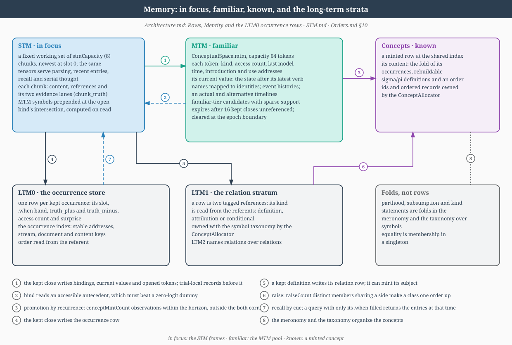

# Short-Term Memory

## Relation to LLMs, Formal Concept Analysis, and DisCoCat

STM is the local working set that replaces the anonymous residual-state view of
many LLM descriptions. It holds unquantized ideas while the parser decides which
typed DisCoCat-like reductions should apply. Those ideas are still grounded in
the Formal Concept Analysis side of the model: their slots point back to
part/whole support, concept order, and codebook rows rather than floating as
untyped context vectors.

## Overview

ConceptualSpace is an STM container plus a grammatical CPU; it owns no atomic
forward fold (see [Spaces.md](Spaces.md#shorttermmemory)). The **short-term
memory (STM)** is the structure CS manages: a per-batch working set of
unquantized CS "ideas" that the model accumulates across a sentence and
reduces at the sentence boundary. This chapter is the single reference for
what the STM is, how it fills, what reads it, and how its end-states chain
into long-term memory.



The stores are named by stratum (Alec, 2026-10-21). `LTM0` is the occurrence
store, one idea per entry; `LTM1` is its relation stratum, one pair of
references per row; and `LTM2` names relations over relations, an `LTM1` row
that references another row. `STM0` and `STM1` are their short-lived
counterparts, and MTM (`MediumTermMemory`) holds the identities in play
between working memory and the durable stores. All of them live in
[Memory.py](../bin/Memory.py), and each has one role: STM is the working set
of the sentence being read, position-addressed and live to the gradient; MTM
holds identities, and what a written row left pending, for as long as they
are in play; LTM is the one durable history of ideas and relations, read by
content, with each idea named by its time.

Two cadences write the STM, selected by `<serial>` (legacy configs derive
it from `symbolicOrder > 0`; see
[Architecture.md](Architecture.md)):

```
SERIAL    one idea per word (push)
PARALLEL  one whole-slab pass (set all slots)
```

The trainable target configuration is `MentalModel.xml`: serial,
`<data><dataType>embedding</dataType>`, `<attention>` unset (which resolves to
`"off"`; see [Section 4](#4-attentional-filtering)), sentence prediction on
and FineWeb data.

---

## 1. STM data model

`ShortTermMemory` ([Memory.py](../bin/Memory.py)) is a `Layer`
(not a `Space`): it carries no SubSpace and no forward / reverse
tensor-map contract. ConceptualSpace builds one at construction as
`self.stm` and treats it as the primary structure it manages.

**Capacity.** Default `8`, set via
`<ConceptualSpace><stmCapacity>N</stmCapacity></ConceptualSpace>`
(`DEFAULT_CAPACITY = 8`). Eight sits inside Miller's $7 \pm 2$ band, the
working-set size psycholinguistics ascribes to human short-term memory. The
capacity is the number of chunks, fixed at construction. Compose reserves a
free slot through the online reduction deadline before the next push, and an
arrival when every chunk is on the stack raises instead of dropping a word;
only the physical shifter of the ungated serial path (Section 2) rolls,
dropping the oldest.

**Chunks.** The working set is `B x stmCapacity` chunks held in
the fourteen `STMChunks.FIELDS` tensors; the stack is metadata over chunks,
not a physical shift. A chunk holds a vector `[form | meaning]`, as an `LTM0`
idea does, with its order, grammar order, concept row and activation; two
tagged references `(tag, value)`, each `SYMBOL`, `IDENTITY_REF` (an MTM
identity), `ACTION` (a journal column of this reading), `RELATION` (an `LTM1`
handle) or `OCCURRENCE` (an `LTM0` address); the bound identity and its
timeline; its stack position ($-1$ off the stack); the tick of its last read;
its `.where` and `.when` bands; and its two truth lanes. An arrival takes a
free chunk, else the least recently read off-stack chunk, and refuses when
every chunk is on the stack. A chunk is read when it is a compose operand,
when a bind to it is kept, when its value is refreshed into the window and
when recall returns it; being offered in a menu is not a read, so attention
chooses what is read and recency what stays. The physical shifter
`_stm_shift_and_push` described below remains only on the ungated serial
path.

A reduce writes its result into the head operand's chunk and frees the
other. When both operands are resolved (a concept symbol, a bound identity
with a value, or a compressed chunk) the result keeps its value and no
references; otherwise it keeps `ACTION` references to the operands' journal
columns, which is where the close finds the chain (Section 10). A composed
chunk carries the identity of its head: a unary result its operand's, a
headed binary result its head side's, and a bind its selected token, else its
head's identity, else a fresh one. A determiner that opens an individual of
order one also takes a fresh identity, and a clause carries its subject's. A
headless binary result and a verb phrase carry no identity ($-1$): `refresh`
reads such a chunk's own value, `bind_menu` never offers it as an
antecedent, and it never inherits the left operand's identity
(`ChunkJournal.apply`).

At the kept close the sentence's top chunk stays off the stack as a recent
entry, with a reference to the entry just written and that entry's stamp
(`keep_close`); its other stacked chunks are freed. Recall loads a returned
entry into a chunk with its references, vector, trust (as its two lanes) and
stored `.when`, and returns its identities to MTM (`EntryRead.recall_chunks`). A
concept entering STM is stamped now; a recalled entry keeps its stored stamp.
Each path of a sentence owns its chunks until the paths are compared, and the
kept path's chunks are what the close writes.

**MTM in the compose window.** MTM's accessible identities and candidates are
prepended to the symbol array that conceptual space reads, ahead of the
words, up to `mtmPrepend` entries fixed at construction and ordered by each
token's latest event, so identities and recalled chains lead the compose
window at every order (`PrependedSymbols.stage`). An unpromoted token's entry
carries a transient id from MTM's preallocated pool (`nVectors + i` for pool
seat $i$, taken when the token opens and released when it expires or is
promoted) and has no codebook row; a promoted token's entry carries its
symbol and row. The entry's form is its name's form, or the centroid of its
mentions' forms, and its meaning is the token's current value. A token with
an alternative timeline has a second entry carrying that timeline's value,
and a modal continuation binds to it explicitly. Each entry is deposited as
an off-stack chunk. `bind` is a binary compose operation (`BindLayer`): its
left operand is the mention on the stack and its right an off-stack identity
chunk, offered once per such chunk beside a dummy that keeps the mention's
own content (`bind_menu`), at any order. It returns the identity's current
value, and the kept close applies the kept binds to MTM once. `bind` is the
only binder: a determiner is a cue input to it, and its content test is
containment, not distance
([Mereology](Mereology.md#asserted-and-geometric-parthood)).

**The tree, the concepts held and the idea.** A concept is a part of a
sentence, and an idea is the vector in conceptual space that corresponds to a
whole sentence (Alec, 2026-11-17). A sentence's tree is the trace of its read:
the actions the grammar took, each operation's operands and result
(`operation_values`) and the leaves, kept by `SentenceStrata.Trace` and
indexed once for a path by `ReadingIndex`, which gives each action its
operands, its parent and its word. Nothing is written into `STM0` or `STM1`
for the tree: `Tree` and `CompositionView` answer from the trace, a node's
address is the trace's first name plus the node's action, and what the close
marks on a node is kept with the trace. The tree holds the words' concepts,
the formula in its syntactic form. Comprehension is a second stage, outside
the tree: `Comprehension.Evaluation` executes the tree's actions on a small
stack, shifting and reducing as the tree has them, on the words' objects.
What it gives is staged beside the tree in the path's `IdeaStack`, an `STM0`,
so the sentence's idea has the layout of an `LTM0` row, and each row is named
by the address of the tree node it comes from (`IdeaStack.name_for`): the
idea and its tree share one index (Alec, 2026-11-17). The concepts held in
STM, MTM's identities put off the stack at the sentence's start and what the
sentence says of them, are read and written by comprehension as the read did.
It starts from a copy of them taken when the sentence begins
(`HeldConcepts.snapshot`); where the read refreshed an operand from one of
them, comprehension reads its own copy at that action; where the read wrote
to one, comprehension writes its own value, in the same order; and before the
kept close the values STM keeps are comprehension's, not the read's
(`HeldConcepts.install`).

**MTM's life.** An MTM token, an identity or a candidate, expires when more
than `mtmHorizon` kept closes (16 by default) have passed in its stream since
its last reference, and at `mtmCapacity` (64 by default) the token with the
oldest access is evicted; neither changes an LTM row. The end of a document
and the epoch boundary leave MTM as it is. A token also records whether its
name is resolved: a name read
with no antecedent opens a pending token, and a kind, a merge with a resolved
token or promotion resolves it, while a verb phrase that updates the token's
value does not.

**What is pending.** MTM also holds what a written row left unresolved, for
as long as it is pending: an open question's slots, a forward reference, a
name awaiting its referent, an operand not yet known
(`MediumTermMemory.hold_pending`). The row itself stores none of it. For
example, "he said she said x" with x unknown is written as one idea, and MTM
holds x as pending against that row until x resolves; readers of the row see
the pending reading through MTM (`pending_meaning`), and a row dropped by
forgetting releases what MTM held for it.

**Buffer.** The data is a single per-batch tensor
`[B, cap, concept_dim]` plus a `[B]` long depth-pointer vector recording
how many slots each row has filled (saturating at `cap`). STM contents are
runtime working state, not learned weights. `concept_dim` is the full CS output
width reserved for the event payload; positional/temporal columns are preserved
when a config gives CS nonzero `nWhere` / `nWhen`. Each entry is thus one wide
concept vector, the full concept-space width of the composed value, held
beside the symbol activation field (Alec, 2026-10-20). The open sentence's
temporary identity is that vector, computed in STM and open to
reinterpretation; what persists is what the kept close writes. The
intersection that `bind` needs is computed on read, never stored.

**Spatial index (Alec, 2026-10-09).** The current conceptual eight-space
has its own range in the model's shared `.where` allocation.
`ConceptualSpace.where` exposes the slots' sinusoidal indices, using the
same encoding as the perceptual codebooks. A slot keeps its location when
ideas are pushed, reduced or cleared. The content's codebook address stays
separate. The kept close writes the sentence's semantic content to LTM,
with its slots beside it (Section 10). A read places only what it
interprets; the earlier placements stay as the occupied slots with their
`.where`/`.when` stamps.

**Attention and STM.** A look asks for concepts and returns them by what the
sentence's percepts are and where they stand
([Architecture](Architecture.md#one-attention),
[Language](Language.md#the-looks)). STM is what moves the request: `attend`
asks for the word level in general and changes the place it asks for from the
state of STM, so as to find the next word not yet read. Its inputs are the
context it reads (`AttentionContext.context`): the understood prefix with its
places and times, the heat of the spaces, and the surprise, which is the
excess and the omission of the one gain field (`Expectation.gain_field`) with
the look's activity as its attention and the look's forecast as its expected.
A form that was interpreted is lowered in the sentence's percept bank over its
extent, so a request that did not change finds the next word. Where the
returned set holds a word concept, the grammar may interpret the most active
one: the call is made with probability `architecture.interpretBias` (1 by
default), and the chooser decides the rest, interpret or abstain.
Interpretation supplies one word to the grammar. Whole-path comparison
credits departures in these choices. During the reading lesson each taught
request and grammar decision contributes its cross entropy.

No region boundary is learned. A look's extent is the activity the salience
map gives: an event is in the look to the degree that both what it is and
where it stands are salient, and what is not active is absent on both lanes,
never evidence against. A learned boundary could not be trained: a
straight-through surrogate cannot see the read it did not make, so its
gradient pushes an admitted item further in and an excluded one further out,
and learned regions saturate open or collapse to nothing. Of a look's error
only the request and the weights that read the where are taught; the first
Pi's entries and the weights that read the what take none of it, so that
perception keeps its one teacher, the reconstruction.

During a sentence, `SentenceField` carries source-support indices beside
the eight STM slots: pushes move the previous placements, unary operations
retain their witnesses, and binary operations join their witnesses. The
indices refer to the sentence's percept bank and its original
`.where`/`.when` stamps. The scorer reads these stamps and all occupied
slots; it never places the earlier reads again. The field has its own
allowance and charges one `serial-word-loop` unit per read.

**`ShortTermMemory` owns its live buffers.** The idea stack is not proxied
off `SymbolSubSpace`. Each chunk field is a plain (non-`nn.Module`-buffer)
attribute `_live_<field>`, set with `object.__setattr__` so STM state stays
out of the traced graph's inputs; `_buffer`, `_depth` and the other fields
are views of them. `capacity` and `concept_dim` read an attached
`SymbolSubSpace`'s `_idea_capacity` / `_stm_payload_dim`, which must equal the
construction (`attach_word_subspace` raises otherwise), and nothing resizes
after construction. There is a single live store regardless of attachment.

**API.** Idea stack: `push(b, idea)`, `pop(b)`, `peek(b, n=0)`
(`peek(b, 0)` = most recent), `snapshot(detach=False)`, `size(b)`,
`is_full(b)`, `is_empty(b)`, `clear(b=None, hard=True)`,
`ensure_batch(batch)`, and `ensure_capacity(capacity)`, which refuses any
capacity beyond the construction. Batch push primitives (masked / whole-slab
writers used by the per-word and parallel forwards): `push_step(ideas)`,
`push_step_masked(ideas, gate_b_1)`, `push_window_batch(ideas)`. The
functional chunk operations (`deposit`, `apply_choice`, `keep_close`,
`refresh`, `bind_menu`, `locate`) live on `STMChunks`. The signal router
consumes `stm.snapshot()` as its slab input.

**Lifecycle.** At a sentence or document reset ConceptualSpace clears STM
softly: the unfinished sentence's stacked operands go, and recalled
identities and kept sentence entries stay off the stack until recency evicts
them (`STMChunks.soft_reset_rows`). The epoch reset clears STM hard, freeing
every chunk and expiring the thought stores (see "Memory module and thought
stamps" below and [Spaces.md](Spaces.md#reset-cascade-hard-vs-soft)).

---

## 2. Serial sequencing

In SERIAL / GRAMMATICAL mode each word traverses a per-word path: surface
lookup $\to$ `PartSpace.forward` (the synthesis front end; a form's code is
the set of its parts, [Mereology](Mereology.md)) $\to$ `ConceptualSpace.forward`, which
does the STM bookkeeping ([Spaces.py](../bin/Spaces.py)):

1. **Perceive (overwrite via `_stm_shift_and_push`).**
   `_stm_shift_and_push(idea)` ([Spaces.py](../bin/Spaces.py)) is
   the perceive step. At capacity, slots $0\ldots(\text{cap}-2)$ shift
   into $1\ldots(\text{cap}-1)$ and the new idea lands in slot $0$ (the
   newest slot); the oldest idea (the last slot $\text{cap}-1$) falls off.
   Below capacity it is a plain push: shift the occupants right and write
   slot $0$. Under `<serialObjectMeta>` (default off), `p` indexes the
   independent sentence-word slab. Inside that iteration PartSpace gathers
   **all** of word $p$'s radix/chunk constituents and takes the max of their
   codes (`synthesize_word_parts`); the batch-padded raw width may exceed the
   eight-wide PS field. The live PS and WS readings bind strictly by
   location; the resulting concept records its actual subsymbolic order and
   full ordered support. Its current-word location is selected for
   `stm.push_step_masked(idea_bd, commit_b_1, orders=..., grammar_orders=...)`,
   which commits once using the word-active column
   `inputSpace._word_last_slot_mask[:, p:p+1]`
   (`BasicModel._per_word_body_step`, [Models.py](../bin/Models.py)). The local
   raw staging resets for word $p+1$; it is not an STM or PS-capacity axis.
   Flag off (or a legacy input without the word-loop tensors) falls
   back to the original per-slot path.
2. **Language dispatch.** The signal router dispatches grammar ops over
   the STM contents (read-only via CS, write-required via SS).
3. **One operation per round.** `LanguageSpace.choose_operation` presents
   the newest two occupied slots to the shared `OperationSelectionLayer`.
   Binary candidates and unary candidates at both positions compete in one
   softmax. Three fixed rounds follow each word, with early STOP; the sentence
   closing runs up to twice capacity. A binary choice removes one slot, while a
   unary choice changes its selected slot without changing occupancy. STOP is
   forbidden until the complete STM fits the sentence's allowance (one slot
   for an absolute sentence, three for a relative one; Section 9) and the
   phase allowance; online rounds allow `K - 1` occupied slots, which reserves
   the next word's slot. A binary-logit prior grows with whole-STM occupancy
   and with the reductions still required per remaining round,
   $p = g\,(d/a + r/n)$ for depth $d$, allowance $a$, required reductions
   $r = \max(d - a, 0)$ and remaining rounds $n$. Its gain $g$ is a learned
   parameter of the compose chooser (`reduce_pressure`, initialized from
   `reducePressure`, default 1), so a grammar lesson can weaken or strengthen
   the preference to fold; the formula and the deadline masks are fixed. When
   remaining rounds equal required reductions, unary and STOP candidates are
   masked. An initially infeasible budget may still leave an incomplete
   sentence; an attempted push into a full stack is an assertion failure. The
   chooser and its training are in
   [Language](Language.md#one-operation-per-round), and the whole
   paths a sentence is read along in
   [Architecture](Architecture.md#whole-paths-and-concept-episodes-2026-11-11).

> **Convention pin — newest-at-slot-0, shift-RIGHT.** The **free / newest**
> slot is **slot $0$** and the rolling window shifts **right**, dropping
> the oldest (the last occupied slot, $\text{cap}-1$ at capacity).
> `peek(n)` counts $n$ back from the newest, so it reads slot $n$
> directly; `snapshot()` returns the live slab **newest-first**.
> `_stm_shift_and_push` shifts right and writes in one pass; the named
> primitive `_stm_shift_for_predict` ([Spaces.py](../bin/Spaces.py)), which
> only frees slot $0$, stays off the forward path for unit tests, since a
> separate physical shift would double-shift the buffer.
>
> A binary fold reads the two newest stack entries as `(left, right)`: left
> is the older, right the newest, and the recorded operand rows follow that
> order. A composite entry, the result of a fold, carries concept row $-1$;
> concept rows live at the leaves, and the structure above them lives in the
> reading's derivation record, which exists only while the sentence is read.

---

## 3. Parallel sequencing

In PARALLEL mode the per-stage forward sees the whole sentence at once:
the slab `[B, N, D]` **is** the STM, each of the $N$ positions its own
slot. `ConceptualSpace.forward` writes it through the `folded.shape[1] > 1`
branch: `_stm_set_all_slots(slab)` ([Spaces.py](../bin/Spaces.py)) writes
all $N$ positions directly as the slot stack (no shift, no mean-reduction).
The slab is position-ordered (position $0$ oldest, $N-1$ newest); under the
newest-at-slot-0 convention it is **flipped** along the position axis so the
slab's newest lands at slot $0$. If $N >$ cap it keeps the last `cap`
positions (dropping the oldest, as the serial rolling window does) and then
flips; if $N <$ cap it zeroes the unfilled (older) tail so a prior pass's
state cannot leak through. Mean-reducing the slab to one idea would destroy
per-slot identity and make the reverse emit the same reconstruction in every
slot.

---

## 4. Attentional filtering

Attention is content based in every mode: what reaches STM is chosen by what
the percepts are and where they stand, and nothing selects by a position or a
time alone. Serial reading is not a separate regime: a sentence's looks start
with the open run, the whole sentence at once, and each later look is one call
of `attend` ([Language](Language.md#the-looks)).

**CS$\to$PS: the look.** The concepts a look asks for are carried down to the
sentence's percept bank as the salience map, and an event is in the look to
the degree that both what it is and where it stands are salient
([Architecture](Architecture.md#one-attention)). What lies away from where the
request looks is lowered by degree, by the magnitude of what asks; nothing is
cut and there is no floor. No window is centred on a word's position: the
place a look asks for comes from the request, carried down through the
first Pi's entries onto the where, and the request moves with the state of STM (Section
1). The word that is interpreted enters STM as one idea; the percepts around
it reach it only through the concepts the look returned.

**CS$\to$SS taxonymic mask.** On the symbolic side the inverse
recommender zeros **non-admissible** codebook rows before a lift / lower
(union / intersection) reduction so an operand can only resolve to a row
of the right grammar category and conceptual order. The admissible row
set is built by `priming_kwargs_for_slots`
([Language.py](../bin/Language.py)) — intersecting `refs_by_category`
with `refs_by_order` per slot — and applied in the recommender's
`_row_mask` closure ([Layers.py](../bin/Layers.py), nested in
`Ops._binary_op_recommend`), which admits only the category/order-matched
rows plus the $\bot$ / $\top$ sentinels. A parallel `_row_weights` closure
multiplies a taxonymic **priming** mask over the admitted rows (the
`left_priming` / `right_priming` weights from `taxonomy.priming_mask`).

**Guidance-signal contract.** The taxonymic mask is a guidance signal: it
biases which codebook rows a reduction may consult, given the current word
and grammar state, and it is read from the codebook's category and order
metadata, which is content. A reading of another modality, such as an image,
uses the same look: its request is over concepts and its where is that
modality's own places, so nothing of the pipeline changes with it.

---

## 5. Routing parser: SS-analysis vs CS-execution {#routing-parser}

The grammar runs through the signal router (`LanguageLayer`,
[Language.py](../bin/Language.py)); `SymbolSubSpace` owns it as
`self.languageLayer`. Conceptually the work splits in two:

- **SS-analysis** — `SymbolSubSpace.compose`
  ([Language.py](../bin/Language.py)) is the analysis stage: a soft
  superposition over the taxonymic codebook that selects, per-space, a
  **hard rule dict** `current_rules = {space_role: list[list[int]]}` — an
  outer per-space_role entry holding one inner rule-id list **per batch
  row** on the full-router path, or a single batch-shared inner list on
  the default-only path (`_default_compose_rules`, `_flatten_selected_rules`
  tolerate both shapes, plus the legacy flat `list[int]` per-space_role
  form). It chooses *which* reductions fire.
- **CS-execution** — actually applying the chosen reductions (lift,
  lower, union, intersection, swap, quantize, not) to the concept tensors
  runs CS-side in `ConceptualSpace.forward` and the WholeSpace
  stack-route path, with the per-space `SyntacticLayer` cursors
  ([Language.py](../bin/Language.py)) executing the unary $\pi$ /
  $\sigma$ folds on reverse. Only lift / lower / union / intersection
  consult the codebook (inverse-recommended); swap / quantize / not are
  tensor-only.

> **The split is a clean code boundary only on the default-only path.**
> When the grammar is *default-only* (every rule is
> the unary $\pi$ / $\sigma$ fold), `compose` emits `current_rules` from
> the grammar XML and runs **no** tensor reduction, and the per-space
> `SyntacticLayer.forward` / `reverse` cursors do the CS-side execution,
> a clean analysis/execution separation. On the **full-router**
> path, however, `LanguageLayer.compose` does **both**: it selects the
> rules *and* folds the slab tensorially through the op modules
> (`OperationSelectionLayer.forward` $\to$ `op(left, right)`),
> caching the root state. The per-space `SyntacticLayer` cursors are then
> **deliberately bypassed** on that path, guarded by
> `not _grammar_is_default_only`
> ([Language.py](../bin/Language.py), the `SyntacticLayer.forward`/
> `.reverse` guard), so that the reduction is
> not double-applied. In the full-router case the SS-analysis and
> CS-execution stages are therefore **co-located** inside
> `LanguageLayer.compose` rather than separated across modules.

`_grammar_is_default_only` is computed from the configured grammar at
`SymbolSubSpace.__init__` ([Language.py](../bin/Language.py)) and gates
both `compose` and `generate`.

---

## 7. Per-word router firing

The `<routerWireSerial>` knob ([model.xsd](../data/model.xsd)) gates
when the router fires on the serial path:

| Value | Behaviour |
|---|---|
| `per-word` | fire per word; boundary fire off |
| `boundary` | fire only at the sentence boundary |
| `both` | **(default)** per-word AND boundary both fire |
| `off` | neither fires |

The **per-word fire** is the C stage of the peer pipeline:
`LanguageSpace.compose` runs over the B-stage STM snapshot and its timestamped
result becomes visible to B two symbolic indices later. On the normal MPS
fullgraph it is part of the tensor `while_loop` and the serial grammar route
remains capture-clean. With `BASICMODEL_MPS_WORD_LOOP_FULLGRAPH=0`, the same C
stage runs in the static host scheduler. The **boundary fire**
(`BasicModel._chart_compose_at_C`, [Models.py](../bin/Models.py)) runs
iff `router_wire_serial in ('boundary', 'both')`.

---

## 8. Masked-word reconstruction via priming

Masked words enter the pipeline as **all-zeros** percept slots. On
reverse, the router fills the blank via a best-fit codebook walk biased
by the taxonymic prior, POS selection, and accumulated prediction — it
reconstructs the most plausible word for the slot given the grammar
context and the codebook geometry.

**Priming machinery.** The bias enters through `left_priming` /
`right_priming` in `Basis.lift` / `Basis.lower`
([Spaces.py](../bin/Spaces.py)), forwarded down to the inverse
recommender's `_row_weights` closure ([Layers.py](../bin/Layers.py),
nested in `Ops._binary_op_recommend`) where
each admitted codebook row is scaled by its taxonymic priming weight (the
$\bot$ / $\top$ sentinels pinned to $1.0$). Primed rows are preferred in
the argmax that selects the operand. `test/test_primed_reverse_hard_mask.py`
exercises this path.

**Tests.** The reverse roundtrip and reconstruction tests are
`test/test_stm_reverse_roundtrip_lift_lower.py`,
`test/test_stm_reverse_roundtrip_union_intersection.py`, and
`test/test_stm_recon_from_cleared_cache.py`.

---

## 9. Relative vs absolute end-states

An absolute sentence ends in one working slot: its verb phrase applied to its
subject fuses into one idea point. A generic subject or an operand that
references a relation makes the clause relative: it ends in three slots,
`[left, predicate, right]`, with native references and no fused point, and
the stack holds them newest-first as `[right, left, predicate]`
(`sentence_row_slots`). STOP becomes eligible only when the stack fits this
allowance; the close then compresses the kept reading into memory (Section
10). `NP -> S` keeps an embedded absolute point; `NP -> REF(S)` carries a
relative clause by reference. Each path's clause journal records these
endings, and its references stay local to the path until the paths are
compared. The close registers children before the entry that encloses them,
and registration gives embedded content no assertion authority. An absolute
enclosing clause can fuse only when all its operands have points: a relation is
a constraint between entries, not a region, so a point fused over a relation
reference would differ from its neighbours only by an arbitrary row code, and
coverage over it would measure nothing. Relativity therefore propagates upward.
A bare noun phrase is an idea whose implicit verb phrase is *occurs*.

The operation budget of Section 2 bounds the close:
`_stm_reduce_to_single_S` runs at most $2K$ closing rounds for STM capacity
$K$, capped by a positive `syntacticOrder`. The default budget completes the
reduction. A manually undersized cap can still leave an incomplete forest,
which is tagged incomplete and cannot publish a program or a memory entry.

At the close an `LTM0` entry keeps one signed trust from $-1$ to $1$: above
zero its idea is held true to that degree, below zero held false, and at zero
it lights nothing. Evidence on both lanes is written as two rows, one on each
lane, so both and neither stay distinct; an `LTM1` relation keeps its two
lanes, `truth_plus` and `truth_minus`. A source's trust is not stored apart:
it sets the row's trust when the entry is written (Section 10, "Trust"), and
sentence content never selects its own trust. Luminosity reads idea entries
only. See
[Reasoning](Reasoning.md) for the relation readers and the declared `true`
thought operator.

---

## 10. LTM as the chain of STM end-states

`symbolSpace.ltm_store` is the one `LTM0` for all completed clauses, and its
relation stratum `LTM1` is `ltm_store.parts`; there is no alternative backing
store. Storage alone does not certify that a described referent exists, and
production observations must provide their owned end state.
[Clause admission](../bin/ClauseRow.py),
[observation writer](../bin/Models.py).

STM and LTM differ in form and in life: STM is position-addressed, live to the
gradient and displaced by what arrives next; LTM is content-addressed,
detached and forgotten by activity. In use they are one chain: a recalled entry
lives in STM while it is active, working memory being the activated part of
long-term memory, and the kept close is the one writer from STM to LTM. A
composed idea enters LTM when its sentence ends; what was merely held is not
stored. Whether an entry stays is decided by its activity, which its surprise
sets when it is written and use raises, so encoding is broad, retention
selective, and there is no separate admission gate (Craik and Lockhart 1972;
Cowan 2001).

**Layout.** LTM is two tables, `LTM0` and `LTM1`; everything else a store
holds is a cache, rebuilt from the columns and never saved, or named
auxiliary state such as the count, the clock and the forgetting counters
(each store's `columns`, `caches` and `auxiliary` in
[Memory.py](../bin/Memory.py)). An `LTM0` entry is one idea, and its
columns are one paired vector `[form | meaning]` in `slots[capacity, nDim]`,
whose form block's last four coordinates hold its time (`time`, read through
`entry_time`); its `trust`; its `referent`; its slots
(`episodic_concepts`, `episodic_values`); and its `activity`. Each column has
its reason: the time says when the row was written and names it; the trust is
how far the idea is held true; the referent is what the idea is of, one
optional reference to a concept or to another row by its time, written from
the reference the close selected and by a promotion, and empty for most
sentences; the slots are what the idea extends to (below); and the
activity decides whether the row stays (below). The idea is semantic memory
and the slots episodic memory (Alec, 2026-11-19: "Entry should be slot in
episodic memory ( the idea is semantic memory)"). An idea is an intension and
its slots its extension, and two ideas can have one extension: a kind of one
member and that member leave equal slots, and the referent tells them
apart. A row's order is the order of what its referent names, and zero
where it names nothing (`order_of_row`). There is no separate `when` column, no role table, no stored
order, no stored derivation, no stream, no origin and no kind: which rows are
truths is read from their trust, a row of nonzero trust being one. An `LTM1`
row is two tagged references,
`refs[capacity, 2]` with `ref_kinds[capacity, 2]`: `OCCURRENCE` (an `LTM0`
row by its time), `SYMBOL` (a concept or word) or `RELATION` (another `LTM1`
row); a zero tag marks an empty seat. The tags, never the integers'
magnitudes, decide traversal. A row has its two lanes, `truth_plus` and
`truth_minus`, and its `activity`, and no time of its own: its time is that
of the rows it references. It stores no type, no operator and no composed
value: if-then and temporal chaining, whole-part, definition and
type-token are told apart by what the references are, their tags and their
situations (`.when`, `.where`, symbol; `LTM1.readings`).
A row that references a row is read as `LTM2` (`LTM1.stratum`). `LTM1` has no
polarity column, so trust-derived evidence on a negative statement is written
with its two poles exchanged.

**Compression at the close** (`ClauseRows.write_clause`). The kept reading is
walked from its leaves. A sentence that is not a relation is one `LTM0` idea,
its value, whatever its operands: a sentence whose words are all known
concepts becomes one idea, its verb phrase applied to its subject, and so does
a sentence with an unresolved operand (a pending name, an unknown word
standing for itself, an open slot) or a verb over a completed relation. What
is unresolved is held in MTM while it is pending (Section 1, "What is
pending"), never stored as a chain. A relation, `part`, `whole` or `implies`
between two operands, is an `LTM1` pair over its operands' entries, even when
both sides are known, and a relation whose operand is a relation is a chain
of pairs whose top row is the sentence. There is no separate sentence row.
Parse-only operations (surface markers, determiners that only select, order
operations) never become rows, and no row carries an operator. An idea's
referent names the identity it was composed over, where the close selected
one. A row whose unknowns later resolve is not rewritten: thought writes the
value to MTM and, when kept, an inference idea. Reading an entry into words
generates from its vector and the current grammar; a sentence's structure is
reconstructed from its vector, inexactly.

References name whole entries, never a part of one, and only entries written
earlier (or planned earlier in the same close), so the reference graph is
acyclic: a self or later reference fails, and protection from forgetting is
transitive. An occurrence handle is a row's time, not an identity: identity,
and a mention's reading as a name/value pair, live in MTM. Several references
may tie to one identity and share its value without unfolding into one
another, so a relation may refer to itself through a shared identity while
the references between stored entries stay acyclic; readers stop at a
repeated occurrence, and neither a cycle nor a binding grants evidence.
Admission
preflights clause dependencies and native concept capacity: an insufficient
store raises before publishing a child prefix, and nested readings reserve
their complete transaction. Embedded clauses are written at zero trust.

**Trust.** An `LTM0` row's trust is set when it is written and never changed
after; a relation's lanes can only rise, when it is asserted again.
A truth-store entry (`Models.store_truths`, or `provision_ltm` for a
configuration's own truths) is written at the trust it is given. A sentence
read in training is written at the model's trust (`<trust>`, set by
WikiOracle in the configuration it trains with) times the certainty of the
sentence's words. A sentence of a conversation is written at zero, so it
lights nothing and cannot certify its own referents. A kept thought is
written at what its premises give, the least on each lane. A relation takes
the same number on the lane of its sign.

**Time.** The model has one integer clock, and the clock's sinusoidal code
is made in one place and held on the model beside it, where every reader
reads it. A stamp is the clock of the moment it records. A concept is opaque
and keeps its `.where` and its `.when` (Alec, 2026-11-19), so a question
about *when* reads the stamp. The chooser and the operators are given the
present in the same code and a comparator that tells how far back a stamp
is; a stamp is never rewritten as an age. A row is named by
its time: a row's time is the model's present, or one more than the last
row's time where the present is not later, so times rise strictly, the
store's order is time order, and a row is found by its time (`row_name`,
`index_of_row`). Every `LTM0` row carries its own time, mentions and the idea
that holds an event's compacted state included; an `LTM1` row, a definition
written by `Interpret.define` included, has none, and its time is that of the
rows it references. An identity's event history is ordered by its rows'
times. There is no recall by time: memory is read by content, and `.when`
stays as model time and as content inside an idea.

**Reading again.** A sentence read again is a new row: no write is matched to
an earlier one by its source, its document or its content, and no stored
trust changes. A reasserted relation joins its two poles with the stored ones
by maximum rather than appending a duplicate claim, and raises the relation's
activity.

**Retrieval.** There is no word index over memory and no index from a
concept to its rows. Retrieval by a word is
either a match by content or a lookup of the `LTM1` rows that reference the
word's symbol (`LTM1.rows_referencing(SYMBOL, word)`). A content read takes
the question's field of understanding, the set of active concepts its
operators leave when applied to its words' sets (for "red ball", what the
sets of red and of ball share): each operand's set gives one result over the
newest `ltmWindow` rows, matched against their slots in `LTM0` order by
order and never reduced across orders or across rows, and the question's
operators combine the results as they combine sets (`EpisodicMemory.matches`,
`relevance`, `ExtendedRecall.matches`). Both sides are concepts, never percept
codes: a question's set holds each active concept with its value, and a
row's slots hold each kept concept as one signed value whose size is its
certainty, on the lane of its sign. At each order, a row's result is the sum
over its slots of that order of the slot's value times the question's
value for that concept on the slot's lane, divided by the question's squared
length at that order, and at most one; only a row's largest slot for a
concept on a lane counts. The results of the orders are joined by the least,
as `intersection` joins them. Rows are ranked by that result, newer first
among ties; a row a read returns has its activity raised. Explicitly
addressed rows are read directly (`EntryRead.cued_rows`).

**One history.** `LTM0` and `LTM1` are one history for the whole model: no
row records which stream wrote it, and the rows a batch of several streams
writes at one close enter the history in the order of their streams. A read
enters the stream that asked. No read is scoped to a document, and a
document has no row of its own. The working stores keep their batch axes:
STM, MTM, the expectation context and the policies hold one row per stream.
The legacy `get_stm_chain` adapter is a read view of the store's rows in time
order, not a separate writer. An internal thought or provisioned fact cannot
become an external predecessor through recency alone: the recent situation
(Section 11) admits only the rows its own stream's kept closes wrote, held by
reference.
[Prediction context](../bin/Layers.py),
[meaning roles](../bin/Meaning.py).

**Slots.** Every `LTM0` row has, beside its idea, a few slots, empty where
its idea has no extension: up to `episodicConcepts`, each one concept of the
row's moment with one signed value (for minus against), in one flat list
with no order axis (`episodic_concepts`, `episodic_values`). For an input
sentence they are taken from its field of understanding, whatever their
orders; for a kept thought, from its idea's extension, taken from its kept
tree or, where it has none, from its generate walk (`EpisodicMemory.select`,
`for_meaning`). Which concepts of the moment fill the slots is not settled:
not the most active (Alec, 2026-11-19: "Most active is clearly not useful;
perhaps least expected, or sentence dominant such as np, vp, ?"). Zero
readings are absent. No place or pole pair is stored; the row's time
supplies time. A close that writes only an `LTM1` relation writes no slot,
and is counted. A recall reinstates a returned row's slots as the requesting
stream's field
(`EpisodicMemory.reinstate`): it lays out the readings by their concepts'
owned surface lengths with one separator between; a missing surface gives an
empty extent and a stale concept id is skipped, each counted. The field is
published directly and empties that stream's present percept readings until
the next open pass; other streams are unchanged.
`reverse` reads the episode without compose or generate. The review rebuilds
each reading's pole pair as $(\max(v, 0), \max(-v, 0))$ from its signed value
$v$, at the row's time; the signed value belongs to these stored references
only, and the field stays a pair. Forgetting carries the columns with their
rows. The slots are
the reading of their moment, not perceptual memory: a percept that had no concept
when it was seen leaves nothing, where a word stood is not kept, and `reverse`
returns the percepts that the concepts' definitions give at the recall. See
[Architecture](Architecture.md#episodic-and-semantic-memory-in-the-two-systems-2026-11-11).

**Definitions.** `interpret` writes a new word's definition as one `LTM1` row
of two `SYMBOL` references, `(object, word)`
(`Interpret.define`): a new word costs one inventory row, which becomes the
object's, and this one row. The definition has no time, like every relation,
and is dropped by forgetting like any row. A word read as its object is
mapped at trust one, and so is the object it reaches (Alec, 2026-11-14: "At
one for now"); a definition that a sentence states takes that sentence's
trust, which is zero in a conversation. Its two references name identities, never
content, so what a concept's code becomes in training cannot redirect a
definition, and they imply no order between word and object. A word with
several objects, or an object with several words, has one row per pair, and
reading a defined word again appends nothing. One derived index over these
rows (`Definitions.DefinitionIndex`) finds the word for a form or unit, a
word's objects and an object's words without scanning; appends update it, and
load and compaction rebuild it.

**Checkpoints.** Each store saves its declared columns and auxiliary state
through `state_dict`; caches are rebuilt and never saved, and nothing rides a
semantic sidecar. Loading validates before importing: an `LTM0` referent must
name a retained row or a concept, an `LTM1` reference must name a live row
with no cycle and no duplicate pair, a trust or an activity must lie in its
range, and a column whose shape differs from the construction raises. An
older layout is converted only where it maps exactly: its evidence pair
becomes the signed trust, its activity starts at `activityDefault`, its
episodic record is flattened into the row's slots, a retained row's
selected reference becomes its referent and what its bindings held pending
moves to MTM, and every retired field it drops is named in a warning. A row
holding both trust lanes, or rows without unique times, are rejected before
any store is loaded. [Checkpoint migration](../bin/MemoryCheckpoint.py).

**Activity.** Every row of either store has one activity, a number from 0 to
1 that says how much the row is in use (`MemoryActivity`). A write sets it
to `activityDefault` (0.5): no sentence is estimated (Section 11), so the
kept close gives no surprise to set it from. An access adds `activityStep` (0.1): a row that recall
returns, a relation read as evidence, a pair written again; a read on a path
counts only if that path is kept. A pass of forgetting multiplies every
activity below one by `activityDecay` (0.9). For example, a row written at
0.5 and returned twice by recall stands at 0.7, and after three passes with
no read it stands at about 0.51. An activity of one is never lowered and its
row never dropped. An `LTM0` row not yet promoted whose activity reaches
`activityPromotion` (0.9) is promoted: its idea becomes a concept
(`MemoryConsolidation.consolidate`), which keeps the row's stamp, the new
concept is written as the row's referent, and the row's activity is set to
one. The concept's order is its
referent's where the row had one, and one above the greatest order among its
slots' concepts where it had none.

**Forgetting.** The forgetting pass (`Forgetting.forget`) runs after backward
at a document boundary, in training or after a stateful inference request,
at the epoch boundary, and before a serving write that finds the store over
its high water mark; it never runs inside an open sentence. It starts
when occupancy reaches `forgetHighWater` (90%) or an earlier pass fell short,
decays every activity as above, and drops the rows of least activity, ties
to the older row, down to `forgetLowWater` (70%), so the same state always
deletes the same rows. High-water pressure in either LTM table overrides
`forgetMinInterval` at a closed boundary; unpressured passes still wait its
256 completed sentences. Use, not isolation, decides: an isolated row may stay because it
is used, and a sentence its context already predicted was written with
little surprise and goes first unless it is read. Forgetting never merges
near-duplicate entries.

Kept whatever their activity: the rows that `LTM1` rows reference and
everything those reach, the rows another row names as its referent, and the
live roots, the rows held by the last understanding, the thought history and
the expectation context (`Forgetting.model_boundary`). A referenced entry is
never deleted. Deleted entries are compacted out of the
fixed-capacity store rather than left as dead slots behind a live mask
(`LTM0.compact_rows`): every reference already holds an entry's time, so
compaction gathers the survivors in time order, no reader needs a live mask,
and MTM releases what it held pending for a removed row. The relation
stratum has its own pass (`forget_parts`) at the same boundary with the same
water marks, and rows that other relations reference are kept.

The pass reports its cut-off, the counts before and after, the protected
count and whether the target was reached, and its counters round-trip with
tensor state. Protected roots can keep it from reaching the
target, and a long document can fill the store before its boundary; both stay
visible rather than bypassing protections.

Concept reclamation is separate: at maximum preallocation, after all streams
close, erase unreferenced exact redundancies, smallest meaning first,
while retaining a representative. Unused mints with no definition, reference,
posting or sparse placement can also be reclaimed, without requiring them
to match each other. Smallness cannot erase a referenced or defined concept.
Distinct individuals are not merged by
matching descriptions. Unreferenced zero-relevance identity/change columns can
also be pruned. A freed physical seat receives a fresh monotonic identity and
cleared moments; no retired handle can denote its replacement.

Storage does not establish existence. Existence is read from rows of nonzero
trust, so a conversation's rows, written at zero, support nothing, and model
activation alone cannot establish a degree. See
[Existence evidence](ExistenceEvidence.md).

---
## 11. The recent situation

No sentence is estimated from the sentences before it, and no close is
taken as a target (Alec, 2026-11-17). The shared `ActivationPredictor` of
`SymbolExpectation` is read only within a sentence, by the word read and the
field read during the read. What carries from one sentence to the next is
each stream's recent situation. At a kept close each row the close wrote is
admitted to it by its address, with the symbols and activations the close
gave it (`SymbolExpectation.include_occurrence`), up to a window of eight. A
frame read from the situation carries one point, an idea's vector or the
head of a sentence stored as a relation chain (`SituationFrame.from_row`);
the stored row keeps both tagged endpoints for a relational read. Its
readers are the word read's context (`WordExpectation`), the candidate frames
and event cases of the sentence's reference bank
(`BasicModel._sentence_reference_bank`), thought's accessible individuals
(`ThoughtLTMCapability.bind_reference`) and the context records of selected
thought. Composition does not search LTM for an identity. Clearing the
situation removes that cross-sentence carrier. Word provenance remains the
current sentence's own reconstruction record when its subject refers to an
earlier occurrence.

## 13. Interaction LTM and the What stack

Beside the chain of STM end-states (Section 10), `WhatInteractionMemory`
keeps a per-row chronological sequence of **interaction slots** for the What
loop.
Each slot (`What.LTMSlot`) has two independently optional halves:

| Slot | Operation | Stack effect |
|---|---|---|
| `(input, —)` | OPEN | pushes an unanswered question |
| `(input, output)` | COMPLETE | no change |
| `(—, output)` | CLOSE | pops the most recent unanswered input (LIFO) |

The stack is the *imbalance* of the sequence: **parity** means no unmatched
input-only slot. There is no frame object and no in-place edit of an
opening slot; a later output-only slot closes it. The API on the layer
(`bin/Layers.py`):

- `append_what_slot(slot, b)` — validates (an empty slot and an unmatched
  close are rejected; closure pressure must not decrease while questions
  are open), detaches both halves from the live graph, appends the
  chronological record with its grammar trace, and trims only *balanced*
  prefixes when `ltmCapacity` is exceeded (an open question is never
  evicted).
- `get_what_slots` / `open_what_slots` / `what_open_depth` /
  `what_at_parity` — read-only views, oldest first.
- `what_context(question, b)` — the target-free chooser context: the
  question's coordinates, the input / output presence masks and
  representations, the open depth, parity, and the current closure
  pressure. `Model._what_grammar_context` folds it into the 29-dim vector
  the grammar chooser's `what_projection` consumes.
- Row hard resets clear the row's slots and its pressure; soft resets do
  not.

The output half always records the response the model actually produced,
never the desired `Data` answer.

SymbolSpace always owns exactly one `Layers.WhatInteractionMemory`, available
as `SymbolSubSpace.what_memory`. `Model._what_memory()` returns this owner.
Expectation has no interaction-memory copy or delegate API. Provisioning
resets the What episode at its hard interaction boundary; suspending external
expectation does not preserve that episode. The **episode credit boundary**
is explicit: an episode ends with `end_what_episode(b, detach=True)`; under
`<whatThinkingDetach>episode` the values appended inside an episode stay
live on the autograd graph until `end` (called after the optimizer step),
so a root answer loss can reach states created at earlier iterations;
under the default `slot` every value is detached at append. `what_context()`
also exposes `open_question` (the newest unanswered input) and
`latest_output` for the resolve step.

`Model.think` understands once and resolves through the ordinary thought
controller, which records its nested questions and typed returns on this
same memory as levelled thought records (see "Thought and query reads"
below); a row whose history that controller owns appends no What slot. The
slot rules above still govern the What records: append-only, an opening
never edited, and an output that is the model's own.

---

## See also

- [Spaces.md](Spaces.md): ConceptualSpace as STM container; the
  `ShortTermMemory` API; Sigma / Pi ownership.
- [Architecture.md](Architecture.md): modes of operation (serial /
  parallel); the per-word operational flow; whole paths.
- [Language.md](Language.md): the signal router, `compose` / `generate`,
  GrammarLayer reductions.
- [Mereology.md](Mereology.md): parthood as shared size;
  the relations the relative predicates draw on.
- [Reasoning.md](Reasoning.md), [Logic.md](Logic.md): the truth surfaces
  and tetralemma trust.
- [ExpectationRetention.md](ExpectationRetention.md): the shared
  predictor and `expect`.
- [Params.md](Params.md): `<stmCapacity>`, `<mtmPrepend>`,
  `<routerWireSerial>`, `<ltmCapacity>`, `<episodicConcepts>` and the
  forgetting settings.

## Slot provenance for the fold ladder

Beside its chunks, the STM keeps one fixed-shape provenance slab
`_wholes` `[B, capacity, 3]` of longs, newest at slot 0 like the buffer:
per slot the index of the coarser analysis whole (the word) the unit
belongs to, the unit's loop position and the clause whole's index; `-1`
means none (a fold across wholes has no whole and is no single unit).
The slab is CS-owned sentence state exactly like the reference slabs: the
compiled word loop carries it through `torch.while_loop` beside the STM
chunk tensors (fullgraph), and the only mutation paths are the pure
primitives `ShortTermMemory.functional_wholes_push` (masked slot-0 push),
`functional_wholes_reduce` (a top-2 fold keeps a whole or clause only when
both operands shared it) and `functional_wholes_reset` (a sentence
boundary); the eager methods `note_whole_masked`, `note_reduce_wholes`
and `same_whole_rows` wrap them.  `same_whole` / `shared_whole` /
`newest_units` are the tensor reads.

The reduce step (eager and compiled alike) turns the slab into the
grammar's `chunk` licensing: `_chunk_structural_prior` is a `[B, 1, R]`
additive logit, the learned `chunk_prior` on a pair the tiling places in
one whole (word or clause) and `-1e4` elsewhere, handed to the Language
chooser as `op_prior`.  After the fold, `_chunk_reduce_provenance`
appends a chosen chunk of two units with concept ids to the
ConceptualSpace's fixed proposal slab (`[B, 32, 3]` plus a count, also
loop-carried), looks the pair up in the admitted phrase-row table
(`chunk_row_table`, `[64, 3]`) and, when admitted, references the phrase's
row at the folded slot (`apply_phrase_rows`). `ConceptualSpace.Reset`
drains the proposal slab into the host counts that admit phrases.

Committing live state under the compiler: every STM
property setter (`_buffer`, `_depth`, the order and reference slabs,
`_wholes`) goes through `ShortTermMemory._assign_live`, which copies in
place when compiling and the shapes match. With a `torch.while_loop` in
the graph, dynamo (torch 2.14 nightly) drops a later attribute
*assignment* of an attribute assigned earlier in the same graph (the
per-forward seed in `_per_word_prelude`), so the sentence reduce and the
reconstruction loss after the word loop read the empty seed; an in-place
copy is tracked and keeps the gradient. Eager execution keeps the plain
assignment. Anything an eager consumer reads after a compiled call is an
explicit output of `_forward_with_compiled_sentence_state`, never an
attribute escape.

## Thought and query reads

What thought and the query operators read from these stores is specified in
their own documents; the memory side is this.

- The interaction memory admits ordinary `ThoughtRecord` values with explicit
  level and termination transitions beside the What slots, and the one
  thought controller records its nested questions and typed returns there.
  Its attended context uses row-owned STM and history, the recent discourse
  chain and frames brought into STM by cued `what`, under one work allowance.
  It never reads a recent slice of the LTM store, and there is no per-role
  leaf-code index (Section 10, "Retrieval"). Capacity retains active contexts
  and referenced occurrences, and the structural sidecar persists detached
  copies and validates replay on restore. See
  [Thought history](ThoughtHistory.md) and
  [SelectedMeaning](SelectedMeaning.md).
- Durable `LTM0` occurrence reads detach their content; row-owned thought
  references preserve live episode meanings. A query operand that is a
  complete description references existing occurrences, and forming a
  candidate cannot create one ([Query contracts](QueryContracts.md)).
- Conceptual-taxonomy queries capture a bounded view of the native reference
  records. The view owns no durable state and is rebuilt after restore
  ([TaxonomyQueries](TaxonomyQueries.md)).
- Permission to run a checked query on a row derives from the requested
  `Understanding`'s owned sentence programs, not from mutable STM staging
  ([Query phases](QueryPhases.md)).
- No row is withdrawn. Forgetting keeps the rows the ordinary thought
  history reaches, and a retained row keeps its time, content and trust
  ([nested retention](NestedRetention.md)).

## Trust and addressing in the chunks

The chunk field `chunk_truth [B, C, 2]` holds the for and against lanes of
each chunk's content: a recalled entry's trust on the lane of its sign, the registered sentence's own
ideas at `(1, 0)`, a derivation's pair, a question chunk at `(0, 0)`. Thought
operands and results name a chunk by its `.when` stamp through
`STMChunks.locate(..., band=WHEN)` (exact match, $-1$ when absent; a duplicate
occupied stamp raises in `ThoughtChunks`); a thought chunk has no place, its
`.where` band being $-1$. The episode's focus chunk is pinned on the stack
while the episode is open. The chunk's pair is the working copy the operators
read; the thought record keeps the pair in the history
(`ThoughtRecord.support_true`, `support_false`), and its address is the chunk's
stamp, which replay resolves the same way. A derivation's pair is the path
minimum over premise $p$, match support $m^+$ (1 for a direct identity) and
rule $r$, $(\min(p^+, m^+, r^+), \min(p^+, m^+, r^-))$, recomputed on replay.
A new thought idea takes a free chunk or the least recently read off-stack one;
an unpinned intermediate result evicted that way is a forgotten lemma,
recovered by a query or by deriving it again, and a thought that finds every
chunk on the stack raises. Trial restoration restores the active stream count
with the fixed buffers. See [Architecture](Architecture.md), "Retained
grammatical occurrences".

## Memory module and thought stamps

The live `ShortTermMemory` owner lives in [Memory.py](../bin/Memory.py),
beside the `STMChunks` namespace, `MediumTermMemory`, `LTM0` and `LTM1`;
`MemoryStore` shares only tensor snapshot copying, and Layers.py owns the
other layers and `Ops`. The kept close retains STM, commits MTM and writes
LTM. The short-lived stores reuse the durable layouts: `STM0` shares
`LTM0`'s idea rows (`IdeaRows`) but keeps its values live, names its rows
locally and expires instead of persisting, and `STM1` is an `LTM1` whose rows
expire. An `STM0` store belongs to one stream. Its owner indexes the stores by
stream and path (each path's `IdeaStack`, beside its tree), by stream (the
recent store) or by stream and chunk (thought stores).

A new thought idea takes a tick of the one model clock that sentences use
(Alec, 2026-11-10: "One clock"), on the same ladder; reads and updates keep
its stamp, and trial rollback puts the clock back. Nothing else puts it back:
each tick also passes the last row's time in `LTM0`, so a stamp is unique
across epochs as well as within one. Clearing STM at the epoch reset still
expires each thought store together with its view records, and an old
external view raises. See
[Architecture](Architecture.md), "When" under "One where, one when, many
whats".

### Thought content growth within the sentence bound

The number of focus chunks stays fixed. A chunk's shared STM0/STM1 content
store begins with `4 * stmCapacity` rows and grows only when its full typed
meaning needs more (2026-11-11). The exact row requirement is the sum of one
head plus the occupied roles of each constituent; its pair links need one
fewer seat. The maximum, fixed at model construction, is `4 * (W + O)`, using
the sentence's existing W leaves and O operator seats; overflow beyond that
ceiling is an error. The bound holds because every input meaning is a leaf or
an operator and needs one head and at most three occupied role rows; O is the
sentence's operation bound, $3W + 2\,\mathit{stmCapacity}$. Allocating the
maximum in every stream and chunk up front would cost far more memory than
thoughts use, so a store grows only to the exact count its current thought
needs, and its contents are never truncated. Reconstructing these transient
buffers preserves the store owner; replacing a thought invalidates its old
view, and trial rollback restores the saved owner generation and content
size. Standalone stores without a sentence owner retain their original
construction bound.
