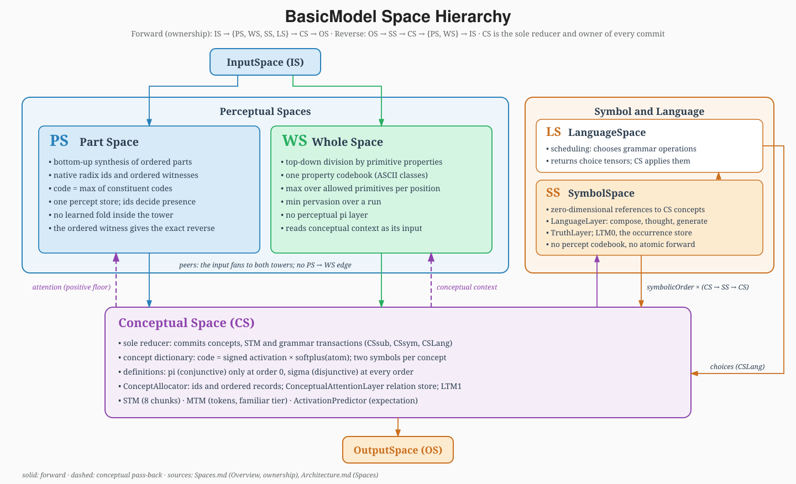
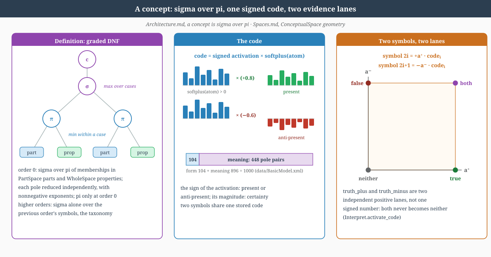

# Spaces

> **Architecture relation.** The Space/SubSpace split is where BasicModel most
> directly departs from conventional LLMs: hidden state is routed through named
> percept, concept, symbol, STM, and codebook stores instead of one residual
> stream. PartSpace/WholeSpace plus the Concept codebook provide the fuzzy
> Formal Concept Analysis reading (extent, intent, and concept order), while
> SymbolSpace and the grammar host provide the DisCoCat-like composition path
> from typed syntax to vector meaning.

> **Terminology (one noun per space).** A **percept** is a PartSpace or
> WholeSpace thing, dimensionally embedded and extensional; its two subtypes
> are **part-percepts** (atoms, synthesized bottom-up) and **whole-percepts**
> (properties or regions, analysed top-down). A **concept** is a
> ConceptualSpace relation tying part-percepts to whole-percepts. A **symbol**
> is a SymbolSpace zero-dimensional reference to a concept id: symbols are
> formed strictly downstream of ConceptualSpace, and a symbol is not a
> WholeSpace row. There are **objects** and **references**, and a reference
> is either a **sign**, a quantized version of its referent (the same space,
> snapped to a codebook row), or a **symbol**. Code identifiers such as
> `subspace.what` keep their names.

> **Perception.** `PartSpace` and `WholeSpace` both subclass `Space`.
> PartSpace combines ordered parts; WholeSpace divides the field by
> primitive properties. Neither owns a sigma/pi fold layer. Native codes stay
> in the same `[0,1]^D` cube; rank is mereological level, not a change of
> dimensional space. Sigma and pi are conceptual and grammatical operations.
> Concept presence keeps two nonnegative poles; negation exists only for
> concepts, not for percepts or symbols. The membership read is independent
> of distributed codes. Objects are analysed and synthesized by sending them
> back through the towers: wholes get split and parts get chunked.

> **`subspace.what`: atoms and properties.** On `PartSpace` the `.what` rows
> are **atoms** (letters and words, gathered by `Codebook.lookup`). On
> `WholeSpace` the `.what` rows are **properties**, and properties are what
> wholes *are*: a `.what` row is a binary proposition over the field, and
> only a proposition can bifurcate the input into two clearly identified
> regions, has-type and complement, the way `materialize_property` does.
> Types apply to **runs of characters, not single characters**. BasicModel
> begins with a small basis of roughly eight ASCII-class properties (letters,
> capitals, digits, punctuation, whitespace and the remaining byte classes),
> one codebook row per property. This is an initial learned basis rather than
> a closed ontology: dynamic properties may activate unused rows within the
> declared WS capacity, which may be declared at PartSpace scale. Such
> admission never allocates a concept or symbol in WholeSpace. Property
> activation may overlap: an ASCII capital activates both `letter` and
> `capital`, and that conjunction does not mint a ninth property row. A whole
> is a **maximal constant-type run**; words are runs of letters, punctuation
> or digits. `materialize` hands the per-position selection
> (`subspace._index`) to the codebook, which produces atoms via `lookup` or a
> per-position **region membership** via `Codebook.materialize_property`
> (`mode="property"`): the region that has the property (`> 0`) and the
> region that does not (`<= 0`). Properties are **low-frequency by
> construction**: there is too much detail to learn a codebook over the whole
> input unless the atoms are low-frequency, so the property basis frequency
> is tied to the input length: the k-th harmonic completes only about k/2
> cycles over the whole field. The learnable property row is the
> low-frequency atom; the basis enforces the coarseness.

> Grammar dispatch lives on `SymbolSubSpace.languageLayer`. `LiftLayer`
> and `LowerLayer` own their grammatical operations; perceptual towers do
> not supply their parameters.

## Overview

BasicModel is a pipeline of five **spaces** plus a grammar host
(`SymbolSpace`), each performing a distinct representational
transformation. Data flows forward from raw input to task output; the
reverse pass reconstructs the original input from the symbolic
representation. The subsymbolic role is filled by `PartSpace`, and the
grammar runs from `SymbolSubSpace.languageLayer`, the signal router.

**`SymbolSpace` literally subclasses `Space`** (`class
SymbolSpace(Space)`, [`bin/Language.py`](../bin/Language.py)), but it is the
downstream reference/grammar coordinator rather than a third learned percept
inventory. It constructs via
`nn.Module.__init__` directly, deliberately SKIPPING `Space.__init__`'s
object/what/where/when VQ-basis build, and holds a `SymbolSubSpace`
coordinator (the typed-STM stack + grammar dispatch carrier) as
`self.subspace`. `SymbolSpace` is a transparent container: reads that
miss its own attrs fall through `__getattr__` to the held coordinator,
and writes forward through `__setattr__`, so `symbolSpace.X` call sites
are unchanged whether `X` lives on `SymbolSpace` or on the coordinator
it forwards to.

```
Forward (space ownership): InputSpace -> {PartSpace, WholeSpace, SymbolSpace,
                              LanguageSpace} -> ConceptualSpace -> OutputSpace
Reverse:                    OutputSpace -> SymbolSpace -> ConceptualSpace
                              -> {PartSpace, WholeSpace} -> InputSpace
```

The forward line describes ownership rather than a same-tick linear chain:
PS/WS form the subsymbolic peer result; SS returns a symbol reference; and
LanguageSpace returns a grammar/routing plan. ConceptualSpace is the sole
reducer and owner of its `CSsub`, `CSsym`, and `CSLang`/STM commits.

### SymbolSpace and LanguageSpace: reference, grammar, and scheduling

`SymbolSpace` is the discrete, inspectable boundary of the model: a symbol is
a typed, zero-dimensional reference to a ConceptualSpace concept, carrying its
reference activation rather than a third perceptual codebook row.  This makes
the concept-to-symbol transition the natural place to expose grammatical role,
derivation provenance, and a stable reference for an external truth or
reasoning system.  It does **not** make SymbolSpace the owner of a separate
continuous concept store; concept allocation, conceptual STM, and their
mutation remain ConceptualSpace responsibilities.

The grammar operator inventory is executed by `LanguageLayer`, registered once
under `SymbolSubSpace.languageLayer`.  `LanguageSpace` is the runtime
scheduling facade for that same layer: in the serial peer pipeline it consumes
the completed symbolic result, chooses grammar operations, returns immutable
choice tensors, and owns the grammar latch timing. It does not duplicate
`LanguageLayer` parameters or grammar state, and it cannot directly mutate
ConceptualSpace STM. ConceptualSpace applies each returned Binary or Unary
choice to its own buffer/depth/order/reference tensors through its `CSLang`
transaction lane. `CSLang` is only the ownership name of the existing CS STM;
it does not register another module or copy its state. This preserves an
inspectable separation between:

- **concept references** (`SymbolSpace`),
- **grammar execution and its persistent state** (`SymbolSubSpace` /
  `LanguageLayer`), and
- **pipeline timing** (`LanguageSpace`).

`SymbolSubSpace.reconstruction_stack` holds the temporary reading record:
selected operations, actual operands, native references and the owned spelling
targets. Each word has three fixed operation-round slots, followed by a bounded
closing budget. Every round chooses from both arities through the same softmax;
there is no separate unary pass. The compiled loop masks inactive words and
publishes the actual end state explicitly.

The sentence driver uses this record for tied reconstruction and for a
path's one departure. Reconstruction keeps the kept path's gradient live;
targets and durable memory are detached. After the paths of a sentence are
compared, only the kept end state is committed and the operation record is
cleared
([Architecture](Architecture.md#whole-paths-and-concept-episodes-2026-11-11)).
The LTM entry and the completed `Understanding` contain no reading program,
leaves or spelling snapshot; output generates from the occupied state and
the model's current grammar.

When `forwardGrammarWeight` is nonzero, the same fixed trace layout also
carries a bounded local loss for each committed fold. Unary and binary layers
contrast their type-valid alternatives using detached child/candidate
evidence, so only the grammar chooser is updated. This gives the forward
derivation direct pressure without extending the autograd path across words.

An application-level truth engine may bind those stable references to typed
propositions, provenance, certainty, or an operator tree.  That policy belongs
above the BasicModel runtime; the model's invariant is that a symbolic result
can be traced back to its concept reference and grammar operation without
silently collapsing it into a perceptual row.

The recurrent character lives in (a) STM accumulation across words in serial
mode, and (b) the T-pass parallel refinement loop driven by
`<subsymbolicOrder>` via `WS.forward(cs_out=...)` / `CS.forward(...)`
iterations. PS itself runs once, at stage 0; the per-stage recurrence
advances through the prior stage's CS output, not repeated PS calls (see
**Perceptual and conceptual ownership** below).



---

## Base Class: Space

All spaces inherit from `Space`, which manages:

- **Shape management.** `inputShape` / `outputShape` as `[nObjects, nDim]`.
- **Codebook / VQ quantization.** When `nVectors > nActive`, a codebook holds
  candidate vectors; top-k selection gives the bottleneck.
- **Reshape flag.** When in/out object counts differ, the `[B, nIdeas, nDim]`
  tensor is flattened before the next space and restored on the way back.
- **Attention.** The `<attention>` element (`off` | `primer` |
  `second-order` | `low-rank`), read per Space with default `off`.
- **`set_sigma` propagation.** Ergodic-mode noise level cascades from the
  top-level model down through every child layer.

### Reset cascade: hard vs. soft {#reset-cascade-hard-vs-soft}

Every space exposes `Reset(batch=None, hard=True)`; both arguments are part
of the required signature.

| Call form | Scope | Use |
|-----------|-------|-----|
| `space.Reset()` | All rows | Whole-state wipe (epoch boundary) |
| `space.Reset(batch=b, hard=True)` | Row `b` only | Document boundary |
| `symbolSpace.soft_reset(batch=b)` | Row `b` sentence-scoped state | Grammar `<start>` reduction |

A hard reset clears, for the affected rows, the parse stack, `_last_svo`, the
sentence-completed flag, the codebook commit accumulator, the discourse
history, `serial_cache`, `_ar_embedded` and `_end_of_stream`.

A soft reset clears the per-sentence working buffers (the parse, category and
reconstruction stacks, `_last_svo[b]` and the sentence-completed flag). It
does **not** touch the discourse history (`SymbolExpectation`'s chronological
context and predictor) or codebook EMA, which are document-scoped.
ConceptualSpace clears its STM softly at a sentence or document reset and
hard at the epoch reset ([STM.md](STM.md#1-stm-data-model), "Lifecycle").

Reset is dispatched from `runEpoch`, never from inside `runBatch` (the pure
compute brick --- see [Architecture.md](Architecture.md)).

---

## Perceptual and conceptual ownership {#sigma-pi-ownership}

Perception is analysis and synthesis of what is present. PartSpace combines
ordered parts with AND; WholeSpace divides allowed primitive sets with OR
and reads their pervasion with min over positions. Sigma and pi are
conceptual operations: pi within the order-0 field, sigma there and over
previous-order symbols, with symbolization raising order.

| Space | Owns | Forward |
|---|---|---|
| PartSpace | native percept inventory, radix ids and ordered witnesses | synthesize located parts; code = max of constituent codes |
| ConceptualSpace | persistent definitions, transient attended rows, codes and STM | read memberships, compose field pi/sigma, then symbolize and union |
| WholeSpace | primitive property memberships and analysis spans | read allowed sets per position and pervasion over runs |

The two perceptual `forward(in_sub, cs_out=None)` signatures remain.
Subsymbolic passes can change attention or level but apply no learned fold
inside a tower. There is no perceptual layer stack kept beside this route.

**Composition (per-mode):**

- **SERIAL / GRAMMATICAL** (`<serial>true</serial>`): one
  iteration per word.

  ```
  CSSub(w):    IS(w) -> { PS(w), WS(w) } -> CS reduction
  CSSym(w-1):  symbolicOrder x (CS -> SS -> CS)
  CSLang(w-2): word-reference deposit -> object-reference resolution
               -> Language's operation choices -> CS apply/STM commit
  ```

  These are three peer-pipelined dependency stages over adjacent word indices.
  The braces inside CSSub are peers, not a left-to-right call order: Input is
  never routed from PS into WS. The eager lexical boundary stages a separate
  property activation for every WS word, so WS reads only the current word
  rather than repeatedly analysing the full padded sentence. Within CSSym,
  the `CS -> SS -> CS` recurrence is intentionally sequential and runs exactly
  `<symbolicOrder>` times to promote conceptual order. CSLang deposits the
  word concept into CS STM; interpreting that reference replaces it with the
  paired object concept before Language builds the object concepts into a
  syntax tree, one operation per round
  ([Language](Language.md#one-operation-per-round)). `CSsub`/`CSsym`
  snapshots handed to a non-owner are read-only, and only CS computes or
  commits conceptual or STM transitions. The CSSub-to-CSSym and
  CSSym-to-CSLang latches merely retain completed tensor products; they are
  not duplicated Space state. Where sentences end,
  `_run_sentence_word_bricks` drives these stages one sentence at a time,
  perceiving the sentence once and then reading it along whole paths
  ([Architecture](Architecture.md#whole-paths-and-concept-episodes-2026-11-11));
  otherwise the three stages run through one tensor `while_loop`, in which W
  is a storage capacity.

- **PARALLEL** (`<serial>false</serial>`): T iterations of PS over
  CS.

  ```
  contribution = PS.forward(IS)      # PS runs ONCE, at stage 0 only -- not
                                     # repeated per stage (single-pass subsymbolic decision)
  for t in 1..T = <subsymbolicOrder>:
      # Universe glue contract: sparse-parallel
      # (symbolicOrder > 0) offers the universe EVERY stage; otherwise it
      # bootstraps stage 0 only and t > 0 stays carrier-driven.
      WS_t = WS.forward(unity if (sparse_parallel or t == 0) else None,
                        cs_out=prevCS_forSS)
      CS_t = CS.forward(contribution, WS_t)   # STM[t] = combine (parallel write; no shift)
      contribution = CS_t             # stage k+1's contribution IS stage k's CS output
  router.dispatch_at_C(STM)           # grammar ops after STM population
  ```

### Lift / Lower

`LiftLayer` and `LowerLayer` are first-class binary `GrammarLayer`
subclasses, not rule-id annotators over a shared substrate:

- `LiftLayer(GrammarLayer)`: `arity=2`, `rule_name="lift"`, `space_role='CS'`,
  invertible. Owns an internal `self._sigma: SigmaLayer` for the pairwise
  additive (sigma-style) math; `forward(left, right)` delegates to
  `_sigma.compose`, and the reverse goes through the same layer. It is
  predication: `"the boy runs"`.
- `LowerLayer(GrammarLayer)`: `arity=2`, `rule_name="lower"`, `space_role='CS'`,
  a determiner: it selects a member of the description, and its marker
  contributes no content, as in `"the boy"`. Reference proposal selects an
  earlier address for `bind` or leaves a fresh description for the kept
  close to mint. It is lossy and not invertible.

Lift's chart is bounded in the backward: its internal
`SigmaLayer` carries `_bounded_backward`, so `atanh(x)` keeps its exact
forward value and clamp while the gradient slope is capped at the tangent at
`|x| = 0.9` (`Layers.bounded_atanh`, a custom autograd Function saving only
the input). Operands at $\pm 1$ are ordinary (max-law unit codes, `chunk`
sums, saturated folds), and the exact derivative $1/(1-x^2)$ (about
$5 \cdot 10^6$ at the clamp) compounded through the nested folds of a long
packed row into NaN parameters. Space-level and readout layers keep the
exact chart: the cap under-converged the crisp XOR fits
(`test_explicit_dimensions.py`), and the compounding needs the nesting.

The signal router (`SymbolSubSpace.languageLayer`) dispatches both as binary
reduce ops at the CS, weighted by `Grammar.rule_probability` (the
per-position copy/reduce score head). See [Language.md](Language.md#grammar)
for the GrammarLayer specifics.

### Butterfly mode on `GrammarLayer`

`GrammarLayer(butterfly=True, N=N)` allocates an FFT-style
**element-pair** cascade over a flattened `[B, M]` view (`M` = `N`
padded to the next power of two; `n_levels = log2(M)`), NOT a packed
per-node matrix Parameter. Storage is three per-node LDU-triplet
`nn.Parameter`s shared by every `GrammarLayer` subclass ---
`butterfly_L: [n_levels, M//2]`, `butterfly_d: [n_levels, M//2, 2]`,
`butterfly_U: [n_levels, M//2]` (sub-diagonal, the two diagonal
scalars, super-diagonal of each node's `2 x 2` LDU block) plus a
`butterfly_perms` buffer (per-level bit-reversal permutations placing
XOR-neighbour elements adjacent). Identity init (`L=0, d0=d1=1, U=0`)
makes the cascade identity at construction. `_butterfly_pair_forward`
/ `_butterfly_pair_reverse` (`GrammarLayer`,
[`bin/Layers.py`](../bin/Layers.py)) implement the closed-form `2x2`
LDU pair op ONCE at the base class -- sign-flip on the off-diagonals +
reciprocals on the diagonals, no `torch.linalg.solve`. Every
`GrammarLayer` subclass (`SigmaLayer`, `PiLayer`, `LiftLayer` /
`LowerLayer`, `IntersectionLayer` / `UnionLayer`,
`ConjunctionLayer` / `DisjunctionLayer`, ...) reuses this SAME pair op
via `self._butterfly_forward` / `self._butterfly_reverse` in butterfly
mode; there is no per-subclass `_butterfly_pair_op` override or
distinct pairwise math (atanh/einsum/tanh, min/max, etc.) --- the
subclass identity only matters for the non-butterfly forward/reverse
math.

Parameter savings: `O(N · log N)` scalars per cascade vs `O(N² · D²)`
for a single big matrix. The `<sigmaPi>` mode selects the grammatical
layers' implementation. Perceptual passes do not allocate these layers.
The primitive XOR gate uses located conceptual definitions and sigma over
their symbols; see [DevelopmentHistory](DevelopmentHistory.md#located-xor-and-native-perception-2026-09-24).

---

## Normalization and Ranges

| Space | Data Contract | Geometry |
|-------|--------------|----------|
| InputSpace | Measured tensor features scale to presence; signed text embeddings retain sign | `[0,1]` for presence data; `[-1,1]` for text embeddings |
| PartSpace | Modal/demuxed what/where/when encoding. Marked radix/meronomy percept stores expose one-sided presence; the orthographic Lexicon remains signed | `[0,1]^d` for percept-store rows; signed projective unit ball for Lexicon rows |
| ConceptualSpace | One opaque code per concept: no where/when band (`canonical_shape` is `(0, 0)`); a concept has generalised over the where and when modalities and cannot be divided (Architecture, "Concepts are opaque; percepts and symbols are located"). The code is `[form \| meaning]`, every coordinate in `[0,1]`; evidence is two lanes, for and against | positive cube; two evidence lanes in `[0,1]` |
| WholeSpace | Whole-percept property memberships | `[0,1]` presence |
| SymbolSpace | 0-D references to ConceptualSpace concept ids | reference activation |
| OutputSpace | Rescaled from activation range to original data range | Data range |

Grammar and chart machinery lives on downstream `SymbolSpace`; it is not
owned by the WholeSpace property inventory.

**Data scaling.** `Data` computes global `input_min`/`input_max` and
`output_min`/`output_max` at load time. InputSpace uses `Data.normalize(x,
"input")` to scale measured presence data to `[0,1]`; signed text embeddings
remain in `[-1,1]`. OutputSpace uses `Data.denormalize(x, "output")` to restore
the original output range.

**Demuxed mode.** When `InputSpace.demuxed=true`, what/where/when components
are stored independently in the SubSpace rather than concatenated. ModalSpace
routes each component through independent PartSpaces; downstream spaces
see an identical muxed tensor via `materialize()`.

---

## Percept Geometry: Positive Unit Hypercube {#percept-geometry-positive-unit-hypercube}

> **Design.** A percept is a vector of independent **presence** features. Each
> coordinate is a membership in `[0,1]`: `0` is absent or nothing, `1` is fully
> present or everything, and intermediate values are partial presence. A
> percept is one-sided; its opposite is the complement `1-x`, not the signed
> negation `-x`.

The percept hypercube is the grounded extent side of the architecture. An LLM
usually learns such grounding indirectly through token statistics; BasicModel
keeps percept presence as an explicit carrier. Formal Concept Analysis enters
when perceptual extents are paired with whole/property intents to form concept
order. DisCoCat enters later, when grammar composes conceptual meanings rather
than raw percept memberships.

Percepts and concepts share the positive cube for content but read it
differently: a percept's coordinates are presences, while a concept's code
keeps its form in the percept cube and its meaning in two nonnegative lanes,
and its polarity and certainty live in evidence lanes rather than in a sign.
Signed coordinates are rejected permanently in identity and concept content:
a native concept carrier must lie in $[0, 1]$ (`IdentityRows.carrier` raises
otherwise), learned maps on the identity path preserve the cube by
construction (see [Bounded Encodings](#percept-bounded-encodings)), and an
artifact holding signed legacy identity points is retired rather than clipped
or converted. Keeping the roles distinct avoids treating a percept's unused
negative half as if it were sensory content.

### Presence, Not Signal {#percept-presence}

A percept feature answers *how present is this?*

| Value | Meaning |
|---|---|
| `0` | nothing or absent; the empty corner |
| `1` | everything or fully present |
| `x in (0,1)` | partial presence |

There is no negative presence. On the percept path:

- `ConceptualSpace.factor_percept` (a staticmethod, [`bin/Spaces.py`](../bin/Spaces.py))
  keeps the percept INPUT non-negative (`percept.clamp(min=0)`; percepts are
  one-sided) but the EVIDENCE it returns against a CS concept row is
  SIGNED in `[-1, +1]`: selection is by absolute value, so an anti-aligned
  row, a "known false" exclusion, is reachable rather than clamped away; a
  zero percept yields zero evidence (the dot-product tautology).
- The meronymic membership folds (`SigmaLayer2` / `PiLayer2` in
  [`bin/Layers.py`](../bin/Layers.py), library classes with no production
  consumer) operate on memberships in `[0,1]` through
  `log`/`exp`, flooring the bottom element with `EPS_LOG` before `log(0)`.
- A marked radix/meronomy Codebook (`is_percept_store`) is read through a UNORM
  straight-through clamp, so forward lookup and reverse decode see the same
  `[0,1]` rows while the float master remains trainable.

The signed orthographic Lexicon is a separate path. Its sign is form content,
so it stays in the projective unit-ball geometry described under
[Lexicon](#lexicon-projective-unit-ball).

### Level Sets: an Intensity Is a Kind {#percept-level-sets}

Every input intensity is categorized. Alec, 2026-11-13: "all input
intensities are tuned into level-sets of percepts", and in the codebook
"percept activations have a kind there but no magnitude". A letter is the
plain case, present or absent. A number is treated the same way.

- **A level is bounded by a part and a whole.** Alec, 2026-11-12: "Each
  percept is categorized against perceptual parts and wholes, whose codes
  are the values. So the order zero concept is a generalization over
  basic percepts." A felt value's percept knits a bound it contains, its
  part, with a bound that contains it, its whole.
- **Order survives without magnitude.** The bounds' codes are values, so
  `Ops.partOf` on two of them is less-than. No percept carries an amount,
  and any two levels can still be compared.
- **A concept generalizes levels.** A concept over several levels takes
  their common part and their covering whole: an interval on one
  dimension, a hyperrectangle on several.
- **Why a kind.** A magnitude in the code would be operated on directly,
  and "arithmetic do not operate on the codes: that would break codebook
  lookup."
- **What is left out.** "Im reserving the feeling of that continuity for
  direct perception, but that is not something that we can model."

**The number modality.** A row of numbers of any number of dimensions is
read this way, one level percept for each dimension. Two dimensions are
the XOR proofs and 784 are a 28 by 28 image, "the only different being
the percept dims" ([FutureWork](FutureWork.md#numeric-input-as-a-modality-xor-as-a-system-1-model-and-one-model-class-alec-2026-11-11-to-specify)).
That intensity is a code and never an amplitude was decided for images on
2026-10-25 ([FutureWork](FutureWork.md#intensity-as-codes-not-amplitude-alec-2026-10-25-decided)).

### Complement, Copart, and Negation {#percept-complement}

A percept's opposite is its complement:

```text
antipode_percept(x) = 1 - x
```

Mereologically, the complement of a part is its **copart**, the rest of the
whole. With the whole normalized to `1`, the carrier `[part, copart] = [x,
1-x]` has dependent axes; the copart is derived rather than stored.

This is not the catuskoti/tetralemma carrier. That truth representation has two
independent axes so it can distinguish BOTH from NEITHER:

| Carrier | Axes | Redundant? | Layer |
|---|---|---|---|
| part/copart `[x, 1-x]` | dependent | yes; collapse to one `[0,1]` coordinate | percept |
| catuskoti `[TRUE, FALSE]` | independent | no | concept/truth |

Complement on `[0,1]` and negation in centered signed coordinates are the same
reflection. Let `y = x - 1/2`; then `1-x = 1/2-y`. The operation is shared, but
the stored carriers and their semantics remain distinct.

**Consequence for expectation and attention.** The cube has a complement but
no additive inverse: `x + (1 - e)` leaves `[0,1]`, and nothing added to a
presence cancels it. Expectation therefore never subtracts from content. At
the concept level it is a gain on the arriving content with the residual in
two separate lanes; at the percept level the signed residual is computed
beside the observed signal, which the forward path carries unchanged (see
[Expectation across the architecture](ExpectationRetention.md)). What the
unsigned carrier does support is withdrawal, the non-affirming `non`, and
that is how attention works here: the reading scope and the priority surface
exclude the non-object without predicting it. Negation therefore exists for
concepts only, not for percepts or symbols (Alec, 2026-11-12: "non- removes
both positive and negative evidence, while not swaps the two types of
evidence."). `not` swaps a concept's two evidence lanes, which is its own
inverse; `non` removes both, keeping the operand as a marked witness, which
cannot be undone (`NonLayer`; [Logic](Logic.md#evidence-lanes)). Neither
negates a coordinate, so sensation is never subtracted from. Only what is
conceptualized can be
attenuated: content that reaches no concept, an unparsed span or a percept
with no concept, is met in full every time.

### Sigma/Pi Membership Lattice {#percept-membership-lattice}

The meronymic fold/split operators form a bounded lattice:

| Operator | Role | Identity | Absorber |
|---|---|---|---|
| sigma | synthesis / union | `0`: `x union empty = x` | `1`: `x union everything = everything` |
| pi | analysis / intersection | `1`: `x intersection everything = x` | `0`: `x intersection empty = empty` |

These are set-membership roles, distinct from evidence on two conceptual
poles. A membership zero rules out pervasion at an observed position;
conceptual `(0,0)` is uncertainty and adds no evidence.

### The Fold Ladder {#fold-ladder}

WholeSpace's constant-signature runs supply positions and word units supply
extents. The ordered canonical PartSpace ids, masks and brackets retain the
surface witness. Recurrence admits composite parts at the boundary, and a
part formed in a turn does not aggregate again in that turn. Higher rank
means a larger part or a finer whole, in the same membership cube. It is not
a sequence of learned perceptual transforms.

A word's distributed code is the **coordinatewise max of its constituent
codes**. Repeated constituents are idempotent. **Anagrams share this code**;
only the ordered containment read and retained witness distinguish them.
The code is useful for similarity and reconstruction but cannot be the
word's presence test. WholeSpace properties are max over allowed primitive
memberships, then min over every observed position in a run.

Max and min are the only idempotent t-conorm and t-norm, so a part's code does
not grow with how often a constituent recurs and a whole's properties do not
decay with its length. A strict sum (the probabilistic sum
$1 - \prod_i (1 - m_i)$ or the Einstein sum) would make wholes grow with their
part count, and a strict t-norm would make long wholes propertyless. A
whole's max dominates every sub-span's max by construction, so containment
order holds inside a whole without projection; the cost is that the max
passes gradient only to the strongest part in each coordinate.

A percept's identity carries no absolute address and is never an unordered
aggregate alone: a basic percept is keyed by its ordered part literals
(repeats kept) and its whole boundaries (`BasicPercepts.reserve`), so `12`,
`21` and `11` are distinct while sharing reusable digit parts. An occurrence
is that identity plus the ordered `.where` of its constituents; two
occurrences of one identity at different positions are the same percept
twice.

### Percept-to-Concept Seam {#percept-concept-seam}

The order-0 definition addresses basic-percept literals, one column per basic
percept and pole ($2\,bp + \mathrm{pole}$); native parts and properties alone
are not its members (see
[One basic-percept basis](#one-basic-percept-basis)).
A present feature contributes to the pole selected by its
signed conceptual weight. Required evidence is min over nonzero
contributions on each pole; alternative definitions are max. Missing
percepts assert neither. No projection onto codes or evidence floor occurs
at the seam. Pi edges above this membership read intersect order-0 field
readings inside the common attention bracket.

Each percept row's presence and observed complement are
pooled over the occurrences inside the one convex bracket of attention
before the definition matrix reads them. Conceptual fields carry no
per-position tensors or per-concept coordinates. Exact
co-location stays in perception (fused parts, pervading runs). See
[Architecture](Architecture.md#one-where-one-when-many-whats-the-field-attention-and-the-two-modes).

`WhereRegistry` assigns each model fixed, nonoverlapping ranges for input
positions, PartSpace rows, all WholeSpace rows and symbol poles. Each symbol
pole has one address. Input percept and symbol occurrences carry the word's
input byte start; repeated occurrences use their different input locations,
without extra symbol slots. Mixing serial readers declare word slots, so their
fixed input-address extent is the existing word-slot capacity times the existing
per-word residual-part capacity (at least the raw InputSpace extent). This
converts unit counts into byte addresses using the fixed residual layout.
The address guard still rejects overflow. Aligned readers retain their raw-byte
extent. The mode is resolved before this fixed registry is constructed. Thought-produced symbols use their symbol-row
address. The registry encodes locations through one model-owned `.where` ladder. Its long period
covers the registry and its short period resolves adjacent locations. The
band carries the address; an integer location is decoded from it. Codebook
identity remains the row index. Every perceptual
codebook reserves physical `nVectors` at construction, and admission changes
occupancy in that allocation; checkpoint capacities must match.

Concept ids persist; order-0 field rows bind per turn. The field is common
to all concepts, and precision belongs only to location. Max over occurrences
inside the subject keeps both poles. Symbolization raises order; subsequent
rows use sigma over the preceding symbols, never pi edges.

### Geometry Split {#percept-geometry-split}

The implementation keeps percept and concept/symbol carriers distinct:

| Property | Percepts |
|---|---|
| space | positive unit hypercube `[0,1]^D` |
| coordinate | per-axis presence |
| opposite | complement `1-x` |
| sides | one-sided |
| metric | membership distance; presence MSE for the marked store |
| magnitude | presence per axis |

| Property | Concepts |
|---|---|
| space | code `[form \| meaning]` in the unit cube: the form in the percept cube, the meaning in two nonnegative lanes |
| coordinate | form presence; meaning as a placement direction scaled by trust |
| opposite | `not` exchanges the two evidence lanes; no coordinate is negated |
| sides | polarity is the pair of evidence lanes (for, against), never a sign |
| metric | meet ratios over the meaning for containment (`IdentityRows.meet_ratios`); cosine for content reads |
| magnitude | the for lane's radius is the concept's trust |

The parallel conceptual field uses independent $(c^+, c^-)$ presences and two
symbols per code, as detailed below; the against symbol reads its code
negated, but the stored code is not signed. The orthographic Lexicon (below)
keeps a sign, as form content.

An order-zero concept's meaning direction is placed, not optimized: at each
kept close a placed row takes one meet-ratio subgradient step toward the
registered priming context, with negatives drawn deterministically from the
row's content key as a brake against collapse, and is renormalized in the
positive cube (`MereologicalCodes.place_rows`). A raised class is placed at its
members' evidence-weighted centroid (`derive_class_placements`).

A symbol is also not a synonym for a concept or a whole. A concept is a
`ConceptualSpace` relation over percepts; a symbol is a reference to a concept.
Their epistemic roles remain distinct even when an implementation path shares
their geometry.

### SBOW Situates Concepts, Not Percepts {#percept-sbow}

The `conceptual_sbow_loss_codes` path in [`bin/embed.py`](../bin/embed.py)
situates concept codes by substitutability on the non-serial path. The
canonical serial path places meanings instead (above): sentence context
attracts each observed concept and deterministic negatives repel it, without
making the dictionary optimizer-owned.

Percepts are deliberately not SBOW-situated:

1. Percept identity is grounded by nearest-row decode in its perceptual metric;
   moving a row changes the token or signal it denotes.
2. Byte spans, `.where`/`.when`, and the meronymic tower anchor its structural
   role.

Distributional movement would therefore break grounding even if the
composition algebra remained invertible. Concept codes can move by
substitutability because their identity is mediated; percept rows cannot.

### Bounded Encodings {#percept-bounded-encodings}

The bounded ranges admit efficient fixed-point storage:

| Format | Range | Intended carrier |
|---|---|---|
| UNORM | `[0,1]` | percept presence |
| SNORM | `[-1,1]` | signed concept/symbol values |
| Q-format fractional | bounded signed or unsigned range | CPU/DSP equivalent |

Training remains in `float32`/`bf16`. Forward-time range enforcement keeps a
float master and uses a straight-through clamp or row projection; the
percept-to-concept seam does not use tanh/atanh. Over a bounded unit range,
SNORM16 has a roughly `3e-5` uniform grid and is finer than bf16 across most of
the interval; SNORM8 is materially coarser.

Learned maps over conceptual codes (the meaning-lane kernels, marker
translations) keep values in the unit cube by construction. A map acts in the
cube's centered chart, $x \mapsto \operatorname{atanh}(2x - 1)$ with finite
rails (`cube_chart`), and its result is mapped back by the inverse chart
$y \mapsto (\tanh y + 1)/2$ (`cube_unchart`), whose whole real domain lands in
$(0, 1)$; a translation adds in the chart and is exactly the identity at zero
(`cube_translate`), and an additive combination is scaled to stay within the
chart's range. Inputs are asserted to lie in the cube (`assert_cube`), and no
result is clipped, so a declared inverse holds.

### The Cube as a Lattice; Two Form Subspaces

Under the componentwise order the percept cube $[0,1]^D$ is a lattice with
*nothing* at the bottom and *everything* at the top; componentwise `min` and
`max` are its meet and join (`Ops.intersection` and `union`), and with the
complement $p \mapsto 1 - p$ as its order-reversing involution it is a Kleene
algebra: De Morgan exact, with no sign pooling. Parthood is a partial order on
it: a part and a type need not be comparable, ties are allowed, and mutual
containment means equal vectors. The unknown, $p = \tfrac12$ (bipolar zero), is
fixed by the complement and by meet or join with itself; false absorbs the meet
and true the join, and nothing pools: $\min(1 - x, y) \ne \min(x, 1 - y)$ in
general, so a composite still says which constituent was negated. On a
concept's two evidence lanes the same order gives Belnap's four values:
`conjunction` over explicit pairs meets them as $(\min c^+, \max c^-)$, and
`not` exchanges the lanes. The `conjunction` kernel over codes
(`Ops._conjunction_kernel`) is not one of these connectives: it binds code
directions by a normalized product, a binding in the vector-symbolic sense
whose sign would be a phase, so it cannot carry negation; the lattice pair is
offered to grammars separately as `min` and `max`.

One percept vector of `percept_width` coordinates serves every tower and the
concept codebook (Alec, 2026-10-26). At text-model construction it splits
into an identity subspace `[0, identity_width)`, the `WordIdentity` pair and
length coordinates (`identityPairDim`, `identityLengthDim`), and a property
subspace `[identity_width, percept_width)` of `propertyDim` coordinates (256
with `propertyOnes = 1`: one coordinate per byte, with no hash collisions).
The `.where`/`.when` band follows `percept_width`. Numeric configurations have
no property subspace. The split is fixed at construction, and a checkpoint of
another layout is rejected.

| row | identity coordinates | property coordinates |
|---|---|---|
| tower-0 atom or word | its atom code, or the join (coordinatewise max) of its atoms' and nested parts' codes | the soft meet $\min_t \left(1 - p_t (1 - c_t)\right)$ of the types $t$ holding over its own bytes, with presence $p_t$ and code $c_t$ (`PrimitiveProperties.fill`); all ones when none holds |
| tower-1 type | all ones (the top) | its weighted byte extension: the union over member bytes of each byte's bits, weighted by `PrimitiveProperties.members` |
| basic percept (order-0 form) | the join of its parts' identity codes | the meet (coordinatewise min) of its wholes' property codes; all ones with no whole |

A part's content lies in the identity subspace and a type's in the property
subspace; the other subspace holds the bound that lets one coordinatewise
order read both. Identity sorts by atom containment and property by
extension, so a subtype's code is at most its supertype's: the type rows are
derived from byte membership (a buffer through which gradient reaches
`members`), not free parameters. Location selects which parts and types an
occurrence has; no `.where`, `.when` or span coordinate enters a code.
`BasicPercepts.subspace_bounds` computes the identity join and the property
meet over basic rows, and `FormContainment.audit` certifies weighted nesting
within each tower and among basic percepts, reporting ties without failing
them; no content of tower 0 is compared with content of tower 1. Composed
wholes keep the leaf-weighted centroid of `compose_blocks` and its exact
inverse `split_centroid`, since a join has no inverse; a description's form
coordinates are likewise folded by centroid so they stay in the cube.

### Live Paths and Migration Status {#percept-live-path}

The tracked baseline enables the global meronomy chart, but the actual carrier
still depends on the input and synthesis mode:

| Path | Live representation |
|---|---|
| measured tensor (`input_presence=True`) | normalized to `[0,1]` |
| text embedding (`input_presence=False`) | retained in `[-1,1]` |
| radix/meronomy percept store | UNORM `[0,1]`; presence decode |
| orthographic Lexicon | signed projective unit ball |
| concept code | `[form \| meaning]` in `[0,1]`; evidence in two lanes |

The canonical radix/property path is membership-native throughout: the codebook
read and the many-to-one word union (max) consume and return `[0,1]` directly,
and there is no learned perceptual fold. The signed truth evaluation chart is not
used at this seam. The orthographic Lexicon remains a compatibility store and
is not the canonical `BasicModel.xml` surface path.

### Mereological Guarantees {#percept-guarantees}

The encoding is hybrid.

**Guaranteed by construction:**

- Byte-position structure - radix longest-match, slot order, the exact
  id-to-bytes table, `.where`/`.when` brackets, and run containment - does not
  depend on vector position.
- When a fold is configured as invertible/butterfly,
  `compose(generate(y)) == y` follows from its LDU/butterfly form. A bare linear
  fold does not provide that guarantee.

**Anchored by the perceptual metric:**

- Vector-to-token identity uses complement-aware presence MSE on the marked
  percept store and wrapped/projective lookup on the signed Lexicon path.
- The max composition gives a part set's code, and the ordered witness (a
  basic percept's ordered literals) determines which whole it is. Radix
  supplies ordered references through a trie; it is not place-value
  arithmetic.

Moving percept rows would leave byte structure and configured invertibility
intact while redirecting nearest-row decode. The model could compose and
decompose consistently yet name the wrong token, which is precisely why
percepts remain anchored.

See also [Mereology](Mereology.md) and [Logic](Logic.md).

---

## Codebook Similarity Metric

`Codebook` wraps `VectorQuantize`. Similarity metric per space:

| Store | Geometry and metric | Retrieves |
|---|---|---|
| PartSpace radix/meronomy | `[0,1]^d`; presence MSE | percept-presence row |
| WholeSpace property basis | `[0,1]^d`; property-membership metric | whole-percept property row |
| SymbolSpace | two pole symbols sharing one concept code; serial references keep their event contract | ConceptualSpace concept id and pole |
| Conceptual similarity codebook | unit rows; dot product | SBOW concept row |

The ConceptualSpace entry is the concept dictionary's *situating* metric, not
the forward concept-production path. Its input magnitude carries belief
certainty, and lookup ranks $\arg\max_i(x \cdot c_i)$.

### Presence and Wrapped-MSE (Perceptual / Symbolic)

These codebooks store *what something looks like*, so the right notion is
coordinate-wise distance. The marked percept store uses
`_presence_mse_score`: ordinary unwrapped MSE on `[0,1]^d`, monotonically
remapped so identical rows score `1` and complementary corners score `-1`.
The signed Lexicon and unmarked stores use `_wrapped_mse_score`, which first
wraps the coordinate difference into the signed unit cell. In both cases,
lookup chooses the row with the largest similarity (equivalently, the smallest
MSE in the active geometry).

For an ordinary, unwrapped Euclidean codebook, retrieval expands
$\|x - c_i\|^2$:

$$
\|x - c_i\|^2 = \|x\|^2 + \|c_i\|^2 - 2\,(x \cdot c_i)
$$

$\|x\|^2$ is constant across $i$ and drops from argmin:

$$
\arg\min_i \|x - c_i\|^2 = \arg\max_i (x \cdot c_i - \tfrac{1}{2}\,\|c_i\|^2)
$$

`VectorQuantize` can therefore keep $\|c_i\|^2$ in `_b_norms_sq`:

```python
indices = (flat @ codebook.T - 0.5 * b_norms_sq).argmax(dim=-1)
```

One matmul + one broadcast subtract + one argmax. Skips the `sqrt`, the per-row
$\|x\|^2$ add, and the cdist autograd plumbing.

### Dot product (Conceptual)

> **Note.** This dot-product metric is the `similarity_codebook`'s retrieval
> metric (used by the substitutability / SBOW *situating* signal), NOT the
> forward concept-production path. When the sparse transform is
> active, a paired field is produced by the snap and the concept pyramid,
> using independent min/max reductions per pole and a per-batch taper. Its two symbols scale
> opposite directions of one stored concept code. Dictionary identity and
> evidence are separate. See **ConceptualSpace → The symbolic phase**.

ConceptualSpace concepts are *named directions* in belief space. $x \cdot
c_i$ gives the *signed strength of belief that $x$ affirms concept $i$*:

- $+1$ fully affirms; $0$ orthogonal; $-1$ fully denies

Two consequences:

1. **Codebook must be unit L2-norm** for this read; the VQ/EMA paths that use
   it maintain their own unit invariant.
2. **Input must NOT be normalized.** The magnitude *is* the certainty signal.
   Cosine similarity would divide it out.

For *ranking*, $x \cdot c_i$ and $\cos(x, c_i) = (x \cdot c_i) / \|x\|$ are
monotone-equivalent (positive constant cancels). Omitting input normalization
preserves certainty and costs less:

```python
# codebook is unit L2-norm (maintained by EMA)
indices = (flat @ codebook.T).argmax(dim=-1)
```

### Configuring the metric

`use_dot_product` is a class attribute on `Codebook` (default `False`). Set it
on a Space subclass to opt in --- `ConceptualSpace` does this. Inputs are not
normalized, so the effective meaning of the underlying
`VectorQuantize.use_cosine_sim` flag is "codebook unit-norm; rank by dot
product".

---

## Mereological rank and conceptual order

Native PartSpace and WholeSpace codes remain in the same cube as their
rank changes. Rank describes the size of a part or the fineness of a whole
cut. There is no perceptual fold sequence to invert.

Conceptual order counts symbolizations: observations are order 0,
particulars are order 1, kinds are order 2. The persistent allocator records
the order by concept id. One word form can address concepts at several
orders; selected grammar roles resolve that reference, as specified in
[Lexicon](Lexicon.md#word-forms-and-concept-orders). A proper name selects
a particular, not an order-0 event. Order-0 field slots are rebound each
turn and do not define concept identity.

## Codebook Uniqueness Contract

Every codebook entry is identified by its **row index** and must carry
**distinct `.what` (`WhatEncoding`) content**:

- **`.where` --- a location, never a codebook row key.** A model-owned
  `WhereRegistry` assigns input positions, then fixed PartSpace and
  WholeSpace slices, then symbols. The symbol range reserves the configured
  number of word-occurrence slots for each row, using exact integer
  coordinates so repeated occurrences remain distinct on CPU, CUDA and MPS.
  Constructing another model cannot move these ranges. Content lookup and
  native relation references do not use where coordinates as identities.
- **`.what` --- distinct prototype content.** Identical `.what` collapses to the
  same parthood identity (`equal(A, A) = 1`) --- a redundant pair the network
  can't distinguish.

How distinctness is kept:

| Source | Mechanism |
|---|---|
| PartSpace percept store | native ids from the canonical radix tiling; a basic percept is keyed by its ordered parts and whole boundaries (`BasicPercepts.reserve`) |
| PartSpace Lexicon | cosine-margin pode/antipode SBOW training, for trained Lexicons |
| InputSpace vocabulary | shares PartSpace's Lexicon (text); manual (raw) |

No regularizer enforces `.what` distinctness on the WholeSpace or
ConceptualSpace codebooks: `ImpenetrableLayer`, the overlap penalty designed
for it, is a library class that no production path constructs
([Mereology](Mereology.md#mereological-fusion)). Distinct content there is
learned, and together with the distinct row indices it keeps the parthood
lattice well-formed.

---

## Lexicon (Projective Unit Ball)

The **Lexicon** ([`bin/Layers.py`](../bin/Layers.py)) backs PartSpace
word embeddings and WholeSpace whole-percept prototypes. Each row is a vector
$w_i$ in the **projective unit ball** --- the closed ball $B^D = \{x : \|x\|_2
\le 1\}$ with the **negation identification** $w \sim -w$ realizing real
projective space $\mathbb{RP}^D$.

**Terminology pin** --- three notions sometimes conflated:

- **Pode** of $(a, b)$: midpoint $(a + b)/2$; SBOW positive-pair attractor.
- **Wrapped pode**: midpoint via the $\pm$-quotient, $(a - b)/2$; the
  midpoint through *negation* of $b$.
- **Antipode** of a single point $p$: furthest point. On the flat torus
  unique ($\mathrm{wrap}(p + 1)$); on $\mathbb{RP}^D$ **not unique** --- the
  maximum-distance set is the orthogonal hyperplane.

So $-w$ is the **negation** of $w$, *not* the antipode.

### Distance and lookup

For $a, b \in B^D$ the projective squared distance is

$$
d_{\mathbb{RP}}^2(a, b) = \min(\|a-b\|_2^2,\; \|a+b\|_2^2)
= \|a\|_2^2 + \|b\|_2^2 - 2\,|\langle a, b\rangle|.
$$

With $\operatorname{pode}(a, b) = (a + b)/2$ and $\operatorname{wpode}(a, b)
= (a - b)/2$, $d_{\mathbb{RP}}(a, b) = 2 \cdot \min(\|a -
\operatorname{pode}\|,\ \|a - \operatorname{wpode}\|)$. The lookup picks
whichever rep of $b$ ($b$ or $-b$) is closer to $a$.

Sorting by smallest $d_{\mathbb{RP}}^2$ = sorting by largest
$\operatorname{score}(x, w_i) = |\langle x, w_i\rangle| - \tfrac{1}{2}\|w_i\|_2^2$.

Implementation: cache `W_norm2 = W.square().sum(-1)` once per optimizer
step; top-k is `(x @ W.T).abs() - 0.5 * W_norm2` followed by `torch.topk` ---
dense matmul + abs + broadcast subtract. No $V \cdot D$ outer-product.

The `Lexicon` API:

```python
lexicon = Lexicon(V, D)
lexicon.project_unit_ball_()         # after optimizer.step()
W_index, W_norm2 = lexicon.lookup_index()

# Projective (RP^D) --- antipode-aware, default.
idx, dist_sq, scores = Lexicon.topk_rp(x, W_index, W_norm2, k=32)

# Plain L2 --- for sites where w and -w are distinct.
idx, dist_sq, scores = Lexicon.topk_l2(x, W_index, W_norm2, k=32)

# Pairwise primitives:
Lexicon.rp_distance_sq(a, b)
Lexicon.rp_similarity(a, b)
Lexicon.rp_pode(a, b)
Lexicon.rp_wrapped_pode(a, b)
Lexicon.rp_closer_rep(a, b)          # sign(<a, b>) * b
```

For $V \gtrsim 10^5$, use `topk_rp_chunked` to bound peak score-tensor size.

### SBOW training: pode (attractor) and antipode (repulsion target)

- **Pode (attractor).** Positive-pair updates pull $a$ and $b$ toward
  $\operatorname{pode}(a, b)$; the gradient picks the closer of $b$ and $-b$
  for shorter-arc attraction.
- **Antipode (balancing repulsion target).** Negative-pair updates push the
  row toward the furthest point. On $\mathbb{RP}^D$ this is a $(D-1)$-sphere,
  so SBOW samples a representative orthogonal direction.

Negative-sampling gradient has two regimes by $\mathrm{sign}\langle a,
b\rangle$: positive case is standard contrastive repulsion along $(a - b)$;
negative case pushes $a$ away from $-b$ along $(a + b)$.

After every optimizer step the trainer calls `lexicon.normalize()`, clipping
$\|w_i\| \le 1$. `W_norm2` should be refreshed when weights change.

Torus primitives (`Lexicon.wrap`, `Lexicon.delta`, etc.) and the
`torus=True` constructor flag remain as **legacy** static methods (the
earlier Lexicon used the flat torus $T^D = [-1, 1)^D$ with wrapped MSE). New
code must use the `rp_*` primitives.

---

## InputSpace

**Role.** Receives the raw source buffer and lifts it into the model's
internal working dimensionality.

**Text mode forward.** Delegates tokenization to `Lex`, producing a span table
of `(start, end, type)`. Each span $\to$ a vector with two components:

- `nWhat` dims --- token content, encoded via `Basis` / `Codebook` (the word
  embedding lookup).
- `nWhere` dims (4) — two quadrature pairs encode one registry location.
  One model-owned encoding serves input positions, PartSpace, every
  WholeSpace, and symbols. The long period is the next power of two covering
  the complete registry plus its seam guard. The fine period is at least
  256 positions and grows with large registries to keep float32 coarse-phase
  error inside the branch bound. Integer modulo occurs before float conversion;
  `decode_index` combines the two phases as integers, preserving adjacent
  addresses above 2²⁴. A word occurrence uses its input byte start in the
  registry's input slice, not its part row's address. Extent endpoints stay
  in perception's span metadata. A part's end follows from its start and
  byte length; a whole's end cannot be recovered from the start-only band.
- `nWhen` dims (4): the same two-rung construction over field time, with
  periods derived from LTM capacity. `.when` is model time, one tick per
  sentence and per new thought idea on one clock
  ([STM.md](STM.md#memory-module-and-thought-stamps)). Every element
  observed in one field has the same advancing subjective `when_time`.
  Per-word reconstruction excludes these shared dimensions, while grammar
  still transports them. Any field-time objective should score the timestamp
  once per field. Spaces and tense operators share this encoding; the exact
  long-integer clock remains alongside it. Tense is the onset-vs-`now`
  relation; `shift_time` rotates both pairs coherently, each at its own
  $\omega$. Both `.where` and `.when` are start-only two-rung ladders
  (`WhereEncoding`, `WhenStartDurationEncoding`).

Result: `[nActive, nWhat + nWhere + nWhen]` tensor.

**Text mode reverse.** Inverts the span encoding: each vector $\to$ nearest
codebook entry, then spans $\to$ characters via the stored offset table.

**Numeric mode.** Tensor data passes through unchanged; `LiftingLayer` projects
native input dim (e.g. 784 for MNIST) to `nDim`. Non-embedding inputs are
scaled to `[-1, 1]` via the global data min/max.

**Key parameters.**

| Parameter | Description |
|-----------|-------------|
| `nActive` | Sequence length |
| `nDim` | Output dim per vector |
| `lexer` | Set on `<WholeSpace>`: lexing is analytic cutting, and InputSpace executes the intake |
| `codebook` | Whether input values are discrete |
| `demuxed` | Store what/where/when independently |

The band is architectural, not a per-Space setting:
`architecture.canonical_shape(section)`
([`bin/architecture.py`](../bin/architecture.py)) gives (nWhere, nWhen) =
(4, 4) on InputSpace, PartSpace, ModalSpace, WholeSpace and SymbolSpace, and
(0, 0) on ConceptualSpace and OutputSpace. Percepts and symbols are located
and timed; a concept is one opaque code that has generalised over where and
when, and the answer has neither.

**Invertibility.** Always non-invertible; reverse is a separate reconstruction
using the span table.

### Document streaming and `valid_mask`

Documents longer than `nOutput` bytes are not truncated. `TheData` maintains a
per-row cursor `(doc_idx[b], offset[b])` and `next_tick()` returns
`(input, output, hard_eos)` where `input` is a `[B, nOutput]` slab containing
the next $\le$ `nOutput` bytes from each row's current document. `hard_eos[b]` is
a host-side bool set when row `b`'s cursor exhausts the current document. A
short fill at document end NULL-pads the slab tail; `valid_mask: [B, K] bool`
flips False for padded positions, and state-mutation propagation skips them.

**Cursor universal --- trial mode for non-AR data.** `next_tick()` is the single
dispatch for both AR text byte (rolling cursor) and non-AR data (numeric).
In trial mode (`slab_bytes` not set), each tick yields one batch of trials
with `hard_eos = [True] * B`. The runEpoch outer loop drives `ds.next_tick()`
directly for both modes; the DataLoader exists only so existing tests can
grab `loader.dataset`.

**Packed word-loop training.** A self-supervised word model may instead set
`<packSentences>true</packSentences>`. `runEpoch` then drives
`next_packed_tick()` over the same B contiguous streams. Each row appends
chronologically consecutive, complete sentences until another sentence would
overflow W, the raw byte slab, or the root FIFO. Boundary tensors let CSLang
soft-reset that row between sentences without padding all rows to a shared
sentence length. The last sentence drains through loss and backward before
the eager boundary resets it. `hard_eos` retains its stronger meaning:
exhaustion of that row's contiguous corpus stream.

`_end_of_stream` is a host-side `list[bool]` diagnostic only; the canonical
hard-reset signal is the cursor's `hard_eos`.

### Within-sentence AR retirement (2026-05-14)

There is no next-token objective within a sentence: the autoregressive
objective of this architecture is **next-sentence** prediction, which belongs
to the discourse layer's activation predictor (see
[STM.md](STM.md#11-inter-sentence-prediction)). Within-sentence training is
IR-only. `InputSpace.forward` emits `[B, N, D]` (left-aligned, right-padded
to N) and `_forward_per_stage` runs a single masked-LM pass:

1. **Stem**: `InputSpace.forward` + `PartSpace.forward` $\to$
   `[B, N, D]`.
2. **Mask**: `create_ir_mask` replaces a `mask_rate` fraction of WHAT
   positions with `NULL_PERCEPT`; the pre-mask event is stored on
   `_ir_pre_mask_input` as the loss target.
3. **Body**: T stages on B rows (no per-cursor walk, no causal
   mask).
4. **Head**: `outputSpace` $\to$ `[B, N, predDim]`. The head is a side
   channel --- IR loss is computed at the subsymbolic (PS), not at the head.

`runBatch` reads `_ir_mask_positions` and `_ir_pre_mask_input` and scores the
PartSpace subspace against the pre-mask event at the masked positions by MSE.
Reconstruction is always from concepts; there is no selection among
concepts, symbols or both.

---

## PartSpace

**Role.** Synthesize parts in their designated order and extent. Native
percept ids come from the canonical radix tiling; a first witness keeps the
ordered group, and recurrence forms a row at the boundary. Membership reads
containment by ids, without re-expanding and re-matching bytes.

PartSpace owns the percept store and the configured synthesis front end.
`synthesize_word_parts` takes the max of active constituent codes in `.what`
and retains the first active constituent's position band. There is no
`sigma`, per-pass fold stack or learned transformation of the native cube.
The ordered witness supplies the exact reverse. `forward(in_sub, cs_out=None)`
keeps the shared perceptual interface, and conceptual pass-back scales
attention with a strictly positive floor; it cannot hide novel content.

---

## ConceptualSpace

**Role.** Forms concepts from perceptual and symbolic sources. With
`symbolicOrder > 0` in parallel mode, the post-pump snap produces paired
positive/negative evidence per occurrence. A feedforward pyramid composes
that field over the bounded taper span S. `W_sigma` stores disjunctive parts;
`conceptualPi` additionally reads conjunctive parts in `W_pi` within order 0. Both poles
share each part's nonnegative exponent, reducing each pole independently. Two symbols
share one stored concept code. The field feeds the symbol leg and conceptual
losses, without replacing the subsymbolic carrier. `CS.forward` itself
performs STM bookkeeping; the pyramid runs once at `_forward_body`'s cutover.
The [settled design](Architecture.md#decided-in-direction-a-concept-is-sigma-over-pi-alec-2026-09-21)
define the current representation.

**Aligned serial geometry.** The BasicModel path is distinct from the
sparse-parallel phase described below. PS and WS each expose eight live
locations. With `subsymbolicOrder=4`, their three cumulative sigma/pi folds
are fitted without moving feature coordinates across locations and stacked as
`[B, 6, 8, D]`. CS emits the equal local mean while retaining that six-source
carrier and the ordered fold paths. The concept written to STM carries actual
subsymbolic order 3 plus support from orders 1, 2, and 3 on both towers. Its
row comes from one fixed, unpartitioned `nVectors` namespace; row address does
not imply order. The same location rule applies when aligned binding is chosen
in parallel. `ConceptualCombine` is the separate conditional mixing-matrix
path and is not part of serial BasicModel.

**Geometry.** A concept's code is `[form | meaning]` (`MereologicalCodes`):
the form is the weighted centroid of the percepts of its written definitions,
or its own basic percept's code when every weight is zero (see
[Mereology](Mereology.md)), and the meaning holds two nonnegative lanes, the
for lane being the concept's placement direction scaled by its trust radius.
Every coordinate lies in $[0, 1]$, and no sign is stored. Polarity and
certainty are evidence: the two lanes of an occurrence's activation, and a
symbol's pole (the symbolic phase below reads the against pole as the negated
code).



**Owned definitions and carrier.** The conceptual inventory owns sparse
feature references, order-0 conjunctive and disjunctive edges, and higher-order
disjunctive edges. The clean-stack STM retains the incoming event and its
short-lived tree. Conceptual presence is computed from native memberships;
a distributed code is used for retrieval and composition. Input reconstruction
starts from the live parallel order-zero field, independently of that tree.
Reverse conceptual demand descends through higher rows, then attributes basic
percepts at the field brackets. Observed order-zero evidence stays unchanged
at the conceptual step; no input perception spans enter the native decoder.

**The symbolic phase.** With `symbolicOrder > 0` and `serial=false`,
`BasicModel._forward_body` runs the continuous perceptual pump and then
`cs_symbolic_phase` on the settled terminal field:

```text
a0 = cs_read_memberships(percepts, extents) # native definitions, pi/sigma at order 0
a  = pad_concept_axis(a0, sum(caps))
for order in 1..K:
    candidate = sigma_previous_order(a)    # max independently on each pole
    candidate *= detached_use_gate
    rank = max_pole(union_occurrences(candidate))
    a[order_slice(order)] = admit_pairs(candidate, top_k(rank, caps[order]))
pair = union_occurrences(a)                # max; both stays distinct
symbols[2*i]   =  pair[i, :, 0] * code[i]
symbols[2*i+1] = -pair[i, :, 1] * code[i]
```

A negated literal swaps source poles. Requirements reduce nonzero
contributions by min separately on each pole; alternatives use max.
An empty pole asserts zero. Exponents qualify individual memberships;
there is no product or probabilistic union across inputs. Located pi
patterns must match each requested pole at its field bracket before
readout. Pi edges exist only at order 0. Exact forward rails use bounded
log charts for gradients. The dictionary is stored once, and a signed
scalar never collapses both into neither in the field.

`_order_caps()` allocates a tile-based taper `[base, base>>1, ..., 1]`,
shrinking it to fit the dictionary. Only its span S is materialized.
`order_slice(0)` reserves the snap rows; higher slices hold compositions and
the provisional pool. Exponents are trainable and projected nonnegative;
participation is detached EWMA use. Discovery fixes its gate at one.
Contexts are a dense CPU S-by-S tensor. Sparse values and pool metadata
persist once, in the structural sidecar. The module registration supplies
optimizer identities, not a second checkpoint copy.

The concept allocator also owns ordered constituent records. There is one
concept row inventory, with conjunctive or disjunctive parts, not different
row kinds. `symbolicOrder=0` disables this parallel cutover; aligned serial
grammar continues to use its own event/STM path.

**Activation carrier.** `subspace.activation` remains the ordinary pipeline
presence gate. The conceptual knowing field is the separate paired
`_concept_activations` tensor, whose occurrence axis is retained in the
checkpoint and whose two poles travel through thought effects and the SS
leg. Serial idea vectors and the sentence close have their own contracts
([STM.md](STM.md)); neither is a substitute for this paired field.

**Shared conceptual hierarchy** (Alec, 2026-11-08). `ConceptualSpace` owns one
native hierarchy for word meanings, classes and classes of classes. Member
centroids provide bottom-up direction; `ConceptHierarchy.condition` supplies
higher-order context to member meanings at kept closes. Formal grammar
arguments are ordinary concepts prebuilt one order above words and use this
same learning path. Groups over arguments lie one further order up.
`PartsOfSpeech` owns the declaration mapping and grammar reads, not another
conceptual space or category codebook. The fixed declaration reservation is
included at initial model construction; codebooks and trust columns do not
resize during use. Form and meaning retain their separate coordinates and
learning paths. See
[Architecture](Architecture.md#hierarchical-conceptual-context-alec-2026-11-08).

### Eager word interpretation (fullgraph forward)

The compiled per-batch forward (`BaseModel.enable_compiled_step`,
`torch.compile(fullgraph=True)`) must carry **zero graph breaks**. Concept
admission, definition writes and ConceptualSpace taxonomy updates are host-side:
`.item()` loops, Python dict/set mutation, and reserve activation cannot be
traced safely. They therefore do not run inside the compiled forward. This
allocation is entirely separate from any dynamic WholeSpace property growth.

The reading calls the full `interpret` unary at its eager word boundary,
under either binding. The canonical aligned serial path already has that
boundary; the other readings use `_stage_reading_word_concepts` before
entering their graph. Parts fuse first, and the object's row replaces the
word's row. A new word reserves that inventory row and one definition row
together. Repeated canonical parts are a lookup, even after learned
property memberships move.

`_commit_autobind_from_stash` still runs at the sentence boundary for its
remaining work, including category-codebook updates and recognised words.
Forcing interpretation does not disable those duties. The word-to-object
link is an identity-based definition row in `LTM1`
([STM.md](STM.md#10-ltm-as-the-chain-of-stm-end-states), "Definitions").

`BASIC_FULLGRAPH=0` relaxes the strict gate to enumerate graph breaks;
`MODEL_COMPILE=eager` traces without the Inductor C++ backend.

### ShortTermMemory

ConceptualSpace owns `self.stm`, a `ShortTermMemory` instance: a per-batch
working set of unquantized CS "ideas". `CS.forward` is STM bookkeeping, with
no atomic fold layer; the symbolic transform fires once at the post-pump
cutover and its outputs never enter the STM (see **The symbolic phase**).

| Property | Default | Configurable via |
|---|---|---|
| Capacity | 8 chunks (within Miller's $7 \pm 2$ band) | `<ConceptualSpace><stmCapacity>N</stmCapacity></ConceptualSpace>` |
| Storage | the fourteen `STMChunks.FIELDS` tensors, `[batch, capacity, ...]`, fixed at construction | working state, not saved |
| Cleared | softly at a sentence or document reset (the unfinished sentence's operands); hard at the epoch reset | `ConceptualSpace.Reset` (soft), the epoch reset (hard) |

The signal router (`SymbolSubSpace.languageLayer`) consumes
`stm.snapshot()` as its slab input for grammar op dispatch. The chunks, the
API, serial and parallel sequencing, attentional filtering, the
relative-vs-absolute end-states and the LTM chain of end-states are in the
dedicated [STM.md](STM.md) chapter.

---

## WholeSpace

**Role.** WholeSpace is the top-down analysis tower over whole-percepts. Its
inventory consists only of properties that divide the input field into regions.
It is perceptual and therefore strictly upstream of concepts and symbols.

**Owned state.**

- Every model owns exactly one `model.wholeSpace`, whose `subspace.what` is
  the canonical whole-percept/property codebook at width `nDim`. Every
  ConceptualSpace stage, the byte cut, word fills, lessons and attention read
  this same inventory. `bindingDepth` counts ConceptualSpace stages and
  ramsification slots; it does not multiply WholeSpace. BasicModel initially
  contains roughly eight ASCII-class properties. There is no `wholeSpaces`
  alias or second `analysis_store` codebook.
- The `<analysis>` policy reads primitive memberships and partitions the field.
  There is no `PiLayer` in WholeSpace.
- Dynamic property learning may add rows to this inventory. Its allocator and
  checkpoint policy are independent of ConceptualSpace capacity.

WholeSpace does **not** own word meanings, concepts, definitions, taxonomy,
grammar symbols, or symbol prototypes. ConceptualSpace owns the concept
inventory and taxonomy; the common LTM store owns definition rows; SymbolSpace owns
downstream references and grammar dispatch. Consequently a WholeSpace state dict must not contain a
tensor sized like the conceptual inventory merely because aligned binding is
enabled.

**Whole-percept presence.** Each property records graded presence in `[0, 1]`.
A property allows primitive alternatives by max and pervades an observed
run by min over positions. Absence supplies no conceptual counterevidence.

**Alignment.** At concept formation, native PS and WS readings bind within
the same attentive field. This is an alignment of the transient `nOutput`
axis, not equality of the two codebook inventories. PS, WS, and CS may therefore
have different `nVectors` values.

**Codebook geometry.** `subspace.what.getW().shape == (nVectors, nDim)`.
Each row describes one whole-percept property. As new properties become useful,
`nVectors` may eventually approach PartSpace scale without changing what the
rows mean.

**One inventory.** One inventory makes every reader agree: the word fill and
the serial open read the same memberships, the byte cut and the lessons teach
the same rows, and a property row has one `.where` address. A checkpoint that
carries a second `analysis_store` copy, concept or symbol prototypes on the
WholeSpace paths, or a WS taxonomy is migrated at load without rewriting the
source artifact: the incompatible tensors are dropped with a warning, the one
copy with changed memberships or observations is retained (competing changed
inventories are rejected), and later symbol and conceptual addresses move
down by the removed copies' capacity, with the persisted location bands
translated and identity and occurrence keys keeping their meaning. The
candidate-attention reader is rebuilt for its new input geometry and starts
fresh, while the retained inventory keeps its optimizer state.

See [Philosophy.md](Philosophy.md), [Logic.md](Logic.md),
[Mereology.md](Mereology.md), and [Language.md](Language.md).

---

## Monotonicity of the lift / lower chain

With `monotonic=true`, the P $\to$ C $\to$ S chain is an
**order-preserving map on a positive cone**.

Three pieces:

1. **Truth-set activations may live on the positive cone** `[0, 1]^{2K}`
   as user-supplied paired `[pos, neg]` bivectors. The componentwise
   partial order $\leq$ is the parthood order for that truth surface.

2. **The Pi / Sigma maps are restricted to $W \geq 0$** entry-wise
   (`monotonic=True` selects `NonNegativeInvertibleLinearLayer` or
   `NonNegativeLinearLayer`):

$$
a \leq b \text{ componentwise} \Longrightarrow Wa \leq Wb \text{ componentwise}
$$

3. **Therefore Pi / Sigma preserve parthood pole-by-pole for truth-set
   bivectors and other positive-cone activations.**

The bivector layout keeps the contradiction corner `[1, 1]` distinct from the
ignorance corner `[0, 0]` under positive matmul --- a single bitonic axis would
let $aP - aN$ cancel under summation.

See [Logic.md Section Parthood as Projection](Logic.md) and
[Philosophy.md](Philosophy.md).

---

## OutputSpace

**Role.** Maps symbolic (or syntactic) vectors to task targets. Three
branches, selected at construction ([`bin/Spaces.py`](../bin/Spaces.py)):

- **Nonlinear / activation mode** (`<nonlinear>` on `<OutputSpace>`,
  `self.nonlinear_output`): an `InvertibleLinearLayer` acts on the scalar
  SYMBOL ACTIVATION vector (`[B, nSymbols] -> [B, nOutput]`), wrapped with
  `atanh` $\to$ linear $\to$ `tanh` to reproduce the nonlinearity a
  `PiLayer` would apply internally — only PS / CS may own a
  `SigmaLayer`/`PiLayer`, so this path builds the same nonlinear surface
  directly instead of delegating to one. `forward` reads
  `vspace.materialize(mode="activation")`; `reverse` mirrors it:
  `tanh(linearLayer.reverse(atanh(x)))`.
- **Unquantized regression head** (`self._regression_head`, true when
  `nVectors <= 1` or `<codebook>none</codebook>`): a head that can only
  name a single codebook prototype would have a VQ snap collapse to the
  row-mean, so this branch NEVER snaps regardless of a configured
  `<codebook>quantize</codebook>`. `forwardLinear` is bias-free
  (`x @ W`); a learned scalar intercept `self._readout_bias` (zero-init)
  is added by `_apply_readout` so a `{0,1}` target (e.g. XOR) can still
  shift off the feature mean. `reverse` undoes it via `_invert_readout`
  before the inverse linear. The head is always linear plus bias, never
  squashed.
- **Codebook (quantized, symbolic) head** (`elif self.codebook`, when
  `nVectors > 1` with a codebook): the post-linear event snaps through
  `self.subspace.get_vectors().forward(output)` — genuinely symbolic,
  multi-vector outputs only.

**Forward.** Vector-mode (the two non-activation branches): `y = W_out * x +
b_out` through the configured linear chain (`InvertibleLinearLayer` when
`<invertible>`, else a `LinearLayer` pair), then the regression-head or
codebook branch above. Always `reshape=True` --- the `[B, nSymbols,
symbolDim]` tensor is flattened before projection (`OutputSpace` is the
sole flattener).

**Reverse.** Pseudoinverse of `W_out` (vector-mode; regression-head
un-readout runs first), or the activation-mode inverse above. Text mode
snaps each output vector to the nearest codebook entry (nearest-neighbour
lookup).

**Text mode generation.** Autoregressive: each step's predicted token vector
is snapped to its nearest codebook entry and fed back as input until
`maxResponseLength` or EOS.

**Key parameters.** `nActive`, `nDim`, `nVectors`.

**Layer.** `LinearLayer` / `InvertibleLinearLayer` (vector-mode) or the
wrapped `InvertibleLinearLayer` (activation-mode), with `(bias, temp)` for
ergodic mode.

**Range.** Forward rescales `[-1, 1]` to the original data range via
`Data.denormalize()`. Reverse applies `Data.normalize(x, "output")`.

**Invertibility.** Pseudoinverse (vector-mode); the activation-mode branch
is exactly invertible via its `InvertibleLinearLayer`; not exactly
invertible in general.

## One basic-percept basis

`BasicPercepts` is perception's fixed-capacity table. Its rows name complete
basic-level occurrences with part and whole boundaries. MTM references those
occurrences; native parts and properties alone are not its perceptual
members. Recurrence writes a durable basic row, and supplied training forms
are declared at admission. Order-0 concepts use only basic-percept literals,
with column `2*bp + pole`; their sigma/pi read and fixed order-zero working
extent stay intact. Compose whole reads and typed word slots use this same
basis.

Basic-percept rows are not withdrawn. Reservation appends an identity,
promotion retains it, and concept forgetting does not remove it; a full
table raises.

## Common order-zero reverse

`ConceptualField` carries concept IDs, paired evidence, where and when; its
perception member is `None` on the decoder path. `SentenceField` retains the
live input field across the sentence's paths, publishes the serial knowing carrier,
and obtains a separate descended view after understanding. The parallel path
keeps the symbolic carrier for higher-order readers while taking the same
descended view for reconstruction.

Reverse attribution divides a concept's demand over its written basic-percept
alternatives by weight (`cs_percept_attribution`; Alec, 2026-11-10). With
nonnegative definition weights $w_{c,p}$, alternative $p$ of concept $c$
receives $d_c\, w_{c,p} / \sum_{p'} w_{c,p'}$ of the demand $d_c$, so the
attributed total equals the demand and no alternative is asserted at full
strength. A precise basic-level concept therefore keeps its own identity
beside a broader property concept.

`FieldReverse.NativeActivity` holds selected native rows, strengths and continuous
percepts at the covered positions. `NativeDecode` uses preallocated spelling,
length and position buffers, and vectorized traversal. Basic percepts place their
own parts at the field brackets; the reverse reads neither a stored surface nor
perception spans. `PartSpace.reverse` and `InputSpace.reverse` carry both the
byte report and differentiable percept face. A missing aligned field or a failing
reverse stage raises to the caller.

Output's `generate` is separate from this reverse. Its occurrence writer selects
terminal rows, preserves both activation poles and supplies output coordinates.
The same decoder then realizes the answer; numeric heads use their forward
head. Thought updates knowing at existing field brackets, without extra
thought-occurrence columns.
